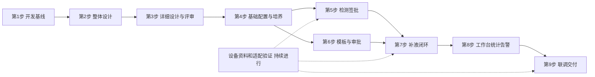

# V4.0 分阶段开发任务清单

> **文档定位（2026-09-17）**：本文件保留阶段路线和DEV编号，不再作为当前进度看板。正文“第3步进行中、其他模块尚待详细设计”等文字是历史快照。当前状态和阅读顺序见[docs总入口](README.md)，非M08开发顺序见[开发启动交付](详细设计/00-非M08开发启动交付.md)。

> 2026-09-17 新系统执行入口：本项目按空库建设，不以前代数据库迁移为前置。数据库只按[新系统开发与数据库唯一入口](开发基线/README.md)执行“完整建表 → 基础数据初始化 → 初始化结果核验”；历史增量、回填及回退文件不在默认执行链内。M08统计延期不影响M01—M07、M09业务开发。

日期：2026-09-08。执行顺序调整为九步，第 2 步整体设计已形成评审稿，第 3 步详细设计尚未完成，业务开发尚未开始。不估算人员和工期。

关联：[总体设计与公共契约](02总体设计与公共契约-V4.0.md)、[第 1 步开发基线](01开发基线与需求差距清单-V4.0.md)。B01–B57 是基线工作包；T01–T16 是基线验收场景；D01–D10 是外部依赖。DEV 编号保持不变，不表示已经完成；文件名前缀是文档编号，不等同于执行步骤编号。

## 1. 如何推进

在“确定整体设计”和“完成基础配置与培养管理”之间增加独立的“完成详细设计”，原第 3—8 步顺延为第 4—9 步。

| 步骤 | 阶段 | 主要工作与产出 |
| --- | --- | --- |
| 1 | 核对现状，建立开发基线 | 核对需求、现有实现、差距、范围排除、外部依赖和验收任务 |
| 2 | 确定整体设计 | 明确模块复用、业务边界、公共状态、逻辑数据模型与接口方向 |
| 3 | 完成详细设计 | 细化表结构、接口、页面及交互，串联业务场景并评审，达到对应模块可编码的程度 |
| 4 | 完成基础配置与培养管理 | 开发和完善登录权限、实验室资源、项目批次培养、状态及设备占用 |
| 5 | 打通检测与签批 | 逐型号检测发送接收、暂存、上传、签名审核及导出打印 |
| 6 | 完成工艺模板与流程审批 | 模板版本、培养方案快照、两级审批及变更生效 |
| 7 | 完成补液业务闭环 | 补液工作流、计算、任务生成调度、泵执行、暂停恢复及异常处理 |
| 8 | 完成综合工作台、统计与告警 | 看板、个人工作台、在线离线统计、通知告警及全过程追溯 |
| 9 | 完成全链路验收与部署交付 | 全范围回归、实机联调、长运行、升级恢复及试点交接 |

检测签批复用现有链路，完整培养执行变更审批在第 6 步完成；第 4 步不开放依赖该审批的活跃培养修改入口。

从第 4 步开始正式业务开发，以单个 DEV 任务或相互依赖的一组任务推进，每批同时完成接口、页面、数据库兼容和对应验收。对应模块须先完成详细设计及评审。已有功能先回归，差距明确后补齐。标记“已开发但未定位”的功能先核实已有成果；未获得位置前，可以继续独立设计和测试数据准备，不直接认定必须全部重写。

第 5、6 步在培养公共接口稳定且对应详细设计评审完成后具备并行实施条件，是否分配多人后续再定；本轮未创建并行开发任务。第 8 步页面设计可提前，页面开发以相应详细设计为依据，数据验收必须等待业务闭环。

## 2. 第 3 步：完成详细设计

本阶段把整体设计落实为可编码、可验证的规格，仍不修改业务代码、不执行数据库迁移、不操作真实设备。按模块推进，先覆盖第 4 步所需的公共设计和基础配置、培养管理；后续模块在各自开发前按同一标准完成详细设计与评审，不能把首批设计完成当作全系统详细设计完成。

| 设计项 | 具体内容 | 交付物 |
| --- | --- | --- |
| 业务操作与规则 | 操作角色、状态限制、输入校验、审批要求、副作用及异常分支 | 业务规则表、状态/权限矩阵与场景流程 |
| 表结构设计 | 逐表明确复用/扩展/新增；字段、类型、单位、非空、默认值、关联、索引、唯一约束、历史及并发保护 | ER关系图、字段字典、DDL设计稿及旧数据兼容/迁移方案；不直接执行DDL |
| 接口设计 | 路径与方法、请求响应示例、字段规则、筛选分页、权限、错误码、事务、版本及重复提交处理 | 接口明细和前后端联调契约 |
| 页面设计与交互 | 布局、列表、筛选、表单、弹窗、按钮可见/禁用、字段联动、加载/空白/失败状态、提交反馈、跳转及未保存退出 | 页面原型或线框图、交互说明和页面—接口映射 |
| 联动评审及验收设计 | 通过真实业务场景检查“页面操作→接口→数据变化”；覆盖并发、失败、撤回和恢复 | 评审问题处理记录、需求—设计—任务映射及验收用例 |

对应模块的设计完成标准：字段及单位能够前后端对照，页面所有操作都有接口和数据处理依据，权限与状态限制无矛盾，旧数据有兼容方案，关键异常有明确交互及处理结果，评审问题已落实。未确认外部依赖需标记其影响路径，不编造参数。

第 3 步当前状态：进行中。[9个业务模块边界](详细设计/00-业务模块划分与设计目录.md)已确认。已形成[编写规范与公共约定](详细设计/00-编写规范与公共约定.md)、[模块模板](详细设计/模板-业务模块详细设计.md)及[系统管理详细设计评审稿](详细设计/01-系统管理/详细设计.md)，包含新旧表对照、完整字段字典和迁移/核验/回退 SQL 设计稿。系统管理已覆盖全部功能组，尚待评审及联动验证，其他模块尚待详细设计，不表示第 3 步整体完成。DEV-01 的开发落地仍归第 4 步。

## 3. 第 4 步：完成基础配置与培养管理

| 任务 | 对应基线 | 前端工作 | 后端与数据库工作 | 依赖及完成标准 |
| --- | --- | --- | --- | --- |
| DEV-01 复用核实与迁移底稿 | B57 | 核实现有成果页面位置及可访问版本 | 获取目标库结构/字典的只读证据，梳理已有成果分支；输出新增/扩展/复用表及迁移顺序 | D08；已有成果未定位的对应新建表任务暂缓。设备参考资料不当实现证据 |
| DEV-02 本地登录与密码 | B03、B04、B51 | 登录、首次/过期改密、个人改密及错误提示一致；保留 AAD 单独跟踪 | auth 登录计数窗口/锁定窗口；system 密码强度、历史10次、有效期和全部改密入口；沿用日志 | 按需求分别测试登录与改密阈值，不能统一为同一数值；T02。AAD 依赖 D10，不阻塞本地交付 |
| DEV-03 组织、角色、授权与字典 | B01、B02、B24 | 场地部门组用户角色、实验室授权及字典回归 | 复用现有组织表；角色功能与数据范围/有效期联动，查询和批量接口一致 | DEV-01；T01/T04，普通用户不得通过接口或导出跨实验室访问 |
| DEV-04 设备、型号与通讯配置 | B09、B10、B11、B12、B13、B16 | 核对全部资源型号、设备实例、通讯弹窗；原图 image85/86 对照字段必填性 | 复用 lab_*、型号及通讯表；规范设备引用、能力映射、维护/校准不可用校验；设备连接证据登记 | DEV-03，D07；小试/中试各配置一套；每类设备有对接角色、协议版本和验证方法 |
| DEV-05 实验室、液体及辅助配置 | B07、B14、B17、B18、B25 | 实验室、液袋培养基耗材、校准对象检测规则、液瓶消耗及节点配置回归 | 维护资源引用和删除限制、节点配置版本；不实现耗材自动扣减 | DEV-03/04，D03/D06；资源能被后续模板引用，无非法关联 |
| DEV-06 项目批次培养与权限 | B19、B20 | 项目批次培养及成员分享；批次内培养编辑结果清楚 | 统一独立/批次同步/批量写入口；校验归属主键、继承、到期、显示编号复用；准备新约束迁移 | DEV-03/04；T04。包含伪造其他批次培养ID和批次列表漏项导致删除的测试 |
| DEV-07 培养状态与占用 | B21 | 七状态、已延期原因、过期重开提示；按服务端可用动作显示按钮 | 培养事件、状态版本、编号声明及占用事务；旧三态映射不猜值；到期扫描与人工操作并发保护 | DEV-06；T03/T16。并发抢同设备只成功一个；两个延期分支均覆盖；结束仅模拟验证 |

第 4 步退出条件：能配置两类实验室、创建项目/培养、正确授权和占用设备。活跃培养需审批的变更保持未交付提示；不绕过审批做直接更新。

## 4. 第 5 步：检测与签批

| 任务 | 对应基线 | 前端工作 | 后端/设备/数据库工作 | 依赖及完成标准 |
| --- | --- | --- | --- | --- |
| DEV-08 各型号检测发送和接收 | B31、B32、B33、B34、B35 | BGA、Vi-CELL、OSMO1/2/3、Cedex Bio/HT 保留型号差异 | 复用派发及客户端；逐型号核验样品关联、单发/整列/盘、容量、顺序和结果消息；完善幂等及原始报文追溯 | DEV-04/06，D07；T06/T07，每个型号分别登记实际结果 |
| DEV-09 暂存、超时和记录 | B36 | 手动发送、暂存、超时、设备取消状态及记录 | 核对可选离线重试配置与暂存边界；未发送暂存午夜清理；发送/清理竞争及迟到结果去重 | DEV-08；T07，午夜不得删除已发送待结果样品，不增加系统检测取消入口 |
| DEV-10 上传、签名审核及记录 | B37、B39 | 签名台与各旧入口按钮/状态一致；撤销原因、批量结果清楚 | 统一签批入口权限、版本和操作者分离；撤签/撤审/作废及恢复记录；不复用为流程审批 | DEV-03/08；T08，签名人自审被拒绝，旧入口不能绕过 |
| DEV-11 报表导出与打印 | B38 | 对应筛选、预览/下载和打印入口 | 复用现有导出构建器；字段、单位及权限逐模板核对；操作记录与真实打印通道验证 | DEV-10，D09；T06/T14，PDF/Excel 独立验收；设备打印不能由生成文件替代 |

里程碑一：检测业务可用。前提是配置、培养、真实检测、上传、签名、审核和导出链路均有证据；只有模拟设备时登记为“模拟联调完成，实机待验”，不宣布里程碑实机完成。

## 5. 第 6 步：工艺模板和流程审批

| 任务 | 对应基线 | 前端工作 | 后端与数据库工作 | 依赖及完成标准 |
| --- | --- | --- | --- | --- |
| DEV-12 审批场景、政策和两级审批 | B08、B49 | 实验室审批设置、流程审批列表/详情、审核批准及撤回驳回 | 新建或复用等价政策/申请/动作表；一级四档、二级三档，政策快照、申请资格、版本和幂等 | DEV-03/06，D04/D08；二级未批准不能生效，无成员按需求向项目回退，不自动放行 |
| DEV-13 基础模板与依赖版本 | B26、B27、B28、B29 | Config、灌注培养基、取样测样、自动控制模板及复制/禁用 | 类型化字段校验、模板版本/引用、依赖无环；MFC/泵前置、温度触发、D0边界 | DEV-05，D06/D08；模板配置符合原文且不产生范围外执行任务 |
| DEV-14 补液方案与泵速策略 | B30 | 固定泵、补料计划、补糖规则、二/三段策略配置 | 规则版本、同泵时间唯一、区间不重叠、糖泵限制、监控配置校验与单位映射 | DEV-13/04；按字段限制验证，禁用不影响旧引用 |
| DEV-15 培养方案初始化与快照 | B22、B30 | 初始化选择与审批结果、现行/候选内容区分 | 固化模板依赖和完整快照；初始化审批通过后现行指针生效；七页在线修改仍排除 | DEV-12/13/14；T05/T09，模板改名/禁用不改变旧培养 |
| DEV-16 允许的培养变更与关联处理 | B22 | 在本期合法入口提交原因与变更，对审批冲突/待生效明确提示 | 受控变更动作、版本检查、批准生效及关联任务处理；与设备动作相关的变更准备分阶段应用接口 | DEV-07/12/15；T05。拒绝/撤回不影响现行数据，审批不复活跨天或已结束对象 |

第 6 步退出条件：模板能配置、复用和形成不可变培养方案；两级审批及候选变更生效可验证。设备动作相关的最终验收继续依赖第 7 步，不把纯数据库状态模拟当真机控制完成。

## 6. 第 7 步：补液业务闭环

| 任务 | 对应基线 | 前端工作 | 后端/设备/数据库工作 | 依赖及完成标准 |
| --- | --- | --- | --- | --- |
| DEV-17 观测、重量与残糖确认 | B43、B53 | 重量来源和质量、Cedex/手工候选、60秒确认及取消 | 观测契约、归一单位、糖乳酸确认快照、服务端倒计时；手工候选不混进离线检测表 | DEV-08/12/15，D02/D03；断网刷新不能重置倒计时，未生效值不参与计算 |
| DEV-18 补液计算及台账 | B53 | 计算预览、来源与阻断原因、记录显示单位 | 纯计算组件、输入/公式版本、目标与实际双快照、分段流水及累计重算；小试/中试取数分离 | DEV-17/14；T10，用独立预期值验算；未知单位、零分母和方向不明不得执行 |
| DEV-19 小试/中试补液工作流 | B45、B46、B47 | 连接、预填充、更换、手工补料、单元补充和废液清理步骤 | 实例/步骤版本、前置校验、审批关联、命令和实际量记录；完成步骤不能只靠前端勾选 | DEV-12/15/17；D07；工作流连接完成事件可可靠触发固定计划生成 |
| DEV-20 固定/动态生成与任务队列 | B48、B54 | 任务新增、列表/详情、原因、两级待审显示 | 逐泵任务、固定与动态幂等键、10秒可配置检查、原状态/审批投影、顺序和跨天处理 | DEV-12/18/19，动态阈值依赖D01；T11，重复轮询/连接/批准不重复生成或派发 |
| DEV-21 泵执行、暂停恢复与记录 | B55、B56 | 执行中/暂停处理中/暂停中、继续原因、指令与执行记录 | 执行锁、命令记录、回读、二/三段调速、停泵、分段计量、有效时长及结算幂等 | DEV-04/18/20，D02/D03/D07；T12，两类实验室各一次真实补料和补糖 |
| DEV-22 异常修复与服务恢复 | B44、B55、B56 | 异常原因、手工/自动补充、恢复待处理、关联新旧任务 | 原任务已修复与新补充待审；UNKNOWN命令对账、停泵未确认不释放锁、重启不重复执行、异常告警事件 | DEV-21；T13，含返水/堵塞/失联/停泵失败/重启；设备看门狗或等价保障实测 |

里程碑二：补液业务可用。必须同时通过模板快照、审批、计算、调度、真实执行、异常恢复和实际量追溯；缺 NCS061 或真实重量/停泵依据时，受影响路径明确未完成。

## 7. 第 8 步：综合展示、统计和通知

| 任务 | 对应基线 | 前端工作 | 后端/数据库/接口工作 | 依赖及完成标准 |
| --- | --- | --- | --- | --- |
| DEV-23 在线数据及综合统计 | B40、B41 | 在线/离线联合图表、培养/自然时间、抽取、报表 | 设备培养归属、项目配置、D0转换、查询范围与抽取，缺测质量、最终报表导出 | DEV-08/17，D07/D09；T14，在线用户监控不计为该功能 |
| DEV-24 实验室看板、详情及个人工作台 | B42、B43、B44、B50、B52 | 实验室卡片/顶部入口、反应器详情/时间线、首页统计待办 | 同一授权查询口径提供数字/明细，任务显示状态共用映射；已延期跳转看板带筛选 | DEV-07/12/20/23；T14，未交付PH/结束工作流入口隐藏 |
| DEV-25 告警、通知、导航与N阶段推送 | B06、B15、B23、B51 | 告警处理、站内信、未读和正确跳转、N阶段标记 | 复用告警/通知，业务事件outbox及消费去重，邮件短信投递、N推送协议与失败恢复 | DEV-12/22，D05/D09；T15，同事件不重复通知，跨实验室范围一致 |
| DEV-26 日志与全过程追溯 | B05、B31、B39 | 登录/操作/审批/检测/执行日志查询与关联 | 补足跨链路关联标识、历史名称快照、原因与版本；日志及导出查询同权限 | DEV-02/10/12/21/25；随机一条结果或任务可还原来源、审批、计算和设备实际记录 |

第 8 步退出条件：页面以真实业务数据联通，数字、明细、图表和报表可交叉核对；消息投递和告警处理有真实证据。

## 8. 第 9 步：验收与交付

| 任务 | 覆盖 | 主要工作 | 完成标准 |
| --- | --- | --- | --- |
| DEV-27 全范围回归与逐项验收 | B01–B57中本期范围，T01–T16 | 按角色、实验室、设备型号逐项记录；最终附件逐字段核对；登记排除项和外部待验项 | 每条当前需求有任务、版本和验收证据；“已开发”不跳过本轮差异核验 |
| DEV-28 长运行、恢复与升级演练 | 所有持久化及设备路径 | 长时间调度、重复消息、重启恢复、时钟/跨日、备份恢复、数据库升级回退与设备停止保障 | 数据不重复结算、任务不重复执行；恢复和回退步骤可复现，设备结果不明不自动放行 |
| DEV-29 试点及运维交接 | 当前交付范围 | 初始化数据、部署配置、启动停机顺序、参数来源、使用说明、故障处置、现场联系人 | 试点验收通过再扩大；运行版本、设备配置和责任人可追溯，未交付功能无误导入口 |

里程碑三：当前范围完整交付。未解决阻断业务或设备执行的问题不得写成验收通过；模拟结束状态验证与真实业务能力在验收记录中分栏。

## 9. 跨任务契约交付清单

每个契约由负责该领域的任务维护。开发前发布字段和错误码示例，消费者按同一版本联调；不是先把接口全部写成空实现。

| 契约 | 生产任务 | 消费任务 | 必须提供的评审样例 |
| --- | --- | --- | --- |
| 实验室/项目/培养权限与可用动作 | DEV-03/06/07 | 所有业务任务 | 授权、失效、跨实验室、只读分享与管理动作区别 |
| 培养状态/占用/事件 | DEV-07 | DEV-08/15/19/20/24 | 未开工作流过期、已开未开始延期、并发抢占 |
| 审批决定与业务应用状态 | DEV-12/16 | DEV-15/19/20/22/25 | 双审、撤回、版本冲突、已通过但设备动作未完成 |
| 模板版本与培养快照 | DEV-13/14/15 | DEV-18/19/20/21 | 模板禁用后旧培养不变、引用版本和字段校验 |
| 设备观测与命令 | DEV-04/08/17/21 | DEV-18/19/20/22/23 | 原始/归一单位、失效质量、拒绝/超时/未知/回读成功 |
| 计算与实际结算 | DEV-18/21 | DEV-20/22/23/24 | 创建预览与执行快照差异、暂停分段、不重复累计 |
| 业务事件及通知 | DEV-26/25 | 所有事件发布者 | 事务提交后投递、重复消费、权限到期和投递失败 |

## 10. 验收执行方法

1. 每项 DEV 建立一份记录：任务/B编号、需求条款、提交版本、库版本、实验室类型、设备型号、用户角色、真实/模拟标记、输入、预期、实际、证据和剩余问题。
2. 纯计算与状态测试使用可重复的时钟、输入和独立预期结果；不要只验证实现函数被调用。审批/占用/生成/结算要加并发或重复请求场景。
3. 设备适配先用协议报文和模拟服务做契约测试，再逐型号实机验收。看门狗、停止确认、恢复不能用静态源码或模拟结果结项。
4. 页面功能用授权用户实际走通；构建通过只说明可构建，不能代表业务验收通过。报表根据最终附件逐字段核对，而非仅验证文件能下载。
5. 数据库变更先验证新增约束对现有数据的影响、版本迁移和恢复；不在功能开发中顺手清空或重建业务库。

建议增加的关键自动化场景：

| 编号 | 场景 | 预期 |
| --- | --- | --- |
| V01 | 到期扫描与开始培养同时提交 | 状态/占用仅一个合法结果，不释放正在培养设备 |
| V02 | 两人同时批准，或批准后相同请求重传 | 只生效一次，只产生一组关联任务 |
| V03 | 一级审核人再做二级批准 | 拒绝；一级通过不准执行 |
| V04 | 任务修改待审时调度扫描 | 不派发；撤回恢复合法原状态，跨天不复活 |
| V05 | 两个调度实例处理同一固定/动态规则 | 一条任务、一条执行认领，不因读数更新生成重复任务 |
| V06 | 收到启动请求后服务断线 | 进入未知/恢复，对账之前不盲目重发 |
| V07 | 200→180暂停，170恢复→140（已验证减重模式） | 实际补量50g，暂停变化10g不计，暂停时间不计执行超时 |
| V08 | 同执行结果/人工补充重复提交 | 台账和残糖只更新一次 |
| V09 | 同时手动发送与午夜清理 | 已送出结果可关联；只清理未发送暂存 |
| V10 | 培养编号取消/删除后复用，旧编号关联结果迟到 | 新旧内部主键区分，不把旧结果写到新培养 |
| V11 | 导出生成后分享授权到期 | 领取结果仍检查权限，不能泄露已失效授权数据 |
| V12 | 刷新/关闭浏览器跨过60秒残糖确认截止 | 以服务端状态为准，不重复生效、不重新倒计时 |

以上均为计划验收，尚未执行。

## 11. 当前进度与下一步

第 2 步已形成整体设计评审稿：模块复用边界、逻辑数据模型、旧库兼容路径、四类状态及关联、模板快照、计算单位与样例、生成执行/恢复方案、接口草案，以及全部 57 个基线工作包的开发映射。这不等于详细设计完成。

第 3 步已启动：完成编写规范、可复用模板及系统管理整份模块评审稿，已描述页面线框与交互、逐参数接口、表字段和字典、逻辑关系图、状态与调用时序、迁移方案和验收用例。当前只完成静态文档检查，未执行数据库迁移、浏览器验证或认证联调。

M01本轮18项业务选择已确认并完成一致性核对；当前进入M02实验室与资源管理详细设计，优先核对授权契约，后续按已确认9模块边界继续。最终 Excel 导入、未定位已有成果复核、设备协议参数定稿和真实联调仍按对应 DEV 任务及基线 D 依赖跟踪。对应详细设计评审完成后，才进入第 4 步及后续业务开发；本轮未修改业务代码、原始数据库结构文件或操作设备。

### 系统管理审阅修订进度（2026-09-08）

两份审阅意见已去重核查并回写，见[合并处理记录](详细设计/01-系统管理/history/review/审阅意见合并处理记录.md)。本次为设计修订，未执行数据库脚本或业务验收。后续先评审M01修订，再推进M02详细设计并联合确认用户授权契约；不以M01全部运行验收作为启动M02设计的前置条件。测试库迁移/回退演练在SQL评审后安排，M01/M02实现后完成依赖联调与管理并发测试。原44项验收用例新增执行明细，状态仍为待验证。

### 最新进度（2026-09-09）

M01的Q01–Q18均已确认，规则、页面、接口、字段说明及原44项验收用例已建立对应关系，见主设计25.5。已确认事项不再列为待用户决策；缓存参数、并发性能、旧数据及迁移恢复仍待技术验证。

M02已启动：[详细设计](详细设计/02-实验室与资源管理/详细设计.md)、[现状核对与复用清单](详细设计/02-实验室与资源管理/history/review/现状核对与复用清单.md)。首轮完成需求入口/职责划分、授权关键链路、三张核心表25字段与旧库映射；下步补全授权契约和实验室功能组。M02全量设备/资源设计、最终目标DDL和迁移稿尚未完成，不进入业务编码或实机验收。
