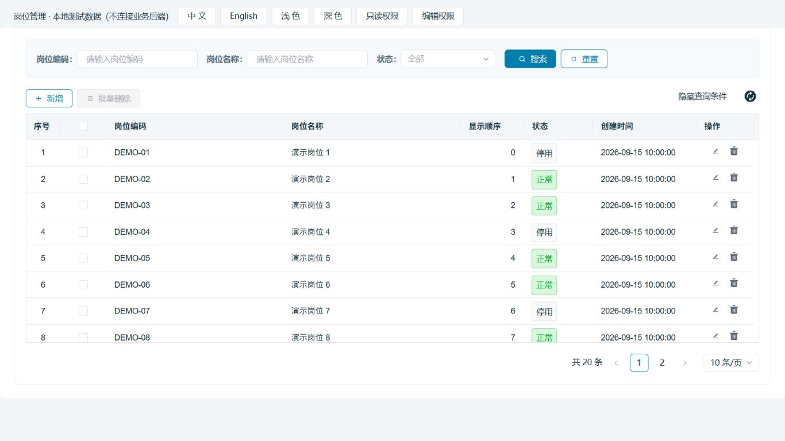

# 系统设置纯表格迁移交接

更新：2026-09-15。适用于 `futurefab-ui` → `futurefab-frontend` 的普通查询 / CRUD 列表。

## 交给接手人的三个入口

1. 本说明：先了解样板、职责和验收范围。
2. [VXE Grid 生成提示词（示例）](prompts/vxe-grid生成提示词示例.md)：已有页面，只生成 / 调整表格时使用。
3. [基础页面生成提示词（示例）](prompts/基础页面生成提示词示例.md)：迁移整个列表页面时使用，已包含表格要求。

两份提示词各自可独立复制。把输入区换成目标页面的真实信息；完整页面任务用第二份即可，不必重复运行第一份。

## 标准页：岗位管理

- 旧页面：`futurefab-ui/src/views/system/post/index.vue`。
- 旧 API：`futurefab-ui/src/api/system/post.js`。
- 新页面：`packages/app-smp-settings/src/views/post-management/index.vue`。
- 新入口：登录后进入“系统设置 → 基本设置 → 岗位管理”，或访问 `/settings/post-management`。必须拥有后端实际授权菜单，注册路由本身不授予访问权限。
- 保留后端菜单 component：`system/post/index`；前端目录及新路由使用 kebab-case。

### 文件职责

页面预览（隔离测试数据，顶部测试开关不属于业务页面）：



| 文件（相对新项目根目录） | 交接人主要改什么 |
| --- | --- |
| `packages/app-smp-settings/src/views/post-management/index.vue` | 查询区、工具栏、表格插槽、字典、选择与删除、分页、弹窗装配 |
| 同目录 `grid.ts` | 表格 id、主键、列宽、列标题、状态及操作插槽 |
| 同目录 `use-post-list.ts` | 草稿条件与已提交条件、服务端分页、请求竞态、选中清理、删除后回退页码 |
| 同目录 `post-editor.vue` | 详情回填、编辑字段、校验、保存、脏数据与关闭保护 |
| `packages/sdk-smp-api/src/post.ts` | DTO、接口参数、HTTP 方法、响应结构；经 `src/index.ts` 导出 |
| `packages/sdk-language/src/language/smp-settings/{cn,en}.ts` | `settings-post` 双语词条 |
| `packages/sdk-smp-stores/src/route-paths.ts` | 旧 component → 新路由片段 |
| `packages/app-smp-settings/src/router/index.ts` | 懒加载页面和 `meta.menuComponent` |
| `tests/post-management.test.ts` | 岗位接口契约、分页与异步生命周期回归 |

样板仅迁移旧页面实际提供的功能。旧页面没有导入 / 导出入口，不能因为 VXE 默认支持这些能力就自动加上。

### 已实现业务

岗位编码 / 名称 / 状态查询，Enter 查询、重置、隐藏查询区、刷新；服务端分页；当前页多选及批量删除；单行删除；新增与编辑；真实 `sys_normal_disable` 状态字典；错误提示与重试；权限控制；中英文和主题变量；未保存保护。

### 已核实接口与权限

| 行为 | 请求 | 权限 / 响应 |
| --- | --- | --- |
| 列表 | `GET /system/post/list` | `system:post:list`；顶层 `rows/total` |
| 详情 | `GET /system/post/{postId}` | `system:post:query`；`data` |
| 新增 | `POST /system/post` | `system:post:add` |
| 编辑 | `PUT /system/post` | `system:post:edit` |
| 单个 / 批量删除 | `DELETE /system/post/{id1,id2}` | `system:post:remove`；逗号分隔 ID |
| 状态字典 | `GET /system/dict/data/type/sys_normal_disable` | `data`，`dictLabel/dictValue` |

详情和保存的权限不同，编辑入口同时要求 `query` 与 `edit`。按钮显示和事件处理函数都检查权限；接口仍由后端鉴权。

列表参数为 `pageNum/pageSize/postCode/postName/status`；主键 `postId`；可编辑字段为 `postName/postCode/postSort/status/remark`。状态字符串 `"0"` 表示正常，`"1"` 表示停用。名称最长 50，编码最长 64，排序为非负 Java Integer，初值 0。审计字段、删除标志不从详情对象直接透传保存。名称 / 编码唯一性、已分配岗位不能删除均由后端处理，前端展示失败原因并保留输入。

## 组件使用约定

| 场景 | 统一使用 | 关键约定 |
| --- | --- | --- |
| 外层页面 | Portal 已有 `PageContainer` | 业务页使用 `.smp-page`，不再重复包壳；独立布局才自行使用 PageContainer |
| 查询、表单、弹窗、分页、提示 | 公司 `@futurefab/ant-design-vue` | 门户已注册 `a-*`；输入 `v-model:value`，弹窗 `open`，表单 `FormInstance.validate()` |
| 所有业务表格 | 公司 `@futurefab/vxe-table` 的 `vxe-grid` | 门户负责注册；业务页只绑定配置与事件，不重复 `app.use(VXETable)` |
| 表格默认行为 | 公共 SDK `tableDefaultConfig` | 不复制实现；稳定唯一 id、真实主键、computed 双语列 |
| 通过弹窗编辑的列表 | `tableFormEditingConfig` | 禁用 Delete 改值、键盘覆盖编辑及粘贴，防止绕过表单 |
| 行内图标操作 | 公共 SDK `EqIconButton` | `icon` + `tooltip` + `disabled`，事件为 `@click`；tooltip 同时提供 aria-label |
| 工具栏图标提示按钮 | 公共 SDK `EesButtonTip` | `icon` + `text` + `loading/disabled`，事件是 `@onClick`，不能写成 `@click` |
| 有文字的主操作 | 公司 `a-button` | 查询 / 保存 primary，新增 primary + ghost，删除 danger |
| 图标 | 公司 icons-vue 或静态 SDK 图标注册表 | 先查实际图标 id；样板使用 `icon-codesign-edit`、`icon-codesign-btn-delete`、`icon-codesign-btn-refresh` |
| 请求 | API SDK `request` | 页面不另建 axios / fetch；统一 Bearer、错误、超时和重复提交保护 |
| 读请求生命周期 | 公共 SDK `useRequestScope` | 列表、详情各自独立 scope；signal + current 双重保护，卸载自动取消 |
| 会话 / 权限 | `useSession` | `has()`，`dirty`，`submitting`，复用已有路由和刷新保护 |
| 文案 | 语言 SDK `t/translateServerText` | UI 用 t；服务端字典和错误用 translateServerText；岗位名称等业务内容不翻译 |
| 样式 | 现有公共类 + Less | 使用主题变量；不引入其他 UI 库，不在页面改公司表格皮肤 |

详细原理见 [VXE 表格基础配置](VXE表格基础配置.md)、[公共按钮组件](公共按钮组件.md)、[路由与 TypeScript 架构](路由与TypeScript架构.md)。旧前端规范里的 Element Plus / SCSS 写法只作为历史交互参考，目标工程以本项目公司 Ant + VXE + Less 约定为准。

## 样板中值得保留的细节

- 查询框编辑的是草稿；点击查询才替换已提交条件。翻页 / 刷新使用已提交条件，避免输入尚未查询的内容悄悄改变结果。
- 查询 / 重置回到第一页，改变每页条数回第一页；删除当前最后一页后按服务端 total 回到有效页码。
- 数据加载时清除旧行和选择，不跨页保留勾选；删除确认保存目标快照，避免后续选择变化影响删除对象。
- 异步旧响应不能覆盖新响应；出错清空陈旧数据，显示错误和重试入口，不能伪装成正常空列表。
- 列配置不为服务端分页数据擅自启用本地排序或筛选。需要新增排序时先核对接口参数，并实现服务端排序闭环。
- 编辑先拉详情；详情失败禁止保存空表单。状态字典失败可重试，在字典可用前禁用编辑入口。
- 保存失败不关闭弹窗；成功后刷新列表。写入成功和刷新失败是两个结果，不能因为刷新失败让用户重复写入。
- 保存期间锁定关闭及重复提交；取消有修改的表单需确认，跨路由通过 session.dirty 复用门户守卫。
- `tableDefaultConfig` 自动补充缺失的序号列；样板显式提供唯一序号列和双语标题，避免默认 `vxe.no` 原样显示，基础配置不会重复添加。默认 46px 大号行高；`height="100%"` 放在 `v-bind` 后面，并给父容器明确高度。

## 交接与验收

每页提交代码、旧新功能对照、实际接口 / 权限清单、检查结果与未验证项；同时更新 `docs/业务菜单清单.md`、`docs/实施进度.md`。不要把历史页面总数当成当前完成数量。

| 验收项 | 本样板状态 |
| --- | --- |
| 旧页面 / API / 后端 Controller、Domain、Service 对照 | 已完成 |
| 接口契约、查询 / 分页 / 重置、请求竞态与卸载、末页回退 | 自动化通过 |
| 路由与已迁移映射一致；现有语言键中英对齐 | 自动化通过 |
| 10 包 build / build-dts / check-without-dts | 通过 |
| 单元测试、UI 规范检查 | 83 项通过；check:ui 通过 |
| 隔离浏览器交互 | 使用内存测试数据验证新增、编辑、失败保留、查询、分页、选择清理、末页批量删除与回退、关闭保护、只读权限 |
| 视觉检查 | 中文浅色、英文深色；1366×768 与窄屏检查，无页面横向溢出；浏览器错误 / 警告日志为空 |
| 真实账号权限、真实岗位 CRUD、关联用户禁止删除 | 待使用专用测试数据联调；不能用本地测试结果替代 |

手动验收应覆盖：有 / 无结果、多页、每页条数；状态正常 / 停用；单选 / 全选 / 翻页清理；删除取消及失败；新增空表单与长度边界；编辑回填与保存失败保留；关闭继续编辑 / 放弃；离开保护；中英文与深浅主题；1366×768 和窄屏布局；刷新深链接；只读账号、编辑缺 query 权限账号。

在新项目根目录运行：

```powershell
pnpm run check:ui
pnpm run test:unit
pnpm run type-check
pnpm run build
```

子应用 / SDK 变化后需重建对应包及依赖，再刷新门户。只启动门户 dev 不会自动编译所有子应用。新增词条后按需运行 `pnpm run language:index` 更新文档索引。
