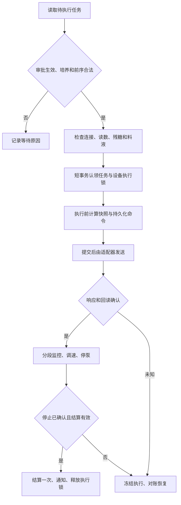

# V4.0 总体设计与公共契约

> **文档定位（2026-09-17）**：本文件保留为第2步总体架构背景。当前阅读入口见[docs总入口](../README.md)；字段、接口、表结构、错误码和Controller调用时序以模块现行详细设计为准；正文旧库兼容/迁移章节不是新系统空库执行清单。

> 2026-09-17 新系统执行入口：本项目按空库建设，不以前代数据库迁移为前置。数据库只按[新系统开发与数据库唯一入口](../开发基线/README.md)执行“完整建表 → 基础数据初始化 → 初始化结果核验”；历史增量、回填及回退文件不在默认执行链内。M08统计延期不影响M01—M07、M09业务开发。


版本：设计评审稿 1.0，2026-09-08。对应开发计划第 2 步：明确模块复用、数据状态、公共接口和实施边界。本文件是后续实现建议，不表示已编码、已部署或已经客户批准全部技术选择。

配套：[第 1 步开发基线](01开发基线与需求差距清单-V4.0.md)、[分阶段开发任务清单](03分阶段开发任务清单-V4.0.md)。需求依据：[V4.0 目录](../需求说明书V4.0-0904_md/index.md)、[最新澄清决策](../需求说明书V4.0-0904_md/需求澄清决策记录.md)。文中“需求约束”来自这些资料；服务名、表名、接口名、事务方案等是本轮技术设计建议。

执行顺序已调整为九步：1 开发基线 → 2 确定整体设计 → 3 完成详细设计 → 4 基础配置与培养管理 → 5 检测签批 → 6 工艺模板与流程审批 → 7 补液闭环 → 8 工作台统计告警 → 9 验收交付。本文件属于第 2 步整体设计；表结构字段、完整接口、页面及交互须在第 3 步按模块细化和评审，对应模块完成详细设计后才能编码。当前尚未进入业务开发。

## 1. 设计结论

先在现有系统内按业务职责组织新增能力，复用已有身份、组织、实验室设备、项目培养和检测实现。培养、流程审批、检测签批、补液执行各自管理状态；通过受控业务操作及有唯一标识的事件关联。设备指令使用持久化记录和回读确认，数据库提交不能代替设备成功。

本期只执行补料、补糖任务。培养方案修改七配置页、结束培养工作流、PH 校准操作与记录、连续式泵速策略、耗材自动扣减仍排除。模板配置中出现其他操作类型，不因此增加自动执行能力。结束状态只在测试环境以模拟事件验证，不开放生产“模拟结束”接口。

本轮新增本设计和任务清单；原需求文件、第 1 步基线及两份已有设计草稿保留。第 12 节列出草稿冲突处理，不直接照旧草稿编码。

## 2. 模块复用及依赖

详细设计按已确认的[9个业务模块](../详细设计/00-总纲与约定/00-业务模块划分与设计目录.md)组织；下方树是服务/职责复用视图，不是详细设计文件夹清单。系统管理整份设计见[模块主文档](../详细设计/01-系统管理/详细设计.md)。登录只是系统管理功能组，审核/批准与检测签批分别归所属业务模块。

```text
futurefab-ui
  └─ gateway：路由与身份校验
      ├─ futurefab-auth：本地登录、会话、失败锁定；AAD 单独跟踪
      └─ futurefab-system：现有业务数据的写入主体
          ├─ 组织权限：场地、sys_dept、用户、角色、实验室授权
          ├─ 实验室资源：型号、设备实例、通讯、液瓶、培养基
          ├─ 项目培养：成员分享、状态、占用、方案快照
          ├─ 检测：样品、型号发送、结果、签名审核、导出
          ├─ 工艺：基础模板、补液方案、两/三段泵速策略
          ├─ 流程审批：场景配置、变更申请、审核批准、生效
          ├─ 补液：步骤实例、计算、任务队列、执行协调
          └─ 展示通知：看板、统计、待办、告警、推送
              └─ 通过各业务查询服务获取授权数据

设备适配边界（由业务服务调用）
  ├─ 复用 futurefab-namedpipe-client、futurefab-sdms-client
  └─ 对接现有设备服务：检测 / 在线采集 / 秤 / 泵
      └─ 各型号协议、点位和现场版本独立验证
```

树表示职责与调用层次，不代表要按每个分支创建 Maven 模块。认证到用户服务继续使用 `futurefab-api-system` 内部契约。工艺、审批、补液先作为 `futurefab-system` 内部业务包；控制器不互相调用，也不跨业务直接写对方 mapper。设备执行协调使用独立、受限的工作线程，不在 HTTP 请求或数据库长事务内等待泵执行。

| 职责 | 复用点 | 新增/调整边界 |
| --- | --- | --- |
| 身份与密码 | auth、用户资料、密码历史、登录日志 | system 持有密码、历史、认证状态及成功登录计数的权威写入；auth 编排挑战和会话，改密所有入口调用同一策略 |
| 组织及权限 | sys_dept、用户角色、实验室授权、SmpPermissionServiceImpl | 增加动作级校验及有效期一致性，沿用现有表，不新建平行部门/人员模型 |
| 培养 | ResCultureServiceImpl、ResBatchServiceImpl、成员分享 | 新增受控培养操作服务；独立、批次同步、批量入口全部调用它 |
| 检测 | DetDeviceDispatchServiceImpl、结果工作流、签名台、导出 | 保留型号适配和业务表，统一多个入口的签批权限与状态保护 |
| 节点配置 | Workflow、LabWorkflow 现有配置 | 配置定义与运行实例分开，新增模板版本和步骤执行记录 |
| 审批 | 复用角色成员和操作日志 | 新建流程审批领域，不能把 det_approval_assignee 或检测签批记录当作业务审批引擎 |
| 设备资源 | 各 lab_* 实例、lab_communication | 使用规范设备引用，不另建重复设备主数据；补足能力、读数和命令适配 |
| 通知告警 | 现有通知、告警规则及记录 | 增加业务事件触发、实际投递和失败追踪；不混入耗材自动扣减 |

## 3. 数据模型与持久化边界

### 3.1 公共约定

- `culture_id` 等内部主键永不复用；用户看到的培养编号为 `culture_code`，按已确认规则允许已删除/已取消记录的编号重新使用，已结束不释放编号。下游永远引用内部主键，显示编号只是快照。
- 新增核心对象带 `id`、`lab_id`、归属主键、`version`、创建/更新时间和操作者；变更用期望版本防止覆盖他人修改。历史快照保存当时名称和显示编号。
- 时间分两类：计划“开始天/结束天”按业务日期处理，真实采集/执行/审批保存完整时刻；部署统一 Asia/Shanghai 业务日，服务内部使用明确时区的时刻。现有 datetime 的时区和数据精度迁移前核对，不直接假定其为 UTC。
- 外部读数保留原始值、单位、来源设备、采集时间、接收时间、质量、消息标识及映射版本；缺测显示缺测，不以 0 替代。
- 重量、体积、浓度用十进制定点计算；建议归一值 `DECIMAL(20,6)`，计算中间精度高于展示精度。设备分辨率及速度精度按型号配置，不能把页面舍入值反复回算。

### 3.2 逻辑实体清单

下表新增物理表名是建议，实施前与实际数据库比对；存在等价表时调整复用，不重复创建。查询频繁的归属、状态、时间、数值用独立字段；JSON 仅用于不可变配置/报文快照，不承担可执行状态查询。

| 实体/建议表 | 处理 | 关键内容与约束 |
| --- | --- | --- |
| res_project/res_batch/res_culture 及成员关系 | 复用 | 培养增加新状态、版本、计划日期与事件时间；不更换主键 |
| res_culture_runtime_event | 新增 | 培养主键、事件标识、前后状态、原因、操作者、真实/模拟来源；事件标识唯一 |
| res_culture_code_claim | 新增或等价唯一索引 | 以规范化编号为唯一键，持有当前不能复用编号的培养；取消/删除时释放，历史仍保留 |
| res_culture_occupancy | 新增 | `device_type + device_id` 唯一，当前培养占用；与历史关联区分，草稿关联不等于占用 |
| prc_template / prc_template_version | 新增 | 模板类型、名称、版本、启停、类型化配置；版本不可变；版本号在模板内唯一 |
| prc_template_binding | 新增 | 版本间引用关系；禁止循环，引用明确版本，禁用只阻止新引用 |
| res_culture_parameter_snapshot / res_culture_parameter_state / res_culture_parameter_application | 新增 | 培养、方案种类、快照版本、来源模板版本、配置副本、是否现行、审批关联；现行指针受事务保护 |
| run_workflow_instance / run_workflow_step | 新增 | 已选节点版本、运行步骤、前置条件、执行输入输出、命令关联；步骤不能直接被前端写成成功 |
| apr_scene / apr_lab_policy / apr_policy_revision | 新增 | 模块、动作、本期启用标识；实验室两级档位、版本和最终 Excel 来源 |
| apr_request / apr_action / apr_delivery / apr_reconciliation | 新增 | 对象与版本、动作、修改前后快照、政策快照、审核批准历史、撤回/驳回原因、应用状态 |
| run_confirmation | 新增 | 培养、业务日、检测或手工来源、糖/乳酸值、倒计时截止、确认状态与版本 |
| run_ledger | 新增 | 补液/取测/手工补充事实、量 g、来源执行段、事件唯一键；累计展示可重算 |
| run_material_session | 新增 | 具体袋实例、培养、启用/更换时间、容量与阈值快照；换袋开启新累计周期 |
| run_task / run_task_candidate / run_generation | 新增 | FEED/GLUCOSE、泵引用、计划时间、规则来源、方案快照、任务/审批关联、生成唯一键 |
| run_calculation | 新增 | 预览/执行阶段、公式版本、输入快照、依据体积与实际体积、目标 L/g、未生成原因；糖缺口不另加用户记录字段 |
| run_execution / run_execution_segment | 新增 | 执行尝试、每段起止秤值、实际量、有效时长、暂停、终止结果、修复关联 |
| run_command / run_execution_sample | 新增 | 命令标识、任务/步骤、速度单位、响应、回读、未知状态；观测保留原始及归一值 |
| run_resource_guard / run_executor_assignment | 新增 | 物理泵/共享秤/反应器执行锁、持有者、执行代次、恢复状态；与长期培养占用独立 |
| run_event（M07审计与outbox；消费幂等归各拥有方） | 新增 | 业务事务内事件、投递重试、消费幂等；不要求先引入消息中间件 |
| online_measurement | 按现有数据源适配 | 培养主键、设备、项目编码、时间、质量、数值/单位、去重键；数据量和保留周期测量后决定分区或外部存储 |
| det_*、sys_notification、告警/导出日志 | 复用 | 补足来源关联、事件去重及权限，不把原始检测结果改写成计算结果 |

### 3.3 三个关键事务

1. **培养保存/占用**：权限与状态检查 → 锁定培养/编号声明/相关设备 → 校验版本和设备可用性 → 更新培养、编号声明及占用 → 写事件 → 提交。锁定设备按固定顺序防止相互等待；冲突整笔失败，不出现抢占一半。
2. **审批生效**：锁定申请与业务对象 → 检查审批资格、当前步骤及版本 → 记录决定 → 应用批准变更与关联任务变更 → 写事件 → 提交。需要设备停泵等外部动作时使用 `apply_state` 分阶段完成，不能在事务中假装外部成功。
3. **执行结算**：锁定执行记录 → 确认停止和有效实际量 → 写执行段及唯一来源流水 → 更新累计/浓度与任务 → 写事件 → 提交。同一执行结果重传只返回已有结算，禁止累计两次。

数据库只保证自身事务。外部命令用持久化待发送记录、响应/回读及恢复对账协调；不宣称数据库锁可以实现硬件“恰好执行一次”。

### 3.4 旧库兼容与迁移

仓库 SQL 中 `res_culture.culture_status` 为 `char(1)`，注释是旧三态；唯一索引为 `(batch_id, culture_code, del_flag)`，与新七态及取消/删除后编号可复用不等价。实施顺序：

1. 读取目标环境表结构、字典和有效数据；输出重复编号、缺日期、旧状态含义及设备多占用报告。
2. 先追加 `state_code`、版本、事件、占用等结构，保留旧字段；旧三态不得仅凭 `0/1/2` 自动猜出七态，缺证据记录进入人工映射清单。
3. 用审核过的映射回填，建立编号声明及占用；新旧接口通过映射层保持兼容，旧接口不得绕开新状态校验。
4. 再切换读写和索引。正式启用前新建/删除/取消同编号循环及跨批次冲突都要测试。旧唯一索引的移除须与新约束同时生效。
5. 迁移带版本号、前置检查、备份和回退说明。本期新增表的数据不得在应用回退时直接删除；出现新七态无法表达为旧三态时停止写入并恢复兼容版本，不能有损压缩状态。

## 4. 培养、检测、审批和任务状态

### 4.1 培养生命周期

权威定义为[M03运行事件、资源释放与延期收尾契约](../详细设计/03-项目与培养管理/运行事件资源释放与延期收尾契约.md)第1—4节。七态为DRAFT/NOT_STARTED/RUNNING/EXPIRED/DELAYED/CANCELLED/FINISHED。FIRST_WORKFLOW_STARTED进入RUNNING，START_COMPLETED不自动消解延期；开始/结束截止为对应计划日次日00:00（Asia/Shanghai），延期按START/END独立记录。合法延长结束日期且新截止未到可恢复RUNNING。资源释放须核对完整ReleaseProof，不能只看终态。真实结束工作流本期排除，终态仅隔离模拟。

详见[M03培养占用开发级时序](../详细设计/03-项目与培养管理/培养占用开发级时序图.md)。本节不再维护第二套状态转换图，避免较早“开始完成才进行中”规则被误用。

### 4.2 检测分开记录发送与数据签批

沿用当前样品、结果字段，增加明确转换映射，不能把以下逻辑枚举直接覆盖现有数字/字符串值：

- 发送：暂存 → 已提交/排队 → 检测中 → 已检测；异常、超时是独立分支，超时后仍可按原样品标识接收迟到结果。
- 数据：已检测 → 已上传 → 已签名 → 已审核；撤销上传回已检测、撤签回已上传、撤审回已签名；作废保留前状态，合法撤销作废恢复该状态。
- Q37：暂存手动发送；未发送暂存到午夜清理。只清理符合暂存条件的记录，不清已送出等待结果的样品。清理与发送使用条件更新，记录清理事件。
- Q38：检测取消由支持该能力的设备操作，本系统接收结果和状态；不能把此规则套到补液任务上。
- 签名人不能审核同一结果；撤销操作校验本人、状态和原因；批量操作逐条检查并清晰返回结果，不能因管理员身份跳过签名人与审核人分离。

### 4.3 审批政策与生效

政策按 `lab_id + scene_code + action` 查找并固化到申请。一级审核四档：不审批不记录、不审批需原因、批次成员、项目成员；二级批准三档：不审批、批次成员、项目成员。一级不审批时二级锁定不审批。批次无成员时按需求向项目成员回退，不能任意找系统管理员代替。

审批状态为 `PENDING_REVIEW / PENDING_APPROVE / APPROVED / CANCELLED`。撤回和驳回都到已取消，但动作、操作者和原因不同。第二级由第二个人批准；不能同一个人完成两级。审批资格执行时再查当前有效授权，同时保存当时资格依据；无有效审批人时明确显示配置/授权问题，不自动放行。

| 对象操作 | 提交后 | 驳回/撤回 | 全部审批通过 |
| --- | --- | --- | --- |
| 新增任务 | 任务候选信息可查看，不准执行 | 该新任务已取消 | 待执行 |
| 修改现有任务 | 候选快照独立保存，原值保留，任务调度挂起 | 恢复原值及合法原状态；已跨天则按跨天规则处理 | 原子应用候选信息后重新准入 |
| 取消待执行/暂停任务 | 保存取消申请、原状态，阻止新派发/恢复 | 恢复合法原状态；暂停任务仍暂停 | 已取消；已启动设备须先证实停止 |
| 培养信息/方案初始化 | 候选变更未生效，不覆盖现行快照 | 原数据保留 | 应用变更和相关任务处理 |
| 异常自动补充 | 原任务标记已修复，新增关联补充任务待审 | 新补充任务取消，保留修复历史 | 新任务准入执行，原任务不重跑 |

保存 `apply_state=NOT_APPLIED/APPLYING/APPLIED/CONFLICT/FAILED`（技术状态）区分“审批决定通过”和“业务变更已生效”。无外部动作的变更在同一事务完成通过与生效；需停泵的变更先冻结相关任务、完成停止确认，再生效。页面对冲突/失败明确显示待处理，不显示成已生效。修改前版本已变化时不强行覆盖，重新提交基于现值的申请。

“不审批不记录”表示不产生审批单、不要求操作原因，不取消系统必要的操作审计和设备执行记录。审批表中的排除场景设为本期不可用；不能因为初始化 Excel 有 PH/结束策略行就开放功能。

### 4.4 补液任务状态及显示

任务内部保存执行状态、关联审批状态和原状态；列表用统一函数投影为需求中的 11 种状态，所有页面和统计共用，避免数据库里多套状态互相覆盖。

| 对外状态 | 条件与主要转换 |
| --- | --- |
| 待审核 | 创建/修改/取消申请一级待审；不能派发 |
| 待批准 | 一级通过且二级未通过；仍不能派发 |
| 待执行 | 无待生效变更、审批已满足，排队等待 |
| 执行出错待审核 | 自动补充的新任务初始待审；有二级时转待批准 |
| 执行中 | 命令已被接受且读数/状态证明进入执行；不以 HTTP 返回成功直接判断 |
| 暂停中 | 已下发 0 速且停止确认；允许按需求取消或填写暂停原因后继续 |
| 执行出错 | 执行异常，停止或停止结果未知；后者保留设备锁及异常标识 |
| 执行出错已修复 | 原错误任务已提交手工或自动补充处理；不改写为正常已执行 |
| 已执行 | 正常停泵并结算成功 |
| 已取消 | 新建被驳回/撤回，或合法取消变更生效等，记录具体原因 |
| 跨天取消 | 计划执行日内未能成功开始，到次日取消；不是对运行中任务硬改状态 |

暂停、下发、停止和恢复还有内部过渡状态，例如 STARTING/PAUSING/STOPPING/RECOVERING；页面显示处理进度，不误报已经停泵。暂停时冻结已累计实际量，继续时重新读秤建立新执行段；暂停期间的秤变化不计作补液，有效执行超时不累计暂停时长。

## 5. 模板、培养方案与工作流

依赖顺序：设备型号/培养基/检测项目 → Config 与泵速等基础模板 → 灌注培养基、取样测样、自动控制及补液组合模板 → 培养方案快照 → 运行步骤与任务。

| 模板 | 必须落实的校验 |
| --- | --- |
| Config | MFC 量程手填；MFC/蠕动泵页完成后才能配置关联回路，无可选关联时提示补齐来源 |
| 灌注培养基 | 首次检测触发固定温度；DO/pCO2 上下限按澄清修订；培养基显示命名保留外部依赖 |
| 取样测样 | 项目与型号引用合法；规则日期使用 D0 起算；配置不产生本期范围外任务 |
| 自动控制 | 培养天数整数且 0 ≤ 开始 ≤ 结束 < 培养周期，允许单日规则；仅交付配置 |
| 补液 | 固定泵引用合法，最多一个糖补料泵；同泵同天同时间的固定任务不可重复；同小时接近仅提示；补糖规则日期不能重叠 |
| 泵速策略 | 仅二/三段；通用监控必填；速度单位及阈值类型明确，不把 g/min 当成 rpm 下发 |

模板编辑生成新版本，禁用不影响已绑定培养快照。创建培养/本期允许的初始化步骤保存所有引用版本和配置副本；初始化审批未通过的方案不能用于执行。由于培养方案修改七配置页排除，本期不提供通用在线修改旧培养方案入口；若本期其他合法操作需改变相关数据，仍通过专用动作及审批，不绕开排除范围。

每个工作流运行实例固化节点与步骤版本。步骤执行前检查实验室类型、设备连接、袋/瓶/液体映射、前置步骤及审批状态。保存、确认、硬件执行完成是不同事件。手工补料、液体补充、废液清理亦需保留实际操作记录，不能只把页面步骤勾选为完成。

## 6. 计算输入、单位和结果

### 6.1 输入字段与取数

| 字段（建议） | 单位与意义 |
| --- | --- |
| initial_mass_g | 初始培养重量，已含人工合并的接种体积；不再添加单独接种字段 |
| total_feed_g / total_sample_g | 累计固定 g，不随反应器规格变化 |
| actual_volume_before_l | 执行前实际培养净体积；小试理论、中试实际净读数，带时间和质量 |
| basis_volume_l | 目标计算依据：初始重量或当前重量换算后的体积；与实际体积分别保存 |
| glucose_g_l / lactate_g_l | 生效的残糖/乳酸值与来源；乳酸仅在残糖确认时变化 |
| medium_glucose_g_l | 本次料液糖浓度；规则补糖计算需大于 0 |
| target_volume_l / target_mass_g | 目标泵入体积及重量，密度按已确认 1 kg/L；设备与表单需要 g 时明确换算 |
| actual_feed_g / actual_feed_l | 分段实测补入量及换算值，不用目标量代替 |

归一化：`g / 1000 = kg = L`（本项目密度约定）。小试实际培养净体积为 `(initial_mass_g + total_feed_g - total_sample_g) / 1000`；中试地秤先按协议确认毛/净重与皮重，再换为 L，不再减小试取测累计。初始培养体积/初始培养基体积按规格显示 g/kg，其他字段及导出分别遵守各自需求单位。

### 6.2 公式契约

设 `Vb` 为目标计算依据体积 L，`Va` 为补液前实际体积 L，`Cg` 为前残糖浓度，`Cl` 为乳酸，`Cm` 为料液糖浓度，`Vadd` 为本次实际补入体积 L：

| 计算 | 公式/处理 |
| --- | --- |
| 数值补料/数值补糖 | 输入带单位；需求表单 g 转 L，直接作为目标，不走浓度除法 |
| 百分比补料 | `initial_mass_g / 1000 × percentage / 100` |
| 按规则残糖补糖 | `(target_glucose - Cg) × Vb / Cm` |
| 按规则残糖+乳酸 | `(target_glucose - Cg - Cl) × Vb / Cm` |
| 中间缺糖量 | 浓度差 × Vb，单位 g；用于计算追溯，不新增用户任务记录字段 |
| 补液后残糖浓度 | `(Cg × Va + Vadd × Cm) / Vafter`；不含糖补料的糖输入项为 0 |
| Vafter | 小试为 `Va + Vadd`，中试为本次结束后的实际净体积观测 |
| 当前残糖重量 | 当前实际净体积 L × 最近生效残糖浓度 g/L |
| 袋余量 | 本次物理袋容量减本袋消耗量，先统一单位；小于下限体积告警，死体积不是告警阈值 |

目标公式严格按确认版本实现，不自行改成其他“更精确”补糖公式。目标依据用初始量时，混合结果仍按 Q35 的实际混合公式和实际前后量计算；此处明确区分两个快照，纠正旧草稿把所有体积一律按初始依据替换的写法。

执行前重新取最新有效读数和确认值，不把“上一次已完成任务后的值”当作实时读数。保存创建预览与执行计算两份记录：审批批准的是方案、输入条件和算法版本；若实际目标因当前依据变化而重新计算，保存差异，用户修改配置/计划参数仍必须重新申请，不能借重新计算修改批准内容。

输入缺失、浓度单位未知、净体积非正、分母为零、原始方向不明或读数失效均阻断相关计算/执行并给出原因。规则计算非正不生成负量任务。NCS061 的对象、单位、比较符和数值由外部依据确定，未取得前只允许计算预览，不启用相应自动补糖生成。

### 6.3 残糖确认与来源

依据 14 模块，候选包括本培养 Cedex 已检测/已上传/已签名/已审核结果；不可自行缩小成“只允许已审核”。手工录入结果只供残糖确认，不写入正式离线检测结果列表。

采用服务端 60 秒确认窗口：点击确认保存候选及截止时间，同培养当日只允许一个待确认候选；窗口内本人取消恢复可选，窗口到期以条件更新生效。刷新、断网或关闭浏览器不改变服务端倒计时。已生效糖/乳酸保留检测项目、稀释关系、原值、单位、确认人和时间快照。

按已确认规则，补液前糖浓度优先取当天最近一次补液后计算值；当天尚无补液时取残糖确认值。记录具体来源事件，不能用无序“最新一条”查询。确认模式及残糖要求继续按方案校验，不由页面传参绕过。

### 6.4 设计验算样例（人工推导，尚未运行测试）

| 样例 | 预期 |
| --- | --- |
| 初始 2000g，累计补入 100g，取测 50g | 小试当前体积 2.05L |
| 初始 2000g，补料 5% | 目标 0.1L = 100g |
| Vb=2L，目标糖 6g/L，残糖 4g/L，料液 400g/L | 规则目标 0.01L = 10g；中间缺糖 4g |
| 上例乳酸=1g/L，模式残糖+乳酸 | 规则目标 0.005L = 5g |
| Va=2L，残糖4g/L，实际补入0.009L、料液400g/L | 小试混合后 11.6/2.009 ≈ 5.774017g/L，不直接写为目标6 |
| 减重秤：200→180g 暂停；恢复时170g，最后140g | 两段实际量20+30=50g，暂停期间变化10g不计入；此样例仅用于已验证减重模式 |
| 料液糖浓度0或方向未配置 | 返回明确不可计算/不可执行原因，不能除零或取绝对值蒙混通过 |

## 7. 生成、调度与设备执行

### 7.1 任务生成和排序

- 连接补料单元完成且方案已生效后，按固定计划生成补料/按数值补糖任务。多泵拆成每泵任务，每个任务单独关联审批单。
- 按规则补糖按系统配置周期检查（默认 10 秒）；当天有补料先等完成，无补料视为完成；阈值和其他准入通过才生成。保留“触发只生成一条”的需求，不把每轮轮询当作新任务。
- 固定任务幂等键建议：培养 + 来源计划逻辑行 + 泵 + 计划时间 + 有效方案批次；重复连接事件不能重复生成。
- 动态任务幂等键建议：培养 + 业务日 + 泵 + 规则逻辑身份。输入读数/确认版本用于判断和追溯，不进入唯一键而导致每 10 秒生成一条。合法自动补充有独立修复申请标识，不能伪装为再次触发原规则。方案替换只在本期允许的专用操作内处理，并记录旧任务取消和新生成关联。
- 未生成也保存结构化原因摘要（等待补料、缺确认、低阈值、缺配置等），同一原因避免每 10 秒堆积重复日志。
- 采用同一培养的补液计划序列，按计划时刻、稳定序号依次执行；前序尚未满足条件不越过。不同培养可独立调度，但共享物理泵、反应器或计量秤仍互斥。此为参考原调度按培养扫描的技术设计，实验室列表只是汇总，不引入全实验室无条件串行。
- “补料时段”采用决策记录允许的“计划时间当天内”方案：准入区间为计划时刻到该业务日次日 00:00（右开）。跨天取消只作用于尚未成功开始的任务；已开始/暂停任务按运行和恢复规则处理。审批跨天完成也不得复活过期任务。

### 7.2 派发流程



认领后、命令发送前再次检查申请/版本和锁代次，避免恰好提交取消或变更时仍派发。培养长期占用不随一次补液完成释放；释放的只是该次执行锁。

### 7.3 物理执行与故障恢复

| 情况 | 处理原则 |
| --- | --- |
| 请求超时，不知泵是否已启动 | 命令结果标 UNKNOWN；查询命令/设备状态，不能直接重发非幂等启动 |
| 支持命令 ID 去重的服务 | 相同逻辑命令沿用同一 ID；重复回执按消息标识去重 |
| 不支持去重或执行代次的旧服务 | 同一设备只有一个受控写入通道；故障转移前核实停止，不能仅凭 Redis 锁过期切换执行者 |
| 泵速、秤回读不一致或中断 | 按策略停泵并记录原始观测；未证实停止不释放执行锁，不把理论量当实际量 |
| 暂停继续 | 先确认停泵；恢复校验授权、状态及设备，创建新秤基准段，目标减去已完成段量 |
| 出错手工补充 | 保存原错误记录与人工补充量、原因、人员，唯一流水重算指标，原任务标已修复 |
| 出错自动补充 | 旧任务保留错误及已完成量，创建关联新任务待审；不修改旧任务目标后重跑 |
| 服务重启 | 先扫描未结算/运行/未知命令并对账；锁超时不是设备空闲的证据；确认恢复前禁止重复启动 |
| 程序停机无法及时停泵 | 现场适配验收必须验证设备/网关看门狗或等价失联停止机制；单靠应用代码无法保证停机后停泵 |

泵速策略的校准、高速、低速、终点及超时/超量/抖动/返水/堵塞参数来自方案快照和设备适配。未知阈值、读数方向、速度映射不设隐式默认。净重/减重/增重必须分别映射；不能无条件使用绝对差，避免隐藏返水。

## 8. 公共接口草案

下表为逻辑契约和候选路由，尚未实现；网关前缀沿用当前配置。现有接口优先适配新增字段，不另建重复 CRUD。响应沿用项目现有外壳，增加业务错误码和关联标识，不在本轮重构全站响应格式。

### 8.1 通用约定

命令类提交带 `requestId`、`expectedVersion`、原因（场景需要时）和业务参数。用户身份从服务端认证取，`labId/cultureId` 交叉校验，不能相信前端传来的操作者或权限范围。重复请求同标识同内容返回原结果，不同内容报冲突。

事件包含 `eventId/type/aggregateId/version/labId/cultureId/occurredAt/source/correlationId/payloadVersion/payload`。业务主键为准，样品编号、培养显示编号不能独自用于匹配。消费去重按 `consumer + eventId`，重复消息不得重复累计、签批或下发。

错误码区分 `STATE_CONFLICT / VERSION_CONFLICT / PERMISSION_DENIED / DEVICE_OCCUPIED / CONFIG_MISSING / DATA_STALE / UNIT_UNMAPPED / DEVICE_RESULT_UNKNOWN` 等。原系统 NCS 错误码原样留存，并附当前映射版本，不硬套所有新错误。

M01 管理写的统一审计/快照时序、SEC-I01 ActorContext 可信会话口径与 M01/M02 实验室范围边界已由 TASK-GATES 阶段门裁决冻结（2026-09-19），并经 TASK-GATES-R1 修订职责边界（同日）：明细唯一来源为 `docs/开发任务/21-TASK-GATES-G1-G3阶段门裁决报告.md`（含 §〇-A R1 修订声明）、`docs/开发任务/22-TASK-GATES-R1-ActorContext职责边界修正报告.md` 与 `docs/详细设计/01-系统管理/详细设计.md`“2026-09-19 TASK-GATES”条款；ActorContext 为五字段纯身份/会话/版本上下文（不含 labScopes 等领域范围），SEC-I01 及其生产适配器不得依赖 M02 等领域服务，实验室范围统一由 M02 拥有的 LabAuthorizationPort 按具体业务动作在事务内实时判定，M02 不可用不阻塞与实验室无关的管理写；本节不复制字段表，后续模块实现者不得另造第二套审计/身份/授权边界口径。

### 8.2 业务命令与查询

| 接口族（候选） | 关键输入 | 输出与生效约束 |
| --- | --- | --- |
| 现有培养新增/修改/删除 | 原字段 + version/requestId | 培养、状态、占用结果；全部写入口统一规则 |
| POST /culture/{id}/changes | action、候选值、原因、版本 | 直接生效结果或 approvalId/applyState；禁止提交任意状态 |
| GET /culture/{id}/available-actions | 当前对象 | 服务端允许动作及不可用原因；实际操作时仍再次校验 |
| /process/templates/{type}、/versions、/copy | 类型化配置、引用版本 | 校验错误定位到页/字段；复制独立新模板 |
| POST /culture/{id}/plan-initializations | 各方案版本、配置 | 初始化快照与审批；不是排除的七页在线修改接口 |
| /lab/{id}/approval-policies | 场景、两级档位、版本 | 配置版本、校验和操作日志；导入含版本及差异报告 |
| POST /process/approval/requests/{approvalId}/actions（REVIEW_PASS/APPROVE_PASS/REJECT/WITHDRAW） | 决定、原因、版本 | 当前审批状态、应用状态、业务对象版本 |
| /culture/{id}/glucose-confirmations | resultId 或手工结果、requestId | 候选、服务端截止时间、生效状态；取消使用专用动作 |
| /culture/{id}/workflow-runs、/steps/{id}/actions | 步骤动作、输入、版本 | 步骤状态、审批/命令关联，不能直接写完成 |
| /feeding/tasks、/tasks/{id}/changes | FEED/GLUCOSE、泵、计划、原因 | 多泵逐任务结果与审批关联 |
| /feeding/tasks/{id}/pause、/resume、/repairs | 原因、版本、修复方式及量 | 处理中/已确认状态，执行段或补充任务标识 |
| /feeding/calculations/preview | 方案和有来源的输入 | 公式版本、输入来源、L/g 结果、阻断原因；预览不下发 |
| 现有检测发送/结果/签批/导出 | 保留现有 DTO，增加版本与追溯 | 型号规则保留，多入口状态一致，导出使用同一权限 |
| /lab/{id}/dashboard、/culture/{id}/timeline | 日期、状态、培养与设备筛选 | 数字及明细使用相同查询条件和统计口径 |
| /measurements/online、/statistics、/reports | 培养/自然时间、检测项目、抽取档位 | 时间轴、质量标识、单位及源记录关联 |

### 8.3 设备适配契约

| 能力 | 输入/输出 | 约束 |
| --- | --- | --- |
| getCapabilities / getHealth | 规范设备引用 → 型号、协议版本、支持操作、连接质量 | 未验证能力禁止启用；连接正常不等于可执行 |
| sendSample / receiveResult | dispatchId、样品与型号字段 → ack、结果消息 | 单发/整列/盘及容量规则在适配器；设备取消仅回传 |
| readObservation | 设备/测点 → 原值、原单位、归一值、时间、质量 | 毛/净重、方向、皮重与映射版本必须可追溯 |
| setPumpSpeed / stopPump | commandId、executionId、设备代次、速度+单位 → ack/readback | 区分传输成功、接受、实际生效；停止也需确认 |
| queryCommand / reconcile | 原命令、设备、执行标识 → 当前设备及命令证据 | 不能靠客户端超时推断失败或完成 |

每个适配器交付时补齐：设备型号、对接联系人、文档版本、读写点位、取数方向、速度换算、去重能力、超时策略、失联停止方式及真实成功/失败报文。HTTP、Named Pipe、SDMS、OPC 或外置泵服务各自验证，不把统一接口理解成统一设备行为。

## 9. 权限、统计、日志与通知

- 功能权限与数据权限同时满足：角色允许动作，且有当前实验室授权及对应项目/批次/培养范围；成员管理权限和分享数据范围按现有业务模型分开。不能把“能看”当作“能改/能审”。
- SmpPermissionServiceImpl 继续提供可见/管理/历史范围；新增审批和执行动作策略复用这些范围，并补足当前有效期和业务角色校验。缓存到期、分享变更后及时失效；最终写操作重新验证。
- 列表、详情、数字、图表、待办、导出共用同一范围构造；统计查询不可先全库计数再只过滤明细。异步导出创建和领取结果时都校验授权。
- 个人工作台“已延期”数字跳转实验室看板并带状态筛选。检测非培养检索为未关联培养 ID。N 阶段仅标记与推送，不改变业务状态。
- 在线项目列表来自人工配置的检测项目；缺测与无权限不补 0。D0 起算、周期边界和自然日切换集中在时间转换服务；默认单天抽取采用已确认最低密度 12 条/天，原始数据仍保留。
- PDF、Excel 和打印分别按最终附件校对，显示单位可以不同，但都从有单位的源值转换；图表显示不能反向更新原始数据。
- 业务事务记录事件，通知消费者产生站内信、邮件/短信投递任务及 N 阶段推送；同一事件同一接收人同一通道去重，失败重试可追踪。消息点击时再次校验权限。
- 操作日志、审批历史、检测签批记录、计算快照、泵命令/回读及告警事件通过关联标识串联；不记录口令、认证令牌或设备密钥明文。

## 10. 外部依赖和启用门槛

沿用基线 D01–D10，不重新提问已经确认的业务规则。

| 依赖 | 不阻塞的工作 | 必须等待的路径 |
| --- | --- | --- |
| NCS061 阈值及单位 | 公式、预览、数值任务与界面设计 | 相关动态补糖自动生成 |
| 小试重量写入责任、秤方向/净重/皮重 | 数据契约、模拟适配和计算样例 | 真实计算输入、执行结算及停泵验证 |
| 最终审批 Excel | 政策模型、两级流程与导入校验 | 目标实验室场景初始化验收；不重新编造默认审批档位 |
| 已开发成果位置 | 当前清晰缺口和公共接口 | 对应模块新增建表/重写之前先核实，避免重复实现 |
| 培养基命名、报表/告警最终附件 | 模板结构、数据模型与测试框架 | 对应字段/模板最终验收 |
| N 阶段接口与设备协议环境 | outbox、适配接口、模拟契约测试 | 外部推送和逐型号实机验收 |
| AAD 方案 | 本地登录全套 | AAD 接入验收 |

模拟数据、测试适配器与正式设备路径显式区分。外部依据不足的路径返回缺少配置/未验证原因；禁止填任意阈值或把模拟结果显示为现场验证成功。

## 11. 交付及验证边界

本轮交付的是设计及实施任务，未生成 DDL、代码骨架、设备命令或部署配置。开发任务执行次序与验收见配套清单。后续每批实现提交接口、迁移、业务场景及结果证据；真实设备验收与纯计算/模拟测试分别登记。

设计核对使用代码图谱 Tier 2 定位，再回读当前源码。代码图谱代次 `2026-09-06T05:30:22Z` 的相关文件元数据已变化；文档覆盖元数据部分不可用，公式文件有局部解析缺口，已读取原文。只对本次选定源码、SQL 表定义和需求段落作判断，未复查其他仓库/分支，未连接真实数据库或运行系统。

关键源码依据：[培养服务](../../futurefab-modules/futurefab-system/src/main/java/com/futurefab/system/service/impl/ResCultureServiceImpl.java)、[批次同步服务](../../futurefab-modules/futurefab-system/src/main/java/com/futurefab/system/service/impl/ResBatchServiceImpl.java)、[权限服务](../../futurefab-modules/futurefab-system/src/main/java/com/futurefab/system/service/impl/SmpPermissionServiceImpl.java)、[检测派发](../../futurefab-modules/futurefab-system/src/main/java/com/futurefab/system/service/impl/DetDeviceDispatchServiceImpl.java)、[通讯配置](../../futurefab-modules/futurefab-system/src/main/java/com/futurefab/system/service/impl/LabCommunicationServiceImpl.java)、[内部用户接口](../../futurefab-api/futurefab-api-system/src/main/java/com/futurefab/system/api/RemoteUserService.java)、[模块清单](../../futurefab-modules/pom.xml)、[数据库快照](../../sql/ymsw.sql)。

## 12. 与已有设计草稿的差异处理

[核心状态机设计](核心状态机设计.md) 和 [补液计算引擎设计](补液计算引擎设计.md) 保留为参考，不能作为无条件“直接转译代码”的规格。以下差异以需求和最新确认修正，本设计相应章节用于后续实现；其他未逐条核验内容仍回到需求原文。

| 草稿问题 | 本轮处理 | 依据 |
| --- | --- | --- |
| 到开始时点未实际开始一律过期，漏掉开过工作流的延期分支 | 分开工作流开启与实际开始事件 | 04、Q32；本设计 4.1 |
| 活跃培养修改一律必须审批 | 合法动作按实验室配置，排除页不开放 | Q31、02；4.1/4.3 |
| 补液任务套用 Q38“只能设备取消” | 检测取消和补液取消分别处理；补液暂停/待执行可申请取消 | 14 任务状态及暂停详情、Q38；4.2/4.4 |
| 任务缺待批准、跨天取消、执行出错已修复等状态 | 保留需求全部显示状态并独立审批状态 | 14/17；4.3/4.4 |
| 修复后直接改旧任务为已完成 | 旧任务已修复，新自动补充独立待审；手工补充留流水 | 14 异常修复；4.3/7.3 |
| 残糖确认仅用已审核或至少上传 | 支持已检测/上传/签名/审核及专用手工来源，服务端60秒确认 | 14 残糖确认；6.3 |
| 用 g 的和直接称 L，或者中试直接用任意地秤值 | 先归一净重再换算 L，区分补料秤和反应器秤 | 21 与量纲确认；6.1 |
| 混合结果体积与初始目标依据混用 | 目标依据和实际体积双快照，实际量结算 | Q35、21；6.2 |
| 将最近成功任务后的读数当当前读数 | 执行前取最新有效观测并保存来源 | 计算依据确认；6.2 |
| NCS061 比较对象写成“目标补糖量/补料体积”二选一 | 取得原系统阈值对象及单位前不启用 | Q40；6.2/10 |
| 设备删除、检查周期仍标待确认 | 使用末尾 D 类已确认默认，不重复询问 | 决策记录末尾；4.1/7.1 |
| 用户编号称全局永不复用 | 内部主键不复用，显示编号按已确认状态规则复用 | 编号复用确认；3.1/3.4 |


### 2026-09-10 M02—M04物理名称收口

M04正式采用prc_template/prc_template_version/prc_template_binding/prc_template_version_model/prc_template_import_map，取代先前process_template*草名；M03现行/候选参数、应用回执、流程全历史引用及运行收件以模块最终表为准，不新建平行culture_plan_snapshot或事件表。M03编号占用采用既有表生成列唯一索引实现，不另建res_culture_code_claim；主设备占用用res_culture_occupancy，附属资源执行守卫归M07。M02控制器型号复用sys_dict_data，工程身份/版本为lab_engineering_profile及lab_engineering_profile_version。各模块最终字典及迁移顺序由本次收尾包统一，SQL仅设计稿。


## 2026-09-11统一审阅收尾

M06/M07物理表名以上述详细设计命名为准。M07 run_event是审计与outbox，不是通用消费者表；各消费幂等键归拥有模块。细化新增run_culture_runtime、run_manual_result、run_exception_handling、run_legacy_handover见20表目标。M03增加res_culture_change_candidate；M05增加当次结果指针、沿受控更正schema2；M06共7表，M09共15表，公共归档定位另3表。

接口/决定封禁、固定执行器/接续、归档与逐规则准入见[统一收尾核对](../详细设计/00-跨模块审阅收尾/history/review/统一审阅收尾核对.md)。M08保持暂停。以上为设计基线同步，不代表实现、SQL或现场验证完成。

### 2026-09-13 培养枚举权威引用

培养生命周期以[M03详细设计](../详细设计/03-项目与培养管理/详细设计.md)为准。历史名称映射：IN_PROGRESS→RUNNING、COMPLETED→FINISHED。此映射不适用于任务、报告等其他领域状态。
