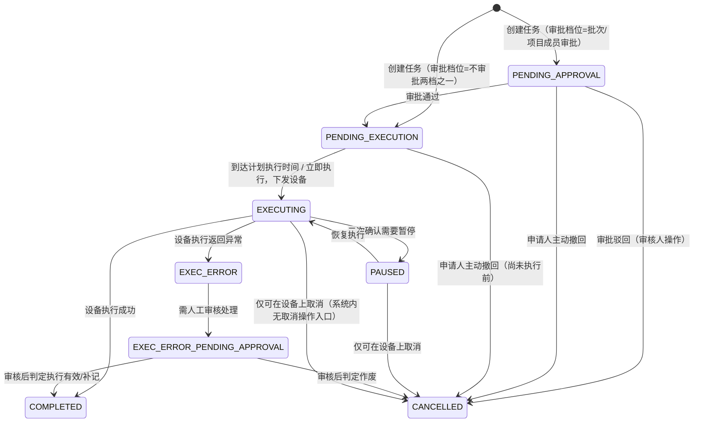
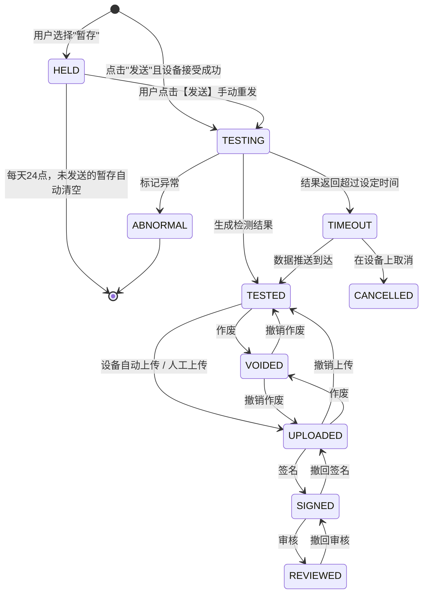

# 核心状态机设计文档

> 版本：V1.0（历史状态机草案，2026-09-13补权威引用）
> 当前实现依据：[M03培养](../详细设计/03-项目与培养管理/详细设计.md)、[M07任务](../详细设计/07-补液运行与任务执行/任务状态调度与异常恢复.md)、[M05检测](../详细设计/05-检测与数据签批/检测工作台接口与位置生命周期.md)。下列旧流程图仅保留历史推导；删除资格、延期触发、任务取消、结果资格和每日额度等冲突处均由对应模块现行契约取代，不作为第二套可实现规则。培养旧名IN_PROGRESS→RUNNING、COMPLETED→FINISHED；其他领域同名状态不改。
> 基于：需求说明书V4.0-0904 + 《需求澄清决策记录》
> 用途：作为数据库状态枚举字段、状态流转逻辑、审批分支实现的统一技术规格，供 Codex 开发参考
> 覆盖范围：培养状态机、任务状态机（补料/补糖）、检测样品状态机

---

## 1. 培养状态机（现行引用）

本节以[M03运行事件、资源释放与延期契约](../详细设计/03-项目与培养管理/运行事件资源释放与延期收尾契约.md)为权威，旧推导不再作为编码依据。历史英文名IN_PROGRESS→RUNNING、COMPLETED→FINISHED，仅用于历史识别，不改变其他领域状态。

| 状态 | 现行语义 |
| --- | --- |
| DRAFT | 日期不完整的合法草稿，不占用 |
| NOT_STARTED | 日期齐全已预约，尚未开启工作流 |
| RUNNING | FIRST_WORKFLOW_STARTED真实开启流程后进入；START_COMPLETED只记录开始完成事实 |
| EXPIRED | 到开始日次日00:00上海时间，从未开启流程；验证NEVER_STARTED完整证明后释放本次预约 |
| DELAYED | 已开流程但开始截止未完成开始，或结束截止未完成结束；分别记录START/END原因，持续占用 |
| FINISHED / CANCELLED | 本期终态仅隔离模拟，真实生产结束入口不开放；状态不能代替资源释放证明 |

已延期经合法流程延长结束日期且新截止未到，可恢复RUNNING并保留占用；迟到START_COMPLETED不自动恢复。过期后重新选择设备和日期重新预约。删除、编号复用、批次与项目聚合权限按M03主设计，不按旧状态标签直接推导设备可删除。

详细顺序见[培养占用时序](../详细设计/03-项目与培养管理/培养占用开发级时序图.md)。以下任务与检测旧图保留历史阅读，当前实现分别服从M07和M05现行契约。

## 2. 任务状态机（补料 / 补糖任务）

> 本期任务类型范围（Q36）：新增任务下拉**只有"补料、补糖"**两种，其他任务类型（PH校准、取样、测样等）不在本期开发范围。

### 2.1 状态枚举

| 状态代码 | 状态名称 | 说明 |
| :--- | :--- | :--- |
| `PENDING_APPROVAL` | 待审核 | 审批档位为"批次成员审批"或"项目成员审批"时，任务创建后进入此态 |
| `PENDING_EXECUTION` | 待执行 | 审批通过后，或审批档位为"不审批"两档时，创建后直接进入此态 |
| `EXECUTING` | 执行中 | 到达计划执行时间（或立即执行），任务已下发给设备 |
| `PAUSED` | 暂停中 | 执行过程中经二次确认需要暂停 |
| `EXEC_ERROR` | 执行出错 | 设备执行返回异常 |
| `EXEC_ERROR_PENDING_APPROVAL` | 执行出错待审核 | 异常需要人工审核处理 |
| `COMPLETED` | 已完成 | 执行成功 |
| `CANCELLED` | 已取消 | 审批驳回，或申请人主动撤回，或在设备上取消 |

### 2.2 审批档位分支（4档，取小试/中试并集，A5决策）

| 审批档位 | 创建后是否需要填写原因 | 创建后初始状态 |
| :--- | :---: | :--- |
| 不审批不记录 | 否 | 直接进入 `PENDING_EXECUTION` |
| 不审批需记录原因 | 是 | 直接进入 `PENDING_EXECUTION`（无需等待审批，但必须填写原因） |
| 批次成员审批 | 是（申请说明） | 进入 `PENDING_APPROVAL`，等待批次成员审批 |
| 项目成员审批 | 是（申请说明） | 进入 `PENDING_APPROVAL`，等待项目成员审批 |

> 小试/中试共用一套系统，也都需要区分"批次成员审批"与"项目成员审批"两个档位，不因小试/中试而简化。

### 2.3 状态流转图

### 2.4 关键规则说明

| 规则点 | 说明 |
| :--- | :--- |
| **"取消"的两种概念（A4决策）** | ① **撤回**：申请人主动操作，发生在 `PENDING_APPROVAL`/`PENDING_EXECUTION` 阶段 ② **驳回**：审核人操作导致的取消，发生在 `PENDING_APPROVAL` 阶段。两者最终都落到 `CANCELLED` 状态，但操作人/操作类型字段需区分记录 |
| **设备上取消（Q38）** | 一旦任务进入 `EXECUTING`/`PAUSED`，**只能在设备上取消**（仅支持取消功能的设备生效），**系统页面上没有取消按钮**；设备取消后系统通过数据回传同步为 `CANCELLED` |
| **暂停（14-1804决策，笔误修订）** | 二次确认需要暂停后，任务状态变为 `PAUSED`（暂停中），**不是**"已取消"（原文笔误） |
| **超时监控** | 参考泵速策略③监控配置中"超时时间"字段，超时后的处理归入 `EXEC_ERROR` 分支 |

---

## 3. 检测样品状态机

> 本状态机对应"检测分析 → 数据签名操作台 → 签批记录"全链路，覆盖 BGA/Vicell/OSMO/Cedex Bio/Cedex Bio HT 等离线检测设备的样品生命周期。

### 3.1 状态枚举

| 状态代码 | 状态名称 | 说明 |
| :--- | :--- | :--- |
| `HELD` | 暂存 | 用户填写样品信息后选择暂存，或发送失败（设备离线/超过最大并发）自动降级为暂存 |
| `TESTING` | 检测中/待检测 | 已发送且设备接受成功 |
| `ABNORMAL` | 异常 | 检测中标记异常，流程终止 |
| `TIMEOUT` | 超时 | 结果返回超过设定时间 |
| `TESTED` | 已检测 | 生成检测结果（含超时后数据推送到达的情况） |
| `VOIDED` | 样本作废 | 已检测/已上传状态下执行作废 |
| `UPLOADED` | 已上传 | 设备自动上传或人工上传 |
| `SIGNED` | 已签名 | 已上传状态下执行签名 |
| `REVIEWED` | 已审核 | 已签名状态下执行审核 |
| `CANCELLED` | 取消 | 超时后在设备上取消 |

### 3.2 状态流转图

### 3.3 关键规则说明

| 规则点 | 说明 |
| :--- | :--- |
| **暂存的两个来源** | ① 用户主动选择"暂存"（不点发送）② 点击发送时，若设备离线或已达最大同时检测数，系统自动降级为暂存（数据库暂存），不算异常 |
| **暂存重发/清空（Q37）** | 用户需**手动点击【发送】重发**，系统不自动重发；**每天24点**，当天未发送的暂存记录**自动清空** |
| **设备上取消（Q38，同任务状态机）** | 仅在 `TIMEOUT` 阶段可以在设备上取消，进入 `CANCELLED` 终态；系统页面无取消操作入口 |
| **签名/审核不需要重新认证** | 签名操作不需要重新输入密码/MFA；签名本身不需要填写原因，**撤销签名、作废**才需要填写原因（此前已确认，未在本图重复标注每条边的"需要原因"属性，实现时需在撤销/作废两类边上加"原因"必填字段） |
| **非培养类样本检索（Q47）** | 检测分析模块中"查看未关联培养ID的检测"用于处理不属于任何培养的检测记录（如设备调试样本），与本状态机主流程并行 |

---

## 4. 三个状态机之间的联动关系（供数据库设计参考）

| 联动点 | 说明 |
| :--- | :--- |
| 培养状态 → 补液任务生成 | 仅"已完成'连接补料单元'工作流"且培养状态为 `RUNNING`（进行中）或 `DELAYED`（已延期）的培养/反应器，才能新增补液任务（对照16号文档"任务新增"筛选条件） |
| 培养状态 → 补糖任务自动生成 | 按规则生成的补糖任务：若有补料任务需等其 `COMPLETED` 后再判断是否生成；若当前无补料任务，默认视为"补料已完成"也会触发生成判断；判断周期为系统配置的检查周期（默认10s） |
| 任务状态 → 补料计算依据取值 | 补料/补糖计算公式中"补料计算依据=当前重量"时，取"任务执行前最新重量"——即最近一次 `COMPLETED` 状态补液任务之后的理论重量/地秤读数快照 |
| 检测样品状态 → 残糖确认 | "补糖前残糖浓度"取值：优先取"当天最近一次补液任务后计算的糖浓度"，若当天无补液任务，则取残糖确认时使用的 `REVIEWED`（已审核，或至少已上传）状态的 Cedex 检测数值 |
| 培养状态 → ID复用 | 培养ID的唯一性校验，仅排除 `CANCELLED`（已取消）和记录被删除的两类情形，其余5态（草稿/未开始/进行中/已延期/已过期/已结束）在库记录均视为"占用中"或"历史记录"，不可复用编号 |

---

## 5. 待确认事项清单（本文档相关，不影响状态机主体设计）

以下为状态机设计中依赖但尚未最终定稿的外部依赖，建议开发前跟进：

1. 设备删除校验的状态推导（第1.6节）——Claude Code推导，未经客户最终确认
2. 补糖量最小阈值 NCS061 的配置来源——待另一系统技术同事补充
3. 小试"当前重量"由 SMP 计算还是 PLC 写库——待药明方补充文档，会影响"任务执行前最新重量"的取数实现方式
4. 补糖规则检查周期的配置入口——暂定系统设置中配置，默认10秒，待确认
