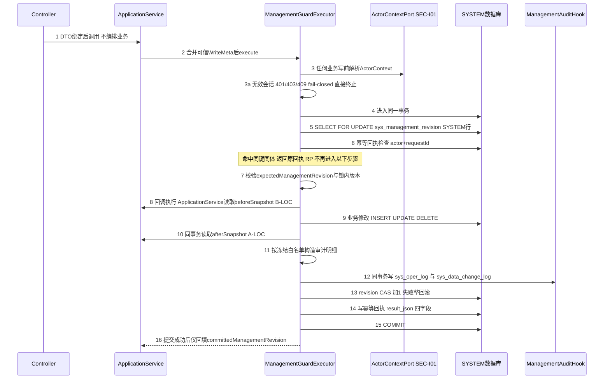
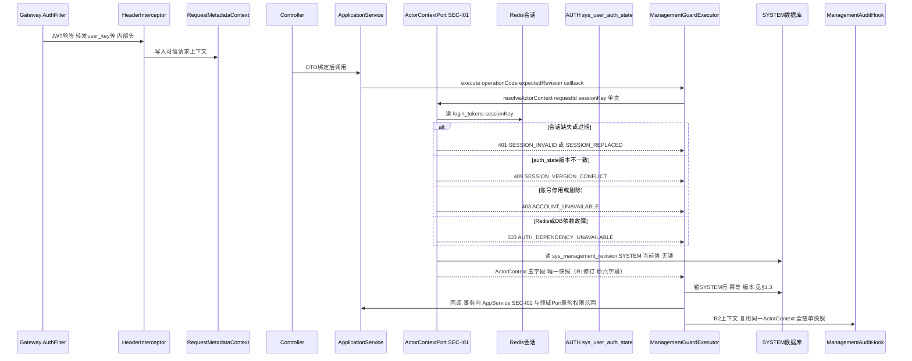
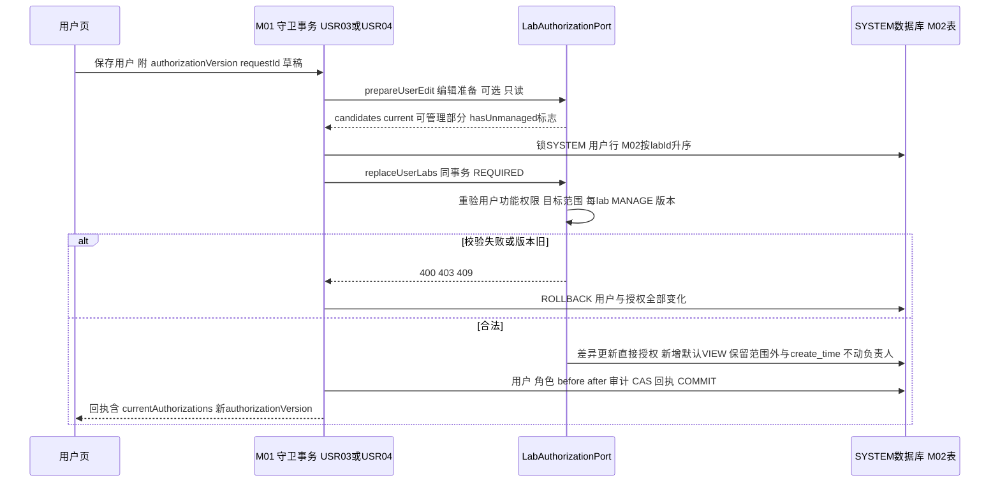
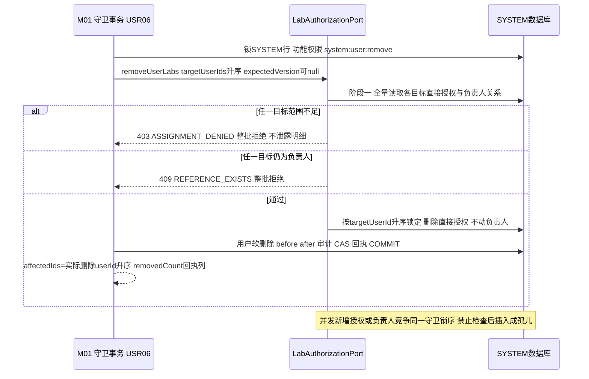
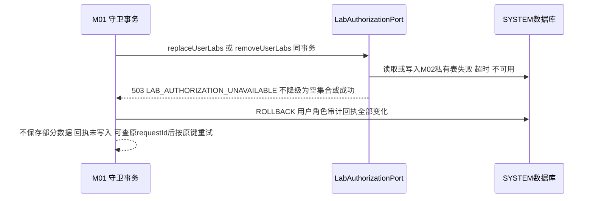
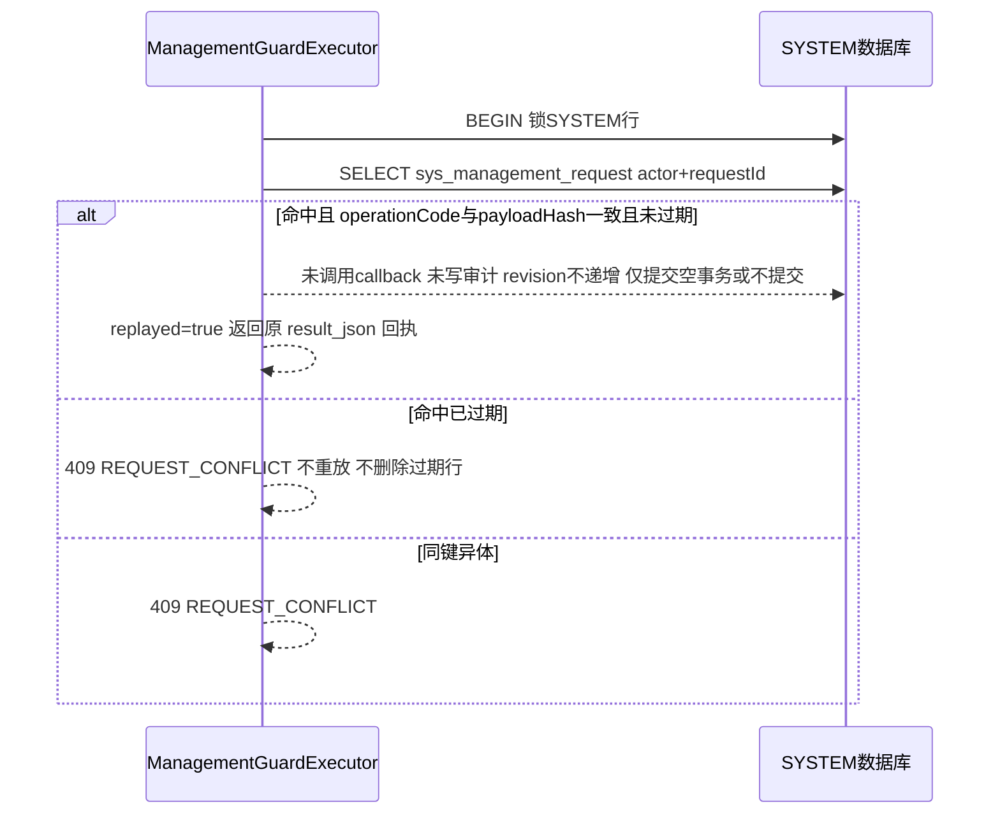

# 21-TASK-GATES：G1/G2/G3 真实业务实现前置设计裁决报告

版本：TASK-GATES-DD-20260919-TG1。任务性质：设计与契约收口。本任务零 Java 生产代码、零测试代码、零 Mapper/XML、零 SQL、零 Vue、零数据库/Redis/HTTP 接入；守卫、Port、模型源码只读取证。

> **⚠ 本报告已由 TASK-GATES-R1 修订（2026-09-19）：§二 G2 中关于 labScopes／“六字段”／“SEC-I01 经 M02 聚合范围”的原文为任务当时口径，已整体废止，现行契约见下方 §〇-A 与 docs/开发任务/22-TASK-GATES-R1-ActorContext职责边界修正报告.md。§一（G1）、§三（G3）、§四～§六其余裁决内容不变、继续有效。**

## 〇-A、TASK-GATES-R1 修订声明（2026-09-19，现行有效）

**废止口径（原文保留但不得再作为契约引用）**：

1. “ActorContext = PKG-00 六字段”（§2.2 标题与表格）；
2. “labScopes 属于 SEC-I01 输出、由适配器经 M02 查询服务聚合推导”（§2.2 labScopes 行、§2.7 时序图内两行）；
3. “M01ActorContextAdapter 注入 M02 LabAuthorizationService”（§2.8 文件归属行）；
4. “SEC-I01 解析依赖 M02”（由上述派生的一切表述）；
5. “其他模块可信任 actorContext.labScopes 完成授权”（本报告及任何活跃设计中从未允许，R1 起在物理模型层面彻底消除该载体）。

**修订为（现行契约，依据 22 报告）**：

1. ActorContext 为**五字段纯身份/会话/版本上下文**：actorUserId、actorName、sessionKey、authzVersion、requestId；`labScopes` 字段已从 Java 模型删除（物理签名方法 `resolveActorContext(ActorContextQuery) -> ActorContext` 不变）。
2. SEC-I01/ActorContextPort 只负责身份、会话有效性、用户停用/删除复核、sessionKey/sessionVersion 匹配、authzVersion、requestId 关联；**不得调用或注入 M02/M03/M04 等领域服务，不读取任何领域私有表，不返回角色/权限集合快照，不承载实验室/部门/项目/培养范围**。
3. INFRA-ACTOR 适配器允许依赖仅限会话/认证链路：Redis login_tokens（LoginUser）、sys_user_auth_state、sys_user 状态、sys_management_revision(SYSTEM)、RequestMetadataContext。
4. **实验室范围的唯一权威=M02 拥有的 `LabAuthorizationPort`**（prepareUserEdit/replaceUserLabs/removeUserLabs，G3 §3.3 不变）：M01 传可信 ActorContext（身份对象，非范围载体），M02 依据 actorUserId、当前功能权限映射与 M02 当前数据在 SYSTEM 锁后同一事务内计算并重验范围；查询候选同样由 M02 Port 返回。
5. M02 不可用仅阻塞调用 LabAuthorizationPort 的业务（503 LAB_AUTHORIZATION_UNAVAILABLE）；**菜单、角色、字典、配置、部门、实验组等不依赖实验室授权的管理写不受影响**——修正原设计“29 个管理写全部依赖 M02 聚合”的矛盾。
6. authzVersion ≠ M02 authorizationVersion（§2.3 的区分继续有效）；ActorContext 不是长期权限票据，同一请求仍只解析一次（§2.4 一致性规则除涉 labScopes 处外全部保留）。
7. G2 阶段门状态：R1 执行期间逻辑状态 REOPENED_FOR_R1，代码/文档/测试修正并验证通过后**重新 CLOSED**（10 审计 closeNote 已按 22 报告更新）。

## 〇、结论摘要与分层声明

- G1（审计映射与快照生成时序）、G2（SEC-I01 ActorContextPort 可信会话一致性）、G3（M01/M02 实验室范围读取与写入边界）三个设计阶段门的全部关闭条件均已在现有权威文档、PKG-00 冻结物理签名与 PRE-01B-R1 基础设施源码事实上唯一确定，裁决为 **CLOSED**（10 审计 MD/JSON 已同步，closeNote 见 §十）。
- 76 条接口骨架口径不变：COMPLETE_SKELETON=76 / PARTIAL_SKELETON=0（禁止改动项，本报告未触碰）。
- 四层区分声明：**设计阶段门已关闭 ≠ 生产适配器已实现 ≠ 真实业务已实现 ≠ 运行环境已验证**。ManagementAuditHook 生产适配器、SEC-I01 生产适配器、M02 LabAuthorizationPort 适配器当前均不存在（PRE-01C 已撤回，05/09 报告口径）；数据库、Redis、JWT、网关、HTTP、浏览器均未运行验证。本报告验证层级＝文档静态检查＋程序化一致性核对（§十一）。

取证输入（全部已读）：AGENTS.md、docs/02 总体设计、05-PKG-01-ADJUST 审计、07-PRE-01B、08/09-PRE-01C（含作废声明）、10 审计 MD/JSON、18/19/20 报告、01 详细设计/数据库表结构与字段字典/错误码全集/Controller 请求调用时序设计/物理接口与骨架字段设计/§17 §22 §23、02-实验室与资源管理《用户实验室授权内部服务逐方法契约》（AUTH-I01/02/03）与《实验室主数据逐接口契约》（Q10/Q11/Q13 停用预检）、ManagementGuardExecutor / ManagementAuditHook / ManagementGuardCallback / GuardExecutionResult / ManagementWriteOutcome / ManagementOperation / ActorContext / ActorContextQuery / LabAuthorizationPort 及 m02/model 全部物理源码、LogAspect / AsyncLogService、TokenService / LoginUser / 网关 AuthFilter / HeaderInterceptor。

说明：任务书"必须阅读"第 20 项《docs/详细设计/01-系统管理/模块内部接口设计.md》经全仓检索不存在（允许清单第 3 项同），该落点以《详细设计.md》新增冻结小节与本报告替代，未另造平行权威文档。

---

## 一、G1 裁决：29 个守卫写接口的审计字段映射与快照生成时序

### 1.1 白名单口径

29 个 operationCode = `ManagementOperation` 枚举全部常量（源码 29 值），与 10 审计 JSON `summary.adminWriteSplit.whitelistTotal=29` 逐一对应；05 旧口径"31 管理写"包含 login/M01-005/M01-007/M01-009 四个非守卫写入口（adminWriteSplit note），与本白名单无冲突，不改动历史报告。ORG12=M01-024 为 GET 查询 actionCode，不在 29 内。

### 1.2 全局冻结规则（对 29 行逐行生效，先于表内引用记号）

- **FA（失败审计口径，全行同值）**：冲突（MANAGEMENT_CONFLICT/REQUEST_CONFLICT）、输入校验失败（400）、权限失败（403）一律**不写成功审计**——不写 sys_oper_log 成功行、不写 sys_data_change_log、不写回执、revision 不递增。失败记录走**独立明确路径**：现有操作日志组件（`@Log` 注解 + futurefab-common-log `LogAspect`，`@AfterThrowing` 分支 status=1，`AsyncLogService` 异步、事务外、经 RemoteLogService），只记脱敏入参摘要与失败原因；该路径不得伪装成成功业务审计，也不得补写 data_change_log。
- **RP（重放审计，全行同值）**：幂等命中返回原回执，**不重复业务回调、不重复 revision、不重复审计**（PRE-01B-R1 现状语义，冻结为契约）。
- **TX（事务边界，全行同值）**：§1.3 十六步同一事务；审计写入（步骤 12）先于 revision CAS（步骤 13）与回执（步骤 14）；任一步异常整次回滚；提交后仅做步骤 16（committedManagementRevision 回填），提交后禁止任何审计/快照写入。
- **B-LOC（before 生成位置，全行同值）**：守卫事务内、业务写回调修改数据之前，由该接口 ApplicationService/领域回调读取（持 §23 锁序行锁语义下）；禁止 Controller 生成、禁止提交后回查。
- **A-LOC（after 生成位置，全行同值）**：业务写完成后、ManagementAuditHook 写审计之前，同一事务内重读同一对象；禁止 Hook 自行猜测/补读业务字段。
- **ID**：全部 ID 以 String（十进制）进入快照与审计。
- **时间**：快照/审计字段值统一 Asia/Shanghai，冻结序列化格式：日期时间 `yyyy-MM-dd HH:mm:ss`、日期 `yyyy-MM-dd`；null 字段省略键；不接受 epoch 数字或本地默认 toString。
- **稳定排序**：集合字段一律按数值主键升序去重；标量列表按字典序升序去重；同一业务内容必须产生字节稳定的快照 JSON（对象键按白名单登记序输出）。
- **大字段截断/摘要**：单字段值超 512 字符 → 保留前 512 字符 + `…#s2:<SHA-256 hex 前 16 位>`；单对象快照 JSON 序列化超 60000 字符 → 集合元素折叠为 `{count, ids 前 50 个, digest}`。sys_oper_log.oper_param/json_result 维持列宽 varchar(2000) 的既有截断规则（列已定义）。
- **全局禁止字段（任何行、任何快照/审计 JSON 不得出现）**：password 及其哈希、密钥、token、sessionKey 原文、HMAC 密钥（含 futurefab.management.receipt-hmac-key 派生物）、完整配置敏感值、credential_version（凭据代次）、login_ip/login_date/login_count（行为流水，非业务快照）。
- **公共审计列**（create_by/create_time/update_by/update_time、active_* 生成列、ancestors 派生列）不进入快照 values（行级 changed_by/changed_at 由审计行自身承载，避免双写漂移）。
- 脱敏展示规则（涉及行）：手机号保留前 3 后 4（`138****5678`）；邮箱保留首字符与域名（`u***@domain`）；无法按规则脱敏的敏感值一律以 `<masked>` + 摘要记入。

### 1.3 十六步总时序（冻结，与 PRE-01B-R1 现状逐步对齐）



铁律（冻结条款）：before 必在业务写之前；after 必在业务写之后、审计写入之前；两者同事务同锁语义；禁止提交后回查生成快照；禁止 Controller 生成快照；禁止 Hook 猜测业务字段；禁止持锁事务内 HTTP/消息/文件/设备等外部副作用；审计失败 fail-closed 整次回滚；重放返回原回执且不重复回调/revision/审计；冲突/校验/权限失败不写成功审计；失败审计只走 §1.2-FA 独立路径；快照字段白名单以 §1.4 表为唯一来源，不得增删；ApplicationService 不得以自由 Map 传递审计内容（§1.5 类型化模型）。

### 1.4 29 行逐操作映射表

列说明：主ID=审计"操作对象"主对象 ID 来源；before/after 列给出"需要？/生成位置（B-LOC/A-LOC 见 §1.2）+读取对象"。白名单列以字段字典现行列名为准；"通用"= §1.2 全局禁止与公共列规则。任务包归属：ORG/ACL/DIC/CFG/USR 业务实现包（§九包 5 及模块业务包）；审计装配统一依赖 INFRA-AUDIT。

| operationCode | 接口ID | HTTP动作 路径 | 业务对象类型 | 业务动作名称 | auditTitle | businessType | 主对象ID来源 | affectedIds来源 | beforeSnapshot 需要/位置 | afterSnapshot 需要/位置 | 快照字段白名单 | 脱敏/禁止字段 | 失败审计口径 | 重放重复审计 | 事务边界 | 任务包 |
|---|---|---|---|---|---|---|---|---|---|---|---|---|---|---|---|---|
| ORG02 | M01-014 | POST /system/smp/venue | 场地(sys_venue) | 新增场地 | 场地管理/新增 | 1 新增 | INSERT 回填 venueId | 无（单对象=null） | 否（新增前无行） | 需/B-LOC—(A-LOC) 新行按白名单 | venue_name,venue_code,parent_id,order_num,status,remark | 通用；无行为列 | FA | RP=否 | TX | 业务实现-ORG |
| ORG03 | M01-015 | PUT /system/smp/venue | 场地 | 修改场地 | 场地管理/修改 | 2 修改 | DTO venueId | 无 | 需/B-LOC 修改前整行白名单 | 需/A-LOC 修改后整行 | 同 ORG02 | 通用 | FA | RP=否 | TX | 业务实现-ORG |
| ORG06 | M01-018 | DELETE /system/smp/venue/{venueIds} | 场地(批量) | 删除场地 | 场地管理/删除 | 3 删除 | 输入解析 venueIds 首元素 | 实际删除 venueId 集合升序 | 需/B-LOC 锁定后删除前各整行 | 需/A-LOC 软删后 del_flag 状态行集合 | 同 ORG02 + del_flag(仅after=2) | 通用 | FA | RP=否 | TX | 业务实现-ORG |
| ORG07 | M01-019 | POST /system/dept | 部门(sys_dept) | 新增部门 | 组织部门/新增 | 1 新增 | INSERT 回填 deptId | 无 | 否 | 需/A-LOC | dept_name,dept_code,parent_id,order_num,leader,status,remark | 通用；phone,email 按 §1.2 脱敏；禁 password 等 | FA | RP=否 | TX | 业务实现-ORG |
| ORG08 | M01-020 | PUT /system/dept | 部门 | 修改部门 | 组织部门/修改 | 2 修改 | DTO deptId | 无 | 需/B-LOC | 需/A-LOC | 同 ORG07 | 同 ORG07 | FA | RP=否 | TX | 业务实现-ORG |
| ORG13 | M01-025 | POST /system/smp/labgroup | 实验组(sys_group+leader/member关系) | 新增实验组 | 实验组/新增 | 1 新增 | INSERT 回填 groupId | 无 | 否 | 需/A-LOC 组行+leaders[]/members[](user_id 升序) | group_name,group_code,dept_id,status,remark,leaders[],members[] | 通用 | FA | RP=否 | TX | 业务实现-ORG |
| ORG14 | M01-026 | PUT /system/smp/labgroup | 实验组 | 修改实验组 | 实验组/修改 | 2 修改 | DTO groupId | 无 | 需/B-LOC 组行+关系集合 | 需/A-LOC 同左 | 同 ORG13 | 通用 | FA | RP=否 | TX | 业务实现-ORG |
| ORG16 | M01-028 | DELETE /system/smp/labgroup/{groupIds} | 实验组(批量) | 删除实验组 | 实验组/删除 | 3 删除 | groupIds 首元素 | 实际删除 groupId 升序 | 需/B-LOC 各整组+关系 | 需/A-LOC del_flag 状态集合 | 同 ORG13 + del_flag(仅after=2) | 通用 | FA | RP=否 | TX | 业务实现-ORG |
| ORG18 | M01-030 | DELETE /system/dept/{deptId} | 部门 | 删除部门 | 组织部门/删除 | 3 删除 | 路径 deptId | 实际解除的子部门/挂用户重挂对象 ID（如有，升序） | 需/B-LOC 整部门行 | 需/A-LOC del_flag 状态行 | 同 ORG07 + del_flag(仅after=2) | 同 ORG07 | FA | RP=否 | TX | 业务实现-ORG |
| ACL02 | M01-036 | POST /system/menu | 菜单(sys_menu) | 新增菜单 | 菜单权限/新增 | 1 新增 | INSERT 回填 menuId | 无 | 否 | 需/A-LOC | menu_name,parent_id,order_num,path,component,query,route_name,is_frame,is_cache,menu_type,visible,status,perms,icon,api_path | 通用 | FA | RP=否 | TX | 业务实现-ACL |
| ACL03 | M01-037 | PUT /system/menu | 菜单 | 修改菜单 | 菜单权限/修改 | 2 修改 | DTO menuId | 无 | 需/B-LOC | 需/A-LOC | 同 ACL02 | 通用 | FA | RP=否 | TX | 业务实现-ACL |
| ACL04 | M01-038 | PUT /system/menu/changeStatus | 菜单 | 菜单启停 | 菜单权限/状态变更 | 2 修改 | menuId | 无 | 需/B-LOC {menuId,status} | 需/A-LOC {menuId,status} | menu_name,status（最小快照） | 通用 | FA | RP=否 | TX | 业务实现-ACL |
| ACL06 | M01-040 | POST /system/role | 角色(sys_role+menu/dataScope关系) | 新增角色 | 角色权限/新增 | 1 新增 | INSERT 回填 roleId | 无 | 否 | 需/A-LOC 角色行+menu_ids[]/data_scope_dept_ids[]升序 | role_name,role_key,role_sort,data_scope,menu_check_strictly,dept_check_strictly,status,remark,menu_ids[],data_scope_dept_ids[] | 通用 | FA | RP=否 | TX | 业务实现-ACL |
| ACL07 | M01-041 | PUT /system/role | 角色 | 修改角色 | 角色权限/修改 | 2 修改 | DTO roleId | 授权关系变化时=受影响角色关联摘要（仍主键 roleId） | 需/B-LOC 行+关系集合 | 需/A-LOC 同左 | 同 ACL06 | 通用 | FA | RP=否 | TX | 业务实现-ACL |
| ACL08 | M01-042 | PUT /system/role/changeStatus | 角色 | 角色启停 | 角色权限/状态变更 | 2 修改 | roleId | 无 | 需/B-LOC {roleId,status} | 需/A-LOC {roleId,status} | role_name,role_key,status（启停触发权限版本递增语义按 §23 状态联动） | 通用 | FA | RP=否 | TX | 业务实现-ACL |
| ACL10 | M01-044 | DELETE /system/role/{roleIds} | 角色(批量) | 删除角色 | 角色权限/删除 | 3 删除 | roleIds 首元素 | 实际删除 roleId 升序 | 需/B-LOC 各整行 | 需/A-LOC del_flag 状态集合 | 同 ACL06 + del_flag(仅after=2) | 通用 | FA | RP=否 | TX | 业务实现-ACL |
| USR03 | M01-050 | POST /system/user | 用户(sys_user+sys_user_role+经M02 Port的实验室授权) | 新增用户 | 用户管理/新增 | 1 新增 | INSERT 回填 userId | 无 | 否 | 需/A-LOC 用户行+role_ids[]升序+lab_auth摘要(labId+authType升序,来源=UserLabAuthorizationResult.currentAuthorizations) | dept_id,user_name,nick_name,user_type,email,phonenumber,sex,avatar,status,remark,notify_email,notify_sms,notify_insite,is_initial_password,role_ids[],lab_auth[] | 绝对禁 password/口令哈希/credential_version；email/phone 脱敏；范围外授权不得出现（G3 §4.5） | FA | RP=否 | TX | 业务实现-USR |
| USR04 | M01-051 | PUT /system/user | 用户 | 修改用户 | 用户管理/修改 | 2 修改 | DTO userId | 无 | 需/B-LOC 用户行+角色+可管理范围授权 | 需/A-LOC 同左 | 同 USR03 | 同 USR03 | FA | RP=否 | TX | 业务实现-USR |
| USR05 | M01-052 | PUT /system/user/changeStatus | 用户 | 用户启停 | 用户管理/状态变更 | 2 修改 | userId | 无 | 需/B-LOC {userId,status} | 需/A-LOC {userId,status} | user_name,nick_name,status | 同 USR03 绝对禁列 | FA | RP=否 | TX | 业务实现-USR |
| USR06 | M01-053 | DELETE /system/user/{userIds} | 用户(批量) | 删除用户 | 用户管理/删除 | 3 删除 | userIds 首元素 | 实际删除 userId 升序 | 需/B-LOC 各用户行+角色+M02 删除回执 currentAuthorizations | 需/A-LOC del_flag 状态集合+removedCount 回执 | 同 USR03 列 + del_flag(仅after=2),lab_removed_count | 同 USR03 绝对禁列 | FA | RP=否 | TX | 业务实现-USR |
| USR09 | M01-056 | PUT /system/user/profile | 用户（本人） | 修改本人资料 | 个人中心/资料修改 | 2 修改 | ActorContext.actorUserId | 无 | 需/B-LOC 本人行白名单列 | 需/A-LOC 同左 | nick_name,email,phonenumber,sex,avatar（本人资料最小集，不含角色/授权） | email/phone 脱敏；绝对禁 password 等 | FA | RP=否 | TX | 业务实现-USR |
| USR10 | M01-057 | POST /system/user/{userId}/force-logout | 会话（目标用户） | 强制退出 | 用户管理/强制退出 | 7 强退 | 路径 userId | 被撤销会话数（回执 affectedIds） | 需/B-LOC {userId,会话存在性事实} 不读会话内容 | 需/A-LOC {userId,invalidated:true,撤销 session_version} | user_name,status,session_invalidated,session_version(仅数值) | 禁 sessionKey/token/Redis 键原文 | FA | RP=否 | TX | 业务实现-USR |
| DIC02 | M01-059 | POST /system/dict/type | 字典类型(sys_dict_type) | 新增字典类型 | 字典类型/新增 | 1 新增 | INSERT 回填 dictId | 无 | 否 | 需/A-LOC | dict_name,dict_type,status,is_editable,remark | 通用 | FA | RP=否 | TX | 业务实现-DIC |
| DIC03 | M01-060 | PUT /system/dict/type | 字典类型 | 修改字典类型 | 字典类型/修改 | 2 修改 | DTO dictId | 无 | 需/B-LOC | 需/A-LOC | 同 DIC02 | 通用 | FA | RP=否 | TX | 业务实现-DIC |
| DIC06 | M01-063 | POST /system/dict/data | 字典数据(sys_dict_data) | 新增字典数据 | 字典数据/新增 | 1 新增 | INSERT 回填 dictCode | 无 | 否 | 需/A-LOC | dict_label,dict_value,parent_code,dict_sort,dict_level,dict_type,css_class,list_class,is_default,status,is_editable,remark | 通用 | FA | RP=否 | TX | 业务实现-DIC |
| DIC07 | M01-064 | PUT /system/dict/data | 字典数据 | 修改字典数据 | 字典数据/修改 | 2 修改 | DTO dictCode | 无 | 需/B-LOC | 需/A-LOC | 同 DIC06 | 通用 | FA | RP=否 | TX | 业务实现-DIC |
| CFG02 | M01-068 | POST /system/config | 参数(sys_config) | 新增参数 | 参数配置/新增 | 1 新增 | INSERT 回填 configId | 无 | 否 | 需/A-LOC | config_name,config_key,config_type,remark,config_value_digest{sha12,len,masked} | config_value 一律摘要化：`{value_masked:"***",value_sha256_12,value_length}`，不写明文（不依赖 BLK-04b 注册表即可判定） | FA | RP=否 | TX | 业务实现-CFG |
| CFG03 | M01-069 | PUT /system/config | 参数 | 修改参数 | 参数配置/修改 | 2 修改 | DTO configId | 无 | 需/B-LOC（含旧值摘要） | 需/A-LOC（新值摘要） | 同 CFG02 | 同 CFG02 | FA | RP=否 | TX | 业务实现-CFG |
| CFG05 | M01-071 | DELETE /system/config/{configIds} | 参数(批量) | 删除参数 | 参数配置/删除 | 3 删除 | configIds 首元素 | 实际删除 configId 升序 | 需/B-LOC 各整行 | 需/A-LOC 删除回执{ids,count}（sys_config 物理删，无 del_flag） | 同 CFG02 列集 | 同 CFG02 | FA | RP=否 | TX | 业务实现-CFG |

29 行闭合校验：operationCode 与 ManagementOperation 枚举、10 审计 JSON actionCode 三方程序化一致（§十一）。

### 1.5 ManagementAuditHook 现有签名复核与 R2 精确签名建议（只设计，不建 Java 类）

复核结论：**现签名 `void onManagementApplied(Long actorUserId, String requestId, String operationCode, ManagementWriteOutcome outcome, LocalDateTime committedAt)` 不足以承载 §1.3/§1.4 语义**——无 before/after 快照承载位、无审计标题/类型来源、无法禁止 Hook 猜字段。本任务不改签名；INFRA-AUDIT/INFRA-GUARD-R2 按下述冻结契约实施 R2：

```
类型化模型（禁止自由 Map 承载审计语义）：
AuditFieldValue   { String field; String value; }                 // field 必须 ∈ §1.4 白名单；value 已按 §1.2 String化/脱敏/截断
AuditSnapshot     { String objectType; String objectId; List<AuditFieldValue> values; }  // values 按白名单登记序；批量=List<AuditSnapshot> 按 objectId 数值升序
AuditIntent       { List<AuditSnapshot> before;                    // 新增场景=空列表（永不 null）
                    List<AuditSnapshot> after;                     // 全行非空（§1.4 after 列）
                    String auditTitle; String businessType; }      // 二者= §1.4 表冻结值，ApplicationService 不得自造

R2 回调返回（替代现 ManagementGuardCallback 直返 Outcome）：
GuardExecutionResultR2 { ManagementWriteOutcome outcome;   // 冻结四字段不变，revision 仍由守卫回填
                         AuditIntent auditIntent; }         // 不得为 null；outcome.applied=false 时整次拒绝

R2 Hook：
ManagementAuditHookR2.onManagementApplied(AuditWriteContext ctx)
AuditWriteContext { Long actorUserId; String actorName; String requestId;   // 全部来自守卫已解析的同一 ActorContext（G2 规则2/3），不接受回调自报
                    ManagementOperation operation;                          // 服务端枚举
                    ManagementWriteOutcome outcome;                         // id/affectedIds 用于 sys_oper_log.operating 与 json_result 回执摘要
                    AuditIntent intent; LocalDateTime committedAt; String newManagementRevision; }
职责：拼装 sys_oper_log 成功行（title=auditTitle, business_type=businessType, status=0, user_id/nick_name/request_id 新列）与逐对象 sys_data_change_log（table_name/record_id 按 §1.4 白名单映射，old_data/new_data=before/after 序列化，operation=INSERT/UPDATE/DELETE）；只读 ctx，不触库外副作用。
异常语义：Hook 内任何异常上抛 → 守卫事务整体回滚（fail-closed，不空审计提交、不吞异常）；不允许 Hook 返回降级标志。
actor/requestId/operationCode 来源：与管理写幂等键同源（同一 ActorContext 快照 + WriteMeta.requestId + 服务端枚举），与现 executor resolveTrustedActor 一致，浏览器自报无效。
```

### 1.6 G1 关闭条件核对

29 逐行映射=完成（§1.4）；快照时序唯一=§1.3；脱敏白名单=§1.4+§1.2；重放与失败审计=§1.2-RP/FA；同事务边界=TX+§1.3 步骤 4-15；Java 模型签名=§1.5；核心字段无"实现时再决定"——config_value 摘要化规则已免除对 BLK-04b 的依赖，其余字段均冻结 → **G1 CLOSED**。

---

## 二、G2 裁决：SEC-I01 ActorContextPort 可信会话一致性

### 2.1 输入冻结（ActorContextQuery，维持 PKG-00 §6.1 物理字段集，不扩不改）

| 字段 | 来源 | 非可信来源处置 |
|---|---|---|
| requestId | WriteMeta/RequestMetadataContext 合并结果（服务端生成链），同 id 同体走幂等重放，异体 REQUEST_CONFLICT | 浏览器 Body 中 actor 字段一律无效 |
| sessionKey | 服务端网关转发的可信上下文：SecurityUtils.getUserKey()（值=JWT user_key claim，签名保护，=Redis login_tokens 键） | 不接受任何业务 Header/Query 自报；requestId 不作为身份凭据 |

operationCode **不进入 ActorContextQuery**：PKG-00 已冻结 Query 字段集为 {requestId, sessionKey}；operationCode 是 ManagementGuardExecutor.execute 的服务端 ManagementOperation 枚举入参，天然不可被浏览器伪造，G2 将其"来自服务端枚举"的要求落在守卫层，不新增字段、不违反 PKG-00 冻结。浏览器提交的 actorUserId/authzVersion/角色/权限/实验室范围一律拒绝采信。

### 2.2 输出冻结（ActorContext = PKG-00 六字段；任务书建议字段逐项链路核实裁决）【已由 TASK-GATES-R1 废止六字段行：现行=五字段，labScopes 行整体作废，见 §〇-A】

| 冻结字段 | 权威来源（现有链路可证） | 说明 |
|---|---|---|
| actorUserId | Redis login_tokens:{sessionKey} 反序列化 LoginUser.userid / sysUser.userId，校验正十进制 | 不由 header user_id 自报值推导；网关注入 header 仅在 JWT 校验后作传输，Port 以会话内容为权威 |
| actorName | LoginUser.username（会话快照） | 仅审计展示，不作身份键 |
| sessionKey | 输入回显，仅用于链路关联 | 安全边界见 §2.4 规则 7 |
| authzVersion | resolve 时刻无锁 SELECT sys_management_revision(scope_key='SYSTEM').current_revision 的当前值（§3.21 真实表，PRE-01B 已接线） | §2.3 裁决 |
| requestId | 输入回显 | — |
| labScopes | **【R1 废止】** ~~适配器调用 **M02 拥有**的 LabAuthorizationService（listAuthorizedLabIds 等现有查询服务，直接授权∪负责人、负责人有效等级2）聚合推导；**Port 适配器不持有、不 join M02 私有 Mapper**~~ | **【R1 废止】** 该字段已从 ActorContext 模型删除；SEC-I01 不依赖 M02；实验室范围唯一权威=M02 `LabAuthorizationPort` 按业务动作在事务内计算与重验（§〇-A 第 4 条） |

任务书建议字段裁决（依据"不得凭空增加无法取得的版本字段"，且 PKG-00 冻结字段集不可增删）：userName→即 actorName；sessionKeyFingerprint→**不入契约**（日志/审计落盘时脱敏是 INFRA-AUDIT 实现手段，非输出字段）；sessionVersion→**不入契约**（真实存在于 sys_user_auth_state.session_version，作为 resolve 内部会话有效性比较依据，见 §2.4-8；不升级为对外字段，防双版本漂移）；roles/permissions→**不入契约**（模型 javadoc 冻结：功能权限实时走 SEC-I02 checkFunctionPermission，防快照过期集合越权/降级）；resolvedAt/authenticationSource→**不入契约**（链路追踪由 requestId 承载；当前认证源唯一=会话/JWT/Redis，无常量价值）；enabled/deleted/sessionValid→**以错误码表达，不入契约**（fail-closed 下三者的 false 即失败，不存在"返回 false 的上下文还继续"的合法路径）。

### 2.3 authzVersion 唯一方案（三选一裁决：复用既有权威存储，不新增、不取消、不伪造）

- 权威存储：`sys_management_revision`（scope_key='SYSTEM'）current_revision——新系统 DDL 真实存在（字段字典 §3.21），PRE-01B 守卫每次管理写 CAS +1，递增时机=管理写事务提交前（§1.3 步骤 13）。
- 语义冻结：authzVersion=解析时刻的 SYSTEM 管理版本，即《详细设计》§22 CurrentIdentity.permissionRevision 的同一载体（"当前管理版本"，I03 每次鉴权读管理版本、不一致即同步重算权限缓存）。
- 比较对象：①SEC-I03 verifyManagementRevision 的期望版本（并发管理写检测）；②权限缓存失效判定（缓存记录的版本旧于当前值→回源重算）。
- 显式区分：authzVersion ≠ sys_user_auth_state.session_version（会话吊销代次）≠ 领域对象 objectVersion ≠ M02 authorizationVersion（授权摘要）。禁止混用；不满足"证明真实存在"的其它版本字段一律不引入。
- 字段不取消：PKG-00 冻结与 Java 模型 javadoc 已声明其"权限缓存失效判断、不替代领域 objectVersion"定位，与上述复用方案完全一致，语义可证、来源真实。

### 2.4 一致性规则冻结（11 条）

1. 同一请求只解析一次 ActorContext：ManagementGuardExecutor.execute 入口 resolveTrustedActor 一次，结果随本次守卫调用链传递（现状即单次；R2 模型中经 AuditWriteContext 复用）。
2. 解析发生在任何数据库锁与业务写入之前（§1.3 步骤 3 先于 4/5）。
3. 守卫幂等键（actorUserId+requestId+operationCode+payloadHash）、版本校验、审计（Hook ctx.actorUserId/actorName）、功能权限重检必须复用同一 ActorContext 实例，禁止各层重复读 Redis 得到不同用户上下文。
4. actorUserId 只能由可信会话解析；Body/Header 普通业务字段禁止作为身份来源。
5. requestId 非身份凭据；sessionKey 有效性才是身份来源。
6. sessionKey 原文不得进入 HTTP 响应、sys_oper_log/sys_data_change_log、业务快照、普通应用日志（Redis 键定位用途为唯一合法使用面）。
7. fail-closed：会话缺失/无效/过期、Redis 无键、LoginUser 反序列化失败、auth_state.current_session_key 与 sessionKey 不匹配或 session_version 不一致、用户停用/删除→resolve 直接失败终止，绝不降级匿名、绝不信任客户端提交的任何身份字段。
8. 会话吊销比较基准（冻结）：sessionKey 与 sys_user_auth_state.current_session_key/Redis 当前会话一致 + session_version 一致（写路径 M01-006/USR10 属业务实现阶段，见 §十；契约先行冻结，适配器实现前该检查为"存在性校验"）。
9. 远程认证依赖（DB/Redis）故障→503，禁止按放行处理。
10. 错误语义复用现有错误码，不创建第二套（§2.5）。
11. authzVersion 权威存储/递增/比较对象=§2.3。

### 2.5 失败行为与错误码（全部复用错误码全集 28 条，零新增）

| 场景 | 错误码 | HTTP | retryable |
|---|---|---|---|
| 未认证（无 token/无会话键） | SESSION_INVALID（网关既有 401 组） | 401 | 否（重新登录） |
| 会话过期/Redis 键不存在 | SESSION_INVALID | 401 | 否 |
| 会话被替换（异地登录顶号） | SESSION_REPLACED | 401 | 否 |
| 会话版本冲突（auth_state.session_version 不一致） | SESSION_VERSION_CONFLICT | 409 | 否（刷新重审） |
| 解析成功后发现账号停用/删除 | ACCOUNT_UNAVAILABLE（403 组，语义行已含"停用/删除"） | 403 | 否 |
| 认证上下文依赖不可用（DB/Redis 故障） | AUTH_DEPENDENCY_UNAVAILABLE | 503 | 是（查原请求后按原键重试） |

任务书出现的 UNAUTHORIZED、SESSION_EXPIRED **不新增**：分别由 401 组 SESSION_INVALID/SESSION_REPLACED 与 SESSION_INVALID 承载（错误码全集 R2 无此二名，创建即构成语义重复的第二套）。

### 2.6 事务内权限重检责任边界

ActorContext 负责：是谁（actorUserId/actorName）、会话是否有效（解析成功本身）、管理/权限版本快照（authzVersion）。ActorContext **不负责**：角色/权限码集合（SEC-I02 实时判定）、对象范围（实验室/部门/项目）与受保护对象校验——仍由 ApplicationService/领域 Port 在事务内、SYSTEM 行锁后按当前关系重验（G3 的 M02 重验即此层）。SEC-I01 Port 不读 M02 私有表、**不调用任何领域服务（R1 修订：原 §2.2 “经 M02 领域查询服务聚合 labScopes”口径已废止）**、不承担领域授权判定。

### 2.7 SEC-I01 完整时序图

> 【TASK-GATES-R1 修订（2026-09-19）】原图含“经 M02 查询服务聚合 labScopes”一行，已废止并就地更正为五字段纯身份解析；现行图如下（另见 22 报告）。



### 2.8 生产适配器实现文件归属（INFRA-ACTOR，§九包 1）

`com.futurefab.system.service.impl.port.m01.M01ActorContextAdapter`（实现 `service.port.m01.ActorContextPort`；09 报告撤回清单同名文件的**重新设计后重建**，非恢复旧实现）＋所需 Mapper（仅 sys_user_auth_state/sys_management_revision/sys_user 状态读取＋Redis 模板；**R1 修订：删除“＋M02 LabAuthorizationService 注入”，INFRA-ACTOR 禁止依赖 M02，见 §〇-A 第 3 条**）。G2 八项关闭条件逐项满足：输入输出冻结 §2.1/2.2（字段集按 R1=五字段）、逐字段来源 §2.2、单请求单次 §2.4-1、失败行为 §2.5、authzVersion §2.3、sessionKey 边界 §2.4-6、责任边界 §2.6、文件归属 §2.8 → **G2 CLOSED（R1 修正验证通过后维持）**。

---

## 三、G3 裁决：M01/M02 实验室范围读取与写入边界

### 3.1 表所有权矩阵（唯一，不得越界）

| 表 | 所有者 | M01 允许的操作 | M02 允许的操作 |
|---|---|---|---|
| sys_user_lab (user_id,lab_id,auth_type,create/update审计列) | M02 | 禁止任何 Mapper/XML/SQL 直读直写；仅经 LabAuthorizationPort | CRUD（含差异更新保留 create_time） |
| lab_lab / lab_lab_leader（负责人(lab_id,user_id)等实验室主数据域） | M02 | 同上禁止；负责人事实仅经 Port 输出 AuthorizationItem.isLabLeader | CRUD |
| sys_user, sys_user_role, sys_dept, sys_group*, sys_menu, sys_role*, sys_dict*, sys_config | M01 | 正常 | 禁止访问 |
| sys_oper_log, sys_data_change_log, sys_user_auth_state, sys_management_revision, sys_management_request | M01（系统管理审计域） | M01 守卫/审计专属 | 禁止访问 |

现有违例（05 登记）：`SmpPermissionQueryMapper.selectLabIdsByAuthLevel` 由 M01 侧直查 sys_user_lab∪lab_lab_leader——裁决：属业务实现阶段必改项，改造方向=经 M02 拥有的 LabAuthorizationPort/LabAuthorizationService 查询聚合（**R1 注：原“G2 §2.2 labScopes 同口径”引用已废止**——范围判定只发生在 M02 Port 调用内，不再存在 SEC-I01 预聚合载体）；骨架阶段不动源码。

### 3.2 职责边界与 7 条禁止

M01 负责：可信操作者身份（SEC-I01）、M01 功能权限（SEC-I02）、用户/部门/角色/实验组等 M01 对象、管理写守卫/幂等/统一审计（G1）、调用 M02 Port、依 Port 结果决定 M01 事务是否继续。M02 负责：实验室主数据、直接授权（sys_user_lab 唯一写方）、负责人派生授权（lab_lab_leader 唯一写方、有效等级2、两来源并集且不互写行）、管理等级语义、停用实验室的历史/现存关联、authorizationVersion、可授予范围、用户全部相关实验室范围判断、M02 私有表读写。

禁止（冻结条款，任一即契约违例）：①M01 Mapper/XML 直查 M02 表；②M01 Service 直接组合 sys_user_lab 与负责人表；③M01 复制 M02 授权算法（并集/等级派生逻辑只存在于 M02）；④用页面已加载实验室 ID 代替服务端完整范围判断；⑤用户删除只查直接授权忽略负责人派生；⑥M02 信任浏览器提交 actorUserId 或管理等级（actor 只来自 ActorContext）；⑦远程/依赖调用失败时跳过授权处理继续保存 M01 数据（503 fail-closed，§3.6 图6）。

### 3.3 八事项逐一冻结（物理签名=PKG-00 `service/port/m02/LabAuthorizationPort` 及 model，已存在，本节为"设计冻结"非新建）

接口：`LabAuthorizationPort { UserLabEditPreparation prepareUserEdit(UserLabEditQuery); UserLabAuthorizationResult replaceUserLabs(ReplaceUserLabsCommand); UserLabAuthorizationResult removeUserLabs(RemoveUserLabsCommand); }`——与《用户实验室授权内部服务逐方法契约》AUTH-I01/02/03 双向一致（差异收敛见 §3.7）。

事项1/2/3 = prepareUserEdit / replaceUserLabs / removeUserLabs。每方法 15 维度：

| 维度 | P1 prepareUserEdit | P2 replaceUserLabs | P3 removeUserLabs |
|---|---|---|---|
| 所属模块 | M02（接口在共享 Port 包） | M02 | M02 |
| 调用方 | M01 用户页前置/USR03/USR04 编辑准备 | USR03/USR04 守卫回调内 | USR06 守卫回调内 |
| 输入字段 | actorContext(ActorContext),targetUserId(String\|null,创建时null),deptId(String\|null),operation(UserLabOperation) | targetUserId,labIds:String[],authorizationChanges[{labId,authType:AuthorizationLevel VIEW/OPERATE/MANAGE}],expectedAuthorizationVersion,requestId | targetUserIds:String[]（批量）,expectedAuthorizationVersion(可null),requestId |
| 输出字段 | laboratories[LaboratoryOption id,label,disabled,disabledReason,children=[]],defaultLabIds,currentLabIds,currentAuthorizations[AuthorizationItem labId,authType,effectiveAuthType,labLeader],hasUnmanagedAuthorizations,authorizationVersion | UserLabAuthorizationResult{applied,authorizationVersion,currentAuthorizations,managementRevision} | 同左（removedCount 语义=after 回执列，见 §3.7 勘误项） |
| 可信字段来源 | actorContext 只能传 SEC-I01 解析实例；浏览器自报无效 | 同左＋operationCode 权限映射（§3.7） | 同左 |
| 事务要求 | 只读，不开事务（可运行于外层事务只读快照） | 必须运行在 M01 守卫事务内（REQUIRED 加入），锁序 SYSTEM→targetUser→labId 升序 | 同 P2 |
| 是否只读 | 是 | 否 | 否 |
| 是否允许跨进程 | 否（同进程第一版；拆进程须重设计，§3.5） | 否 | 否 |
| 失败错误码 | 400 INPUT_INVALID；403 ASSIGNMENT_DENIED/PERMISSION_DENIED；404 NOT_FOUND；503 LAB_AUTHORIZATION_UNAVAILABLE | 前四者＋409 VERSION_CONFLICT/REQUEST_CONFLICT；503 MANAGEMENT_BUSY | 同 P2＋409 REFERENCE_EXISTS（仍为任一实验室负责人） |
| 超时/不可用行为 | 依赖故障→503 LAB_AUTHORIZATION_UNAVAILABLE，**不得返回空集合冒充无授权** | 依赖故障/锁等待→503，整次 M01 事务回滚 | 同 P2 |
| 是否包含范围外 ID | 否（current* 仅可管理范围；范围外→hasUnmanagedAuthorizations=true 汇总标志，无 ID/名称/等级） | 输入含调用方不可管理 ID→403 整次拒绝；输出仅可管理范围 | 输出不含范围外明细（拒绝时仅计数级信息） |
| 是否需要脱敏 | 无需（无敏感列） | 无需 | 无需 |
| 授权版本语义 | authorizationVersion=目标用户直接授权集合+负责人事实+授权范围管理版本的稳定摘要（非 max update_time/行数；契约示例"71/72"为示意占位，String 十进制比较按不透明值处理） | 提交前锁内重验，旧值→VERSION_CONFLICT | 见 §3.7 批量版本裁决 |
| 幂等要求 | 天然幂等（只读） | requestId 幂等沿 M01 守卫四元组，Port 不建平行幂等表；同键异体由守卫 REQUEST_CONFLICT | 同 P2 |
| 审计归属 | 无写、无审计 | M01 统一审计（USR03/04 after.lab_auth）；M02 不写 oper_log | M01 审计（USR06）；M02 不写 |

事项4 用户删除全部相关范围检查：不是独立 Port——冻结为 P3 内部阶段①（读目标用户直接授权∪负责人，普通管理员须覆盖全部相关实验室 MANAGE，超管按受保护身份全局；范围不足 403 ASSIGNMENT_DENIED 整批拒绝、不泄露实验室明细）。事项5 可授予实验室集合：P1 输出 laboratories+defaultLabIds（同 dept 精确匹配不包含子部门 ∩ 可授予集合），不提供独立集合查询 Port（防双读漂移）。事项6 授权版本读取与冲突判断：P1 输出读取、P2/P3 输入 expectedAuthorizationVersion 校验，不提供独立版本 Port（读取与校验分离会制造 TOCTOU）。事项7 负责人引用检查：P3 内部阶段②（目标仍是任一负责人→409 REFERENCE_EXISTS，含停用实验室；必须先显式解除负责人），不建查询型旁路 Port；页面展示事实由 P1 currentAuthorizations.labLeader 承载。事项8 停用实验室关联处理：M02 自身实验室生命周期行为（M02《实验室主数据逐接口契约》停用预检，两来源并集计数、事实依赖故障 503 RESOURCE_FACTS_UNAVAILABLE 不得返回"可停用"），**M01 不调用、不经 Port**；用户页可见效果= P1 Option.disabled/disabledReason。

### 3.4 同进程第一版规则（冻结）

模块 Port 接口注入；与 M01 用户写事务同一 DataSource、同一事务（守卫持有）；不拆 HTTP；M02 适配器独占 M02 Mapper；M01 ApplicationService 只依赖 Port 接口；replace/remove 在同一 SYSTEM 守卫与业务事务内执行；任一步失败整次回滚；三个方法不得以"三个独立 HTTP 调用"描述为原子（拆分远程时本契约整体作废重设计，本任务不设计分布式事务伪方案）。

### 3.5 读取隐私边界（冻结）

普通管理员仅获得自己可管理范围的候选与授权信息；范围外授权只允许 hasUnmanagedAuthorizations=true 汇总标志，不返回范围外实验室 ID/名称/授权等级；超管范围豁免≠豁免受保护账号、负责人引用或其它删除约束；删除必须覆盖全部相关实验室范围（直接+负责人来源），范围不足整批拒绝且不泄露明细；负责人来源不因直接授权操作被隐式增删（两来源不互写）。

### 3.6 三条用户事务时序（新增/编辑/删除）+ M02 依赖失败



用户删除（USR06 批量）：



M02 依赖失败：



removedCount=0 且无负责人不构成拒绝（继续用户删除，非"未执行"）；检查后插入关系由 §3.4 锁序防线覆盖。

### 3.7 契约文档与物理签名差异收敛（本次同步修订《用户实验室授权内部服务逐方法契约》）

- actor 承载：契约输入 `actorUserId:string` → 物理为 `ActorContext actorContext`（更严格，可信对象整体传入）。契约改为引用 ActorContext。
- operation 承载：ReplaceUserLabsCommand 物理无 operation 字段——冻结映射 USR03≙USER_CREATE、USR04≙USER_UPDATE、USR06≙USER_DELETE，M02 依据守卫 operationCode 映射的功能权限码经 SEC-I02 重验；RemoveUserLabsCommand 的 operation 语义固定 USER_DELETE（字段省略即契约）。
- remove 批量：契约单 targetUserId → 物理 `targetUserIds:String[]`。契约 §4 改批量语义（阶段①②对每个目标逐一执行、任一失败整批拒绝）。
- 批量 expectedAuthorizationVersion 语义：允许 null=跳过预检、由锁内事务重验唯一权威（删除流默认策略）；非 null=**批量组合版本**，生成规则冻结为 `sha256Hex(规范化JSON{targetUserIds 升序, 各自 authorizationVersion 升序对齐})` 的十进制稳定摘要字符串，M02 在 remove 预检阶段同规则重算比对，不符→409 VERSION_CONFLICT。prepareUserEdit/replaceUserLabs 的 per-user 摘要语义不变（§3.3 事项6）。
- AuthorizationItem.labLeader（物理 boolean）≡契约 isLabLeader；AuthorizationLevel 枚举 VIEW/OPERATE/MANAGE≡契约 "0"/"1"/"2"，序列化沿用十进制字符串。
- removedCount：物理 result 复用 UserLabAuthorizationResult（applied/currentAuthorizations/managementRevision），契约 removedCount 落为 USR06 回执 affectedIds（实际清权用户数），不改物理类。

G3 九项关闭条件逐项满足：表所有权 §3.1、禁直读 §3.2、Port 签名 §3.3+§3.7、事务边界 §3.4/3.6、授权版本 §3.3 事项6+§3.7、范围外隐藏 §3.5、三条时序 §3.6、失败回滚 §3.3/3.6、实现文件所有权 §九包 4/5 → **G3 CLOSED**。

---

## 四、补充时序图：幂等重放与管理写失败审计路径



失败审计路径（§1.2-FA）：@Log 切面 @AfterThrowing→AsyncLogService（@Async，RemoteLogService）→sys_oper_log status=1＋脱敏入参摘要；与守卫事务无耦合（异步、事务外），不产生 data_change_log/回执，不阻塞回滚。成功路径唯一权威=ManagementAuditHookR2（§1.5）；INFRA-AUDIT 须提供"守卫成功写已记 oper_log 时切面对同 requestId 成功记录去重"的机制（如请求域标记），oper_log 成功行与 Hook 行不得双写。

---

## 五、错误码核对总表（零新增，零第二套）

| 任务书码 | 裁决 | 承载 | 证据 |
|---|---|---|---|
| UNAUTHORIZED | 复用，不创建 | 401 SESSION_INVALID/SESSION_REPLACED | 错误码全集 28 条 L30/L31 |
| SESSION_EXPIRED | 复用，不创建 | 401 SESSION_INVALID | L30 |
| SESSION_VERSION_CONFLICT | 已存在，复用 | 409 | L32 |
| ASSIGNMENT_DENIED | 已存在，复用（范围外授权操作） | 403 | L10 |
| REFERENCE_EXISTS | 已存在，复用（负责人引用等） | 409 | L28 |
| LAB_AUTHORIZATION_UNAVAILABLE | 已存在，复用（M02 依赖故障，不降级） | 503 | L17 |
| MANAGEMENT_CONFLICT | 已存在，复用（版本/CAS 漂移） | 409 | L19 |
| MANAGEMENT_BUSY | 已存在，复用（仅锁超时/死锁） | 503 | L18 |
| REQUEST_CONFLICT | 已存在，复用（同键异体/过期回执） | 409 | L29 |
| INPUT_INVALID | 已存在，复用 | 400 | L16 |
| BLOCKED_INPUT | **非运行期错误码**：客户参数缺失的 AI 处置标记（AGENTS.md §10），不进入运行时契约与响应，不创建 | — | — |
| （辅助确认）PERMISSION_DENIED 403 / NOT_FOUND 404 / VERSION_CONFLICT 409 / ACCOUNT_UNAVAILABLE 403 / AUTH_DEPENDENCY_UNAVAILABLE 503 / RESOURCE_FACTS_UNAVAILABLE(M02 域) | 均已存在，按上文章节引用复用 | — | 错误码全集＋M02 契约 |

泄露检查：以上失败响应均不携带范围外实验室 ID/名称/等级（§3.5）；401/403 组不区分"用户不存在/无权"细节防枚举；503 组不携带依赖拓扑。

---

## 六、快照与审计的禁止事项汇总（铁律清单）

禁止提交后回查生成快照；禁止 Controller 生成快照；禁止 Hook 猜测业务字段或自行读库补快照；禁止持锁事务内 HTTP/消息/文件/设备/远程调用（§25.2 与 ManagementGuardCallback javadoc 同口径）；禁止审计失败静默放行（fail-closed 整体回滚）；禁止重放重复回调/revision/审计；禁止把冲突/校验/权限失败记成成功审计；禁止 password/口令哈希/密钥/token/sessionKey/完整配置敏感值/HMAC 密钥进入快照、审计、回执、普通日志；禁止 ApplicationService 以自由 Map 传递审计（§1.5 类型化）；禁止 M01 直读直写 M02 表；禁止三个独立 HTTP 冒充原子事务；禁止伪造 authzVersion 默认值。

---

## 七、文档修改清单（允许范围内）

1. docs/开发任务/21-TASK-GATES-G1-G3阶段门裁决报告.md——本报告（主裁决记录）。
2. docs/详细设计/01-系统管理/详细设计.md——新增"2026-09-19 TASK-GATES：G1/G2/G3 业务实现前置冻结条款"小节（浓缩条款＋指针）。
3. docs/详细设计/01-系统管理/Controller请求调用时序设计.md——文末新增 TASK-GATES 补充节（快照时序与 SEC-I01 口径指针）。
4. docs/02总体设计与公共契约-V4.0.md——§8.1/§9 处追加指针条款。
5. docs/详细设计/02-实验室与资源管理/用户实验室授权内部服务逐方法契约.md——按 §3.7 收敛修订（ActorContext 承载、operation 映射、批量 remove、版本字段语义、removedCount 落点）。
6. docs/开发任务/10-全接口契约骨架覆盖审计.md/JSON——G1/G2/G3 blockers 状态与 closeNote；§十三建议顺序与 §十七补充说明同步。未改：COMPLETE_SKELETON=76、PARTIAL=0、76 条接口结论、路由数量、接口ID、G4 状态、BLK-02/03/04b/04c 状态。
物理接口与骨架字段设计.md：无 G1-G3 相关既有口径，未改（允许清单内非必要项）。

---

## 八、G1/G2/G3 closeNote（写入 10 审计，六要素）

- **G1**：裁决摘要=29 逐操作映射表＋16 步同事务快照时序＋类型化 R2 审计模型冻结（§一）。权威文档位置=本文件 §一＋详细设计新增节＋Controller时序补充节。责任边界=Controller 只绑定、AppService/回调产快照、守卫编排、Hook 只装配审计。后续实现任务=INFRA-AUDIT＋INFRA-GUARD-R2（§九）。未执行验证=无编译/测试/DB/HTTP 变更可验证（本任务零代码）。不代表生产适配器已实现——ManagementAuditHook 现实现仍为不存在（撤回态）。
- **G2**：裁决摘要=ActorContextQuery/ActorContext 维持 PKG-00 ~~六字段集~~（**R1 修订：五字段集，labScopes 已删除**）、逐字段权威来源、authzVersion 复用 sys_management_revision SYSTEM（不新增/不取消/不伪造）、失败行为复用既有错误码、单请求单次解析全链复用。权威文档位置=本文件 §二/§2.7 时序＋详细设计新增节；**R1 后现行权威=22 报告＋本文件 §〇-A**。责任边界=Port 管身份/会话/版本快照，功能权限 SEC-I02 实时、对象范围事务内领域重验（**R1：SEC-I01 不依赖 M02，范围唯一权威=LabAuthorizationPort**）。后续实现任务=INFRA-ACTOR（§九）。未执行验证=Redis/JWT/DB 未运行。不代表生产适配器已实现——M01ActorContextAdapter 不存在。
- **G3**：裁决摘要=M01/M02 表所有权矩阵＋7 禁止＋LabAuthorizationPort 三方法 15 维冻结＋事项4-8 归属裁决＋同进程同事务规则＋隐私边界＋契约-物理差异收敛。权威文档位置=本文件 §三/§3.6＋M02 逐方法契约（修订版）＋详细设计 §20 既有边界。责任边界=M02 独占授权表与授权算法，M01 仅经 Port 并决定事务去留。后续实现任务=M02-LAB-AUTH-PORT→M01-USR-BUSINESS（§九）。未执行验证=DB 事务/锁序/并发未实测。不代表生产适配器已实现——Port 适配器与 M02 Mapper 接线不存在；SmpPermissionQueryMapper 直查违例改造属实现阶段。

---

## 九、实施任务包与依赖顺序（只列不执行）

1. **INFRA-ACTOR**：M01ActorContextAdapter（G2 §2.8）、单请求上下文复用载体、auth_state/session_version 存在性→完整校验接线。**无前置依赖，第一优先**。
2. **INFRA-AUDIT**：AuditFieldValue/AuditSnapshot/AuditIntent 模型、ManagementAuditHookR2 适配器、sys_oper_log/sys_data_change_log Mapper/XML、§1.2 截断/脱敏/排序工具与切面去重。依赖：无（模型可先行）；集成测试依赖包1。
3. **INFRA-GUARD-R2**：ManagementGuardExecutor 适配 R2 回调/上下文（不改 PRE-01B 幂等/CAS 核心语义）。依赖：包2 模型。
4. **M02-LAB-AUTH-PORT**：LabAuthorizationPort 适配器（M02 侧）、差异更新/范围重验/版本摘要/负责人检查、缓存失效协调（提交后发布）。依赖：无源码依赖包1-3；集成依赖包3 的守卫接线。
5. **M01-USR-BUSINESS**：USR03/04/06 真实实现（只调 Port），随后其余 26 个白名单写口按各自业务包推广。依赖：包1+2+3+4 全部。

并行范围：包1、包2、包4 三条线可并行开发（文件所有权互斥：port/m01 impl、guard+audit 装配、port/m02 impl＋M02 Mapper）；包3 需包2 冻结模型后启动；包5 与 TASK-ROUTE、BLK-02/03/04b/04c 处置并行不冲突（29 写口中受 BLK 影响者按 10 审计 blockerRefs 延后）。

---

## 十、仍开放事项与边界

- BLK-02/03/04b/04c、TASK-ROUTE：状态未动（任务书禁改项），仍阻塞对应接口（M01-017/018/020/030/060/064/068/069/071 等）真实实现，不阻塞阶段门裁决。
- 生产适配器（SEC-I01/审计 Hook/M02 Port）均未实现；真实业务查询/写入、守卫接线、权限撤权实时化未实现；数据库/Redis/JWT/网关/HTTP/浏览器零验证。
- auth_state 写路径（M01-006/USR10 会话撤销）实现后，G2 §2.4-8 的完整会话版本校验方可生效；契约已先行冻结，不构成未决项。

## 十一、验证结果（本任务实际执行）

见任务收尾回复 §十一逐项（JSON 解析、MD/JSON 阶段门一致、29 映射三方核对、Port 物理-契约双向一致、6 图覆盖、错误码引用存在性、全仓旧口径残留检索、git diff --check、Java/XML/SQL/Vue 零改动确认）。本任务不要求 Maven 测试（未触碰可编译物）。

## 十二、20 点结论（按任务书顺序）

1. TASK-GATES：完成（设计裁决层级）。2. G1：CLOSED。3. 审计时序：§1.3 十六步＋§1.5 R2 类型化模型。4. 29 个全部逐行映射：是（§1.4，三方程序化一致）。5. G2：CLOSED。6. ActorContext 输入输出权威来源：§2.1/2.2（PKG-00 冻结字段集＋登录/JWT/Redis 链路逐项核实）。7. authzVersion：复用 sys_management_revision SYSTEM 当前值（§2.3）。8. 会话一致性与失败行为：§2.4/2.5，全 fail-closed，错误码零新增。9. G3：CLOSED。10. M01/M02 表与职责边界：§3.1/3.2。11. Port 清单与签名：§3.3/3.7。12. 三条用户事务边界：§3.4/3.6 同事务同锁、整体回滚。13. 范围外隐藏：§3.5。14. 错误码：全部复用、0 新增（§五）。15. 修改文档：§七 6 项。16. 源码/SQL/Vue：零修改。17. 验证：§十一。18. 仍开放：§十。19. 实现任务包与顺序：§九。20. 可以进入业务实现任务拆分：设计前置已唯一确定——**76 条接口契约骨架完成，G1/G2/G3 设计阶段门已关闭，可以进入业务实现任务拆分；生产适配器尚未实现，真实业务尚未实现，数据库/Redis/JWT/HTTP 均未验证；BLK-02/03/04b/04c 与 TASK-ROUTE 仍开放。**
