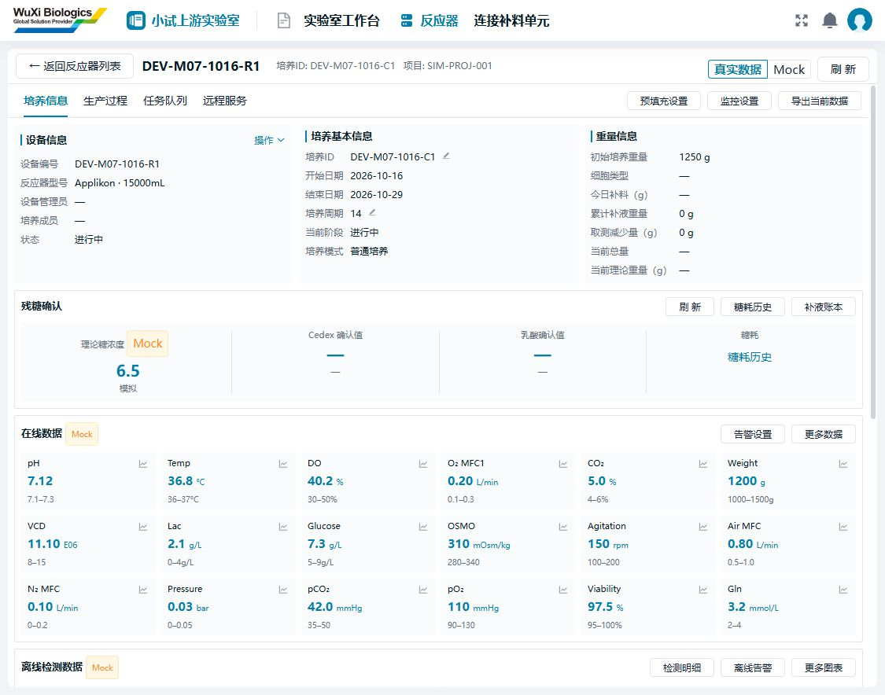
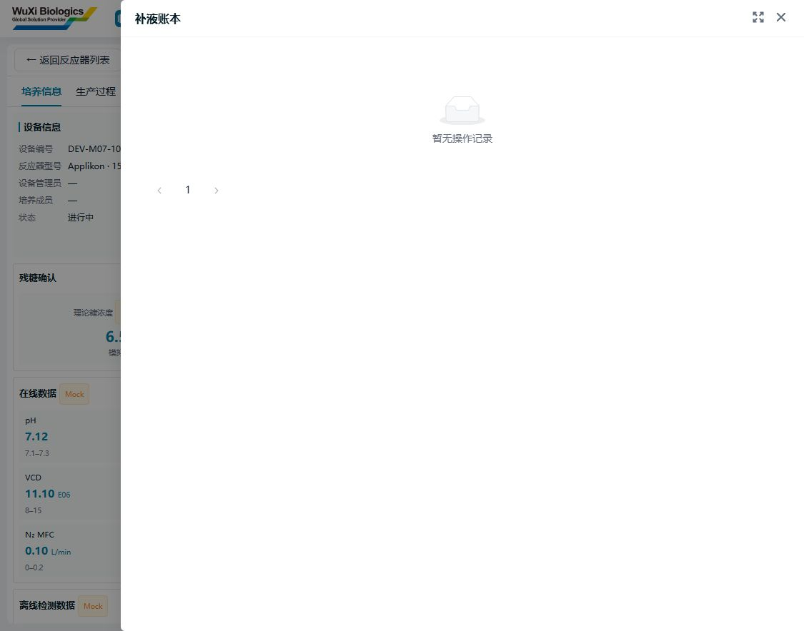
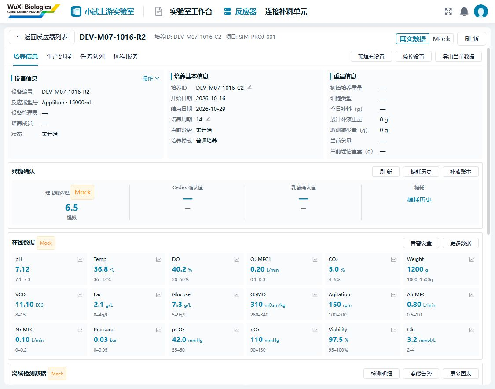

# 反应器真实模式与补液读取联调（2026-10-16）

## 本轮结果与入口

为小试上游实验室（11001）新增两组独立开发反应器/培养关联，用真实数据库和HTTP服务验证详情、初始重量、余额及补液读取；这些记录是测试夹具，不是实验或泵执行事实。

入口：[反应器真实模式](http://127.0.0.1:5581/labs/11001/reactors?feeding=reactors)。选择“真实数据”，点击 DEV-M07-1016-R1 或 R2。

- [R1：运行中、初始重量1250g](http://127.0.0.1:5581/labs/11001/reactors?feeding=reactor&reactor=861016101)
- [R2：未开始、重量未登记](http://127.0.0.1:5581/labs/11001/reactors?feeding=reactor&reactor=861016102)

## 数据清单与隔离边界

|对象|ID/标识|用途|
|---|---|---|
|现有模拟项目（只引用）|99001 / SIM-PROJ-001|不修改项目和原有成员|
|新增批次|861016010 / DEV-M07-1016|两个培养的共同批次|
|新增批次负责人关联|861016010 → 用户1|当前开发管理员可见|
|新增设备|861016101 / DEV-M07-1016-R1；861016102 / R2|复用已有15L型号；无IP、端口或泵映射|
|新增培养|861016201 / C1；861016202 / C2|分别为RUNNING和NOT_STARTED；计划2026-10-16～29|
|新增占用|861016401 / 402|分别RUNNING和RESERVED，仅占用这两台新增开发设备|
|新增运行余额|culture_id 861016201 / 202|初始累计补液、取液均0；writer UNKNOWN、readiness BLOCKED、plan barrier BLOCKED|
|新增重量来源夹具|861016301|为C1的1250g提供非悬空来源；快照/策略/回执均写明DEV、synthetic、notBusinessReceipt|

共11条新记录。C1重量版本1；C2重量为null、版本0。没有插入账本、执行记录、真实审批或完成工作流。C1运行状态和初始重量来源为合成测试状态，**不能据此认定初始重量写入审批、培养启动或W03执行已经验证**。所有新设备都不可实际执行。

导入SQL：[seed-m07-linked-cultures-20261016.sql](tools/seed-m07-linked-cultures-20261016.sql)。导入器：[SeedM07Dev.java](tools/SeedM07Dev.java)、[PowerShell入口](tools/seed-linked-cultures.ps1)。只允许ymsw_v2、限定表INSERT、事务提交、核对行数；重复导入因主键冲突整笔回滚，不覆盖原数据，不执行DDL或全库初始化。脚本从本机.local读取连接配置，不包含密码。

本机已导入，**不要重复执行**。其他同结构开发库需先核实项目99001、实验室11001、型号1300175020131225600及用户1存在，再显式传入-Apply。若后续清理，必须先检查这些ID是否新增了真实业务依赖，再按占用/重量来源/运行余额/培养/批次负责人/批次/设备的依赖顺序处理；保留既有项目和型号。未自动执行清理。

## 接口与页面接线

以下业务路径均经9090网关的/system前缀调用；前端继续使用统一SDK、登录权限和请求取消机制。

|接口|HTTP结果|页面行为|
|---|---|---|
|GET /resource/culture/list?labId=11001|200，2个培养|与7台设备列表正确关联（原有5台+新增2台）|
|GET /lab/labbenchreactor/861016101|200，Applikon、15000mL、IN_USE|读取原设备详情|
|GET /resource/culture/{id}|两组200|培养编号、计划日期、状态、项目和批次|
|GET /resource/culture/{id}/initial-weight|两组200，1250/null|分别显示1250 g/—，不把未知当0|
|GET /run/cultures/{id}/balance|两组200|显示累计补液0 g、累计取液0 g；缺失净量保持—|
|GET /run/cultures/{id}/ledger?pageNum=1&pageSize=10|两组200，data.rows=[]、total=0|新增“补液账本”抽屉，分页读取；EesNoData空态|
|GET /run/cultures/{id}/glucose-candidates?onlyConfirmed=true|两组200，[]|残糖/乳酸读取已确认值；未确认显示—|
|GET /run/cultures/{id}/glucose-history|两组200，[]|新增“糖耗历史”抽屉；hasValue=false不显示伪糖耗|
|GET /run/workflows/candidates?labId=11001&subflowCode=W03|200，2条不可选候选|返回“台式反应器未配置有效控制器连接”，原真实操作页继续显示阻塞原因|

初次W03查询因夹具缺少占用记录返回503，补齐开发设备占用后复验200；完整请求与响应见[脱敏HTTP记录](assets/linked-culture-http-20261016.json)，不含登录密码和令牌。

本轮修复真实培养关联：后端当前device.ref.labId为null，前端允许使用同一培养响应的lab.id作为实验室事实；显式不同实验室、错误设备类别、缺失全部实验室信息仍拒绝匹配。没有移除实验室隔离校验。

新增读取区域独立检查run:balance:query/run:glucose:query；单个接口失败不会丢弃其他成功结果，403/空数组不会变成Mock成功。切换培养时中止旧请求，清除旧抽屉与页码，防止串数据。组件继续复用SmpDetailDrawer、EesNoData、vxe-grid、tableDefaultConfig和项目Ant/主题样式。

## 保留Mock和未完成项

- 当前净重、理论净重、料袋余额后端仍返回null；今日补液、窗口取液在无账本时也为null。前端不自行拼公式补造。
- 理论糖浓度仍为独立标记的Mock示例；已确认糖/乳酸及糖耗历史已改为真实读取。
- 在线指标、离线曲线、生产过程样例及缺失的设置继续Mock；未将设备ID冒充观测通道ID。
- 新UX批量连接向导继续Mock。真实W03只支持单培养启动，现有W03/W06/W07操作页保留；开发设备无连接/泵映射，不执行真实泵命令。
- 初始重量真实编辑仍需完整的已完成工作流事实、M06策略/审批、版本冲突与未知结果恢复联调；本轮只验证重量读口，不绕过写守卫。
- 当前开发库run_culture_runtime缺少源码部分写映射引用的runtime_stream_id/runtime_stream_sequence/runtime_last_event_key。余额读取不依赖这三列，本轮未扩库；真实连接写链路启用前需对照现行基线核对。
- 账本/确认/历史已验证真实空集合；非空业务数据的真实执行产生链路仍待设备联调，前端非空与缺值分支已做单元测试。

## 验证记录

- 12个培养相关HTTP读请求全部200，断言重量1250/null、累计0与未知净量null；设备详情、列表和W03候选另外核验。
- 43项针对性测试通过（feeding-runtime-readings 4、reactor-detail 7、reactor-overview 3、feeding-prototype 29）；本地化8项通过，共51项。
- 本地化测试首轮受本机文件扫描耗时影响超时，单独以60秒上限复跑8/8通过；未修改测试断言。

- 重建SDK类型后，app-smp-lab类型检查通过；首次检查使用旧SDK声明失败，已重建解决。
- app-smp-lab及依赖7个包的build/build-dts全部通过，应用hash为3b9a0f34。git diff --check通过（仅换行符提示）。
- 5581浏览器核验：真实模式7台设备、R1/R2培养关联正确；R1为1250 g，R2为—，两者累计补液/取液为0 g；真实账本与糖耗历史均呈现EesNoData。
- 浏览器未观察到新增error；W03候选的200及不可选状态以HTTP记录为准。未执行W03启动/预填充。
- 本轮未重跑全量测试/全局UI规则，原交付文档中的既有失败记录仍有效。

