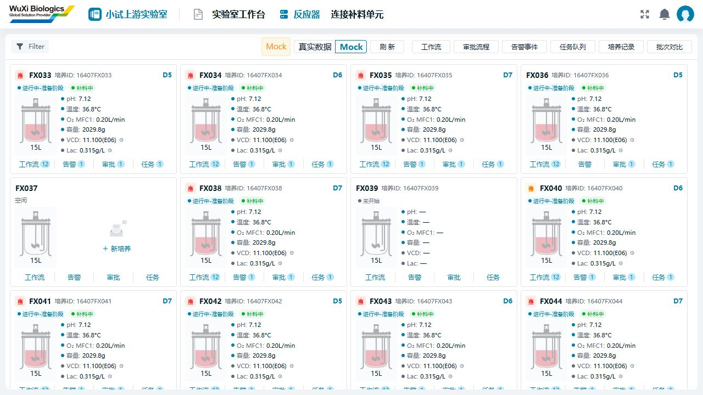

# 本机启动与原页面复用修正

日期：2026-10-15。基线：16a3b72c4306db67c4449d67e3f8222e92dd89ed。未提交 Git。

## 1. 当前结果

- Docker 已恢复，项目 Redis 容器健康；新版网关、认证、业务服务已启动，三个健康检查均为 UP。
- 主入口为 http://127.0.0.1:5581 。已使用现有账号完成无验证码登录，进入原门户和小试上游实验室。
- 真实反应器列表读到 5 台设备；真实 W03 候选接口返回空列表，页面正常显示无可用培养。未创建培养、发起真实工作流或下发设备命令。
- 已通过菜单管理新增顶部“反应器”，直接进入独立总览；该页面去掉冗余工作台标题、欢迎区和内部功能栏。原工作台保留，补液原型预览入口仍可用。
- 验证码保留完整实现，开发默认关闭，显示与校验由同一个后端配置控制。

## 2. Docker 故障与处理

Docker Desktop 初始化 Inference manager 时，尝试清理旧 Unix socket 失败：

> listening on unix://C:/Users/FFA/AppData/Local/Docker/run/dockerInference: remove ...: The file cannot be accessed by the system.

检查时 Docker 进程已经退出，运行目录仍有旧 socket/ReparsePoint。将旧运行目录保留为带时间戳的 stale 备份，重建运行目录后重新启动 Docker Desktop。没有恢复出厂设置，没有删除镜像、卷或项目容器。最终 docker version、docker ps 正常。

本次相关目录为用户目录下 AppData/Local/Docker/run 和 AppData/Local/docker-secrets-engine；故障备份仍留在原父目录。不要把此次旧 socket 故障泛化为今后任何启动失败都应该删除运行目录。

## 3. 新版后端启动方式

现有 .local/dev.ps1 是旧版单体项目脚本，8080 服务不对应当前前端。当前前端 scripts/portal-environment.ts 的代理目标是 9090。

| 端口 | 服务 | 本次结果 |
| --- | --- | --- |
| 5581 | futurefab-frontend 门户 | 已登录并读取真实页面 |
| 9090 | futurefab-gateway | 健康 UP；/code 返回 code=200 |
| 9200 | futurefab-auth | 健康 UP；现有账号登录成功 |
| 9201 | futurefab-system | 健康 UP；真实设备/培养和 W03 候选读取成功 |
| 6379 | yaoming-smp-redis | Docker healthy，新版使用逻辑库 9 |
| 5828 | 补液独立组件预览 | 仅开发 Mock 调试，非正式门户 |

本轮临时启动过的旧版 8080 和旧 Mock 9080 进程已停止。其他项目容器未停止。没有启用本地 MySQL：新版使用现有开发库 ymsw_v2；密码来自本机私有配置，不写入文档。

本机启动文件（均在 Git 忽略目录 .local 内）：

- microservices/dev.ps1：Start / Status / Stop / Restart；可用 -Service gateway、auth、system 指定单个服务。只操作本脚本记录且启动时间匹配的进程。
- microservices/overrides.properties：本机 Redis、数据库环境变量、127.0.0.1 监听和静态服务发现。
- logs/system.stdout.log、auth.stdout.log、gateway.stdout.log 及对应 stderr.log：运行诊断日志。

在项目根目录执行：

~~~powershell
& .local/microservices/dev.ps1 Start
& .local/microservices/dev.ps1 Status
# 修改验证码配置后，仅重启网关
& .local/microservices/dev.ps1 Restart -Service gateway
# 需要停止本次启动的新版服务时
& .local/microservices/dev.ps1 Stop
~~~

未找到与此项目匹配的本机 Nacos。启动读取 nacos-config/application-dev.yml 与各服务 dev.yml，以本机 SimpleDiscoveryClient 定位 auth/system，关闭 Nacos 注册和配置导入；没有使用其他项目的 Nacos 缓存。文件服务未启动，本次未验证附件上传等能力。

NamedPipe、SDMS 客户端以及可配置的结果拉取/重试调度在本机覆盖中关闭。部分内部事实投递 worker 是服务本身的固定调度；本次不将“未手工发送设备命令”表述为“所有后台任务都停用”。

## 4. 后端启动修复

业务服务首次启动报 M07RuntimeFactOutboxPublisher 无默认构造器。该类同时存在生产用三参数构造器和测试用四参数构造器，Spring 无法自动选定注入入口。

修复：在生产构造器添加 @Autowired，保持测试时钟构造器不变。新增 M07RuntimeFactOutboxPublisherWiringTest，用最小 Spring 容器验证真实构造器注入，与原有 outbox 合约测试一起通过（4/4）。

Z 盘重编译两次在 testCompile 阶段发生 class 文件间歇性 NoSuchFileException，尚未确定底层文件系统原因。将同一批源码复制到 C 盘临时目录后构建与测试成功，再将 system jar 放回项目 target。日志保存在 .local/logs/system-local-build.log；构建临时路径记录于 .local/backend-build-path.txt。这不是修改业务源码规避测试失败。

## 5. 验证码开关与登录排查

配置位置：[futurefab-gateway-dev.yml](../../../../nacos-config/futurefab-gateway-dev.yml)。

~~~yaml
security:
  captcha:
    enabled: false # 开发默认关闭；改 true 恢复
    type: math
~~~

- false：/code 返回 captchaEnabled=false，原登录组件隐藏验证码输入和图片，网关跳过验证码校验。
- true：原组件显示验证码，网关重新校验；图片生成、刷新、校验代码全部保留。
- 本机配置覆盖文件没有第二份 enabled 值，避免修改源配置后仍被覆盖。
- 本机文件启动需要重启 gateway；未来如使用 Nacos，需同步发布对应 DataId 的值。

认证日志中的此前多次失败为“用户名或密码错误”，不能认定验证码本身故障。用户随后提供并登录了现有账号，本次又验证关闭验证码后登录成功。密码不写入文档、源码或新凭据文件。

只读检查确认数据库保存 BCrypt 哈希，旧本地开发凭据不适用于当前库。因现有账号已恢复使用，未执行新账号 INSERT，也未修改任何已有账号密码；预备的未使用随机凭据文件已清理。

## 6. 原页面与组件复用

| 位置 | 本次修正 |
| --- | --- |
| reactor-overview / lab-overview | 新增正式“反应器”菜单页；原工作台不被替换，旧feeding参数链接在有权限时跳转到新页 |
| run-workflows | 真实 W03 页面保留；原型预览作为页面内按钮，返回后重新读取真实候选 |
| 任务队列/培养记录 | 已有页面被授权时打开原页面；不绕过门户授权自行构造业务菜单 |
| 补液分步侧栏 | 复用 sdk-smp-common 的 LeftMenu、right-content 插槽及折叠/滚动行为；小试保留连接、其他、补料补充、取样补充、废液、手工六项；右侧内容独立滚动，侧栏保持可见 |
| 反应器图示 | 复用原 tank-bg.png 轮廓，由 sdk-smp-common/ReactorVessel 统一渲染；有培养时液体为原型粉色 #efb8bf，避免使用主题蓝色充当料液颜色 |
| 其他基础组件 | 沿用 PageContainer、VXE、SmpDialog、SmpDetailDrawer、ConfirmModal、项目 ECharts 与中英文文案 |
| 真实培养关联 | 按设备种类、实验室和 ID 关联，避免不同设备表同号误配；DELAYED 培养仍按占用培养显示 |

图示液位是装饰，并非采集测量值。真实接口未给出的 pH、温度、重量等显示“—”；演示值有明确标记。新增页面使用项目样式，不把原型截图的整个导航系统复制成另一套菜单。

当前小试上游实际主菜单为“实验室工作台”“反应器”“连接补料单元”。“反应器”来自系统菜单管理的持久化配置，使用现有实验室模板和门户授权机制。其他未开放功能保持原状态。

## 7. 验证与边界

| 检查 | 结果 |
| --- | --- |
| Docker 引擎、项目 Redis | 正常 / healthy |
| 9090、9200、9201 /actuator/health | 均 UP |
| 门户 /dev-api/code | code=200，captchaEnabled=false，无图片 |
| 无验证码登录 | 浏览器进入真实门户成功 |
| 顶部反应器菜单 | 保存后可见，点击直达 /labs/11001/reactors；真实5台、Mock12台；总览无冗余工作台功能栏 |
| 原 W03 页面 | 真候选加载完成，当前空列表；未发起真实写入 |
| 前端针对性回归 | 本轮92/92通过（7个文件）；此前登录挑战4/4通过 |
| app-smp-lab 类型检查 | 通过 |
| app-smp-lab 及依赖构建 | 7 个包通过；最终页面微调后再次构建 app-smp-lab 通过 |
| 后端构造器注入与 outbox 合约 | 4/4 通过；业务服务成功启动 |
| 全量前端测试、全局 UI 规则 | 沿用原交付记录的未通过项，本轮未宣称全量通过 |

本轮不代表实际泵运行、现场设备、任务写入或所有角色授权已验收。更完整的功能清单、Mock 分界、此前全量测试失败项见[补液前端原型版交付说明](补液前端原型版交付说明-20261015.md)。

## 8. 正式入口截图

以下来自5581正式门户新增“反应器”菜单页；Mock标签区分示例数据。

## 9. 菜单保存故障修复

菜单保存曾被开发库审计表缺少record_key阻塞。经用户明确授权，先备份ymsw_v2.sys_data_change_log的表结构和214条记录，再按现行开发基线补字段、索引、二选一约束，并将record_id改为可空。原列数据修复前后逐字节相同。之后通过菜单管理创建反应器，审计增至215条；未绕过审计、未直接写菜单表、未运行整库安装脚本。

备份：`.local/backups/menu-audit-20261015-1792059952923/`；已执行SQL记录：`.local/microservices/repair-menu-audit-schema.sql`。另重建了过期的app-smp-settings产物，使原有管理版本/请求ID逻辑生效；未为此重启业务服务。配置与截图详见[交付说明第8节](补液前端原型版交付说明-20261015.md#8-本轮反应器菜单与ux修正)。

## 10. 详情与补液UX续修

本轮未修改端口、后端、数据库、菜单或验证码配置。继续使用5581正式门户与9090网关。

- “反应器”卡片点击设备号进入详情；真实空闲设备详情已读到品牌/容量。
- 总览去掉“真实接口”标签，仅保留数据模式按钮；空闲卡片、任务空态、原W03空候选统一EesNoData。
- 空闲/运行中详情、生产过程以及批量补液的选择、现量、预填充、完成页按UX重排；复用LeftMenu、ReactorVessel、原图片、项目表单/弹窗/图表。
- 新接M03初始重量、M07余额只读SDK；本机尚无关联培养，真实重量浏览器联调待补。批量新UX、在线/离线观测等缺接口部分仍为明确标识的Mock；真实W03/W06/W07沿用既有页面。
- 46项针对性测试通过，类型检查通过，7包构建通过；浏览器已走通双反应器8瓶、泵启停互斥、自定义泵速、跳过原因及完成。
- 修复浏览器验收发现的悬浮提示遮挡相邻停止按钮问题。没有发送实际设备命令。

当前截图、接口边界及后续接入顺序见[交付说明第9节](补液前端原型版交付说明-20261015.md#9-详情与补液流程ux还原2026-10-15续)。第8节截图为此前菜单轮留档，以交付说明第9节为准。
