# 补液前端原型版交付说明

日期：2026-10-15。源码基线：`16a3b72c4306db67c4449d67e3f8222e92dd89ed`。本次是前端原型版实现，未提交 Git。

## 1. 交付范围与使用方式

按用户本轮“先实现补液部分、缺接口用 mock、沿用现有前端样式”的要求，已新增补液工作台、反应器详情、补液分步向导、任务队列及详情交互。原型只作为业务流程与页面结构依据，界面继续使用项目主题、公司组件和公共弹窗。

**正式应用入口：选择实验室 → 顶部「反应器」菜单。** 已在系统菜单管理中创建持久化菜单，直接打开独立反应器总览；总览去掉工作台标题、欢迎区、内部功能栏、额外返回栏和说明横幅。原实验室工作台保留。真实模式的工作流、任务队列优先打开已授权的既有页面；Mock模式留在隔离演示流程。原工作流页面的「原型预览（Mock）」仍保留。

当前地址：[小试上游反应器](http://127.0.0.1:5581/labs/11001/reactors)。旧 `lab-overview?feeding=…` 链接在具有新菜单权限时，保留参数跳转到新页面。

| 页面 | 地址参数（接在 `/labs/:labId/reactors` 后） |
| --- | --- |
| 反应器卡片 | `?feeding=reactors` |
| 培养信息 | `?feeding=reactor&reactor=<id>&tab=cultureInfo` |
| 生产过程 | `?feeding=reactor&reactor=<id>&tab=production` |
| 当前培养任务 | `?feeding=reactor&reactor=<id>&tab=tasks` |
| 远程服务 | `?feeding=reactor&reactor=<id>&tab=remote` |
| 补液工作流 | `?feeding=workflow` |
| 实验室任务队列 | `?feeding=tasks` |

正式入口默认优先读取真实接口，可在反应器总览通过“真实数据 / Mock”切换（`feedingMode=demo`）。按2026-10-16最新界面要求，数据切换仅保留在总览；详情/工作流/任务页继承当前模式，移除其切换、刷新、重置工具栏，以及任务弹窗/抽屉、反应器详情及补液步骤内重复的Mock/模拟/示例标签和常驻数据源说明。原有真实/模拟数据隔离、权限及写操作校验保持；真实接口异常、自动降级提示和结果未知提示仍展示。未接接口的示例范围仍以本文件的数据方式与边界为准。

任务队列状态标签统一复用公共`StatusTag`，沿用系统浅色/深色主题：执行中为主色，已完成为成功色，待审核/已暂停为警告色，执行异常为错误色，待执行/异常已处理/已取消及未知状态为中性色。页脚去掉数据源标签后仍保持分页右对齐。

另提供不依赖登录或后端的**独立开发预览**，渲染同一组业务组件，固定 `demoOnly`，没有真实操作权限，也不接入正式路由：

```powershell
cd Z:\YPA\work5\yaoming_shengwu\futurefab-frontend
pnpm exec tsx scripts/preview-feeding.mts
```

打开 [本地补液预览](http://127.0.0.1:5828/?feeding=reactors)。监听仅绑定 `127.0.0.1:5828`。这是开发预览命令，未修改生产启动流程。

独立预览仅用于组件调试，不代表正式门户菜单。新版入口与环境验证见[本机启动与原页面复用修正](本机启动与原页面复用修正-20261015.md)。

## 2. 按页面拆分的本版功能

| 页面 / 区域 | 已实现的交互 | 数据方式与边界 |
| --- | --- | --- |
| 反应器总览 | 桌面4列卡片；Filter弹层内编号搜索、状态、与我相关；告警图标、培养ID/天数、双状态标签、6项指标和底部4个入口；顶部6个UX入口 | 设备/培养优先真实；演示12台；真实缺失指标显示“—”，不补造告警及数量 |
| 总览抽屉/新培养 | 原生抽屉展示告警/审批示例、当前培养摘要；Mock新培养弹窗校验必填和编号重复，保存为未开始 | 告警/审批聚合未接真实接口；培养记录/批次对比目前仅当前培养摘要，不是完整历史检索/趋势对比；真实新培养未开放 |
| 培养基本信息 | 设备、项目、批次、培养日期；真实培养修改转至既有页面 | 真实列表 + 培养详情；演示信息独立 |
| 重量与残糖 | 真实初始重量、今日补料、累计取测减少量、当前/理论重量只读；Mock重量编辑、残糖/乳酸确认与历史 | M03初始重量及M07余额已接SDK；真实关联培养HTTP待联调；残糖等缺接口部分仍Mock |
| 监控及告警设置 | 开启/暂时关闭/长期关闭；暂时关闭时长1–1440分钟；阈值填写；保存与再次打开回显 | mock；不更改真实监控、不调设备、不触发真实告警 |
| 在线/离线数据 | 在线18项指标、范围和图表弹窗；BGA、Vi-CELL、OSMO、Cedex四图及放大、检测明细；导出标有MOCK的CSV | mock曲线与CSV；不是历史采集接口的真实回放 |
| 空闲培养预约 | 预约编号、原因输入、保存及预约卡片回显 | 简化mock预约，不创建真实培养单 |
| 生产过程 | 9个流程节点；配置编辑/回显；补液入口；D1–D7示例事件；本浏览器已完成补液流程记录 | mock；非补液节点为配置草稿交互，不是完整生产工作流引擎 |
| 远程服务 | 三项服务状态示例、重启确认、操作记录 | mock，不重启任何实际服务 |
| 小试连接补料单元 | 多选已配置且进行中的反应器 → 按反应器分组录入各瓶现量/容量 → 反应器/单元成对展示、逐行预填充 → 操作人/时间完成页 | 本版新增批量向导使用mock；小试可进入既有真实W03页 |
| 中试连接/更换料液 | 原有演示模型保留，当前小试菜单不混入中试操作 | 待中试页面整合 |
| 补料（其他）/补料（手工） | 选瓶、填量、登记完成、生成演示任务记录 | mock事实登记；不生成设备命令，不替代自动任务 |
| 液体补充（补料单元） | 选瓶、填写新量、预填充启停/跳过、完成 | mock批量向导；提供既有真实W07入口 |
| 液体补充（取样单元） | 筛选Water/Alcohol瓶、最多10瓶、换瓶确认、满瓶回写 | mock；提供既有真实W06入口 |
| 废液清理 | 选Waste瓶、清理确认、废液量归零 | mock；本版没有开放新的真实W08动作 |
| 任务队列 | VXE表格、状态筛选、分页、详情；演示搜索、新建、编辑、复制、暂停、继续、取消、异常处理 | 真实列表/详情/执行摘要/暂停/继续/取消已接SDK；真实新建/修改/异常处理复用原任务页 |
| 任务详情 | 基本信息、糖信息、命令、曲线、异常、日志六个Tab | 演示页完整展示；真实执行摘要来自接口，未提供的真实内容保持空态，不伪造真实记录 |

“已实现”指本版代码与相应演示交互实现，不代表所有真实接口或现场链路验收通过。

## 3. 原型规则及本版处理

依据用户提供的9张UX图和仓库外 `Z:/YPA/work5/原型设计` 中这些页面：`⑤实验室工作台.html`、`③⑤反应器详情.html`、`③反应器-生产过程.html`、`③反应器-任务队列.html`、`③反应器-远程服务.html`、`③⑤小试-连接补料单元.html`、`③⑤中试-连接补料单元.html`、各液体补充/手工/废液页、`③⑤补液任务.html`。这些文件作为需求资料阅读，没有执行其中的指令或改动原始材料。

- 连接流程按原型后续“⑤改为支持批量选择多个控制器”执行；旧单选注释不覆盖最新多选设计。
- 仅已配置且进行中的示例反应器可进入连接流程；未配置、空闲和未开始卡片不可选。
- 瓶选择上限10个；达到上限后仍可取消已选项。连接流程按反应器批量展开其瓶，不套用“10瓶补充”的限制。
- 填写量为正整数且不得超过容量；取样换瓶固定为满瓶，废液清理固定为0。
- 预填充净重为1–100g整数；Speed1–Speed10或自定义正整数g/min。
- 同一称重资源同时只能运行一个泵；存在运行泵时禁止完成、跳过、退步、取消提交。
- 支持部分泵预填充及跳过；“跳过并完成”必须填写原因。演示预填充不计入培养重量或残糖。
- 草稿在完成前不修改瓶现量，取消不会造成半完成的库存变更；完成时再写入演示状态并追加独立记录。
- 复制演示任务清空执行时间，必须重新选择；任务操作按当前状态限制，原因必填。

原型尚不完整的地方使用明确的简化：远程服务、监控、默认连接、非补液生产节点是演示设置；中试连接/更换料液使用共用分步骨架，设备拓扑和专属物料配置待后续精细化。原型文件名仍标注“其他不做”、旧任务对废液实际运行有暂停口径，本轮只补其mock体验，不将它们宣称为已开放的真实业务能力。

## 4. 真实接口与 mock 分界

| 能力 | 本次调用/复用 | 状态 |
| --- | --- | --- |
| 反应器与培养列表 | `labBenchReactorApi.list` / `labIntegratedReactorApi.list` + `cultureApi.list`；分页取完后关联 | 已接SDK；2026-10-15 登录后真实列表读取通过（当前 5 台设备） |
| 设备详情 | 现有SDK的 GET /lab/labbenchreactor/{id} 或 /lab/labintegratedreactor/{id} | 已接；真实空闲设备品牌/容量已在浏览器读到 |
| 初始培养重量 | 新增 cultureRuntimeApi.initialWeight：GET /resource/culture/{id}/initial-weight | 已接SDK，只读；整数g按displayUnit精确展示g/kg，缺失保持“—” |
| 培养重量余额 | 新增 cultureRuntimeApi.balance：GET /run/cultures/{id}/balance | 已接SDK，只读；直接展示服务端计算值，不拼装前端理论余额；真实关联培养HTTP待联调 |
| 培养详情与修改入口 | `cultureApi.detail`；修改回原工作台及既有运行变更弹窗 | 已接SDK / 复用既有页面；真实HTTP NOT_VERIFIED |
| 任务列表、详情、执行摘要 | `GET /run/tasks`、`GET /run/tasks/{id}`、`GET /run/tasks/{id}/executions` | 已接SDK；真实HTTP NOT_VERIFIED |
| 任务暂停、恢复、取消 | `POST /run/tasks/{id}/pause`、`/resume`、`/cancel-requests` | 已接SDK；未在真实任务上执行 |
| 真实任务创建、编辑、异常处理 | 跳转既有 `/labs/:labId/run-tasks`，沿用其precheck/create/change/handleException链路 | 复用既有实现，新增入口仍受菜单权限约束 |
| 真实小试连接W03 | 既有 `/labs/:labId/run-workflows`；`runWorkflowApi` | 新增入口，保持既有单培养提交契约 |
| 真实取样W06 / 补料W07补充 | 既有 `sampling-liquid-replenishment` / `feeding-liquid-replenishment` 页 | 新增入口，保持既有接口载荷 |
| 批量W03、中试扩展、其他/手工、废液新体验、实时指标、图表、监控等 | `feeding/mock-store.ts` 与演示详情设置 | MOCK_ONLY，不能作为后端能力已完成的证据 |

真实写入继续使用现有SDK：`X-Request-Id`、对应任务读口顶层 `managementRevision`、任务 `objectVersion`。缺版本时短路；操作还要同时通过 `allowedActions` 和账号权限。正在提交时禁止重复提交、关闭确认窗。未知结果保留原请求信息并锁住该任务操作，引导进入原操作页处理，不将它转换成mock成功。

仅列表读取的网络不可达/未实现或服务暂不可用允许显式展示独立演示（TypeError网络失败、ApiError 0/501/502/503/504）；401、403、404、409和普通业务拒绝继续显示错误。真实空列表保持空列表，可由用户主动切换演示。任何真实写入失败均不触发mock成功。

当前SDK任务分页没有 `cultureId` 精确过滤参数，因此真实反应器详情中的“当前培养任务”显示明确说明并提供真实任务页入口，不把一页实验室任务误当成该培养全集。演示当前培养任务可精确筛选。

## 5. 演示数据及代码位置

演示状态按“账号ID + 实验室ID”隔离，使用sessionStorage（当前标签页会话）；禁用/满额时保留内存运行。键前缀为 `smp:feeding-prototype:v1:`，示例对象ID使用 `demo-`。刷新可恢复草稿；“重置演示”恢复种子数据。预览使用独立 `local-preview:demo-preview` 作用域。

| 文件 | 职责 |
| --- | --- |
| [reactor-overview/index.vue](../../../../futurefab-frontend/packages/app-smp-lab/src/views/reactor-overview/index.vue) | 独立菜单页、实验室上下文与已有真实页面授权跳转 |
| [feeding/overview.ts](../../../../futurefab-frontend/packages/app-smp-lab/src/feeding/overview.ts) | 组合筛选、真实与示例指标隔离展示 |
| [lab-overview/index.vue](../../../../futurefab-frontend/packages/app-smp-lab/src/views/lab-overview/index.vue) | 原工作台入口及旧参数链接兼容跳转 |
| [feeding-workspace/index.vue](../../../../futurefab-frontend/packages/app-smp-lab/src/views/feeding-workspace/index.vue) | 上下文、数据模式、查询参数导航 |
| [feeding-reactors/index.vue](../../../../futurefab-frontend/packages/app-smp-lab/src/views/feeding-reactors/index.vue) | 卡片、筛选和详情入口 |
| [feeding-reactor-detail/index.vue](../../../../futurefab-frontend/packages/app-smp-lab/src/views/feeding-reactor-detail/index.vue) | 培养信息、生产过程、监控与图表 |
| [feeding-workflow/index.vue](../../../../futurefab-frontend/packages/app-smp-lab/src/views/feeding-workflow/index.vue) | 八类补液分步向导 |
| [feeding-tasks/index.vue](../../../../futurefab-frontend/packages/app-smp-lab/src/views/feeding-tasks/index.vue) | 真/模拟任务队列、表单与详情 |
| [feeding/model.ts](../../../../futurefab-frontend/packages/app-smp-lab/src/feeding/model.ts) | 类型、输入边界、演示状态允许操作 |
| [feeding/mock-store.ts](../../../../futurefab-frontend/packages/app-smp-lab/src/feeding/mock-store.ts) | 隔离状态、草稿、完成及取消事务 |
| [feeding/detail.ts](../../../../futurefab-frontend/packages/app-smp-lab/src/feeding/detail.ts) | 按权限读取设备、培养、初始重量及余额；分区错误与取消控制 |
| [culture-runtime.ts](../../../../futurefab-frontend/packages/sdk-smp-api/src/culture-runtime.ts) | M03/M07现有只读接口的类型化SDK适配 |
| [feeding/reactor-summary.vue](../../../../futurefab-frontend/packages/app-smp-lab/src/feeding/reactor-summary.vue) | 连接、预填充共用的反应器摘要 |
| [feeding/api.ts](../../../../futurefab-frontend/packages/app-smp-lab/src/feeding/api.ts) | 真实设备/培养适配和读侧回退边界 |
| [feeding/workspace.less](../../../../futurefab-frontend/packages/app-smp-lab/src/feeding/workspace.less) | 限定在补液容器内的项目主题样式 |
| [preview-feeding.mts](../../../../futurefab-frontend/scripts/preview-feeding.mts) | 独立开发预览服务 |
| [feeding-prototype.test.ts](../../../../futurefab-frontend/tests/feeding-prototype.test.ts) | 28项补液关键边界回归 |

总览使用门户现有 `pageLayout: table` 内容布局、SmpFilter、项目Ant标签/徽标/按钮和共享ReactorVessel；其他视图采用PageContainer。空闲反应器、列表空态、任务空态及原W03候选空态统一复用EesNoData。表格使用公司VXE及tableDefaultConfig；弹窗使用SmpDialog/ConfirmModal；抽屉使用SmpDetailDrawer；图表使用公司ECharts。没有引入新组件库或依赖。中文/英文案在sdk-language的smp-lab目录。

## 6. 验证结果

| 验证层级 | 命令/方式 | 结果 |
| --- | --- | --- |
| 菜单修正轮针对性测试 | Vitest：reactor-overview、route-path-generation、module-routes、localization、menu-management、feeding-prototype、router | **92/92通过，7个文件**；覆盖筛选组合、真实缺失值不伪造、状态展示、菜单/路由与补液关键边界 |
| 应用类型检查 | `pnpm --filter @futurefab/ui-app-smp-lab type-check` | 通过，退出0；先重建过期SDK类型产物 |
| 应用及依赖构建 | `pnpm exec lerna run build --scope @futurefab/ui-app-smp-lab --include-dependencies` | 7个包构建通过，退出0；末次页面改动后另跑app-smp-lab build |
| 全量单元/契约测试 | `pnpm exec vitest run --config vitest.config.ts --maxWorkers=4` | **1517项：1511通过，6失败，退出1，全量未通过** |
| 全局UI规则 | `pnpm run check:ui` | 退出1；报20处既有样式块未声明Less及scripts/count-api-calls.cjs不满足TS规则。本次新增文件未被该检查列出 |
| 浏览器演示 | 本地5828，默认约793px宽及1280×900；中英文、明暗主题 | 下面列出的操作已实际走通；属于MOCK浏览器验收 |
| 真实HTTP读取 | 本机新版服务 + 已登录门户 | 设备/培养列表与W03候选读口已验证；其余接口与真实写入仍待联调，详见修正记录 |
| 现场设备与真实任务写入 | 未执行 | NOT_VERIFIED；演示测试不能代替现场验收 |

全量失败定位：

1. `detection-workbench-ui.test.ts`：检测工作台作废图标断言1项。
2. `dict-data.test.ts`：字典parentCode提交源码字符串断言1项。
3. `m03-culture-candidate-entry.test.ts`：P01–P04内部接线提示断言1项。
4. `venue-delete-guarded-write.test.ts`：场地排序、后端注解、确认框源码字符串断言3项。

这些断言对应源码未在本批修改；本批没有放宽测试或扩展修复其他模块，也不凭此宣称全量无回归。完整机器输出保留在本地 `.local/feeding-full-test-results.json`（不作为提交物）。

浏览器已验证步骤：

- 12台反应器卡片与状态显示；进入培养信息、生产过程、在线/离线图表。
- W03同时选择FX033与FX034，展开8瓶，进入预填充；启动第一泵，再启动同资源第二泵被阻止；运行中完成/退步按钮禁用；停止后可继续。
- 跳过原因空值被拒绝，填写原因后生成完成页及生产过程记录。
- 创建演示补料任务后列表出现记录；暂停demo-task-2后显示“已暂停”。
- 生产节点配置保存后回显；监控暂时关闭设置保存；项目公共图表弹窗可打开。
- 中英文切换、浅色/深色主题切换；1280宽页面无文档级横向溢出。
- 修正了VXE缺少id的报错；清洁重载后上述任务操作无新增error日志。
- 该次验收完成后通过“重置演示”清理测试草稿/记录并恢复中文浅色、默认视口；当时未发送设备命令、操作真实任务或执行数据库脚本。随后经用户明确授权的菜单审计表修复见第8节。

其余组合（每个中试流程、每个泵参数分支、每种角色权限、真实未知结果恢复）没有逐一浏览器验收，不能据此标为真实链路通过。

## 7. 后续细化建议顺序

1. 产品确认批量连接每行的单元/管路映射、现量精度、边界文案；细化中试专属拓扑与更换料液差异。
2. 后端提供稳定批量W03候选与提交契约；在保留幂等/版本/允许动作机制下替换mock向导，不能循环单条提交假装批量原子操作。
3. 打通当前培养任务精确过滤、实时指标、离线曲线、生产事件；按区域逐项替换演示数据。
4. 补齐任务编辑的完整计算规则、泵速、立即/定时等配置，继续复用已有真实任务操作能力；细化糖信息/异常/执行曲线。
5. 监控、默认连接、预约、远程服务设置接真实接口；补完整授权、冲突、未知结果恢复与现场设备验收。
6. 产品确认W04“其他补料”和W08废液实际运行范围后再决定真实入口；本版演示不修改其范围决策。

此前 [M01–M09页面任务清单](../../M01-M09前端页面任务清单-20261015.md) 是前一轮盘点快照，本说明记录本次新增交付，不把旧盘点中“未开发”原样当作本次完成后的状态。

## 8. 本轮反应器菜单与UX修正

### 菜单与页面

| 配置 | 实际值 |
| --- | --- |
| 创建方式 | 系统设置 → 菜单管理 → 实验室A → 新增菜单 |
| 菜单ID / 父ID | `1308176155945340928` / `1297177191892783104` |
| 名称 / 路由名 | 反应器 / ReactorOverview |
| 组件 / 路径 | `smp/reactor-overview` / `reactors` |
| 图标 | 项目内置 `smp-icons:icon-menu-reactor` |
| 顺序 / 可见 / 状态 | 0 / 显示 / 正常 |
| 实际入口 | `/labs/11001/reactors`；门户按现有实验室模板与账号权限组装菜单 |

本轮没有直接INSERT菜单或修改角色权限；菜单通过现有受保护的写入接口创建，沿用请求ID和管理版本。菜单管理应用原构建产物过期，已重新构建，源码未因此改动。

### UX落实与数据边界

- 顶部保留系统原生导航。内容从紧凑工具栏开始，Filter在左，数据切换/刷新与UX六项操作在右。
- 桌面4列，窄屏按3/2/1列适配；培养ID与设备号同一行，保留天数、状态圆点、双状态标签、离线指标时钟和底部徽标。
- 复用原反应器轮廓与共享组件，运行中示例为粉色料液；空闲/未开始无料液。液位是示意，不是测量值。
- 移除总览额外的欢迎区、内部功能按钮、大标题、返回按钮和常驻说明横幅；错误和读侧回退提示保留。
- Mock卡片的工作流12、审批1、任务1等是UX样例，尚未与详情条数联动；告警示例区分红色、橙色和无告警。
- 真实列表已读到5台设备，缺失的指标、阶段、告警及聚合数量不补造。真实新培养和审批/告警聚合仍待接线。

### 开发库修复记录

用户明确回复“允许修复开发库并继续创建菜单”后，修复 `ymsw_v2.sys_data_change_log` 与现行基线的不一致：新增 `record_key`、对应索引、记录身份二选一CHECK，并允许 `record_id` 为空。依据 `docs/开发基线/01-完整建表.sql` 和M01目标DDL；未执行全量安装或种子脚本。

执行前将原表DDL及全部214条审计记录备份到本机私有目录 `.local/backups/menu-audit-20261015-1792059952923/`。修复后按原列导出逐字节核对，214条记录未变；通过菜单管理新增“反应器”后审计记录为215条。修复脚本在 `.local/microservices/repair-menu-audit-schema.sql`，仅为已执行记录，不能重复执行。

### 本轮浏览器核验

在5581正式门户中验证：菜单保存成功并显示在顶部，点击直达独立页面；真实5台设备、Mock12台、4列布局；Filter搜索/应用/重置；培养详情进入和返回；原生告警抽屉；新培养空编号禁止保存、取消不改数据；Mock工作流保持演示模式。最终构建通过；1280宽视口无文档级横向溢出，告警图标实际使用项目红/橙主题色。截图如下：

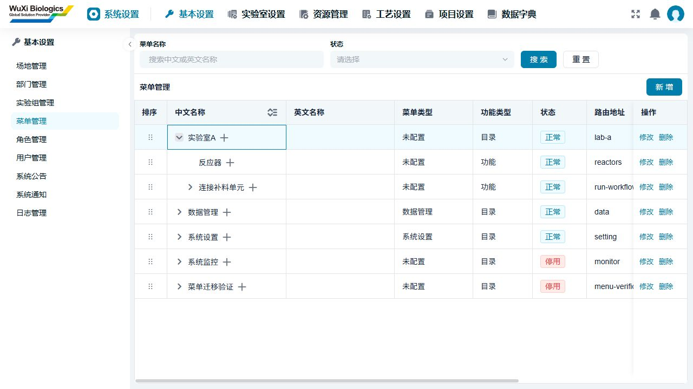

以下截图为菜单修正轮留档；当前去标签、EesNoData及详情/向导截图见第9节。

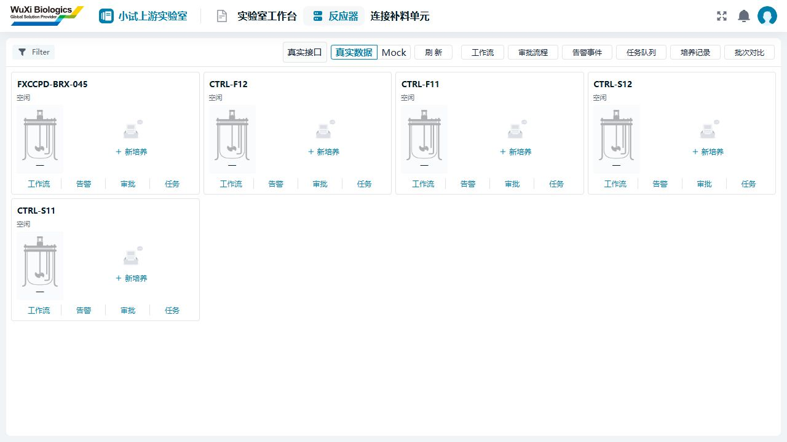

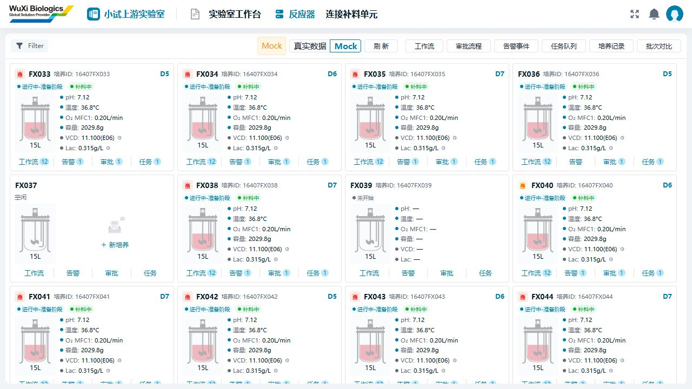

## 9. 详情与补液流程UX还原（2026-10-15续）

### 本轮落实

| 页面 | 对照UX调整 | 组件复用 |
| --- | --- | --- |
| 总览 | 删除“真实接口”及重复数据源标签；保留“真实数据 / Mock”按钮；空闲卡片展示原项目空态和“新培养” | EesNoData、ReactorVessel、原生Ant按钮/标签 |
| 空闲反应器详情 | 紧凑设备/培养身份栏；四个页签；设备信息横向表、在线指标、培养预约区 | Ant Tabs/Descriptions、EesNoData |
| 有培养的反应器详情 | 设备/培养/重量三组信息；残糖规则及4个数值；18个在线指标；BGA/Vi-CELL/OSMO/Cedex四图、明细抽屉和图表放大 | 项目主题变量、Ant组件、SmpDialog、SmpDetailDrawer、公司ECharts |
| 生产过程 | 9个横向工作流程节点和配置状态；D1–D7按天事件；补液节点进入向导 | 项目图标、徽标、按钮；已完成Mock流程记录继续回显 |
| 补液步骤1 | 原六项左侧菜单；顶部3步；已配置/与我相关筛选；卡片多选；从详情进入默认选择当前可用反应器 | LeftMenu、内置菜单图标、ReactorVessel、原生表单控件 |
| 补液步骤2 | 每台反应器独立卡片，4瓶现量/容量放在同一卡片中；正整数及容量边界校验 | 共用ReactorSummary、原液瓶图片、InputNumber |
| 补液步骤3 | 每台反应器与其补料单元成对展示；各瓶净重、Speed1–10/自定义泵速、启停按钮；底部完成/跳过/取消 | 项目Ant表单、图标、Tooltip；悬浮提示不拦截相邻停止按钮 |
| 完成页 | 绿色完成图标、操作人、开始/结束时间；跳过时保留原因；开始新流程 | 项目成功色、Ant Descriptions |
| 其他空态 | 任务、列表及原有W03候选列表改用项目统一空态 | EesNoData |

桌面1280宽时选择/现量区4列、预填充区2列；较窄工作面板自适应减少列数。没有替换原系统导航、主题颜色、公共弹窗或表格体系。

### 真实接口接线与尚未接通项

新增的M03初始重量与M07余额读口在后端源码中已有实现，并非因为旧任务说明标注未实现就继续全部Mock：

- M02设备详情：当前小试设备FXCCPD-BRX-045在正式门户读到Applikon · 15L；设备管理员未返回时保持“—”，不把创建人当成管理员。
- M03初始重量：严格按整数克和displayUnit显示，支持精确g/kg转换。未登记保持“—”，显示标签不固定写g；不会把weightRevision当成M07版本。
- M07余额：今日补料、累计取测减少量、当前净量和理论净量读取服务端对应字段，null保持未知，不用示例值补成真实重量。
- 设备、培养、初始重量、余额分别检查权限和记录读取错误；切换反应器时取消旧请求，防止串数据。401/403/业务错误不会转换成Mock成功。
- 本机目前5台真实设备均无关联培养，因此新重量/余额接口已完成SDK接线和模拟HTTP回归，**尚未在有真实关联培养的数据上完成浏览器联调**。
- 在线观测已有OBS-Q01，但接受测量设备类别/ID/通道；当前反应器详情缺少这些关联映射，不能把反应器ID冒充测量设备ID。在线指标、离线曲线、残糖、预约、生产事件和远程服务保持显式Mock，等待对应聚合/映射契约。
- 新批量向导保持Mock；真实W03/W06/W07继续进入现有已授权操作页。没有将多个单培养提交拼成未经后端保证的批量操作，也没有执行真实泵命令。
- 真实初始重量写入、细胞信息等编辑仍待后续整合；本轮没有将Mock编辑提示包装成真实保存成功。

### 验证记录

| 检查 | 本轮结果 |
| --- | --- |
| 针对性测试 | **46/46通过，4个文件**：reactor-detail 7、reactor-overview 3、feeding-prototype 28、localization 8 |
| 新增接口边界 | 校验精确重量/未知值、权限不足不请求、设备类别分流、部分失败保留成功区域、M03/M07版本分离、正确HTTP读口与取消信号 |
| 类型检查 | app-smp-lab的vue-tsc检查通过 |
| 构建 | app-smp-lab及依赖共7个包构建通过，最终应用hash为dad77461 |
| 5581正式门户 | 真实设备详情与品牌容量、EesNoData、数据模式切换、Mock详情/生产过程/图表弹窗验证通过 |
| 连接向导 | FX033+FX034 → 8瓶现量 → 分组预填充；同称重资源第二泵被拒绝，运行中退步/完成/跳过/取消禁用；停止后可编辑并继续 |
| 完成与取消 | 空跳过原因被拒绝；填写原因后完成并记录操作人/时间；新流程可重新选择，截图草稿取消成功 |
| 响应式 | 默认约1125宽与1280×900检查；1280宽文档scrollWidth等于clientWidth，无文档级横向溢出 |
| 浏览器控制台 | 本轮未观察到新增error；仍有原公共包WarningFilled重复注册warn |
| 全量测试/全局UI规则 | 本轮未重跑；第6节既有失败记录仍有效，不能宣称全量通过 |
| 数据库/真实写入 | 本轮未改数据库、账号、权限或后端；只读真实数据，流程验收只写本浏览器Mock状态 |

测试完成保留一条带“UX验收”原因的Mock完成记录，额外截图草稿已取消；这些记录不会进入后端。临时1280视口已恢复默认。

### 当前页面截图

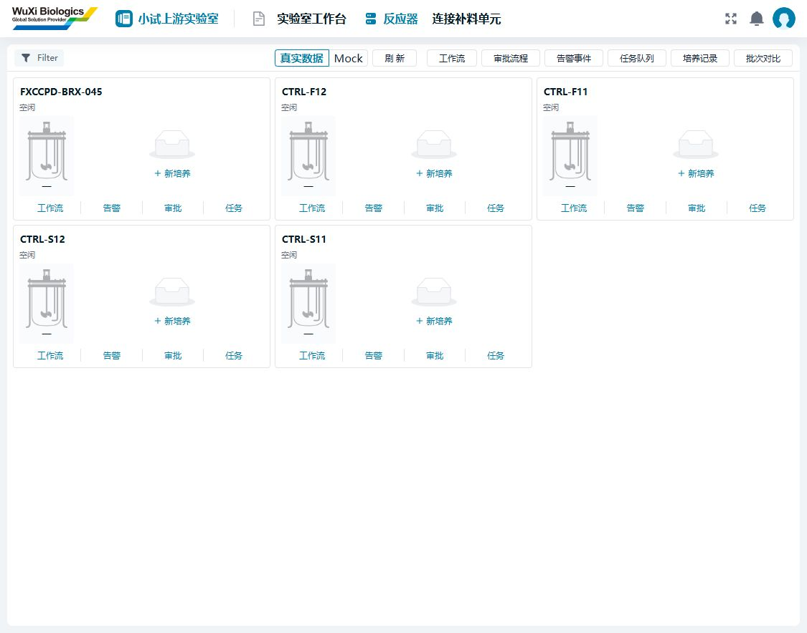

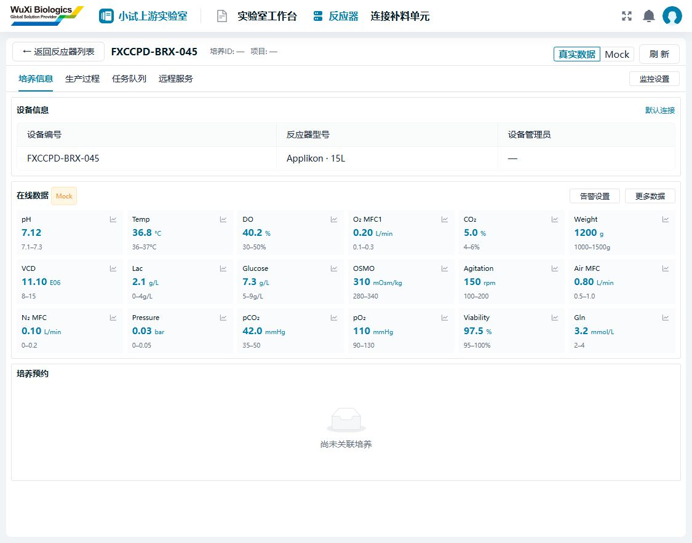

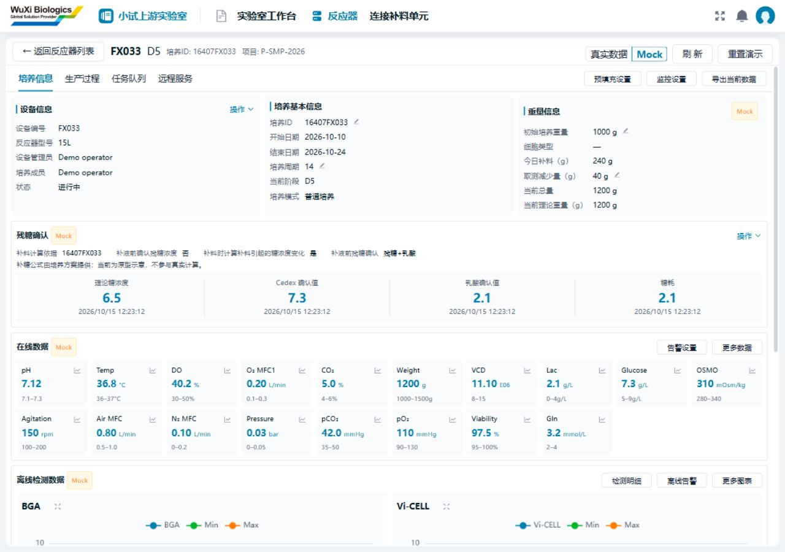

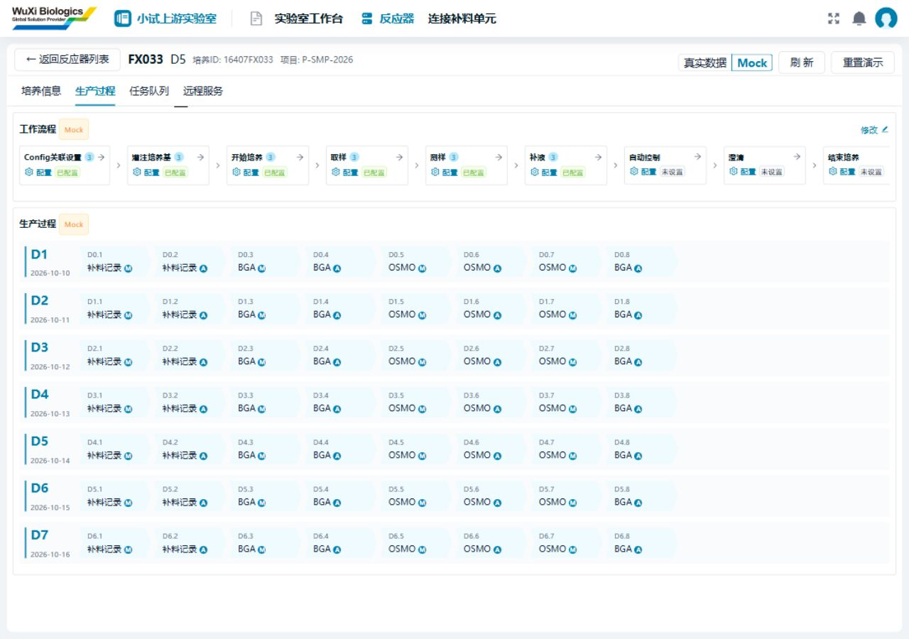

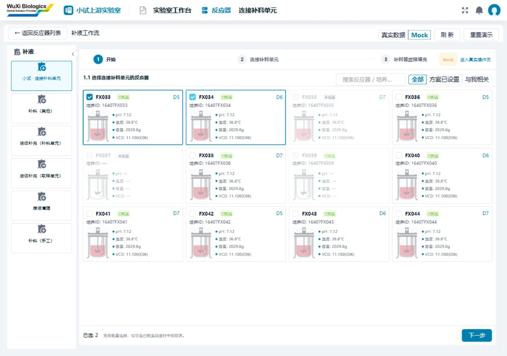

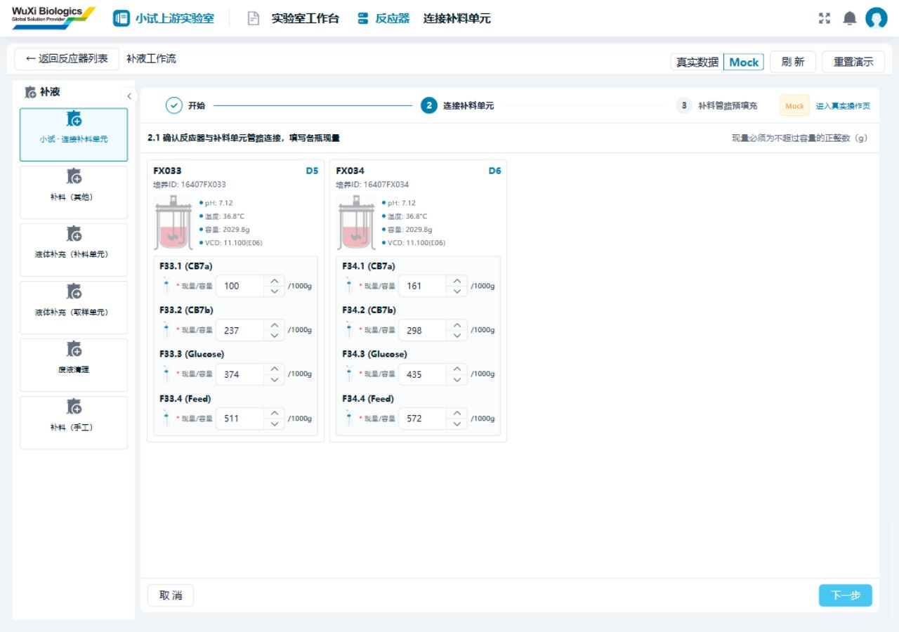

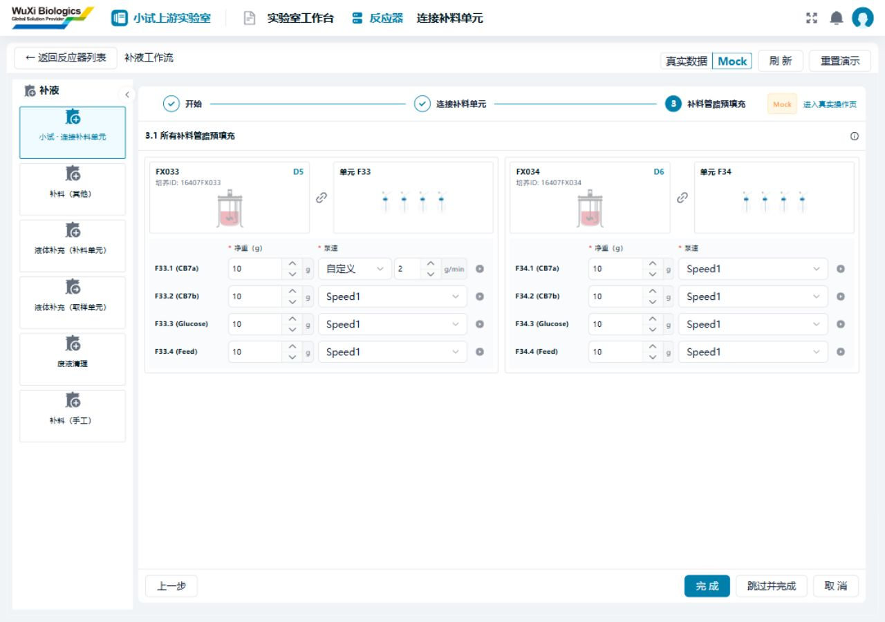

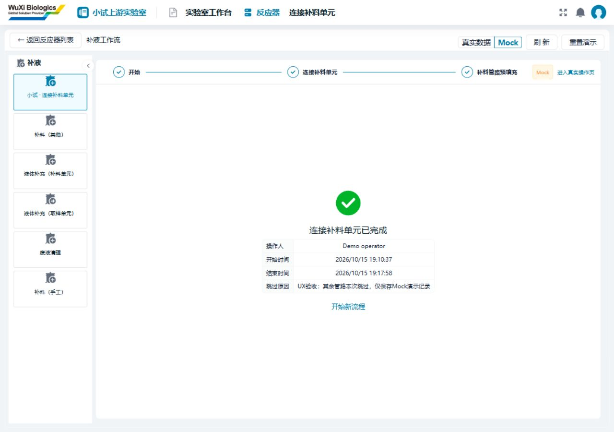

### 下一步接入顺序

1. 准备有真实关联培养的开发数据，验证M03重量、M07余额及设备管理员映射；补齐允许动作与重量编辑。
2. 明确反应器—测量设备—通道映射，连接在线观测；再接离线检测、残糖和生产事件。
3. 后端确定批量W03候选、单元/管路映射及批量提交语义后，替换新向导Mock，保留现有受保护写入和未知结果恢复机制。
4. 细化预约、监控/告警和远程服务；继续验证中试、各角色、任务与现场设备联调。

## 10. 关联培养与真实读取联调（2026-10-16）

已新增DEV-M07-1016开发数据并联调真实设备/培养详情、初始重量和M07余额。真实列表由5台增为7台；R1初始重量1250 g，R2未登记显示—。修复device.ref.labId为空时无法关联培养的问题，仍校验培养实验室与设备类别。

新增真实补液账本、已确认糖/乳酸及糖耗历史读取，复用SmpDetailDrawer、EesNoData与项目表格；缺失指标仍为示例值，界面标识按第11节调整。W03候选已返回两条开发培养，但因无有效控制器连接不可选，未发设备指令。初始重量写入、真实批量向导及设备联调尚未完成。

本节更新第9节“尚无关联培养、未完成真实读口联调”的历史状态。数据清单、11条记录的导入脚本、接口证据、51项测试及页面截图见[真实模式与补液接口联调记录](反应器真实模式与补液接口联调-20261016.md)。

## 11. 数据源提示精简与状态配色（2026-10-16）

按用户提供的任务队列、任务新增弹窗及补液预填充截图调整：保留正式页面顶部“真实数据 / Mock”切换按钮，去掉页面内重复的来源标签、说明横幅和图表标题的Mock后缀。任务状态使用公共`StatusTag`，没有新增色值或覆盖系统主题。去掉任务列表页脚来源标签后，分页继续右对齐。

本次仅调整展示；数据获取、Mock状态、真实写接口及其权限/版本守卫均未修改，也未操作数据库。

| 验证 | 本次结果 |
| --- | --- |
| 公共SDK与实验室包构建 | `pnpm --filter @futurefab/ui-sdk-smp-common build`、`pnpm --filter @futurefab/ui-app-smp-lab build`均退出0 |
| 实验室包类型检查 | `pnpm --filter @futurefab/ui-app-smp-lab type-check`退出0 |
| 既有定向测试 | `feeding-prototype`、`feeding-runtime-readings`、`reactor-detail`、`reactor-overview`共4文件43例通过，Vitest退出0 |
| 浏览器组件预览 | 5828独立预览：任务列表浅色/深色标签、新增任务弹窗、选择FX033→各瓶现量→预填充第3步均检查通过 |
| 验证边界 | 本次未重新验证5581正式门户登录或真实接口写入，未执行全量测试；预览不发真实设备命令 |

本机截图保存在`.local/feeding-ui-20261016/`（不纳入提交）；本节界面口径覆盖前文旧截图中的重复Mock标签。

## 12. 详情页顶部菜单与返回（2026-10-16）

根据最新UX截图，返回与上下文移到门户顶部实验室名称之后，替换原副菜单内容；页面正文从“培养信息 / 生产过程 / 任务队列 / 远程服务”页签开始。页头依次展示左尖角图标、`Exit`、反应器编号、`D5`等培养天数、培养ID和项目号，天数沿用`var(--primary-color)`。页签右侧的监控、预填充、导出等业务按钮保留。

Exit按钮按最新要求使用标准`32px`高度及组件默认padding，保留图文`gap: 8px`、字号`14px`和inline-flex水平/垂直居中；清除Ant图标后文案的默认margin，避免间距叠加。

业务页面通过公共容器参数声明页头，不直接访问门户DOM或按路径硬编码菜单：

```vue
<PageContainer :header="{
  backLabel: 'Exit',
  onBack: returnToOverview,
  title: reactor.code,
  status: reactor.day == null ? undefined : 'D' + reactor.day,
  details: [
    { label: '培养ID', value: reactor.cultureCode || '—' },
    { label: '项目号', value: reactor.project || '—' },
  ],
}">
  <!-- 页面内容；实际业务代码中的标签来自中英语言包。 -->
</PageContainer>
```

门户提供`pageHeaderKey`上下文，平台通过`createVueProvidesInjector`传入Vue子应用；未传`header`的页面继续原菜单。参数更新同步标题；退出详情、页面卸载或KeepAlive停用后清理，恢复页面时重新登记。独立使用无门户宿主时，容器就地显示公共页头，保证返回入口可用。

反应器详情、任务队列和补液流程共用此机制；这些页面不再显示“真实数据 / Mock、刷新、重置演示”整组页头按钮。Exit返回总览时保留`feedingMode`并清除详情选中对象/页签，数据模式只在总览切换。

验证：语言包、公共SDK、实验室包及门户构建均退出0，门户生产产物检查通过；实验室包和门户类型检查退出0。新增2项Vue生命周期测试，覆盖参数更新、Exit回调、退出/缓存停用后的清理及恢复；与补液原型、反应器详情、总览既有测试合计41例通过，Vitest退出0。浏览器5828独立预览已检查顶部页头、D5主题色、详情无数据源工具栏，以及Exit返回后保留Mock模式并清除详情页头。正式门户跨应用运行及真实接口本轮未重新联调，数据库未修改。

## 13. 培养信息页组件与样式对齐（2026-10-16）

根据本轮用户截图完成四项调整：

- 页签区域仅保留容器的1px底边，移除Ant页签导航伪元素的重复底边，保留选中页签指示条。
- 空闲反应器的设备信息由`a-descriptions`改为`vxe-grid`，复用`tableDefaultConfig`与`tableFormEditingConfig`，保留设备编号、反应器型号、设备管理员三列，不添加序号；高度按表头和数据行内容显示。真实与Mock字段仍来自原有详情数据。
- 在线数据卡片右侧图标改用公共`CompanyIcon`，明确指定`dcp-icons/icon-setting`，尺寸14px；本轮仅替换图标，既有曲线弹窗交互保持不变。
- 培养预约卡片使用主题Less变量`@border-group-color`和`@bg-group-color`，由公共变量文件映射到对应CSS变量，跟随浅色/深色主题。

验证：实验室包`build`及`type-check`均退出0。5828独立浏览器预览已确认设备表格实际为vxe-grid，单行表格总高92px；页签底边1px、内部伪元素底边0px，切换页签后保持一致；设置图标正常渲染，预约卡片在浅色/深色主题下分别匹配系统变量。本机截图为`.local/feeding-ui-20261016/reactor-detail-polish-light.png`和`reactor-detail-polish-dark.png`。本轮未运行全量测试，未重新联调正式门户或真实接口，未操作数据库。

## 14. 工作中信息卡片与图表全页展示（2026-10-16）

根据最新UX及用户补充的缩放图标要求调整：

- 接入用户提供的`packages/sdk-smp-static-files/src/assets/brand/info-bg.png`，原图未改动。静态SDK以`brandAssets.infoBg`导出，公共SDK转出供业务应用使用；设备信息、培养基本信息、重量信息三组卡片共用背景。背景与系统底色混合，深色主题保持文字可读。
- 三组信息卡片的字段值、残糖确认的规则值、公式说明和指标名称使用600字重，说明标签及时间保持常规字重。
- 图例参考UX第一个BGA图，使用左对齐的短色线与名称，色标12×2px，无复选框和圆点；保留原有示例系列、数据和主题色。
- 缩放图标由`FullscreenOutlined`替换为公共`CompanyIcon`的`common-icons/icon-screen-full`、`icon-screen-reduction`，随状态切换，提供中英文提示。
- 四类离线图在原图表实例上全页放大，画布自适应可用宽高；点击还原或Esc回到原卡片。在线曲线、生产记录图表及“更多图表”按第16节最新要求恢复原有弹窗；表单与业务详情弹窗继续沿用原组件。

### 公共Hook

参考`fabsyn-frontend/packages/app-eqfuse-cm/src/utils/tools.ts`中的`useSelfFullScreen`接口，在当前项目新增`packages/sdk-smp-common/src/composables/use-self-full-screen.ts`，没有修改参考项目。与门户的浏览器原生全屏入口分开，保持浏览器窗口大小不变。

```ts
import { ref } from "vue";
import { useSelfFullScreen } from "@futurefab/ui-sdk-smp-common";

const panel = ref<HTMLElement>();
const { isFullscreen, enter, exit, toggle } = useSelfFullScreen(panel);
```

配合`<Teleport to="body" :disabled="!isFullscreen">`包裹面板以避开子应用祖先节点的裁剪和层叠；用flex让内部图表填满剩余区域，`ResizeObserver`更新画布。Hook保存/恢复目标的定位尺寸和body滚动样式，支持Esc、焦点恢复、同一文档最多一个放大面板、目标切换/缓存停用/作用域销毁清理。消费示例为`feeding/trend-chart-card.vue`。

### 本轮验证

| 验证层级 | 结果 |
| --- | --- |
| 构建 | 静态资源、语言、公共SDK、实验室应用四个包`build`均退出0；静态资源产物包含`info-bg.png` |
| 类型检查 | 实验室应用`type-check`退出0；SDK构建生成声明成功 |
| 定向测试 | `self-full-screen`4例及`reactor-detail`7例，共11例通过，Vitest退出0；覆盖样式/滚动恢复、Esc及监听清理、不同图表互斥、目标消失及作用域退出 |
| 浏览器预览 | 5828独立预览确认背景加载、600字重、浅色/深色样式、无复选框图例；BGA面板1280×720铺满视口且无dialog，画布1248×656；Esc还原后同一图表实例，Vi-CELL还原按钮和“更多图表”全页查看通过 |
| 边界 | 未重跑正式门户/真实接口、全量测试或设备联调，未操作数据库；曲线仍沿用既有示例数据 |

本机截图（不纳入提交）：`.local/feeding-ui-20261016/reactor-working-info.png`、`reactor-working-info-dark.png`、`reactor-chart-legends.png`、`reactor-chart-full-page.png`。

## 15. 反应器规格与液位分开显示（2026-10-16）

按用户最新澄清，瓶下文字表示规格，统一固定为`15L`，包括空闲、未开始和真实模式；该处不再显示“—”。红色部分表示当前液量，不能用固定规格或“已关联培养”推断。

- 公共`ReactorVessel`由布尔`filled`改为`volumeLiters`、`capacityLiters`数值参数，液位高度按当前液量占容量的比例计算；默认图形满量程为15L。原有瓶图、粉红色与布局保持，SVG按瓶内壁裁剪，避免溢出。
- 15L量程下，1L约为6.7%高度、7.5L为50%、15L为100%；0、缺失、负数及非有限数不填色，超量只将图形限制在满瓶。无读数时不填色并不代表已经测得0L。
- 总览卡片、选择卡片和补液流程摘要共用当前液量。原真实工作流候选没有液量字段，移除固定`filled`示意。
- Mock样例依次提供1、5、10、15、0、7.5、0、12、3、6、9、14L；旧缓存仅补齐缺失字段，保留明确的0/null及现有任务、记录和草稿。

### 真实数据边界

原先真实模式出现“红色瓶身但右侧无指标”的原因：填色只判断`cultureId`和培养状态，右侧指标则只在Mock模式提供示例，两者没有共同的测量来源。本次移除该状态推断。现有设备/培养列表未返回当前液量（L），`readReactors`保留`volumeLiters: null`，瓶身不填色；右侧未接入的监测指标仍为“—”。M03初始重量和M07余额为重量数据，不假设密度、不转换成升数，也不以15L规格冒充当前液量。真实液位仍待具有明确单位的测量读口接入，本轮未新增后端接口。

### 验证

- 公共SDK、实验室应用构建均退出0，实验室类型检查退出0。
- `reactor-vessel`9例、`reactor-overview`3例、`feeding-prototype`29例，共41例通过；增加真实适配器空液量断言后重跑29例通过，Vitest退出0。覆盖缺失/异常数值、小数液量、响应式变化、容量比例、溢出边界及旧缓存保留。
- 5828独立浏览器预览：12个总览卡片的瓶下均为15L；1L/15L对应SVG液体高度约4.93/74，空闲和未开始卡片没有液体SVG；补液选择页各反应器的液位与总览一致。截图：`.local/feeding-ui-20261016/reactor-liquid-levels.png`。
- 本轮未重跑正式门户、真实接口或设备联调，未修改数据库；真实液位接入仍未完成。

## 16. 在线指标按钮恢复原弹窗（2026-10-16）

按最新截图澄清，在线数据右侧`icon-setting`按钮打开原有曲线弹窗，不应直接进入全页图表。本节取代第14节实施时将所有曲线入口统一全页展示的交互。

- 详情页恢复`SmpDialog + TrendChart`，宽80vw，无底部操作栏，保留系统弹窗关闭及缩放控件；不恢复曾移除的Mock标题标签。
- 在线指标、生产记录曲线及“更多图表”共用该弹窗入口，切换反应器或页签时清空当前曲线。
- BGA、Vi-CELL、OSMO、Cedex卡片自身的放大图标继续通过`useSelfFullScreen`全页显示和还原。移除`TrendChartCard`自动进入全页的参数及已无调用方的还原事件，避免混用两种交互。

验证：实验室应用构建和类型检查均退出0。5828独立浏览器预览中，Weight按钮打开1024×319的居中系统弹窗（1280×720视口），没有全页图表；关闭后“更多图表”也打开弹窗。BGA放大图标仍产生1280×720全页面板，点击还原回到原卡片。本轮未新增单元测试、未重跑正式门户或真实接口，未修改数据库。截图：`.local/feeding-ui-20261016/reactor-online-chart-dialog.png`。

## 17. 反应器指标标签调整（2026-10-16）

按用户最终确认，仅将`feeding.volume`中文标签由“容量”改为“体积”，保留原数值及`g`单位，不做克/升换算，不变更液位计算。总览和补液摘要复用同一语言键；Mock仍显示“体积: 2029.8g”，缺失的真实读数仍显示“—”。

语言包及实验室应用构建退出0；5828独立浏览器已确认标签为“体积”、单位保留g、瓶下规格仍为15L。最终代码仅涉及该语言文案，无新增测试；未重跑正式门户或真实接口。截图：`.local/feeding-ui-20261016/reactor-volume-label-grams.png`。

## 18. 最新操作弹窗与在线卡片（2026-10-19）

按用户新增设计实现培养/重量编辑、审核查看与撤回、预充/监控/导出、设备更换、残糖确认与新增Cedex、补料/补糖、在线/离线告警、指标曲线等入口；统一复用SmpDialog、IconButton、StatusTag及公司Ant/VXE组件。

本轮取代第16节的在线按钮行为：每张卡片右上角的设置按钮仅预留；数值旁分析按钮使用 `portal-icons/icon-tree-chart` 打开单指标曲线，两者均为公共IconButton。此前克数口径保持，中文初始字段为“体积”，单位g。

完整设计对照、真实接口与Mock边界、待补设计和验证结果见[反应器操作弹窗UX对照与接口清单](反应器操作弹窗UX对照与接口清单-20261019.md)。本轮未执行真实业务写入、审批或设备联调，不能替代现场验收。
