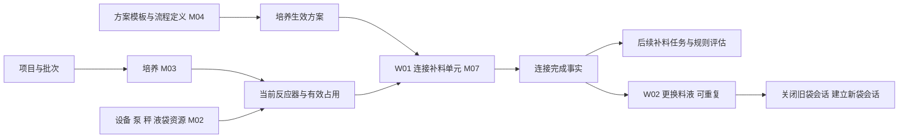
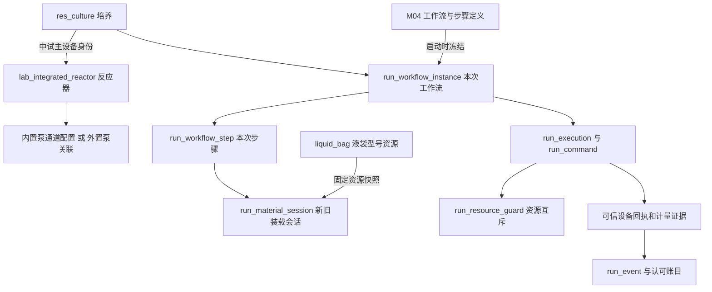

# 中试连接补料单元与更换料液：新人开发导览

初稿核对日期：2026-10-17；需求对照增补：2026-10-20，源码基线 `b96cfd455`。本文是学习导航和开发建议，不替代正式需求与接口契约，不表示中试功能已实现或通过现场验收。原定 10 月 19 日至 23 日的路线见第 8 节，实际开发顺序取决于待确认规则及上游能力到位情况。

2026-10-21实施续接：固定三步定义、业务启动及冻结步骤查询、候选卡图标/日序/成员、未操作草稿取消已实现并通过25类316例定向回归，已按小功能本地提交。第12节按接口列出真实逻辑、用表和未实现部分；模式/设备/最终完成链仍未闭合，数据库、HTTP、浏览器及设备未验收。

同日后续已获用户模拟回执授权，最新W01配置读取、外置绑定、模拟步骤/操作/完成取消见第14节；上段316例及第12节的待接状态是前一批证据。真实设备和现场状态仍分别报告。

**先记住：W01 让一次培养具备使用补料单元的条件，W02 在已经连接的培养中更换某些泵所用的液袋。两者都包含操作记录、状态推进和设备动作，需要接入现有 M07 公共框架。**

## 0. 先区分名称、原文和还没有决定的规则

### 0.1 W01、W02 是什么

W01、W02 是现行 M07 设计对两类工作流的编号，用来讨论和定位规则；不是需求文档章节号，也不是两个新的微服务。

| 讨论编号 | 中文名称 | 客户 V4.1 的章节 | 对应原型文件 |
| --- | --- | --- | --- |
| W01 | 中试连接补料单元 | §3.3.1.1「连接补料单元-中试」 | `③⑤中试-连接补料单元.html` |
| W02 | 中试更换料液 | §3.3.1.2「更换料液-中试」 | `③中试-更换料液.html` |

W01/W02 是整条流程，流程里才有第 1、2、3 步。流程定义规定要做哪些步骤；工作流实例记录某次培养实际做了哪一次操作。后续编码还需核对 M04 实际配置中的 `subflowCode` 和稳定步骤码，不能仅凭设计编号假定数据库已经预置同名目录。

本轮只读核对的客户原件：桌面 `需求说明书V4.1-1013.docx`，以及 `原型图（新）` 目录中的上述两张 HTML。原件均不修改。下面的引用用于解释差异，不把原型中某一条备注直接升级为实现规则。

### 0.2 原文冲突与 2026-10-20 最终确认

| 关注点 | V4.1 正文实际写法 | 新原型实际写法 | 设计对照 | 本轮结论 |
| --- | --- | --- | --- | --- |
| W01 选几台反应器 | §3.3.1.1「反应器卡片」写“仅支持单选”；「选中进行下一步操作」又写“仅支持选中单个反应器” | 同一页同时有“可以选择最多10”备注，以及“一次只能操作1个反应器哦”提示 | 旧设计曾写 ≤10 反应器、多选二次确认；[现行工作流设计](../详细设计/07-补液运行与任务执行/工作流与页面操作设计.md)已按确认改为单台 | **已确认：W01每次只选1台反应器** |
| W01 多选提示 | 正文又保留“若选中单个反应器直接进入步骤2，否则提示并二次确定后进入步骤2” | 同页并存单台提示与最多 10 的备注 | W01旧批量说明由本次确认取代 | **多台请求由服务端拒绝，不通过二次确认放行** |
| W01 开始前置 | §3.3.1.1 开头写“完成开始细胞培养工作流或到达培养开始时间，条件满足其一即可” | 备注写前置节点为“开始细胞培养”，并要求检查前置是否完成 | 现行设计明确核验真实完成事实、有效占用及其他准入 | **已确认：必须已完成开始培养，时间到达不能替代** |
| W02 选择上限 | §3.3.1.2 前面也有“仅支持单选”，后面却明确“支持批量选中不同控制器的不同泵”“不允许超过10个泵” | 说明明确最多 10 个泵；但提示中另有“最多一次操作10个反应器哦” | 设计按 ≤10 泵，不按反应器计数 | 当前设计按泵计数；交给前端时需一起核对原型提示，不能把两个单位混用 |
| W01 预填充精度 | 净重不超过 100g，小数位跟随对应秤的精度；泵速为正整数且不超量程 | 备注另写净重为正整数 | 设计写净重 >0 且 ≤100g，精度随秤 | 现行设计与本段正文一致；真实秤精度还需资源事实支持 |
| W02 预填充精度 | 本段写正整数、不超过 100g | 备注也写正整数 | 现行设计引用已确认 Q03：精度随秤 | 属于客户版本与既有确认的差异；本轮未推翻既有 Q03，也不静默改代码 |
| 外置泵是否由此页开始/停止 | 正文预填充部分普遍描述发送开始/停止指令 | 两处步骤标题另写“外置泵进行填充无需开始和停止” | 设计要求核准真实设备能力及控制方式 | 后续设备动作接线前需向设备负责人确认，不能套用内置泵行为 |

这些位置都能在 Word 中用引号内的文字搜索到；HTML 可直接用浏览器打开。HTML 中“可以选择最多”后面的 `10` 位于另一个文字片段，不能只截前半句判断。

2026-10-20 最终用户答复：“中试每次只能选1台反应器”“必须已完成‘开始培养’工作流”。此前暂不确定的答复已被本次确认取代；不是最多两台，也不再等待这两项裁决。权威登记见[需求澄清决策记录](../需求说明书V4.0-0904_md/需求澄清决策记录.md)同日 M07 条目；上表保留原件差异便于理解，不把旧原文当作当前实现口径。

### 0.3 三个数量不要混在一起

1. **本次选几台反应器**：W01已确认每次仅1台；候选列表可以显示多台，但一次只能提交其中一台。
2. **本次选几个泵**：W02 的选择数量。例如反应器 R1 选 2 个泵、R2 选 3 个泵，总计 5 个泵，而不是 2 个操作对象。
3. **几个泵同时执行预填充**：运行并发能力。W01每次仅选一台，该反应器仍可能有多个泵；允许多泵不代表允许多反应器批量启动。共用秤且没有可分辨计量证据时，现行设计要求串行计量。

W01不再实现多反应器批量启动。W02仍可跨反应器选择最多10个泵：它属于另一条流程，各泵需要独立记录状态与结果；一个对象异常不能把其他对象已发生的动作当作数据库事务一起回滚。

### 0.4 先理解前置业务，再讨论开始条件

| 前置知识 | 在本功能中的作用 | 不能当成什么 |
| --- | --- | --- |
| 实验室及操作权限 | 确定用户能操作哪些培养、设备 | 看得到菜单不等于能对任意设备操作 |
| 项目→批次→培养 | 培养是本次连接操作对应的业务对象 | 培养不是反应器，反应器可以先后服务不同培养 |
| 反应器及有效占用 | 确认该培养当前使用的具体设备 | 设备型号或一段历史绑定不证明当前可以控制它 |
| 开始培养流程 | 记录该次培养开始所需的信息和完成事实；W01必须已取得完成事实 | 计划时间到了，不等于人员已完成开始培养 |
| 培养的生效补液方案 | 确定固定泵接什么液体、液袋及补糖计算等规则 | 选了模板不等于当前培养的方案已配置并生效 |
| 工作流选择与定义 | 确定该培养使用此流程、各步骤是什么、说明及图示版本是什么 | 菜单有入口不等于当前实验室已配置可运行定义 |
| 泵、秤和服务事实 | 提供真实模式、量程、精度、通信及运行证据 | 页面显示绿色或 HTTP 接受命令不等于泵已实际运行 |
| W01 完成事实 | 作为 W02 及后续适用补料任务的前置 | 不表示培养已经补入了所有计划料液 |

例子：培养 C 计划今天 09:00 开始，到 09:10 人员还没有完成“开始培养”。**按本次确认，此时仍不能启动 W01**；须等开始培养真实完成，并同时满足权限、当前有效占用、流程及生效方案等检查。候选显示不可选原因，点击启动时后端再次核验。后续需接通权威事实来源，不能将“到了开始日期”、页面文字“培养中”或客户端布尔值当作完成证明。

“开始培养”和“连接补料单元”是两条不同流程。当前开始培养专项的“第四步完成才保存”等规则，不能不经确认就套到 W01/W02 的每一步；尤其真实换袋或设备动作已经发生时，页面取消不能抹去事实。

### 0.5 从业务动作映射到后端接口

| 阅读顺序 | 页面行为 | 主要接口/方法 | 先理解的检查 |
| --- | --- | --- | --- |
| 1 | 显示候选卡片 | `GET /run/workflows/candidates` → `listWorkflowCandidates()` | 当前用户、实验室、培养、反应器、方案与前置条件 |
| 2 | 选中并进入后续步骤 | `POST /run/workflows` → `startWorkflows()` | 单选/多选规则、实时重验、请求幂等、冻结流程与选择 |
| 3 | 展示本次进度及表单 | `GET /run/workflows/{id}` | 实例不是模板；步骤和旧数据由服务端提供 |
| 4 | 下一步、完成或跳过 | `POST /run/workflows/{id}/steps/{stepId}` | 当前步骤、对象版本、必填项、真实完成证据 |
| 5 | 切自动、开始/停止预填充 | `POST /run/workflows/{id}/operations` | 先保存命令意图，再调用设备，最后保存真实回执 |
| 6 | 取消 | `POST /run/workflows/{id}/cancel` | 是否已有已确认换袋、未停止或结果未知的动作 |

前端仍用 Mock，不妨碍先核对以上服务端契约和实现。待业务规则明确后，把请求字段、响应字段、单位、错误码和版本来源交给前端对齐，不必等待前端现有 Mock 字段成为接口标准。

本轮分支已按用户要求改为 `feature/lab-workflow/pilot-feed-connect-liquid-replace`，工作目录仍为原仓库；空分支快进到本机及缓存 `origin/cloud` 同一基线 `b96cfd455`。本轮同步已确认的两条规则及教学文档，业务实现后续推进；不操作数据库或设备，不提交或推送。

## 1. 先用 15 分钟理解业务

细胞培养过程中，细胞会消耗营养物质。现场通过泵把培养基、糖液等送入反应器。软件需要知道：哪一次培养使用哪台反应器、每个泵接什么液体、液袋装了多少、哪些动作真实发生、后续补料任务何时可以执行。

| 名词 | 新人可以怎样理解 | 开发时必须区分 |
| --- | --- | --- |
| 项目、批次、培养 | 项目下组织实验批次，批次下有具体培养 | `culture_id` 是培养记录身份；页面培养编号是业务展示值，不能当作所有表的主键 |
| 中试反应器 | 进行中试培养的设备实例 | 设备型号、现场实例 ID、设备编号是三种东西 |
| 补料单元 | 为培养补入料液的一组设备、泵、管路和计量配置 | 不等于一只液袋，也不一定对应一张独立主表 |
| 泵、泵通道 | 将某种液体输送到反应器的执行对象 | 内置泵可按反应器及泵号配置；外置泵有自己的实例和关联，不能统一假设 `pump_id` 就够了 |
| 培养基／料液 | 泵连接的液体，例如某种补料培养基、糖液 | 液体身份、糖浓度、用途来自生效方案和资源事实，不能从泵名称猜 |
| 液袋型号 | 液袋管理里的描述、容量、皮重、图标等 | `liquid_bag.bag_id` 是管理记录身份，不足以证明现场是哪一只物理袋 |
| 物理液袋 | 本次实际挂在泵上的那一袋液体 | 更换后需要新装载会话，不能仅修改型号并清空历史 |
| 预填充 | 先让液体充满管路、排除空气 | 默认是管路消耗，不计入培养补入量，不是一次正式补料任务 |
| 皮重、净重、毛重 | 空袋重量、液体重量、袋和液体总重量 | 秤报什么、在哪一层扣皮重、方向及精度均需核准，不能重复扣皮重 |
| 工作流、步骤 | 一次操作过程及其中各个环节 | 工作流模板不等于本次运行实例；运行中不能随模板编辑偷偷换步骤 |
| 补料任务 | 之后按生效方案安排和执行的一次补料 | 连接完成不等于这些任务已经执行 |

一个教学例子：培养 C 使用反应器 R，泵 P1 接补料液，P2 接糖液。W01 确认方案、泵模式和依赖服务，完成接管及可选预填充，才建立连接完成事实。几天后 P2 的袋需要更换，通过 W02 只选择 P2，记录旧袋和新袋，建立新装载会话，再选择是否预填充。**P1 不因此换袋，培养以前的累计补入量也不因此清零。** 示例 C/R/P1/P2 只是教学符号，不是数据库种子或实际设备地址。

## 2. 你负责的边界，以及需要找谁协作

| 模块 | 与这两个功能的关系 | 你应该如何使用 |
| --- | --- | --- |
| M01 用户、权限、公共守卫 | 当前用户、实验室权限、请求幂等、管理修订和审计 | 复用现有身份和管理守卫，不自己造登录或版本系统 |
| M02 实验室与资源 | 实验室类型、反应器、泵、秤、液袋、通讯和设备适配 | 通过所属 Port 读取并校验，缺中试提供方需与负责同事补契约 |
| M03 项目与培养 | 当前培养、真实生命周期、有效占用、成员范围、生效方案 | 决定培养能否操作；不能通过工作流直接更新培养主状态 |
| M04 方案与流程定义 | 固定泵、补液规则以及流程定义、步骤描述、图片版本 | 开启实例时冻结适用定义，不把描述和步骤 ID 写死在页面 |
| M06 审批 | 方案等变更的审批和生效依据 | W01 读取已生效结果；不要把整个流程任意新增为另一套审批流程 |
| M07 补液运行与任务执行 | 你这次的主要模块：候选、实例、步骤、物料会话、命令、运行事实 | 在既有工作流链路补 W01/W02 分支，保持任务和工作流对象分离 |
| M05 检测、M09 通知 | 卡片可能展示检测数据；异常通知与运行事件协作 | 按既有授权读口消费，不能因展示需要直接访问其他模块内部 Mapper |
| M08 在线／离线统计 | 后续只读消费业务数据 | 你做过的统计查询经验有帮助，但统计页面、D0 和样品 SecondId 不负责控制泵或记换袋事实 |

实际姓名需要组长提供。优先找 M02 设备集成、M03 培养方案、M04 流程配置、M07 执行器和前端实验室应用的负责人，明确共享文件谁修改。

## 3. W01 中试连接补料单元：页面怎么走

原始需求对应 V4.1 §3.3.1.1，桌面原型为 `③⑤中试-连接补料单元.html`。原型有不同版本的备注，以下把稳定业务和待确认点分开。

### 第一步：选择可操作培养及反应器

查询以真实实验室为范围，提供房间、所有／方案已设置／与我相关等过滤。候选不是全库设备列表：应核对成员操作范围、培养与反应器有效关联、流程是否适用、前置培养环节，以及完整且已生效的补液方案。未设置方案的卡片可以解释原因并置灰。

卡片展示培养编号、培养天数、反应器编号、规格／图标、负责人或成员、方案设置情况，以及能取得且有时效、质量信息的指标。未知值显示未知，不能补0伪装实时采集成功。W01按最新确认只保留“所有／方案已设置”，不恢复“与我相关”；展示负责人不能代替后端成员资格校验。

**2026-10-20已确认**：W01每次只能选择1台反应器，且必须已完成该培养的开始培养工作流。旧设计最多10台及原文“到达开始时间即可”的表述已被取代。候选可显示多张卡，但服务端必须拒绝多台启动请求，并重新校验开始培养完成事实。

### 第二步：模式确认

每个选中培养展示生效方案中的计算设置、固定泵、所接培养基、液袋描述与皮重，以及所需服务状态。泵模式来自真实回读。点击“一键变更模式”意味着逐泵产生切 AUTO 的设备意图；按钮点击成功或 HTTP 202 不能立即把全部泵标绿。

进入下一步时再次核验：所需泵模式真实就绪、依赖服务就绪、方案和配置版本仍匹配。服务重启仅能操作本工作流已绑定且核准的服务；缺远程重启协议时明确未就绪，不能在后端随意执行页面传来的 IP 或命令。

### 第三步：手工接管及管路预填充

用户在现场接好管路。页面逐泵展示液体与袋信息，可填预填充净重和泵速、复制同培养其他选中泵的输入、开始／停止。2026-10-20用户确认内置、外置泵均保留系统开始／停止，原型那句外置泵提示不代表停用控制。复制后仍须逐行验证不同泵的量程及精度。

现行 W01 契约：净重 `>0 且 ≤100g`，精度随所关联秤；泵速为正整数且不超过核准量程。中试可以多泵执行，但共用秤且不能提供分辨计量证据时必须串行，不能仅因页面允许就无条件并发。

不做预填充时允许二次确认后跳过；已经开始的动作必须先确认安全停止。取消不能删除已经发生的命令、消耗或审计事实。

完成后，M07 保存连接事实、连接代次和计划生成交接事件，后续消费者生成适用任务。重复点击不得重复连一次、重复生成任务。计划生成暂失败时，应区分“已连接”和“任务生成待处理”。

## 4. W02 中试更换料液：与 W01 的不同

原始需求对应 V4.1 §3.3.1.2，桌面原型为 `③中试-更换料液.html`。

| 环节 | 用户做什么 | 后端应保证什么 |
| --- | --- | --- |
| 开始 | 在已连接培养中选择同一台反应器的泵，可选择该反应器全部泵 | 2026-10-29 用户确认覆盖旧跨反应器及 10 泵限制；逐个检查权限、当前袋会话、资源占用及前置完成事实 |
| 更换液袋 | 左侧看旧袋；右侧选择新袋描述并填写补充净重 | 旧值由服务器读取，新袋描述来自资源管理；皮重和容量取资源事实；装载净重正整数 g 且不超核准容量 |
| 记录更换 | 确认已完成实际换袋，再进入下一步 | 固定旧／新袋对照、物理袋身份、操作人和时刻；关闭旧会话并建立新会话，保留旧消耗与培养账 |
| 管路预填充 | 使用新袋信息，填写独立预填充净重和泵速，开始／停止或确认跳过 | `loadedGrams` 与 `primeGrams` 分开；不能把整袋装载量当作填充目标 |
| 完成 | 本次更换流程结束 | 可再次发起新的更换实例；不再生成首次连接事实，不重复触发连接计划 |

例如教学场景中新袋实际装载 500g，预填充 10g，这两个数属于不同业务字段。模型容量只是上限，不代表袋子实际装满。原型“容量减累计补液”的简写需要落实为装载会话、认可消耗及来源证据；未经核准不能拿名义容量伪造当前余量，也不能把 50L 直接当成 50000g。

换袋已确认而预填充失败，应保留新袋事实并恢复原实例处理剩余步骤。数据库事务回滚不了现场已换上的液袋。

## 5. 数据库脉络：先认清这几组表

来源：[开发基线](../开发基线/README.md)、[来源清单](../开发基线/来源清单.json)、[M07 当前完整字段字典](../详细设计/07-补液运行与任务执行/审阅收尾完整字段字典.md)。以下描述的是已登记结构；本次未连接数据库核验数据或执行 SQL。

| 数据组 | 表及关键字段 | 对应页面／逻辑 |
| --- | --- | --- |
| 培养身份 | `res_culture`：`culture_id`、`lab_id`、`device_kind`、`device_id`；`res_culture_occupancy` | 选择哪个培养、主设备和有效占用；中试主设备类型为 `INTEGRATED_REACTOR` 时关联反应器实例 |
| 中试反应器 | `lab_integrated_reactor`：`integrated_id`、`lab_id`、`venue_id`、`device_no`、`model_id`、`floor_scale_id`、`feed_scale_id`、`need_external_pump` | 房间、编号、型号、反应器秤和补料秤等配置来源；两种秤不能混用 |
| 中试泵配置 | `lab_integrated_reactor_pump`：`integrated_id+pump_id`；`lab_integrated_reactor_pump_config`：`integrated_id+pump_no` | 前者是外置泵关联，后者是内置泵通道配置；中试适配必须明确是哪条路径 |
| 液袋主数据 | `liquid_bag`：`bag_id`、`description`、`model`、`capacity`、`tare_weight`、`residual_amount`、`icon_path` | 新袋选项、皮重和图标；当前基线皮重为整数 g，原型小数示例不能直接照写 |
| 流程定义 | `workflow_node`、`workflow_subflow`、`workflow_step`；`lab_workflow_node` | 一级流程、二级流程、步骤及实验室配置；由 M04 定义提供方解析 |
| 培养流程引用 | `res_culture_workflow_reference` | 培养选定流程的引用事实；应通过 M03 权威口获取资格 |
| 本次工作流 | `run_workflow_instance`：`workflow_id`、`culture_id`、`subflow_code`、`definition_hash/snapshot`、`selection_snapshot`、`state`、`object_version` | 本次操作哪种流程、哪些对象、冻结了什么、目前进展 |
| 本次步骤 | `run_workflow_step`：`step_instance_id`、`workflow_id`、`definition_step_id`、`step_code`、`form_snapshot`、`completion_evidence`、`object_version` | 步骤表单、旧新对照、完成或跳过证据 |
| 装载会话 | `run_material_session`：`session_id`、`culture_id`、`resource_key`、`physical_item_key`、`material_kind`、`initial_grams`、`consumed_grams`、`state` | W02 新旧袋追溯；中试袋应使用适用的 `FEED_BAG` 类型，不能照搬小试 `FEED_BOTTLE` 插入语句 |
| 培养运行 | `run_culture_runtime`：`connection_generation`、`connection_workflow_id`、`readiness`、累计量投影 | 连接完成事实与运行就绪状态；不是培养主数据的替代品 |
| 命令及资源 | `run_execution`、`run_execution_segment`、`run_command`、`run_resource_guard`、`run_executor_assignment` | 真实设备动作、执行器归属、泵／秤互斥、命令回执及未知状态恢复 |
| 事实与交接 | `run_event`、`run_ledger`、`run_generation`、`run_task` | 审计／可靠交接、认可数量、生成防重和后续任务；预填充不能直接计为培养正式补入 |

这是业务关联示意，不表示数据库都建了外键，或允许 M07 直接 JOIN 别的模块内部表。跨模块仍经 Port。泵与袋的最终组合还依赖培养生效方案和资源快照，不能仅从以上箭头补造不存在的外键字段。

## 6. 在 IDEA 里沿着这条链读代码

实际前端在 `futurefab-frontend/`，使用 pnpm 工作区、Vue 3、项目封装的 Ant Design Vue；当前根 `package.json` 使用 Vite 7。不要沿用旧说明中 `futurefab-ui + Element Plus` 的路径和命令。

| 阅读顺序 | 点击文件 | 读完应能回答 |
| --- | --- | --- |
| 1 | [实验室应用路由](../../futurefab-frontend/packages/app-smp-lab/src/router/index.ts) | 运行工作流页从哪里进入、如何带 `labId` |
| 2 | [现有运行工作流页](../../futurefab-frontend/packages/app-smp-lab/src/views/run-workflows/index.vue) | 查询候选、开启、读详情、推进步骤、下发动作各调用什么 |
| 3 | [运行工作流 SDK](../../futurefab-frontend/packages/sdk-smp-api/src/run-workflow.ts) | 当前 `start()` 默认 W03；哪些方法可复用、哪些需补中试参数和 DTO |
| 4 | [RunWorkflowController](../../futurefab-modules/futurefab-system/src/main/java/com/futurefab/system/controller/run/RunWorkflowController.java) | 六类公共接口、功能权限、管理版本和请求 ID 怎样绑定 |
| 5 | [工作流应用实现](../../futurefab-modules/futurefab-system/src/main/java/com/futurefab/system/service/impl/application/m07/RunWorkflowApplicationApplicationServiceImpl.java) | 现有支持哪些流程，权限、版本、事务和资源判断在哪一层 |
| 6 | [M04 流程定义提供方](../../futurefab-modules/futurefab-system/src/main/java/com/futurefab/system/service/port/m04/WorkflowDefinitionPortImpl.java) | 如何解析实验室适用的唯一流程、连续步骤和定义 hash |
| 7 | [M02 泵规格提供方](../../futurefab-modules/futurefab-system/src/main/java/com/futurefab/system/service/impl/port/m02/M02WorkflowPumpCommandSpecAdapter.java) | 当前实现依赖小试控制器，为什么中试不能只换 `subflowCode` |
| 8 | [实例 SQL](../../futurefab-modules/futurefab-system/src/main/resources/mapper/system/RunWorkflowInstanceMapper.xml)、[步骤 SQL](../../futurefab-modules/futurefab-system/src/main/resources/mapper/system/RunWorkflowStepMapper.xml)、[物料会话 SQL](../../futurefab-modules/futurefab-system/src/main/resources/mapper/system/RunMaterialSessionMapper.xml) | 写哪张表、更新时是否带状态和版本；现有会话插入为什么不够用于中试液袋 |

IDEA 操作：双击 Shift 搜类名；在页面搜索 `runWorkflowApi`；对 Java 方法按 Ctrl+B 跳声明／实现，Alt+F7 看调用者；看 Mapper 时继续打开同名 XML。先跟踪一条查询，再跟踪一次步骤提交，最后看一次物理命令，避免第一天陷入整个大 Service。

### 公共接口怎样映射按钮

以下为 Controller 相对路径；浏览器实际入口还需核对当前网关配置，不擅自加前缀。

| 接口编号 | 接口 | 用途 |
| --- | --- | --- |
| M07-022 | `GET /run/workflows/candidates` | 开始页候选和不可选原因 |
| M07-023 | `POST /run/workflows` | 冻结选择、创建本次工作流及步骤 |
| M07-024 | `GET /run/workflows/{id}` | 读当前步骤、表单、版本和允许操作 |
| M07-025 | `POST /run/workflows/{id}/steps/{stepId}` | SAVE／NEXT／COMPLETE／SKIP 等步骤操作 |
| M07-026 | `POST /run/workflows/{id}/operations` | SET_AUTO／PRIME_START／PRIME_STOP；设备动作受理，不等于完成 |
| M07-027 | `POST /run/workflows/{id}/cancel` | 取消或进入安全处理 |
| M07-028 | `POST /run/services/{id}/restart` | 有所属工作流且能力核准的远程服务重启 |

三个不同概念必须同时记住：`X-Request-Id` 标识一次业务请求及重放；`X-Management-Revision` 来自本页面读口响应顶层，保护管理配置；`expectedVersion` 对应本次步骤或实例的对象版本。它们不能互相替代。管理版本缺失时前端不得发送守卫写请求；409 冲突后刷新事实并让用户重新确认。

### 当前实现到底到哪一步

2026-10-20 本轮实施前的静态读码证据：`listWorkflowCandidates()` 仅允许 W03、W05、W07 所对应的小试分支，读取 `W03CandidateCulturePort` 与小试控制器运行事实；原 `resolveLabWorkflowContext()` 限制为小试上游实验室。`startWorkflows()` 已分流 W05/W06/W07/W08 对应方法，余下分支只接受 W03；W08 的暂停范围不能因存在分派代码而认定恢复。开始培养通过 Controller 中的独立服务分派。Controller 中个别“骨架 501”注释已落后于具体方法实现，判断时以实际代码为证据。

首片段提交`5f65abcc0`将W01基础候选接入公共M07-022，通过M03/M02/M04及M03-P04核验权限、实际开始完成、占用、反应器和FEEDING生效包。后续2026-10-21已补培养日序、型号图标、成员展示、单反应器业务启动、冻结步骤查询和纯草稿取消，详第12节。完整在线/离线指标卡、模式/设备/最终完成链及W02仍未接完，不能称两条中试工作流已经实现。

可复用的是公共路由、请求身份、权限框架、定义读取、工作流实例／步骤基础读写、既有命令意图和资源保护方式。需要新增或适配的是中试候选、反应器及内外置泵事实、生效补液方案准入、模式／服务确认、中试液袋会话、量程精度和后续完成交接。现有 W03 通过不能替代这些验收。

状态：上述已接片段`IMPLEMENTED + CONTRACT_TESTED`。此前M04签名冲突按用户确认精确兼容登记，未改原生产接口。2026-10-21最新25类316例定向回归全部通过，原始Maven退出0；并非全仓测试或运行验收。全量基线静态门禁仍失败，本次W01种子定向静态核验通过，未执行SQL；HTTP、浏览器、设备均`NOT_VERIFIED`。详细日志、失败修复和本地提交见[本轮实施台账](../详细设计/07-补液运行与任务执行/history/review/2026-10-20-中试W01W02后端实施台账.md)。

## 7. 开发前要先裁决或拿到的资料

| 优先级 | 问题 | 目前证据及影响 | 应找谁 |
| --- | --- | --- | --- |
| 已确认，实施待接线 | W01 单反应器限制 | 每次仅1台；候选可多卡展示，后端拒绝多台启动，不能静默截取第一台 | M07实现／前端对齐 |
| 已确认，事实来源待核对 | W01 开始培养前置 | 必须真实完成开始培养；计划时间到达不放行，接通权威完成事实并在启动时重验 | M03／M07 |
| W01已登记，安装待验 | W01/W02 实际 `subflowCode` 与稳定步骤码 | W01已登记connect_feed_unit_pilot及START/MODE_CONFIRM/PRIME_FILL，并补空库种子，未执行目标库；W02仍需独立接线，不猜旧码 | M04／组长 |
| 设备动作前 | 内置 OPC 泵和外置泵的命令设备 ID／通道怎样映射？ | 用户已确认两类泵都保留系统启停；两条资源结构不同，现有工作流泵规格适配为小试，具体寻址/协议/回读仍待核准 | M02／自控 |
| 设备动作前 | 秤精度、方向、净毛重、稳定及停泵证据；泵模式和速度单位／量程 | 现行能力矩阵列有待核准项；不能把 Speed 代码、rpm、g/min 混为一谈 | 计量／设备适配 |
| 换袋落库前 | 真实袋标识从哪里来、如何识别旧袋／新袋？ | `bag_id` 只代表管理记录；W02 需要物理袋与装载身份，现有 FEED_BOTTLE 插入不能直接用于 FEED_BAG | 物料／M02／M07 |
| 模式页验收前 | 各服务如何查询状态、是否支持受控重启？ | 缺协议时只显示未就绪；不能承诺“一键重启”可现场使用 | 控制服务／运维 |
| 字段冻结前 | W02 预填充精度、袋皮重示例的冲突 | V4.1 W02 写整数；现行 Q03 契约写随秤；原型皮重有 0.2g，而当前 `liquid_bag.tare_weight` 是整数 g | 产品／计量／M02 |
| 联调前 | 测试实验室、权限、培养、已生效方案、反应器／泵／秤及定义配置是否齐全？ | 有表不等于有主数据；缺数据会导致候选为空，不能通过放宽权限和前置兜底 | 组长及各拥有方 |

另外两个原文问题已有现行设计处理，不必重复发明：W02 完成时原文复制了“连接工作流完成”，应结束本次更换实例；“取消不保存”不能抹除已发生物理事实。其余新差异在开发前写入正式澄清，本文不自行修改契约。

### 7.1 液袋型号、装载记录和物理袋编号：来源与待裁决

2026-10-20 用户询问“哪里要求区分每只袋”。核对后应分开解释，不能把现行设计当成客户原文明文要求扫码。

客户 V4.1 §3.3.1.2“更换料液－中试”，步骤2的“液袋更换信息对比”要求：左侧原袋展示描述、图标、皮重、现重量、容量等；右侧新袋从液袋管理的描述下拉选择，自动带出皮重，填写补充净重。进入下一步前校验描述和净重，记录操作人、开始/结束时间及页面展示的描述、净重、型号，更新各泵对应的袋信息。原型同样展示“原始的／新鲜的”，更新记录包括时间、人、培养、设备编码、泵号、新袋型号与净重。**所核对的这段正文和原型未要求扫码、条码或人工填写每只袋的唯一编号。**

现行仓库[工作流设计 §4](../详细设计/07-补液运行与任务执行/工作流与页面操作设计.md#4-量与物料投影)则明确要求一次更换建立新装载会话，固化物理袋实例 ID，且不能按模型累计；[字段字典 DB04](../详细设计/07-补液运行与任务执行/数据库模型与字段字典.md#db04-run_material_session)定义 `physical_item_key` 为“物理袋瓶标识，不是型号ID”，另有 `session_id` 表示本次装载身份。这个约束来自当前设计，具体物理编号的生产来源尚未找到。

| 概念 | 相同型号的两只500g袋示例 | 能解决什么 |
| --- | --- | --- |
| 型号/资源记录 | 两只袋都选择同一描述、容量和皮重 | 自动带入共用规格，不能以此累计每次装载消耗 |
| 本次装载记录 | 第一次装载S1，换袋后装载S2 | 分开记录新旧袋净重、消耗和操作历史；技术ID可由系统产生 |
| 现场物理袋标识 | 实体袋A、实体袋B各有可识别编号 | 识别同一只袋是否被移动、重复装载或用于另一培养；仅生成S1/S2不能证明这是两只不同实体 |

后续需产品/团队裁决：只要求“每次装载分别留痕”，还是还要“按现场可识别编号跟踪同一只实体袋”。前者无需新增扫码交互，但若将其作为最终方案，须正式调整现行物理袋约束的措辞和字段语义；后者须明确编号是否已存在、由谁生产和维护、是否允许复用，以及前端如何采集。本轮不代为选择，不把装载ID冒充物理袋ID，也不新增扫码/编号必填。该待定项只阻塞 W02 确认换袋落库，不阻塞中试候选等读取实现。

## 8. 下周学习和开发路线

### 开发前约半天：建立能复述的地图

先读本指南第 1—4 节，再分别打开两张原型，从“开始”走到“完成”。用上面的 C/R/P1/P2 教学例子讲清：第一次连接是什么、更换一只袋改变了什么、哪些历史不能清。随后按第 6 节从页面跟到 SQL。第一轮只读，不修改共享 M07 大文件。

| 日期 | 学习／开发重点 | 当天应交给组长的具体成果 |
| --- | --- | --- |
| 周一 10/19 | 产品确认冲突；跟读 W03 的候选、启动、步骤链；与 M02/M03/M04 核对事实来源 | W01/W02 字段及状态清单、确定的流程／步骤码、依赖负责人、接口与文件分工；能解释三个版本／请求字段 |
| 周二 10/20 | 先实现中试候选、只读详情和创建实例；冻结定义与选择，完善权限／前置／重复启动拒绝 | 具备明确不可选原因的页面；正常、无权、未配方案、旧版本和重复请求契约用例；不依赖真实泵也可验这些规则 |
| 周三 10/21 | W01 模式确认、预填充表单与命令准备；完成／跳过与连接事实、防重事件 | 一条可追溯 W01 流程；模拟与真实设备结果分栏；受理、未知、失败不能显示成功 |
| 周四 10/22 | W02 泵选择、旧新袋对照、新会话、独立预填充与中断恢复 | 新袋建立后旧袋历史仍在；重复确认不重复换袋；已换袋后取消／失败有明确恢复路径 |
| 周五 10/23 | 前后端联合回归、目标库核验、浏览器操作、按条件开展设备联调 | 演示步骤、测试报告、所需配置／数据清单、剩余阻塞、阶段提交说明和交接文档 |

这是按依赖及时到位安排的目标，不是承诺一周内完成设备现场验收。外部协议未到时，可以先交付受控的业务流程和契约测试，对真实设备路径标 `BLOCKED_EXTERNAL`。如果你只负责前端或只负责后端，应让组长从此表划清负责列。

## 9. 如何拆任务，减少和同事冲突

2026-10-20 已按用户要求采用分支 `feature/lab-workflow/pilot-feed-connect-liquid-replace`，工作目录 `D:\develop\myprojects\yaoming_shengwu`，本轮基线 `b96cfd455`。创建/调整分支时工作区干净；后续仍应先与组长明确共享文件归属。不要把统计模块或其他同事的在途修改混入本功能提交；需要并行运行其他分支时，再另行约定独立工作目录。

把工作拆成可评审的四块：中试候选及详情、W01 业务步骤、W02 物料会话、设备适配与验收。共享的 `RunWorkflowApplicationApplicationServiceImpl`、DTO、SDK 和路由要明确负责人、合入顺序，避免几个人同时修改同一批未提交文件。提交只显式添加本任务文件；真实凭据、运行日志、本地配置和生成目录不进入提交。

阶段交付除代码外，还需说明：要增加哪些流程定义／实验室绑定／权限，是否真的有结构变更，如何准备隔离测试数据，运行依赖哪些服务和核准能力，如何重启对应服务、怎么验证。文档本身不授权数据库或部署操作；分支调整、提交及推送分别以用户实际授权和执行证据为准。2026-10-20 用户已授权将已完成片段在当前分支按功能本地提交，兼容登记、基础候选查询与开发说明分别提交；实际哈希与范围见实施台账，未推送。

## 10. 最小验收清单：写代码时就据此自测

| 场景 | 应看到的结果 |
| --- | --- |
| 无成员操作权、跨实验室、伪造对象 ID | 服务端拒绝，不能只依靠按钮隐藏 |
| 培养未满足前置、方案不完整／未生效、定义缺失 | 不可选或拒绝启动，给出准确原因 |
| W01 数量限制、W02 第 11 个泵 | 前后端同时校验；批量输入先全量预检 |
| 相同请求重复、相同键异载荷、两个窗口旧版本 | 同键同内容返回原结果；冲突不覆盖，不重复生成事件或会话 |
| 模式手动、服务断开、陈旧读数 | 不能进入依赖就绪的步骤或伪造绿色状态 |
| 净重 0、负数、超过 100、精度不符；泵速 0 或超量程 | 前后端定位字段并拒绝，单位按核准契约 |
| 共秤多泵、正在执行任务、另一工作流占泵 | 资源互斥；不因租约超时或关闭弹窗擅自释放 |
| 设备仅 ACCEPTED、调用超时、回执 UNKNOWN | 保留未确认状态；按原命令核查，不能换请求 ID 再开始 |
| 开始预填充后直接完成／跳过／取消 | 未取得必要停止与结算证据前不得伪装已安全结束 |
| 不预填充直接完成 | 二次确认、记录跳过；只触发允许的完成事实一次 |
| W02 新袋装载超容量、物理袋重复使用 | 拒绝；不影响其他已确认物理事实 |
| W02 换袋后预填充失败或刷新页面 | 新袋事实仍可追溯，原实例可恢复；旧账和培养累计不清零 |
| 预填充消耗、后续正式补液 | 两种事实分别记录，不把管路消耗直接加到培养补入量 |
| W01 完成、计划交接暂时失败 | 显示已连接与任务生成状态差异；重放不生成重复任务 |

浏览器验收要记录页面、HTTP 方法和 URL、两个守卫请求头、对象版本、载荷、响应和后端异常日志；测试数据清理要有记录。Mock 或单元测试通过只能标 `CONTRACT_TESTED`，真实 HTTP、浏览器、SQL 和设备必须分别提供证据。

## 11. 精简阅读路径和求助清单

第一遍读：[本指南第 1—4 节](#1-先用-15-分钟理解业务) → 两张桌面原型 → 第 6 节源码链。第二遍读下面五份，不需要一开始读完整个 docs：

1. [工作流与页面操作设计](../详细设计/07-补液运行与任务执行/工作流与页面操作设计.md)：W01/W02 的规则和取消／完成语义。
2. [任务页面与接口契约](../详细设计/07-补液运行与任务执行/任务页面与接口契约.md)：API22—28 及请求／响应。
3. [Controller 请求调用时序](../详细设计/07-补液运行与任务执行/Controller请求调用时序设计.md)：查询、业务提交和设备外部调用的边界。
4. [数据库 JSON 与事务契约](../详细设计/07-补液运行与任务执行/数据库JSON与事务契约.md)：实例／步骤／资源快照怎样留证。
5. [设备命令契约](../详细设计/07-补液运行与任务执行/设备命令契约.md)、[现场能力核准矩阵](../详细设计/07-补液运行与任务执行/现场能力核准矩阵.md)：开始、停止、受理、执行、未知的区别及需要现场提供的资料。

需要继续补充的资料：组长给你的前后端负责范围和共享文件分工；一套获准测试的中试培养及生效方案；反应器、泵、秤、液袋和流程配置样例；物理袋追踪是否需要及编号来源；设备接口负责人与核准协议；可用测试环境及权限。W01 单反应器与必须完成开始培养已确认，不再列为待定。示例请脱敏，不在文档或聊天中粘贴密码和令牌。

## 12. W01业务链、接口与用表核对（2026-10-21）

本节是新人阅读导航，业务依据为[现行工作流契约](../详细设计/07-补液运行与任务执行/工作流与页面操作设计.md)及[接口目录](../详细设计/07-补液运行与任务执行/接口目录与契约定位.md)。下表按当前源码区分真实实现与待接能力，不把通用路由的存在当成中试已经实现。

### 12.1 从选择到连接完成

1. **选择培养及其反应器**：限定真实中试实验室、当前用户范围；仅“所有／方案已设置”两项筛选，房间可进一步过滤。每次只能选1台；该培养必须真实完成开始培养，有当前有效运行占用，已选择补液流程且补液方案完整生效。
2. **创建本次业务实例**：启动接口在守卫事务内重新检查以上事实，冻结定义、培养/占用版本、反应器和生效方案。创建实例和三个步骤、操作事件及审计。此时仅代表操作开始，不等于设备已经连接，也不下发任何泵命令。
3. **模式确认**：读取生效方案的计算配置、固定泵/培养基/液袋等信息，读取真实泵模式及绑定服务状态；一键变更模式只切手动为自动，不应启动泵。全部必需模式和服务真实就绪后才允许进入预填充。完整读取和中试模式命令仍待接线。
4. **手工连接管路并可选预填充**：用户现场接管，逐泵填写本次预填充净重和泵速，系统下发开始／停止；内置、外置泵均保留此功能（用户本轮澄清）。多泵并行还须满足真实泵秤资源与计量能力；共秤不能区分计量时逐泵执行。只有受理回执不能显示已开始或已停止。
5. **完成或确认跳过**：可以部分预填充或全部跳过；从未操作而点击完成需二次确认。已有运行中或UNKNOWN动作必须先安全收口。最终事务只生成一次连接事实、代次及计划交接事件；后续计划生成状态与连接完成状态分开。中试最终完成链仍待实现。

取消不保存未提交表单，但必须保留已发生的动作与审计。本轮纯草稿取消只覆盖尚未推进、无命令/执行/资源占用的业务实例；不替代设备动作后的安全取消。

### 12.2 为什么讨论整袋装载量及切自动

| 数量或动作 | 示例 | 在W01中的含义 |
| --- | --- | --- |
| 型号容量 | 额定上限1000g | 液袋资源规格，不证明实际装满 |
| 实际装载净重 | 现场实际装入500g | 跟踪本次袋消耗/余量的真实起点；原文未要求W01新增输入框，生产来源仍待核对 |
| 预填充净重 | 本次填管路10g | 原型输入的净重，范围>0且≤100g；不能当作整袋装载量 |
| 切自动 | MANUAL→AUTO | 改控制模式，不是开始预填充，不应登记10g或其它虚假目标 |
| 开始预填充 | 目标10g、核准速度 | 真实物理动作，要有命令身份、计量规格、回执和安全停止证据 |

现有`WorkflowExecutionSpecFreezer`要求真实ACTIVE物料会话，才可为计量执行冻结规格；W01目前未找到首次袋会话/实际装载量生产者。这个缺口来自当前后端实现及计量契约，不等于客户要求必须手填整袋重量。用户要求先解释再判断，本轮不替用户选择数据来源或新增扫码。

需求步骤2明确有“一键变更模式”；[设备命令契约](../详细设计/07-补液运行与任务执行/设备命令契约.md)末节的独立`MODE_CHANGE`是技术方案，解决现有计量命令必须含目标克数而切模式无目标克数的问题。2026-10-21用户已确认使用规则：确认停止且无未决动作才允许切自动，切换本身不启动泵。内部命令版本由技术方落实，不要求用户选择JSON；仍须核准设备指令及回读，不能填假克数绕过或宣称设备已接通。

### 12.3 接口和真实作用

下列均为Controller相对路径；真实网关前缀另核。写接口沿用双头`X-Request-Id`和`X-Management-Revision`；修订来自本页面读响应顶层，不能硬编码。步骤/取消还需对应对象版本。

| 编号／接口 | W01当前作用 | 当前边界 |
| --- | --- | --- |
| 022 `GET /run/workflows/candidates` | 有权培养/反应器、房间过滤、方案及前置判断；图标、上海自然日序和三级有效成员回退已接 | 全部在线/离线最新指标、房间名/完整房间选项仍有提供方缺口；离线仅当前反应器容器，按采集/检测完成时间取最新有效上传/签名/审核结果并显示状态，补传不覆盖新测值 |
| 023 `POST /run/workflows` | `connect_feed_unit_pilot`，明确labId、恰1个cultureId；守卫内重验、创建实例/步骤、留痕、防重复启动 | 仅业务启动，实例OPEN；响应APPLIED表示启动请求已应用，不是连接完成 |
| 024 `GET /run/workflows/{id}` | 读取已创建的有权实例、三步、版本、操作者及时间，严格从冻结定义返回步骤名称/说明/图示 | 完整中试模式信息、泵/服务状态及完成页投影仍待补齐，不从`pumps=null`推断无泵或就绪；步骤间版本校验不等于整体数据库快照证明 |
| 025 `POST /run/workflows/{id}/steps/{stepId}` | 公共步骤入口已有 | W01模式确认、预填充推进、完成/跳过仍未接；不能套小试分支 |
| 026 `POST /run/workflows/{id}/operations` | 公共设备动作入口已有 | W01的SET_AUTO、PRIME_START/STOP仍未接；切自动业务条件已确认，非计量命令合同待技术落实、设备参数未到 |
| 027 `POST /run/workflows/{id}/cancel` | 本轮补齐仅纯草稿取消 | 任意实际动作或未决资源存在则拒绝直接取消；全面安全收尾仍待后续命令链 |
| 028 `POST /run/services/{id}/restart` | 参数验证已有 | 当前无真实服务绑定/重启协议和执行通道，失败关闭，不是重启已实现 |

### 12.4 涉及哪些表

M07只读写自己的`run_*`表，其他模块事实通过拥有方Port读取，表名不代表M07可跨模块直接查询。

| 拥有方／表 | 本功能中的作用 | 当前读写边界 |
| --- | --- | --- |
| M03 `res_culture` | 培养身份、主设备、计划开始天、真实开始完成来源、生命周期/版本、流程选择 | 通过M03读取；W01不改培养主状态 |
| M03 `res_culture_occupancy` | 当前培养/实验室/反应器匹配的占用及版本 | 读取，启动重新核验RUNNING |
| M03 `res_culture_parameter_state`、`res_culture_parameter_snapshot`、`res_culture_parameter_application` | FEEDING现行指针、不可变完整包和合法生效回执 | 读取；不代替运行中方案审批生效链 |
| M03 `res_culture_member`、`res_batch_member`、`res_project_member` | 操作资格及成员显示来源 | 通过M03按有效MEMBER及权限读取；成员显示与操作资格分别处理 |
| M02 `lab_lab`、`lab_integrated_reactor`、`dev_integrated_reactor` | 类型、归属、反应器编号/规格/房间ID/型号图标 | 通过M02读取；无写入 |
| M04 `lab_workflow_node`、`workflow_node`、`workflow_subflow`、`workflow_step` | 实验室绑定、补液目录、固定三步及可编辑描述 | 读取定义并冻结；本轮仅新增空库种子文件，未执行数据库 |
| M07 `run_workflow_instance`、`run_workflow_step` | 本次操作及各步骤状态、定义/选择快照、版本、时间 | 启动新建；纯草稿取消更新，审计不删除 |
| M07 `run_event` | 工作流启动、取消等不可遗漏的业务事件 | 追加；最终连接完成交接仍未实现 |
| M07 `run_culture_runtime` | 已连接防重复检查、后续连接代次/事实 | 本轮启动只读取，不提前写已连接 |
| M01 `sys_user`、`sys_dept`及当前认证状态 | 人员名册显示与可信当前会话 | 通过M01名册及SEC-I01读取，不从M03/M07跨表查询；缺名保留ID |
| M01 `sys_management_revision`、`sys_management_request`、`sys_oper_log`、`sys_data_change_log` | SYSTEM守卫、版本CAS、原请求幂等回执及操作/逐对象变更留痕 | 复用公共框架，由框架维护 |
| M07 `run_command`、`run_execution`、`run_resource_guard` | 判断是否仍是可直接取消的纯草稿 | 本轮取消只验证不存在动作/占用，不释放未知物理资源 |
| 后续 `lab_integrated_reactor_pump_config`、`lab_integrated_reactor_pump`、`liquid_bag`、`run_material_session`、执行/计量账 | 固定/外置泵、袋资源、真实装载、预填充命令和结算 | 尚未形成完整W01生产链，不能据表已存在宣称已实现 |

### 12.5 仍需确认与验证的边界

- 2026-10-21用户确认当前默认设备已连接，后续按具体协议实现连接逻辑。当前后端开发以设备/服务已连接为前提，先推进业务；缺实际连接协议不阻塞无依赖子项。模拟连接须明确来源，真实设备联调仍未验证；已连接不代表AUTO、已停止、无未决动作或命令已执行，不自动解决实际装载量来源。
- 用户／团队仍需核对：首次实际装载量从哪里来，或者W01是否需要另行调整计量边界。用户已确认切自动仅限停止且无未决动作；其命令版本属于技术落实，不再作为用户业务选择题。整袋身份来源与W02换袋追溯继续按第7.1节分别讨论。
- 设备团队输入：内外置泵模式标签/控制权限/速度单位及量程、每泵对应秤及计量策略、原命令查询与停止证据、服务健康及受控重启协议。未核准保持BLOCKED_INPUT/BLOCKED_EXTERNAL。
- 提供方实现缺口：全部在线/离线最新指标的受控读取、中试完整泵规格/模式/服务事实。不能用空数组或固定未就绪响应冒充这些接口实现。
- 本地提交、实际测试类/用例数及原始退出码见[本轮实施台账](../详细设计/07-补液运行与任务执行/history/review/2026-10-20-中试W01W02后端实施台账.md)。单元/契约通过不代替MySQL事务、HTTP、前端或设备验收。

### 12.6 当前反应器指标卡：已确认规则及来源缺口

离线指标已确认按采集／检测完成时间取最新有效上传、签名或审核结果并显示状态，补传旧值不覆盖新值；只展示当前反应器容器，排除同培养早期摇瓶或其他容器。相同测量时间的不同有效结果如何裁决仍待确认，不能暗用上传时间决定。

| 数据链 | 已有真实能力 | 尚缺来源与处理边界 |
| --- | --- | --- |
| 离线：M05结果拥有方 | `M05EffectiveResultReader`读取原始结果及有效更正；签批查询支持原始items/更正快照、有效状态和可信completedAt | 当前绑定含培养、实验室及检测仪detectorId，未冻结取样反应器/容器；`M05SendPreparation`也未冻结来源。检测仪不是取样反应器。中试样本ID可判断阶段，但反应器阶段没有容器编码，不能靠当前培养设备补出历史身份。需M03/M05补取样来源事实生产契约；历史无证据不回填 |
| 在线：M02观测、M03发生时绑定 | 当前观测支持按可信设备+通道枚举全部指标；有不可变值、质量、时间和培养关联证据 | 现有反应器通道枚举只覆盖floor_scale_id，尚无pH/DO/温度等全部测点的可靠来源。观测类型不含INTEGRATED_REACTOR，不能把反应器ID塞成测量设备ID。需提供真实测点绑定，再逐值核对发生时培养/实验室；不能将旧培养或未知归属读数搬入当前卡片 |

上述为源码只读核查，不表示新展示Port已经实现。M07只应消费拥有方的受控展示接口，不跨表查询、不借M08统计应用，也不放宽执行用`DetectionResultPort`的准入。缺来源时保持明确缺口；不能用全空列表冒充“反应器没有指标”。设备配置、映射和数据本身缺失也不能由编造默认值解决。

## 13. 本指南依据与核查范围

- 只读核查桌面`需求说明书V4.1-1013.docx`及两份中试原型，未修改客户原件；原型文字不作为真实运行证据。
- 对照仓库需求／设计入口、M07及提供方现行契约，沿真实Controller→应用服务→Mapper/Port核对。
- 当前代码交付与25类316例定向回归见第12节及实施台账；W01完整后端链和W02均未闭合，SQL、HTTP、浏览器及设备未验收。原型冲突及待决项见第7、12节。

## 14. W01后端模拟联调（2026-10-21）

本轮按用户授权先完成W01业务演练，第一袋初始量留待余量/W02需要时讨论。默认设备服务已连接，以明确模拟回执验证切自动与预填充启停。模拟完成不代表实际接管设备、出液、计量或正式计划已生成。

### 14.1 开启与隔离

源码默认关闭。给system服务本次启动设置Java VM参数`-Dfuturefab.pilot-workflow.simulation-enabled=true`，或在获准环境设置同名Spring属性；本任务未修改Nacos、发布配置或重启服务。开启后新建W01固定executionMode=SIMULATION，既有LIVE实例不自动转换。关闭开关阻止新模拟动作，但已提交请求仍应沿原键/原载荷查回执并复验当前权限。

模拟不写真实run_command/run_execution/run_material_session/计量账，不更新run_culture_runtime连接，不触发真实计划生成。实际测得克数为null，不把目标10g当“实测10g”；没有新增整袋重量或条码必填。

### 14.2 接口和调用顺序

| 接口 | 当前模拟行为 |
| --- | --- |
| 022候选 | 真实中试培养范围、开始完成、占用、方案及房间ID筛选，图标/日序/成员；完整指标卡与房间名称/选项仍未接完 |
| 023启动 | 恰1培养/反应器，冻结真实前置/方案/三步/培养方式及补料计算配置，模拟标记由服务端开关固定 |
| 024详情 | 冻结说明、当前版本、允许操作、pilotContext页面白名单；只取最高已进入步骤的最新模拟状态，不改前序完成快照 |
| 025步骤 | START/MODE_CONFIRM/PRIME_FILL按顺序NEXT进入、COMPLETE提交；末步可SAVE参数、确认后SKIP或完成 |
| 026操作 | SET_AUTO可省pumpRef一键全部；PRIME_START/STOP精确指定当前泵；回执state=SIMULATED、executionMode=SIMULATION，objectId是步骤ID而非commandId |
| 027取消 | 保留已发生操作/审计，取消未完成步骤及实例；运行或未决泵先STOP/核对 |
| 028服务重启 | 当前默认连接，不发送重启；真实服务目录/IP/健康及重启协议仍待后续 |

写请求携带X-Request-Id和X-Management-Revision，修订从本页面GET顶层读取。025/026的expectedVersion取当前步骤版本，027取实例版本；每次成功写后GET刷新。超时/结果未知保留原请求键、原版本及原载荷，不能换键重发。

后端操作顺序：GET候选→POST启动→GET三步ID/版本；START NEXT再COMPLETE；MODE_CONFIRM NEXT加载配置→026 SET_AUTO→MODE COMPLETE；PRIME_FILL NEXT→可选SAVE/START/STOP→COMPLETE或确认SKIP。NEXT对应显示该步骤时进入，COMPLETE对应下一步/完成按钮的提交时机，前端联调时不能只改当前步骤编号。

SAVE的rows每行仅resourceKey、primeGrams、speed，逐行整批验证；复制参数到同培养其它泵是前端交互，后端仍逐泵校验。PRIME_START必须显式提交pumpRef、>0且≤100的primeGrams、kind=FIXED且为正整数量程内g/min速度，净重符合模拟精度；STOP不再传量和速度。不同泵即使共用同一模拟地秤也可同时预填充，不计算实测重量；同泵运行/未决仍互斥，全部停止后才可完成/跳过。无任何预填充的COMPLETE与显式SKIP均需skipConfirm=true及skipReason；START/MODE不可跳过。

### 14.3 外置绑定、信息来源和用表

外置配对已找到现有来源：培养修改→补液方案→固定泵中的externalPumpBindings，经M03校验后由M04冻结在包bindings的EXTERNAL_PUMP。按pumpNo匹配培养基/液袋，按pumpId匹配外置泵；只能绑定无内置配置的槽位。此前只看M02关系表而判断“缺规则”的核查不完整，现已纠正，不需要用户新增规则。无绑定显示原因，已绑定但缺量程也不能开始，不按顺序猜。

| 拥有方与表/来源 | 本轮用途 |
| --- | --- |
| M02 lab_integrated_reactor_pump_config、lab_integrated_reactor_pump、lab_peristaltic_pump、dev_peristaltic_pump_model | 真实内外置泵及同实验室、启停用/删除、其它活动反应器连接校验；无关联量程保持未知，不借型号maxFlow或pumpSpeed猜g/min |
| M02 liquid_bag | 全局型号的当前描述/皮重/图标，非实际装载；培养基及袋描述优先保留P04冻结名称 |
| M02 lab_floor_scale、dev_floor_scale_model及floor_scale_id/feed_scale_id | 真实实例和rawPrecision；本轮显式以VESSEL建立模拟共秤模型，非核准物理计量策略 |
| M03 res_culture.culture_mode、res_culture_feeding_config | 培养方式原值与计算依据/残糖确认/浓度变化/补糖计算模式和配置版本；不是mode_code的NORMAL/REACTOR |
| M03/M04 FEEDING content/bindings | 固定泵、培养基/袋及外置绑定，不静默换成当前最新模板 |
| M07 run_workflow_instance、run_workflow_step、run_event | 版本CAS、参数保存、固定完成证据、独立LOCAL模拟事件 |
| M01管理守卫/审计表 | 原权限/SYSTEM修订/幂等及真实STEP/WORKFLOW审计；模拟026用独立内部操作码，真实COMMAND审计规则保留 |

均经拥有方Port读取，M07不跨模块Mapper。公开precisionSource=SIMULATION_FROM_MODEL_RAW、scaleAssignmentSource=SIMULATION_VESSEL_SCALE与bagConfigurationSource/bagDescriptionSource，明确模拟精度/共秤、当前皮重和冻结描述来源；未知不补0。缺数据、依赖故障分别处理，不用空结果伪装成功。

### 14.4 页面接线补充（2026-10-22）

实际页面位于 `futurefab-frontend/packages/app-smp-lab/src/views/pilot-connect/index.vue`，通过同目录 `workflow.ts` 和SDK `run-workflow.ts` 调用上述接口。第一步展示真实培养、规格和成员，第二步使用详情中的培养规则、泵、培养基/袋信息及明确标记的模拟服务状态，第三步传入实际填写的净重与固定泵速。复制仅复制当前培养内的输入，不复制请求身份。

方案缺少冻结培养基名称时，M02按方案引用ID读取 `feed_medium` 当前名称并冻结到新模拟步骤，来源以issue明确标记；不修改方案摘要或历史数据。改选培养须先确认取消旧尝试；取消失败时保留旧实例。取消后重开、超时原请求恢复及延迟详情响应均以服务端事实为准。

页面“切回手动”本轮按用户确认后置。第一步无实例时的描述仍使用原页面文本；完整在线/离线指标卡、真实服务重启和设备协议仍待补齐。本节不表示这些缺口已验收。

### 14.5 验证边界

实际测试类/数量、原始退出码及本地提交见[实施台账](../详细设计/07-补液运行与任务执行/history/review/2026-10-20-中试W01W02后端实施台账.md)。本轮无DDL或建库SQL变更，未运行目标库、真实HTTP、浏览器、设备及现场验收；此前全量基线哈希问题未处理。完整指标卡、真实协议/服务重启/核准计量及真实连接后的计划生成消费链仍需后续补齐；W02本轮未开发。

## 15. W02更换料液后端（V4.2与新原型复核，2026-10-21）

用户要求先实现后端，前端后续联调；本轮按功能点本地提交，不推送、不执行目标数据库、不发布Nacos或控制真实设备。V4.2只在本节中试更换料液范围核对，不自动改动小试或其他工作流。

### 15.1 本次复核发现并修正的差距

前批7笔提交已存在，但前批实现是“整批启动、随后各泵独立处理”，不能据574例旧测试宣称原型整页保存已满足。本轮用户明确：A/B/C泵须全部填好再进下一步，最后一起保存；取消放弃本页所有暂存袋；启停仍逐泵操作。已新增服务端可信批次及整页接口，防止漏成员、部分保存或通过旧单实例口绕过。

同时补上W02预填充SAVE/START的1～100整数克校验（W01原精度规则不变）、第二/三步分组头、过期步骤说明。原先仅能按房间ID筛选，现另补工作流权限下的房间名称选项，无需授予场地管理权限。用户另确认本轮模拟同反应器不同泵可同时启动，实测量仍为空，真实地秤如何计量和停止留后续设备协议确认。

### 15.2 使用规则与调用顺序

- 服务端显式开启futurefab.pilot-workflow.simulation-enabled=true，默认关闭。必须先有同培养最新完成的SIM W01；不生成真实连接、供料、计量或计划。
- 按2026-10-29最新确认，同一批次仅选择一台反应器的一个或多个唯一泵，可选择该反应器全部泵；旧跨反应器和10泵上限表述不再作为新启动规则。POST启动一次预检并原子登记子实例；服务端首个预分配workflowId作为batchId，完整有序batchWorkflowIds和batchRootWorkflowId冻结到每个成员，不让浏览器自行定义批成员。历史跨反应器批次按原冻结清单恢复；大批次容量、性能及上游设备前置仍需验证。
- 型号选袋，无实体袋扫码/库存要求。首袋理论基数为型号容量，新袋为本次补充净重loadedGrams，均扣当袋认可消耗；比例除型号容量。低于残余量才告警，不清培养历史累计，预填充请求量不当实际消耗。
- 步骤2完成仅暂存STAGED/NONE；最终全批完成/确认跳过后一起COMPLETED/APPLIED。任意未完成阶段取消须二次确认且所有泵停止无未决，整页放弃暂存，下次从步骤1重开；技术审计和模拟动作记录不删除。
- 部分泵做过预填充时可以整页完成，其余成员记录PAGE_PARTIAL_PRIME依据，不伪造启动或用户跳过确认。全页从未预填充而完成，或显式跳过，需skipConfirm=true及原因。
- W02不同泵可同时保持模拟RUNNING，同泵重复/未决仍拒绝。W01的模拟共秤保护保持；真实计量策略不由本模拟例外改变。

| 接口 | 调用与字段 |
| --- | --- |
| GET /run/workflows/room-options | labId及subflowCode=replace_feed_liquid_pilot（也支持W01）；先取当前有权同lab反应器房间ID，再取精确名称；所有表示不传venueId，不造ID为0的房间 |
| GET /run/workflows/candidates | subflowCode、labId、venueId可选、ALL/PLAN_CONFIGURED；返回反应器及replacementPumps、旧袋理论量、不可操作原因 |
| POST /run/workflows | pumpTargets=[{cultureId,pumpRef}]，返回batchId、batchRequestId和每泵workflowId；仅创建成功，不是换袋已经应用 |
| GET /run/workflow-batches/{batchId} | 返回本页完整有序items及各成员步骤/实例版本；逐成员VIEW验证，顶层managementRevision用于下一笔写 |
| POST /run/workflow-batches/{batchId}/steps | body={stepCode,action,items:[{workflowId,stepId,expectedWorkflowVersion,expectedStepVersion,rows}],skipConfirm,skipReason}；全成员锁定/版本和业务prepare校验后统一apply |
| POST /run/workflows/{id}/operations | 单泵PRIME_START/PRIME_STOP；仅SIMULATED，不生成真实commandId或实际克数；每次后刷新批详情再继续使用当前版本 |
| POST /run/workflow-batches/{batchId}/cancel | cancelConfirm=true及完整items[{workflowId,expectedWorkflowVersion}]；全页安全校验通过才一起取消 |
| GET /run/workflows/{id} | 仍可单成员只读，batchId用于恢复整页。带manifest新成员不能用原单实例steps/cancel部分提交或取消；旧无manifest历史不猜测迁移 |

所有写主动携带X-Request-Id和X-Management-Revision，后者来自当前批详情顶层。每次未知结果保留原键、原版本、原载荷恢复，不换键重试。重放不重新执行动作；返回的是权限复核后的当前详情，不把当前详情当作原动作重做。单泵启停也会改变实例/步骤及SYSTEM修订，之后应刷新整批再发后续写。

页面操作顺序：房间/候选→选择泵POST启动→GET批详情；START NEXT/COMPLETE→REPLACE_BAG NEXT→填写全页各成员rows后COMPLETE→PRIME_FILL NEXT→可选SAVE/逐泵START/STOP→全页COMPLETE或确认SKIP。后台不把前端步骤编号当状态依据。复制同培养参数是前端输入交互，整页SAVE逐成员校验，不需要另造设备复制命令。

### 15.3 展示字段、用表与拥有方

items[].replacementContext.basicInfo含cultureId/cultureCode/reactorId/reactorCode/dayCount/specText及可空reactorWeightReading/weightIssue，供按反应器分组。编号与规格冻结在selection.reactorDisplay，日序按培养计划开始日D0；旧快照缺字段明确提示，不反查当前设备后冒充历史。左右袋卡有浓度、描述、图标、皮重、容量、理论余量/比例及lowRemaining。型号候选来自M02，糖浓度来自P04培养基快照。

| 拥有方／表或Port | W02用途 |
| --- | --- |
| M03培养事实、ParameterPackagePort | 有权培养、真实开始完成、当前占用、生效FEEDING完整包；新的预填充复核最新来源，安全STOP不被漂移困住 |
| M02 PilotWorkflowResourcePort、PilotWorkflowConfigurationPort | 真实反应器及内外置泵、型号、量程、秤配置和液袋候选；不按数组顺序猜外置配对 |
| M01 VenueNameReadPort / sys_venue | 仅按当前有权反应器绑定的房间ID读取正常名称；绑定当前HTTP身份，不扫全场地或借用管理权限 |
| M04 WorkflowDefinitionPort / workflow_subflow、workflow_step | 可重复固定三步、可编辑描述及定义冻结；修正种子不改已冻结历史说明，也未更新运行库 |
| M07 run_workflow_instance | 可信批根/完整成员清单、原创建身份/批请求、每成员版本及最终状态；不新增平行批次表 |
| M07 run_workflow_step | 草稿/暂存bagAfter、参数、模拟动作历史与完成证据；步骤2完成不等于换袋生效 |
| M07 run_event | 每次操作者、起止时间/目标/速度、暂存/最终换袋/取消事件；与状态变更同一守卫事务 |
| 公共管理守卫与审计表 | SYSTEM修订、原键幂等、全员原子提交与逐真实对象审计；批步骤及取消有独立内部policy |

M07不跨模块Mapper，不创建真实run_material_session，不写真实run_command/run_execution、计量账、run_culture_runtime或正式计划。跨模块读通过拥有方Port；本批无DDL变更，只有固定种子文案及对应空库生成物同步。

### 15.4 待设备接入与验证层级

反应器实际重量用户倾向培养净重但未最终核准：现无明确罐皮重，观测可能已有offset。后期明确输入为毛重并给出反应器及附件皮重时才能扣皮，输入已是净重则不重复扣。当前空读数+原因，不拿袋皮重、达阈重量、容量或随机单位g指标代替。

本轮只演练即时模拟启停成功与业务/权限/版本/安全拒绝，不声称已覆盖真实设备执行失败、未知结果的现场核对、实际称量或设备故障恢复。SQL目标库、真实HTTP、前端浏览器、设备和现场验收均未运行；开关未发布，旧数据库已冻结说明不会被本地提交自动更新。实际测试次数、原始退出码及功能提交见[实施台账](../详细设计/07-补液运行与任务执行/history/review/2026-10-20-中试W01W02后端实施台账.md)。
