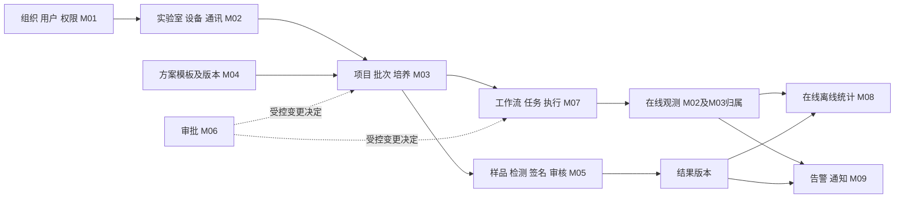
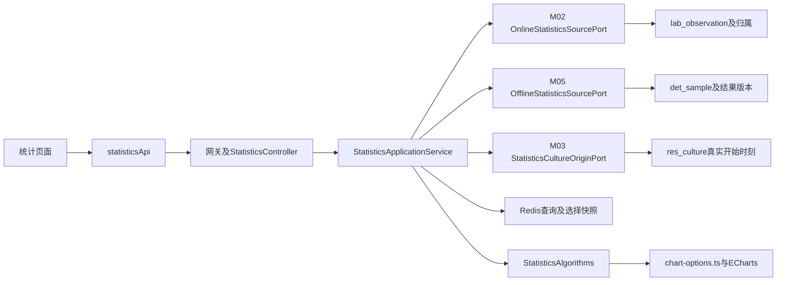

# 药明云项目入门与代码导航

这份指南帮助新开发人员把客户需求、页面、接口、Java 实现和数据库连起来。先读前四节理解全貌，再按第七节走一遍你负责的在线／离线统计，最后用排查清单处理真实开发问题。它是学习导航，不是新需求、接口契约或安装脚本。

核对日期：2026-10-16。代码快照：个人分支 `feature/data-statistics/online-offline`，HEAD `5a474558`，包含 cloud `5506ce3a`。本文没有核验整个项目的运行环境，也不表示每个模块已实现、已联调或已上线。

配套查阅：

- [中试连接补料单元与更换料液开发导览](中试连接补料单元与更换料液开发导览.md)：准备开发 W01/W02 时优先阅读，含业务前置、原型差异、源码入口和一周路线。
- [数据库表与核心字段索引](数据库表与核心字段索引.md)：当前建表基线的 172 张表、拥有方和核心字段。
- [后端接口入口索引](后端接口入口索引.md)：124 个 system REST Controller 的源码、路径及应用服务导入线索。
- [需求入口](../01-需求文档.md)、[设计入口](../02-详细设计.md)：正式规则仍从这里进入，再读模块现行契约。

## 一 先把项目要做的事情说清楚

这套系统管理生物制药实验室的一次培养实验及其周边工作：谁有权限，在什么实验室，用哪个设备，按哪套方案培养，过程中采到了什么数据，做了什么检测和补液，谁审批或签名，最后如何追溯。

最常见的一条业务主线是：



这是一张职责图，不代表每条箭头都已通过实机验收。你的 M08 在业务链下游读取数据；统计结果错误时，既可能是统计算法，也可能是上游归属、开始时间、状态、单位或版本不满足条件。

先记住五个词：

| 概念 | 在这个项目中的含义 | 主要对象 |
| --- | --- | --- |
| 项目 | 一项实验研究或业务项目，可以关联实验室、负责人和成员 | `res_project` |
| 批次 | 项目内的一批实验安排 | `res_batch` |
| 培养 | 一次具体培养对象，是运行、检测归属和对比的重要身份 | `res_culture` |
| 样品 | 从培养中取得并送检的样本，不等于培养本身 | `det_sample` |
| 指标 | pH、Glucose、Lactate 等被测参数，其身份还涉及检测类型、统计名及单位 | `dev_detector_item` 及来源配置 |

`culture_id` 是数据库关联主键，`culture_code` 是页面上的业务培养编号。样品还有 `sample_no` 和 `second_id`。不要将它们当作同一个字段，也不要把长整型 ID 转成前端 Number。

## 二 需求和原型应该怎样对应

本次只读提取了桌面《需求说明书V4.1-1013.docx》的正文，核对章节与范围标记，并清点桌面原型根目录 145 个 HTML 页面。没有逐屏验收全部原型，也没有声称对 V4.1 与所有源码完成逐条覆盖检查。Word 正文提取不包含图片中的全部信息；开发具体页面时还要打开相应原型。

客户 Word 的①②③④⑤、（3.1）（4.0）（4.1）主要是阶段／修订标记，不是 Java 模块编号。需求第一章叫“系统设置”，里面实际上横跨多个业务拥有方。

| V4.1 章节 | 原型例子 | 代码业务归属 | 先找哪里 |
| --- | --- | --- | --- |
| 1.1 基本设置、1.5 数据字典 | ①⑤数据字典.html | M01 | settings 的用户／组织／角色／菜单／字典页面 |
| 1.2.1 实验室管理 | ①③⑤实验室管理（一二阶段调整）.html | M02；实验室审批政策另归 M06 | `LabLabController`、`sys_user_lab` |
| 1.2.2 设备配置、1.3 资源管理 | 集成反应器、检测设备等原型 | M02 | `Dev*` 型号库、`Lab*` 实验室实例 |
| 1.4.1 项目管理 | ①项目管理.html | M03 | `ResProjectController` |
| 1.4.2 批次管理 | ①③④⑤批次管理.html | M03 | `ResBatchController` |
| 1.4.3 培养 ID 管理 | ①③培养管理.html、③④⑤修改培养.html | M03，运行依赖 M07 | `ResCultureController` |
| 1.6 工艺设置 | ④灌注培养基方案.html、⑤培养方案预设.html | M04 | `ProcessTemplateController`、`WorkflowController` |
| 2.1 检测分析 | BGA、Vicell、OSMO、Cedex 等页面 | M05，设备能力来自 M02 | 工作台、样品与结果应用服务 |
| 2.2 数据签名、2.3 签批记录 | ①⑤数字签名-操作台（一二阶段调整）.html、①签名审批记录.html | M05 | `DetSignConsoleController`、报告作业及结果版本 |
| 2.4 在线、2.5 离线数据 | ②在线数据统计.html、②离线数据统计.html | M08 这次恢复的首版 | `StatisticsController` |
| 3.2 反应器详情、3.3 工作流、3.4 任务 | ③⑤任务队列.html、③⑤补液任务.html | M07 页面组合 M03/M02/M09 | app-smp-lab、`controller/run/` |
| 3.5 流程审批 | ③⑤流程审批.html | M06 | `ProcessApprovalController` |
| 1.2 告警、1.1.10 通知等 | ⑤实验室告警.html 等 | M09 | `Alarm*V2Controller` |

要分清当前边界：

- 本期主交付 M01—M09。M08 4个包（在线／离线统计首版、批次对比及横向Excel、个人工作台、反应器看板）本期纳入设计、编码另行授权；其余未批准的综合统计不随之恢复。
- 小试一期原系统保留，不能把新系统基线 DDL 执行到一期旧库；小试二期和中试按新系统设计与经核准的接入方式推进。
- 原型里有入口，不等于当前已开放。比如旧培养接续、部分方案修改页面、连续泵速、AAD 等存在明确的延期或排除边界。
- 总设计仍残留 Element Plus、M08 全部延期等旧文字；当前前端实际入口是 `futurefab-frontend`、pnpm 工作区和 `@futurefab/ant-design-vue`。这些差异记录在本指南中，不据此批量重写需求。

## 三 哪些是服务 哪些只是代码包

后端有多个 Maven 工程，但 M01—M09 不是九个微服务。当前业务实现主要集中在 system 内，用包、Port 和应用服务隔离职责。

| 工程或依赖 | 要做什么 | 如何判断是否需要单独启动 |
| --- | --- | --- |
| `futurefab-gateway` | 前端 HTTP 统一入口、路由与网关过滤 | 有 `FutureFabGatewayApplication` |
| `futurefab-auth` | 登录、挑战式改密、会话令牌等；用户事实通过系统契约取得 | 有 `FutureFabAuthApplication` |
| `futurefab-modules/futurefab-system` | 组织权限、实验室、培养、工艺、检测、审批、运行、告警及本次统计 | 有 `FutureFabSystemApplication`，你最常改这里 |
| `futurefab-modules/futurefab-file` | 文件上传与文件存储适配 | 有 `FutureFabFileApplication`；需要文件功能时核对部署 |
| `futurefab-modules/futurefab-job` | Quartz 调度管理和任务日志等 | 有 `FutureFabJobApplication`；不等于所有业务调度都在这里 |
| `futurefab-modules/futurefab-gen` | 代码生成工具 | 有 `FutureFabGenApplication`；普通统计查询不靠它实时生成代码 |
| `futurefab-monitor` | Spring Boot Admin 等服务运行监控 | 有 `FutureFabMonitorApplication`；不同于实验室业务工作台 |
| `futurefab-api/futurefab-api-system` | 服务间契约、DTO、公共错误码、远程调用接口 | 依赖包，不是让你单独运行的业务服务 |
| `futurefab-common/*` | 安全、数据权限、Redis、日志、数据源、Seata 等公共能力 | 依赖包，不单独启动 |
| `futurefab-namedpipe-client` | 对接检测设备侧 Named Pipe 的客户端、适配与相关入口 | 当前被 system 作为 Maven 依赖引入，无独立 Boot 主类 |
| `futurefab-sdms-client` | SDMS 配置、令牌、订单／结果等客户端适配 | 同样由 system 引入；外部 SDMS 服务是另一个部署对象 |
| Nacos | 服务注册、发现和配置 | 外部基础设施，不是上面某个业务模块 |
| Redis | 会话及缓存；M08 临时查询快照也存这里 | 外部基础设施；重启／清空会影响临时状态 |
| MySQL | 业务主数据、结果版本、执行与审计等 | 外部基础设施；Nacos、Quartz 等专用库要按实际部署区分 |

`futurefab-modules`、`futurefab-common`、`futurefab-api` 本身是聚合工程，不要寻找各自的“启动按钮”。开发前还要看所选功能的对象存储、设备、SDMS、通知服务等依赖是否齐全；源码里有适配器不等于外部设备已接通。

当前根 POM 声明 Java 17、Spring Boot 4.0.6、Spring Cloud 2025.1.1。前端具体版本查工作区 package.json、锁文件及构建配置，不能照抄旧文档的 Vite 6 假设。

## 四 前端页面和后端接口怎样接起来

| 前端包 | 主要内容 | 容易误解的地方 |
| --- | --- | --- |
| `packages/portal` | 登录、门户、路由守卫、子应用装配、部署 API 前缀 | 地址栏 `/portal` 是前端门户，不是后端服务 |
| `packages/app-smp-settings` | 系统、实验室、资源、项目／批次／培养、模板等配置管理页面 | “设置”包里有 M03/M04，不只 M01 |
| `packages/app-smp-data` | 检测工作台、签名、记录、报告相关入口及统计 | “data”不等于只属于 M08 |
| `packages/app-smp-lab` | 培养运行、工作流、任务、补液等业务操作 | 它也会展示 M03 和 M09 的事实 |
| `packages/sdk-smp-api` | HTTP 请求封装、类型、各业务 API | flat 与 `modules/` 文件并存，必须跟随页面实际导入及 index.ts 导出 |
| `packages/sdk-smp-stores` | Pinia 会话、菜单路由映射等共享状态 | 页面文件存在还需要菜单映射和权限 |
| `sdk-smp-common`、`lib-smp-base`、`sdk-language`、`sdk-smp-static-files` | 公共组件、布局、语言和静态资源 | 不要在业务页面重做一套公共框架 |

最实用的调用链是：

```text
页面 index.vue
→ sdk-smp-api 的某个 xxxApi 方法
→ client.ts 拼 API 前缀并携带会话
→ 门户开发代理
→ gateway 路由
→ Controller
→ ApplicationService
→ Mapper 接口和 XML / 其他模块提供的 Port
→ MySQL 或 Redis
→ 统一响应外壳
→ SDK 解析、页面渲染
```

以统计为例，页面地址和请求地址完全是两回事：

```text
页面：       http://127.0.0.1:5581/data/online-statistics
浏览器 API： /dev-api/system/data/statistics/queries
代理后：     /system/data/statistics/queries
网关去前缀： /data/statistics/queries
Controller： @RequestMapping("/data/statistics")
方法：       @PostMapping("/queries")
```

证据：`portal/src/router/index.ts`、`scripts/portal-environment.ts`、`scripts/portal-proxy.ts`、`nacos-config/futurefab-gateway-dev.yml`。源码开发代理当前写的是前端 5581、后端 9090，这只是配置基线，不表示每台机器实际运行在这些端口。Nacos 发布配置与源码文件也要区分。

再看项目管理：SDK 调的是 `/resource/project/list`，网关扩展路由直接转 system，不走 `/system` 的去前缀路径。因此不要给所有接口机械地加同一个服务前缀。

## 五 M01 到 M09 分别如何理解

本节给出真实类名和阅读顺序，不给整个模块贴“已全部完成”标签。接口可能并存真实实现、旧版停用入口和未实现依赖，必须逐方法检查。

| 模块 | 一句话职责 | 代表入口与实现 | 核心表 |
| --- | --- | --- | --- |
| M01 | 谁能登录、看见和操作什么 | auth 的 `TokenController` → `AuthenticationApplicationServiceImpl`；system 的 `SysUserController`、`SysRoleController`、`SysMenuController` | `sys_user`、`sys_role`、`sys_menu`、关系表、`sys_management_*`、审计表 |
| M02 | 实验室里有哪些设备、能测什么、如何接入 | `LabLabController`、`LabDetectorController`、`DevDetectorItemController`、`LabCommunicationController`；观测入口 `ObservationIngressController` | `lab_lab`、`sys_user_lab`、`dev_*`、`lab_*`、`lab_observation_*` |
| M03 | 项目和培养身份、成员、占用、方案生效 | `ResProjectController`、`ResBatchController`、`ResCultureController` → m03 应用服务和 Mapper | `res_project`、`res_batch`、`res_culture`、成员、占用、参数与绑定表 |
| M04 | 可复用工艺模板和不可变版本 | `ProcessTemplateController` → `ProcessTemplateApplicationApplicationServiceImpl` | `prc_template*`、`workflow_*`、`lab_workflow_node` |
| M05 | 样品怎么发送、结果怎么接收和签批 | `DetWorkbenchController`、`DetSampleController`、`DetSignConsoleController`、`DetResultController` → m05 应用服务 | `det_sample`、`det_result`、`det_result_item`、`det_result_revision`、签批／更正／派发记录 |
| M06 | 受控变更由谁审核批准并交付决定 | `ProcessApprovalController`、`ApprovalPolicyController`、`ApprovalReconciliationController` → m06 应用服务 | `apr_scene`、`apr_lab_policy`、`apr_request`、`apr_action`、`apr_delivery`、`apr_reconciliation` |
| M07 | 对哪个培养执行什么任务，以及实际执行了多少 | `controller/run/RunTaskController`、`RunWorkflowController`、`RunExecutionController` → m07 应用服务及执行支持类 | `run_task`、`run_workflow_instance`、`run_execution`、`run_command`、`run_ledger`、`run_event` |
| M08 | 读取业务事实筛选、抽样、画图 | `StatisticsController` → `StatisticsApplicationService` → M02/M03/M05 只读 Port | 读上游表；用户查询／选择快照在 Redis，不新增统计业务表 |
| M09 | 发现告警、确定收件人并投递通知 | `AlarmRecordV2Controller`、`AlarmNotificationV2Controller`、`AlarmDeliveryV2Controller` → m09 应用服务 | `alarm_event`、`alarm_record`、`alarm_recipient`、`alarm_delivery*`、`sys_notification` |

### M02 型号和实验室实例不要混用

`dev_detector_model` 描述检测仪型号；`lab_detector` 是某实验室的一台实际检测设备。`dev_detector_item` 描述参数定义，`lab_detector_item_config` 表示实例相关配置。类似地，小试反应器本体、控制器及通道是不同对象，中试集成反应器又是另一类设备身份。查问题时先确认 ID 的设备种类，不能把两个表中相同数字视为同一设备。

在线观测接入还要经过原包验签／证据、映射、数值与质量、发生时培养归属等步骤。`lab_observation_mapping` 是字段到指标的转换配置，不是在线数值表；`lab_observation` 才存规范化数值，`lab_observation_association` 存观测归属。

### M03 和 M04 不要混用

模板是可复用的设计，培养生效方案是已冻结的具体版本。修改模板后不能自动改掉已经运行的培养或既有任务。M03 的参数候选、快照和当前状态需要一起理解；读到 M06 审批通过，还要继续追踪 M03 是否已应用成功。

### M05 检测结果不是样品表中的一个值

`det_sample` 记录身份和检测排队上下文；`det_result` 是结果主记录；`det_result_item` 是各指标明细；`det_result_revision` 保存不可变结果版本。签名、审核、更正又各有证据。统计不能只 JOIN 到一条“当前有数值的明细”就跳过版本和状态核验。

### M06 审批通过不等于设备已经执行

M06 产生审批决定，并交付给 M03/M05/M07 等业务拥有方；拥有方重验权限、状态、版本后应用。`apr_delivery` 与 `apr_reconciliation` 用来追踪交付及 UNKNOWN 对账。审批、检测签名和任务执行是不同流程，不能互相代替。

### M07 任务 命令 执行 计量是不同层次

`run_task` 表示业务任务，`run_execution` 表示执行过程，`run_command` 表示具体命令意图与回执，`run_ledger` 表示计量结算。设备返回 ACCEPTED 只是受理；UNKNOWN 也不能当失败换个命令 ID 再投料。

当前源码的 `CultureApplicationServiceImpl.finish` 就是一个跨模块例子：校验培养版本、状态和占用，再通过 M07 的运行 Port 获取安全释放证明；缺证明不能直接把培养状态改成已结束。你可用它理解为什么不能绕过 Service 直接 UPDATE 状态字段。

### M09 消息投递失败不应改写实验结果

业务事实先成立，告警规则再判定，接收人快照固定后各通道投递。恢复状态、人工处理状态、投递状态不同；不要看到“邮件发送失败”就回滚培养或检测结果。

## 六 打开 Java 代码时先认清这些目录

以 `futurefab-modules/futurefab-system/src/main/` 为基准：

| 路径 | 看什么 | 初学者常见误区 |
| --- | --- | --- |
| `java/com/futurefab/system/controller` | URL、参数、权限注解、调用哪个应用服务 | 同名 Controller 中可能同时有新旧接口 |
| `service/application/m0x` | 应用服务契约；个别如 M08 也在这里直接实现 | 并非全部文件都是 interface，实际打开核对 |
| `service/impl/application/m0x` | 事务、业务编排、幂等和状态校验的主要实现 | 不要只看旧 `IXXXService` 就认定是当前生产路径 |
| `service/port/m0x` | 模块提供给其他模块使用的能力约定 | Port 不等于一条远程 HTTP，有的当前是同进程调用 |
| `service/impl/port/m0x` | Port 的提供方适配实现 | 消费方不能跳过 Port 去写别人的 Mapper |
| `service/support/m0x` | 规则计算、执行协调、证据处理等支持类 | support 下并不都是通用工具 |
| `service/guard`、`service/audit` | 管理写守卫、并发、幂等、审计 | 不应为方便调试而删除守卫或审计 |
| `domain/dto`、`domain/vo`、`domain/row` | 请求、响应、数据库投影 | 它们不一定一一对应数据库实体 |
| `mapper` | SQL 的 Java 方法声明 | 要核对 namespace 与方法 ID |
| `resources/mapper/**` | 真正 SELECT/INSERT/UPDATE 的 XML | 一张表可被多个不同用途 Mapper 读取 |

旧 CRUD 服务、新应用服务、legacy 拒绝入口仍可能并存。源码中的“骨架阶段501”等注释有时未同步，所以判断一个操作要看真实方法体、实际调用方和测试，而不是单看类存在或注释。

## 七 用你的统计模块走通完整代码

### 第一站 找到页面和菜单

页面：`futurefab-frontend/packages/app-smp-data/src/views/statistics/index.vue`。

路由：`app-smp-data/src/router/index.ts`。公共路由映射：`sdk-smp-stores/src/route-paths.generated.ts`。数据库入口：`sys_menu`；账号还需具备相应菜单和功能权限。菜单脚本在 `sql/seed/20261014_m08_statistics_menu_install.sql`，它不生成实验数据。

### 第二站 跟踪请求

SDK：`packages/sdk-smp-api/src/statistics.ts`；导出：同目录 `index.ts`；网络公共层：`client.ts`。

在页面点击“开始统计”，用浏览器 F12 → Network 搜索 `statistics`。记录方法、URL、请求体和响应，再到 `StatisticsController` 找对应方法。HTTP 200 还要看统一响应外壳里的 code/errorCode；之前未登录请求就可能以 HTTP 200 返回 code=401。

### 第三站 找到应用编排

`StatisticsApplicationService.create` 的主要步骤是：规范化查询与数量限制 → 校验用户和请求标识 → 读取 M02/M05 数据并补 M03 培养事实 → 校验值、单位、质量和离线命名 → 在线按时间段取最早有效点 → 组装行与来源指纹 → 保存用户查询快照。

查询／选择信息进入 Redis，不 UPDATE 培养、样品或结果表。读取行、勾选和生成图时会重验所属用户及权限，并用选择版本和来源指纹阻止旧结果错误出图。快照默认 1800 秒、源数据量默认上限 20000，实际值还受环境配置影响。

### 第四站 看懂三个只读提供方

| 提供方 | 实际适配器／Mapper | 查什么 |
| --- | --- | --- |
| M02 | `M02StatisticsSourceAdapter` → `M02StatisticsSourceMapper.xml` | 指标、设备候选和规范化在线数值；按处理版本及归属修订筛选 |
| M03 | `M03StatisticsCultureOriginAdapter` → `M03StatisticsCultureOriginMapper.xml` | 项目／批次／培养业务编号、真实开始时刻及历史绑定设备候选 |
| M05 | `M05StatisticsSourceAdapter` → `M05StatisticsSourceMapper.xml` | 样品及检测结果的当前不可变版本，逐项投影数值与单位 |



### 第五站 把表连接起来

在线读取的核心关系：

```text
lab_observation_receipt.receipt_id
  ← lab_observation.receipt_id
lab_observation.mapping_id → lab_observation_mapping.mapping_id
lab_observation.observation_id
  ← lab_observation_association.observation_id
lab_observation_association.culture_id → res_culture.culture_id
```

发生时设备与培养关系还有 `res_observation_binding_revision`、`res_observation_binding_interval`。统计读历史观测的归属，不能用设备现在绑定的培养替换过去的归属。未归属的在线点在符合查询规则时可以被按时间查询，并非每个在线点都有样品记录。

离线读取的核心关系：

```text
res_project.project_id → res_batch.project_id
res_batch.batch_id → res_culture.batch_id
res_culture.culture_id → det_sample.culture_id
det_sample.sample_id → det_result.sample_id
det_sample.current_result_id → det_result.result_id
det_result.result_id + object_version
  → det_result_revision.result_id + object_version
```

`det_result_item` 是理解明细的重要表，但当前统计数值由 M05 校验后从 `det_result_revision.content_snapshot` 提取，不是直接读取任意版本明细。具体 JOIN 以当前 XML 为准；这些箭头是逻辑关联，不表示每条都声明了数据库外键。

### 第六站 找到计算与绘图

- 后端 `StatisticsAlgorithms`：每日分段抽样、业务行及图表点转换。96 条／天对应每 15 分钟一段，每段取最早有效点。
- 后端 `StatisticsSampleNaming`：小试三类与中试样品规则，排除无培养周期或缺可信容器身份的记录。两字符短前缀只判断结构，不能自由解释成培养天数。
- M03 `res_culture.start_completed_at`：保留真实开始事实用于追溯。2026-10-17用户确认图表D0改为每培养首条已选记录，取消后顺延；相对天数为该基准起经过秒数／86400。
- 前端 `chart-options.ts`：分图、同指标单位共轴、配色、虚线在线叠加、日期格式、tooltip 和工具栏。

自然时间用原始采集／检测完成时间；在线取 `observed_at`，离线取 `testing_end_time`。样品 ID 中的 D 数字和真实时刻是不同证据，不能用它偷偷补出不存在的真实开始时间。

当前已知限制：离线历史样品到物理控制器／反应器的映射还缺可信依据；11 条旧命名 Mock 培养没有真实开始时刻，只能用自然时间。不能为让图好看而使用当前设备或第一条测量时间猜测。

## 八 在 IDEA 里具体怎样读一个功能

以“查询培养列表”为练习，不先修改代码：

1. 打开浏览器培养管理页，F12 的 Network 记录列表 URL，例如 `/resource/culture/list`。
2. IDEA 连按两次 Shift，搜索 `ResCultureController`，在类内找 `/list` 对应方法。
3. Ctrl+B 跳转被调用服务；如果跳到 interface，Ctrl+Alt+B 选实现。不要直接打开名字相近的旧类。
4. 看请求 DTO 和响应 VO，记下培养 ID、版本、状态和权限字段分别从哪里来。
5. 跟到 Mapper，再用 Shift+Shift 搜同名 XML；核对 namespace、方法 ID、WHERE 条件和关联表。
6. 选中关键应用方法，Alt+F7 看用法；Ctrl+Alt+H 查看可用的调用层次。异步事件、Port、注解反射不一定全部出现在静态调用层次里。
7. 回到前端 `sdk-smp-api/src/culture.ts`，再看页面实际 import 的 API 和列定义。
8. 对照需求 1.4.3 和模块契约，写一张便签：触发动作 → URL → 方法 → 表 → 权限／状态／版本约束 → 测试。

下一次做“取消某一行后重新画图”，就用相同方法走统计的 selection 接口。日常不需要先读完整个仓库。

## 九 每次开发都要检查的共同规则

| 规则 | 为什么需要 | 看哪里 |
| --- | --- | --- |
| 功能权限 + 数据范围 | 能点按钮，不代表能读写任意培养／实验室 | Controller 权限注解、M01/M02/M03 权限 Port |
| 管理版本 | 防止旧页面覆盖别人刚保存的配置 | `@CurrentManagementRevision`、`sys_management_revision` |
| 请求幂等标识 | 超时重试不能变成重复写或重复设备动作 | `X-Request-Id`、`sys_management_request`、业务回执 |
| 对象版本 | 防止并发修改同一个对象 | `object_version`、expectedVersion、SQL CAS 条件 |
| 运行／处理／归属版本 | 防止把不同处理结果和历史归属混到一起 | runtime_version、process_version、association_version 等 |
| UTC 与上海展示时间 | 防止一天边界、D0 和自然日偏移 | DTO、Mapper、统计输入输出格式 |
| 不可变快照 | 保留当时测量、审批和执行的证据 | `det_result_revision`、模板／培养参数版本 |
| 事务与外部副作用分开 | 数据库回滚不能撤回已投料或已发邮件 | 应用服务、outbox、Worker 与固定命令身份 |

标注 `@ManagementGuardedWrite` 的写接口必须带 `X-Request-Id` 和页面对应读接口返回的顶层 `managementRevision`。前端没有 revision 就应短路，不能借别的模块版本或硬编码。遇到 MANAGEMENT_CONFLICT/409 应刷新并按契约处理，而不是删除后端校验。

M08 的创建查询、勾选和出图虽然使用 POST/PUT，但操作的是用户临时查询快照，不是上述管理业务写；它使用自己的请求和选择版本语义。不能仅按 HTTP 动词决定套哪种守卫。

## 十 出现问题时按这条路径排查

| 现象 | 先检查 | 再检查 |
| --- | --- | --- |
| 没有菜单 | sys_menu、角色菜单与功能权限、重新加载会话 | 菜单 component 与 route-paths 映射、子应用路由 |
| 页面空白／旧内容 | 子应用及 SDK 是否构建、浏览器控制台和网络资源 | 门户加载路径、资源版本、实际启动目录 |
| 404 | Network 的真实 URL、开发代理、网关路由 | 去前缀后的 Controller 路径及服务注册 |
| HTTP 200 但页面报错 | 响应 code/errorCode/msg | 令牌、权限、业务异常；200 不等于业务成功 |
| 401／403 | 会话是否有效、功能权限 | 实验室和项目／培养对象范围 |
| 409 | 管理版本、对象版本、幂等键是否冲突 | 不换键盲重试，按具体契约恢复 |
| 501 | 真实调用链是否还有未实现接口或已延期入口 | 模块契约和调用方，不靠删异常掩盖 |
| 503／依赖不可用 | 配置、真实上游事实、部署输入及设备能力 | 不是一律解释为服务没启动 |
| 数据库有记录但统计查不到 | 本人范围、已上传／已签名／已审核、完成时间、当前结果版本 | 快照质量、指标及单位、样品命名、培养归属、源点上限 |
| 自然日／D0 不正确 | UTC 输入输出、完整快照已选首条基准、所选横轴模式 | 是否误用了首条时间、计划日期或旧快照 |
| 修改源码后页面无变化 | 进程是否加载新代码、SDK／子应用是否重建 | Nacos 是否实际发布、服务是否重启及缓存是否过期 |

SQL 查询尽量使用明确 ID 和有限时间窗口；先 SELECT 核验。不要为了测试页面在业务库直接改审批、执行或签名状态。

## 十一 建议用五次练习熟悉项目

| 顺序 | 实际操作 | 学到什么 | 产出 |
| --- | --- | --- | --- |
| 第一次 | 登录并查看菜单，跟踪 `/auth/login` 和菜单请求 | auth、gateway、system、会话和权限 | 一张登录／导航调用图 |
| 第二次 | 从项目找到批次、培养，跟踪一次列表和详情 | M03 身份关系、DTO/VO、Mapper | 五个主要 ID 的对应记录 |
| 第三次 | 查一个已有样品及结果版本，不发送设备命令 | M02/M05 分工、结果明细与快照 | 一条样品到结果的链路 |
| 第四次 | 用基础 Mock 或混合 Mock 生成在线／离线图 | M08 的实际上下游、选择顺延 D0、抽样、勾选 | 一次查询的请求响应和表关联 |
| 第五次 | 只读查看一个审批单及一个任务的状态 | M06/M07 决定、应用、命令、执行的区别 | 状态与版本清单，不进行真实投料 |

你当前优先顺序是 M08 → M03 → M05 → M02，随后补 M01 的权限／守卫，再读 M04/M06/M07/M09。这样先掌握自己模块的真实数据来源，而不是从最复杂的设备执行开始。

## 十二 工作方式和需要团队补充的材料

当前个人分支已经推送，现有 13 个本机配置／工具修改仍未纳入提交。本指南等新文档是这次新增工作，未随前一次 Push 自动上传。日常提交继续用明确文件范围，避免配置、打包产物和别人代码混入。

一项需求开始时先确认现行契约；开发时跟实际请求和版本；完成后至少覆盖正常、空数据、无权限、状态／版本冲突和来源变化等相关路径。数据库、HTTP、真实浏览器和设备验收分别记录；不拿 Mock 测试替代实机。

现有资料足够继续做静态学习，不需要你重复发送已经提供的文件。为了把学习变成稳定开发，后续最有用的补充是：

1. 团队认可的本地启动说明：环境名、所需服务、配置获取方式、启动顺序与日志位置；不要在聊天里发密码／令牌。
2. 组内模块负责人和代码审阅人：特别是 M02 在线来源、M03 培养事实、M05 检测快照的负责人。
3. 共享开发库、个人开发库和小试一期旧库的用途边界，以及哪套与当前基线一致；不需要提供真实连接凭据。
4. 组长对 V4.1 与当前合并设计差异的已确认清单，防止把原型中的延期入口误做成本期功能。
5. 测试环境可用的账号角色、菜单授权和可复现样例；设备／SDMS 真实联调由谁提供环境与验收证据。

只缺这些团队运行信息时，仍可继续阅读、定向单元测试和文档整理；涉及共享库、部署、业务规则裁决或真实设备操作时再找相应负责人确认。
