# SMP 小试二期与中试补料调度统一方案

**客户评审稿 V1.5｜2026-10-16｜工艺与软件协同设计**

本方案说明 SMP 如何把已批准的培养补料方案转化为可执行任务，并完成执行监控、暂停恢复、异常处置和实际补料量记录。评审重点是：**向哪个培养体系补加什么物料、何时补、补多少、以什么速率补，以及如何证明本次补料已经停止、实际补入量是多少。**

正文供工艺、实验操作、自动化及项目人员共同评审；

## 1 方案目标与适用范围

统一的是补料任务的业务管理和执行记录，小试二期与中试分别配置执行接口、计量方法、泵速策略和现场保护。

| 实验室范围 | 已确认的实施方式 | 本方案安排 |
| --- | --- | --- |
| 小试一期 | 沿用原系统 | 按一期原业务接口、执行程序和回调链管理，保持与二期新执行链的边界。 |
| 小试二期 | SMP 重构补料调度和补料监控 | 新调度负责生成/执行任务及记录过程，新监控负责进度、超量/停滞和服务健康检查；直接调用客户现有服务控制健康接口。设备交互使用 OPC，具体服务接口及点位需核验。 |
| 中试 | SMP 重构补料调度和补料监控，设备交互使用客户提供的 OPC 通道 | 与小试二期采用同一调度、监控和健康检查分工。正式接口尚待客户提供；OPC 路线已确认，启停、调速、状态及停止反馈点位需核验，重量读取通道单独确认。 |

本期覆盖计划补料、定量补糖、按规则补糖、人工发起的补料、暂停继续和异常后补料。本文“人工发起任务”指用户提出请求后由系统执行；“人工追加登记”指登记现场已经发生的人工补加，两者必须区分。

连续式泵速策略、pH 校准、耗材自动扣减、旧未完成任务接续及 M08 能力仍在本期范围之外。补料停止不等于培养结束，培养结束继续按 M03 已确认的业务流程办理。

## 2 工艺概念与补料任务定义

### 2.1 统一用语

| 术语 | 本方案中的含义 | 使用注意 |
| --- | --- | --- |
| 培养批次 / 培养体系 | SMP 中与具体培养记录及反应器关联的培养对象 | 文中“培养批次”用于业务说明，不直接等同于药品生产批号，也不新增批号模型。 |
| 补料物料 | 本次拟加入的补料培养基、糖液或已配置的其他补加液 | 明确物料身份、浓度/性质及供料容器，不能只凭泵号识别物料。 |
| 目标补料量 | 本任务计划泵入的补料液质量，系统计算单位为 g | 是补料液的质量；补糖任务中不直接等于葡萄糖溶质质量。 |
| 实际补料量 | 根据经确认的计量方法得到、用于本次任务记录的实际加入量 | 原始读数、实时估算量与最终确认量分别保留。 |
| 培养液量 | 初始或当前培养液的质量/体积 | 必须说明时点、来源及单位，避免统称“罐重”导致计算依据混淆。 |
| 补料速率 | 单位时间补入的补料液质量或体积 | g/min、mL/min 与泵转速 rpm 分别表达，通过已确认的换算关系连接。 |
| 补料执行服务 | 负责启动、调速、读取执行数据和停止核验的软件组件 | 原方案“固定执行器”强调同一设备组的固定控制归属，不特指新增现场硬件。 |
| 实际量确认与记录 | 确认各执行段实际补入量，按同一执行身份更新记录 | 对应开发文档中的“计量结算/认可账”，不是费用结算。 |
| 设备解除占用 | 本次执行已停止、未决指令及计量已处理，设备允许分配给后续任务 | 仅修改任务状态不足以证明设备可重新使用。 |

补料工艺规则决定何时补、补什么、补多少；单次执行策略决定怎样把这份物料加入培养体系。按葡萄糖等检测结果触发的任务，也须明确检测到计算、计算到实际补加的时间关系。[工艺概念参考：Eppendorf 补料培养与反馈控制说明](https://www.eppendorf.com/us-en/lab-academy/applied-industries/bioprocessing/introduction-to-bioprocessing/batch-fed-batch-and-continuous-culture/)。该资料仅用于术语解释，本项目的执行规则以已确认需求为准。

### 2.2 一次任务应回答的问题

| 工艺问题 | 任务及执行记录应明确的内容 |
| --- | --- |
| 给谁补 | 培养对象、反应器、补料通道及所用设备组。 |
| 补什么 | 物料、供料容器及当前使用记录；参与糖计算时保存所用糖浓度及来源版本。 |
| 何时补 | 计划时间或触发规则、实际开始/停止时间、延迟及暂停原因。 |
| 补多少 | 目标补料液质量、计算依据、实际补入量、差额及计算版本。 |
| 怎样补 | 固定速率或分段策略、速率范围、称重方式及允许的停止条件。 |
| 谁负责 | 任务申请和审批人员、当前执行控制方、异常处理与现场处置责任方。 |
| 如何证明 | 原始称重/设备反馈、分段记录、停料确认、人工干预及更正记录。 |

其中物料批次、使用期限、连接检查等现场信息是否已有系统来源、是否需要增加录入或接口，列为第10节工艺评审事项，不能在缺数据时默认已检查。

## 3 补料类型与任务生成

| 类型 | 触发和计算依据 | 系统处理 |
| --- | --- | --- |
| 固定计划补料 | 已生效培养方案中的时间及定量/百分比参数 | 补料单元连接完成后展开计划任务；百分比依据按现行规则使用初始培养合并量。 |
| 固定量补糖 | 方案约定的补糖时间和补加液质量 | 随固定计划展开，不依赖动态补糖扫描。 |
| 按规则补糖 | 已确认葡萄糖结果，必要时包括乳酸；所选培养量依据、目标浓度和补料液糖浓度 | 判断规则成立后生成待审批任务；实际启动前按批准的规则取得有效输入重算，并固定本次目标。 |
| 人工发起补料 | 用户填写物料、目标量、计划时间及执行方式 | 按既定审批政策生效后进入队列；重复提交同一请求不重复建任务。 |
| 异常后自动补料 | 原任务安全停止并确认实际量后，经用户处理和审批产生 | 建立关联子任务，明确额外补加量；子任务开始前不预记实际量。 |

固定任务按计划发生项去重。动态任务按“培养对象＋稳定规则＋上海业务日”每日最多创建一次；这是本项目已确认的业务约束，不是通用工艺频率建议。创建后取消、驳回或撤回不恢复当日额度；未创建任务的无效评估可以在条件改善后重新判断。

按规则补糖使用经过确认的检测结果驱动任务计算；它与单次补料过程中根据重量反馈调速是两个层次。本期不因此承诺连续在线维持葡萄糖浓度，也不把定期检测间隔当作泵控制采样周期。

审批固定的是任务内容或动态规则、计算依据及算法版本。动态任务的生成预估量与执行前目标量分开保存；执行前重算不授权更改规则。开始后暂停继续仍使用原目标，不重新计算一份完整补料量。

## 4 总体架构与双方职责

### 4.1 从工艺计划到设备执行

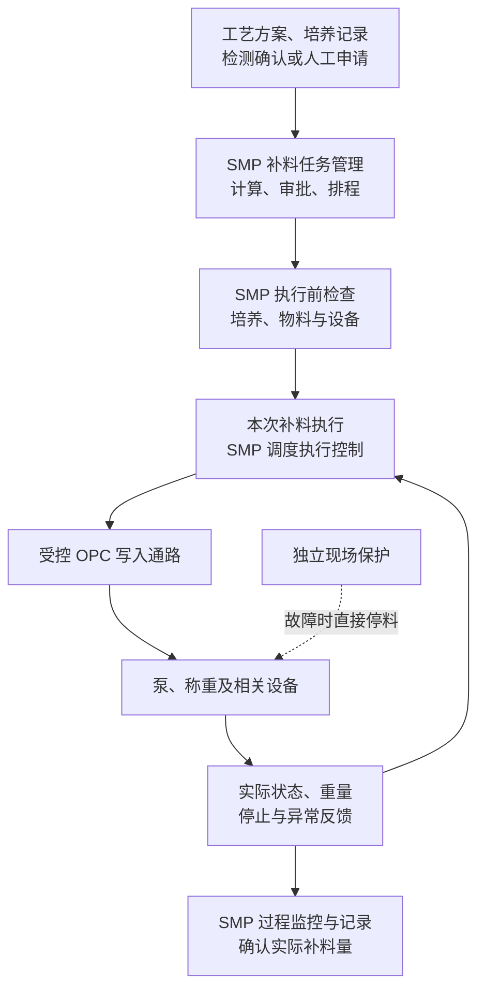

图中反馈箭头表示设备信息回传。SMP 收到“请求成功”后继续跟踪实际执行；取得停止和计量结果后才确认任务结果。

| 工作 | SMP 责任 | 客户工艺 / 自动化 / 现场责任 |
| --- | --- | --- |
| 工艺参数和适用范围 | 保存生效方案、版本和审批记录，按约定计算 | 确认物料、计算依据、补料时间、速率、允差及异常处理要求。 |
| 任务排程 | 生成、审批交接、队列、共享设备互斥及执行前检查 | 提供设备可用条件及现场操作约束。 |
| 小试二期执行与监控 | 重构补料调度和补料监控；新监控直接调用现有服务控制健康接口，执行安全停止及处置记录。 | 提供并维护现有服务控制接口，协同确认新调度检查地址、设备映射及设备通信，配合现场验证。 |
| 中试执行与监控 | 重构补料调度和补料监控；调度通过客户 OPC 通道控制设备、取得合格重量并判断终点，监控检查进度与健康并独立请求安全停止。 | 提供正式设备接口和可复用的服务健康接口，核准设备映射、运行参数、停止反馈与现场保护，配合联调。 |
| 异常处置 | 告警、请求停止、保留未确定结果、支持用户处理 | 排查物料/管路/设备原因，确认现场实际状态及恢复条件。 |
| 现场保护 | 接收保护状态，限制任务启动及恢复 | 落实独立保护回路、急停、锁存及授权复位，提供实测结果。 |

### 4.2 统一调度与监控，分别适配设备接口

小试二期和中试均由 SMP 重构调度与补料监控。调度取得有效重量和状态，按核准规则控制补料、判断终点并请求停止；监控独立检查执行进度和服务健康，异常时请求安全停止。两类实验室设备交互均使用 OPC。中试全部设备交互仍经客户接口。这里区分客户封装的 OPC 服务 API 与 SMP 直接连接 OPC Server：当前确认的是 OPC 路线，具体调用层次、DA/UA 类型、版本、端点、鉴权及读写点表由客户提供，不据此默认 SMP 直连 OPC Server。重量数据是否也经 OPC 获取单独确认；小试原文的地秤服务保持为来源证据，中试称重读取方式仍待确认。

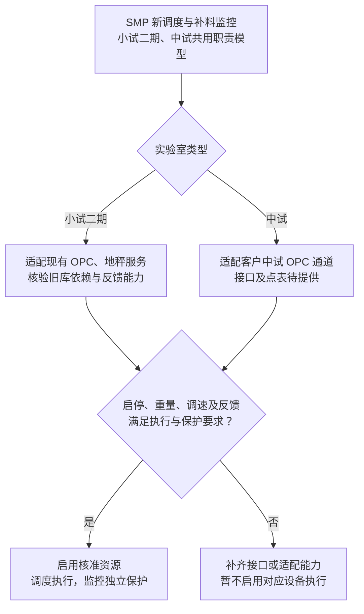

一次补料只能有一个控制方。正常开泵和调速由 SMP 调度负责，监控只有安全停止权限。客户设备内部的基础控制和保护继续按设备能力工作；若后续中试仅提供整次补料任务接口，需要另行评审控制职责变更，不作为当前并列默认路线，也不能与 SMP 同时调速。

两类采用统一的逻辑部署边界：任务管理、执行调度、进程外补料监控、受控 OPC 写入通路、客户健康服务和独立现场保护。软件监控必须运行在执行调度进程之外；负责两方写入仲裁的组件也不能仅存在于调度进程内。具体服务器数量不在本方案中预设，部署与故障覆盖按4.4节确认。

### 4.3 小试二期与中试的重构与复用

本节按客户最新确认描述两类实验室的共同分工。这里的“服务监控健康接口”与需要重构的补料监控区分：客户小试原文由 ServiceControl（服务控制）提供 `GET controlService/api/healthcheck`。中试同样复用客户健康接口，其实际地址、响应和部署映射须确认，不能直接套用小试 URL、检查实现或设备列表。

| 程序 | 实施边界 | 在新流程中的职责 |
| --- | --- | --- |
| 补料调度 | 我们重构 | 读取新任务、执行前检查、通过设备接口开泵/调速、读取重量、判断终点与运行异常、保存执行明细及结果。 |
| 补料监控 | 我们重构 | 读取 SMP 当前执行和进度记录，检查超量、停滞、首反馈和数据时效；调用现有健康接口，必要时独立请求安全停泵并记录处置。 |
| 设备控制接口 | 小试与中试均使用 OPC，由客户提供接入资料 | 提供设备状态、启停和泵速设置；分别核验调用层次、OPC 类型、读写点位、权限、质量/时间戳及停止反馈。小试旧服务的旧库依赖另行处理。 |
| 重量采集接口 | 小试核验现有地秤服务；中试由客户提供 | 提供重量读数；中试具体称重来源和读取方式待接口确认，两类缓存时效、单位和质量均需核对。 |
| 服务控制 ServiceControl | 直接调用客户现有健康接口 | 返回所配置调度服务的健康结果；健康检查与安全停泵分工分离，停止由 SMP 新监控通过设备接口请求。 |

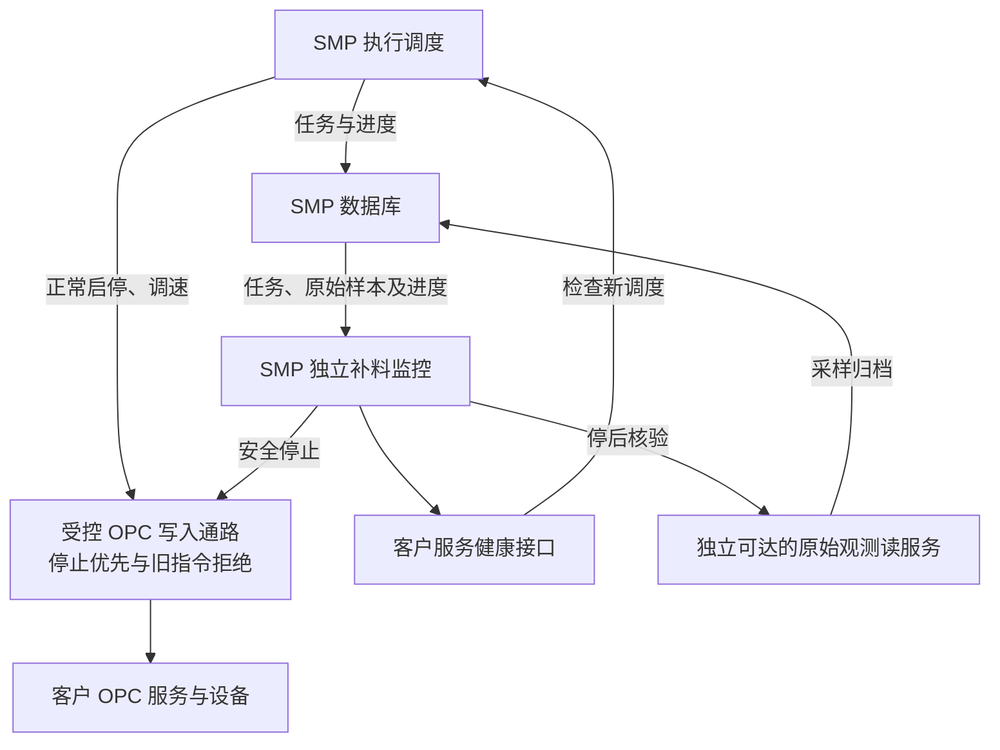

本图突出正常控制和保护停止的共同写入边界；重量采集、原始观测交付与停后反馈详见8.4节。数据库读取通过拥有模块提供的受控接口或读模型完成，该读路径不能依赖执行调度进程转发；新监控不照搬原库状态7/9及“只查今日”的 SQL。调度与监控共同使用同一套执行身份、设备映射和实际量记录，监控不另建第二套任务账。监控可维护保护状态及复核值，最终业务状态和计量认可由 M07 受控归并。

直接复用健康接口，还需完成目标配置和结果语义对接。客户小试资料中的 ServiceControl 会访问所配置的调度 `version` 地址，判断返回 `Database` 非空，并 Ping 配置目标。重构后须让该检查确实指向新调度：由客户确认检查地址及返回兼容要求，SMP 按约定提供可用的健康响应；不能为通过检查而固定返回非空字符串，也不能仍检查已经退出运行的旧调度。两类接口可复用的方向已确认，具体部署地址、返回语义及现场配置分别联调核实；中试不能默认采用小试的 Database/Ping 判据。

健康返回失败或接口调用异常时，新监控依据“健康接口实例→调度主机→设备组”的有效映射，核对这些设备当前活动/未决任务并请求停止，范围不扩大为全厂所有泵。已经重新分配或映射不明的设备进入现场核对及独立保护流程，不凭过期缓存操作。

新监控的安全停泵通路必须在新调度进程失效时仍可到达对应设备接口/适配服务，不能要求故障调度转发。正常开泵/调速仍由唯一调度控制方负责；监控只有受控的安全停止权限，并与调度共享停止优先和旧指令拒绝机制。这种分工不增加第二个正常调速控制方。

现有健康接口作为服务可达性信号继续使用，新监控同时检查执行记录和采样进度。即使健康接口返回成功，控制线程卡死或明细停更仍须按规则处置；监控或整机自身失效仍由独立现场保护覆盖。

### 4.4 部署边界与故障覆盖

“调度、监控、OPC、称重、健康检查”是职责划分，不要求恰好部署五台服务器。以下边界作为开发基线，物理主机及客户服务改造位置在联合部署清单中落实。

| 组件 | 进程及依赖要求 | 故障时的责任 |
| --- | --- | --- |
| SMP 任务管理与执行调度 | 任务管理负责审批/排程；执行调度负责单次控制。控制循环不被页面请求、慢查询或通知阻塞。 | 无法取得有效控制资格、样本或记录能力时停止新增动作，并按故障规则停料。 |
| SMP 补料监控 | 独立于调度进程；任务读模型、原始观测、健康检查和停止通路不经故障调度转发。 | 调度退出或卡死后仍能识别受影响资源、请求停止并核验。 |
| OPC 写入仲裁与反馈适配 | 优先在客户 OPC 服务写入口落实；客户服务不支持时，由双方确认增加独立适配进程。全部软件写入口必须受控，禁止旁路。 | 拒绝过期/失配指令，锁定停止，提供停止后的状态读取；自身不可用时转现场保护。 |
| 客户健康服务 | 复用现有接口，配置为检查新调度实例和对应设备组。 | 仅提供健康信号；不替代真实控制进度、OPC 可用性和停料证据。 |
| 现场保护 | 由客户确认 PLC/DCS、设备或液路保护及复位条件，独立于上述业务软件。 | 覆盖 OPC、网络、数据库、监控及控制主机故障中软件无法完成的停料。 |

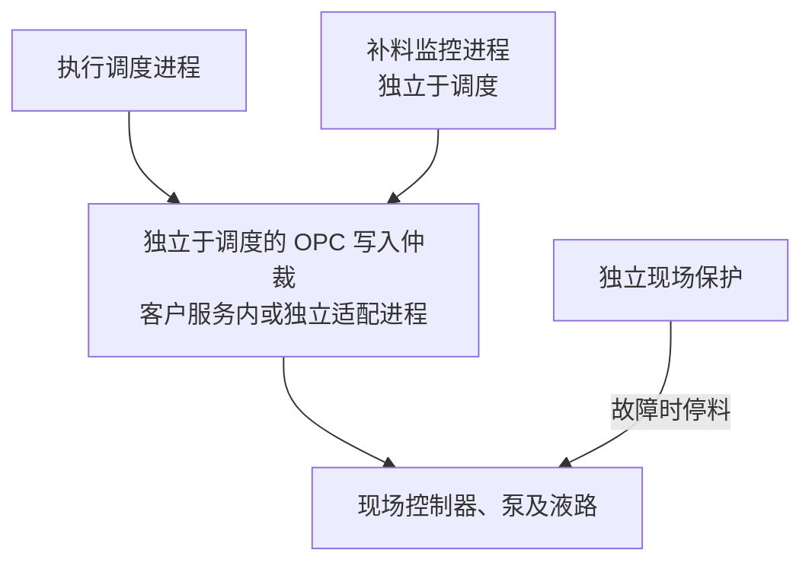

独立进程能够隔离调度进程崩溃，不能自动覆盖同机断电。若监控承担调度主机故障后的软件停泵，应部署在另一可用主机，并验证网络及 OPC 服务仍可达；若同机部署，则整机故障须由已核准现场保护覆盖。两种布置都不能以“有监控进程”作为整机容错证明。

交付部署清单至少列出：主机、进程、设备组、OPC/称重/健康端点、启动依赖、检查目标、写入权限、保护路径、运维责任和版本。两个软件进程共用的数据库、网络、OPC 服务、电源及计算规则须标为共同故障点；物理停料能力逐资源组验证。

### 4.5 OPC 写入仲裁与停止锁定

正常启动/调速由调度唯一发起，调度和监控均可发起停止。M07 管理任务身份，M02 负责受控写入适配；客户配合实现其 OPC 服务或现场控制器中的必要约束。这里的停止锁定是拟实施的软件机制，客户现有服务尚不能视为已经具备。

| 规则 | 必须落实的行为 |
| --- | --- |
| 单资源串行写入 | 同一泵/共用控制资源的写入在实际入口串行仲裁；指令携带内部执行身份、控制代次、递增序号、有效期与来源。客户端锁或数据库 CAS 不能代替实际写入口约束。 |
| 停止优先 | 在允许的资源归属下接受停止意图，先使停止锁定生效，拒绝新启动/调速，撤销尚未发出的普通指令，再执行核准停止动作。数据库或业务日志失败不得阻塞该保护动作。 |
| 在途指令 | 已离开入口的写入未必可撤销。必须核准客户服务/控制器的排队、完成顺序和停止屏障；已超时请求不得在稍后覆盖停止。无法证明这一点时，需要现场运行许可/锁存等约束，不能仅靠再写一次0。 |
| 锁定与复位 | 锁定后迟到普通指令均被拒绝。进程重启默认禁止正常写入；未恢复的锁定或归属视为不允许启动。人工暂停、异常保护和现场锁存分别按其授权恢复规则处理，复位不直接开泵。 |
| 停止核验 | OPC 写入应答、设定值回读、实际转速/停止位、液流或重量证据分层记录。读数缺失时不伪造已停止；必要时转现场确认。 |
| 权限与旁路 | 监控仅有受控停止权限。若接口只有通用写速度方法，由服务端/适配入口限制可写值及资源；不能只靠监控程序约定写0。旧程序和未纳入仲裁的手动入口须隔离，现场急停继续有效。 |

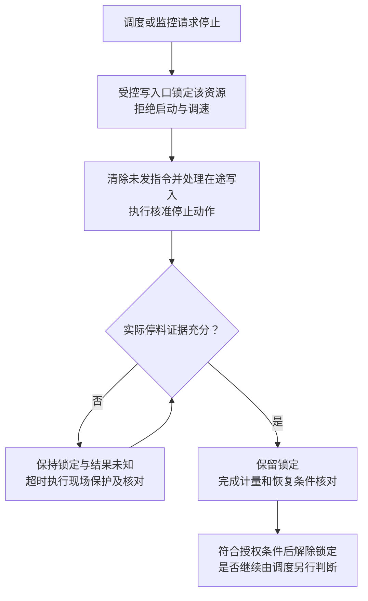

异常路径在现场处置后重新核验，不重置原停止期限；未取得证据不允许进入解除锁定流程。超时即记录停止故障，后来证实停料也不改写为按时正常完成。写入口自身无法锁定或无法保证停止优先时，立即沿核准现场保护路径处理，不等待软件恢复。连续健康检查成功、连接恢复或服务重启都不能自动清除保护。有效归属不明时按8.5节执行固定保护范围，不向猜测的当前任务发送正常控制指令。

## 5 一次补料的标准操作流程

### 5.1 执行前检查

| 检查对象 | 执行前应满足的条件 | 不满足时 |
| --- | --- | --- |
| 培养与工艺 | 培养仍有效，任务及方案已批准，当前时间符合计划，前序任务已经按规则处理。 | 等待或提示具体原因；过期未开始任务按既定跨天规则处理。 |
| 检测与目标 | 所需检测确认有效，计算依据、物料糖浓度和单位明确，本次目标量合法。 | 不用默认0或旧值补齐，不启动依赖该数据的任务。 |
| 物料与液路 | 系统物料映射、供料容器使用记录和可用量满足任务要求；现场准备按双方确认的流程完成。 | 保持待执行，安排核对。新增现场检查范围见第10节。 |
| 设备与控制 | 泵、秤及共用管路/控制器已分配，处于可接受模式，无其他控制方占用。 | 不并行启动冲突任务。 |
| 计量与停止 | 起始读数有效、单位和方向正确，当前执行方式具备规定的停止与保护能力。 | 保持禁止启动，修复后重新检查。 |

设备允许工作容量应来自客户确认的约束。反应器标称容积、供料袋额定容量和实际液量分别使用，不能相互替代。

同一培养的补料与补糖统一按计划时间和稳定任务编号排序。前序待审、暂停、异常未处理、执行结果不确定或关联补料未完成时，不让后序任务绕过；不同培养仅在设备资源真正独立时并行。

### 5.2 正常执行与结果确认

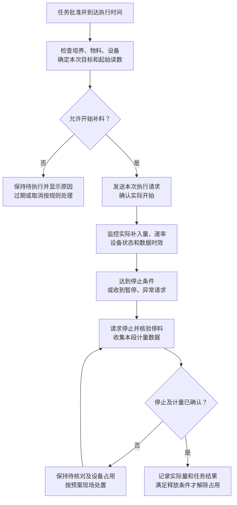

图中“确认实际开始”若超时，核对 SMP 原命令记录及可用 OPC 实际反馈并执行必要停止保护；客户无查单能力时不虚构查询结果，不能另发一份补料请求。正常完成还需最终量符合已确认的允差；暂停或异常按各自流程处理，不直接标记正常完成。执行记录完成仅说明本次补料动作及计量已处理，不代表培养工艺效果或产品质量已经判定合格。

任务暂停后保留任务与设备关系，并按已确认的恢复要求保持必要设备占用；规定的停止后观察未完成、仍有未决指令或实际量未确认时，不解除相关占用。

## 6 补料量计算与称重确认

### 6.1 计算对象和单位

目标量、实际量和累计量以十进制 g 计算；葡萄糖/乳酸浓度以 g/L 表达。质量、体积及葡萄糖溶质质量在记录中分别标明。

现行项目契约约定业务体积按密度1g/mL换算，即 g/1000 转为 L。这是项目已确认的计算约定，不是所有补料液的通用物性结论。具体物料的单位适用性须确认；若工艺要求使用实际密度，应走计算规则变更评审，本版不擅自改公式。

| 计算用途 | 现行规则及解释 |
| --- | --- |
| 定量补料 | 直接使用经批准的补料液目标质量。 |
| 百分比补料 | 初始培养合并质量×补料比例；不要误用每次执行前的实时质量。 |
| 按残糖规则补糖 | 按已批准公式，用目标浓度与当前浓度之差、所选培养量依据及补料液糖浓度计算补加液量。 |
| 残糖/乳酸模式 | 沿现行客户确认的乳酸修正规则计算，所需两类确认均有效；该规则是项目工艺约定，不描述为普适生化换算。 |
| 补料后糖浓度 | 按实际补入量及补料前后培养液量计算理论混合浓度；是否更新按现行开关执行，不能当成补后实测结果。 |

例如：计算依据为2000g，当前糖3g/L，目标7g/L，糖液400g/L，按现行公式得到补加液20g。若实际补入20g、补前体积2L，按该混合模型得到理论浓度约6.9307g/L，而不是把目标7g/L直接写为实测值。软件保留现行目标计算与实际混合计算的区别；是否需工艺调整由客户评审决定。

### 6.2 小试与中试的计量来源

| 计量对象 | 小试二期 | 中试 |
| --- | --- | --- |
| 当前培养液质量 | 初始培养质量＋全部确认补入量−全部确认取样量，是按记录计算的当前量。 | 采用反应器秤经净重处理后的有效读数；已体现在称重中的取样不再扣一次。 |
| 本次补料量 | 按已确认的供料称重/累计消耗方式分段计算。 | 正式接口须说明提供原始重量、分段量还是累计结果，并明确计量依据。 |
| 供料容器余量 | 当前容器实际装载量减本使用记录的确认消耗。 | 客户数据来源及容器切换方式待确认。 |

供料减重法中，本段量=本段起始重量−本段结束重量；累计消耗读数则取末值−初值。方向、净重/皮重及精度按具体设备确定，反向变化不能取绝对值后当作补入。

**供料端减重不天然等于全部进入反应器。**计量方案须说明预充、管路残留、排空、旁路及暂停操作如何处理。反应器增重也会受其他加料、取样等活动影响，能否用来计量本次补料须单独确认。适用条件未建立时，系统保留待核对结果。

### 6.3 分段计量与数据可信性

暂停后继续或更换供料容器时建立新的执行段和起始基准。目标50g，第一段200→180g确认20g；恢复起点170g，结束140g确认30g，总计50g。暂停期间180→170g的10g另行核对，不直接计为培养补入量。

界面实时累计量由“历史确认段量＋当前段估算量”组成；当前段最终确认时替换估算量，不再加一次。重量缺失、质量异常或来源不确定时显示待核对，不显示虚假0。

保存原始读数、设备及通道、采集/接收时刻、来源序号、单位、质量和配置版本。当前数值未变化可能是稳定、实际无流量或缓存停更，必须结合采集时刻与运行阶段判断。最终确认量如需人工更正，追加理由、旧值、新值及操作者，保留原记录。

## 7 泵速策略与停止判据

工艺人员确定允许的补料速率及补量要求，自动化人员确认设备可达到的范围，软件按已批准参数执行。两段/三段策略是单次补料的泵速阶段，不指培养的工艺阶段。

| 策略 | 本次补料如何执行 | 使用前提 |
| --- | --- | --- |
| 固定速率 | 按设定物理流量补加，按目标及计量规则停止。 | 单位、最小/最大流量及设备换算已经确认。 |
| 二段策略 | 先按高速段补加，到达已配置的补量边界后转低速段，达到停止条件后停料。 | 高低速、切换补量、终止比例和允差分别配置。 |
| 三段策略 | 按现行策略增加在线校准阶段，再执行高低速阶段。 | 校准时长、窗口、有效样本和系数范围具备实施依据。在线校准不能代替投用前设备确认。 |
| 小试速度代码 | 使用已确认的 Speed1—10 等代码映射。 | 仅适用于支持且已验证的设备；中试本期不因此扩展该模式。 |

泵转速到实际流量的关系应与所用管路、物料及操作条件对应。流量校准须说明操作条件和计量边界；设备厂家校准说明也要求先使液体充满泵管并到达出口。该说明用于解释校准前提，不作为本项目其他品牌泵的控制指令或参数。

速度百分数与阶段补量比例分别使用：例如策略H=70表示按目标量比例计算每分钟流量，不表示先补70%的量。原小试70/15、Speed_Val=1或特定罐保底值均不能直接作为新系统通用参数；具体公式与限幅算例见附录A.2。

| 判据 | 作用 | 与其他判据的区别 |
| --- | --- | --- |
| 正常停止条件 | 决定何时发出正常停料请求。 | 可以包含已批准的终止比例，不必等待超量阈值。 |
| 运行超量保护 | 运行中实际量超过保护阈值时及时停料。 | 是运行保护，不表示最终允差自动合格。 |
| 最终量允差 | 停料并稳定计量后判断本次任务是否符合补量要求。 | 超出允差按异常处理，保留实际量。 |
| 异常后补料5%条件 | 决定是否开放额外补料处理选项。 | 是现行业务规则，不是设备控制精度或允许超加比例。 |

### 7.1 停料响应时间与补量精度

参数须按设备组、实际工作流量和最大并发负载核准，不能直接沿用旧系统3秒健康周期或将旧接口约1.6秒回读等待当作完整停料时长。正常停止、软件异常保护和现场保护分别建立预算。

| 时间项 | 起止边界与验证内容 |
| --- | --- |
| T采样 | 从现场变化到可用有效样本，包含设备更新、缓存龄期和采集传输，不以 HTTP 响应快慢替代。 |
| T检测 | 从有效样本可用或进度停止到检测触发，包含扫描等待、线程调度、落库/读模型滞后；健康检测另外计入检查间隔和超时。 |
| T命令 | 从触发停止到现场接受有效停止，包含仲裁、在途处理、队列、网络及接口执行；按最坏负载验证。 |
| T物理 | 从现场接受停止到液体停止流动，包含泵减速及相关阀动作。不能把泵电机停止直接当作液路停料。 |
| T核验 | 停料后的状态核对、称重稳定和观察时间。单独限制，不能因无限等重量稳定而无限延后现场升级。 |

软件量反馈保护的保守响应上限可按 `T响应 = T采样 + T检测 + T命令 + T物理` 预算；各项边界要避免重复计算。同类服务健康故障按自己的检测链计算。现场保护独立给出触发到实际停料的实测上限。

采用 g/s 表示的已核准最大实际流量 qmax，估计潜在追加量上界为 `Δm上界 = qmax × T响应 + m余流 + u计量`。其中 m余流仅表示尚未计入 qmax×T响应 的残余流入量，u计量是经确认的计量不确定度裕量，三者不得重复计入。存在持续虹吸或未限定的液流时，上界不能成立，须先完善液路切断能力。

该估算用于验证是否满足客户批准的补量容差和保护要求，不作为新增自动补偿公式。正常停止终点、低速段与最大流量仍由核准策略确定；若时间预算不满足精度要求，应调整核准流量/周期、接口性能或现场控制条件，再验证，不能通过放宽超量阈值掩盖不足。

联调记录应包含各时间项的配置上限、测试负载、观测最大值、工程裕量、最终批准上限及负责人。仅有一次正常测试或平均耗时不能代表最坏上界。任何必要时间项、流量边界或允许追加量缺失时，该设备/模式保持未核准；不新增通用毫秒数或百分比。

## 8 补料监控与异常处置

### 8.1 监控观察什么、系统如何处理

| 现象 | 工艺与设备解释 | 系统处置及现场核对 |
| --- | --- | --- |
| 请求发出后没有开始反馈或首个有效重量 | 可能未开始，也可能已经开始但反馈丢失。 | 在规定时限内查询原请求并启动必要停止保护；不再发一份完整目标。 |
| 运行中累计量超过保护阈值 | 可能超加，或称重受到异常扰动。 | 优先请求停料，核验实际量与称重状态；不等待普通观察流程结束。 |
| 在有效时间窗内补入量明显不足 | 可能供料不足、液路受阻、空转、连接异常或计量问题。 | 按已确认规则报疑似供料异常并停料/核对；单靠重量曲线不能确诊堵塞。 |
| 归一化补入量出现反向变化 | 可能回流，也可能容器受力、移动或称重方向/基准错误。 | 按现行返水/反向变化规则保护，现场查因；保留负值，不换算成正补量。 |
| 重量突变、振荡 | 可能外部扰动或其他液路活动，不能直接认定已加入同等量。 | 按核准抖动策略先确认停泵再观察；期间超量、超时和通信保护继续。 |
| 读数长期相同 | 新样本确实无变化，与同一缓存反复返回是不同情况。 | 前者结合运行阶段和有效窗口查供料，后者按数据过期处理；停后稳定不误报堵塞。 |
| 通信中断、执行服务卡死 | 最后一条动作可能继续生效，SMP 可能不知道设备当前状态。 | 保留执行结果不确定，禁止重复启动，按预定停止及现场保护路径处置。 |
| 泵已报告停止但液体仍流动或重量未稳定 | 停电机不必然等于液路已经停止流动。 | 保持停止核验，检查液路和计量条件；不能提前完成任务或复用设备。 |

堵塞、抖动和返水判据使用同一执行段的有效样本、已确认方向、精度和对应理论流量。切换速率、暂停恢复或换容器后重建监控窗口。无法形成有效判定窗口时，数据时效、超量及超时保护仍工作。

软件同时监控未确认启动、执行中、暂停/停止待确认、结果不确定和规定的停止后观察任务；跨午夜继续覆盖。监控页面、告警通知和设备控制分别处理，通知失败不得延误停料。

### 8.2 停料核验流程

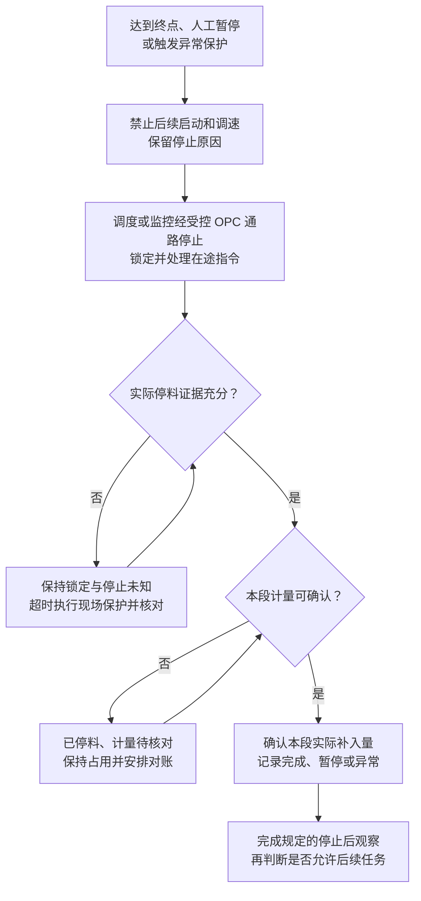

停止请求必须优先于普通调速和恢复请求；已经延迟或排队的旧请求不能在停料后重新启动设备。接口返回200、回读设定速度0或客户返回“完成”，仅作为对应步骤的反馈；实际停止、稳定重量及规定观察时间仍须核验。

### 8.3 软件保护与独立现场保护

小试二期和中试均由 SMP 新补料监控直接调用客户现有健康接口，并结合 SMP 执行进度判断；两类的检查周期、重量判据、资源映射和安全停止接口分别核准。软件保护负责及时发现异常、停止和阻止错误重启。若要求覆盖执行进程卡死，须由进程外监控检测真实控制/采样进度，不能只检查端口或 Ping。

独立现场保护由客户现场自控、电气和设备责任方落实，明确在 SMP—客户接口、客户服务—设备两段通信中断，以及执行进程、监控进程或整机失效时如何停料。可采用经确认的 PLC/DCS、设备 watchdog、使能或必要的液路切断回路；具体能力须按型号、固件、接线和运行模式验证。

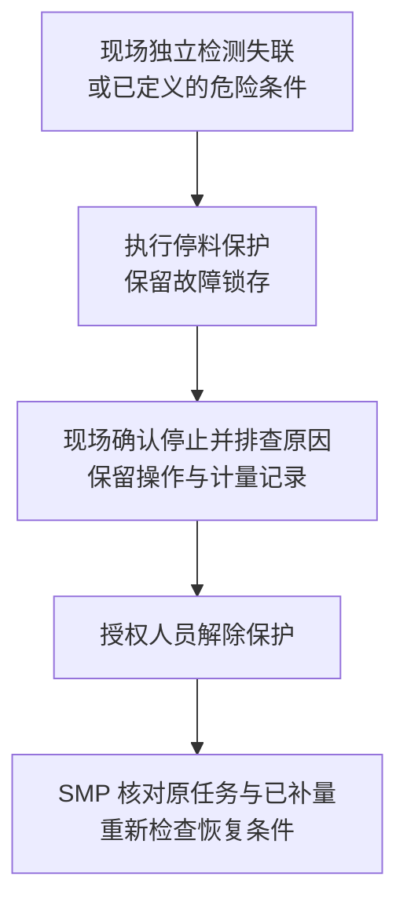

解除保护仅表示故障允许复位，不直接开泵。通信恢复或进程重启也不自动恢复速度。现场保护已动作但 SMP 尚无反馈时，系统仍显示待核对；保护参数、动作时间及责任人员在投用前确认。

### 8.4 监控证据及停止后的反馈

监控不参与正常调速。其数据路径分别承担以下职责，避免把调度写入的一个累计量同时当作独立计量证据。

| 数据或信号 | 监控用途 | 证据边界 |
| --- | --- | --- |
| SMP 活动执行读模型 | 确定目标、段基准、阶段、设备映射、控制代次和保护范围。 | 读取路径独立于调度进程；缓存不能授权新启动或设备重新分配。 |
| 原始重量与状态观测 | 按同一计量政策、段基准和序号复核补量，比较调度报告量，判断超量/无进展/时效。 | M02 采集/客户读服务保留原始值、来源时间、质量和单位。正常可读持久观测；调度停机后的状态读取须仍可用。 |
| 调度执行进度 | 检测循环是否推进、明细是否停更、控制阶段是否合理。 | 心跳只能表示对应循环的真实进度，不能由无关定时线程不断刷新以掩盖控制卡死。 |
| 客户健康接口 | 检查所配置调度服务及网络目标。 | 健康成功不替代采样推进；明确实际检查对象，不能只检查旧调度或无关主机。 |
| 停止后实时反馈 | 经独立于调度的 OPC/称重读路径核对实际转速、状态及重量变化。 | 独立监控至少可请求该读路径；原始质量或时效不足时保留未知，转现场保护/人工证据。 |

复核计算使用已冻结的目标、单位、计量方向和执行段，不按“最大值”或“最后到达值”覆盖认可量。原始量与调度量不一致时，按批准的偏差阈值和窗口保护并保留两份证据，禁止静默改账。保护复核可独立执行，但共享同一传感器或同一算法时仍存在共同故障；本方案不宣称其能发现所有传感器失准或系统性公式错误，这类问题由计量确认、算例审查及现场验证覆盖。

停止反馈由 M02/客户读服务提供，监控在调度失效后继续核验；M07 在可用时统一归并任务和认可量。实际停料已证实但最终量待核对时，可以明确展示这两个事实，业务完成、允许继续和设备释放仍受各自条件限制，不能用“最终量未知”反复开泵或抹去已取得的停止证据。

### 8.5 数据库、记录与保护通路故障

执行开始前向监控及写入仲裁组件登记活动资源保护记录，包含执行/段、设备组、控制代次、授权边界和固定保护范围；登记未被确认不启动。数据库失联期间禁止新任务启动和资源归属移交。保护记录是已建立控制权的安全依据，不能由任意旧任务缓存生成。

| 故障条件 | 必须执行的动作 | 恢复及禁止事项 |
| --- | --- | --- |
| 业务数据库/读模型不可用 | 在核准的故障检测时限内禁止新启动及普通调速；对已有运行任务请求安全停止。若进程间资格通路仍可用，按已登记且受实际写入口约束的活动资源记录处理。 | 不等待 DB 写成功再停泵，不盲目停止已被转移的资源；数据库恢复后先核对设备状态、锁定和历史实际量。 |
| 归属记录缺失、损坏或无法证明有效 | 拒绝正常控制；由客户事先核准的固定保护范围和现场失联机制停料，升级现场处置。 | 不用过期缓存猜泵号；无法证明安全路径的设备组不得启用。独立保护不依赖在线任务查询。 |
| 本地日志或磁盘不可写 | 不启动新执行，已有执行进入停止保护；使用仍可用的远端/现场记录来源保留证据。 | 停止动作不等待落盘；记录可能有缺口，恢复后标记待核对，不声称完整补齐。 |
| OPC 写通路不可达或写入仲裁失效 | 禁止正常下发并维持停止意图，按核准失联时限由现场保护停料。 | HTTP/OPC 重连不自动重启。现场保护须能检测许可/控制进度失效，不仅检测网络端口。 |
| 监控失效 | 调度自身保护继续；若监控健康超过核准期限，拒绝新启动并对活动任务受控停止；同时由独立现场保护覆盖双方失效。 | 监控恢复先恢复活动集合和停止锁定，不能仅重启一个进程就开放设备。 |

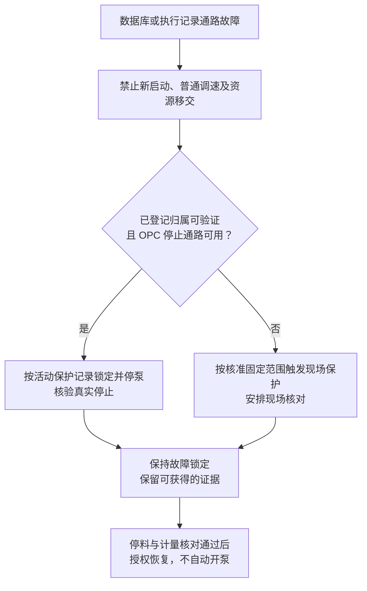

关键保护状态优先保存到独立于业务数据库的可靠存储，恢复后按原身份去重回写；该存储同样不可用时，停止动作仍立即推进，组件重启按禁止正常写入处理。对“请求停止、应答、实际停料、最终量、记录补回”分别标记证据是否完整。系统不能在无法可靠留痕时伪造成功或承诺无损恢复。

## 9 暂停继续、取消与异常后补料

### 9.1 人工暂停后可以申请继续

用户发出暂停后，系统请求停料；确认实际停止并取得本段补料量后，任务才显示“已暂停”。用户填写暂停原因并申请继续，系统重新检查权限、物料、液路/设备状态、保护状态和计量基准，然后仅执行剩余量。

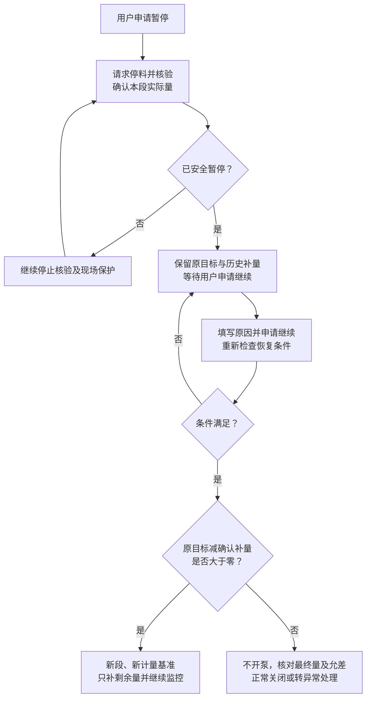

暂停请求至实际停止的时间仍计入执行活跃时间；实际暂停至下一段真正开始的时间不计入，重启不能把历史执行时长清零。换容器需更新容器使用记录，暂停期重量变化单独核对。小试和中试均由 SMP 保存原任务并创建关联的新执行段，按剩余量继续；OPC 侧只执行核准的启动/设速及反馈交互，不要求提供“继续补料任务”业务 API。若客户封装服务另有任务身份，则附加关联，不取代 SMP 账本。

执行中按现行政策仅允许暂停和查看。未开始任务或已安全暂停任务可按既定政策申请取消；取消待审、驳回或撤回不自动继续。取消生效后仍须确认 SMP 剩余执行请求及在途设备指令已关闭；客户封装服务如有自己的队列，也须核对关闭，并保留已补量。人工暂停、取消及现场保护不能由普通抖动自动恢复解除。

### 9.2 异常后是否需要再补

先确认已经停料和实际补入量，再由用户确认原因及处理方式。实际量未知时不开放基于虚假0值的自动补料。少加误差按现行规则计算：`(目标量−确认实际量)/目标量×100%`。

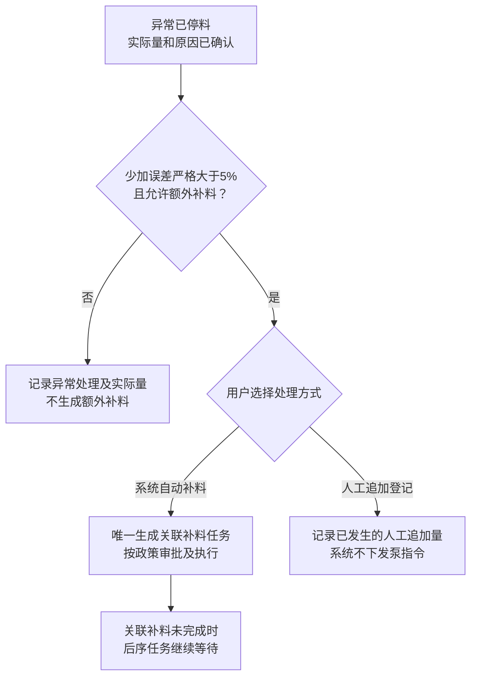

目标50g、实际47.5g正好少5%，不满足严格大于条件；47.49g少5.02%，可按政策选择额外补料；超过目标不产生负补量。该5%规则保留原需求，工艺是否需要调整应单独评审。

自动补料量默认取目标减确认实际量，允许按现行政策修改，但必须为正且速度合法；人工追加量单独记录。原异常只能成功处理一次，重复提交不重复建任务/计量。原任务“异常已处理”不代表补料成功，关联任务被驳回、失败或未完成须继续明确显示。

### 9.3 延迟与跨天

同一业务日按上海时区判断。计划日已过且确定未开始、无未知启动指令的任务按现行规则关闭；已经开始、暂停或结果不确定的任务持续跟踪，不因跨午夜取消。异常补料沿原计划日，过期不得静默顺延，确需执行由用户另行申请合法任务。

任务延迟或长时间暂停是否影响当前培养阶段，需由工艺人员判断。现行日期规则不能替代工艺时间窗口；允许延迟/暂停多久及超时后的处理要求作为第10节待确认项，不在本版新增自动报废或自动结束培养逻辑。

## 10 需要客户确认的工艺与接口事项

### 10.1 工艺和现场评审

以下为本次从工艺视角补充的评审问题，**尚不是已批准的新功能或默认参数**。先确认已有 SOP、设备或系统如何覆盖，再决定 SMP 需要读取、展示、记录还是阻止执行。

| 编号 | 需共同确认的内容 | 主要责任方及软件影响 |
| --- | --- | --- |
| GY-01 物料身份与使用条件 | 补料培养基/糖液批次、浓度、可用量、使用期限等是否已有权威来源，何时复核。 | 工艺/操作；确定引用的数据及检查时点，不新建重复物料台账。 |
| GY-02 液路准备与连接 | 对应培养的液路、阀位、管路规格、连接及无菌操作要求如何确认，哪些由人工/SOP完成。 | 工艺/现场自动化；软件不得从“已连接”推断无菌状态合格，自动联锁范围另行确认。 |
| GY-03 称重与物料转移边界 | 预充、残留、排空、旁路、换袋及其他加料/取样对本次计量的影响；皮重与容器使用记录。 | 工艺/计量/开发；决定哪些量可计入培养补入，哪些另行对账。 |
| GY-04 单位、密度和糖公式 | 密度1业务约定对现有物料的适用性，糖液浓度来源，初始/当前量依据，乳酸修正规则及理论浓度用途。 | 工艺/M07；继续沿现行公式，变更须先确认权威计算契约。 |
| GY-05 工艺允许条件 | 单次/累计补量、允许工作容量、补料速率、最终允差及相关现场工艺条件。 | 工艺/自动化；区分工艺要求、设备能力和软件检查，参数不使用通用示例值。 |
| GY-06 延迟、暂停及补料顺序 | 可接受的延迟/暂停时间、换袋后复核、关联异常补料未完成时如何处理后续计划。 | 工艺/操作/M07；现有阻断规则保留，新增时间窗口规则须单独确认。 |
| GY-07 异常恢复与现场保护 | 谁确认实际停料、谁排查原因、谁可申请继续/复位，保护动作期限及记录方式。 | 现场自动化/操作/开发；形成可执行的故障处置及恢复流程。 |

### 10.2 中试正式接口

客户已确认中试与小试二期同样由 SMP 重构调度和补料监控、直接调用现有服务健康接口；小试和中试设备交互均使用 OPC，中试具体 OPC 接口与点表尚待提供；重量读取是否同走 OPC 仍需单独确认。以下待确认的是接口能力和实施参数，不再将调度或监控建设归属列为未决项。下列 ZS-IF 编号沿统一方案 V1.0 保留，用于需求与联调追踪。客户接口/设备责任方提供资料，SMP 的 M07/M02 设计方共同确认；人员、版本、日期及结果在评审记录中补齐。

| 事项 | 客户需要提供和双方需要确认 | 未完成时的影响 |
| --- | --- | --- |
| ZS-IF01 调度执行接口能力 | SMP 调度负责执行编排及运行判断；客户提供启停、重量、调速和状态接口的调用语义。若仅有整次任务接口，另行评审职责变更。 | 当前模式所需能力未核准时，不派发设备任务。 |
| ZS-IF02 请求与权限 | OPC 服务 API 或直连方式、DA/UA 类型、地址/版本/鉴权、读写点表、数据质量与时间戳、设备与培养映射、任务参数、单位、目标、策略、容量约束及请求限流。 | 不复制小试 URL 或直接写客户旧库；缺对应能力的分支关闭。 |
| ZS-IF03 身份与幂等 | SMP 自有 task/execution/segment/command、控制代次与序号；客户若提供请求号则关联。核验 OPC 点位写入结果、回读及未知处理；不要求 OPC Server 提供任务级幂等/查单。 | 未知定量动作不能自动重试；无法可靠恢复的路径不得投用。 |
| ZS-IF04 状态及反馈 | OPC 写应答、设定回读、实际运行/停止位及质量/时间戳的区别；订阅或轮询、更新周期与缓存规则。客户回调、命令查询及历史补拉仅按实际能力启用。 | 不能把受理当运行；断线期证据不可补时保持未知，不声称完整恢复。 |
| ZS-IF05 暂停继续取消 | 暂停/继续/取消由 SMP 管理；核准 OPC 停止、实际反馈及再次启动条件。SMP 保存原目标和历史量，新段只补剩余量，不要求客户提供任务级暂停/继续 API。 | 用户可提出业务申请，现场继续或取消能力未核准不得承诺已可用。 |
| ZS-IF06 量与时间 | 重量经 OPC 或独立称重服务读取、培养净量与本次补入量来源，净毛重/皮重、方向、单位、质量、时间源、分段/累计覆盖范围及最终量认可。 | 不推算未知量、不重复扣取样、不重复累计或结算。 |
| ZS-IF07 策略与设备能力 | 固定/二段/三段支持，单位转换、流量范围、校准、实际速度/停止位、控制模式及监控判据。 | 不增加 CODE/连续策略、不猜转换；无法实施的模式阻断。 |
| ZS-IF08 停止优先与在途 | 实际 OPC 写入口的仲裁实现方、排队/超时、在途完成顺序、停止锁定、迟到指令拒绝及复位权限；核准停止重传条件与7.1节时间预算。 | 本地 STOP 不代表在途已清；无法阻止迟到重启的路径不得投用。 |
| ZS-IF09 软件监控与健康复用 | SMP 重构监控已确认；核准部署隔离、健康接口地址/响应/检查目标、主机设备映射、进程外卡死检测、数据和独立停止接口、缓存时效及重启去重。 | 不默认客户旧监控认识 SMP 新表；监控不完整不能替代保护。 |
| ZS-IF10 独立现场保护 | 具体型号/回路、失联/断电行为、锁存、实际停料期限、急停和人工复位及责任人。 | 外部故障无可靠停料能力时对应资源组不得生产投用。 |
| ZS-IF11 结算与接口故障 | SMP 依据有效原始观测分段确认实际量及最终容差；客户若提供累计量或最终结果，明确覆盖范围且不重复累计。核准断线、DB/磁盘故障及证据交接。 | 不凭成功状态结算；实际量未知保留待核对。 |
| ZS-IF12 发布与运维 | 双方版本协同、凭据、服务位置、隔离与移交、队列盘点、回退格式兼容、故障升级人和期限。 | 不自动接管或重放未知投料，旧控制方隔离未证实不开放。 |


## 附录A 小试二期差异、资料补充及专项验收

下列内容来自整合基线小试二期 V1.2，保留原49项设计对照、11项缺口及34项验收编号。表头中的“原行为”均指客户小试旧系统说明，不是中试能力；“重构规则”是小试二期目标。两类重构采用同一监控职责模型；MON 机制可供统一框架借鉴，算法/参数、接口及 NCS 事件不可无核准直接套到中试。

表格中的旧章节引用用于溯源至原小试方案；本文件相关重构公式集中在附录A.2，统一监控见第8节，状态实现见附录C、暂停及异常处理见第9节。所有验收仍为 NOT_VERIFIED。

### A.1 目标、泵速及单位对照

| 项 | 新增说明的原行为 | 二期重构处理、差异及待补证据 | 验收 |
| --- | --- | --- | --- |
| PF01 定量目标 | FeedingType=3 取 FeedingVolume | 新目标取 M07-F01 的合法 inputGrams。先核准旧字段单位再比较；不把 FeedingType 数字或旧体积值直接赋给新目标 g。 | XS-SCH-19 |
| PF02 百分比目标 | `(MediumVolume+CellsVolume)×FeedingVolumePercent/100/1000` | 新目标取 M07-F02：初始合并量 I(g)×percent/100。旧式的 `/1000` 必须结合原字段单位解释，不能再对新 g 结果除一次。旧值只用于对照，不另写新任务目标。 | XS-SCH-19 |
| PF03 动态补糖 | 依据当前浓度、FeedingTo、LowerLimit 算 RealFeedVolume，并回写任务 | 按 M07-F03/F04 及合法残糖/乳酸确认计算；生成与真正执行前分别留快照，执行时冻结目标。旧说明未给出完整糖公式及最小量，不推定与新规则等价；NCS061 阈值仍待核准。 | XS-SCH-02、19 |
| PF04 旧启动速度 | `v0=min(P旧,R旧,0.70×T旧)`，然后乘 Speed_Val | 这是旧数值关系，不直接认定为 g/min 或“先补70%”。新 FIXED 用核准固定流量，新 STRATEGY 按下节 H、R 计算；旧 PumpSpeed 是否代表物理流量需提供字段单位及配置。 | XS-SCH-20 |
| PF05 旧降速 | `v1=min(0.15×T旧,v0)`，然后乘 Speed_Val | 15% 是旧速度计算项，不是低速阶段补量占比。新低速流量取 L，阶段分配取 A、B、E，不能把两类百分数混用。新增说明未给旧降速触发点，不能猜为70%或85%。 | XS-SCH-20 |
| PF06 特定罐保底 | 名单内抬高启动速度至 floor，仍不超过已配置 MaxSpeed；低速用固定 feed_slow_set_speed，并不高于启动速度和 MaxSpeed | 不把罐号名单、保底或固定慢速塞进当前 M04 二/三段策略。确有工艺需要时先冻结例外政策、单位与范围并回写权威契约后启用；保底是否仍受任务 PumpSpeed 上限约束在说明中未明确，不自行补成已知。其他合法策略可独立启用。 | XS-SCH-21 |
| PF07 单位换算 | 两档数值乘 Speed_Val，默认1；pump1set—pump4set 写 OPC 点 | 由 M02 使用每泵核准的单位和换算版本；Speed_Val=1 不是通用默认。g/min、mL/min、rpm、设备代码不能混写；非线性曲线需核准适用管径等条件。CODE 映射未提供，仍阻断该模式。 | XS-SCH-21 |
| PF08 二段策略 | 说明只有启动/慢速算法，没有可核准的阶段边界和终止比例 | 新策略明确 qH、qL、HIGH 边界、LOW 终点和期限，见附录A.2。不以旧70/15作为新系统默认值；速度比例与补量占比独立保存。 | XS-SCH-20、22 |
| PF09 三段与校准 | 新增说明未给三段、校准斜率和有效窗口算法 | 沿现行三段公式及核准 calibrationProfile。缺校准依据只阻断相关三段/校准分支，不声称旧说明证明其存在，也不强制普通 FIXED 必须校准。 | XS-SCH-22 |
| PF10 理论期限 | 新增说明未给完整执行超时公式 | 新策略限幅、必要校准修正后计算精确理论时长，再加宽限；不按原始模板流量或显示两位分钟计时。暂停确认后的静止期不计活跃时间，重启不清零。 | XS-SCH-22、24 |
| PF11 计量方向及分段 | 已补量=初始地秤重量−当前地秤重量，写 Exenumber | 对核准 SUPPLY_DECREASES 保留此方向；其他读数按各自核准方向归一化。新物料会话或暂停恢复新段新基准，保留负差值，不用 abs；旧累计值不再次写入新 ledger。 | XS-SCH-11、19 |
| PF12 配置与量账 | CDP_FeedingConfig 首条未删除行提供全局系数；结束更新批次量、糖重和袋余量 | 使用任务固定策略及设备核准配置版本，不依赖“首条”或热改全局值。当前培养量按小试账本口径，糖更新遵守开关及F05/F06；物料session余量事实按现行契约维护，本期不因此扩大到已排除的耗材自动扣减。 | XS-SCH-14、23 |

### A.2 小试二期目标策略公式及算例

以下符号仅用于解释现行公式，不是新增 DTO 字段：目标 `T` 为 g，核准最大物理流量 `R` 为 g/min；`H/L` 为高速/低速目标量百分数每分钟，`A` 为高速补量占比，`E` 为正常终止比例。三段另有校准 `c` 秒及补量占比 `C`，低速占比 `B`。这些百分数均保存数值本身，计算时除以100。

```text
二段：
qH = min(T × H / 100, R)                         g/min
qL = min(T × L / 100, R)                         g/min
HIGH边界 = T × A / 100                          g
正常终点 = T × E / 100                          g
理论秒数 = 60 × [(T×A/100)/qH + (T×(E−A)/100)/qL]
执行期限 = 理论秒数 + timeoutGraceSeconds

三段：
C + A + B = 100
qC = min(T × C / 100 × 60 / c, R)               g/min
qH、qL 同上
校准后HIGH累计边界 = T × (C+A) / 100            g
三段理论秒数 = c + 60 × [(T×A/100)/qH + (T×B/100)/qL]
正常终点仍为 T × E / 100；E<100不改写C/A/B占比
```

三段校准还须满足核准持续时间、有效窗口及样本证据，不能仅因达到 C% 就跳过必需校准。提前达到安全终点或超量时先停泵，不为凑校准时长继续补。适用的校准斜率修正为 `k=有效窗口实际量/理论量`、修正流量 `q/k` 后限幅；缓冲时间、k 合法范围和修正后的期限按核准 profile 固定，新增说明没有证明通用默认值。

执行前验证 T、R 及所用流量均为正且有合法单位，策略满足 M04 的类型和范围；CODE 不具有可核准流量时不计算这些流量依赖判据。若所选模式无法取得可靠流量、期限或保护参数，阻断该模式，不用除零、历史保底或未校准系数补值。计算保留精度，展示舍入不反向参与控制；除最大值外还要核对实际泵最小可用流量及输出量程，无法达到的阶段不得强行下发。

算例仅用于公式核对：T=100g、R=40g/min、H=70、L=15、A=80、E=100、宽限30s，则 qH=40g/min、qL=15g/min，高速边界80g、终点100g，理论时长 `60×(80/40+20/15)=200s`，期限230s。不能使用未限幅的70g/min计算期限，也不能把70/15理解成高速补70g、低速补15g。此例不是生产默认，也不表示与旧 PumpSpeed 配置相同。
