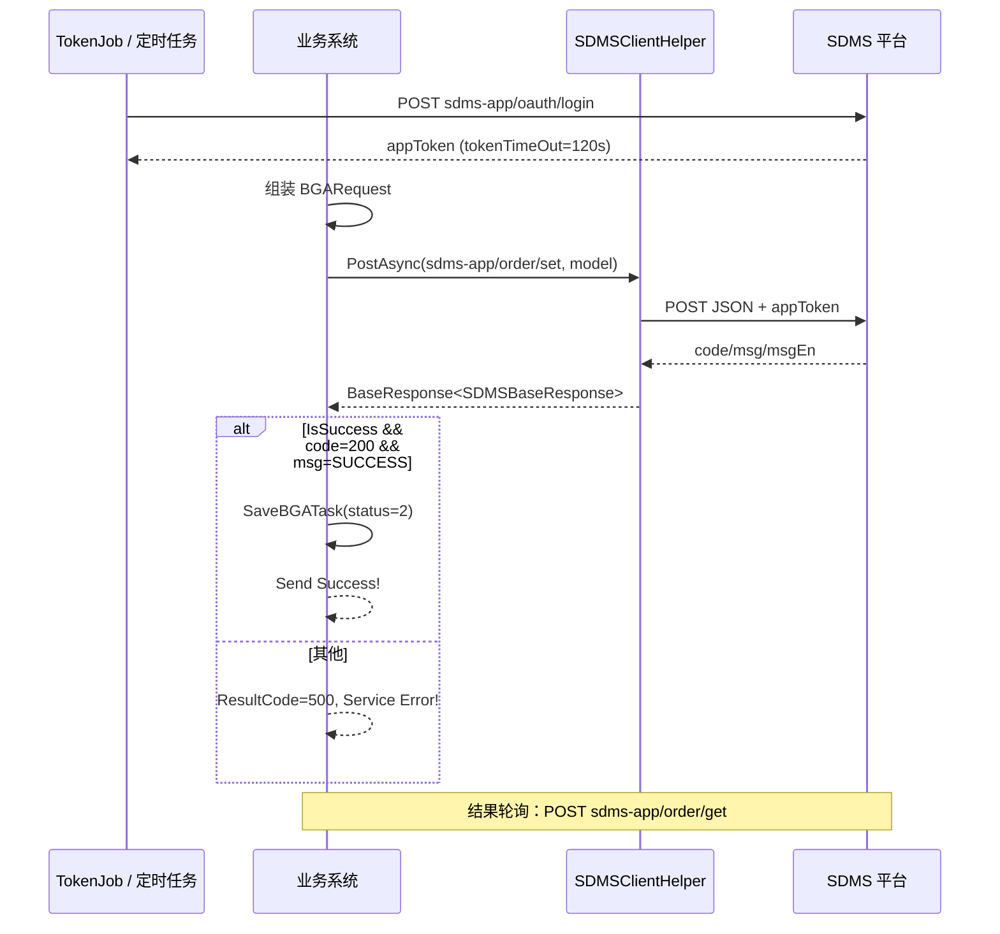

# BGA 检测订单发送至 SDMS — 接口文档

---

## 1. 概述

| 项目 | 说明 |
|------|------|
| 接口名称 | 发送 BGA 检测订单到 SDMS |
| 业务场景 | 本地系统创建/确认 BGA 检测任务后，将订单信息推送到 SDMS 平台，由 SDMS 调度检测设备执行 |
| 调用方式 | HTTP `POST`，`Content-Type: application/json` |
| 调用方 | 原系统 `SendBGAOrder` 相关业务（通过 `SDMSClientHelper.PostAsync`） |
| 超时时间 | 300 秒（5 分钟） |
| 平台根地址 | `{SDMSPlatformAddress}`，示例：`http://192.168.1.111:9080/` |

SDMS 相关接口均以 `sdms-app/` 为前缀，与 `SDMSPlatformAddress` 拼接为完整 URL。

---

## 2. SDMS 接口清单

| 常量名 | 相对路径 | 用途 |
|--------|----------|------|
| `SDMSOAUTHLOGIN` | `sdms-app/oauth/login` | 应用登录，获取 `appToken` |
| `SDMSVALIDEQU` | `sdms-app/valid-equ` | 校验设备/私钥是否有效 |
| `SDMSSENDORDER` | `sdms-app/order/set` | **下发检测订单**（BGA / OSMO / CedexBio 等） |
| `SDMSORDERRESULT` | `sdms-app/order/get` | 按时间范围查询订单检测结果 |
| `SDMSREMOTECONTROL` | `sdms-app/remote-control` | 远程控制（路径已配置，本文未含调用日志） |

**URL 拼接规则：**

```
完整 URL = SDMSPlatformAddress + 相对路径
示例：http://192.168.1.111:9080/sdms-app/order/set
```

---

## 3. 服务地址与配置

### 3.1 基础地址与认证

| 配置项 | 示例值 | 说明 |
|--------|--------|------|
| `SDMSPlatformAddress` / `SDMSURL` | `http://192.168.1.111:9080/` | SDMS 平台根地址，作为 `HttpClient.BaseAddress` |
| `SDMSAppKey` | `11111` | 应用 Key，用于 OAuth 登录 |
| `SDMSAppSecret` | `222222` | 应用 Secret，用于 OAuth 登录 |
| `TokenJobInterval` | `1` | Token 刷新间隔（单位待确认，与定时任务配合） |
| `TokenJobIntervalEnable` | `Y` | 是否启用 Token 定时刷新 |

### 3.2 定时任务相关配置

| 配置项 | 示例值 | 说明 |
|--------|--------|------|
| `BGAJob` / `BGAJobTime` | `Y` / `30` | BGA 订单/结果轮询任务开关与间隔（秒，推断） |
| `OSMOJob` / `OSMOJobTime` | `Y` / `30` | OSMO 设备任务 |
| `VicellJob` / `VicellJobTime` | `Y` / `30` | Vicell 设备任务 |
| `CedexBioJob` / `CedexBioJobTime` | `Y` / `30` | CedexBio 设备任务 |
| `AsyncResultTime` | `700` | 异步结果相关超时或间隔（单位待确认） |

### 3.3 HTTP 客户端行为

- `Accept: application/json`
- `Timeout`: 5 分钟
- 请求经 `CustomMessageHandler` 包装，**通常在此 Handler 中注入 OAuth 获得的 `appToken`**（具体 Header 名需对照 `CustomMessageHandler` 源码）
- TLS：支持 SSL3 / TLS / TLS1.1 / TLS1.2

---

## 4. 认证：OAuth 登录

在调用业务接口前，需先通过 `sdms-app/oauth/login` 获取 `appToken`（由 `TokenJob` 定时刷新，`TokenJobIntervalEnable=Y` 时启用）。

### 4.1 请求

```
POST http://192.168.1.111:9080/sdms-app/oauth/login
Content-Type: application/json
```

```json
{
  "appKey": "1222",
  "appSecret": "xxxxx"
}
```

### 4.2 响应（实际日志）

```json
{
  "code": 200,
  "msg": "SUCCESS",
  "msgEn": "SUCCESS",
  "data": {
    "appToken": "QQQAAA",
    "tokenTimeOut": 120
  }
}
```

| 字段 | 类型 | 说明 |
|------|------|------|
| `data.appToken` | string | 后续业务请求使用的令牌 |
| `data.tokenTimeOut` | number | 令牌有效期（秒），示例为 `120` |

---

## 5. 设备校验：valid-equ

下发订单前或独立校验时，可调用 `sdms-app/valid-equ` 验证 `serialNumber` + `privateKey` 是否有效。

### 5.1 请求（实际日志）

```
POST http://192.168.1.111:9080/sdms-app/valid-equ
```

```json
{
  "sampleId": null,
  "beginTime": null,
  "endTime": null,
  "serialNumber": "serialNumber",
  "privateKey": "privateKey/y5ONe0UcQcMh5O5aPi"
}
```

### 5.2 响应（实际日志）

```json
{
  "code": 200,
  "msg": "SUCCESS",
  "msgEn": "SUCCESS",
  "data": false
}
```

| 字段 | 说明 |
|------|------|
| `data` | `boolean`，表示设备/密钥是否有效（示例为 `false` 表示无效或未通过） |

---

## 6. 发送 BGA 检测订单（核心接口）

### 6.1 请求

```
POST http://192.168.1.111:9080/sdms-app/order/set
Content-Type: application/json
```

### 6.2 请求头

| Header | 值 | 必填 |
|--------|-----|------|
| `Accept` | `application/json` | 是 |
| `Content-Type` | `application/json` | 是 |
| 认证相关 Header | 由 `CustomMessageHandler` 注入（`appToken`） | 是 |

### 6.3 请求体（`BGARequest`）

| 字段 | 类型 | 必填 | 来源字段（本地） | 说明 |
|------|------|------|------------------|------|
| `serialNumber` | string | 是 | `bgaorderModel.serialNumber` | 设备序列号 |
| `privateKey` | string | 是 | `bgaorderModel.privateKey` | 设备私钥/鉴权凭证 |
| `testingOrder` | object | 是 | — | BGA 检测订单明细 |
| `testingOrder.sampleId` | string | 是 | `bgaorderModel.SampleID` | 样品 ID |
| `testingOrder.DeviceModel` | string | 是 | `bgaorderModel.EquipmentModel` | 设备型号 |
| `testingOrder.DeviceNo` | string | 是 | `bgaorderModel.EquipmentNo` | 设备编号 |
| `testingOrder.Temp` | string | 视业务 | `bgaorderModel.Temp` | 温度参数 |

### 6.4 请求示例

```json
{
  "serialNumber": "SN202505200001",
  "privateKey": "privateKey/y5ONe0UcQcMh5O5aPi",
  "testingOrder": {
    "sampleId": "SAMPLE-001",
    "DeviceModel": "BGA-Model-X",
    "DeviceNo": "EQ-001",
    "Temp": "37.0"
  }
}
```

> **JSON 命名注意：** 原 C# 模型中 `serialNumber`、`privateKey`、`sampleId` 为小驼峰，`DeviceModel` / `DeviceNo` / `Temp` 为 PascalCase。实际字段名取决于序列化配置，**联调时以抓包为准**。

### 6.5 响应结构（`SDMSBaseResponse`）

| 字段 | 类型 | 说明 |
|------|------|------|
| `code` | string / number | 业务状态码；日志中为数字 `200`，调用方判断使用字符串 `"200"` |
| `msg` | string | 业务消息，成功为 `"SUCCESS"` |
| `msgEn` | string | 英文消息 |

**成功示例（推断，与 OAuth 响应结构一致）：**

```json
{
  "code": 200,
  "msg": "SUCCESS",
  "msgEn": "SUCCESS"
}
```

### 6.6 成功判定（调用方逻辑）

同时满足以下条件视为**发送成功**：

1. `result.IsSuccess == true`（HTTP 层）
2. `result.Data.code == "200"`（字符串比较）
3. `result.Data.msg == "SUCCESS"`

成功后执行：`SaveBGATask(bgaorderModel, 2, clientIp, false)` — 任务状态置为 `2`（已发送）。

> **注意：** 实际日志中 `code` 为 JSON 数字 `200`，若反序列化为 `int`，与字符串 `"200"` 比较可能失败。对接时需统一类型或兼容两种格式。

---

## 7. 查询订单结果：order/get

用于按时间范围拉取检测结果（与 `BGAJob` 等定时任务配合）。

### 7.1 请求（实际日志）

```
POST http://192.168.1.111:9080/sdms-app/order/get
```

```json
{
  "sampleId": null,
  "beginTime": "2026-05-20 09:08:59",
  "endTime": "2026-05-20 09:31:09",
  "serialNumber": "serialNumber",
  "privateKey": "privateKey"
}
```

| 字段 | 类型 | 说明 |
|------|------|------|
| `sampleId` | string / null | 按样品过滤；`null` 表示不按样品过滤 |
| `beginTime` | string | 开始时间，格式 `yyyy-MM-dd HH:mm:ss` |
| `endTime` | string | 结束时间 |
| `serialNumber` | string | 设备序列号 |
| `privateKey` | string | 设备私钥 |

### 7.2 响应（实际日志）

```json
{
  "code": 200,
  "msg": "SUCCESS",
  "msgEn": "SUCCESS",
  "data": [
    {
      "sampleId": "D3-1233333",
      "resultTime": "2026-05-20 09:19:36",
      "itemList": [
        {
          "subSampleId": null,
          "testingNo": "aMOD",
          "name": "aMOD",
          "value": "348",
          "unit": null,
          "errorMsg": null
        },
        {
          "subSampleId": null,
          "testingNo": "iIID",
          "name": "iIID",
          "value": "D224",
          "unit": null,
          "errorMsg": null
        }
      ]
    }
  ]
}
```

| 字段 | 说明 |
|------|------|
| `data[].sampleId` | 样品 ID |
| `data[].resultTime` | 结果产生时间 |
| `data[].itemList[]` | 检测项列表 |
| `itemList[].testingNo` | 检测项编号 |
| `itemList[].name` | 检测项名称 |
| `itemList[].value` | 检测值 |
| `itemList[].unit` | 单位（可为 null） |
| `itemList[].errorMsg` | 错误信息（可为 null） |

---

## 8. 其他设备订单结构（同 `order/set`）

`sdms-app/order/set` 为通用下发接口，不同设备类型请求体结构不同，外层均为 `serialNumber` + `privateKey` + `testingOrder`。

### 8.1 OSMO

```json
{
  "serialNumber": "...",
  "privateKey": "...",
  "testingOrder": {
    "sampleId": "...",
    "positionNo": "1"
  }
}
```

| 字段 | 来源 |
|------|------|
| `testingOrder.sampleId` | `osmoorderModel.SampleID` |
| `testingOrder.positionNo` | `osmoorderModel.positionNo`（转 string） |

### 8.2 CedexBio

```json
{
  "serialNumber": "...",
  "privateKey": "...",
  "testingOrder": {
    "sampleId": "...",
    "PositionNo": "...",
    "cedexCheckBioModel": [
      {
        "Name": "...",
        "TestingNo": "...",
        "SpecificFactor": "..."
      }
    ]
  }
}
```

---

## 9. 调用方返回（对本系统上层 API）

| 场景 | ResultCode | ResultMessage |
|------|------------|---------------|
| SDMS 发送成功 | 默认成功码 | `Send Success!` |
| SDMS 发送失败或异常 | `500` | `Service Error!` |

失败时记录日志：`SendBGAOrder Error SDMS Send Failed`。

---

## 10. 调用流程



---

## 11. cURL 示例

### 11.1 OAuth 登录

```bash
curl -X POST "http://192.168.1.111:9080/sdms-app/oauth/login" \
  -H "Accept: application/json" \
  -H "Content-Type: application/json" \
  -d "{\"appKey\":\"11111\",\"appSecret\":\"222222\"}"
```

### 11.2 发送 BGA 订单

```bash
curl -X POST "http://192.168.1.111:9080/sdms-app/order/set" \
  -H "Accept: application/json" \
  -H "Content-Type: application/json" \
  -H "Authorization: Bearer {appToken}" \
  -d "{
    \"serialNumber\": \"SN202505200001\",
    \"privateKey\": \"privateKey/y5ONe0UcQcMh5O5aPi\",
    \"testingOrder\": {
      \"sampleId\": \"SAMPLE-001\",
      \"DeviceModel\": \"BGA-Model-X\",
      \"DeviceNo\": \"EQ-001\",
      \"Temp\": \"37.0\"
    }
  }"
```

> `{appToken}` 与认证 Header 名称需按 `CustomMessageHandler` 实际实现替换。

### 11.3 查询订单结果

```bash
curl -X POST "http://192.168.1.111:9080/sdms-app/order/get" \
  -H "Accept: application/json" \
  -H "Content-Type: application/json" \
  -H "Authorization: Bearer {appToken}" \
  -d "{
    \"sampleId\": null,
    \"beginTime\": \"2026-05-20 09:08:59\",
    \"endTime\": \"2026-05-20 09:31:09\",
    \"serialNumber\": \"serialNumber\",
    \"privateKey\": \"privateKey\"
  }"
```

---

## 12. 错误与排查

| 现象 | 可能原因 | 建议 |
|------|----------|------|
| 返回 `Service Error!` | SDMS 返回非 `200` / `SUCCESS` | 查看 `code`、`msg`、`msgEn` |
| `IsSuccess == false` | 网络超时、DNS、证书、HTTP 4xx/5xx | 检查 `SDMSPlatformAddress`、防火墙、5 分钟超时 |
| 认证失败 | `appToken` 过期或 AppKey/Secret 错误 | 检查 OAuth 响应、`tokenTimeOut`、TokenJob 是否启用 |
| `code` 判断失败 | 日志为数字 `200`，代码比较字符串 `"200"` | 统一反序列化类型或兼容 `200` / `"200"` |
| `valid-equ` 返回 `data: false` | 设备序列号或私钥无效 | 核对 `serialNumber`、`privateKey` |
| 字段不匹配 | JSON 命名策略不一致 | 抓包对比实际字段名 |

---

## 13. 附录：数据模型（C# 参考）

### BGARequest

```csharp
public class BGARequest
{
    public string serialNumber { get; set; }
    public string privateKey { get; set; }
    public BGATestingOrder testingOrder { get; set; }
}
```

### BGATestingOrder

```csharp
public class BGATestingOrder
{
    public string sampleId { get; set; }
    public string DeviceModel { get; set; }
    public string DeviceNo { get; set; }
    public string Temp { get; set; }
}
```

### SDMSBaseResponse

```csharp
public class SDMSBaseResponse
{
    public string code { get; set; }
    public string msg { get; set; }
    public string msgEn { get; set; }
}
```


