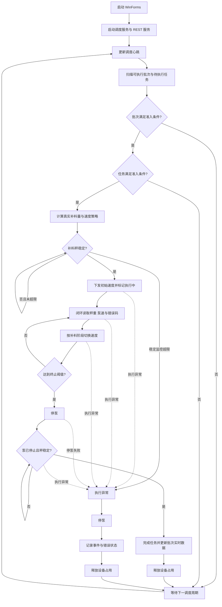

# NPPScheduler 反编译复刻参考文档 v0.1

## 1. 文档目的

整理 NPP 补料调度核心的运行机制、数据库访问、任务扫描、补料执行、泵速策略、地秤读取、设备接口和异常监控逻辑。 本文用于后续重新设计或复刻自动补料系统中的调度核心，不建议直接复制历史反编译代码。

## 2. 范围


| 项      | 内容                                       |
| ------ | ---------------------------------------- |
| 主程序    | `NPPScheduler.exe`                       |
| 配置文件   | `NPPScheduler.exe.config`                |
| 核心库    | `CoreScheduler.Core.dll`                 |
| 实体库    | `CoreScheduler.Entity.dll`               |
| 基础设施库  | `CoreScheduler.Infrastructure.dll`       |
| REST 库 | `CoreScheduler.RestAPI.dll`              |
| 日志配置   | `NLog.config`                            |
| 目标框架   | `.NET Framework 4.5`                     |
| 程序类型   | Windows Forms 程序，内部启动后台调度线程和 WCF REST 服务 |


## 3. 程序定位

`NPPScheduler` 是历史系统的补料调度核心。它不是单纯的 UI 程序，而是用 WinForms 承载后台调度服务。

核心职责：

1. 周期扫描数据库中的可执行批次和补料任务。
2. 校验批次、反应器、地秤、泵、Cedex 检测结果和未处理异常。
3. 根据任务和泵速策略计算真实补料目标量、校准速度、高速速度、低速速度和理论超时时间。
4. 通过 IoT、OPCDA 或外置 Modbus 泵服务下发泵速。
5. 通过地秤或反应器实时数据计算已补料量。
6. 记录补料过程明细、泵速下发记录、事件、异常和任务状态。
7. 监控超时、超量、抖动、返水、堵塞、泵速为 0、通讯异常、泵错误码等异常。
8. 完成任务后停泵、更新任务和批次实时数据、释放设备占用。

### 3.1 总体流程图



正常路径完成补料并释放占用，准入失败进入等待路径，执行异常则统一停泵、记录事件与错误状态并释放占用。


## 4. 核心类型


| 类型                                           | 所属程序集                              | 作用                                  |
| -------------------------------------------- | ---------------------------------- | ----------------------------------- |
| `CoreScheduler.UI.Program`                   | `NPPScheduler.exe`                 | WinForms 入口，使用 Mutex 保证单实例。         |
| `CoreScheduler.UI.MainForm`                  | `NPPScheduler.exe`                 | 启动调度线程和 REST 服务，提供简单调试 UI。          |
| `CoreScheduler.Core.CoreService`             | `CoreScheduler.Core.dll`           | 调度主循环，扫描批次和任务，创建执行线程。               |
| `CoreScheduler.Core.FeedingTool`             | `CoreScheduler.Core.dll`           | 补料任务执行核心，包含泵速策略、地秤闭环、异常监控。          |
| `CoreScheduler.Core.Cmmpt`                   | `CoreScheduler.Core.dll`           | HTTP 设备通讯客户端，封装 IoT、OPCDA、外置泵、地秤读取。 |
| `CoreScheduler.Core.EntityHelper`            | `CoreScheduler.Core.dll`           | 数据库读写、任务状态更新、事件、报警和通知。              |
| `CoreScheduler.Entity.Config`                | `CoreScheduler.Entity.dll`         | 配置项静态读取。                            |
| `CoreScheduler.RestAPI.RestControl`          | `CoreScheduler.RestAPI.dll`        | 启动 WCF REST 服务。                     |
| `CoreScheduler.RestAPI.SystemService`        | `CoreScheduler.RestAPI.dll`        | REST 接口实现。                          |
| `CoreScheduler.Infrastructure.MysqlDBHelper` | `CoreScheduler.Infrastructure.dll` | MySQL SQL 执行和结果映射。                  |


## 5. 启动流程

入口：`CoreScheduler.UI.Program.Main()`。

启动行为：

```text
创建 Mutex "NPPScheduler"
如果是首个实例：
    启动 WinForms MainForm
如果已存在实例：
    静默退出
```

窗体加载：`MainForm.Form1_Load()`。

```text
关闭跨线程 UI 检查
取消开机自启动配置
后台 Task 启动 CoreService.AutoExecute()
启动 RestControl.Start()
写日志 "CoreService Start Up Ok"
```

注意：历史程序仍使用 WinForms 承载调度核心。新系统建议改为 Windows Service / Worker Service。

## 6. 关键配置

配置来源：`NPPScheduler.exe.config`。

### 6.1 基础服务配置


| 配置项                               | 历史值                                   | 说明                             |
| --------------------------------- | ------------------------------------- | ------------------------------ |
| `ConnectionStrings`               | MySQL 连接                              | 调度程序直接访问 MySQL。历史值包含账号密码，必须脱敏。 |
| `coreservice_interval_time`       | `10`                                  | 调度主循环间隔，单位秒。                   |
| `open_restful_api_url`            | `http://127.0.0.1:8082`               | 调度程序自身 REST 监听地址。              |
| `gui_api_url`                     | `http://192.168.1.110`                | GUI / 业务系统 API 地址。             |
| `gui_api_create_task`             | `api/pumping/create-task`             | 自动创建补糖任务接口。                    |
| `gui_api_create_schedulermonitor` | `api/pumping/create-schedulermonitor` | 调度监控接口，但当前代码主要写数据库表。           |


### 6.2 实时数据与设备服务配置


| 配置项                                             | 说明                                                                |
| ----------------------------------------------- | ----------------------------------------------------------------- |
| `ldms_url` / `ldms_api_get_device_data`         | 非 OPCDA 设备的实时数据来源。                                                |
| `iot_url` / `iot_api_login` / `iot_api_publish` | 历史 IoT 平台登录和泵速发布接口。                                               |
| `opcda_url` / `opcda_api_get_device_data`       | OPCDA 实时数据读取接口。                                                   |
| `opcda_api_pump_speed_set`                      | OPCDA 泵速下发接口。                                                     |
| `opcda_api_get_pump_mode`                       | OPCDA 泵模式查询接口。                                                    |
| `emerson_url` / `api_get_device_data`           | OHAUS / Emerson 地秤服务接口，默认 `messageService/api/getOhausScaleData`。 |
| `mettler_url` / `mettler_api_get_device_data`   | Mettler 地秤服务接口。                                                   |
| `modbus_api_get_device_data`                    | 外置 Modbus 泵当前速度查询接口。                                              |
| `modbus_api_pump_speed_set`                     | 外置 Modbus 泵速度下发接口。                                                |


### 6.3 补料策略与报警配置


| 配置项                                           | 历史值    | 说明                         |
| --------------------------------------------- | ------ | -------------------------- |
| `feed_accuracy_percentage`                    | `1`    | 补料计算精度百分比。                 |
| `feed_first_stop_remaining_liquid_percentage` | `85`   | 两阶段第一段减速比例，旧逻辑残留。          |
| `feed_speed_down_remaining_liquid_percentage` | `99.8` | 两阶段第二段减速比例，旧逻辑残留。          |
| `slopecaltotalseconds`                        | `300`  | 校准速度计算默认时间。                |
| `liquid_volume_diff_num`                      | `200`  | 补料地秤与反应器地秤差值报警阈值，单位 g。     |
| `feed_speed_diff_waring`                      | `50`   | 泵速偏差报警百分比，旧配置。             |
| `feed_excess_percentage`                      | `2`    | 超量报警百分比，旧配置；任务执行主要使用策略表字段。 |
| `feed_timeout_seconds`                        | `2700` | 超时报警默认秒数，旧配置。              |
| `jam_buffer_time`                             | `5`    | 堵塞监控额外缓冲时间，单位秒。            |
| `scale_precision`                             | `0.1`  | 默认地秤精度。                    |
| `dither_precisioncoefficient`                 | `6`    | 抖动地秤精度系数默认值。               |
| `error_count_limit`                           | `2`    | 设备通讯错误次数阈值。                |
| `start_buffer`                                | `30`   | 任务启动前缓冲时间，单位秒。             |
| `last_rate`                                   | `2`    | 末次低速比例相关配置。                |
| `Scale_Monitor_Time`                          | `120`  | 任务结束后继续监控地秤时间，单位秒。         |


## 7. REST API

监听地址：

```text
http://127.0.0.1:8082
```

接口定义：

```http
GET /version
POST /start-feeding
```


### 7.1 GET /version

返回程序版本、发布时间、数据库服务器和数据库名。

注意：该接口会从数据库连接串中截取数据库服务器和库名，存在信息泄露风险。

### 7.2 POST /start-feeding

反编译结果显示该接口当前只返回空 `BaseResponse`，未实现实际启动逻辑。历史自动补料主要依赖后台轮询数据库，而不是通过该接口触发。

## 8. 调度主循环

入口：`CoreService.AutoExecute(CancellationToken)`。

主循环条件：

```text
while CoreService.Status == Running
```

每轮流程：

1. 写入或更新 `cdp_schedulermonitor` 心跳。
2. 查询可执行批次列表 `CDP_Batch`。
3. 遍历批次。
4. 查询反应器设备信息 `CDP_EquReactor`。
5. 跳过不在 `support_reactors` 配置内的反应器。
6. 如果补料秤忙，检查是否有执行中任务；有则执行停泵处理。
7. 如果批次存在未处理异常，跳过。
8. 校验批次是否可补料：今日 Cedex、反应器错误、自动模式、反应器秤和补料秤状态。
9. 校验当天 Cedex 结果是否唯一且已指定。
10. 检查是否存在未结束任务。
11. 根据 Cedex 和补糖规则可能自动创建补糖任务。
12. 查询待执行补料任务。
13. 遍历待执行任务并做任务级校验。
14. 构造 `ExeTaskMode`。
15. 计算真实补料量。
16. 校验补料袋剩余量。
17. 启动任务执行线程 `FeedingTool.Start(exeModel)`。
18. 每轮结束后休眠 `coreservice_interval_time` 秒。


## 9. 任务准入条件

调度器启动补料任务前会检查：


| 条件                 | 不满足时行为              |
| ------------------ | ------------------- |
| 反应器存在且在支持列表中       | 跳过批次。               |
| 补料秤未忙              | 忙时跳过；如果有执行中任务则尝试停泵。 |
| 批次无未处理异常           | 跳过批次。               |
| 当天存在有效 Cedex 结果    | 没有则等待。              |
| 多个 Cedex 结果必须有指定值  | 否则等待。               |
| 批次模式为自动模式 `Mode=1` | 否则跳过。               |
| 反应器本身无错误码          | 否则跳过。               |
| 反应器秤和补料秤无错误        | 否则跳过。               |
| 任务状态为待执行，任务模式为自动   | 否则跳过。               |
| 任务有有效 `ConfigId`   | 否则等待。               |
| 当前批次没有其他任务正在执行     | 否则跳过。               |
| 目标泵没有未处理错误码        | 否则跳过。               |
| 任务补料时间不晚于当前时间      | 否则等待。               |
| 补料袋剩余量足够           | 不足时报 `NCS012`。      |


## 10. 任务状态

| 枚举                    | 值     | 含义     |
| --------------------- | ----- | ------ |
| `PendingReview`       | `1`   | 待审核。   |
| `PendingCancel`       | `2`   | 待取消。   |
| `PendingApprove`      | `3`   | 待批准。   |
| `PendingExecute`      | `5`   | 待执行。   |
| `ErrorPendingApprove` | `6`   | 异常待批准。 |
| `Executing`           | `7`   | 执行中。   |
| `ExeError`            | `9`   | 执行异常。  |
| `ErrorHandled`        | `11`  | 异常已处理。 |
| `Skiped`              | `17`  | 已跳过。   |
| `Executed`            | `19`  | 已执行。   |
| `Canceled`            | `99`  | 已取消。   |
| `AccrossDayCanceled`  | `199` | 跨天取消。  |


## 11. 补料执行阶段

反编译枚举 `EnumFeedingStep`：


| 阶段               | 值    | 说明             |
| ---------------- | ---- | -------------- |
| `Idle`           | `0`  | 空闲。            |
| `SlopeCal`       | `5`  | 三段式校准阶段。       |
| `SpeedUp`        | `10` | 升速到高速阶段。       |
| `SpeedKeep`      | `15` | 高速保持阶段。        |
| `SpeedDown`      | `20` | 降速到低速阶段。       |
| `LowSpeedKeep`   | `30` | 低速保持阶段。        |
| `LowSpeedDown`   | `35` | 下发 0 速度并等待停止。  |
| `IsFinish`       | `40` | 任务完成后的补料秤监控阶段。 |
| `IsScaleMonitor` | `50` | 启动前地秤稳定监控阶段。   |


## 12. 真实补料量计算

入口：`CoreService.GetTaskRealFeedVolume()`。

规则：

```text
如果 FeedingType == 3:
    RealFeedVolume = FeedingVolume
否则如果 FeedingBasis == 3:
    RealFeedVolume = 指定反应器重量 * FeedingVolumePercent / 100
否则:
    RealFeedVolume = (MediumVolume + ReactorNetVolume) * FeedingVolumePercent / 100
```

任务开始后会根据补料秤精度对目标量四舍五入：

```text
RealFeedVolume = Round(RealFeedVolume, CountDecimalPlaces(ScalePrecision))
```


## 13. 泵速策略执行

泵速策略来自表 `CDP_FeedingConfig`，字段与此前整理的 `pump_speed_strategy` 草案基本对应。

关键字段：


| 字段                          | 说明               |
| --------------------------- | ---------------- |
| `IsTwoStep`                 | `1` 表示二段式，否则三段式。 |
| `CalibrateDuration`         | 三段式校准时间，单位秒。     |
| `CalibrateVolumePercent`    | 校准补料比例。          |
| `HighSpeedPercent`          | 高速泵速比例。          |
| `HighSpeedVolumePercent`    | 高速阶段补料比例。        |
| `LowSpeedPercent`           | 低速泵速比例。          |
| `LowSpeedVolumePercent`     | 三段式低速阶段补料比例。     |
| `IntervalTime`              | 主监控间隔，单位秒。       |
| `ExcessPercentage`          | 超量百分比。           |
| `TimeOutSeconds`            | 策略额外超时时间。        |
| `TerminalVolumePercent`     | 达到目标百分比后下发 0 泵速。 |
| `DitherCoefficient`         | 抖动系数。            |
| `DitherIntervalCoefficient` | 抖动监控间隔系数。        |
| `DitherMonitorTime`         | 抖动观察时间系数。        |
| `DitherScaleCoefficient`    | 抖动地秤精度系数。        |
| `RebateCoefficient`         | 返水系数，历史逻辑使用负数。   |
| `RebateIntervalCoefficient` | 返水监控间隔系数。        |
| `JamCoefficient`            | 堵塞系数。            |
| `JamIntervalCoefficient`    | 堵塞监控间隔系数。        |


### 13.1 二段式速度计算

```text
highSpeed = min(realFeedVolume * HighSpeedPercent / 100, maxPumpSpeed)
lowSpeed = min(realFeedVolume * LowSpeedPercent / 100, maxPumpSpeed)
firstSetSpeed = highSpeed
```

二段式理论时间：

```text
highTimeSeconds = HighSpeedVolumePercent / 100 * realFeedVolume / highSpeed * 60
lowTimeSeconds = (100 - HighSpeedVolumePercent) / 100 * realFeedVolume / lowSpeed * 60
expectedSeconds = ceil(highTimeSeconds + lowTimeSeconds)
TimeOutSeconds += expectedSeconds
```

二段式直接从 `SpeedUp` / `SpeedKeep` 进入高速阶段，不执行校准阶段。

### 13.2 三段式速度计算

```text
calibrateSpeed = min(realFeedVolume * CalibrateVolumePercent / 100 / CalibrateDuration * 60, maxPumpSpeed)
highSpeed = min(realFeedVolume * HighSpeedPercent / 100, maxPumpSpeed)
lowSpeed = min(realFeedVolume * LowSpeedPercent / 100, maxPumpSpeed)
```

三段式理论时间：

```text
expectedSeconds = ceil(
    CalibrateDuration
    + HighSpeedVolumePercent * realFeedVolume / 100 / highSpeed * 60
    + LowSpeedVolumePercent * realFeedVolume / 100 / lowSpeed * 60
)
TimeOutSeconds += expectedSeconds
SlopeCalTotalSeconds = CalibrateDuration
```

三段式校准完成后会根据实际校准补料量反推斜率系数：

```text
calibrationActual = weightAt30Seconds - weightAtCalibrateEnd
slopeVal = calibrationActual / (calibrateSpeed * (CalibrateDuration - 30) / 60)
actualHighSpeed = highSpeed / slopeVal
actualLowSpeed = lowSpeed / slopeVal
```

如果计算出的实际速度超过泵最大速度，则使用泵最大速度。

## 14. 地秤读取来源

入口：`FeedingTool.GetCurrentFeedingScaleWeight()`。

根据反应器和地秤模型选择不同读取方式：


| 条件                                          | 读取来源                                                                                             | 换算                                                         |
| ------------------------------------------- | ------------------------------------------------------------------------------------------------ | ---------------------------------------------------------- |
| 反应器在 `opcda_reactors` 且地秤 `Model == 5`      | OHAUS / Emerson 服务：`http://{SubSystemIP}:{SubSystemIPPort}/messageService/api/getOhausScaleData` | 直接使用返回 Weight。                                             |
| 反应器在 `opcda_reactors` 且在 `mettler_reactors` | Mettler 服务：`messageService/api/getScaleData`                                                     | 如果单位是 `KG`，乘以 1000 转 g。                                    |
| 其他情况                                        | IoT / LDMS 实时数据                                                                                  | `scale1workingWeight` 或 `scale2workingWeight` 乘以 1000 转 g。 |


地秤通讯失败会累加错误计数，达到 `error_count_limit` 后报错并停泵。

## 15. 泵速下发来源

入口：`Cmmpt.SetSpeed()`。

根据设备类型选择下发方式：


| 条件                               | 下发方式                                                                                                   |
| -------------------------------- | ------------------------------------------------------------------------------------------------------ |
| `request.IsExternalPump == true` | 调用外置 Modbus 泵服务：`http://{ExternalIp}:{ExternalPort}/modbusPumpService/api/pumpSpeedSet?speed={speed}`。 |
| `deviceNo` 在 `opcda_reactors`    | 调用 OPCDA 服务：`POST /opcdaReadService/api/pumpSpeedSet`。                                                 |
| 其他设备                             | 调用 IoT 平台：`POST /api/v1/mqtt/publish`，消息为 base64 编码 JSON。                                              |


外置泵会应用速度系数：

```text
actualSpeedToExternalPump = requestedSpeed / SpeedCoefficient
```

泵速命令模型：

```json
{"pump1set": 12.3}
{"pump2set": 12.3}
...
{"pump8set": 12.3}
```

所有泵速下发会写入 `CDP_FixedFeedingTask_SpeedSet`。

## 16. 补料执行闭环

`FeedingTool.Start()` 的主闭环可以概括为：

1. 判断是否外置泵，并准备对应 IP、端口、速度系数和最大速度。
2. 启动定时器，按 `iot_onlinedata_interval_time` 秒刷新 `_BioInfo` 实时数据。
3. 读取补料秤信息和精度。
4. 首次获取实时数据，最多尝试 10 次，每次失败后等待 6 秒。
5. 读取初始反应器重量和初始补料秤重量。
6. 写入任务开始前设备数据。
7. 读取泵速策略配置。
8. 计算真实补料目标量和阶段速度。
9. 执行泵模式和泵单位校验。
10. 启动前监控补料秤稳定，连续稳定超过 10 次后才开始；超过 30 次仍不稳定报 `NCS035`。
11. 下发初始速度。
12. 标记任务开始，写任务状态和设备忙状态。
13. 循环读取当前补料秤、反应器重量、实际泵速和泵错误码。
14. 按阶段切换速度。
15. 每轮写入执行明细 `CDP_FixedFeedingTask_ExecDetail`。
16. 每轮更新任务实时补料量、批次当前体积和当前葡萄糖重量。
17. 达到终止百分比后下发 0 泵速。
18. 等待泵速降为 0 并确认补料秤读数稳定。
19. 判断最终少加或超量。
20. 标记任务完成，释放设备占用。
21. 任务结束后继续监控补料秤 `Scale_Monitor_Time` 秒。


## 17. 终止与完成逻辑

达到以下条件时进入 `LowSpeedDown` 并下发 0 速度：

```text
actualFeedVolume >= realFeedVolume * TerminalVolumePercent / 100
```

历史代码对下发 0 速度最多重试 5 次，每次失败等待 1 秒。进入停止阶段后：

1. 等实际泵速小于 `0.001`。
2. 至少继续观察 5 秒。
3. 取最近 5 条执行明细。
4. 如果最近 5 条补料量最大值和最小值差异大于地秤精度，继续等待。
5. 如果最终补料量小于 `target * (100 - ExcessPercentage) / 100`，报 `NCS033`。
6. 如果最终补料量超过 `target + target * ExcessPercentage / 100`，报 `NCS009`。
7. 否则调用 `FinishTask()` 完成任务。


## 18. 异常监控


### 18.1 超时

```text
elapsedSeconds > configInfo.TimeOutSeconds
```

触发 `NCS008`，停泵并标记任务异常。

### 18.2 超量

```text
actualFeedVolume - realFeedVolume > realFeedVolume * ExcessPercentage / 100
```

如果不是抖动场景，触发 `NCS009`。

### 18.3 抖动

监控间隔：

```text
DitherIntervalCoefficient * IntervalTime
```

阈值：

```text
max(
    currentSetSpeed / 60 * elapsedSeconds * DitherCoefficient,
    DitherScaleCoefficient * ScalePrecision
)
```

如果实际增量大于阈值：

1. 下发 0 速度。
2. 进入抖动观察状态。
3. 观察时间为 `DitherMonitorTime * IntervalTime`。
4. 观察期后如果仍异常，触发 `NCS030`。
5. 如果恢复正常，则恢复上次速度并继续补料。


### 18.4 返水

监控间隔：

```text
RebateIntervalCoefficient * IntervalTime
```

触发条件：

```text
actualDelta < ScalePrecision * RebateCoefficient
```

历史配置中 `RebateCoefficient` 应为负数。触发 `NCS032`，停泵。

### 18.5 堵塞

只有当理论补料增量大于 `2 * ScalePrecision` 时启用堵塞监控：

```text
currentSetSpeed / 60 * IntervalTime * JamIntervalCoefficient > 2 * ScalePrecision
```

触发条件：

```text
actualDelta < currentSetSpeed / 60 * elapsedSeconds * JamCoefficient
```

触发 `NCS031`，停泵。

### 18.6 泵速为 0

按堵塞监控窗口统计平均泵速，如果平均泵速 `<= 0`，触发 `NCS007`，停泵。

### 18.7 设备通讯异常


| 类型               | 条件                                   | 错误码      |
| ---------------- | ------------------------------------ | -------- |
| 地秤读取失败           | 错误次数达到 `error_count_limit`           | `NCS023` |
| 外置泵读取失败          | 错误次数达到 `error_count_limit`           | `NCS026` |
| OPC / IoT 实时数据失败 | 错误次数达到 `error_count_limit` 或持续超过通知缓冲 | `NCS013` |
| 泵错误码持续存在         | 持续超过通知缓冲                             | `NCS018` |
| 泵速下发失败           | 返回码不是 `200` 或 `0`                    | `NCS037` |
| 未知异常             | catch 全局异常                           | `NCS999` |


## 19. 自动补糖逻辑

`CoreService.SetGlucoseInfoByCedex()` 会根据当天 Cedex 葡萄糖/乳酸数据和培养方案自动创建补糖任务。

关键规则：

1. 只处理当天已设置 Cedex 葡萄糖结果的批次。
2. 如果当天已有未结束任务，不创建补糖任务。
3. 根据培养天数查询 `CDP_CultureProtocol_AutoGlucoseFeedingRule`。
4. 如果计算模式需要乳酸数据，则必须有当天指定乳酸结果。
5. 当前葡萄糖浓度低于下限时计算补糖量。
6. 查找葡萄糖对应的补料泵关系和葡萄糖浓度。
7. 补糖量公式大致为：

```text
feedingGlucoseVolume = (currentVolume * FeedingTo / 1000 - currentGlucoseWeight) / glucoseConc * 1000
```

如果计算模式考虑乳酸，则扣减乳酸对应重量：

```text
feedingGlucoseVolume = (currentVolume * FeedingTo / 1000 - currentGlucoseWeight - lactateWeight) / glucoseConc * 1000
```

1. 根据补料秤精度四舍五入。
2. 如果低于最小允许补料量，发送 `NCS061` 通知。
3. 否则调用 GUI 接口 `api/pumping/create-task` 创建补糖任务。


## 20. 数据库读写范围

历史程序直接拼接 SQL 访问 MySQL，主要涉及表：


| 表                                      | 用途                        |
| -------------------------------------- | ------------------------- |
| `CDP_Batch`                            | 批次状态、当前体积、葡萄糖重量、反应器和地秤关联。 |
| `CDP_PreCulture`                       | 培养方案、补料基准、空气泵配置。          |
| `CDP_Batch_FixedFeedingTask`           | 补料任务主表。                   |
| `CDP_Batch_FixedFeedingTask_Execution` | 补料任务执行记录。                 |
| `CDP_FixedFeedingTask_ExecDetail`      | 补料过程明细。                   |
| `CDP_FixedFeedingTask_SpeedSet`        | 泵速下发记录。                   |
| `CDP_FeedingConfig`                    | 泵速策略配置。                   |
| `CDP_EquReactor`                       | 反应器、泵参数、泵错误码、OPC 配置。      |
| `CDP_EquScale`                         | 地秤信息、模型、精度、占用状态。          |
| `CDP_EquScale_ItemSerials`             | 补料袋/物料余量。                 |
| `CDP_Events`                           | 事件和异常记录。                  |
| `CDP_Events_HandlingRecord`            | 异常处理记录。                   |
| `Sys_Notification_Setting`             | 不同通知码的时间缓冲配置。             |
| `CDP_EquAlarm`                         | 声光报警设备。                   |
| `cdp_schedulermonitor`                 | 调度心跳。                     |


## 21. 报警设备控制

历史程序支持声光报警 HTTP 服务：

```http
GET /alarmService/api/open
GET /alarmService/api/flash
GET /alarmService/api/close
```

任务启动时调用 `flash`，任务完成时调用 `close`，任务异常时调用 `open`。


