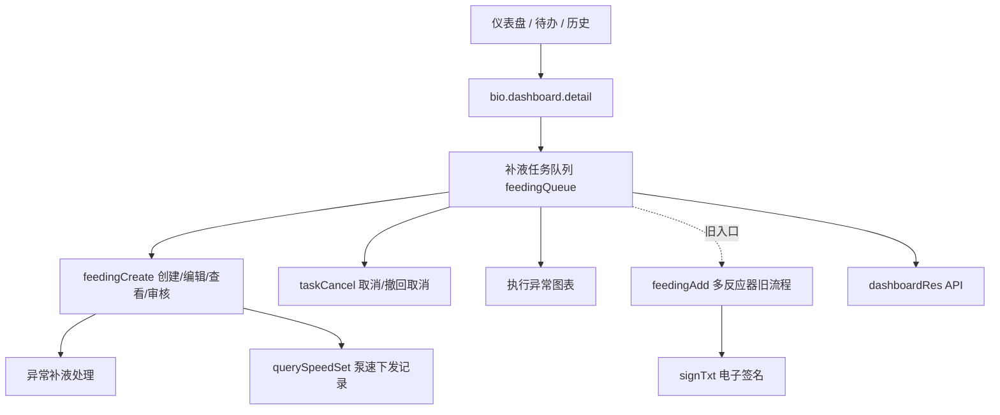
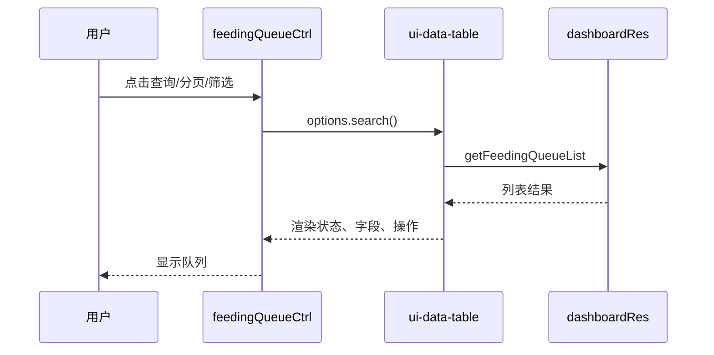
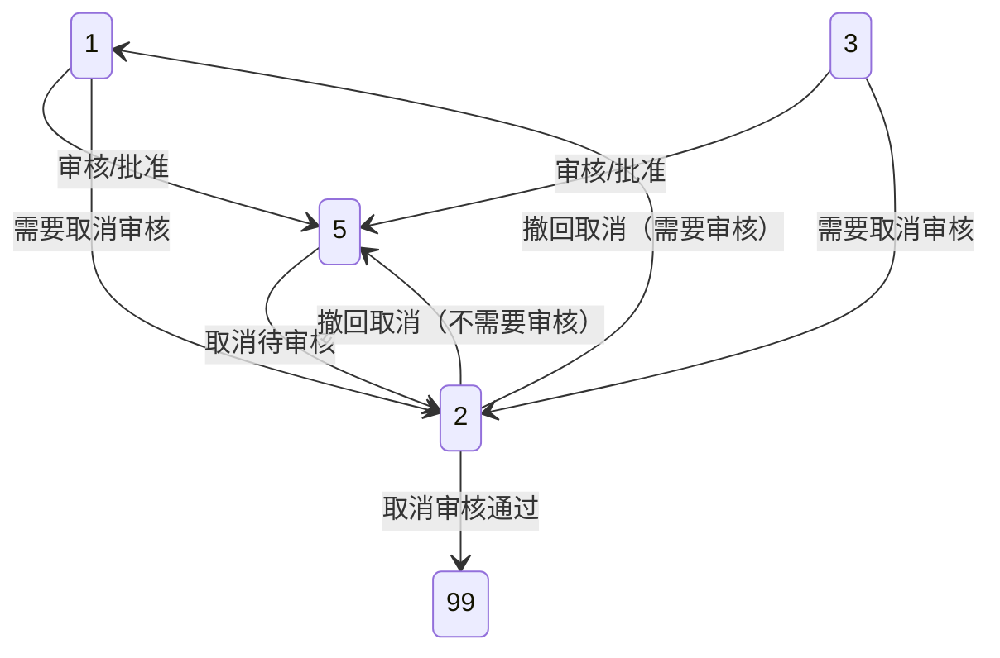

# 补液任务详情：legacy AngularJS `feedingQueue` 模块

> 本文是对当前前端源码的知识整理，不等同于后端接口契约。证据标签含义如下：
>
> - **【已证实】**：可以由当前前端源码直接定位。
> - **【前端推断】**：由模板、Controller、接口调用或分支行为推导，但后端规则未在本次源码范围内出现。
> - **【未知】**：当前前端没有足够证据，不能补写为确定事实。

## 1. 范围与证据边界

### 1.1 模块职责

**【已证实】** `feedingQueue` 是生物仪表盘下的补液任务队列：负责查询、筛选、查看、创建、编辑、审核、取消、撤回取消、处理执行异常以及查看执行图表。主页面 Controller 在 `views/bio/dashboard/feedingQueue/feedingQueueController.js:2-522`，主模板在 `views/bio/dashboard/feedingQueue/feedingQueue.html:1-158`。

**【前端推断】** 该模块既承载任务编排，又承载部分执行结果补录；真正的任务持久化、状态机、设备执行和权限判定仍由后端及设备服务决定。

### 1.2 阅读范围

本说明重点使用以下源码：

| 区域 | 主要文件 | 证据关注点 |
| --- | --- | --- |
| 队列主页面 | `feedingQueue/feedingQueueController.js`、`feedingQueue.html` | 查询、操作入口、刷新、状态分支、权限 |
| 创建/编辑/查看 | `feedingQueue/feedingCreate/feedingCreate.js`、`feedingCreate.html` | 表单、计算、审核、异常执行、详情页签 |
| 取消 | `feedingQueue/taskCancel/taskCancelController.js`、`taskCancel.html` | 取消原因、直接删除、待审核、撤回 |
| 旧批量流程 | `feedingQueue/feedingAdd/feedingAdd.js`、`feedingAdd.html` | 多反应器及旧审核/签名流程 |
| 签名 | `feedingQueue/signTxt/*`、`components/signTxt/*` | 手写签名及图片上传；`feedingAdd` 的活动模板使用 `/app/components/signTxt` |
| API 边界 | `res/app-res.js:1109-1207` | 请求方法与路径 |
| 状态显示 | `common/filter/filter.js:1899-1952` | 完整前端状态码映射 |
| 状态常量 | `app-config.js:44-50` | 仅前端固定的部分工作流常量 |
| 路由及入口 | `route/app-route.js:392-408,432`，各入口 Controller | 详情路由与返回路径 |

## 2. 目录架构与入口



### 2.1 路由和详情入口

| 入口 | 行为 | 证据 |
| --- | --- | --- |
| 仪表盘 | 保存详情上下文，设置 `where_to_detail = 'home'`，进入 `bio.dashboard.detail` | `views/bio/dashboard/dashboardController.js:245-249` |
| 待办列表 | 保存上下文，进入详情 | `views/bio/dashboard/toDoList/toDoListController.js:34-38` |
| 批次历史 | 转换批次字段（包括 `BatchId`）后进入详情 | `views/bio/dashboard/batchHistory/batchHistoryController.js:98-104` |
| 培养历史 | 标记历史来源 `where_to_detail = 'history'` 后进入详情 | `views/bio/dashboard/cultureHistory/cultureHistoryController.js:197-204` |
| 补液队列返回 | 使用 `$scope.taskBatch` 作为 `culture` 参数返回详情 | `feedingQueue/feedingQueueController.js:102-105` |
| 详情页 | `bio.dashboard.detail`，URL `/detail`，参数 `culture`，Controller 为 `detailCtrl` | `route/app-route.js:392-400` |
| 详情页 MES 子页 | `bio.dashboard.detail.mes`，URL `/mes`，模板上下文为 `mesBatch` | `route/app-route.js:401-408` |

详情初始化优先使用 `$stateParams.culture`，没有时读取 `sessionStorage.culture_detail_params`；缺少上下文时返回仪表盘，并通过 `loadCurrentBatchById` 补全当前批次数据（`detail/detailController.js:10-25`）。详情页还会用任务、培养、反应器和当天范围查询当天补液队列（`detail/detailController.js:610-624`）。

## 3. 列表、筛选与加载流

### 3.1 初始化

**【已证实】** `feedingQueueCtrl` 初始化时执行以下工作（`feedingQueueController.js:5-63`）：

1. 加载当前用户。
2. 将开始时间默认为 3 个月前的当天起始时间。
3. 从状态参数或 `sessionStorage` 读取 `taskBatch`。
4. 有批次上下文时，将培养、反应器、批次任务和批次 ID 带入筛选。
5. 加载反应器列表、状态枚举、补液介质字典和补液类型字典。
6. 配置 `ui-data-table`，数据源为 `dashboardRes.getFeedingQueueList`，默认页大小为 20。

**【已证实】** 状态下拉不是完全由 `app-config.js` 静态常量驱动，而是调用 `codeRes.getEnumList({ key: 'EnumBatchFeedTaskStatus' })` 获取后端枚举（`feedingQueueController.js:91-100`）。因此不能把某一组“九个下拉值”写成固定契约。

### 3.2 筛选项与校验

模板中的筛选项为培养编号、反应器、状态、开始/结束补液时间、审核人、批准人、修改人（`feedingQueue.html:8-30`）。

**【已证实】** 开始时间和结束时间都填写时，前端通过 `checkDateTime` 检查先后顺序，失败时显示 `CE200403`；当前代码没有要求两个时间必须同时填写，因此单边时间条件如何查询还需结合后端行为确认（`feedingQueueController.js:65-75,288-297`）。

### 3.3 列表字段

**【已证实】** 表格展示培养/任务/反应器、介质/泵、目标量、实际量、完成百分比、补液时长、计划/开始/结束时间、状态和操作（`feedingQueue.html:33-156`）。当 `ExtraFeedingMode === 3` 时，实际量显示值会叠加 `ErrorNeedFeedingVolumn`（`feedingQueue.html:67-71`）。

### 3.4 查询与刷新



**【已证实】** 新增、编辑、审核、取消、撤回等弹窗成功后，通过事件 `on-alarm-setting-popup-close-click` 通知父 Controller；父 Controller 关闭弹窗并调用 `$scope.options.search()` 刷新列表，部分成功分支会将 `CurrentPage` 重置为 1（`feedingQueueController.js:152-165,221-235,329-343,390-404,462-475`）。

**【已证实】** 主队列和任务详情数据没有定时轮询证据，打开详情或返回队列后看到的是当次请求结果；但执行图表是例外：状态 7 打开图表后会每 5 秒调用一次 `getChartData()`。证据：`feedingQueueController.js:484-519`，`components/execChartPopup/execChartPopupController.js:4-30`。

## 4. 创建、编辑与查看

### 4.1 操作入口

| 模式 | 前端入口 | 主要证据 |
| --- | --- | --- |
| 创建 | 队列创建弹窗 | `feedingQueueController.js:125-166` |
| 编辑 | 已存在任务的编辑弹窗 | `feedingQueueController.js:173-236` |
| 查看 | 同一详情组件的只读模式 | `feedingQueueController.js:173-236`，`feedingCreate.js:21-87` |
| 审核 | 详情组件审核模式 | `feedingQueueController.js:434-477`，`feedingCreate.js:230-258` |
| 取消 | `taskCancel` 弹窗 | `feedingQueueController.js:309-344` |
| 撤回取消 | `taskCancel` 的撤回分支 | `feedingQueueController.js:346-405` |
| 执行异常图表 | 图表弹窗 | `feedingQueueController.js:484-519` |

### 4.2 表单模型与初始化

**【已证实】** 创建/编辑模型至少包含以下业务字段：

| 字段/概念 | 用途 | 证据 |
| --- | --- | --- |
| `BatchID` / `BatchId` | 批次标识；保存前会统一处理 | `feedingCreate.js:266,303,358` |
| 反应器 | 任务执行反应器 | `feedingCreate.html:7-10` |
| 补液时间 | 计划执行时间 | `feedingCreate.html:13-16` |
| 补液介质 | 介质、泵和葡萄糖属性来源 | `feedingCreate.html:18-25`，`feedingCreate.js:130-158` |
| `FeedingType` / 补液类型 | 表单分支字段；值 1 和 3 分别切换百分比/克数输入 | `feedingCreate.js:123-129`，`feedingCreate.html:27-46` |
| `FeedingBasis` / 计算基准 | 百分比目标量计算所使用的初始重量或当前重量基准；与表单分支字段分开 | `feedingCreate.html:194-203`，`feedingCreate.js:172-175` |
| 泵速策略 | 泵速配置选择 | `feedingCreate.html:48-53` |
| 创建原因 | 操作原因，最多 100 个字符 | `feedingCreate.html:55-58` |
| 泵名、泵号、葡萄糖标记 | 由介质选择自动填充 | `feedingCreate.js:130-158` |
| `PrecisionNum` | 实际量及额外量的显示/舍入精度 | `feedingCreate.js:184-203,443-524` |
| `ExcessPercentage` | 允许超量阈值 | `feedingCreate.js:184-203,443-524` |
| `ExtraFeedingMode` | 额外补液模式；自动模式为 `1` | `feedingCreate.js:184-203` |

创建时泵策略由 `pumpConfigRes.getQueryList` 加载（`feedingCreate.js:39-59`）；反应器在创建和查看/编辑时使用不同的 `isShowAll` 参数加载（`feedingCreate.js:21-28,61-74`）；任务树通过 `getRoomReactorTreeListV2` 加载（`feedingCreate.js:160-182`）。没有 `FeedingType` 时会设默认值；葡萄糖任务会强制 `FeedingBasis = 3`，这是计算基准设置，不是表单分支字段（`feedingCreate.js:166-175`）。

### 4.3 五个详情页签

| 页签 | 可见条件 | 内容 | 证据 |
| --- | --- | --- | --- |
| 1. 基础信息 | 始终可见 | 任务、培养、反应器、介质、目标/实际量、时间等 | `feedingCreate.html:81-99` 及基础表单区域 |
| 2. Cedex/葡萄糖数据 | 仅 `current.IsGlucose` | 葡萄糖相关输入和计算数据 | `feedingCreate.html:81-99,268-280` |
| 3. 操作/审核日志 | 始终可见 | 操作记录、审核记录 | `feedingCreate.html:81-99` |
| 4. 执行异常处理 | `Status` 为 `9`、`11` 或 `6` | 异常执行数据、实际量、原因、额外补液 | `feedingCreate.html:93-94,317` |
| 5. 泵速下发记录 | `SpeedSetLis` 非空 | 泵速策略/下发历史 | `feedingCreate.html:81-99`，`feedingCreate.js:26-29,76-87` |

**【已证实】** `feedingCreateCtrl` 默认 `currentIndex = 1`，正常创建/编辑/查看从第 1 个页签开始（`feedingCreate.js:7`）。队列的 `reviewDetail(item, true)` 专门为状态 6 的异常审核传入 `currentIndex: 4`；普通审核传入 1（`feedingQueueController.js:435-446`）。页签 4 的显示条件仍由 `feedingCreate.html:93-94` 控制。只有 `accessController.isView` 为真时才调用 `querySpeedSet({ taskId: BatchTaskID })` 加载泵速记录（`feedingCreate.js:20-29,75-87`）。**【前端推断】** “一次加载、无轮询”意味着泵速历史和异常数据不会因设备后台变化而自动追加。

## 5. 补液类型、显示字段与公式

### 5.1 补液类型

**【已证实】** 补液类型字典使用 `FEEDINGTYPE` 加载（`feedingQueueController.js:111-123`）。表单分支明确读取 `current.FeedingType`，不是 `FeedingBasis`（`feedingCreate.js:123-129`）。前端表单至少明确区分两类输入：

| 代码/场景 | 输入 | 前端约束 | 证据 |
| --- | --- | --- | --- |
| `FeedingType = 1` | 百分比体积 | `> 0` 且 `< 100`，保留 2 位小数 | `feedingCreate.js:123-129`，`feedingCreate.html:36-40` |
| `FeedingType = 3` | 克数体积 | `> 0` 且 `<= InitVolume` | `feedingCreate.js:123-129`，`feedingCreate.html:42-46` |

切换补液类型时会清空不适用的体积字段（`feedingCreate.js:123-129`）。**【未知】** `FEEDINGTYPE` 的完整业务字典值和每个代码的后端含义不由本次前端固定源码完整定义。

### 5.2 百分比和目标量

模板显示的百分比目标量计算如下；这里的 1/3 是 `FeedingBasis` 计算基准，不是表单分支用的 `FeedingType`（`feedingCreate.html:194-203`）：

```text
基准 1：目标重量 = 初始重量 × 补液百分比
基准 3：目标重量 = 当前重量 × 补液百分比
```

**【已证实】** 实际量变化监听会先按 `PrecisionNum` 舍入，再计算误差百分比（`feedingCreate.js:184-203`）：

```text
误差百分比 = abs(实际量 - 目标量) × 100 / 目标量
```

**【前端推断】** 当实际量低于目标量且误差百分比达到 `ExcessPercentage` 时，界面允许进入额外补液处理；目标量为 0 时该公式的除零行为未在前端特殊处理，需以后端或实际运行验证。

### 5.3 补料实际重量与完成度

**【已证实】** 详情页分别展示 `FeedingScaleBefore`、`FeedingScaleAfter`、`FeedingVolume` 和 `TotalFeedingRealVolume`，单位标注为 `g`；非零数值按 `PrecisionNum` 格式化显示。详情页对非零 `FeedingCompleteRate` 使用 2 位小数显示，主列表则直接显示后端返回值（`feedingCreate.html:146-163`，`feedingQueue.html:66-73`）。

当前前端未发现对 `TotalFeedingRealVolume` 或 `FeedingCompleteRate` 的赋值或计算，因此以下公式是**待后端或业务规则确认的候选口径**。

**【前端推断】** 如果秤前、秤后字段表示同一补料容器，并且补料时容器重量减少，则单次补料实际重量的候选公式为：

```text
候选单次实际重量 = FeedingScaleBefore - FeedingScaleAfter
                   = 补料秤前重量 - 补料秤后重量
```

该候选公式只适用于两个秤值均有效且 `FeedingScaleBefore >= FeedingScaleAfter` 的情况。状态 9 页面允许人工录入 `TotalFeedingRealVolume`，但前端不能证明异常触发条件、最终取值来源、后端赋值方式或存储前舍入规则；`PrecisionNum` 目前只能证明前端显示格式（`feedingCreate.html:150-163,327-331`）。

**【前端推断】** 如果 `TotalFeedingRealVolume` 表示不含额外补料的基础实际重量，则基础完成度的候选公式为：

```text
候选基础完成度（%） = TotalFeedingRealVolume / FeedingVolume × 100
                    = 补料实际重量 / 补料目标重量 × 100
```

仅当 `FeedingVolume` 为有效且大于 0 的数值时该公式才有定义；目标重量为 0 或缺失时应记为未定义或不可计算，而不是 0%。该公式自然可能产生大于 100% 的结果，但前端不能证明后端是否封顶或采用其他计算规则。

主列表仅在 `ExtraFeedingMode === 3` 且 `ErrorNeedFeedingVolumn` 为真值时，将实际量显示为两段文本：

```text
TotalFeedingRealVolume + ErrorNeedFeedingVolumn
```

这只证明手动模式下的并列显示，不证明前端已经求和，也不证明额外量已经执行。只有确认 `ErrorNeedFeedingVolumn` 已执行且尚未包含在 `TotalFeedingRealVolume` 中时，才可使用以下候选公式：

```text
候选累计实际重量 = TotalFeedingRealVolume + ErrorNeedFeedingVolumn

候选补料后完成度（%） = 候选累计实际重量 / FeedingVolume × 100
```

自动模式 `ExtraFeedingMode === 1` 是否已由后端合并进实际量或完成度未知，不得再次累加后重算（`feedingQueue.html:67-73`）。此外，详情基础页会把数值 0 当作假值并显示“未知”，异常页通过 `>= 0` 可以显示实际量 0；这是显示差异，不代表后端数值定义不同。

### 5.4 葡萄糖计算

系统创建的葡萄糖任务在模板中展示以下四条字段级计算（`feedingCreate.html:268-280`）：

```text
模式 1，GlucoseFeedingVerification=true：
FeedingVolume = (FeedingTo - GlucoseConcBefore) × CurrentVolumeBefore / GlucoseConc

模式 1，GlucoseFeedingVerification=false：
FeedingVolume = (FeedingTo × CurrentVolumeBefore - CedexValue × ReactorVolumeBefore) / GlucoseConc

模式 3，GlucoseFeedingVerification=true：
FeedingVolume = (FeedingTo - GlucoseConcBefore - LactateConc) × CurrentVolumeBefore / GlucoseConc

模式 3，GlucoseFeedingVerification=false：
FeedingVolume = (FeedingTo × CurrentVolumeBefore - (CedexValue + LactateDesgineConc) × ReactorVolumeBefore) / GlucoseConc
```

**【未知】** 公式中的单位、浓度来源、验证状态写入后端的字段名，以及后端是否重新计算，前端未给出完整契约。

## 6. 校验、保存与执行异常

### 6.1 创建/编辑保存

保存顺序为：

1. `utility.validateForm(feedingForm)`（`feedingCreate.js:262-264`）。
2. 调用 `checkFeedingTaskVolume`（`feedingCreate.js:266-299`）。
3. 根据验证结果处理：`1` 直接保存；`3` 弹出最小/最大范围确认；`5` 拒绝并显示最小量警告。
4. 调用 `updateFeedingQueueV2` 保存（`feedingCreate.js:301-329`）。

编辑分支针对状态 1 或 3 保存；状态 5 进入待执行处理（`feedingCreate.js:315-329`）。**【未知】** 验证结果码 `1/3/5` 的后端完整枚举和其他可能值未在前端定义。

### 6.2 表单校验

- 反应器必填；创建时可选，批次固定时禁用（`feedingCreate.html:7-10`）。
- 补液时间必填，且不得早于 `feeTimeMin`（`feedingCreate.html:13-16`）。
- 补液介质、补液类型、泵速策略必填（`feedingCreate.html:18-53`）。
- 百分比输入必须 `> 0` 且 `< 100`，保留 2 位小数（`feedingCreate.html:36-40`）。
- 克数输入必须 `> 0` 且 `<= InitVolume`（`feedingCreate.html:42-46`）。
- 创建原因必填，最多 100 个字符（`feedingCreate.html:55-58`）。

### 6.3 执行异常与额外补液

异常状态详情页要求实际量；处理逻辑位于 `feedingCreate.js:443-538`。

```text
状态 9 的额外量 = abs(目标量 - 实际量)，按 PrecisionNum 舍入

ErrorNeedFeedingVolumn + TotalFeedingRealVolume
    <= FeedingVolume × (100 + ExcessPercentage) / 100
```

这里的 `FeedingVolume` 是目标量，`TotalFeedingRealVolume` 是已输入的实际量，`ErrorNeedFeedingVolumn` 是自动/手动额外量；源码只在状态 9 的监听分支中按目标量与实际量差值计算额外量（`feedingCreate.js:184-203`），提交时按上述字段校验（`feedingCreate.js:451-457`）。

**【已证实】** 状态 9 会计算所需额外量；自动额外补液模式调用 `checkSaveErrorFeedingVolume`，确认后通过 `saveErrorfeedingVolume` 提交任务 ID、实际量、原因、模式、泵速、旧策略、额外量和误差百分比（`feedingCreate.js:443-524`）。执行异常审核调用 `approvalFeedingError({ batchTaskID })`（`feedingCreate.js:526-538`）。

**【已证实】** 列表实际量在 `ExtraFeedingMode === 3` 时叠加 `ErrorNeedFeedingVolumn`（`feedingQueue.html:67-71`）。**【前端推断】** `ExtraFeedingMode` 的具体业务枚举和 `1`、`3` 以外模式的后端行为不能由当前 UI 完整确定。

## 7. 状态模型与状态显示

### 7.1 完整前端显示映射

以下是 `feedingQueueStatusFormat` 的完整映射，不代表后端枚举全集（`common/filter/filter.js:1899-1952`）。

| 状态码 | 翻译键/前端显示语义 | 证据及备注 |
| --- | --- | --- |
| 0 | `Task_Satus_Null`：空/无状态 | `filter.js:1903-1905` |
| 1 | `Task_Satus_Pending_Review`：待审核 | `filter.js:1906-1908` |
| 2 | `Task_Satus_Pending_Cancle`：待取消审核 | `filter.js:1909-1911` |
| 3 | `Task_Satus_Pending_Approve`：待批准 | `filter.js:1912-1914` |
| 4 | `Task_Satus_Revoke_Cancle_Pending_Review`：撤回取消待审核 | `filter.js:1915-1917`；UI 注释标为作废 |
| 5 | `Task_Satus_Pending_Execute`：待执行 | `filter.js:1918-1920` |
| 6 | `Task_Satus_ErrorPendingApprove`：执行出错待审核 | `filter.js:1921-1923` |
| 7 | `Task_Satus_Executing`：执行中 | `filter.js:1924-1926` |
| 9 | `Task_Satus_ErrorInExecution`：执行中出错 | `filter.js:1927-1929` |
| 11 | `Task_Satus_ErrorInExecutionFixed`：执行中出错已处理 | `filter.js:1930-1932` |
| 17 | `Task_Satus_Skiped`：跳过 | `filter.js:1933-1935` |
| 19 | `Task_Satus_Executed`：已执行 | `filter.js:1936-1938` |
| 99 | `public_Canceled`：已取消 | `filter.js:1939-1941` |
| 199 | `Task_Satus_AccrossDayCanceled`：跨天取消 | `filter.js:1942-1944` |

未知状态会原样返回（`filter.js:1945-1950`）。注意翻译键本身包含历史拼写，如 `Satus`、`Cancle`、`Skiped`、`Accross`；文档保留源码原文，不将其修正为新的契约。

**【已证实】** 主列表对 `Status` 先做真值判断，因此状态 0 不会经过上述过滤器，而会显示 `public_Unknown`；映射中的 `Task_Satus_Null` 只证明过滤器能力。证据：`feedingQueue.html:79-80`。

### 7.2 静态常量与动态下拉的差异

`app-config.js:44-50` 只固定了：`PendingReview = 1`、`PendingCancel = 2`、`PendingApprove = 3`、`PendingCancelReview = 4`、`ErrorPendingApprove = 6`。**【已证实】** 主队列另从后端动态获取 `EnumBatchFeedTaskStatus`（`feedingQueueController.js:91-100`）。

**【已证实】** UI 注释明确写出状态 4「撤回取消待审核 -- 作废」，对应操作块也被注释掉（`feedingQueue.html:141-146`）。**【未知】** 后端是否仍接受状态 4、是否只为历史数据保留，以及动态下拉实际返回哪些值，当前前端没有证据。不要把它写成“下拉固定九个值”。

### 7.3 前端提交的目标状态与不确定状态



上图需按以下证据边界阅读：

| 转移 | 结论 | 证据 |
| --- | --- | --- |
| `1/3 -> 5` | 已证实前端提交目标状态 5；后端持久化结果未知 | `feedingCreate.js:230-258` |
| `1/3/5 -> 2` | 已证实取消分支提交目标状态 2；后端持久化结果未知 | `feedingQueueController.js:309`，`taskCancelController.js:45-86` |
| `2 -> 99` | 已证实前端提交目标状态 99；后端持久化结果未知 | `feedingCreate.js:230-258` |
| `2 -> 1` 或 `2 -> 5` | 已证实撤回取消按 `IsCancelNeedApprove` 提交目标状态 1 或 5；后端持久化结果未知 | `taskCancelController.js:72-85` |
| `1/3` 直接删除 | 已证实存在记录删除分支，不是转移到状态 99；请求参数写为 `datchTaskId` | `taskCancelController.js:45-86` |
| `6` 撤回 | 已证实存在执行异常撤回入口并调用 `cancelFeedingError`；目标状态未知 | `feedingQueueController.js:407-431`，`app-res.js:1165-1169` |
| `7/9/11/17/19/199` 间转移 | **【未知】**；状态含义可显示，但设备驱动和后端完整转移没有前端证明 | `filter.js:1924-1944` 仅证明显示映射 |

## 8. 审核、取消与撤回规则

### 8.1 审核

- **【已证实】** 状态 1/3 审核分支向后端提交目标状态 5（`feedingCreate.js:230-258`）。
- **【已证实】** 状态 2 审核分支向后端提交目标状态 99（`feedingCreate.js:230-258`）。
- **【前端推断】** 状态 1 和 3 的“审核/批准”在界面上共享相关处理，但“待审核”和“待批准”的后端角色语义不能仅凭前端完全区分。
- 旧流程仍保留 `taskCheck`，审核与批准分别传 `CheckType: 1` 和 `CheckType: 2`（`feedingAdd.js:164-241`；旧分支也见 `feedingCreate.js:333-412`）。

### 8.2 取消

- 状态 1/3 可进入取消分支；其中直接删除是记录删除，不应描述为转移到状态 99；另一分支进入待取消审核。
- 状态 5 取消进入状态 2。
- `SoureType != 3` 时，取消权限分支受 `CancelAuthority` 控制；`SoureType == 3` 存在创建人专属分支（`feedingQueue.html:84-150`）。
- 取消原因必填，最多 100 个字符（`taskCancel.html:4-29`）。
- 直接删除调用 `deleteFeedingQueue`，参数名为源码中的 `datchTaskId`；这是现状证据，不应在文档中擅自改成 `batchTaskId`（`taskCancelController.js:45-86`）。

### 8.3 撤回取消和异常撤回

- 状态 2 且当前用户为 `Last_updated_by` 时显示撤回取消入口（`feedingQueue.html:84-150`）。
- 撤回状态根据 `IsCancelNeedApprove` 返回 1 或 5（`taskCancelController.js:72-85`）。
- 状态 6 且当前用户为 `Last_updated_by` 时显示执行异常撤回入口（`feedingQueue.html:128-135`），调用 `cancelFeedingError`，其操作类型字符串为「撤回取消」；目标状态未知（`feedingQueueController.js:407-431`，`app-res.js:1165-1169`）。
- 状态 4 的撤回取消审核操作代码已注释并标记作废（`feedingQueue.html:141-146`）。

## 9. 权限与前端可见性

**【已证实】** 队列表格操作区的主要条件如下（`feedingQueue.html:84-150`）：

| 操作 | 前端显示条件 |
| --- | --- |
| 查看 | 状态 `>= 1`，并带 `Feeding Queue View` |
| 编辑 | 状态 1 或 3 且当前用户等于 `Last_updated_by`；状态 5 另受 `CancelAuthority` 分支影响 |
| 审核 | 状态 1/3/2 时要求 `CancelAuthority` 且当前用户与 `Last_updated_by` 不相等；状态 6 为当前用户与 `Last_updated_by` 不相等的独立异常审核分支 |
| 取消 | 状态 1/3/5 且有 `CancelAuthority` 且 `SoureType != 3`；`SoureType == 3` 另有创建人分支 |
| 撤回取消 | 状态 2 且当前用户等于 `Last_updated_by` |
| 撤回执行异常 | 状态 6 且当前用户等于 `Last_updated_by` |
| 图表 | 状态 19、7、9、11 |

**【已证实】** 源码同时出现正确拼写的 `access-control` 和疑似拼写错误的 `asscess-control`：查看、编辑、审核和图表入口使用了 `asscess-control`，取消及撤回入口使用 `access-control`（`feedingQueue.html:84-150`）。**【前端推断】** 若权限指令只识别 `access-control`，拼错的属性可能不会生效；本说明仅记录证据，不断言运行时一定绕过权限。

## 10. legacy `feedingAdd` 与签名流

### 10.1 `feedingAdd`

**【已证实】** `feedingAdd` 是旧的或替代的多反应器流程；当前队列 Controller 没有发现打开它的现行入口，但其 Controller 和模板仍保留（`feedingAdd.js:7-307`、`feedingAdd.html:1-160`）。

- 初始化从 `dialogParams` 获取反应器树、补液类型、介质定义和权限控制器；空字段默认取第一项（`feedingAdd.js:7-27`）。
- 创建模式至少选中一个反应器；非新增模式会把遍历到的所有反应器设为选中；每个选中反应器单独校验（`feedingAdd.js:43-69`）。
- 当前确认路径使用警告确认框：新增/确认调用 `updateFeedingQueue({ FeedingQueueRoomList })`；审核调用 `taskCheck(CheckType: 1)`；批准调用 `taskCheck(CheckType: 2)`；取消/确认取消调用 `taskCancle(cancelType: 1/2)`（`feedingAdd.js:164-241`）。
- `feedingAdd.js:70-163` 还保留被注释的旧签名实现。
- 待执行路径会使用 `/app/components/signTxt/signTxt.html` 的共享电子签名，然后调用 `handlePendingExecution({ FeedingQueueRoomList })`（`feedingAdd.js:244-307`）。
- 模板包含反应器勾选、补液时间、介质、类型、百分比/克数、状态 9 的异常量输入，以及签名/审核按钮（`feedingAdd.html:10-160`）。

### 10.2 签名

`feedingAdd` 的活动签名模板明确使用 `/app/components/signTxt/signTxt.html`，对应共享 Controller 为 `components/signTxt/signTxtController.js`（`feedingAdd.js:262-263`）。队列本地 `feedingQueue/signTxt/signTxtController.js` 与 `signTxt.html` 文件仍存在，但在本次检查的活动源码中未发现引用，不能据此宣称它是当前活动流程。

**【已证实】** 两种实现均：

1. 展示当前认证用户名称（Controller: `signTxtController.js:10-12`）。
2. 延迟 500 ms 初始化 Canvas（`signTxtController.js:113-121`）。
3. 支持触摸和鼠标绘制（`signTxtController.js:47-85`）。
4. 只有绘制后才将 `isSign` 置为 `true`（`signTxtController.js:57-61,76-81`）。
5. 清空画布并重置签名状态（`signTxtController.js:87-91`）。
6. 将 Canvas 转为 PNG `File`，以 `img` 字段放入 `FormData`，调用 `uploadRes.uploadImg`（`signTxtController.js:93-107`）。
7. 上传成功后用 `on-img-upload-close` 事件回传图片 URL（`signTxtController.js:124-127`）。

签名确认和清除按钮在没有签名时禁用（`signTxt.html:20-22`）。

## 11. API 清单

以下表格只记录 `res/app-res.js` 已出现的前端方法映射；请求参数、响应模型和后端事务语义未在此处臆造。

| 前端方法 | 方法 | 路径 | 使用位置/用途 | 证据 |
| --- | --- | --- | --- | --- |
| `getFeedingQueueList` | GET | `api/dashboard/query-feeding-queue-list` | 主队列列表 | `app-res.js:1109-1112` |
| `getFeedingQueueListToday` | GET | `api/dashboard/query-feeding-queue-list-today` | 详情页当天队列 | `app-res.js:1113-1115` |
| `getFeedingQueueById` | GET | `api/dashboard/query-feeding-queue-by-id` | 按 ID 获取任务 | `app-res.js:1117-1120` |
| `updateFeedingQueueV2` | POST | `api/dashboard/update-feeding-queue-v2` | 新建/编辑保存 | `app-res.js:1125-1127` |
| `getDefaultPumpConfigById` | GET | `api/dashboard/query-default-pumpConfig` | 默认泵配置 | `app-res.js:1129-1133` |
| `checkFeedingTaskVolume` | POST | `api/dashboard/feedingtask-volume-verify` | 创建/编辑量校验 | `app-res.js:1134-1137` |
| `checkSaveErrorFeedingVolume` | POST | `api/dashboard/feedingtask-volume-check` | 异常量/额外补液校验 | `app-res.js:1138-1141` |
| `handlePendingExecution` | POST | `api/dashboard/update-feeding-execute` | 旧批量/签名流 | `app-res.js:1142-1145` |
| `handlePendingExecutionV2` | POST | `api/dashboard/update-feeding-execute-v2` | 新待执行处理 | `app-res.js:1146-1149` |
| `deleteFeedingQueue` | DELETE | `api/dashboard/delete-feeding-queue` | 直接删除/取消 | `app-res.js:1150-1153` |
| `updateFeedingQueue` | GET | `api/dashboard/feeding-queue-upate-status` | 旧状态更新 | `app-res.js:1154-1158` |
| `approvalFeedingError` | GET | `api/dashboard/approval-feeding-error` | 执行异常审核 | `app-res.js:1160-1164` |
| `cancelFeedingError` | POST | `api/dashboard/cancel-feeding-error` | 撤回/取消异常处理 | `app-res.js:1165-1169` |
| `getRoomReactorTreeListV2` | GET | `api/dashboard/query-room-reactor-tree-list-v2` | 房间/反应器任务树 | `app-res.js:1180-1183` |
| `getReactorList` | GET | `api/dashboard/query-batch-reactor` | 创建/查看时加载可选反应器 | `feedingCreate.js:61-74`; `app-res.js:1184-1187` |
| `querySpeedSet` | GET | `api/dashboard/query-speed-set` | 泵速下发记录 | `app-res.js:1188-1190` |
| `taskCheck` | POST | `api/dashboard/task-check` | 旧审核/批准 | `app-res.js:1197-1200` |
| `taskCancle` | POST | `api/dashboard/cancel-feeding-task` | 旧取消/确认取消 | `app-res.js:1201-1204` |
| `saveErrorfeedingVolume` | POST | `api/dashboard/handle-errorfeeding-task` | 保存执行异常补液结果 | `app-res.js:1205-1207` |

`getFeedingQueueById` 和 `handlePendingExecution` 的 URL 已由 `dashboardRes` 明确定义；其响应模型和后端事务语义仍属于本次前端检查范围之外。其余路径保留源码中的历史拼写，例如 `upate`、`taskCancle` 和 `saveErrorfeedingVolume`。
