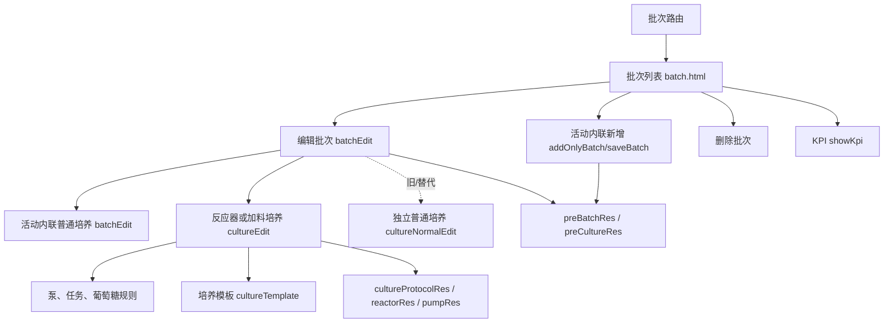
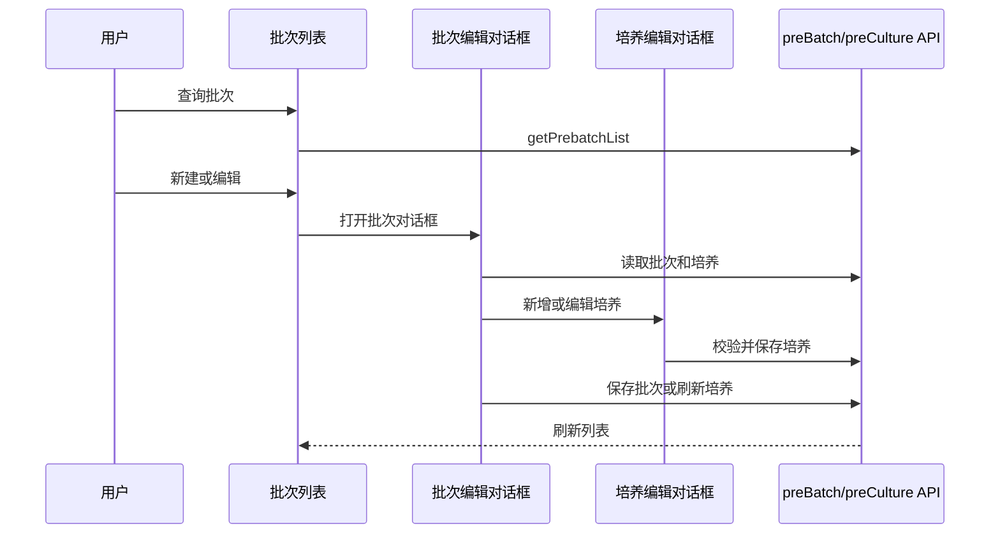

# NPP 批次培养详情

## 1. 文档定位与证据规则

本文面向维护 NPP 批次培养前端的开发、测试和运维人员，描述当前 AngularJS 页面实际可见的行为、调用关系和数据形状。

证据标签如下：

| 标签 | 含义 |
| --- | --- |
| 【已证实】 | 可由当前前端源码直接确认，后面的路径和行号指向证据。 |
| 【前端推断】 | 根据前端调用、显示或状态控制推测出的业务含义，不等同于服务端事实。 |
| 【未知】 | 当前代码没有足够证据，必须查后端实现、接口契约或现场数据。 |
| 【已知风险】 | 源码中已定位到可能导致错误、数据漂移或维护困难的具体实现。 |

本文的行号以当前工作区文件为准。前端 `access-control` 只能说明界面上的显示或操作入口，不能证明后端已经授权。

## 2. 范围与目录

【已证实】入口路由是 `sysmanage.commonSetting.nppBatch`，地址为 `/NPP/home/sysmanage/commonSetting/nppBatch`，控制器为 `dataBatchCtrl`，模板为 `views/sysmanage/commonSetting/nppBatch/batch.html`。证据：`route/app-route.js:154-179`。

【已证实】模块目录如下：

```text
views/sysmanage/commonSetting/nppBatch/
├── batch.html                    批次查询和列表
├── batchController.js             批次列表、批次对话框、培养对话框入口
├── batch.css / batch.less         页面样式
├── batchAdd/                      旧/替代的新建批次及新建培养路径
├── batchEdit/                     编辑批次及培养集合
├── cultureEdit/                   反应器或加料培养编辑
├── cultureNormalEdit/             普通培养编辑
├── cultureTemplate/               培养协议模板
└── showKpi/                       批次 KPI 查询对话框
```

【已证实】路由变化时会刷新认证令牌，并从本地模块设置填充 `$rootScope.ModuleSetting`。证据：`route/app-route.js:556-586`。

## 3. 总体架构和流程



【已证实】页面采用 AngularJS 控制器加 Bootstrap 对话框方式组织批次和培养编辑。批次编辑对话框关闭后会刷新列表，证据：`batchController.js:160-187`。

【已证实】活动批次新增从 `batch.html` 的 `addOnlyBatch()` 开始，先显示内联批次表单；`saveBatch()` 调用 `updatePrebatch` 成功后，再通过 `updateBatch()` 打开 `batchEdit`，证据：`batch.html:4`，`batchController.js:135-187`。

【前端推断】`batchAdd/` 控制器包含另一套新增批次和培养实现，但活动 `dataBatchCtrl` 的新增代码没有打开这些模板，而是打开 `batchEdit`；因此本文件将 `batchAdd/` 标为旧/替代路径，不把它作为当前主流程。证据：`batchController.js:135-187`，`batchAdd/batchAddController.js:4-348`。

【前端推断】批次是父对象，普通培养和反应器培养是挂在批次下面的两类子对象。活动编辑器默认调用 `preCultureRes.getList` 填充统一的 `cultureList`，列表再用 `TrainingType` 区分培养类型；`getNormalCulture` 属于保留的普通培养集合读取路径，与当前内联普通培养编辑器分开，证据：`batchEditController.js:97-100,147-180`，`batchEdit.html:106-125`。

## 4. 批次列表、查询和编辑

### 4.1 查询

【已证实】列表初始化为第 1 页、每页 10 条，控制器准备的查询参数包括开始时间、结束时间、`keyword` 和 `projectId`，接口为 `preBatchRes.getPrebatchList`。证据：`batchController.js:4-25`。

【已证实】执行搜索时页码重置为 1，开始时间晚于结束时间时拒绝查询。证据：`batchController.js:37-59`。

【已证实】项目下拉数据来自 `projectRes.userProject`，因此前端仅加载当前用户可见项目。证据：`batchController.js:76-87,233-244`，接口定义见 `app-res.js:2381-2404`。

【已知风险】搜索模板绑定 `Keyword` 和 `ProjectId`，控制器初始化的参数却是 `keyword` 和 `projectId`；大小写不一致可能导致关键字或项目筛选没有传入预期参数。证据：`batch.html:7-15`，`batchController.js:20-25`。

### 4.2 新建和编辑

【已证实】活动内联新增默认选中第一个用户可见项目，批次表单要求 `PreBatchNo` 和项目名称，Titer 可选，键盘输入禁止 `+`、`-` 和 `e`，证据：`batchController.js:135-143`，`batch.html:75-100`。

【已证实】活动内联批次保存调用 `preBatchRes.updatePrebatch`，成功后进入 `batchEdit`，证据：`batchController.js:148-187`。`batchAdd/batchAddController.js` 使用的 `createBatch` 属于旧/替代实现，不是活动 `dataBatchCtrl` 新增流程，证据：`batchAdd/batchAddController.js:200-215`，`res/app-res.js:2456-2460`。

【已知风险】批次新增的 `access-control="Add"` 挂在按钮内部图片上，而点击事件挂在父级 `div`，前端权限指令是否能阻止父级点击需要结合指令实现验证。证据：`batch.html:4-6`。

【已证实】批次删除先弹出确认框，确认后调用 `preBatchRes.deletePrebatch` 并刷新列表，证据：`batchController.js:551-573`。

## 5. 培养类型和状态

### 5.1 培养类型

| TrainingType | 名称 | 说明 | 证据 |
| ---: | --- | --- | --- |
| 1 | 普通培养 | 普通培养表单，包含培养编号、房间、培养容器、开始和结束日期 | `common/filter/filter.js:2055-2070`; `batchEdit.html:327-355` |
| 3 | 反应器培养 | 反应器、泵、加料任务和葡萄糖规则等配置 | `common/filter/filter.js:2055-2070`; `cultureEdit.html:28-119` |

【已证实】培养类型在编辑表格中通过 `cultureTypeFormat` 显示，培养状态通过 `cultureStatus` 显示，证据：`batchEdit.html:106-125`。

### 5.2 CultureStatus 映射

| CultureStatus | 中文名称 | 证据 |
| ---: | --- | --- |
| 1 | 未开始 | `common/filter/filter.js:1849-1877` |
| 3 | 已开始 | `common/filter/filter.js:1849-1877` |
| 4 | 已逾期 | `common/filter/filter.js:1849-1877` |
| 5 | 已完成 | `common/filter/filter.js:1849-1877` |
| 9 | 已过期/过去 | `common/filter/filter.js:1849-1877` |
| 99 | 已取消 | `common/filter/filter.js:1849-1877` |

【已证实】控制器保留了 `scheduledStartDateChange()`：若被调用，计划开始日期为今天或更早会把状态设为 9，未来日期设为 1；但当前模板的计划开始日期绑定的是 `changeStartTime()`，未绑定该函数。因此这段状态赋值不能视为当前页面已接线的活动流转。证据：`cultureEdit/cultureEditController.js:1138-1155`，`cultureEdit/cultureEdit.html:53-60`。

【前端推断】前端能看到的状态变化不是完整状态机。当前代码没有证明服务端会自动把 1、3、4、5、9、99 按某一条完整路径推进。

## 6. 路由、对话框和培养流转



【已证实】活动 `batchEdit` 中的培养类型选择器提供普通培养和反应器培养两种类型，证据：`batchEdit/batchEditController.js:357-394`，`batchEdit/batchEdit.html:277-305`。

【已证实】编辑已有批次时会加载房间、容器和培养集合，并建立反应器与容器映射，证据：`batchEdit/batchEditController.js:35-180`。

【已证实】活动普通培养使用 `batchEdit` 内联编辑器，要求培养编号、房间、培养容器或反应器、开始日期和结束日期，开始日期晚于结束日期时拒绝保存，证据：`batchEdit/batchEditController.js:84-95,395-457`，`batchEdit/batchEdit.html:307-370`。

【前端推断】`cultureNormalEdit/` 是独立的旧/替代普通培养对话框。活动控制器仍保留 `addNormalCultrue()` 打开它的代码，但活动模板中的旧普通培养表格被 `ng-show="currentCulture === 1 && false"` 隐藏，证据：`batchEdit/batchEditController.js:567-620`，`batchEdit/batchEdit.html:159-206`。

【已证实】普通培养可以转换为加料培养。转换时设置 `isChange: true` 和 `GlucoseFeedingVerification: true`，证据：`batchEdit/batchEditController.js:357-467`，具体赋值见 `batchEditController.js:459-466`。

【已证实】培养删除需要确认，确认后调用 `deletePreculture`，证据：`batchEdit/batchEditController.js:516-537`，接口见 `res/app-res.js:2557-2560`。

【已证实】删除按钮还要求当前用户是创建人，并且培养状态为 4、1 或空值；这只是前端显示门控，不代表后端授权规则。证据：`batchEdit/batchEdit.html:129-137`。

【已证实】N-production 开关变更需要确认，并调用 `changeCultureNProduction`，证据：`batchEdit/batchEditController.js:540-564`，接口见 `res/app-res.js:2582-2586`。

【未知】服务端是否在普通转加料时复制、重建或清除泵、任务、葡萄糖规则，前端只证明了转换标记和葡萄糖校验标记。

## 7. 普通培养和反应器培养数据模型

### 7.1 批次模型

| 字段 | 前端用途 | 证据或状态 |
| --- | --- | --- |
| PreBatchId | nppBatch 编辑、删除和 KPI 查询使用的批次标识 | 【已证实】`batchController.js:189-205,551-573`; `batchEdit/batchEditController.js:39,471`; `showKpi/showKpi.js:5-33` |
| PreBatchNo | nppBatch 的批次号主字段和显示字段 | 【已证实】`batch.html:27-40,75-76`; `batchEdit/batchEdit.html:7-9,224-226` |
| ProjectId / projectId / ProjectName | 项目归属字段及当前代码中的大小写变体 | 【已证实】`batchController.js:20-25,115-131`; `batchEdit/batchEditController.js:182-219,245-249`; `batch.html:7-9` |
| Titer | 批次表单可选数值 | 【已证实】`batch.html:75-100` |
| Cultures / cultureList | 批次编辑中的统一培养集合，页面按 `TrainingType` 显示类型 | 【前端推断】列表由 `preCultureRes.getList` 读取，证据：`batchEditController.js:97-180`，`batchEdit.html:106-125` |

### 7.2 普通培养模型

【已证实】活动内联普通培养至少包含培养编号、培养房间、培养容器或反应器、计划开始时间和计划结束时间；独立 `cultureNormalEdit` 也保留培养编号和计划开始日期字段。证据：`batchEdit/batchEdit.html:327-355`，`cultureNormalEdit/cultureNormalEdit.html:2-28`。

### 7.3 反应器或加料培养模型

【已证实】表单包含培养编号、反应器、培养天数、计划开始和结束时间、加料依据、葡萄糖验证及卫星培养设置，证据：`cultureEdit/cultureEdit.html:28-119`。

【已证实】反应器培养还包含固定泵、加料任务和葡萄糖规则。泵字段见 `cultureEdit/cultureEdit.html:207-285`，任务字段见 `cultureEdit/cultureEdit.html:299-370`，葡萄糖规则见 `cultureEdit/cultureEdit.html:423-489`。

## 8. 默认值、公式和单位

| 项目 | 规则 | 标签和证据 |
| --- | --- | --- |
| 计划开始 | 未传入开始日期时取当天 | 【已证实】`cultureEdit/cultureEditController.js:10-18` |
| 计划结束 | `scheduledEnd = scheduledStart + Days`，缺少 Days 时按 1 天初始化 | 【已证实】`cultureEdit/cultureEditController.js:10-18,1138-1146` |
| 培养天数 | 1 至 9999 | 【已证实】`cultureEdit/cultureEdit.html:49-59` |
| 加料依据 | 新建反应器培养默认 1，选项 1 初始值、3 当前值 | 【已证实】`cultureEdit/cultureEditController.js:29-32,80-88`; `cultureEdit.html:62-66` |
| 葡萄糖验证 | 新建反应器培养默认 `true` | 【已证实】`cultureEdit/cultureEditController.js:80-88` |
| 数值加载 | `InitialWorkingVolume` 和 `TransferCellVolume` 加载时执行数值 `/1000`，再四舍五入到两位；源码没有证明后端单位 | 【已证实】数值操作见 `cultureEdit/cultureEditController.js:34-38`；单位为未知 |
| 数值保存 | 页面值保存前执行 `*1000` 后提交；源码没有证明后端单位 | 【已证实】数值操作见 `cultureEdit/cultureEditController.js:1263-1268` |
| kg/g 口径 | 页面中被注释的两个输入标签显示 `kg`，因此前端可推断可能存在 g 与 kg 的换算，但后端单位仍未知 | 【前端推断】`cultureEdit/cultureEdit.html:148-160`；数值操作见 `cultureEdit/cultureEditController.js:34-38,1263-1268` |
| 模板 | `Status=true`、`add=true`；复制时协议名称追加 `-Copy` | 【已证实】`cultureTemplate/cultureTemplateController.js:7-17` |

【已知风险】工作体积和转移体积输入在 HTML 中被注释，但控制器仍会执行 `/1000` 和 `*1000` 数值变换；如果对话框重复初始化或保存，需验证是否会重复换算。源码没有证明后端单位，证据：`cultureEdit/cultureEdit.html:121-160`，`cultureEdit/cultureEditController.js:34-38,1263-1268`。

## 9. 校验规则

### 9.1 日期和状态

【已证实】普通培养校验开始日期不得晚于结束日期，证据：`batchEdit/batchEditController.js:84-95`。反应器培养根据开始日期和天数重算结束日期，证据：`cultureEdit/cultureEditController.js:1138-1155`。

【已证实】反应器培养编辑保存入口只在状态为 1 或空值且不是 `fromPage` 时显示，证据：`cultureEdit/cultureEditController.js:86-90`，`cultureEdit/cultureEdit.html:505-507`。活动内联普通培养保存按钮由表单校验控制，证据：`batchEdit/batchEdit.html:368-370`，`batchEdit/batchEditController.js:436-457`。独立 `cultureNormalEdit` 的状态门控属于旧/替代对话框，证据：`cultureNormalEdit/cultureNormalEdit.html:26-28`。

【已证实】反应器培养保存前还会检查：至少一个固定泵选择了补液介质；启用卫星罐时卫星罐不能与主罐相同；所选主反应器的本地 `MaintenanceFlag` 不能为维护状态。证据：`cultureEdit/cultureEditController.js:1158-1168,1228-1242`。

### 9.2 泵和任务

【已证实】反应器培养初始化固定 8 个泵，编号为 PUMP1 至 PUMP8，初始介质、袋、外部泵和配置为空，证据：`cultureEdit/cultureEditController.js:259-332`。

【已证实】选择反应器会带出规格、反应器规模、加料规模、外部泵模式和泵配置；外部泵选择会带出泵速和策略配置，证据：`cultureEdit/cultureEditController.js:92-169`。

【已证实】选择介质会带出介质名称、葡萄糖浓度、葡萄糖标志及可能的泵配置，袋选择会带出下限体积，证据：`cultureEdit/cultureEditController.js:754-779`。

【已证实】泵存在已有任务时修改介质会确认；确认后会删除该泵的全部任务，证据：`cultureEdit/cultureEditController.js:844-895`。

【已知风险】使用“+1”复制任务并重新编号时，第 6 泵分支执行了未声明的 `n26++`，而不是 `n6++`；在严格模式下可能抛出 `ReferenceError` 并中断复制流程，不只是索引错位。普通“新增任务”走另一分支。证据：`cultureEdit/cultureEditController.js:929-939,957-1000`。

### 9.3 葡萄糖规则和操作符

【已证实】葡萄糖规则的日期输入控件允许非负整数，下限值和目标值要求非负，操作符只能为 `<` 或 `≤`，计算模式只能为 1 或 3。证据：`cultureEdit/cultureEdit.html:445-482`。

【已证实】保存前会按规则排序，要求开始日为非负整数、结束日为正整数且不小于开始日，结束日最大为 127，并禁止区间重叠。模板允许结束日输入 0，但保存代码用 `!CultureDayEnding` 拒绝 0，二者存在差异。证据：`cultureEdit/cultureEdit.html:449-457`，`cultureEdit/cultureEditController.js:1171-1219`。

【已知风险】操作符边界与符号直觉相反：选择 `<` 时仅在 `LowerLimit > FeedingTo` 时拒绝，因此相等会通过；选择 `≤` 时在 `LowerLimit >= FeedingTo` 时拒绝，因此相等反而不通过。证据：`cultureEdit/cultureEdit.html:459-464`，`cultureEdit/cultureEditController.js:1195-1205`。

【已证实】若已有葡萄糖规则但不再存在葡萄糖泵，页面会先提示，用户确认后才清除规则，证据：`cultureEdit/cultureEditController.js:898-927`。

【前端推断】葡萄糖泵展示编号由反应器设备或产品 ID 加泵编号推导，证据：`cultureEdit/cultureEditController.js:340-355,388-390,1074-1089`。具体设备命名约定仍依赖后端数据。

## 10. 模板

【已证实】培养对话框可查看培养协议模板，并将模板中的天数、葡萄糖验证、固定泵、加料任务和葡萄糖规则复制到当前培养，证据：`cultureEdit/cultureEditController.js:641-700`。

【已证实】模板数据通过培养协议、固定泵、加料任务、其他任务和葡萄糖规则接口加载，证据：`cultureTemplate/cultureTemplateController.js:187-220,421-611`。

【已证实】模板保存提交培养协议、固定泵、加料任务和葡萄糖规则模型，复制模式会将协议及子项 ID 重置为 0，证据：`cultureTemplate/cultureTemplateController.js:717-749`。

【已知风险】控制器维护其他任务数据，但对应 UI 区块被禁用，保存 payload 也没有提交其他任务，证据：`cultureTemplate/cultureTemplateController.js:421-611,717-732`；培养页面相关禁用标记见 `cultureEdit/cultureEdit.html:382` 和 `cultureEdit/cultureEditController.js:941-943,1044-1048`。

## 11. API 清单

| 领域 | 前端方法或接口 | 用途 | 证据 |
| --- | --- | --- | --- |
| 批次 | `preBatchRes.getPrebatchList` | 分页查询批次 | `batchController.js:4-25`; `app-res.js:2423-2461` |
| 批次 | `updatePrebatch` | 活动内联新增、批次编辑和最终保存 | `batchController.js:148-187`; `batchEdit/batchEditController.js:279-315,498-513`; `res/app-res.js:2435-2438` |
| 批次 | `createBatch` | 旧/替代 `batchAdd` 新建实现 | `batchAdd/batchAddController.js:200-215`; `res/app-res.js:2456-2460` |
| 批次 | `deletePrebatch` | 删除批次 | `batchController.js:551-573`; `res/app-res.js:2439-2442` |
| 批次 | `getKpiList` | 按批次查询 KPI | `showKpi/showKpi.js:5-33`; `app-res.js:2452-2455` |
| 培养 | `preCultureRes.getList` | 活动编辑器填充统一培养列表，页面按 `TrainingType` 区分类型 | `batchEdit/batchEditController.js:97-100,147-163`; `batchEdit/batchEdit.html:106-125`; `res/app-res.js:2520-2527` |
| 培养 | `getNormalCulture` | 保留的普通培养集合读取路径，非活动内联编辑器本身 | `batchEdit/batchEditController.js:164-180`; `res/app-res.js:2528-2531` |
| 培养 | `updatePreculture` | 保存反应器或加料培养 | `cultureEdit/cultureEditController.js:1222-1336`; `res/app-res.js:2540-2543` |
| 培养 | `updateNormalPreculture` | 保存活动内联普通培养 | `batchEdit/batchEditController.js:436-457`; `res/app-res.js:2549-2552` |
| 培养 | `createTestPreculture` | 独立普通培养旧/替代对话框的新建接口 | `cultureNormalEdit/cultureNormalEditController.js:13-28`; `res/app-res.js:2577-2580` |
| 培养 | `deletePreculture` | 删除培养 | `batchEdit/batchEditController.js:516-537`; `app-res.js:2557-2560` |
| 培养 | `changeCultureNProduction` | 切换 N-production | `batchEdit/batchEditController.js:540-564`; `app-res.js:2582-2586` |
| 校验 | `checkSmallCultureNoVerify` | 反应器培养保存前检查；检查失败后由前端弹出确认，再决定是否继续保存 | `cultureEdit/cultureEditController.js:1222-1336`; `res/app-res.js:2544-2548` |
| 校验 | `checkReactorStatus` | 选择主反应器时检查可用状态 | `cultureEdit/cultureEditController.js:101-114`; `res/app-res.js:2565-2568` |
| 校验 | `checkReactorReduceStatus` | 选择卫星反应器时检查减容/占用状态 | `cultureEdit/cultureEditController.js:170-182`; `res/app-res.js:2573-2576` |
| 协议 | `cultureProtocolRes` 及固定泵、加料任务、其他任务、葡萄糖规则接口 | 模板和培养配置 | `app-res.js:2247-2379` |
| 资源 | 房间、规模、反应器、泵、介质和袋接口 | 表单下拉和资源联动 | `app-res.js:2170-2223,2671-2844` |
| 项目 | `api/project/userProject` | 当前用户项目范围 | `batchController.js:76-87`; `app-res.js:2381-2404` |

【已证实】本目录能确认上述接口的方法、URL 和主要调用位置；接口响应完整 schema、错误码语义和事务边界不在本目录，证据：`res/app-res.js:2247-2587`。
