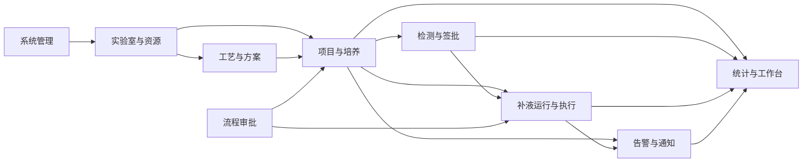

# V4.0 业务模块划分与详细设计目录

> **导航说明（2026-09-17）**：简化阅读请先看[docs总入口](../README.md)。本文保留完整需求归属和历次模块进度，后半部的阶段性“下一步/待完成”按历史记录理解；当前权威入口以总入口列出的模块四件套和专题契约为准。

> 2026-09-17 新系统执行入口：本项目按空库建设，不以前代数据库迁移为前置。数据库只按[新系统开发与数据库唯一入口](../开发基线/README.md)执行“完整建表 → 基础数据初始化 → 初始化结果核验”；模块增量、回填及回退文件仅保留为历史参考。`sql/ymsw.sql` 不直接执行。

> 2026-09-17 当前范围修订：[M08排除范围与跨模块交付边界](00-M08排除范围与跨模块交付边界.md)补充B01—B13功能级归属。业务CRUD、业务采集落库和领域历史归所属模块；M08只读消费统计。培养运行操作页由M07承载，公共导航由M01/公共前端负责；本期功能通过独立菜单进入，统计延期不构成开发/验收前置。

> 2026-09-17 调用设计入口：[Controller与模块接口调用总设计](00-Controller与模块接口调用总设计.md)冻结Controller、模块内应用端口、跨模块Port、事务与外部调用边界；M01—M07、M09各目录新增《Controller请求调用时序设计》，每个目标HTTP入口必须逐项映射，不允许用通用CRUD图替代登记。表结构和唯一写拥有方见[空库基线清单](../开发基线/04-表结构与模块拥有方清单.md)。

> 2026-09-17 开发人员走查入口：[走查报告](00-开发人员视角设计走查.md)记录现有代码适配发现和关闭结果；[实现结构与事务编排约定](00-开发实现结构与事务编排约定.md)冻结物理包职责、路由复用/兼容处置、事务传播、异常映射和worker规则。开始编码前须按所选开发包填写逐入口物理实现登记。

日期：2026-09-08；状态：9个业务模块及三处边界已由用户确认。本文件明确第3步的文档组织和职责分工，不代表模块功能已经设计完成或进入编码。依据[需求目录（V5.1 正文）](../需求说明书V5.1-1030_md/index.md)、[最新澄清决策](../需求说明书V4.0-0904_md/需求澄清决策记录.md)、[整体设计](../02总体设计与公共契约-V4.0.md)及[开发任务](../03分阶段开发任务清单-V4.0.md)。

**M05当前状态（2026-09-10）：当前确认范围详细设计已完成，见[覆盖矩阵与开发验收](05-检测与数据签批/M05覆盖矩阵与开发验收.md)。完整目标14张det_表267列，配套01—20 SQL设计稿；未执行业务开发、SQL或设备验证。下方M05分批进度是历史记录，当前状态以本说明为准，其他模块进度不随之改变。**

## 1. 划分口径

按主要业务对象、完整业务过程及数据维护职责划分为9个业务模块。模块内部包含多个功能组；登录、修改密码、角色维护、设备通讯弹窗、任务暂停均属于功能，不各自建立模块目录。

这9个模块与九步实施计划是两个维度，编号不一一对应；也不要求创建9个微服务或Maven工程。继续沿用整体设计的现有服务复用方案。一个页面可以聚合多个模块的数据，但每个业务对象的修改只能由所属模块处理。

## 2. 模块清单与职责

| 编号/模块及文件夹 | 完整功能范围 | 主责数据及输出 | 与其他模块的边界 |

| --- | --- | --- | --- |

| M01 系统管理 `01-系统管理` | 本地登录、密码、会话；场地、部门、实验组；用户、角色、菜单及功能权限；字典、系统参数；登录日志、操作日志及个人资料相关入口 | 身份与组织、角色功能权限、公共鉴权、字典与审计基础；复用sys_dept等现有主数据 | 定义统一权限判断；实验室授权记录归M02，项目成员/分享归M03。通知业务归M09，业务专属历史由所属模块保存 |

| M02 实验室与资源管理 `02-实验室与资源管理` | 实验室及用户授权；设备型号库、设备实例、通讯配置及能力；检测项目/规则、校准对象配置；液袋、培养基、耗材、液瓶、消耗配置及引用限制 | 实验室与设备资源、设备身份/连接/读数/命令公共契约、资源可用性；静态型号和实验室实例在同一模块内分功能组 | M03负责培养占用；M05负责检测派发与结果；M07负责泵执行；M02负责非运行观测接入与历史查询，M03负责历史培养关联，M07负责执行专属采样；M08仅消费统计。M02不另建这些业务状态机；不实现PH校准操作或耗材自动扣减 |

| M03 项目与培养管理 `03-项目与培养管理` | 项目、批次、培养；成员/分享/授权继承；培养编号、状态、预约占用与释放、延期；培养方案初始化、现行/候选快照；本期允许的培养变更；N阶段标记 | 项目培养主数据、有效权限、培养状态事件、设备占用、培养实际使用方案及版本 | M04提供模板，M03固化使用快照；M06给出审批决定，M03负责应用培养变更；M07处理关联执行任务；N标记归M03，外部推送归M09 |

| M04 工艺与方案管理 `04-工艺与方案管理` | 工作流/节点定义与实验室配置；Config、灌注培养基、取样测样、自动控制模板；补液方案、二段/三段泵速策略；复制、校验、禁用、依赖和版本 | 可复用模板、节点定义、版本及完整依赖导出 | 负责定义，不管理培养当前方案指针，不生成设备执行任务。运行步骤实例归M07；模板包含四阶段配置不扩大本期自动执行范围 |

| M05 检测与数据签批 `05-检测与数据签批` | BGA、Vi-CELL、OSMO各型号、Cedex Bio/HT发送与接收；暂存、重发、超时、设备取消反馈；检测记录、上传/撤销、作废/恢复、签名/审核/撤销；签批记录、检测打印与导出 | 样品、发送队列、检测结果、结果状态、签批记录、检测报告 | 检测签名审核是结果生命周期，不接入M06的通用业务审批状态机；结果供M07计算、M08统计，消费者不直接修改结果 |

| M06 流程审批管理 `06-流程审批管理` | 实验室审批场景配置及初始化；申请、候选变更、一级审核、二级批准、驳回/撤回、理由、审批详情与生效跟踪 | 审批政策和快照、审批单、动作记录、审批决定及应用状态 | 审批资格调用M01/M02/M03的权限契约；培养/任务是否可变更及实际生效由M03/M07判断。审批通过不等于已经停泵或完成业务变更 |

| M07 补液运行与任务执行 `07-补液运行与任务执行` | 小试/中试连接、预填充、更换料液、手工补料、液体补充、废液清理；重量及糖/乳酸确认、计算；固定/动态任务生成；队列、顺序与互斥、泵速、暂停继续、停止确认、异常补充和恢复 | 工作流运行实例、观测/确认快照、计算记录、补料补糖任务、命令、泵速与实际量台账 | 使用M03的培养方案快照、M05的检测结果、M06的审批准入及M02设备契约。停止与异常处置由本模块执行，告警展示/通知归M09 |

| M08 数据统计与工作台 `08-数据统计与工作台` | 在线/离线统计、培养/自然时间、抽取、比较图表和综合报表；实验室/反应器/首页/个人工作台的统计聚合展示（延期） | 统计读模型、统计口径和综合报表，不是业务原始数据权威 | 原始观测归M02/M07、培养关联归M03、检测结果归M05；公共框架归M01，业务操作页面归所属模块，业务不依赖统计 |

| M09 告警与通知管理 `09-告警与通知管理` | 告警规则、状态/业务告警、告警查询与处理；站内消息、邮件、短信、未读；通知范围、投递、重试去重；N阶段外部推送 | 告警规则与记录、通知接收/投递记录、外部推送结果 | 事件事实由所属业务模块提供；设备安全停止归M07，不等待用户处理告警。告警处理不直接把异常任务改成成功；N标记不参与补液业务计算 |

## 3. 原需求目录的归属

以下映射覆盖原需求目录01–24，按章节内容拆分归属，不按Markdown文件数量新建模块。

| 原需求文档编号/内容 | 主责模块 | 拆分说明 |

| --- | --- | --- |

| 01 基本设置 | M01、M09 | 组织用户登录日志归M01；通知归M09 |

| 02 实验室设置 | M02、M06、M09 | 实验室授权/设备/液瓶消耗归M02；审批设置归M06；告警归M09 |

| 03 资源管理 | M02 | 型号库、检测规则及物料资源 |

| 04 项目设置 | M03 | 项目批次培养、分享占用；培养变更协作M06/M07 |

| 05 数据字典 | M01 | 字典维护；业务字典含义由所属模块定义 |

| 06 工艺设置 | M04 | 模板和工作流定义；培养使用快照归M03 |

| 07 数据管理 | M05、M08 | 检测数据入口归M05；综合查询统计入口归M08 |

| 08 检测分析、09 签名台、10 签批记录 | M05 | 包含型号差异、检测报告和签批历史 |

| 11 在线数据、12 离线数据统计 | M02、M03、M05、M07、M08 | 业务观测采集/落库/查询归M02/M07，历史培养关联归M03，检测原始数据归M05；统计分析归M08延期 |

| 13 实验室看板 | M08、M06、M07 | 统计聚合看板延期；审批、工作流和任务队列以所属模块独立菜单交付 |

| 14 反应器详情 | M03、M07、M09；M08统计延期 | M07承载培养运行操作页；培养及方案归M03，计算执行归M07，告警配置监控归M09；统计聚合归M08延期 |

| 15 工作流、16 任务队列 | M07 | 本期运行过程及补料/补糖任务 |

| 17 流程审批 | M06 | 审批过程；最终业务变更仍由对象所属模块应用 |

| 18 首页、19 顶部导航、20 个人工作台 | M01、M09；M08统计延期 | 公共框架/导航/登录落点/资料/改密/退出归M01；消息/未读归M09；各领域待办操作保留独立入口，M08统计聚合页面延期 |

| 21 公式、22 补料记录、23 补糖记录 | M07 | 输入来源、计算、执行台账及追溯 |

| 24 原系统参考资料 | 跨模块输入 | 各模块按所需参考旧表/协议/报表，不单独作为业务模块 |

## 4. 跨模块契约及唯一维护责任

| 对象/契约 | 维护方 | 消费方及约束 |

| --- | --- | --- |

| 身份、组织、功能权限 | M01 | 所有模块复用；领域数据权限仍合并M02/M03结果，不能只判断角色按钮 |

| 实验室授权与资源可用性 | M02 | M03/M05/M07/M08/M09查询；授权到期后查询、操作和导出同样受限 |

| 培养状态、占用与分享 | M03 | 看板只是呈现；设备可用需同时满足M02资源状态和M03占用约束 |

| 模板版本→培养方案快照 | M04→M03 | M07仅读取已生效快照；模板后续修改/禁用不改既有培养 |

| 检测结果及质量 | M05 | M07保存计算所用结果版本/值；手工残糖候选留在M07，不伪造检测结果 |

| 审批决定→业务变更 | M06→M03/M07 | 双方约定版本、幂等、待应用/失败/冲突状态；不得跨模块直接更新对方表 |

| 设备契约→业务适配 | M02定义公共契约并承接非运行观测 | M05补型号派发规则，M07补控制采样/回读停止规则，M03补历史培养关联；M08只读消费统计，协议契约不另建业务模块 |

| 执行结果→统计/告警 | M07→M08/M09 | 计算和实际结算以M07为准；通知失败不回滚已执行设备动作 |

| 审计与领域记录 | M01提供公共审计 | M05/M06/M07保留各自不可变业务记录；M01/M08提供授权检索，不复制另一套业务历史 |

| N标记→外部推送 | M03→M09 | M03保存标记和变更事件，M09管理接口投递/失败恢复；无接口资料时不伪称推送完成 |

依赖示意（箭头表示能力提供或业务数据流，不是强制同步调用，也不代表微服务拆分）：

图省略所有模块对M01鉴权的重复连线。审批申请由M03/M07提交给M06，M06再返回决定，不能把图中的审批输出理解为审批领域拥有培养和任务。

## 5. 开发任务对应关系与设计顺序

保留原DEV编号。跨模块任务拆分的是设计责任，不重复计算完成度。

| 模块 | 主责DEV | 必要协作 |

| --- | --- | --- |

| M01 | DEV-02、DEV-03组织/角色/字典部分、DEV-26公共日志部分 | DEV-03实验室授权由M02提供领域规则；其他模块补自己的审计内容 |

| M02 | DEV-04、DEV-05资源部分、DEV-03实验室授权部分 | DEV-05工作流节点定义归M04 |

| M03 | DEV-06、DEV-07、DEV-15、DEV-16培养变更部分 | DEV-15与M04/M06，DEV-16与M06/M07 |

| M04 | DEV-13、DEV-14、DEV-05节点配置部分 | 为DEV-15提供版本化完整模板 |

| M05 | DEV-08、DEV-09、DEV-10、DEV-11 | DEV-26检测签批追溯 |

| M06 | DEV-12 | DEV-15/16/19/20/22的审批契约，DEV-26审批历史 |

| M07 | DEV-17至DEV-22、DEV-16关联任务部分 | DEV-26执行追溯；设备接口协作M02 |

| M08 | DEV-23、DEV-24的统计聚合部分（延期） | DEV-25公共导航由M01、消息由M09独立交付；业务采集和历史归属按本文件当前范围补充执行 |

| M09 | DEV-25告警通知及推送部分 | M03提供N标记事件，DEV-26投递追溯 |

| 跨模块工作 | DEV-01、DEV-27至DEV-29 | 旧库/当前库复核、整体回归、恢复演练和交付，不另建“迁移模块”“验收模块” |

建议详细设计顺序：M01 → M02 → M03基础部分 → M04/M05/M06 → 补齐M03方案初始化与审批联动 → M07 → M08/M09。这是依赖顺序，未分派并行人员；M08页面布局、M09事件契约可提前设计，但数据验收等待业务来源完成。

当前M01已完成18项业务问答及跨章节一致性收尾，运行验证仍未执行。M02已启动，优先完成实验室授权契约和主数据设计，后续继续按模块顺序推进。

## 6. 文件组织与当前完成度

根目录只保留本目录、公共规范和空白模板。每个业务模块一个文件夹，主文档统一为`详细设计.md`；该模块字段字典、SQL、原型及图片均放入该文件夹。跨模块说明引用所属模块，不为每个功能另建一个模块文件夹。暂未开始的模块仅在本清单登记，写设计时再创建目录，避免空文件被误认为交付物。

当前已有：[系统管理详细设计评审稿](01-系统管理/详细设计.md)。现有登录与密码内容已归入系统管理主文档，配套字段字典已扩展至系统管理全范围；迁移分DD01认证基础、DD02组织权限及日志两批，主文档规定统一顺序。SQL文件名中的“登录模块”是既有批次名，不表示独立业务模块，也不能作为整个系统管理的迁移脚本使用。

M01：整模块设计及18项业务选择已确认并完成本轮一致性收尾，配套22张表字段字典和两批次迁移方案，技术及运行验证待执行。M02：[详细设计启动稿](02-实验室与资源管理/详细设计.md)及[现状核对与复用清单](02-实验室与资源管理/history/review/现状核对与复用清单.md)已建立，完整设计进行中。M03–M09：边界已确认，详细设计待开展。所有模块仍需详细设计评审和开发验收，没有因这次目录调整获得“已开发”状态。

## 7. 范围与外部依赖继续沿用

十二月已纳入Config、灌注、自动控制及对应培养预设，新任务按各自确认入口纳入，不再以任务只有补料/补糖或七配置页全排除限制。中试下游暂不处理；未批准的其他配置页、独立接种字段、连续泵速和自动耗材扣减不自动恢复。已恢复只读统计/工作台范围见[当前规则](00-十二月上线范围与澄清规则.md)。

NCS061阈值由M07跟踪；小试重量写入责任、设备读数方向/净重口径由M02/M07协同；审批初始化Excel由M06核对；N阶段推送接口由M09跟踪、M03提供数据语义；灌注培养基命名沿已确认基础培养基；控制写入、取样填充、前缀回传仅余具体开发对接核实。缺少依据的路径保持待定/阻断，不启用猜测默认值，不计入实机验收。

## 2026-09-09 设计进度更新

M02已完成本轮架构评审意见回写，跨模块契约和运行验收仍待完成。M03已建立[详细设计首轮稿](03-项目与培养管理/详细设计.md)、[现状核对](03-项目与培养管理/history/review/现状核对与复用清单.md)及[字段基线](03-项目与培养管理/数据库字段基线.md)，进入业务确认与逐项设计；原进度段中的启动状态为历史记录。第3步继续进行，不启动第4步业务编码。

### M03基础数据库设计进展（2026-09-09）

[M03主设计](03-项目与培养管理/详细设计.md)现已覆盖UI01—UI04、基础页面接口、状态/事务和本轮13表170列[目标字段字典](03-项目与培养管理/数据库表结构与字段字典.md)，并提供8份迁移/核验/回退/目标结构SQL设计稿。项目与批次删除后编号复用已按Q18确认。静态检查已完成，SQL未执行；精确动作角色、方案快照、M07运行/释放和跨模块联调仍待完成。保持第3步进行中，不表示已进入业务开发。

### M03基础权限与设计一致性复核（2026-09-09）

Q19—Q30已回写[M03主设计](03-项目与培养管理/详细设计.md)，涵盖历史空对象删除、项目/批次/培养操作身份、实验室操作权限交集和项目成员只读入口。新增[权限矩阵与基础设计复核](03-项目与培养管理/权限矩阵与基础设计复核.md)，汇总动作权限、九项设计纠偏、交叉验证用例及真正剩余事项；不再将已确认基础角色列为待定。候选用途、批次聚合子动作、只读授权来源、撤回/重约功能码及未知N标记已同步目标接口。下一步确认下级/历史数据的实验室查看边界，再推进技术对接与后续模块。仅文档静态复核，未执行业务代码、SQL或运行验收，仍为第3步详细设计。

### M03权限服务复用与跨模块契约（2026-09-09）

新增[权限服务复用与跨模块契约](03-项目与培养管理/权限服务复用与跨模块契约.md)，从现有SmpPermissionService、LabAuthorizationService、Mapper及批次入口形成目标动作决策、范围查询、历史记录归属检查和实时失效协议，附12条验收用例；同步M01/M02消费边界。Q31/Q32查看范围已确认，本轮没有新增业务问题。下一设计依赖为M04方案快照及M06/M07/M09的审批、运行、通知契约；现有源码差距需在实现阶段修改验证。仍处于详细设计，不表示业务代码、SQL或实机验收已完成。

### M04工艺与方案管理启动（2026-09-09）

已建立[M04主设计](04-工艺与方案管理/详细设计.md)及[现状核对与复用清单](04-工艺与方案管理/history/review/现状核对与复用清单.md)，明确六类模板、固定工作流复用、既有培养快照不回写及Q33/Q36/A3排除边界。当前进入关键业务确认与字段逐项展开，M04-Q01已确认嵌套模板固定来源版本及参数、主动重新载入才升级；Q02已确认子模板禁用/删除不影响已保存父模板沿用参数；Q03已确认取样模板直接及嵌套均限指定实验室，跨实验室需复制并重验目标资源；进入各类模板字段及权限设计。仍属第3步详细设计，未完成M04全模块设计、业务编码、SQL或实机验收。

### M04 Config模板字段细化（2026-09-09）

[M04主设计](04-工艺与方案管理/详细设计.md)第5.1节已展开Config五页字段、型号与通道联动、PID弹窗、列表/操作、整体保存及21条补充验收用例；原图303—308已直接核对。MFC手填量程及回路前置沿既有确认。Q04已确认每隔设定秒数增加1 L/min至目标流量，精充与粗充目标流量直接比较；Q05已确认精充必须匹配同一MFC通道的完整粗充配置，并严格小于该通道目标流量，允许精充只覆盖部分粗充通道；PID数值范围及设备单位仍需后续细化。仅文档细化，未修改业务代码、SQL或执行设备验证。

### M04灌注培养基模板字段细化（2026-09-09）

[M04主设计](04-工艺与方案管理/详细设计.md)第5.2节已展开基本信息、规格/重量单位、检测设置、嵌套取样实验室限制、可选工艺参数、保存交互及18条补充验收用例。原图314—316已核对，首次仅温度及既有pO2/pCO2澄清已纳入。Q06已确认未配置项不修改现行设置，仅应用明确配置项；取消配置不清空设备参数；回路量程、PID范围及运行契约尚待对接，培养基名称保留客户待定。未修改业务代码、SQL或执行设备验证。

### M04取样测样模板字段细化（2026-09-09）

[M04主设计](04-工艺与方案管理/详细设计.md)第5.3节已展开四类检测参数、实验室联动、Cedex项目分组选择、复制/保存及19条验收用例，原图319/320已核对。样品量默认120µL、Vi-CELL检测量乘法及两种DefaultValue语义已明确区分。Q07已确认任务开始且取样前读取控制器当前有效温度设定值，并固定用于本次任务；设备能力、接口/数据库及检测运行仍待设计验证。未修改业务代码或SQL，未执行设备验证。

### M04自动控制模板规则细化（2026-09-09）

[M04主设计](04-工艺与方案管理/详细设计.md)第5.4节已展开基础信息、取测、各类调整与通知配置、嵌套参数、日期/条件交集校验和21条验收用例，主要规则原图已核对。D0/单日、通气Air默认及Q01—Q07沿既有确认；范围外PH操作和结束培养执行不恢复。Q08已确认按等待后的计划时间比较，同培养同类型差值小于60分钟冲突、恰好60分钟允许，跨午夜同样检查。规则运行、规格/通道映射、API/数据库及跨模块契约仍待细化，未执行代码、SQL或设备验证。

### M04补液模板字段细化（2026-09-09）

[M04主设计](04-工艺与方案管理/详细设计.md)第5.5节已展开固定泵资源联动、台式速度代码/策略互斥、糖泵唯一、补料规则、补糖分支及16条验收用例；原图344—346/355/356已核对。同泵同一时刻拒绝、临近一小时仅提示，与取测Q08硬限制分开；补糖动态检查沿最新确认。NCS061及执行恢复保持已有待定，未新增业务确认问题。未修改业务代码/SQL，未执行设备验证。

### M04泵速策略模板字段细化（2026-09-09）

[M04主设计](04-工艺与方案管理/详细设计.md)第5.6节已展开二/三段式阶段字段、理论时长、全部监控参数、停泵/超量边界、保存适配及18条验收用例；原图357—359已核对。连续式仍排除，停泵与超量沿既有确认；Q09已确认正常抖动判断的实际补料量与理论阈值采用同一抖动检查窗口，基础采集周期保留。六类模板字段首轮已展开，数据库/API/权限及M07运行契约仍待完成。仅文档及数值示例静态检查，未修改业务代码/SQL或执行设备验证。

### M04数据库基线与版本核心模型（2026-09-09）

[M04主设计](04-工艺与方案管理/详细设计.md)第4.2节已链接当前四张工作流表45列及旧库12表比较基线，新增五张模板核心表字段字典、逻辑ER、沿用/复制事务与16条验收用例。Q10于2026-09-10确认删除释放名称、禁用仍占用，核心字典已增补名称生成列，现为五表67列；六类存储叶子、工作流增量及迁移/核验/回退SQL仍待完成。本轮仅文档设计及静态核对，未修改业务代码或执行SQL。

### M04取样与泵速存储契约（2026-09-10）

[M04主设计](04-工艺与方案管理/详细设计.md)已链接[模板内容存储契约](04-工艺与方案管理/模板内容存储契约.md)，完成SAMPLING/PUMP_SPEED两类schema 1完整叶子、数值/空值编码、Cedex历史项目快照、版本投影、三个JSON示例与16条存储验收用例。已对齐M02项目开关缺行默认启用规则；其余四类内容、API权限、工作流增量及迁移/执行仍待完成。本轮仅文档与数值静态核对，未执行SQL或设备验证。

### M04 Config与灌注存储字段树（2026-09-10）

[M04存储契约](04-工艺与方案管理/模板内容存储契约.md)已追加第7—10节：通道稳定身份、回路端点映射、PID、Config工艺值及灌注检测/可选配置和取样槽位，新增16条验收用例。Q11已确认模板保存检查结构及已知规则、应用前必须校验培养固定的有效Config量程及目标设备能力，PID工程约束及型号映射仍待闭合；自动控制/补液内容继续展开。本轮仅文档及静态核对，未执行SQL或设备验证。

### M04自动控制与补液存储字段树（2026-09-10）

[M04存储契约](04-工艺与方案管理/模板内容存储契约.md)第11—14节补齐最后两类字段树：规则身份/时刻、检测槽位与等待基准、固定泵/资源快照及补糖互斥分支，新增16条验收用例。六类内容首轮均已展开，存储用例共48条；PID/规格/型号映射、资源快照接口、动作权限、工作流增量、迁移与运行消费仍待闭合。本轮只修改文档，未执行SQL或设备验证。

### M04模板维护 API 与权限第一批（2026-09-10）

[M04主设计](04-工艺与方案管理/详细设计.md)第9节已展开10个目标API：上下文、详情/历史、来源预览、新增/修改/复制及启停/删除；完整公共DTO引用六类叶子契约，区分只读快照与可写参数，附来源沿用取证、原子保存/幂等时序和18条接口权限用例。Q12已确认可操作1/可管理2加功能权限可维护限定实验室模板；真实角色菜单、列表/候选/资源事实、工作流增量与培养应用契约仍需完善。本轮仅文档静态检查，未修改业务代码或执行SQL。

### M04查询、候选与资源事实第二批（2026-09-10）

[M04主设计](04-工艺与方案管理/详细设计.md)第10节补齐6个只读目标API及18条查询/资源用例；保留泵速时间OR、补液周期文本匹配，定义候选与已保存绑定分流、资源来源/未知值、实验室可见范围及管理修订捕获。累计16个目标API、36条接口查询用例。台式控制器型号与实例身份映射、规格/PID工程协议、资源真实接入、工作流增量及培养应用契约仍待完成；未修改业务代码或执行SQL。

### M04工作流引用范围确认（2026-09-10）

[M04主设计](04-工艺与方案管理/详细设计.md)Q13已确认：实验室取消一级流程时检查所有培养引用，包括已结束、已取消等历史培养；仍有引用则禁止取消，不因已有快照而豁免。Q14后续已确认独立清空操作；工作流目标接口见M04第11节，M03引用数据落点及实现仍待完善，未修改业务代码或执行SQL。

### M04固定工作流及清空配置（2026-09-10）

[M04主设计](04-工艺与方案管理/详细设计.md)第11节补齐6个既有工作流接口的目标增量及1个独立清空接口，18条工作流验收用例。Q14已确认清空需二次确认并满足Q13全部培养引用保护；普通保存仍至少一项。统一管理守卫、关系差异更新、M03引用应用服务与错误恢复已展开，累计23个HTTP目标接口。四张工作流表45列不增加字段，未编写业务代码或执行数据库/运行验证。

### M04固定版本向培养交付（2026-09-10）

[M04主设计](04-工艺与方案管理/详细设计.md)第12节冻结完整TemplatePackage、3个内部导出/应用前校验/解释服务及16条用例；候选成功保存后不追当前模板，审批必须对应精确快照及hash，Q11对照培养已生效固定Config和实际设备复核。M03拥有物理快照及指针，原plan_version仅为日程版本；M06/M07消费存储和执行协议仍需各模块完成。保持Q33/Q36排除范围，未运行业务代码或SQL。

### M04核心数据库交付稿（2026-09-10）

[M04数据库交付说明](04-工艺与方案管理/数据库交付与核验说明.md)已形成5份SQL稿、五表67列及24条基础CHECK，静态解析与字典比对通过；四张工作流表不改DDL。旧数据核准缺口保持显式阻断，不自动回填或启用；未执行数据库、过程、接口或设备验证。后续重点为资源工程映射及消费模块准入。

### 2026-09-10 M04工程交接与当前完成边界

M04六类模板字段、23个HTTP目标接口、3个内部服务、五表67列及五份SQL设计稿已形成；[工程来源与接入验收](04-工艺与方案管理/工程来源与接入验收.md)补齐控制器字典身份、7项依赖和10条用例。M02需追加model_dict_code并同步其SQL包；PID/规格/型号能力资料、M03固定包物理存储、M06/M05/M07消费仍未闭合。仅静态建表解析及字典比对通过，不标M04全链路设计或运行完成。后续模块详细设计可以独立继续，未关闭项保留在交接表。

## M05设计形成过程（历史记录，当前范围已完成）

### 2026-09-10 M05检测与数据签批启动

[M05主设计](05-检测与数据签批/详细设计.md)已建立范围、七类型号差异首表、当前十二状态、页面/跨模块边界、14条初始验收及Q01审核资格待确认项；[当前字段基线](05-检测与数据签批/数据库字段基线.md)提取12表164列。复用现有检测样品/结果/签批服务，不新建平行检测系统。Q37手动重发、Q38设备侧取消、M04-Q07/Q08和M03历史分享限制直接沿用。完整型号/接口/数据库增量/设备运行尚未设计或验证，不标模块完成。

### 2026-09-10 M05-Q01审核资格已确认

检测审核不再依赖独立检测审批人名单：审核功能权限与所属项目/批次/培养有效负责人/普通成员身份取交集，排除仅历史分享，签名与审核人必须不同。M05主设计及M03权限交接已同步；旧配置不自动删除，实际代码尚未接入。继续签批状态与接口设计，不重复询问该资格来源。

### 2026-09-10 M05签批接口第一批

M05主设计第11节已展开Q01审核资格、六动作状态与本人规则、预检1接口/正式写6接口、原子确认集合、M01回执、稳定操作人及领域历史，新增16条验收用例。明确结果作废不调用设备取消，当前Mapper/服务差异保留在复用清单。完整数据库增量未交付；M05-Q02仅无培养检测审核资格待确认，有培养检测的Q01不重问。未改代码、未执行SQL或设备动作。

### 2026-09-10 M05-Q02无培养审核资格已确认

真实无培养结果：所属实验室可操作及以上＋审核功能权限＋签名审核不同人；有培养结果仍按Q01负责人/成员范围。M05、M02及M03交接已同步，继续查询、队列及结果接收详细设计，不重复询问审核资格。

### 2026-09-10 M05签名台查询契约

M05主设计第12节补齐3个查询目标接口、样品组命中与全结果展开、真实上样时间、稳定送检人、历史单位/项目快照及14条验收。累计签批部分10个目标接口；Q01/Q02均已确认。队列、七型号适配及完整数据库增量继续展开，接口/数据库/设备尚未验证。

### 2026-09-10 M05结果完整性与列释放设计

M05主设计第13节展开期望项目固定、首项/完整/设备结束的区分、HT发送批次占用、清空不取消及10条验收。Q03待确认HT整列正常释放条件；Q01/Q02已确认不重问。完整设备接收/数据库/运行验收仍未完成。

### 2026-09-10 M05-Q03最新修订与可配置规则

用户对HT和圆盘工作中补样、单发按钮、行/列暂存、行/列删除及批删跳过作出明确说明，替代旧“所有column整列完成后才能再发”。[可配置发送暂存与删除规则设计](05-检测与数据签批/可配置发送暂存与删除规则设计.md)已形成能力模型、七种配置映射、位置轮询/遮挡、目标接口、批量删除回执和30条验收；M05及M02正文冲突已修正。规则物理字段/迁移、代码和设备接入未实施，M05仍在详细设计阶段。

### 2026-09-10 M05工作台接口与运行数据细化

[工作台接口](05-检测与数据签批/检测工作台接口与位置生命周期.md)补齐样品白名单、八动作契约、左侧腾位与右侧历史边界、跨午夜位置投影及16条验收；[运行字段增量](05-检测与数据签批/发送规则与运行字段增量设计.md)为五张既有表定义20列与10条验收。M05-Q08已确认暂存修改/删除仅限本人，批删跳过他人项。SQL包、前后端和设备未实施，继续保持M05详细设计中，不标整个模块完成。

### 2026-09-10 M05发送规则数据库包

[发送规则数据库交付说明](05-检测与数据签批/发送规则数据库交付说明.md)给出本轮五表20列的SQL设计：M02六列并入原包、旧库独立补丁，M05十四列及核验/未启用回退/三表目标字典；M02目标更新为38表645列。新增12条SQL验收场景；尚未执行MySQL或设备，M05-Q08本人身份边界已确认，M05整体设计继续。

### 2026-09-10 M05设备发送与接收专项

[设备发送结果接收与位置释放契约](05-检测与数据签批/设备发送结果接收与位置释放契约.md)补齐部分接受、未知恢复、去重/冲突、迟到/乱序、完整性、异常释放与圆盘真实开始依据，含六个内部目标方法和28条验收；[现状核对](05-检测与数据签批/设备适配与结果采集核对清单.md)限定源码证据。技术事件收件与接收字段需后续数据库包，原20列包计数不变；代码/设备未实施，M05仍在详细设计阶段。

### M05 接收数据库续接（2026-09-10）

[接收事件持久化与结果字段设计](05-检测与数据签批/接收事件持久化与结果字段设计.md)：新增30列技术收件表、既有表17列，附字段字典、06—10迁移核验回退设计稿及20条验收。旧发送20列包口径保留；未执行SQL、未编写业务接入、未验证设备，签批动作数据库包仍待继续。

### M05 签批数据库续接（2026-09-10）

[签批动作与不可变快照数据库设计](05-检测与数据签批/签批动作与不可变快照数据库设计.md)补齐有效动作指针、版本、不可变快照和请求证据；既有两表新增12列，配套11—15 SQL设计稿与20条验收。Q01/Q02/Q08均沿已确认规则，未运行迁移、历史回填或接口测试。

### 2026-09-10 M05当前确认范围设计完成

[主设计](05-检测与数据签批/详细设计.md)已合并当前结论；新增结果操作、签批记录与报告、自动检测及结果交接专项，以及16—20最终数据库设计稿、14表267列完整字典、源报告附件核对和开发验收矩阵。Q01—Q08全部确认，无本期新增待确认业务问题。设计完成，工程实施与数据库/浏览器/设备/跨模块验证仍待执行。

### 2026-09-10 M06流程审批管理详细设计完成

[M06主设计](06-流程审批管理/详细设计.md)已形成实验室四档政策、三类来源、双阶段审批/驳回/撤回、页面与生效交付契约；配套47场景映射、六表95列、五份SQL设计稿及54条设计验收场景。M06-Q01已确认首审/批准必须不同人；M06-Q02已确认无合格批次审批人时转交项目成员，项目也无合格人则保持待办。当前确认范围详细设计完成，无本期新增待确认业务问题。仅设计交付，未写代码、执行SQL、核准导入或验证接口/设备。

### 2026-09-10 M07补液运行与任务执行详细设计完成

[M07主设计](07-补液运行与任务执行/详细设计.md)已完成当前确认范围：八个补液工作流、十一种任务状态、31个目标HTTP接口、计量/残糖确认/泵速/调度/异常恢复契约，配套18张目标表314列、五份SQL设计稿、88项验收场景及当前/旧系统18表字段对照。Q01取消也算结束、Q02同培养统一排队、Q03中试更换料液填写独立预填充净重及泵速、Q04每规则每天最多生成一次均已确认，无本期新增待确认业务问题。外部NCS061/读数/PLC写入与设备能力继续跟踪；仅设计完成，未执行业务开发、SQL或设备联调。

### 2026-09-10 M08数据统计与工作台第一批设计

[M08主设计](08-数据统计与工作台/详细设计.md)已建立在线归档与培养关联、三模式统计与图表、看板/详情/个人工作台聚合和12个目标查询接口，配套40条设计验收场景、当前及旧系统12表123列基线、两份原始Excel指定单元格/公式与21列表头核对。M08-Q01已确认图表D0随首条已选记录移动，不改变真实培养天数；Q02同分钟取点仍待确认。当前为第一批设计，完整数据库/SQL/输出接口/接入验收未完成，不标记M08整体完成。未编写业务代码、执行SQL或验证设备。

### 2026-09-10 M08暂停，M09告警与通知管理当前确认范围设计完成

用户要求暂停M08统计详细设计，待业务表稳定后再继续；M08原第一批文件保持不变，同分钟取点与统计SQL不在本轮推进。

[M09详细设计](09-告警与通知管理/详细设计.md)已形成规则/查询处理/在线离线与状态配置/审批生效/通知投递/个人与管理员消息/N外部推送的当前确认范围详细设计，配套42条附件逐行映射、15张目标表284列、五份SQL设计稿、21个目标HTTP接口、5个内部契约及68条设计验收场景。[静态核验](09-告警与通知管理/静态核验结果.md)仅证明文本结构与保护文件核对，不代表功能实现。

M09-Q01已确认恢复正常停止提醒，记录仍待人工处理；Q02已按用户“按需求处理”确认：时段外触发仅记录，开窗后不补发。M09当前确认范围详细设计完成，无其他本期业务待确认项。在线高级告警逻辑、SMS/声光/N外部协议继续按外部接入条件跟踪。未编写业务代码、执行SQL或发送真实通知。

### 2026-09-10 M02、M03、M04收尾完成

M02补齐控制器型号与工程版本，最终40表672列；M03补齐培养参数快照、现行/候选指针、应用回执、历史流程引用及运行事实/释放/延期契约，最终18表254列；M04补齐固定工程包和两轮审阅意见，核心5表70列、复用工作流4表45列不变。每个模块新增完整最终字典、5份增量/核验/回退/目标SQL及收尾验收；原基线包保留版本，不混用旧计数。

[联合收尾核对](history/review/00-M02-M03-M04收尾核对.md)记录范围、设计依赖与静态验证。M01—M07及M09当前确认范围详细设计完成，M08按用户要求暂停；代码、真实工程资料、历史数据核准及SQL/接口/设备执行仍按实施清单推进。不得以设计完成声称已可上线。

## M05 2026-09-11 已确认审阅方案更新

M05新增受控更正、报告范围和审计保留设计，见[交付核对](05-检测与数据签批/history/review/已确认审阅方案交付核对.md)。当前目标15表293列，01—25 SQL稿；原14表267列为旧基线。确认方案已落设计，其他审阅项仍需收尾，未做业务开发、SQL执行和设备验证。M08继续暂停，其他模块本次不修改。

## 2026-09-11统一审阅收尾入口

[统一审阅处置、最新DDL与实施验收](00-跨模块审阅收尾/history/review/统一审阅收尾核对.md)。当前结构：M03 19表276列；M05 15表294列；M06 7表127列；M07 20表344列；M09 15表286列；公共归档3表31列单独计数。此前数量作为阶段基线保留。M08继续暂停；模块设计收尾与运行验收状态分开。
