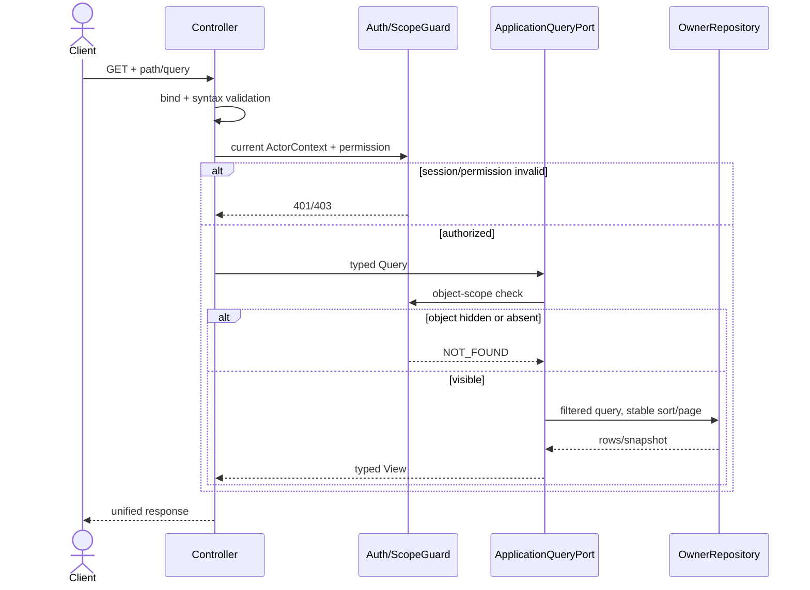
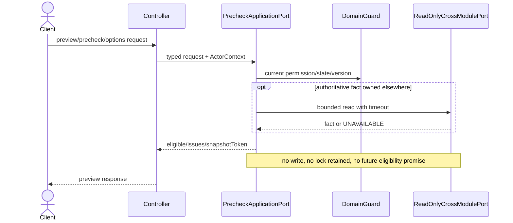

# Controller 与模块接口调用总设计

版本：DD-20260917-CALL-01；S04范围同步于2026-11-07。范围为M01—M07、M09，以及2026-11-04已确认纳入设计的M08四个只读包；M08其余未批准综合统计继续延期，编码另行授权。M08现状接口沿[开发说明](../08-数据统计与工作台/开发说明与接口契约.md)，新增目标沿[模块主设计](../08-数据统计与工作台/详细设计.md)和[逐口查询时序](../08-数据统计与工作台/统计读模型与查询执行契约.md#5-s04目标接口逐口时序映射)，不另建平行目录。本文是目标设计，不代表Controller已实现、SQL已执行或联调已通过；旧通用机制不能覆盖本轮用户对新增设计的约束。

## 1. 交付判定

一个 HTTP 入口只有同时具备以下证据才算“Controller 调用设计完成”：

1. 在模块《接口目录与契约定位》中有唯一稳定契约 ID、方法、完整路径、请求与响应叶子、权限和错误码来源；
2. 在模块《Controller请求调用时序设计》中逐项映射到一个序列编号，不允许用“其余接口类似”代替登记；
3. 明确 Controller 只做协议适配，调用哪个模块内应用端口，应用端口读写哪些拥有方表；
4. 跨模块调用写明生产方、消费方、方法、DTO/schema、超时与重试语义；
5. 写入口写明事务开始、锁顺序、CAS/幂等、提交点和事务外动作；
6. 图中至少有鉴权失败、输入失败、版本/并发冲突、依赖不可用、幂等命中和未知结果的适用分支；
7. 文件/外部通道/设备调用不得持有数据库事务；可靠 outbox、命令意图或作业记录必须先提交。

模块接口目录是字段权威，本文及模块调用图是调用顺序权威，完整建表基线是物理结构权威。三者冲突时停止开发并修订设计，不由开发者自行选择。

## 2. 分层和模块内接口

```text
HTTP request
  -> Controller / RequestMapper
  -> SessionPermissionPort + ObjectScopeGuard
  -> ApplicationQueryPort | ApplicationCommandPort
  -> DomainPolicy / DomainService
  -> Repository / OutboxRepository
  -> CrossModulePort（仅应用层可调用）
  -> ResponseMapper / unified envelope
```

| 层 | 允许职责 | 禁止职责 |
| --- | --- | --- |
| Controller | 路径/Query/Header/Body绑定，格式校验，可信会话注入，调用唯一应用端口，统一响应映射 | 直接访问Mapper；自行拼跨模块DTO；开启长事务；在Body信任actor/scene/lab归属 |
| 应用查询端口 | 当前权限与对象范围校验，稳定分页，读取拥有方Repository，组装只读投影 | 产生审计、回执、领域事件或隐式修复数据 |
| 应用命令端口 | 幂等/CAS、锁顺序、领域规则、单模块事务、回执和outbox | 在事务中等待设备、文件、邮件、短信或第三方HTTP |
| 领域服务 | 状态机、值域、不可变快照、hash和决策规则 | 读取浏览器身份或直接返回HTTP结构 |
| 跨模块Port | 使用权威DTO/schema和可信ActorContext；明确超时、UNKNOWN及查询恢复 | 共享Mapper、跨模块联表写、双写对方主表、把ACK当业务完成 |

每个公开接口的逻辑应用端口 ID 与接口契约 ID 相同，例如 `M03.CU-W02`。代码方法名可以按项目命名规范展开，但必须在实现清单中保持一对一映射，禁止一个“通用保存”绕过不同动作的权限、状态和事务规则。

物理落类、现有路由复用、异常映射、事务传播和后台worker的统一规则见[开发实现结构与事务编排约定](00-开发实现结构与事务编排约定.md)。逻辑端口ID不是Java类名；开发任务不得只凭端口ID新建一套与现有Controller/Service并行的重复实现。

### 2.1 前端公共请求契约

前端实现以本节作为跨模块公共入口；模块接口目录仍是具体路径、字段、权限和错误码权威。若模块文档出现“Body 必填 requestId/managementRevision/baseRevisionId 可替代管理修订头”等表述，按本节修正后执行，并在模块文档中补齐。

1. 标注 `@ManagementGuardedWrite` 的公开写接口必须携带请求头 `X-Request-Id` 与 `X-Management-Revision`。`X-Request-Id` 使用 UUID 8-4-4-4-12 格式；`X-Management-Revision` 使用同一页面、同一对象或同一列表读口返回的顶层 `managementRevision`，不得硬编码、不得从其他模块或无关页面借用。
2. 对守卫写接口，服务端以 `WriteMeta` 头为权威。Body 中的 `requestId`、`managementRevision`、`baseRevisionId` 只在具体模块明确登记为业务字段时参与业务校验，不能替代 `X-Request-Id` 与 `X-Management-Revision`。
3. 只有标注 `@CurrentManagementRevision` 的读口才能作为前端 revision 来源。`TableDataInfo` 或统一外壳存在 `managementRevision` 字段不等于该接口会返回有效值；前端读到 null/空值时必须短路写请求并提示刷新，不得发送守卫写。
4. 守卫写返回 `409`、`MANAGEMENT_CONFLICT`、`REQUEST_CONFLICT` 或模块登记的版本冲突码时，前端应刷新对应读口取得新 `managementRevision`，保留用户普通输入供对比，不自动覆盖服务器现值。
5. 分页读口默认采用统一外壳 `{code,msg,rows,total,pageNum?,pageSize?,managementRevision?}`；是否返回有效 `managementRevision` 仍以 `@CurrentManagementRevision` 为准。前端不得只因外壳类型有该字段就认定可写。

## 3. Controller 标准调用序列

### CTRL-QRY：授权查询



### CTRL-QRY-RECOVERY：守卫写路由的只读结果恢复（2026-10-11）

当前唯一登记入口为M07-005 POST /run/tasks中originalCreationRequestId非空的分支；这是同一路由分流序列，不新增HTTP接口、不增加wired计数。Controller解析合法WriteMeta与已验证会话，应用端口在ManagementGuardExecutor.execute之前分流；依原创建身份、业务载荷和当前全对象权限读取不可变领域回执，返回原创建结果。零业务写、零版本递增、零设备调用，不取得后台身份/资源能力，不进入HTTP写回调；只读事务用于一致投影而非保留未来资格。

调用次序为认证及功能权限→规范化恢复输入→精确键读取→命中事件可信性与全培养权限→输入集合/hash比对→整组回执/任务完整性→原结果映射。客户端集合/hash不同409 REQUEST_CONFLICT；相同原输入但持久事实缺损503 RESOURCE_FACTS_UNAVAILABLE；全无命中或对象不可见统一404 FORBIDDEN_OR_NOT_FOUND，不证明未提交、不自动重建。完整判定优先级见M07数据库JSON契约第四轮。无恢复参数时必须走原CTRL-CMD，保持管理回执到期拒绝；不能把本例外推广到其他守卫写入口。work2窗口同批登记机器账本与共享门禁只读例外，并覆盖两分支的零写反证/真实写正控制。

### CTRL-PRE：只读预检/候选



### CTRL-CMD：单模块事务写

```mermaid
sequenceDiagram
    actor U as Client
    participant C as Controller
    participant A as CommandApplicationPort
    participant D as DomainService
    participant R as OwnerRepository
    U->>C: command + requestId + expectedVersion
    C->>A: typed command + trusted actor
    A->>R: lookup idempotency receipt
    alt same key same hash
        R-->>A: original receipt
    else same key different hash
        A-->>C: REQUEST_CONFLICT
    else new request
        A->>R: BEGIN; lock owner rows in declared order
        A->>D: recheck permission/state/value/CAS
        alt rejected
            A->>R: ROLLBACK
            A-->>C: domain error
        else accepted
            D-->>A: changes + events
            A->>R: persist aggregate, audit, receipt, outbox
            A->>R: COMMIT
            A-->>C: mutation result
        end
    end
    C-->>U: unified response
```

### CTRL-BATCH：整批原子写

```mermaid
sequenceDiagram
    actor U as Client
    participant C as Controller
    participant A as BatchCommandPort
    participant R as OwnerRepository
    U->>C: ordered items + requestId
    C->>A: normalized unique items
    A->>R: BEGIN; lock stable ascending owner keys
    loop every item before first mutation
        A->>R: recheck scope/state/version/reference
    end
    alt any item invalid
        A->>R: ROLLBACK all
        A-->>C: indexed issues, no partial success
    else all valid
        A->>R: apply all + one receipt/audit set
        A->>R: COMMIT
        A-->>C: batch result
    end
    C-->>U: unified response
```

### CTRL-APR：候选、审批和拥有方生效

```mermaid
sequenceDiagram
    actor U as Client
    participant C as OwnerController
    participant O as OwnerApplicationPort
    participant P as M06 ApprovalPort
    participant B as RuntimeBarrierPort
    participant R as OwnerRepository
    U->>C: change command
    C->>O: typed command + trusted actor
    O->>R: BEGIN; lock owner + active candidate
    O->>P: evaluateApprovalPolicy
    P-->>O: BYPASS/DIRECT/DIRECT_REASON/APPROVAL + fixed policyEvidence
    O->>R: save immutable candidate + hash + receipt
    alt APPROVAL
        O->>P: submitApproval(candidateId/hash)
        P-->>O: approvalId/PENDING
        O->>R: bind approval; COMMIT
    else direct
        O->>B: apply owner-specific barrier in same local transaction boundary
        B-->>O: APPLIED or conflict
        O->>R: update owner + candidate + receipt + outbox; COMMIT
    end
    O-->>C: PENDING/APPLIED/CONFLICT/UNKNOWN
    C-->>U: mutation response
    Note over P,O: later decision uses fixed deliveryId/decisionHash; UNKNOWN is queried, never blindly resubmitted
```

同事务屏障只允许同部署单体内的受控应用端口参与，不意味着跨服务分布式事务。若部署边界拆分，必须先新增可靠编排/补偿设计，不得保持“远程同事务”的文字假设。

### CTRL-EXT：设备/外部通道异步动作

```mermaid
sequenceDiagram
    actor U as Client
    participant C as Controller
    participant A as CommandApplicationPort
    participant R as Repository
    participant W as Worker
    participant X as Device/External Provider
    U->>C: action + requestId + expectedVersion
    C->>A: typed command
    A->>R: BEGIN; save PREPARED/INVOKING intent, fence, payload hash
    A->>R: COMMIT
    A-->>C: 202 + command/delivery id
    C-->>U: accepted, not executed
    W->>R: lease committed work
    W->>X: transaction-external call
    alt confirmed result
        X-->>W: evidence
        W->>R: short TX -> terminal state + evidence + event
    else timeout/disconnect
        W->>R: short TX -> UNKNOWN
        W->>X: query same external identity
        X-->>W: fact/NOT_FOUND/UNKNOWN
        W->>R: reconcile monotonically
    end
```

### CTRL-JOB：文件/报告作业

```mermaid
sequenceDiagram
    actor U as Client
    participant C as Controller
    participant A as JobApplicationPort
    participant R as JobRepository
    participant W as JobWorker
    participant S as ObjectStorage
    U->>C: preview/create job
    C->>A: scope + frozen input version
    A->>R: BEGIN; save job/request hash; COMMIT
    A-->>C: jobId/state
    W->>R: lease job
    W->>S: generate/upload outside DB transaction
    W->>R: short TX -> file metadata/hash/state
    U->>C: GET job or file
    C->>A: recheck current download permission
    A->>R: read immutable job/file metadata
    A-->>C: status or controlled stream
    C-->>U: response
```

### CTRL-INTERNAL：可信内部事件/决定

```mermaid
sequenceDiagram
    participant P as Producer Module
    participant I as Consumer InternalPort
    participant R as ConsumerRepository
    P->>I: schemaVersion + source identity + payloadHash
    I->>R: BEGIN; insert inbox/idempotency row
    alt same key same hash
        R-->>I: original ACK/result
    else same key different hash or unknown schema
        I->>R: persist conflict/blocked evidence; COMMIT
        I-->>P: CONFLICT/BLOCKED
    else new
        I->>R: apply local state + outbox; COMMIT
        I-->>P: RECEIVED/APPLIED/UNKNOWN
    end
    Note over P,I: ACK only states the documented phase; it never implies physical completion
```

## 4. 跨模块调用端口总表

| 调用方 | 提供方/端口 | 目的与关键输入 | 返回/失败语义 | 事务规则 |
| --- | --- | --- | --- | --- |
| M01 | M02 `prepareUserEdit/replaceUserLabs/removeUserLabs` | 用户新增/修改/删除时的实验室授权范围与差异 | 固定候选/替换结果；依赖不可用不得当空集合 | M01用户与M02当前授权在同单体受控编排；锁顺序SYSTEM→用户→实验室授权 |
| M02/M03/M04/M05/M07/M09 | M01 `ActorContext/Permission/managementRevision` | 当前会话、功能权限、实时撤权和系统配置版本 | 401/403/409分别保留；对象范围仍由拥有方校验 | 不共享业务表写；不得用managementRevision替代对象版本 |
| M03/M04/M05/M07/M09 | M02 资源、能力、工程和设备配置读取端口 | 设备身份、配置版本、能力、授权实验室 | COMPLETE/INCOMPLETE/REVOKED/UNAVAILABLE分开 | 查询不持业务写锁；配置快照随候选固定 |
| M03 | M02 占用/释放守卫 | 培养预约、换设备、删除/撤回/重约 | 成功、冲突、UNKNOWN；不能把查不到当空闲 | 按SYSTEM→lab→culture→device→occupancy锁序；同单体原子更新拥有方记录 |
| M04 | M03 `WorkflowReference.checkRemoval` | 工作流节点删除前检查全历史培养引用 | `complete=false`或503时禁止删除 | 只读检查后M04锁内重验版本；不跨表级联删M03历史 |
| M04 | M02 `resolveEngineering` | 固定TemplatePackage中的工程资料和版本 | 完整包/hash或明确不完整/撤销 | 固定版本，不在后续运行时偷换当前配置 |
| M03 | M06 `evaluateApprovalPolicy/submitApproval` | 培养参数、基础变更、模式/初始重量候选 | BYPASS/DIRECT/DIRECT_REASON/APPROVAL及固定证据 | 候选先固定；审批单绑定幂等；不信浏览器sceneCode |
| M09 | M06 `evaluateApprovalPolicy/submitApproval` | SC045/SC046在线/离线告警配置候选、固定revision/hash和来源请求 | BYPASS/DIRECT/DIRECT_REASON/APPROVAL及固定政策证据；不可用时禁止默认直通 | M09先持久化不可变候选；仅APPROVAL分支提交审批；M06不写M09配置表 |
| M06 | M03/M07/M09 owner `deliverDecision/queryApplication` | 固定delivery、candidate/hash、decisionVersion | APPLIED/DISCARDED/CONFLICT/FAILED/UNKNOWN | UNKNOWN按原键查询；不新建决定、不把ACK当物理完成 |
| M03 | M07 `applyCultureInputChange` | 模式/初始重量生效时使未开始计算失效并固定版本 | APPLIED/CONFLICT，candidateId幂等 | 当前单体内与M03主值、候选、回执同事务；远程化前必须重设计 |
| M03 | M07 运行屏障/释放证明 | 参数切换、培养结束/删除/释放资源 | 活跃/暂停/UNKNOWN/未结算均阻断 | M07运行事实权威；M03不直接查改run表 |
| M07 | M03 `readEffectivePackage/resolveAt` | 执行前读取固定培养参数与发生时绑定 | 固定generation/packageHash或不可用 | 启动前读取并固定到ExecutionSpec；执行中不追随当前值 |
| M07 | M03 `CultureRuntimeCalculationPort.lock/apply` | SC033计算规则候选读取/生效，原申请人及双期望版本 | 当前完整五字段、培养/配置版本及初始重量来源；失权/变版明确拒绝 | 加入M07拥有方事务，SYSTEM→lab→culture/config；M03配置和培养CAS与M07未开始任务重算、候选、审计及回执共同提交，不独立提交或发设备命令 |
| M05 | M07 `resolveEffectiveResult`消费契约 | 已签批/更正后的精确结果版本 | 精确revision/hash；不兼容schema拒绝重试 | M07不直接读det_result“最新值” |
| M02/M07 | M09 `INT01 receiveEvent` | 经源模块判定的真实观测/命令/运行事实 | RECEIVED/APPLIED/IGNORED/BLOCKED及duplicate | 源outbox提交后投递；M09失败不回滚源事实 |
| M09 | M02 可靠设备命令/查单 | 关闭声光、监控应用等已核准物理动作 | 202/EXECUTED/FAILED/UNKNOWN；NOT_FOUND非未执行证明 | 命令意图先提交，事务外调用，UNKNOWN查同命令 |
| M09 | M02 `resolveAlarmResourceFacts` | API08—11所需稳定unitId/unitCode、设备检项、单位、读数来源、设备/声光当前绑定和配置版本 | COMPLETE/INCOMPLETE/REVOKED/UNAVAILABLE；不返回猜测单位或临时ID | 只读固定事实；保存候选时固化revision/hash，生效和执行前按契约重验 |
| M09 | M01/M03 `resolveRecipientScope/resolveAlarmTargetVisibility` | API01—03处理资格、接收人身份、培养成员/设备负责人/角色和对象可见域 | 稳定userId集合及scopeVersion；无权与不存在统一，依赖未知503 | M09只保存解析后的稳定接收人关系，不复制成员/角色表，不以用户名CSV授权 |
| M09 | M03/M05/M07 截止事实分页源 | INT04截止扫描所需生产者事实和稳定游标 | 事实/跳过/下一游标；源版本固定 | M09不写生产方表，不依赖M08统计表 |

生产方的字段、枚举、单位、错误码和schemaVersion是唯一权威；消费方只引用，不复制变体。所有端口须在实现前形成provider contract test与consumer contract test，失败夹具至少覆盖缺字段、未知schema、版本倒退、同键异hash、超时、重复、乱序和失权。

## 5. 表、事务与接口的绑定规则

1. 表只能由《表结构与模块拥有方清单》的写拥有方通过Repository修改；跨模块只能调用Port或消费可靠事件。
2. Controller映射表中的“主表”不是允许直接SQL的列表，而是应用事务的拥有方落点。
3. 所有JSON列必须在字段契约中给出schemaVersion、必填叶子、canonical hash和升级/双读策略；`JSON_VALID`只证明语法。
4. 同一请求的业务主表、幂等回执、审计和可靠outbox应在一个本地事务提交；外部副作用在提交后执行。
5. 锁只按统一顺序扩大，禁止回头：SYSTEM/配置→实验室→业务根→子对象→设备/占用→候选/审批交付→任务/命令/投递。
6. 查询不得为了“顺手修复”产生写入；预检不得锁定未来资格；最终命令必须在锁内重验。

## 6. 开发准入检查

- 每个模块的Controller映射表中不得存在`UNMAPPED`、空应用端口或空序列编号。
- 每个跨模块Port必须同时出现在生产方和消费方清单，字段/hash/schema一致。
- 每个准备实现的HTTP入口必须先在实现清单登记`契约ID -> canonical路由 -> 现有或目标Controller方法 -> 应用端口方法 -> 路由处置`；处置只允许`REUSE/ADJUST/NEW/COMPAT/DISABLE`，未登记不得编码。
- `COMPAT`只能做协议转换并调用同一应用端口；不能拥有第二套事务、Mapper或状态规则。`DISABLE`必须返回契约指定的升级/停用错误，不得静默走旧语义。
- 写事务只允许由最外层应用命令服务开启，传播为`REQUIRED`并对受检异常回滚；禁止Controller开事务、同类自调用依赖代理事务、在事务内进行RPC/设备/文件/短信/邮件调用。
- 领域错误由统一异常映射层转换为`HTTP状态 + 稳定错误码 + requestId + issues`；应用端口不得返回`AjaxResult/R`，Controller不得拼接业务错误文本代替错误码。
- 每张业务表必须只有一个写拥有方；公共框架表也须有明确维护模块。
- DDL中的枚举/CHECK/唯一键必须覆盖接口允许值；接口允许值不得超出DDL。
- Mermaid图通过渲染/语法检查；接口目录和映射表数量由脚本复核，但数量相等不代表字段语义正确。
- M08关闭时，M01—M07/M09全部业务CRUD、观测、审批、运行、告警链不能调用M08接口、表或消费者。

### 2026-10-21 无匹配 HTTP 路径与资源的错误状态补充

仅对网关框架产生的路径/资源不存在（非负载均衡服务实例缺失）及 MVC 的 NoHandlerFoundException、NoResourceFoundException，返回真实 HTTP404 与统一外壳 code=404，提示“请求的接口或资源不存在”。MVC 保留既有 requestId 响应元数据；不向客户端拼接原始异常、完整资源定位或堆栈。此补充不把权限403、方法405、依赖503或内部错误500映射为404，也不借机改写其他既有业务错误外壳；具体业务不可见404仍遵守所属模块契约。静态停用页的六路径访问例外见[检测接线契约](../02-实验室与资源管理/检测实例规则应用与命名管道接线契约.md)，不适用于正式业务页面。
