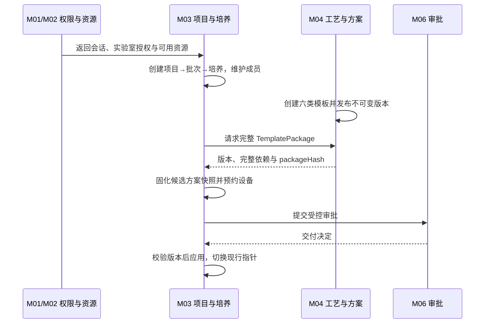
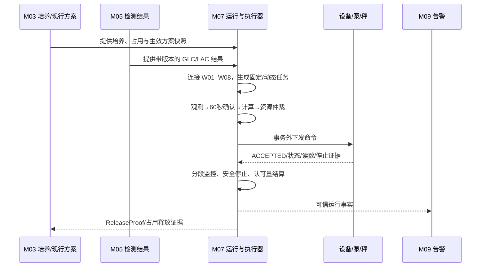
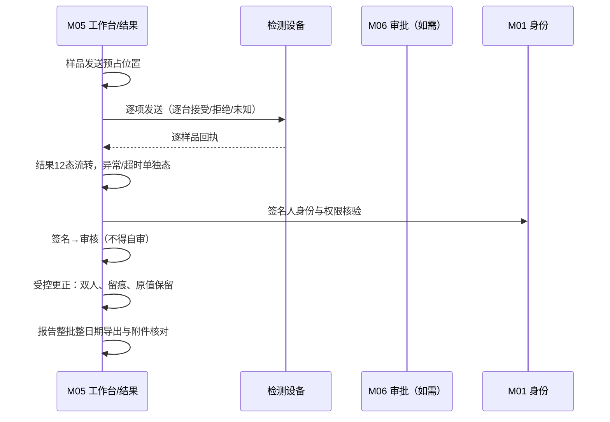
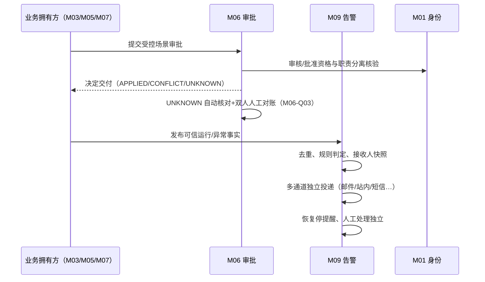
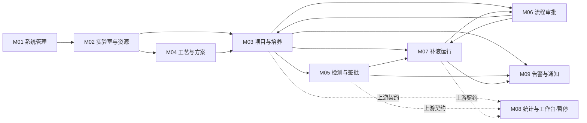
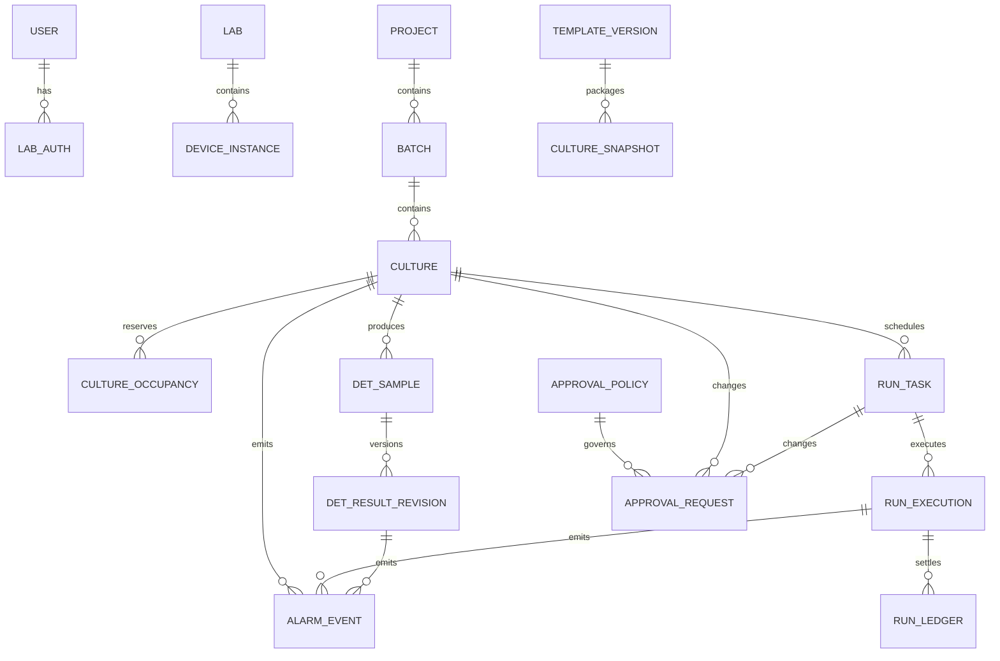
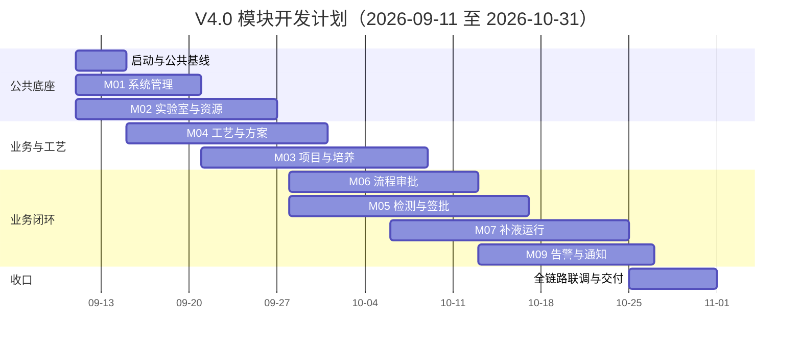

# 药明云（SMP / futurefab）V4.0 统一详细设计评审文档

> **当前导航与状态（2026-09-17）**：先从[docs总入口](../../README.md)进入。非M08当前范围已完成开发人员视角设计走查，已知设计P0问题已关闭；业务代码、MySQL执行、HTTP、浏览器及设备验收仍未开始。本文中的G1、T0—T10及日期计划是评审/过程记录，字段和接口实现以各模块现行契约及调用设计为准。

> 2026-09-17 新系统执行入口：本项目按空库建设，不以前代数据库迁移为前置。数据库只按[新系统开发与数据库唯一入口](../../开发基线/README.md)执行“完整建表 → 基础数据初始化 → 初始化结果核验”；模块增量、回填及回退文件仅保留为历史参考。`sql/ymsw.sql` 不直接执行。
> 业务观测11张表以及初始重量字段已合入空库完整建表基线；接口、JSON版本及验收仍以各业务模块契约为准。仅完成文档和SQL静态整理，未运行SQL、代码或设备验收。

> 2026-09-17 范围补充：按用户确认，M08 仅承接统计分析，统计延期不影响所属模块的业务数据增删改查、采集落库、告警和操作页面。当前边界以[M08排除范围与跨模块交付边界](../00-范围与待核/00-M08范围与跨模块交付边界.md)为准；其B01—B13为边界追踪、BD01—BD13为待执行验收。M07承载培养运行操作页，M01负责公共框架/导航，M09组件按原权限接入。本次为设计补充，业务观测存储承接的详细物理落点须在所属模块落实，既有“设计完成”不代表新增承接已验收。

> **评审版本**：V4.0-R2
> **编制日期**：2026-09-15（在 2026-09-11 R1 编制基础上重构；2026-09-13 R2 补充交付已并入正文与附录）
> **文档性质**：单份完整详细设计主文档（业务正文 + 技术核查附录）
> **评审范围**：M01–M07、M09 当前确认范围；M08 暂停
> **目标读者**：需求负责人 / 项目经理 / 客户业务代表（重点读第一、二部分）；产品 / 研发 / 测试 / 运维 / 设备集成（通读全部，含第三部分附录）
> **当前状态**：READY_FOR_G1 —— 设计补充已完成、待 G1 设计评审通过。这不表示 G1 已通过，也不表示代码、SQL、联调、浏览器或实机验收已完成

## 如何阅读本文档

| 如果你是 | 建议阅读路径 |
| --- | --- |
| 需求 / 业务人员 | 第一部分（业务总览）＋第二部分（各模块做什么）＋1.8（需要客户输入的事项） |
| 产品 / 测试 | 第一、二部分 ＋ 第四部分（实施与验收）＋第五部分（术语表） |
| 开发 / 架构 | 全文；重点第三部分（技术核查附录）与第四部分 |
| 设备 / 运维集成 | 1.4 主线二、2.7 M07、3.4 公共底线、3.10 性能基线、3.12 恢复设计、4.2 门禁 |

全文口径约定：

1. "设计完成"一律指业务规则、页面、数据、接口与异常处理均已落文档且相互一致，**不代表**代码已实现、SQL 已执行或设备已验证。
2. 文档完成 / 代码完成 / SQL 执行 / 联调通过 / 实机验收五件事分别记录，互不替代。
3. "待核准 / BLOCKED / SAVE_ONLY / UNKNOWN"均表示真实的外部依赖或未知状态；未知值保留未知，**不补 0、空串或猜测值**。
4. 引用已确认业务规则时一律带模块前缀（如 M05-Q08、M06-Q03）；不同模块同编号的 Q 互不相干，不要跨模块套用。
5. 本文是评审与开发入口文档；字段级细节以第二部分各模块"源文档入口"和第六部分索引指向的模块文档为准。

---

# 第一部分　业务总览

## 1.1 这个系统是做什么的

药明云 V4.0 是一套面向生物制药实验室培养业务的管理系统。它把实验室日常回答的问题变成可记录、可追溯、可审批的数据：

- 这个项目、这个批次、这罐培养，用哪台反应器、哪个补料泵、哪台秤，从哪天到哪天？
- 用哪套工艺方案（灌注、取样、自动控制、补液、泵速策略），方案的哪一版？
- 培养期间要做哪些检测（BGA、Vi-CELL、OSMO、Cedex），结果谁来签名、谁来审核，报告给谁？
- 每天按方案补料、按残糖补糖，实际补了多少，账怎么记？
- 出了异常（超时、掉线、误差、设备故障），谁被通知、谁处理、设备如何安全停止？

**一句话：系统记录并管理培养业务，在权限和审批清楚的前提下，驱动实验室设备完成补料、补糖与检测，并为每个结果、每次操作留下可审计的证据。**

系统沿用现有 gateway / auth / system 底座，不推倒重来。文档中的九个业务模块（M01–M09）是**职责与数据所有权划分**，不等于九个微服务：多数能力仍落在现有 system 服务内，按领域边界划分代码与数据的归属。

## 1.2 本期交付什么、不做什么

**本期实际执行的任务只有两种：补料（FEEDING）与补糖（SUGAR）。**

### 1.2.1 本期范围（要做）

| 范围 | 说明 |
| --- | --- |
| 项目 / 批次 / 培养管理 | 三级业务对象全生命周期、成员与分享、设备预约占用、培养方案快照与生效 |
| 工艺模板与方案 | 六类模板的版本化维护、完整不可变模板包交付、工作流配置 |
| 检测与数据签批 | 七类设备工作台的样品发送、结果接收、签名审核、报告导出、受控更正 |
| 流程审批 | 47 个受控场景的实验室级审批政策、审批单全生命周期、决定交付与生效对账 |
| 补液运行与任务执行 | 八个补液工作流、补料/补糖任务生成与执行、泵速控制、停止证据、计量结算台账 |
| 告警与通知 | 42+5 条规则的告警生成、多通道投递、恢复与人工处理、N 阶段外部推送门禁 |
| 系统管理与资源 | 身份权限底座、实验室授权、设备型号/实例/通讯/检测项目/物料资源 |

### 1.2.2 明确排除项（本期不做，任何模块不得用"临时默认值"或"兼容旧入口"恢复）

1. 培养方案修改"七配置页"（Q33）；
2. 真实"结束培养"工作流（Q36）——终态仅用于隔离环境模拟验收，生产入口保持关闭；
3. PH 校准操作与记录（A3，5.0 范围，入口隐藏）；
4. 连续式泵速策略；
5. 耗材自动扣减；
6. 独立接种体积旧入口（Q34）；
7. AAD 集成（另案跟踪，本期为本地登录）；
8. 自助找回密码、短信登录、MFA；
9. M08 统计分析、聚合工作台及统计读模型的实现；业务数据采集、落库、领域历史和增删改查不在延期范围内，由所属业务模块独立交付。

M08 暂停不阻断上游业务事实落库：M03/M05/M07/M09 仍按约定稳定输出带版本、单位、时间、身份的可信事实，避免将来恢复 M08 时反向改动上游模型。

## 1.3 九个模块：各管什么、现在到什么程度

| 模块 | 一句话定位（白话） | 本期交付 | 当前状态 |
| --- | --- | --- | --- |
| M01 系统管理 | 管"谁是谁、能做什么"：账号、登录、角色、菜单权限、字典、日志 | 登录与会话安全、组织与功能权限、公共管理守卫 | 设计完成 |
| M02 实验室与资源 | 管"东西在哪、谁能碰"：实验室、设备型号/实例、通讯、检测项目、物料 | 实验室授权三级、8 类设备型号、12 类实例、通讯热更新、资源契约 | 设计完成 |
| M03 项目与培养 | 管"事是谁的、排在哪"：项目/批次/培养、成员、设备预约占用、方案快照 | 七态状态机、占用与释放、方案初始化与生效 | 设计完成 |
| M04 工艺与方案 | 管"怎么做"：六类工艺模板的版本化定义与完整交付包 | 模板版本不可变、嵌套版本冻结、工作流引用保护 | 设计完成 |
| M05 检测与数据签批 | 管"测了什么、谁认账"：样品发送、结果、签名审核、报告、更正 | 七类工作台、结果 12 态、签批合规、受控更正 | 设计完成 |
| M06 流程审批 | 管"改动要谁点头"：审批政策、审批单、决定交付与生效跟踪 | 47 场景、四档/三档政策、职责分离、UNKNOWN 对账 | 设计完成 |
| M07 补液运行与任务执行 | 管"泵怎么动、账怎么记"：任务执行、物理命令、计量结算 | 八工作流、补料/补糖任务、执行器恢复、结算台账 | 设计完成 |
| M08 统计与工作台 | 统计分析、聚合看板和统计读模型；不拥有业务原始数据维护 | **暂停**，业务采集落库与查询由所属模块独立交付 | 暂停 |
| M09 告警与通知 | 管"出了事谁要知道"：告警规则、投递、恢复、外部推送 | 42+5 规则、多通道投递、恢复与人工处理 | 设计完成 |

各模块实施前的关键门禁详见 1.7 与第四部分。

## 1.4 四条业务主线（一次完整业务如何走通）

四条主线覆盖本期全部核心业务。每条主线先讲白话流程，再给参与方交互图、必须成立的规则、异常处理与评审问题。

### 1.4.1 主线一：从项目到培养准备（立项 → 排期 → 方案生效）

**白话流程**：项目负责人建项目，项目下设批次，批次下建培养（"某罐细胞在某反应器从某月到某月"）。培养保存开始/结束日期那一刻，设备就被这条培养"预定"了（预约占用），不用等到开始日。培养要用哪套工艺方案，由模板负责人从六类模板中选版本、固化成不可变快照，走审批后生效。之后改模板，不影响已经生效的培养。

**参与角色**：项目负责人、实验室管理员、培养成员、模板维护人、审批人。
**入口页面**：项目列表/详情、批次列表/详情、培养列表/详情、成员与分享、六类模板、方案提交与审批。

**必须成立的规则（业务口径）**：

1. 开始/结束日期填全并保存，即取得该设备的排他占用；不按日期段排程，两段日期不重叠也不能同时预定同一设备；
2. 模板发布后修改，不影响既有培养已固化的方案快照；
3. 审批通过和业务生效是两件事：审批通过只形成"决定"，生效由业务拥有方重新核验后执行；
4. 草稿/未开始/已过期培养的修改走免审批分支（Q31）；进行中/已延期的修改按实验室审批政策；
5. 无权限、资源冲突、版本冲突、历史数据未核准或模板包不完整时，阻断而非降级。

**异常与恢复**：审批取消/驳回保留候选与审计痕迹；应用冲突进入可对账状态，不重复交付；培养过期后释放设备、重新选择；设备更换必须走 M03/M06/M07/M09 的版本交接屏障，不能私下改绑。

**本线评审问题**：客户是否接受"日期齐全即排他占用"；项目/批次/培养的负责人和分享边界是否符合现场；候选方案撤回、过期、延期及设备更换的人工入口是否完整。

### 1.4.2 主线二：补料与补糖执行（本期核心物理业务）

**白话流程**：培养开始后，操作人员按工作流把管路连接好（八个补液工作流 W01–W08，如中试连接补料单元、更换料液、小试连接等）。连接完成后，系统按已生效方案自动生成固定补料/定量补糖任务；残糖（GLC）/乳酸（LAC）检测值经 60 秒人工确认窗口后参与计算；按规则补糖由系统每 10 秒扫描一次、每规则每天最多生成一个任务。任务走审批生效后进入执行：下发泵速命令、实时监控读数、确认停泵、把"实际补进去多少"唯一结算入账。出错先安全停泵，误差超 5% 才允许补任务或手工补量。

**参与角色**：培养负责人、补液操作员、审批人、设备集成人员。
**入口页面**：反应器详情、工作流连接、任务队列、残糖确认、执行监控、异常处理、计量台账。

**必须成立的规则（业务口径）**：

1. 任务类型只有补料和补糖两种；固定任务按生效方案生成，按规则补糖每培养每规则每天最多一次（M07-Q04）；
2. 同一培养的补料/补糖统一排队，同一天补料取消也算"结束"、可作补糖前提（M07-Q01）；
3. 观察确认（60 秒）、计算、命令下发、物理执行、结算各自留痕；"设备收到命令（ACCEPTED）"不等于"已执行"；
4. 暂停后恢复只补剩余量，不重置已入量；停止必须取得泵速归零与秤稳定证据后才结算；
5. 通知失败不回滚已入账的补液，也不影响安全停止；设备安全动作不等待通知或人工确认；
6. 未核准路径（EXT 外部依赖未就绪）只允许模拟，不允许物理执行。

**异常与恢复**：网络超时产生 UNKNOWN 时先查设备状态、不盲目重发；旧执行器由单调递增的资源代次（FENCE）隔离；进程崩溃后由固定归属执行器接续核实；误差超规则进入异常处理/补充子任务；断线后核对原命令再决定。

**本线评审问题**：现场是否接受确认时限、每日额度、暂停与补充处理规则；每类泵、秤和反应器的责任方及核准时点是否明确；断网、断电、迟到回执和人工停止的处理是否符合 SOP。

### 1.4.3 主线三：检测、签批与报告（样品发送 → 结果 → 签名 → 报告）

**白话流程**：培养期间，操作人员在工作台把样品送到 BGA、Vi-CELL、OSMO、Cedex 等检测机。设备逐台报告"这台样品我收了 / 拒收"。结果回来后进入 12 种状态流转（存样 → 测试 → 上传 → 签名 → 审核），关键动作要求签名人不能自己审自己（职责分离）。需要改数时走"受控更正"：双人、留痕、原值保留。报告按整批整日期范围导出，附件可核对。

**参与角色**：检测操作员、签名人、审核人、报告接收方。
**入口页面**：七类设备工作台、结果列表/详情、签批操作、报告导出、更正记录。

**必须成立的规则（业务口径）**：

1. 有培养关系时，审核资格 = 该培养有效负责人/成员 + 功能权限；仅有历史分享资格的不可审（M05-Q01）；
2. 无培养关系时（如单独送检），需真实实验室等级 ≥ 可操作 + 权限（M05-Q02）；
3. 暂存数据只有本人能改、能删（M05-Q08）；
4. 受控更正必须双人，修改/删除仅限本人范围内数据，原值可回溯（M05-Q09）；
5. 报告导出是"整批整日期"粒度，不做部分导出（M05-Q10）；
6. 设备逐样品回执（接受/拒绝/未知）分别处理，未知不猜测；
7. 午夜只清理未发送暂存（M05-Q37）；本期不提供"设备取消"按钮（M05-Q38）。

**异常与恢复**：乱序/迟到/重复结果事件按版本与序号对账；位置冲突时释放与重占走同一契约；签名令牌（5 分钟）过期需重签；更正与签批审计记录暂不自动删除、允许受控归档（M05-Q11）。

**本线评审问题**：七类工作台的字段启用/禁用是否符合各机型现场；签名与审核的职责分离名单是否按现场角色落实；更正双人名单与范围是否满足质量体系要求。

### 1.4.4 主线四：异常、审批与通知（出事 → 审批 → 通知 → 恢复）

**白话流程**：任何需要"点头"的业务改动（方案生效、培养修改、任务批准）都生成审批单。审批单分两级：审核（可四档：直通 / 直通需理由 / 批次级 / 项目级）和批准（三档：免 / 批次级 / 项目级；直通档强制免批准）。审核人不能同时是批准人（M06-Q01）。42+5 条告警规则触发后，按"恢复即停提醒、但记录仍待人工处理"的双维度处理（M09-Q01）；时段外触发的只记录不补发（M09-Q02）。

**参与角色**：审批人（审核/批准）、告警接收人、处理人、系统管理员。
**入口页面**：审批单列表/详情、审批政策配置、告警列表/详情、通知记录、处理操作。

**必须成立的规则（业务口径）**：

1. 审核人 ≠ 批准人，按稳定 userId 判定（M06-Q01）；
2. 审核人缺合适人选时按 fallback 转项目成员；无合适人选则 NO_ELIGIBLE 阻断，不降级（M06-Q02）；
3. 决定交付为 UNKNOWN 时先自动核对，仍不确定则双人人工对账，不重复业务生效（M06-Q03）；
4. 告警恢复后停止提醒，但 handle_status 仍为"未处理"直到人工确认（M09-Q01）；
5. 通知时段外触发的记录保持 RECORD_ONLY，进入时段后不补发（M09-Q02）；
6. 设备安全动作（停泵、继电器）不等待 M09 通知或人工处理；
7. 告警处理按钮不修改任何任务/审批状态，只标记告警自身已处理。

**异常与恢复**：投递失败按通道独立重试，不承诺网络"恰好一次"；未核准通道（SMS 网关、声光回执、N 阶段外部推送）保持待核准，模拟不冒充真实投递成功；告警记录暂不自动删除、允许受控归档（M09-Q04）。

**本线评审问题**：47 场景的审核/批准档位是否符合各实验室管理颗粒度；fallback 与 NO_ELIGIBLE 边界是否可接受；告警接收人集合与处理人资格的判定是否符合现场。

## 1.5 角色与权限（白话版）

系统权限分六层，逐层收紧：

| 层 | 含义 | 例子 |
| --- | --- | --- |
| 1. 会话 | 你是谁、登录是否有效 | 账号未过期、未锁定 |
| 2. 功能权限 | 你能进哪些菜单、点哪些按钮 | 有"审批-批准"功能码 |
| 3. 实验室授权 | 你能在哪些实验室看到/操作/管理 | 0=可见、1=可操作、2=管理 |
| 4. 领域数据范围 | 具体这条培养/项目/结果你能不能碰 | 是该项目成员或分享对象 |
| 5. 状态/版本 | 当前状态与并发版本是否允许该操作 | 对象处于 RUNNING 且版本未冲突 |
| 6. 外部能力就绪 | 相关设备/通道是否核准可用 | 泵速曲线已核准、通道已启用 |

任一不过即拒绝；前端按钮隐藏只是体验，**后端逐次重检**（M09 明确：前端 allowedActions 仅作展示）。

**关键白话规则**：

- 实验室授权是"三级"：可见（能看）→ 可操作（能干活）→ 管理（能配置）；
- 组织树选择时"全选包含子部门"（M01-Q02），而 M02 实验室默认不含子部门——两者是不同模块的不同规则，不要混用；
- 数据范围取所有适用范围的**交集**（M01 dataScope 1–5）；
- 敏感操作（改密、换端、删除）有独立守卫与计数（如 M01 连续 7 次失败锁 30 分钟）。

## 1.6 关键业务规则速览（按模块，均带前缀）

> 完整规则以各模块"已确认业务规则"章节与源文档为准；下表为评审时最常问到的。

| 模块 | 规则编号 | 白话 |
| --- | --- | --- |
| M01 | M01-Q02 | 组织树"全选"包含子部门 |
| M01 | M01-Q03 | 手机/邮箱选填但填写后须唯一 |
| M01 | M01-Q04 | 手机号须为大陆 11 位 |
| M02 | M02-Q06 | 实验室授权不设有效期 |
| M02 | M02-Q07 | 超管全局可见 |
| M02 | M02-Q10 | 范围外授权先解除才可删除对象 |
| M02 | M02-Q11 | 实验室负责人须先解除才可移除 |
| M03 | Q31 | 草稿/未开始/已过期培养修改免审批 |
| M03 | Q33 | 培养方案"七配置页"本期排除 |
| M03 | Q36 | 真实"结束培养"工作流本期排除（仅模拟） |
| M04 | M04-Q08 | 模板版本冲突边界：严格 <3600s 判冲突，恰好 3600s 允许 |
| M05 | M05-Q01/Q02 | 审核资格：有培养看培养关系；无培养看实验室等级 |
| M05 | M05-Q08/Q09 | 暂存仅本人改删；更正双人、原值保留 |
| M05 | M05-Q37/Q38 | 午夜仅清未发送暂存；本期无"设备取消"按钮 |
| M06 | M06-Q01 | 审核人 ≠ 批准人（稳定 userId） |
| M06 | M06-Q03 | UNKNOWN 决定先自动核对，后双人人工对账 |
| M06 | M06-Q04 | 按实验室分批启用审批，不默认直通 |
| M07 | M07-Q01 | 同一天补料取消也算"结束"，可作补糖前提 |
| M07 | M07-Q03 | 预填充净重 >0 且 ≤100g，独立字段 |
| M07 | M07-Q04 | 按规则补糖每培养每规则每天最多一次 |
| M07 | M07-Q05 | 固定单执行器（单归属） |
| M09 | M09-Q01 | 恢复停提醒，记录仍待人工处理 |
| M09 | M09-Q02 | 时段外触发不补发（NO_CATCH_UP） |
| M09 | M09-Q03 | 离线告警仅反应器详情，针对当前培养 ID |

**易混提醒**：M01-Q02（组织全选含子部门）与 M02-Q06/M02-Q07（实验室授权不设有效期/超管全局）是完全不同的规则；跨模块引用必须带前缀。

## 1.7 设计进度：READY_FOR_G1 意味着什么

- **已完成（设计层面）**：T0–T10 全部设计补充任务在 2026-09-13 关闭，包括：权威枚举收口（T0）、七模块错误码全集入口（T1）、M07 设备命令逐字段契约（T2）、开发级时序图 7 张（T3–T6）、M05 七类工作台样例（T7）、全模块逐接口展开与闭合复核（T8）、跨模块契约一致性核对（T9）、并行开发任务包 P00–P08（T10）。
- **未开始（实施层面）**：G1 设计评审（本次）、代码开发、SQL 执行、契约测试、联调、浏览器验收、实机验收。
- **门禁 G1–G5**：G1 设计评审 → G2 开发准入 → G3 模块联调 → G4 系统验收 → G5 实机上线；当前卡在 G1。
- **一句话**：设计文档已"冻结到可开发"，但任何"完成"都必须按文档/代码/SQL/契约测试/实机五层分别核实。

## 1.8 需要客户 / 现场输入的事项（EXT 清单）

| 编号 | 所需输入 | 影响路径 | 缺失时系统行为 | 责任方/最晚时点（会上填写） |
| --- | --- | --- | --- | --- |
| EXT-01 | PID 算法、参数单位/端点/精度、型号/实例映射 | M02/M04 自动控制 | 阻断相关保存、应用和运行 | ＿＿ / D2 前 |
| EXT-02 | NCS061 最小补糖阈值及版本/范围 | M04/M07 补糖 | THRESHOLD_UNVERIFIED，不默认 0 | ＿＿ / 路径启用前 |
| EXT-03 | 当前重量写入方、净/毛重、皮重、方向、精度、稳定判据 | M02/M07 称重与停泵 | 保持 UNKNOWN，不驱动计算/停泵 | ＿＿ / 实机前 |
| EXT-04 | 泵速代码/量程/校准、watchdog、停止与查单回执 | M07 物理执行 | 只允许模拟；禁止相应物理路径 | ＿＿ / 实机前 |
| EXT-05 | 50L 袋皮重原图、真实物理袋标识 | M07 物料会话 | 相关实例未就绪 | ＿＿ / 实例启用前 |
| EXT-06 | 7 类检测设备派发/队列/位置/完成证据 | M05 检测 | 49 格矩阵逐格门禁 | ＿＿ / 型号启用前 |
| EXT-07 | SMS 网关、声光命令与回执 | M09 外部通道 | 对应通道 BLOCKED，其他通道独立 | ＿＿ / 通道启用前 |
| EXT-08 | N 阶段外部 URL/鉴权/字段/幂等/查单 | M03/M09 外部推送 | 不创建伪成功；对应规则阻断 | ＿＿ / 规则启用前 |
| EXT-09 | 在线呆滞/延迟/循环告警 profile | M09 高级在线规则 | SAVE_ONLY，不启用 | ＿＿ / 规则启用前 |
| EXT-10 | AAD 集成方案 | M01 | 本期继续本地登录，另案 | ＿＿ / 后续版本 |

**原则**：未知值保留未知（NULL / UNKNOWN / BLOCKED / SAVE_ONLY），不补 0、不空串、不猜测；对应路径只允许模拟测试，不物理执行、不冒充真实投递成功。

**2026-10-11 附录2复核**：客户附录2已缩小但未关闭以下各项，状态不变。EXT-02/03/04/05 的逐项证据见 M07[现场能力核准矩阵复核](../07-补液运行与任务执行/现场能力核准矩阵.md)，复核另新增 M07-EXT06—08（外置泵换算系数、DeltaV 写权限、二期执行程序）。EXT-07 声光的历史报文已到、寄存器语义未证实，见 M02[设备适配 §2.1](../02-实验室与资源管理/三类实验室设备适配契约.md)。EXT-10 的旧系统 AAD 为 SAML 2.0＋邮箱匹配本地用户，见附录2`单点登录接口/`，新系统仍需独立企业应用参数。会上逐项填写用[补液任务方案评审与客户确认清单](../../开发任务/03-接线与阻塞记录/2026-10-11-补液任务方案评审与客户确认清单.md)。

---

# 第二部分　各模块设计摘要

> 每个模块按同一结构展开：**定位（白话）→ 本期核心功能 → 关键业务流 → 已确认业务规则 → 关键设计选择与理由 → 实施前置**。
> 表/列/接口/SQL 数字统一收在第三部分附录（3.4 接口分类与错误码、3.6 数据规模），此处仅给"规模一句话 + 源文档入口"。
> 各模块"源文档入口"指向第六部分索引中的权威文件；字段级细节以模块文档为准，本文不复制字段表。

## 2.1 M01 系统管理——"谁是谁、能做什么"

**定位（白话）**：整个系统的底座。管账号、登录、会话、组织、角色、菜单与功能权限、字典、日志，并为所有模块提供"当前用户 + 可见范围 + 功能码"的统一答案。

**本期核心功能**：

- 本地登录与会话安全（口令策略、失败锁定、换端/改密守卫）；
- 组织与功能权限（角色、菜单、功能码；dataScope 1–5 取交集）；
- 公共管理守卫（SYSTEM 守卫、认证/管理双响应外壳）；
- 身份与联系方式/受保护管理员身份的所有权（M09/M02 引用，不自建旁路）。

**关键业务流**：登录 → 会话 → 菜单/按钮权限判定 → 数据范围重检 → 敏感操作守卫（计数、锁定）→ 审计留痕。

**已确认业务规则（M01-Q01–Q18，2026-09-09）**，评审最常问的三条：

- **M01-Q02**：组织树"全选"**包含子部门**（注意与 M02 实验室授权"默认不含子部门"是两条不同规则）；
- **M01-Q03**：手机号/邮箱选填，但填写后须**唯一**；
- **M01-Q04**：手机号须为**大陆 11 位**。

**关键设计选择与理由**：

1. 会话、功能权限、实验室授权、数据范围四层分离——任一失败即拒绝，避免"菜单能进但数据越权"；
2. 连续 7 次登录失败锁 30 分钟，锁屏与登录**共用计数**（防绕过）；
3. 邮箱只存密文引用 + 密钥版本，**绝不存明文**；口令/令牌/SMTP 密码不进 URL、日志、事件载荷；
4. 并发基线（设计口径）：P95 响应 ≤2s；守卫等待 P95 ≤200ms；首次保存冲突率 ≤1%；正确性错误 = 0；
5. 沿用现有 gateway/auth/system，不新建微服务；M01 的接口描述颗粒度（字段级 + 幂等 + 冲突 + 版本）是其他模块契约写法的**参考基线**，但不是可照抄模板。

**实施前置**：G1 通过后进入 P00 公共底座任务包；错误码全集入口已建（2026-09-13，见 3.4 与各模块 `错误码全集.md`）。

**规模一句话**：22 表 242 列；76 个外部接口（API 12 / ORG 22 / ACL 13 / USR 10 / DIC 9 / CFG 5 / LOG 3 / SEC 2）+ 5 个内部服务方法（I01–I05）；7 个 SQL 稿；44 个验收项。

**源文档入口**：`01-系统管理/` 目录下详细设计与接口契约；错误码全集见 `01-系统管理/错误码全集.md`。

## 2.2 M02 实验室与资源——"东西在哪、谁能碰"

**定位（白话）**：管实验室、设备型号库、设备实例、通讯配置、检测项目与物料（耗材/液瓶/工程资料）。回答"这台反应器属于哪个实验室、归谁管、能不能用、参数是什么"。

**本期核心功能**：

- 实验室主数据与三级授权（0 可见 / 1 可操作 / 2 管理）；
- 8 类设备型号库（台式 + 其余七类路由矩阵）与 12 类设备实例；
- 通讯配置热更新与加载回执（同修订"失败后成功"是新有效证据）；
- 检测项目开关与规则（5 入口、6 规则逐项）；
- 资源契约：四类资源 20 个 CRUD、消耗配置、液瓶观测、控制器能力、默认连接与打印排版、25 项导出；
- 工程资料维护与解析（EngineeringProfile 模式 1，8 对象；resolveEngineering 内部方法 SVC-M02-E01 + 3 HTTP）。

**关键业务流**：资源建模（型号→实例→通讯→绑定）→ 授权 → 被 M03/M04/M07 引用 → 变更走版本与守卫。

**已确认业务规则**：

- **M02-Q06**：实验室授权**不设有效期**；
- **M02-Q07**：超管**全局**可见；
- **M02-Q10**：范围外授权先解除，才可删除对象；
- **M02-Q11**：实验室负责人须先解除，才可移除；
- **M02-Q20**：用户换部门不自动动其授权；
- **M02-Q21**：创建者不自动成为管理员；
- **M02-Q24**：型号访问按功能权限；
- **M02-Q25**：型号结构字段禁止修改（只读 + 受控流程）。

**关键设计选择与理由**：

1. **WriteMeta 写语义**：同键同载荷重放返回原回执；同键异载荷返回 REQUEST_CONFLICT——保证幂等与冲突可判定；
2. 13 表编号空间 = 实验室编码 + 11 类 asset_no + container_no（大小写不敏感），避免跨表撞号；
3. 控制器型号按 `model_dict_code + smp_bench_controller_model` **逐连接核准**，不凭名称推断能力；
4. 资源 iconPath 省略 = 保留原值、显式 null = 清除（技术收口，T9 已对齐消费方）；
5. 2026-09-13 完成 161 个逐接口契约清单（实例 96×8 + INS-M01~M05 5 + 聚合 4 + 型号 56×7），开发者无需再自行代换 `R/P/K/basePath` 占位符。

**实施前置**：M03/M07 强依赖 M02 资源契约；控制器型号与通讯参数逐连接核准前，相关能力只允许模拟（见 EXT-04 及 M02 核准矩阵）。

**规模一句话**：40 表 672 列（2026-09-13 基线；此前基线 38 表 645 列）；13 个 SQL；46 个唯一索引（增量基线）；161 个逐接口契约。

**源文档入口**：`02-实验室与资源管理/` 目录（设备实例详细设计、设备型号库设计、通讯/检测/资源/工程资料各契约、09-13 新增逐接口文件群、`错误码全集.md`）。

## 2.3 M03 项目与培养——"事是谁的、排在哪"

**定位（白话）**：管项目 → 批次 → 培养三级业务对象，及其成员、分享、设备预约占用、培养方案快照与生效。是本期业务的"时间轴与责任轴"。

**本期核心功能**：

- 七态生命周期状态机（13 条转换 TR01–TR13）；
- 设备预约占用与释放（日期齐全即排他占用）；
- 培养方案初始化（模板包固化 → 审批 → 现行指针切换）；
- 运行事件接收（RuntimeFact 六类）与资源释放证据（ReleaseProof）；
- 延期（DELAYED）处理与截止评估。

**已确认业务规则**：

- **Q31**（澄清决定）：草稿/未开始/已过期培养的修改**免审批**；进行中/已延期的修改按实验室审批政策；
- **Q33**（澄清决定）：培养方案修改"七配置页"本期**排除**；
- **Q36**（澄清决定）：真实"结束培养"工作流本期**排除**，终态仅用于隔离环境模拟验收；
- 占用释放：M07 返回"无未结束执行/未知/占用"的 ReleaseProof 后，M03 才可释放培养/容器资源。

**关键设计选择与理由**：

1. 七态权威集 = `DRAFT / NOT_STARTED / RUNNING / EXPIRED / DELAYED / CANCELLED / FINISHED`（T0 收口；旧拼写 IN_PROGRESS/COMPLETED 仅在历史映射注中保留）；
2. 占用即预约：开始/结束日期填全并保存即取得排他占用，不按日期段排程——简化并发语义，避免"日期不重叠但同设备双订"；
3. **RuntimeFact 六类**（2026-09-13《运行事件资源释放与延期收尾契约》）：首开流程 / 开始完成 / 终态 / 释放 / 截止评估 / 延期消解；按 `streamId + 序号` 去重，RECEIVED 与应用分离；乱序 BLOCKED/IGNORED，不凭服务器接收时间猜；
4. ReleaseProof `complete=true` 才允许释放资源——防止"任务还在跑、设备先放走"；
5. 设备更换走 M03/M06/M07/M09 版本交接屏障，不私下改绑。

**实施前置**：模板包契约（M04）冻结；审批决定交付（M06）契约冻结；运行事件契约（09-13）冻结。

**规模一句话**：19 表 276 列；18 个 SQL 稿（09-13 新增 14–18）；2 张开发级时序图（培养占用、培养方案）；`错误码全集.md`。

**源文档入口**：`03-项目与培养管理/` 目录（状态与占用设计、数据库表结构与字段字典、培养参数快照与审批生效收尾契约、运行事件资源释放与延期收尾契约、开发级时序图、`错误码全集.md`）。

## 2.4 M04 工艺与方案——"怎么做"

**定位（白话）**：管六类工艺模板（灌注、取样、自动控制、补液、泵速策略等）的版本化定义，以及"完整不可变模板包"的交付。模板发布一个版本后，该版本内容冻结；培养引用的是**版本**，不是"当前模板"。

**本期核心功能**：

- 六类模板 CRUD + 版本发布（不可变）；
- 嵌套版本冻结（模板引用模板时的版本联动）；
- 工作流配置引用保护（工作流被方案引用时禁止破坏性修改）；
- TemplatePackage 完整包交付（版本 + 完整依赖 + packageHash）；
- 工程版本固定（2026-09-13《工程版本固定与评审收尾》）：三列 `engineering_schema_version / engineering_snapshot_json / engineering_hash`；EngineeringBundle + engineeringHash（SHA256）；canonicalHash V2 前缀 `M04_VERSION_V2`；TemplatePackage schema1（8 键）→ schema2 + engineeringBundle；五阶段校验矩阵；旧行 NULL = LEGACY_UNVERIFIED。

**已确认业务规则**：

- **M04-Q08**：模板版本冲突边界——时间差**严格 <3600s 判冲突，恰好 3600s 允许**（含端点）；
- 模板发布后修改不影响既有培养已固化的快照；
- 培养基字段**显示标签沿用资源字典**，客户将来变更显示名称不影响数据结构（措辞已修正，不再表述为"客户待确认"）。

**关键设计选择与理由**：

1. 版本不可变 + hash 校验：保证"同一培养看到的方案"在任何时刻可复核；
2. 嵌套版本冻结：防止 A 引用 B、B 换版本后 A 的内容悄悄漂移；
3. `CONFIGURATION_INCONSISTENT` 已在 M04 详细设计 §9.6 登记并纳入错误码全集（T1）；
4. 工程资料以 bundle + hash 方式固定进模板版本，M02 侧 resolveEngineering 提供解析——两侧契约已冻结（T9 第二批核对）；
5. LEGACY_UNVERIFIED 语义：旧数据工程列为 NULL 时明确标记"未核准"，不回填猜测值。

**实施前置**：无硬外部依赖；依赖 M02 资源字典与 M06 审批契约。

**规模一句话**：5 表 70 列 + 复用 4 张工作流表 45 列；23 个 HTTP 接口 + 3 个内部方法；24 条 CHECK 约束；36 个功能码。

**源文档入口**：`04-工艺与方案管理/` 目录（详细设计、模板内容存储契约、工程版本固定与评审收尾、`错误码全集.md`）。

## 2.5 M05 检测与数据签批——"测了什么、谁认账"

**定位（白话）**：管七类检测设备的样品发送、结果接收、12 态流转、签名审核、报告导出与受控更正。是"数据可信 + 责任到人"的落点。

**本期核心功能**：

- 七类设备工作台（BGA / Vi-CELL / OSMO-1 / OSMO-2 / OSMO-3 / Cedex Bio / Cedex Bio HT），49 格能力矩阵（7 型号 × 7 能力）逐格核准；
- 样品发送预占位置、设备逐项接受/拒绝/未知回执；
- 结果 12 态流转（idle / stored / pending / testing / tested / uploaded / signed / reviewed / exception / timeout / cancelled / voided）+ 位置 6 态；
- 签批：签名人不得自审；confirmationToken 5 分钟有效；object_version 并发控制；锁序 SYSTEM→labId→detectorId→sampleId→resultId→明细；
- 受控更正：双人、留痕、原值保留、修改/删除仅限本人范围；
- 报告：整批整日期导出 + 附件核对记录。

**已确认业务规则**：

- **M05-Q01**：有培养关系时，审核资格 = 该培养有效负责人/成员 + 功能权限；**仅历史分享资格不可审**；
- **M05-Q02**：无培养关系时（单独送检），需真实实验室等级 ≥ 可操作 + 权限；
- **M05-Q03**：sendMode 与 lockScope 独立判定；Cedex Bio HT 整列锁；Vi-CELL 位置锁 + 圆盘遮挡；
- **M05-Q08**：暂存数据仅**本人**可改可删；
- **M05-Q09**：受控更正**双人**，原值可回溯；
- **M05-Q10**：报告导出为**整批整日期**粒度；
- **M05-Q11**：审计记录暂不自动删除，允许受控归档；
- **M05-Q37**：午夜仅清理**未发送**暂存；
- **M05-Q38**：本期**不提供**"设备取消"按钮（设备侧取消证据与系统业务作废分别表达）。

**关键设计选择与理由**：

1. 恒定 DTO + 受控 `inputProfile`（白名单：temperature / cellType / dilutionFactor / sampleItems），**不新增按型号名硬编码分支**；
2. 签批 10 接口（1 个 preview-action + 6 写 + 3 查询），令牌 5 分钟 + 对象版本双重防重放/防冲突；
3. 10 个错误码（INVALID_REQUEST … DEPENDENCY_UNAVAILABLE）已归集进 `错误码全集.md`；
4. 乱序/迟到/重复事件按版本与序号对账，未知不猜测；
5. `det_approval_assignee` 为遗留只读表，不在本期写入路径上。

**实施前置**：七类工作台字段样例（T7 已交付）冻结；M02 设备实例契约冻结；M06 审批契约冻结。

**规模一句话**：15 表 294 列（2026-09-11 头部为权威基线；M05 详细设计 §21 的 14 表 267 列为旧基线）；30 个 SQL 稿；302 个验收场景（276 + 26）；7 类工作台样例（T7）；`错误码全集.md`。

**源文档入口**：`05-检测与数据签批/` 目录（详细设计、检测工作台接口与位置生命周期、设备发送结果接收与位置释放契约、签批动作与不可变快照数据库设计、受控更正逐接口契约、可配置发送暂存与删除规则设计、现场能力核准矩阵、`错误码全集.md`）。

## 2.6 M06 流程审批——"改动要谁点头"

**定位（白话）**：管 47 个受控业务场景的审批政策、审批单全生命周期、决定交付与生效对账。核心原则：**审批通过 ≠ 业务生效**——审批只形成"决定"，生效由业务拥有方重新核验后执行。

**本期核心功能**：

- 47 个受控场景 × 三态（SUPPORTED / OWNER_GATED / EXCLUDED）；
- 审核四档（DIRECT / DIRECT_REASON / BATCH / PROJECT）× 批准三档（NONE / BATCH / PROJECT）；DIRECT 档强制 NONE（直通即免批准）；
- 审批单 4 态（PENDING_REVIEW / PENDING_APPROVAL / APPROVED / CANCELLED）+ applyState 5 种（PENDING / APPLIED / CONFLICT / FAILED / UNKNOWN）；
- 三类来源：TASK（任务）/ CULTURE_OPERATION（培养操作）/ PLAN_INITIALIZATION（方案初始化）；
- 决定交付与生效对账：UNKNOWN 自动核对 + 双人人工对账。

**已确认业务规则**：

- **M06-Q01**：审核人 ≠ 批准人（按稳定 userId 判定）；
- **M06-Q02**：无合适审核人时按 fallback 转项目成员；仍无合适人选则 NO_ELIGIBLE 阻断，**不降级**；
- **M06-Q03**：UNKNOWN 决定先自动核对，仍不确定则双人人工对账；允许必要重投但**不得重复业务生效**（2026-09-11）；
- **M06-Q04**：按实验室**分批启用**审批，不默认 DIRECT（2026-09-11）；
- **M06-Q05**：审批记录暂不自动删除；24h 回执规则不适用于审批域（2026-09-11）；
- **Q31**（澄清决定）：草稿/未开始/已过期修改免审批；
- **Q39**（澄清决定）：方案初始化以**已核准 Excel** 为准。

**关键设计选择与理由**：

1. 职责分离按稳定 ID 判定，不凭姓名/角色名——避免改名后绕过；
2. applyState 与审批态**分离**：审批 APPROVED 后仍可能 CONFLICT/UNKNOWN，业务拥有方负责收敛；
3. 8 个 HTTP 白名单接口 + 4 个内部方法；功能码 `process:approval:list/query/review/approve/withdraw` + `lab:approval:query/edit`；
4. 决定交付允许重投但幂等：同 decisionKey/decisionHash 不重复生效；
5. 错误码表已存在并被 T1 收口引用，不重建第二套语义。

**实施前置**：M03/M05/M07 各业务方的"受控场景清单"冻结；M01 身份契约冻结。

**规模一句话**：7 表 127 列；10 个 SQL 稿；54 个验收场景；`错误码全集.md`（接口与审批生效契约第 5 节 + 统一入口）。

**源文档入口**：`06-流程审批管理/` 目录（详细设计、接口与审批生效契约、审阅收尾对账与启用契约、`错误码全集.md`）。

## 2.7 M07 补液运行与任务执行——"泵怎么动、账怎么记"

**定位（白话）**：本期**核心物理业务**。管八个补液工作流、补料/补糖任务生成与执行、泵速命令下发与回读、停止证据、计量结算台账。铁律：**设备安全动作永远优先，且不等通知、不等人工**。

**本期核心功能**：

- 八个工作流 W01–W08（中试/小试连接补料单元、更换料液等）；
- 任务生成：固定补料（按生效方案）+ 定量补糖（按规则，每培养每规则每天最多一次，M07-Q04）；
- 残糖（GLC）/乳酸（LAC）60 秒人工确认窗口；动态任务每 10 秒扫描；
- 命令生命周期：`PREPARED → INVOKING → ACCEPTED / EXECUTED / FAILED / UNKNOWN`；查询态：`NOT_SENT / ACCEPTED / RUNNING / STOPPED / FAILED / UNKNOWN / NOT_FOUND`；
- 三层状态：业务态 11 / 物理阶段 10 / 结算态 4；
- 计算公式 F01–F10；净体积 L、累计 g、密度 1；
- 停止证据（StopEvidenceProfile：泵速归零 + 秤稳定）后才结算；
- 执行器恢复：FENCE 资源代次隔离旧执行器；崩溃后固定归属执行器接续（M07-Q05 固定单执行器）；
- 计量结算台账：唯一结算入账，不重复、不丢失。

**已确认业务规则**：

- **M07-Q01**：同一天补料**取消也算"结束"**（TERMINAL_INCLUDES_CANCEL；结束集合含 EXECUTED / CANCELLED / DAY_CANCELLED / ERROR_HANDLED），可作补糖前提；
- **M07-Q02**：queueScope = CULTURE（同一培养的补料/补糖统一排队）；
- **M07-Q03**：预填充净重 >0 且 ≤100g，**独立字段**（不混入其他重量）；
- **M07-Q04**：按规则补糖 ONCE_PER_RULE_DAY，已创建即占额度；
- **M07-Q05**：固定单执行器（单归属，2026-09-11）；
- **M07-Q06**：历史数据只读 + 两人复核接续基线（2026-09-11）；
- **M07-Q07**：运行数据暂不自动删除 + 受控归档（2026-09-11）。

**关键设计选择与理由**：

1. **四层语义分离**：业务状态 / 命令状态 / 查询态 / 物理事实与结算状态——`ACCEPTED` 只说明设备收到命令，**不等于已执行**；`NOT_FOUND` 只说明网关无记录，**不等同设备从未执行**；
2. 设备调用一律在**事务提交之后**（事务外），不虚构跨服务原子事务；
3. UNKNOWN 时先查同 commandId 设备状态，**不盲目重发**；
4. 停止未确认（无泵速归零 + 秤稳定证据）**不释放资源、不结算**；
5. 泵速 Speed1–10 为**设备代码**，非 rpm；STRATEGY 模式须有核准换算曲线（EXT-02 未核准则 SAVE_ONLY）；
6. 通知失败不回滚已入账的补液，也不影响安全停止；
7. 2026-09-13 T2 冻结：submitCommand / queryCommand 逐字段表 + 五类契约测试样例（成功/失败/受理未执行/UNKNOWN/恢复查询）；NCS007–037 动作语义已登记。

**实施前置**：EXT-02（NCS061 最小补糖阈值）、EXT-03（重量写入方/净毛重/稳定判据）、EXT-04（泵速代码/校准/watchdog/停止与查单回执）、EXT-05（50L 袋皮重）逐项核准前，对应路径只允许模拟；泵/秤/反应器责任方与核准时点须现场确认（会上填写）。

**规模一句话**：20 表 344 列；31 个 HTTP 接口（run: 前缀）+ 8 个内部契约；10 个 SQL 稿；88 个验收场景；T2 命令字段表；`错误码全集.md`。

**源文档入口**：`07-补液运行与任务执行/` 目录（详细设计、泵速执行与设备恢复契约、任务状态调度与异常恢复、计量确认与补液计算契约、数据库JSON与事务契约、审阅收尾执行器与接续契约、设备命令契约、`错误码全集.md`）。

## 2.8 M08 统计与工作台——**暂停**

**当前状态**：按用户要求暂停，待业务表稳定后继续。本期不评审其实现、不恢复其范围、不借补文档恢复。

**对上游的要求**：M03 / M05 / M07 / M09 仍按约定稳定输出带版本、单位、时间、身份的可信事实（outbox / 事实流），避免将来恢复 M08 时反向改动上游模型。

**边界**：M02/M07承接业务在线观测的采集、落库与查询，M03维护历史培养关联，M09直接消费业务事实，不以M08统计或归档完成为前置。外部协议未核准时可用版本化模拟事实验证，但不得冒充真实在线闭环；新增业务存储承接仍须补齐所属模块物理设计与联调证据。

**源文档入口**：`08-数据统计与工作台/` 目录（本期不在评审范围，仅保持接口边界文档可定位）。

## 2.9 M09 告警与通知——"出了事谁要知道"

**定位（白话）**：管 42+5 条告警规则的触发、多通道投递、恢复与人工处理、N 阶段外部推送门禁。铁律：**设备安全动作不等待 M09 通知或人工处理**；M09 处理按钮**不修改**任何任务/审批状态。

**本期核心功能**：

- 42 条告警（R001–R042）+ 5 条扩展（X001–X005）；CASE01–62 验收场景；
- 告警记录双维度：handle_status（0 未处理 / 1 已处理）× condition_state（ACTIVE / RESOLVED）；
- 多通道独立投递（站内 / 邮件 / 短信…），轮次、查单、重试与恢复；
- 事实去重（eventId / 版本水位）、规则与接收人快照；
- 站内消息、未读、管理员发送记录与失败重发；
- N 标记/延期外部推送门禁（未核准不开放）；声光关闭与恢复（待核准）。

**已确认业务规则**：

- **M09-Q01**：恢复正常后**停止提醒**，但记录**仍待人工标记已处理**（两维度独立）；
- **M09-Q02**：时段外触发**仅记录不补发**（windowPolicy = NO_CATCH_UP，"按需求处理"确认）；
- **M09-Q03**：离线告警**仅保留在反应器详情**，针对当前培养 ID 生效，含该培养所属实验室的 BGA / Vi-CELL / OSMO / Cedex 检测指标上下限；实验室设置不再提供另一套离线告警入口（2026-09-11）；
- **M09-Q04**：告警与通知记录暂不自动删除、允许受控归档；未决/UNKNOWN/仍在提醒的记录保持在线（2026-09-11）。

**关键设计选择与理由**：

1. 一次性 BUSINESS 提醒独立周期（condition_state=RESOLVED、handle_status=0），不与持续条件水位混用；
2. 重复提交同 requestId 同 hash 返回原成功结果；另一请求返回 ALREADY_HANDLED，无重开入口；
3. R022/R026 合并：canonical 为 R026，不双发；
4. 在线高级规则保存为 SAVE_ONLY，待药明技术提供核准 profile，不凭字段名编造停泵/去抖逻辑；
5. 通知管理页仅 M01 受保护超级管理员可查全量记录；个人消息页即使管理员也只查本人；
6. 权限：告警列表/详情先功能权限，再应用 M01/M02/M03 可见域；人工处理再要求处理权限 + 本人稳定 ID 在接收人集合；
7. 重启/断流**不是恢复**；事实顺序无法核实时 BLOCKED，不凭服务器接收时间猜；
8. 2026-09-13：开发级时序图（事实接收、多通道轮次与恢复）+ `错误码全集.md` 已交付。

**实施前置**：EXT-06~09（SMS 网关、声光回执、N 阶段推送、在线高级规则）核准前对应通道只允许模拟；归档密钥版本与恢复能力须保留。

**规模一句话**：15 表 286 列（头部为权威基线；M09-DB01 的 284 列为此前基线）；21 个 HTTP 接口（/alarm/v2）+ 5 个内部方法；10 个 SQL 稿；68 个验收场景；`错误码全集.md`。

**源文档入口**：`09-告警与通知管理/` 目录（详细设计、规则映射、页面与接口契约、通知投递与恢复契约、告警配置与审批生效契约、告警投递开发级时序图、审阅收尾准入与恢复契约、`错误码全集.md`）。

---

# 第三部分　技术核查附录

> 本部分供产品 / 研发 / 测试 / 运维 / 设备集成核查用。所有数字均为**设计目标态**，不是实现完成证明；表/列/接口/SQL 明细以各模块"完整字段字典/完整目标表结构"与接口契约文档为准。

## 3.1 架构与模块依赖

箭头表示能力提供或业务事实流向，**不表示必须同步调用，也不表示微服务拆分**。所有模块对 M01 鉴权的依赖在图中省略。

审批申请由对象拥有模块提交给 M06；M06 交付决定，对象拥有模块负责生效。页面可以聚合多模块数据，但**写操作必须回到对象拥有模块**。

## 3.2 跨模块数据所有权

| 业务对象/能力 | 唯一维护方 | 其他模块可以做什么 | 禁止事项 |
| --- | --- | --- | --- |
| 身份、组织、功能权限 | M01 | 校验会话、查询权限上下文 | 各域复制用户/角色真相表 |
| 实验室授权、设备与物料资源 | M02 | 查询授权等级、能力、配置就绪状态 | M03/M05/M07 直接改资源表 |
| 项目、批次、培养、占用、方案现行指针 | M03 | 查询培养事实、消费状态事件 | M06/M07 直接推进培养状态 |
| 模板版本与完整交付包 | M04 | M03 固化快照，M07 只读生效快照 | 用模板现值覆盖既有培养 |
| 检测样品、结果、签批与更正 | M05 | M07 固化消费的结果版本和值 | M07 伪造或回写检测结果 |
| 审批政策、决定与交付 | M06 | 拥有方申请、查询、回执生效结果 | M06 越权修改业务对象 |
| 运行任务、命令、执行事实与计量账 | M07 | M03/M09 消费可信事件 | 以通知结果决定设备安全动作 |
| 告警、收件人解析与投递 | M09 | 源模块提交事实、查询通知结果 | M09 重复计算源业务阈值 |

## 3.3 权限与准入统一规则

一次业务操作必须同时通过：**会话有效 → 功能权限 → 实验室授权等级 → 领域数据范围 → 对象当前状态/版本 → 外部能力就绪**。列表、详情、导出、后台任务和批量操作使用同一口径，不允许只在按钮上隐藏。

- 实验室授权等级：0 可见、1 可操作、2 管理；
- M01 的 dataScope 1–5 与实验室授权**取交集**；"全部数据"只放宽部门/本人范围，不产生跨实验室权限；
- 审批人、签名人、审核人还要满足各自资格与职责分离规则（M06-Q01、M05-Q01 等）；
- 前端 allowedActions 仅作展示，**后端逐次重检**（M09 已明确）。

## 3.4 数据库、接口与一致性公共底线

| 主题 | 统一设计 |
| --- | --- |
| 关联完整性 | 不建物理外键；所有写路径、导入和后台任务复用应用事务校验 |
| 唯一性与软删除 | 组合唯一索引和生成列保证活动记录唯一，删除后释放名称/编号 |
| 并发 | 关键对象 object_version/CAS；管理写复用 SYSTEM 守卫；固定锁序 |
| 幂等 | 短期请求使用操作者+requestId 回执（WriteMeta：同键同载荷回原回执，异载荷 REQUEST_CONFLICT）；领域事件使用长期 event_key/eventId 去重 |
| 外部调用 | 事务内先持久化意图，事务提交后调用；UNKNOWN 先查询同 commandId，不盲目重发 |
| 不可变证据 | 版本、快照、审批动作、签批、更正、交付、计量账与事件采用追加式记录 |
| 时间 | Asia/Shanghai；时间戳带时区；业务日期 YYYY-MM-DD；截止点为次日 00:00 |
| 前端主键 | bigint 以十进制字符串传输，避免 JavaScript 精度损失 |
| 敏感数据 | 口令、令牌、密文手机号、SMTP 密码等不进入 URL、普通日志或常规事件载荷 |
| 未知能力 | 缺少来源时保留 NULL/UNKNOWN/BLOCKED/SAVE_ONLY，不用 0、空串或猜测常量替代 |

**接口分类**（每个接口必须落在其中一类，且字段/权限/错误码可定位）：

| 类型 | 用途 | 必须说明 |
| --- | --- | --- |
| 现有接口 | 沿用当前行为 | 已核对的控制器/服务、需补的权限和版本校验 |
| 调整接口 | 在现有路径上扩展 | 兼容期、字段默认语义、旧客户端行为 |
| 新增 HTTP 接口 | 页面或外部调用 | 权限、请求/响应、幂等、版本冲突、错误码 |
| 内部服务契约 | 同系统跨模块同步查询/命令 | 超时、失败、数据所有权、禁止跨表写 |
| 领域事件/outbox | 异步事实传播 | eventId、schemaVersion、顺序、去重和重放 |
| 设备/外部协议 | 真实世界调用 | 单位、精度、ACK、查单、停止证据、UNKNOWN 恢复 |

接口保留现有 `R/AjaxResult` 外壳，但认证失败、业务失败、依赖未就绪和未知执行结果必须用可区分的业务码/HTTP 状态表达，不能套成功响应。批量接口逐项返回成功、跳过、失败和原因；敏感字段不得进入查询串。

**错误码收口**：M01/M02/M04/M05/M06/M07/M09 七模块均已在 2026-09-13 建立 `错误码全集.md` 统一入口（T1）；局部表为场景说明，命名与技术映射以统一入口为准；生产方定义码、消费方登记引用，不复制第二套语义。

## 3.5 关键状态机

| 对象 | 状态集 | 要点 |
| --- | --- | --- |
| 培养 | DRAFT / NOT_STARTED / RUNNING / EXPIRED / DELAYED / CANCELLED / FINISHED（13 转换 TR01–TR13） | 状态、占用和方案指针分层；终态不可逆；旧拼写 IN_PROGRESS/COMPLETED 仅在历史映射注保留（T0） |
| 检测结果 | 12 态：idle / stored / pending / testing / tested / uploaded / signed / reviewed / exception / timeout / cancelled / voided | 签批快照不可变；更正产生新版本 |
| 检测位置 | DRAFT / RESERVED / RUNNING / UNKNOWN / COMPLETED / RELEASED | 位置代次隔离迟到回传 |
| 审批 | PENDING_REVIEW / PENDING_APPROVAL / APPROVED / CANCELLED + applyState（PENDING / APPLIED / CONFLICT / FAILED / UNKNOWN） | 决定与生效分离；无重开；UNKNOWN 自动核对 + 双人人工对账 |
| 运行任务 | 业务状态（11）+ 物理阶段（10）+ 结算状态（4） | ACCEPTED 不等于执行；停止证据后结算 |
| 设备命令 | PREPARED / INVOKING / ACCEPTED / EXECUTED / FAILED / UNKNOWN；查询态 NOT_SENT / ACCEPTED / RUNNING / STOPPED / FAILED / UNKNOWN / NOT_FOUND | 四层语义分离；NOT_FOUND 不等同"从未执行"；INVOKING 只表示已持久化调用意图 |
| 告警 | handle_status（0/1）× condition_state（ACTIVE/RESOLVED） | 恢复与处理独立；NO_CATCH_UP；一次性提醒独立周期 |

派生状态不重复落库；所有计算必须保存输入值、单位、版本、取数时点和输出，才能重演与审计。

## 3.6 目标数据规模

| 模块 | 目标表 | 目标列 | SQL 设计稿 | 说明 |
| --- | ---: | ---: | ---: | --- |
| M01 | 22 | 242 | 7 | 基于现有 sys_* 扩展 |
| M02 | 40 | 672 | 13 | 实验室、设备、通讯、检测与物料资源（2026-09-13 基线） |
| M03 | 19 | 276 | 18 | 含收尾新增候选/交接证据（09-13 新增 14–18） |
| M04 | 5 | 70 | 10 | 另复用 4 张工作流表 45 列，不计入新增目标合计 |
| M05 | 15 | 294 | 30 | 含结果版本、受控更正及收尾证据 |
| M06 | 7 | 127 | 10 | 含对账/永久封禁收尾结构 |
| M07 | 20 | 344 | 10 | 含执行器接续与归档收尾结构 |
| M09 | 15 | 286 | 10 | 42+5 规则准入和恢复结构 |
| **模块合计** | **143** | **2,311** | **108** | 不含 4 张仅复用的 M04 工作流表 |
| 公共长期归档 | **3** | **31** | **5** | 跨模块公共新增，单独计数 |
| **全量设计目标** | **146** | **2,342** | **113** | 全部仍是设计态，未在目标库执行 |

统计口径以各模块"完整字段字典/完整目标表结构"和公共归档设计为准。表数不等于本次全部新建表数：M01/M02/M03/M05/M09 含既有表复用或扩展，实施时必须基于目标库 `SHOW CREATE TABLE` 重新生成差异证据。

## 3.7 逻辑数据关系（ER 概览）

这是逻辑关系图，不表示数据库物理外键。关系完整性由对象拥有模块在事务内校验。

## 3.8 开发级时序图索引（7 张）

第一部分的 4 张概要主线图保留作导航；事务边界、失败分支、UNKNOWN/断线/重启/FENCE/幂等细节见下列 7 张开发级子图（DD-20260913-R2 交付）：

| # | 子图 | 覆盖 |
| --- | --- | --- |
| 1 | [模板固定包与候选审批](../03-项目与培养管理/培养方案开发级时序图.md) | 模板导出→候选快照保存→审批决定交付→APPLY/CONFLICT；候选保存失败则固定包不留痕 |
| 2 | [任务准入、物理执行与恢复](../07-补液运行与任务执行/补液执行开发级时序图.md) | 任务生成→批准生效→执行准入→submitCommand→回读调速→停止证据→结算；INVOKING 后才调用、UNKNOWN 先查同 commandId、fence 隔离、重启先列旧命令再逐查接续、唯一结算 |
| 3 | [培养七态与占用释放](../03-项目与培养管理/培养占用开发级时序图.md) | 并发抢占、到期扫描与"开始"竞争、EXPIRED 重新选择、DELAYED 持续占用、运行事件 outbox 与迟到事件 |
| 4 | [发送、午夜清理、接收与恢复](../05-检测与数据签批/检测生命周期开发级时序图.md) | 发送预占与设备逐项接受、午夜清理与活动占位、重复/乱序/迟到/未知事件、重发准入 |
| 5 | [签批、更正与报告](../05-检测与数据签批/签批更正报告开发级时序图.md) | 签名审核（不得自审）、双人受控更正、报告任务 |
| 6 | [决定交付、DISCARD与人工对账](../06-流程审批管理/审批对账开发级时序图.md) | 决定/DISCARD/驳回/撤回按真实语义交付、允许重投但不得重复业务生效、UNKNOWN 收敛路径 |
| 7 | [事实接收、多通道轮次与恢复](../09-告警与通知管理/告警投递开发级时序图.md) | 事实去重、规则与接收人判断、多通道独立投递、轮次、查单、重试与恢复；区分逻辑去重与外部传输重试 |

配套交付（DD-20260913）：[跨模块契约一致性核对（T9）](../00-跨模块审阅收尾/跨模块契约一致性核对.md)、[并行开发任务包清单（T10）](../00-跨模块审阅收尾/并行开发任务包清单.md)、[设计补充交付记录](../00-跨模块审阅收尾/history/review/设计补充交付记录.md)。以交付记录的逐项状态为准，不将文档存在等同于验收通过。

## 3.9 迁移包使用规则

每个模块先核对原完整基线，再按"前置检查 → 备份 → 增量 DDL/回填 → 后置核验"执行。完整目标 DDL 只用于隔离空库对比，不与增量重复创建。

- M03 顺序为原 13 → 14–18（09-13 新增）；M05 原 25 → 26–30；M06/M07/M09 原 05 → 06–10；
- 公共归档 01–05 独立创建；
- 未启用回退必须**逆序**且保留备份证据；
- 产生新业务证据后只允许向前修复，不回退。

## 3.10 性能与容量基线

当前数字是技术验收基线，**不表示已经压测或已获业务峰值确认**。管理客户端按 5/10/20 并发、预热 1 分钟后各运行 5 分钟；混入成员/角色、模板发布、样品号、审批政策、任务生成等 SYSTEM 守卫写路径。

总体基线：非冲突请求 P95≤2 秒、SYSTEM 守卫等待 P95≤200ms、无关对象首次保存冲突率≤1%；越权、丢更新、重复生效/入账、孤立引用和重复物理发送必须为 **0**。

| 路径 | 设计负载/规模 | 关键证据 |
| --- | --- | --- |
| M05 结果消费/工作台 | 10 万/100 万结果；重复事件；多 worker；工作台和采集分开测 | 每领域键一次生效、积压年龄、采集延迟、守卫等待 |
| M06 列表/交付 | 1 万/10 万/100 万审批单；窄/宽日期和培养搜索 | 授权查询计划、UNKNOWN 不提前释放 |
| M07 扫描/执行/采集 | 100/1,000/10,000 活动培养；20 执行器；按核准采样间隔 | 无重复日生成、FENCE、背压、丢样与结算时长 |
| M09 投递/搜索 | 10 万/100 万事实；2/4 worker；每批 100；解密批 500 | 去重、租约接管、积压、权限变化、后台查询 |

若连续两轮达不到实际峰值要求，必须评审锁粒度、索引或任务分片；**不能通过绕过权限、事务或把物理动作静默降级来换取性能**。

## 3.11 安全与审计

- 身份认证、会话代次、强制下线、密码历史和锁定以数据库权威状态为准，缓存不能延长权限；
- 所有列表、详情、导出、批量和后台任务复用同一数据准入；权限变化后长任务重新校验；
- 签名、审核、审批、受控更正、设备命令、结算和告警处理保留真实操作者，不允许系统或导入人员冒名；
- 敏感配置加密保存，日志和异常脱敏；加密搜索有批量与并发预算，无明文旁路索引；
- 邮箱只存密文引用 + 密钥版本，绝不存明文；口令、令牌、密文手机号、SMTP 密码不进 URL、普通日志或常规事件载荷；
- 审计记录包含 correlationId/requestId、对象版本、来源版本/hash、前后状态、理由和时间，但不保存秘密原文。

## 3.12 可用性、恢复与可观测性

- 外部调用前保存意图，调用后保存回执；超时/崩溃通过查询、租约、心跳和幂等键恢复；
- 设备命令 UNKNOWN 禁止盲目重试非幂等动作；旧执行器由 FENCE 拒绝写入；
- 监控至少覆盖：队列积压与最老年龄、UNKNOWN 数量/年龄、租约接管、配置 desired/applied 差异、失败交付、归档游标、权限拒绝和版本冲突；
- 备份、恢复、未启用回退、提交前后宕机、重复/迟到/乱序事件都要在隔离环境演练；
- 统一归档 Reader 和永久去重守卫实现并验收前，不得迁走在线历史。

## 3.13 浏览器与可用性验收

关键业务页需在目标浏览器完成真实登录态走查，覆盖：正常、空数据、无权限、依赖未就绪、版本冲突、网络超时、批量部分失败和长任务。

- 按钮可见性只是表现，服务端必须再次校验；
- 所有阻断提示应说明缺少什么、由谁处理、处理后如何重试；
- 不得把 UNKNOWN 显示成成功，也不得把未实施功能做成可点击入口。

---

# 第四部分　实施与验收

## 4.1 模块开发计划（2026-09-11 — 2026-10-31）

本计划从 **2026 年 9 月 11 日**启动，目标在 **2026 年 10 月 31 日**完成当前确认范围的开发、联调和验收收口。计划以模块依赖和可验收交付物为主，不把文档设计完成等同于代码完成。M08 继续暂停，不纳入本周期。

**计划原则**：

1. M01/M02 先提供身份、权限、实验室和设备资源底座；M04 同期完成模板交付契约；
2. M03 在资源与模板契约可联调后完成项目、培养、占用和方案快照主线；
3. M05、M06 可按已冻结契约并行开发，但在 M03/M02 对接完成后才能关闭端到端验收；
4. M07 必须消费 M03 现行方案、M05 可信检测结果和 M06 决定交付，物理路径按现场能力逐项开放；
5. M09 在事实源稳定后完成规则与通知闭环；最后一周只做全链路验收、缺陷关闭和交付整理。

**模块时间表**：

| 阶段/模块 | 开发时间 | 主要交付 | 阶段验收点 |
| --- | --- | --- | --- |
| 启动与公共基线 | 09-11—09-14 | 冻结本期范围；确认分支、环境、数据库基线、公共错误码/幂等/版本约定；建立模块联调清单 | 09-14：范围与依赖基线可追溯，阻断项有责任人和目标日期 |
| M01 系统管理 | 09-11—09-20 | 登录与改密、会话、组织/用户/角色、功能与数据权限、字典参数、公共审计 | 09-20：认证与四重权限基础可供其他模块联调 |
| M02 实验室与资源管理 | 09-11—09-26 | 实验室授权、设备型号/实例、通讯配置、检测项目、物料资源、公共设备契约 | 09-26：授权与资源查询稳定；未核准设备能力保持 BLOCKED |
| M04 工艺与方案管理 | 09-15—09-30 | 六类模板、版本发布、工作流引用、完整 TemplatePackage 与 packageHash | 09-30：M03 可获取不可变完整模板包并验证版本/hash |
| M03 项目与培养管理 | 09-21—10-08 | 项目/批次/培养、成员与分享、七态状态机、设备预约占用、方案快照与应用 | 10-08：从项目创建到方案生效、占用/释放主链联调通过 |
| M06 流程审批管理 | 09-28—10-12 | 47 场景政策、审批动作、决定交付、applyState、UNKNOWN 对账和逐实验室启用 | 10-12：M03/M07/M09 至少各一条审批场景完成申请—决定—生效对账 |
| M05 检测与数据签批 | 09-28—10-16 | 样品暂存/派发、设备事件接收、结果操作、签名审核、报告、受控更正 | 10-16：模拟设备链完成发送—结果—签批—报告；能力格按证据开放 |
| M07 补液运行与任务执行 | 10-06—10-24 | 八个工作流、任务生成、确认/计算、执行器、命令恢复、停止证据与计量账 | 10-24：模拟链完整；已核准设备路径完成实机执行、停止和结算证据 |
| M09 告警与通知管理 | 10-13—10-26 | 42+5 规则、收件人、站内/邮件/短信/声光投递、恢复处理与外部推送门禁 | 10-26：事实—规则—投递—恢复闭环通过；各通道独立标明 READY/BLOCKED |
| 全链路联调与交付收口 | 10-25—10-31 | 四条业务主线回归、权限与异常、数据库核验、性能/恢复验证、缺陷关闭、交付清单 | 10-31：当前确认范围达到完成定义；未获外部核准的路径保留阻断并形成后续清单 |

**关键里程碑**：

| 里程碑 | 日期 | 通过标准 |
| --- | --- | --- |
| P1 公共底座可联调 | 09-26 | M01/M02 权限、实验室和资源契约可用；公共接口约定冻结 |
| P2 培养与方案主线贯通 | 10-08 | M03/M04 完成培养、占用、模板包和方案生效联调 |
| P3 审批与检测闭环贯通 | 10-16 | M05/M06 与拥有模块完成主要正常/异常路径 |
| P4 补液执行主线贯通 | 10-24 | M07 模拟链通过；实机路径只按核准能力开放 |
| P5 告警与全量收口 | 10-31 | M09 与四条业务主线回归完成，阻断项和交付证据齐全 |

**计划风险与调整规则**：

- 外部协议、设备参数、历史数据或目标数据库未按 1.8/3.x 时点提供时，只顺延受影响路径，不用猜测值绕过门禁；
- 里程碑延迟超过 2 个工作日，项目计划必须重排后续依赖模块并记录新的验收日期；
- 10 月 25 日后原则上不新增范围，只接收阻断级缺陷、验收问题和交付必需修复；
- 10 月 31 日的"完成"按 4.6 节定义判断。未取得现场核准的设备/外部通道可以保持 BLOCKED，但不得被记录为已完成或已上线。

## 4.2 五级门禁（G1–G5）

| 门禁 | 工作内容 | 通过证据 | 当前状态 |
| --- | --- | --- | --- |
| G1 设计评审 | 本文与模块设计、DDL、矩阵、审阅处置一致 | 评审纪要与问题关闭记录 | **待本次会议** |
| G2 隔离数据库 | 执行前置/增量/后置，核对完整目标；验证存量保留、CHECK、失败中断和未启用回退 | SQL 执行日志、SHOW CREATE TABLE、数据对比、回退演练 | 未开始 |
| G3 领域实现与接口联调 | 实现权限、状态、快照、对账、执行器、恢复、归档 Reader | 自动化测试、CLOSE/CASE、故障注入、契约报告 | 未开始 |
| G4 混合压测与恢复 | 按 3.10 和真实峰值测试；演练归档、宕机、重放、接管 | 环境清单、原始结果、SQL 计划、监控与恢复记录 | 未开始 |
| G5 现场分批启用 | 逐实验室、型号/固件、能力格、规则和通道核准；先查询预览，再非物理链，最后物理动作 | 现场签字、版本/hash、实机回执、停泵/结算证据 | 未开始 |

只有前一门禁通过，相关路径才能进入下一门禁。部分设备能力或规则通过只开放对应路径，**不等于整个模块上线**。

## 4.3 业务验收主场景

| 场景 | 必须覆盖的正常路径 | 必须覆盖的异常路径 | 通过证据 |
| --- | --- | --- | --- |
| 项目/培养/方案 | 建项目→批次→培养→占用→方案审批生效 | 无权限、占用冲突、版本冲突、过期/延期、应用 UNKNOWN | UI/接口/数据库/审计一致 |
| 补料补糖 | 连接→确认→计算→执行→停止→结算 | 断网/断电、迟到回执、暂停、误差、执行器接管 | 设备与账本双证据，无重复动作 |
| 检测签批 | 暂存→发送→接收→签名→审核→报告 | 重复乱序、缺项、超时、作废、受控更正 | 快照/版本/报告/审计可追溯 |
| 审批闭环 | 政策→申请→审核/批准→交付→生效回执 | 无审批人、职责冲突、重复交付、CONFLICT/FAILED/UNKNOWN | 审批与对象状态可对账 |
| 告警通知 | 事实→规则→收件人→投递→恢复/处理 | 时段外、失败重试、UNKNOWN 查单、租约接管、收件人未知 | 规则与通道逐项证据 |
| 权限与安全 | 登录、强制改密、实验室授权、领域范围 | 会话替换、授权过期、越权导出、权限中途变化、秘密泄漏检查 | 前后端一致拒绝与审计 |

## 4.4 并行开发任务包（P00–P08）

[T10 闭合（DD-20260913-T10-R1）](../00-跨模块审阅收尾/history/review/T10并行开发任务包最终闭合复核.md)：[并行开发任务包清单](../00-跨模块审阅收尾/并行开发任务包清单.md)已按 2026-09-11—2026-10-31 计划补齐 **P00–P08** 的：

- 模块与文件修改边界（可写路径清单）；
- 共享组件（鉴权/错误外壳/事件外壳）拥有方——共享定义由明确拥有方维护，模块任务只消费权威定义；
- 依赖契约版本（revision）；
- 输入输出与模拟夹具（fixture）；
- 正常与异常验收用例；
- 集成责任与前置依赖；
- 完成条件。

**使用要求**：开发者拿到任务包后无须自行猜测接口字段、调用顺序、事务切分或失败处理；跨模块双方按同一份契约独立实现并完成契约测试。先形成可验证夹具与契约断言设计，实际编译/测试/集成通过情况由实施阶段记录，**不伪造已通过证据**。

## 4.5 九步项目路线的关系

现行开发任务清单为九步：1 基线探查；2 总体设计；3 详细设计与评审；4 配置/培养；5 检测；6 模板/审批；7 补液；8 仪表盘/统计/告警；9 全量验收。本次完成的是第 3 步的评审输入；会议通过后才能进入实现。M08 已暂停，因此第 8 步只实施当前确认的 M09 告警范围，统计与工作台另行恢复后再评审。

## 4.6 完成定义

"模块完成"至少同时满足：需求决议已落文档；代码与接口已实现；目标库迁移通过；权限/状态/并发/幂等测试通过；外部能力逐项核准；故障恢复和审计可追溯；目标浏览器走查通过；上线/回退材料齐全。**任何单一层级通过都不能替代其他层级。**

文档完成 / 代码完成 / SQL 执行 / 契约测试通过 / 实机验收五者分别记录，互不替代。

---

# 第五部分　术语表

> 左列为业务白话（给需求/业务人员），右列为技术定义（给开发/测试/运维）。

| 术语 | 白话解释 | 技术定义 |
| --- | --- | --- |
| TemplatePackage | 一套工艺方案的"整包快照"，发出去后不能改 | M04 输出给 M03 的不可变完整模板包，含版本、完整依赖和 packageHash；schema2 含 engineeringBundle + engineeringHash |
| 现行/候选方案 | "正在用的方案" vs "等审批的新方案" | 已生效指针指向的快照 / 待审批或待应用的新快照 |
| 预约占用 | 培养一选定日期就把设备"预定"了 | 培养日期齐全保存即取得的设备排他权；不按日期段排程 |
| changeKey/变更槽 | 一件事同一时间只能有一个审批在跑 | 受控业务操作的唯一键；同一变更同时最多一个活动审批 |
| applyState | "审批过了"之后，业务这边真正生效没有 | 审批决定交付后，业务拥有方的独立生效状态（PENDING/APPLIED/CONFLICT/FAILED/UNKNOWN） |
| occupancy generation | 检测位置每次换样品都记一次"第几批"，旧批次的迟到消息作废 | 检测位置每次装入递增的代次，用于隔离迟到回传 |
| 受控更正 | 改数据要两个人，改完原数据还在 | 双人审核后为检测结果新增不可变版本，不覆盖旧签批证据 |
| FENCE | 老进程"下岗"后不许再写数据 | M07 资源仲裁的单调代次，使旧执行器失去写入资格 |
| ReleaseProof | M07 开出的"设备这边全干净了"证明 | M07 提供的资源释放证据；complete=true 才允许 M03 释放占用 |
| settlement/结算 | 把"实际补进去多少"唯一记账 | 取得安全停止与最终量证据后，把认可量唯一写入账本 |
| RECORD_ONLY/NO_CATCH_UP | 通知时间窗外的事只记下来，过后不补发 | 告警时段外只记录，开窗后不补发（windowPolicy=NO_CATCH_UP） |
| UNKNOWN | "不确定"就是不确定，不能猜成成功或失败 | 外部结果尚不能确定，需要查单或人工恢复；不是成功或失败的别名 |
| ACCEPTED | 设备说"收到了"，不等于"做到了" | 命令生命周期状态；只表示设备接收命令，不等于已执行 |
| WriteMeta | 同样的请求重发一次，返回原来的回执；改了一个字就报冲突 | 幂等写语义：同键同载荷回原回执，异载荷 REQUEST_CONFLICT |
| outbox/领域事件 | 各模块"发生了什么"的可靠广播，先落库再发 | 异步事实传播：eventId、schemaVersion、顺序、去重和重放；RECEIVED 与应用分离 |
| SAVE_ONLY | 先存下来但不启用 | 能力未核准时仅保存配置，不开放功能入口 |
| BLOCKED | 这条路现在走不通，明确挡住 | 路径级启用门槛：缺外部资料/核准，对应路径阻断，不降级、不猜测 |
| object_version/CAS | 你改的时候别人也改了，就拒绝你这次 | 关键对象乐观并发控制；固定锁序 |
| 七态 | 培养从草稿到结束/取消的 7 种状态 | DRAFT/NOT_STARTED/RUNNING/EXPIRED/DELAYED/CANCELLED/FINISHED（M03 权威集，T0 收口） |

---

# 第六部分　源文档索引

> 本文是评审与开发入口文档。字段级、接口级、SQL 级细节以以下权威文档为准；本文与模块文档冲突时，以模块"完整字段字典/收尾契约"最新修订为准并回报评审。

## 6.1 主文档与公共文档

| 文档 | 用途 |
| --- | --- |
| [业务模块划分与设计目录](00-业务模块划分与设计目录.md) | 模块边界和详细设计导航 |
| [编写规范与公共约定](00-编写规范与公共约定.md) | 数据库、接口、审计和状态公共规则 |
| [需求阅读核对清单](../history/review/00-需求阅读核对清单.md) | 需求来源覆盖核查 |
| [接口契约与时序图缺口盘点（T0–T10）](../history/review/00-接口契约与时序图缺口盘点.md) | 设计补充任务定义与逐批执行记录（T8 十一批、T9 三批、T10 闭合） |
| [总体设计](../../历史归档/02总体设计与公共契约-V4.0.md) | 第 2 步总体基线和跨模块视角 |
| [分阶段开发任务清单](../../历史归档/03分阶段开发任务清单-V4.0.md) | 九步路线、依赖和验收点 |
| [统一审阅收尾核对](../00-跨模块审阅收尾/history/review/统一审阅收尾核对.md) | 55 项审阅意见最终处置 |
| [并发容量与实施验收计划](../00-跨模块审阅收尾/并发容量与实施验收计划.md) | 混合负载与五级实施顺序 |
| [长期保留归档与恢复契约](../00-跨模块审阅收尾/长期保留归档与恢复契约.md) | 公共归档、Reader、去重和恢复 |
| [静态核验结果](../00-跨模块审阅收尾/history/review/静态核验结果.md) | 本轮静态检查范围与限制 |
| [跨模块契约一致性核对（T9）](../00-跨模块审阅收尾/跨模块契约一致性核对.md) | 生产方/消费方逐字段、枚举、单位、版本一致性 |
| [并行开发任务包清单（T10）](../00-跨模块审阅收尾/并行开发任务包清单.md) | P00–P08 任务包 |
| [T10 最终闭合复核](../00-跨模块审阅收尾/history/review/T10并行开发任务包最终闭合复核.md) | READY_FOR_G1 判定证据 |
| [设计补充交付记录](../00-跨模块审阅收尾/history/review/设计补充交付记录.md) | DD-20260913-R2 各任务实际交付证据 |
| [需求澄清决策记录](../../需求说明书V4.0-0904_md/需求澄清决策记录.md) | Q 编号澄清决定的权威出处 |

## 6.2 模块详细设计入口

| 模块 | 主设计 | 最新收尾 / 字段 / 契约入口 |
| --- | --- | --- |
| M01 | [系统管理详细设计](../01-系统管理/详细设计.md) | [数据库表结构与字段字典](../01-系统管理/数据库表结构与字段字典.md) / [错误码全集](../01-系统管理/错误码全集.md) |
| M02 | [实验室与资源详细设计](../02-实验室与资源管理/详细设计.md) | [收尾后完整数据库字段字典](../02-实验室与资源管理/收尾后完整数据库字段字典.md) / 09-13 逐接口契约文件群（型号查询样例、编辑候选、控制器能力、实例读取投影、外置泵与引用候选、默认连接与排版、25 项导出、通讯契约、检测配置、四类资源 CRUD、消耗配置、液瓶、预检查、消耗六旧入口、检测项目主数据、工程资料维护与解析、实验室主数据、用户授权内部服务、型号专属筛选）/ [错误码全集](../02-实验室与资源管理/错误码全集.md) |
| M03 | [项目与培养详细设计](../03-项目与培养管理/详细设计.md) | [收尾后完整数据库字段字典](../03-项目与培养管理/收尾后完整数据库字段字典.md) / [培养参数快照与审批生效收尾契约](../03-项目与培养管理/培养参数快照与审批生效收尾契约.md) / [运行事件资源释放与延期收尾契约](../03-项目与培养管理/运行事件资源释放与延期收尾契约.md) / [培养方案开发级时序图](../03-项目与培养管理/培养方案开发级时序图.md) / [培养占用开发级时序图](../03-项目与培养管理/培养占用开发级时序图.md) / [错误码全集](../03-项目与培养管理/错误码全集.md) |
| M04 | [工艺与方案详细设计](../04-工艺与方案管理/详细设计.md) | [数据库模型与版本字段字典](../04-工艺与方案管理/数据库模型与版本字段字典.md) / [模板内容存储契约](../04-工艺与方案管理/模板内容存储契约.md) / [工程版本固定与评审收尾](../04-工艺与方案管理/工程版本固定与评审收尾.md) / [错误码全集](../04-工艺与方案管理/错误码全集.md) |
| M05 | [检测与签批详细设计](../05-检测与数据签批/详细设计.md) | [完整字段字典](../05-检测与数据签批/审阅收尾完整字段字典.md) / [检测工作台接口与位置生命周期](../05-检测与数据签批/检测工作台接口与位置生命周期.md) / [设备发送结果接收与位置释放契约](../05-检测与数据签批/设备发送结果接收与位置释放契约.md) / [签批动作与不可变快照数据库设计](../05-检测与数据签批/签批动作与不可变快照数据库设计.md) / [受控更正逐接口契约](../05-检测与数据签批/受控更正逐接口契约.md) / [可配置发送暂存与删除规则设计](../05-检测与数据签批/可配置发送暂存与删除规则设计.md) / [现场能力核准矩阵](../05-检测与数据签批/现场能力核准矩阵.md) / [检测生命周期开发级时序图](../05-检测与数据签批/检测生命周期开发级时序图.md) / [签批更正报告开发级时序图](../05-检测与数据签批/签批更正报告开发级时序图.md) / [错误码全集](../05-检测与数据签批/错误码全集.md) |
| M06 | [流程审批详细设计](../06-流程审批管理/详细设计.md) | [接口与审批生效契约](../06-流程审批管理/接口与审批生效契约.md) / [审阅收尾对账与启用契约](../06-流程审批管理/审阅收尾对账与启用契约.md) / [完整字段字典](../06-流程审批管理/审阅收尾完整字段字典.md) / [审批对账开发级时序图](../06-流程审批管理/审批对账开发级时序图.md) / [错误码全集](../06-流程审批管理/错误码全集.md) |
| M07 | [补液运行详细设计](../07-补液运行与任务执行/详细设计.md) | [泵速执行与设备恢复契约](../07-补液运行与任务执行/泵速执行与设备恢复契约.md) / [任务状态调度与异常恢复](../07-补液运行与任务执行/任务状态调度与异常恢复.md) / [计量确认与补液计算契约](../07-补液运行与任务执行/计量确认与补液计算契约.md) / [数据库JSON与事务契约](../07-补液运行与任务执行/数据库JSON与事务契约.md) / [审阅收尾执行器与接续契约](../07-补液运行与任务执行/审阅收尾执行器与接续契约.md) / [设备命令契约（T2 字段表）](../07-补液运行与任务执行/设备命令契约.md) / [补液执行开发级时序图](../07-补液运行与任务执行/补液执行开发级时序图.md) / [错误码全集](../07-补液运行与任务执行/错误码全集.md) |
| M09 | [告警与通知详细设计](../09-告警与通知管理/详细设计.md) | [审阅收尾准入与恢复契约](../09-告警与通知管理/审阅收尾准入与恢复契约.md) / [现场能力核准矩阵](../09-告警与通知管理/现场能力核准矩阵.md) / [告警规则与源事件映射](../09-告警与通知管理/告警规则与源事件映射.md) / [通知投递与恢复契约](../09-告警与通知管理/通知投递与恢复契约.md) / [告警投递开发级时序图](../09-告警与通知管理/告警投递开发级时序图.md) / [错误码全集](../09-告警与通知管理/错误码全集.md) |
| M08（暂停） | [统计与工作台设计](../08-数据统计与工作台/详细设计.md) | 本期不评审实现；仅保持上游输出边界文档可定位 |

## 6.3 使用与维护约定

- 本文件负责整体评审和结论，模块文档负责可实施细节；
- 评审决议若改变范围、状态、权限、数据所有权或外部准入，必须同时更新本文、澄清记录、受影响模块设计及验收 CASE；
- 原审阅意见与旧版本继续保留用于追溯，不作为当前实现入口；
- 任务关闭以[交付记录](../00-跨模块审阅收尾/history/review/设计补充交付记录.md)的实际证据为准；接口定位目录不等于逐接口验收，文档存在不等于验收通过。

---

*本文档 V4.0-R2 于 2026-09-15 重构完成，整合 2026-09-11 R1 全量设计整合与 2026-09-13 R2 设计补充交付（T0–T10、READY_FOR_G1）。代码、SQL、外部接口、设备、浏览器、性能与现场验收状态以第四部分门禁证据为准，本文不代替任何一层验证。*
