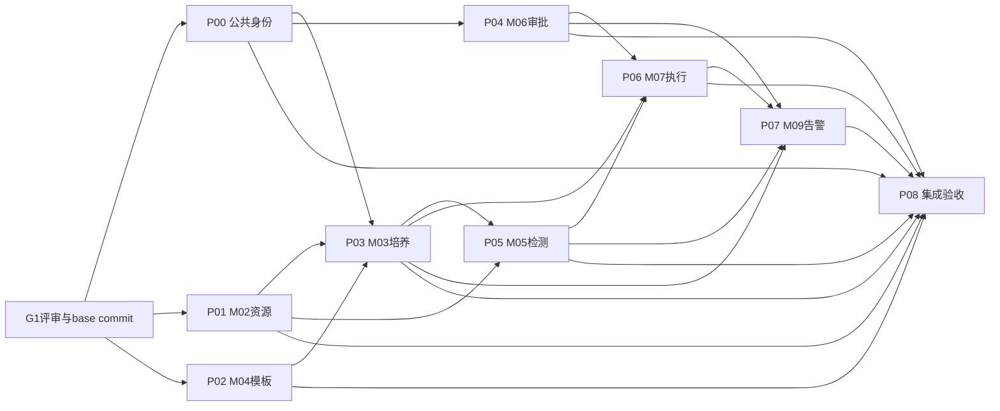

# 并行开发任务包清单

版本：DD-20260913-T10-R1。设计基线：DD-20260913-T9-R3。计划周期：2026-09-11—2026-10-31。M08暂停。

## 1. 结论与状态

P00—P08已具备模块边界、单一写入拥有方、依赖契约、夹具、异常断言、集成责任和完成条件，T10静态设计任务完成。当前状态为`READY_FOR_G1`：可用于分派、建立worktree、准备测试和评审；统一主文档G1正式评审通过并固定代码基线后，才能改为`IMPLEMENTATION_READY`并开始业务实现。代码、SQL、接口、设备和外部通道仍未验证。

状态只有：`READY_FOR_G1`（任务包完整，待正式评审）、`IMPLEMENTATION_READY`（G1通过且工程前置满足）、`IN_PROGRESS`、`INTEGRATION_READY`、`DONE`、`BLOCKED`。设备或外部通道只阻断受影响路径，不把整个模块状态伪造为DONE。

## 2. 开工先决条件

1. G1评审记录明确范围、排除项和未决项，M08保持暂停；评审变更须先回写权威设计再调整任务包。
2. 记录唯一base commit、Java/Node/数据库版本和目标分支；每包从同一base建立独立worktree，禁止从其他未合并任务包继续分叉。
3. 建立隔离数据库并确认迁移目录；业务包只新增`sql/v4/<package>/`脚本，`sql/ymsw.sql`作为基线只读，由P08在最终集成时决定是否生成汇总稿。
4. CI至少执行受影响Maven模块编译/测试、前端lint/build、迁移前后核验和契约夹具；没有运行证据时状态不能升为DONE。
5. `contract-fixtures/v4/p00`—`p08`按本文建立，固定正常、冲突、重复、乱序、UNKNOWN和权限失败载荷；生产方拥有字段，消费方只引用版本与hash。
6. 共享文件执行单写者规则。跨包需求先由拥有方提交契约/公共实现，消费包再升级；不得在两个worktree中各自修改同一公共DTO、枚举或错误码。
7. 现场参数、设备能力、短信/声光/外部推送资料按能力格登记。未知值保持NULL/UNKNOWN/BLOCKED，不以0、空对象或模拟成功替代。

## 3. 共享文件与单一拥有方

| 范围 | 写入拥有方 | 其他包规则 |
| --- | --- | --- |
| `futurefab-common/futurefab-common-core/**`中的响应、ID/版本/decimal/时间/hash公共类型 | P00 | 只消费；新增公共字段先提交P00变更 |
| `futurefab-common/futurefab-common-security/**`、`futurefab-auth/**`、会话/权限公共实现 | P00 | 领域包调用接口，不复制认证逻辑 |
| 根`pom.xml`、各聚合`pom.xml`、`nacos-config/**`、全局路由/构建配置 | P08 | 业务包在任务说明中登记需求，由P08集中合并 |
| `futurefab-ui/src/utils/**`、`router/**`、`store/**`全局文件 | P00负责权限/会话；P08负责最终路由装配 | 领域页面先用本模块局部文件，不抢写全局入口 |
| M01—M07/M09公共事件外壳与归档Reader接口 | P00拥有外壳；事件生产方拥有payload schema；P08拥有集成装配 | 消费方不得新增同名平行协议 |
| `sql/ymsw.sql` | P08最终集成 | P00—P07只写独立增量、核验和回退脚本 |
| 跨包契约夹具根`contract-fixtures/v4/**` | 各P包只写自己的子目录；P08只写端到端组合夹具 | 已发布夹具不可覆盖，变更以新revision文件追加 |

当前业务代码集中在`futurefab-modules/futurefab-system`，因此Java目录不能仅按父目录分工。旧文件按类名前缀和Mapper目录划分；新增实现优先进入本文指定的领域子包，避免多包同时改`controller/domain/service/mapper`下的同名公共文件。

## 4. 并行波次与集成顺序

| 波次 | 可并行任务 | 进入条件 | 退出证据 |
| --- | --- | --- | --- |
| W0 09-11—09-14 | P00/P01准备，P02夹具准备 | G1、base、隔离库、CI确定 | 公共契约夹具和模块迁移骨架可运行 |
| W1 09-15—09-26 | P00、P01、P02 | 共享外壳由P00先发布revision | M01/M02联调接口稳定；TemplatePackage schema2夹具通过 |
| W2 09-21—10-16 | P03；P04/P05在各自依赖夹具后并行 | M02/M04生产夹具冻结；M03先提供消费stub | 培养主线、审批交付、检测结果各自产生可查询回执 |
| W3 10-06—10-26 | P06；P07可先做规则/站内链，事实联调随生产方接入 | M03/M05/M06契约测试通过 | M07模拟执行闭环；M09各通道状态与恢复闭环 |
| W4 10-25—10-31 | P08 | P00—P07达到INTEGRATION_READY | 四条主线、迁移、恢复、浏览器与交付证据齐全 |

## 5. P00 公共鉴权、错误、幂等与审计外壳

- 模块/DEV/计划：M01；DEV-02、DEV-03公共部分、DEV-26公共审计；09-11—09-20；`READY_FOR_G1`。
- 写边界：`futurefab-auth/**`；`futurefab-common/futurefab-common-security/**`；公共core类型；system模块`Sys*`类及`resources/mapper/system/**`，但`SysNotification*`由P07拥有；前端`views/login/**`、`views/system/**`、`api/system/**`、会话/权限工具；`sql/v4/p00/**`。
- 依赖：M01接口定位/错误码全集；T9-R2 ActorContext、managementRevision、authzVersion和请求幂等语义。
- 输入输出与夹具：`actor-valid.json`、`session-revoked.json`、`management-cas.json`、`request-replay-same.json`、`request-replay-conflict.json`；输出保留认证/管理现有外壳、requestId及领域错误映射。
- 验收：本地登录/强制改密；会话替换；功能权限与对象范围分层；权限中途撤销；同键同体原回执、异体冲突；日志不泄露token/秘密。
- 集成责任：先向P01—P07发布可信上下文测试构造器和错误外壳；P00修复公共行为，领域包修复自己的范围判断。
- 完成条件：M01契约测试、受影响模块测试及前端登录/权限走查通过；迁移/回退证据齐全，消费者签收revision。

## 6. P01 M02实验室授权、设备与资源

- 模块/DEV/计划：M02；DEV-03实验室授权、DEV-04、DEV-05；09-11—09-26；`READY_FOR_G1`。
- 写边界：system模块`Lab*`、`Dev*`、`BottleConfig*`、`CalibrationObject*`、`ConsumableMaster*`、`ConsumptionRule*`、`FeedMedium*`、`LiquidBag*`及对应mapper XML；前端`api/lab/**`、`api/device/**`、`views/lab/**`、`views/device/**`；`sql/v4/p01/**`。不得修改Res/Det/Workflow/Alarm/SysNotification实现。
- 依赖：P00；M02逐接口完整清单及T8补充；T9-R1五组消费交接；配置版本/SecretChange/读数公共契约。
- 输入输出与夹具：20类保存样例、12类实例/8类型号查询、唯一性冲突、引用删除阻断、授权过期、Secret KEEP/REPLACE/CLEAR、GOOD/BAD/UNKNOWN读数、工程COMPLETE/INCOMPLETE/REVOKED。
- 验收：列表/详情/CRUD/预检/导出、跨实验室隐藏、批量原子性、稳定排序与decimal/日期；内部resolve方法按版本返回；未知工程值不转0。
- 集成责任：向P02/P03/P05/P06发布M02只读契约和模拟适配器；P01负责生产投影，消费者负责本地映射。
- 完成条件：M02接口与迁移契约测试通过；五组消费者用同一夹具联调；真实设备路径仍按能力格单独标READY/BLOCKED。

## 7. P02 M04模板包与工程配置

- 模块/DEV/计划：M04；DEV-13、DEV-14；09-15—09-30；`READY_FOR_G1`。
- 写边界：现有`Workflow*`及`resources/mapper/process/**`中模板/工作流定义；前端`api/process/**`、`views/process/**`；新增Java进入`com.futurefab.system.process.template/**`；`sql/v4/p02/**`。培养实例、任务执行和审批决定不在本包。
- 依赖：P00/P01；M04接口定位/错误码；TemplatePackage schema2、engineeringBundle和packageHash；T9-R2交接。
- 输入输出与夹具：六类模板正常包、依赖缺失、循环引用、工程INCOMPLETE/REVOKED、schema1依赖方、模板更新后读取旧版本、同版本hash冲突。
- 验收：复制/发布/禁用/引用、版本不可变、依赖无环、类型和单位校验；旧培养仍可取固定版本；schema2包完整且hash可复算。
- 集成责任：P02发布TemplatePackage生产stub与固定fixture；P03拥有消费和快照持久化，不能由P02写培养表。
- 完成条件：模板接口/迁移/包契约测试通过，P03对正常/旧版本/缺工程三类fixture签收。

## 8. P03 M03项目、培养、快照与占用

- 模块/DEV/计划：M03；DEV-06、DEV-07、DEV-15、DEV-16；09-21—10-08；`READY_FOR_G1`。
- 写边界：system模块`ResProject*`、`ResBatch*`、`ResCulture*`及对应resource mapper；前端`api/resource/**`、`views/resource/**`；新增Java进入`com.futurefab.system.resource.runtime/**`；`sql/v4/p03/**`。
- 依赖：P00/P01/P02；M03接口定位/错误码；TemplatePackage schema2；RuntimeFact/ReleaseProof schema1；T9-R2/R3。
- 输入输出与夹具：项目/批次/培养权限；七态；占用竞争；TemplatePackage固定；RuntimeFact重复、乱序、异hash、版本冲突；精确occupancyId释放；开始/结束延期及EXTEND_END消解。
- 验收：独立/批次同步写入、编号与内部ID隔离、现行/候选方案、同设备并发只一方成功、ACK与应用分开、旧occupancy证明不能释放新占用。
- 集成责任：消费P01/P02，向P04/P05/P06/P07发布培养查询、状态和RuntimeFact收件stub；M07拥有附属资源guard，M03只拥有主设备占用。
- 完成条件：M03接口/迁移/并发/时钟测试通过；与P02模板包和P06释放证明完成双向契约测试。

## 9. P04 M06审批政策、决定交付与对账

- 模块/DEV/计划：M06；DEV-12及DEV-16审批协作；09-28—10-12；`READY_FOR_G1`。
- 写边界：新增Java`com.futurefab.system.approval/**`、mapper`resources/mapper/approval/**`、前端`api/approval/**`和`views/approval/**`、`sql/v4/p04/**`。现有`DetApproval*`是M05检测签批，P04不得挪用或改造成通用审批。
- 依赖：P00；M06接口定位/错误码；47场景政策；DeliveryResult状态APPLIED/DISCARDED/PENDING/CONFLICT/FAILED/UNKNOWN；T9-R2。
- 输入输出与夹具：职责分离、无审批人、一级/二级决定、撤回/驳回、同changeKey竞争、重复决定、ACK丢失、UNKNOWN查单、归档恢复。
- 验收：候选不可变、决定版本/hash固定、同槽唯一、交付至少一次而业务只生效一次；REJECTED不混入DeliveryResult；ACK不冒充APPLIED。
- 集成责任：P04拥有政策/申请/决定和交付重试；P03/P06/P07各自拥有业务应用事务与query回执。
- 完成条件：政策、动作、交付、对账和归档Reader契约测试通过；至少与P03/P06/P07各跑一条fixture。

## 10. P05 M05检测、签批、更正与报告

- 模块/DEV/计划：M05；DEV-08—DEV-11；09-28—10-16；`READY_FOR_G1`。
- 写边界：system模块`Det*`、`DetectionRule*`及detect mapper；前端`api/detect/**`、`views/detect/**`；检测适配范围`futurefab-sdms-client/**`；`sql/v4/p05/**`。通用审批由P04，设备资源由P01。
- 依赖：P00/P01/P03；M05接口定位/错误码及七类型号样例；ResultSnapshot schema1/schema2、ResultChanged和受控更正；T9-R3。
- 输入输出与夹具：BGA、Vi-CELL、OSMO1/2/3、Cedex Bio/HT；单发/列/盘；逐项接受；午夜竞争；重复乱序迟到；签名人与审核人分离；更正双签；报告存储失败。
- 验收：发送—接收—结果—签批—报告模拟链；resultId/objectVersion/item/value/unit/时间/质量证据稳定；更正不覆盖旧版本，旧消费者拒绝schema2并可恢复。
- 集成责任：消费P01/P03，向P06发布有效结果查询和ResultChanged fixture；P05拥有结果真实性，P06拥有用途资格的最终执行守卫。
- 完成条件：七类契约测试、并发/重放、更正和报告权限测试通过；模拟与实机结果分栏记录。

## 11. P06 M07补液任务、计算、执行器与账本

- 模块/DEV/计划：M07；DEV-17—DEV-22；10-06—10-24；`READY_FOR_G1`。
- 写边界：新增Java`com.futurefab.system.run/**`、mapper`resources/mapper/run/**`、前端`api/run/**`和`views/run/**`、M07专用设备适配层；`sql/v4/p06/**`。修改P01设备配置、P03培养、P05结果或P04决定须由对应拥有方提交。
- 依赖：P01/P02/P03/P04/P05；M07接口定位/错误码；CommandEvidence/StopEvidence schema1、RuntimeFact/ReleaseProof schema1；T9-R3。
- 输入输出与夹具：确认快照、独立预期计算值、固定/动态任务；PREPARED→INVOKING→各结果；查询RUNNING/STOPPED/NOT_FOUND；旧fence；完整Reading/profile；暂停分段、停止后监控和唯一结算。
- 验收：未知单位/零分母/结果不可信阻断；重复扫描不重复生成；UNKNOWN/NOT_FOUND不盲发；ACCEPTED不结算；旧执行器失去写资格；StopEvidence和ReleaseProof不完整时保留资源。
- 集成责任：消费P03/P04/P05固定版本；向P03发布RuntimeFact/ReleaseProof，向P07发布运行事实；物理适配器与模拟适配器共用契约但分别登记证据。
- 完成条件：纯计算独立预期、调度并发、故障注入、重启恢复、账本幂等和模拟设备链通过；实机路径仅按核准型号/固件/能力放行。

## 12. P07 M09告警、通知与恢复

- 模块/DEV/计划：M09；DEV-25及DEV-26通知审计；10-13—10-26；`READY_FOR_G1`。
- 写边界：system模块`Alarm*`、`SysNotification*`及alarm/smp通知mapper；前端`api/alarm/**`、`views/alarm/**`、`api/smp/notification.js`、`views/smp/notification/**`；新增Java进入`com.futurefab.system.alarm.delivery/**`；`sql/v4/p07/**`。
- 依赖：P00/P03/P04/P05/P06；M09接口定位/错误码；Event/Fact schemaVersion=1、canonicalVersion=1及DeliveryRow状态；T9-R3。
- 输入输出与夹具：事实重复/异hash/序列缺口、42+5规则、收件人未知/过期、时段外、站内事务、邮件/短信独立失败、INVOKING崩溃、UNKNOWN查单、迟到回调、恢复停止提醒。
- 验收：源事实不由M09重判；规则/轮次/接收人/投递可追溯；FAILED才重发，UNKNOWN只核实；通知失败不回滚源业务；秘密和未脱敏地址不出列表/日志。
- 集成责任：事实生产方拥有payload；P07拥有接收、规则、接收人、投递和恢复。短信/声光/外部推送按通道分别READY/BLOCKED。
- 完成条件：站内、邮件、短信、声光模拟通道独立契约测试及租约接管通过；真实通道结果逐项记录。

## 13. P08 端到端契约、迁移、恢复与交付

- 模块/DEV/计划：跨模块；DEV-27—DEV-29；10-25—10-31；`READY_FOR_G1`。
- 写边界：`contract-fixtures/v4/p08/**`、端到端测试/报告、根构建装配、`nacos-config/**`、最终迁移编排和交付材料。领域规则缺陷退回P00—P07拥有方修复，P08不复制修补。
- 依赖：P00—P07均达到INTEGRATION_READY；T0—T10权威设计；隔离库、消息、对象存储、模拟/实机清单。
- 输入输出与夹具：项目—培养—方案、检测签批、审批交付、补液执行、告警通知四条主线；权限撤销、跨日、并发、宕机、重放、归档、升级/回退和浏览器场景。
- 验收：代码/接口、迁移、权限、并发幂等、恢复审计、浏览器和部署回退分别留证；模拟与实机分栏；未核准路径保持BLOCKED且无误导入口。
- 集成责任：固定合并顺序P00→P01/P02→P03→P04/P05→P06→P07；每次只接收已通过包内检查的提交，冲突由文件拥有方解决。
- 完成条件：统一主文档10.5全部满足；四条主线和失败注入通过；10月31日交付清单列出版本、迁移、测试、设备/通道状态、遗留阻断与责任人。

## 14. 每包交付模板与多AI规则

每个实现任务开工时复制下表，不允许只给AI一句“按详细设计开发”。

| 字段 | 必填内容 |
| --- | --- |
| package/base | P编号、base commit、worktree/分支、契约版本 |
| ownership | 可写路径、只读依赖、共享文件拥有方、禁止修改路径 |
| objective | 对应DEV/B编号、接口/页面/迁移/事件的具体范围 |
| fixtures | 输入、预期输出、hash/revision、正常和异常文件 |
| validation | Maven/前端/SQL/契约/浏览器/模拟器/实机命令与证据路径 |
| integration | 生产方、消费方、合并顺序、stub移除条件、冲突归属 |
| boundary | M08/预留项、UNKNOWN参数、现场门禁和本包不验收范围 |

多AI可并行实现不同P包，也可在同包内继续拆成后端、前端、迁移和契约测试，但同一文件始终只有一个写入者。子任务必须继承base、契约revision、可写路径和夹具；发现设计缺口时停止该接口实现并提交缺口，不在本地创造字段。完成包内检查后先由拥有方合并，再触发消费方契约回归；P08只组合已验收产物。
