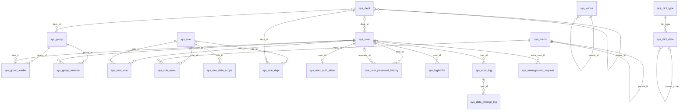

# 系统管理：新旧表对照与完整字段字典

## 认证安全增强目标承载（2026-11-01）

对应[认证安全增强设计](认证安全增强设计.md)。以下新增承载已进入目标DDL、开发基线SQL和来源清单，来源为[AUTH-01](AUTH-01-认证安全增强表结构.sql)与[登录快照DDL](认证安全-登录快照DDL.sql)；下文旧版本表列数不代表本次新增承载。定向同步由scripts/sync_auth_security_baseline.py执行，初始化种子不变。既有库升级另审，不执行history/sql；本轮未执行目标数据库。

### A. sys_sensitive_operation_receipt（目标新增，M01独占）

| 逻辑字段 | 目标类型/约束 | 语义 |
| --- | --- | --- |
| actor_user_id、business_request_id | bigint、varchar(64) ascii_bin，联合主键 | 可信操作者与本次业务UUID；全生命周期不可改意图 |
| operation | varchar(32)，非空 | PASSWORD_RESET / PASSWORD_POLICY_UPDATE固定技术枚举 |
| session_binding、actor_credential_version | char(64) ascii_bin、bigint，非空 | 会话key及代次的服务端带密钥摘要、操作者凭据版本，不保存原sessionKey |
| payload_hmac、key_id | char(64) ascii_bin、varchar(64)，非空 | 完整规范载荷HMAC及密钥版本，包含目标、期望版本和敏感字段；不存原口令/初始密码 |
| proof_hash | char(64) ascii_bin，可空；非空唯一 | READY时非空，256bit随机凭证的SHA-256；不是低熵口令摘要 |
| state | varchar(16)，非空 | PENDING待验证、READY可执行、APPLIED已提交、REJECTED明确拒绝、CANCELLED已取消；过期由各阶段期限派生EXPIRED，不伪造成功 |
| challenge_expires_at | datetime(3)，非空 | PENDING准备挑战截止，不因重复请求续期；READY另按proof_expires_at控制 |
| active_challenge_hash | char(64) ascii_bin，可空 | 当前唯一可完成验证的挑战摘要，重建验证尝试时锁内替换；旧回调不匹配则拒绝，不能覆盖新凭证 |
| authentication_method、verified_at、proof_expires_at | varchar(16)、datetime(3)、datetime(3)；验证前可空 | LOCAL_PASSWORD/AAD、验证时间及执行截止 |
| result_json | JSON，可空 | 仅APPLIED非空，保存原API07/09最小成功结果，禁止密码/凭证/摘要 |
| reject_code | varchar(64)，可空 | 明确失败分类，不写异常堆栈或敏感载荷；依赖超时不视为明确失败 |
| created_at、retain_until | datetime(3)，非空 | 服务端时间、保留截止；至少覆盖建议24小时回执窗口 |

目标索引：主键(actor_user_id,business_request_id)、proof_hash唯一（NULL允许多行）、retain_until清理索引。约束：READY/APPLIED必须有验证事实和凭证摘要；APPLIED必须有结果。操作记录与密码/政策变更及成功审计同事务；不借用sys_management_request的冻结动作码。状态变更使用行锁及旧状态校验；过期清理不删除业务审计。

### B. sys_login_security_snapshot（目标新增，M01独占）

| 逻辑字段 | 目标类型/约束 | 语义 |
| --- | --- | --- |
| user_id、session_version | bigint、bigint，联合主键 | 用户及已成功激活会话代次，不用浏览器clientId认定身份 |
| login_request_id | varchar(64) ascii_bin，非空 | 激活幂等键，(user_id,login_request_id)唯一 |
| previous_success_at、previous_failure_at | datetime(3)，可空 | 本次登录前可信成功/失败时刻，无记录NULL，不回填 |
| current_login_at、created_at | datetime(3)，非空 | 当前激活服务端时刻、快照创建时间 |
| success_event_id、failure_event_id | bigint，可空 | 所用历史sys_logininfor事实身份，用事件顺序消除同毫秒歧义，不加数据库外键 |

当前会话按user_id/session_version查询；同次登录重试读取已有快照，不更新。失效会话快照随现有认证审计保留政策保留，不新增自动删除历史数据期限。时间在DB按现有UTC会话约定存储，接口输出明确偏移，显示上海时区；不据旧文“上海业务时间”重新解释已有历史datetime。

### C. 现有认证日志与Redis

sys_logininfor目标增补技术事件STEP_UP_VERIFY，不计成功/失败LOGIN统计。真实LOGIN成功及已知账号口令失败需在认证状态锁内写可信审计，按(user_id,event_type,request_id)幂等去重；物理唯一索引须兼容未知user_id和旧LEGACY记录，实施DDL逐项验证，不直接假定现有idx_login_request具有唯一性。新写的request_id必填，旧NULL不补造。

物理实现增补：login_time改为datetime(3)，新增可空auth_event_sequence（取认证状态version递增后的序号）与生成列login_request_dedup（仅非空用户的LOGIN取request_id）。唯一索引uk_login_user_sequence(user_id,auth_event_sequence)、uk_login_user_request(user_id,login_request_dedup)及idx_login_previous_event支持锁内去重/前次查询。历史序号保持NULL，不回填或推断同刻顺序；下文旧3.16节的16列计数由此增至18列。二次认证事件实际保存到受控sys_oper_log，不写LOGIN、不增加login_count；STEP_UP_VERIFY仅作场景分类，不要求本轮插入sys_logininfor。

Redis仅保存验证码、分层限流、匿名标识及短时认证挑战，均设置TTL；内部票据不得保存密码。原始operationProof仅在验证完成后短时保存在受控Redis以支持同验证请求取回，限制到原用户/会话/挑战，保留不超过凭证有效期，禁止日志和持久化附件；随机token丢失时不能靠数据库hash还原，可重新验证并原子撤销旧凭证。敏感操作成功回执与登录快照必须落MySQL，不能依赖Redis持久性。

版本1.1，2026-09-08。属于[系统管理详细设计](详细设计.md)，同一业务模块的数据库附件。当前结构来源`sql/ymsw.sql`，SHA256 `B3F185BD23B399CAC0E1B12593F9F68D0E42CDE7C457EDD3B2F472A7286F4366`，用户已有修改未动；cdp/npp仅参考结构，不导入账户或敏感数据。

结构来源：[当前ymsw.sql](../../../sql/ymsw.sql)、[旧cdp.sql](../../接口文档/原系统数据库表结构/cdp.sql)、[旧npp.sql](../../接口文档/原系统数据库表结构/npp.sql)。以上是文件结构快照，不等于已核验运行数据库。

## 1. 新旧表与复用决策

| 旧库对象/字段 | 当前与目标 | 处理理由 |
| --- | --- | --- |
| cdp.auth_department / npp.cdp_department，DepartmentId/Name/Code | sys_dept.dept_id/dept_name/dept_code | 复用已有组织主表和树；当前代码编码全局唯一，不复制旧无层级模型 |
| auth_module：ModuleId、SuperModuleId、URL、ModuleSetting | sys_menu.menu_id/parent_id/path/perms，sys_role_menu | 复用目录/菜单/按钮结构；旧ModuleSetting不能未经语义映射直接变权限标识 |
| auth_role、auth_rolemodule、auth_userrole | sys_role、sys_role_menu、sys_user_role | 复用现有关系；角色多选数据权限复用sys_role_data_scope，描述扩至1000 |
| cdp_experimentalgroup：GroupId/GroupName/GroupNo/PrincipalId | sys_group及sys_group_leader | 复用主表，旧单负责人扩展为现有多负责人关系，不能丢失第二负责人 |
| cdp_experimentalgroupuser：GroupId/UserId | sys_group_member | 复用复合主键关系；组页与用户页同一事实来源 |
| cdp_dict/cdp_dictdtl：DictId/DictNo/DictName、DictDtlId/No/Name | sys_dict_type/sys_dict_data | 复用类型编码+数据值+parent_code两级；IsModifyFlag对应现有is_editable概念 |
| auth_user：UserId/Account/Pwd/DisplayName/IsInitialPwd | sys_user及初始标记/凭据版本 | bcrypt及现有用户主键复用；旧Pwd格式不凭长度推断可直接导入 |
| npp.auth_user.IsReceiveSMS/Email/Site | sys_user.notify_sms/notify_email/notify_insite | 复用通知偏好；站内固定必选1 |
| auth_userloginlog：LoginTime/LoginIP/Browser/OS/PCName/MAC | sys_logininfor及追溯扩展 | 复用登录记录，PC/MAC可空；旧LabID不误映射实验室身份 |
| 当前sys_oper_log/sys_data_change_log | 扩展操作者ID/显示名/请求ID，复用变更前后快照 | 不再创建平行操作审计表 |
| 场地与设备位置关系 | 当前sys_venue | 当前表和实现已存在；旧库对应场地表未做完整等价证明，不伪造一一映射 |
| 当前密码历史 | sys_user_password_history | user_id改bigint；历史追加，保留既有varchar主键和未知旧版本 |
| 本期新增一致性要求 | sys_user_auth_state、sys_management_revision、sys_management_request | 前者管理认证，后两者保护管理事务与重复请求；不是新的用户/角色主数据 |

所有目标表采用InnoDB/utf8mb4/utf8mb4_0900_ai_ci；随机标识/幂等键显式ascii_bin。无数据库外键。主键沿用现有雪花ID；sys_oper_log保留自增主键；复合关系主键由真实关联ID组成。sys_management_revision固定SYSTEM一行。日期时间业务时区上海，不将现有datetime擅自解释成UTC。

## 2. 逻辑表结构关系图

图为逻辑关联。父ID为0表示根而非必须存在ID0记录；已删除主表保留历史。M02实验室/设备通过venue_id引用sys_venue，sys_user_lab通过user_id关联sys_user；它们属于外部模块，新增引用与组织删除共享管理守卫。sys_config为全局参数，sys_management_revision为事务版本，不虚构用户外键关系。

## 3. 全部目标字段

下列字段是执行当前DD01+DD02后的完整目标结构。每行列出物理列名、类型、可空/默认、含义/字典/关联。无单位字段为标识或文本；时间为带精度的数据库datetime，传输为ISO；单独注明天/毫秒。SQL默认不等于前端默认，原字段兼容默认保留而新请求按主文档校验。生成列仅数据库计算，客户端不能写入。

### 3.1 sys_venue（15列）

维护主体：system对应业务应用服务；关联表随主对象原子更新。

| 字段 | 类型/字符集差异 | 可空/默认/主键 | 中文含义、字典值及逻辑关联 |
| --- | --- | --- | --- |
| venue_id | bigint | 否/无/PK | 场地主键 |
| parent_id | bigint | 否/0 | 上级主键，逻辑关联本表主键；根为0，无外键；逻辑关联 sys_venue.venue_id，根0例外；一对多、防环；无外键 |
| ancestors | varchar(2000) | 是/'' | 祖先内部ID链，0开头逗号分隔；父级变化同事务重算子树，长度超限拒绝 |
| venue_name | varchar(50) | 否/无 | 场地名称 |
| venue_code | varchar(50) | 否/无 | 场地编码 |
| order_num | int | 是/1 | 排序整数，无单位；新建默认业务值1，同值按创建时间/ID排序 |
| status | char(1) | 是/'0' | 字典sys_normal_disable（系统开关）：0启用/正常、1停用；不与会话在线或账号锁定混用 |
| del_flag | char(1) | 是/'0' | 固定删除标志：0存在、2已删除；软删除保留主键和历史，接口不允许任意写入 |
| create_by | varchar(64) | 是/'' | 创建时用户名快照；不是user_id外键，来源当前登录身份，不接受客户端值 |
| create_time | datetime | 是/NULL | 创建服务端时刻；上海业务时区，历史NULL保持未知 |
| update_by | varchar(64) | 是/'' | 最近修改时用户名快照；不是user_id外键，服务端维护 |
| update_time | datetime | 是/NULL | 最后修改服务端时刻；历史NULL保持未知 |
| remark | varchar(500) | 是/NULL | 备注 |
| active_venue_name | varchar(50) | 是/生成计算 | 未删除记录唯一校验生成键，删除后NULL；表达式 `CASE WHEN del_flag='0' THEN venue_name ELSE NULL END` |
| active_venue_code | varchar(50) | 是/生成计算 | 未删除记录唯一校验生成键，删除后NULL；表达式 `CASE WHEN del_flag='0' THEN venue_code ELSE NULL END` |

索引（保留原索引并明确本期新增）：

- `PRIMARY KEY (`venue_id`)`
- `INDEX `idx_sys_venue_parent`(`parent_id` ASC)`
- `INDEX `idx_sys_venue_name`(`parent_id` ASC, `venue_name` ASC, `del_flag` ASC)`
- `INDEX `idx_sys_venue_code`(`parent_id` ASC, `venue_code` ASC, `del_flag` ASC)`
- `UNIQUE INDEX uk_m01_venue_name(parent_id,active_venue_name)`
- `UNIQUE INDEX uk_m01_venue_code(active_venue_code)`

### 3.2 sys_dept（17列）

维护主体：system对应业务应用服务；关联表随主对象原子更新。

| 字段 | 类型/字符集差异 | 可空/默认/主键 | 中文含义、字典值及逻辑关联 |
| --- | --- | --- | --- |
| dept_id | bigint | 否/无/PK | 部门主键 |
| parent_id | bigint | 否/0 | 上级主键，逻辑关联本表主键；根为0，无外键；逻辑关联 sys_dept.dept_id，根0例外；一对多、防环；无外键 |
| ancestors | varchar(2000) | 是/'' | 祖先内部ID链，0开头逗号分隔；父级变化同事务重算子树，长度超限拒绝 |
| dept_name | varchar(50) | 是/'' | 部门名称 |
| dept_code | varchar(50) | 是/'' | 部门编码 |
| order_num | int | 是/0 | 排序整数，无单位；新建默认业务值1，同值按创建时间/ID排序 |
| leader | varchar(20) | 是/NULL | 负责人 |
| phone | varchar(11) | 是/NULL | 联系电话 |
| email | varchar(50) | 是/NULL | 邮箱 |
| status | char(1) | 是/'0' | 字典sys_normal_disable（系统开关）：0启用/正常、1停用；不与会话在线或账号锁定混用 |
| del_flag | char(1) | 是/'0' | 固定删除标志：0存在、2已删除；软删除保留主键和历史，接口不允许任意写入 |
| create_by | varchar(64) | 是/'' | 创建时用户名快照；不是user_id外键，来源当前登录身份，不接受客户端值 |
| create_time | datetime | 是/NULL | 创建服务端时刻；上海业务时区，历史NULL保持未知 |
| update_by | varchar(64) | 是/'' | 最近修改时用户名快照；不是user_id外键，服务端维护 |
| update_time | datetime | 是/NULL | 最后修改服务端时刻；历史NULL保持未知 |
| active_dept_name | varchar(50) | 是/生成计算 | 未删除记录唯一校验生成键，删除后NULL；表达式 `CASE WHEN del_flag='0' THEN dept_name ELSE NULL END` |
| active_dept_code | varchar(50) | 是/生成计算 | 未删除记录唯一校验生成键，删除后NULL；表达式 `CASE WHEN del_flag='0' THEN dept_code ELSE NULL END` |

索引（保留原索引并明确本期新增）：

- `PRIMARY KEY (`dept_id`)`
- `UNIQUE INDEX uk_m01_dept_name(parent_id,active_dept_name)`
- `UNIQUE INDEX uk_m01_dept_code(active_dept_code)`

### 3.3 sys_group（13列）

维护主体：system对应业务应用服务；关联表随主对象原子更新。

| 字段 | 类型/字符集差异 | 可空/默认/主键 | 中文含义、字典值及逻辑关联 |
| --- | --- | --- | --- |
| group_id | bigint | 否/无/PK | 实验组主键 |
| group_name | varchar(20) | 否/无 | 实验组名称 |
| group_code | varchar(50) | 是/'' | 实验组编码 |
| dept_id | bigint | 是/NULL | 归属部门主键；逻辑关联 sys_dept.dept_id，可空；新写入必须存在未删除部门；无外键 |
| status | char(1) | 是/'0' | 字典sys_normal_disable（系统开关）：0启用/正常、1停用；不与会话在线或账号锁定混用 |
| del_flag | char(1) | 是/'0' | 固定删除标志：0存在、2已删除；软删除保留主键和历史，接口不允许任意写入 |
| create_by | varchar(64) | 是/'' | 创建时用户名快照；不是user_id外键，来源当前登录身份，不接受客户端值 |
| create_time | datetime | 是/NULL | 创建服务端时刻；上海业务时区，历史NULL保持未知 |
| update_by | varchar(64) | 是/'' | 最近修改时用户名快照；不是user_id外键，服务端维护 |
| update_time | datetime | 是/NULL | 最后修改服务端时刻；历史NULL保持未知 |
| remark | varchar(500) | 是/NULL | 备注 |
| active_group_name | varchar(20) | 是/生成计算 | 有效实验组唯一键；删除及空编码不占唯一性；表达式 `CASE WHEN del_flag='0' THEN group_name ELSE NULL END` |
| active_group_code | varchar(50) | 是/生成计算 | 有效实验组唯一键；删除及空编码不占唯一性；表达式 `CASE WHEN del_flag='0' THEN NULLIF(group_code,'') ELSE NULL END` |

索引（保留原索引并明确本期新增）：

- `PRIMARY KEY (`group_id`)`
- `INDEX `idx_sys_group_dept`(`dept_id` ASC)`
- `UNIQUE INDEX uk_m01_group_name(active_group_name)`
- `UNIQUE INDEX uk_m01_group_code(active_group_code)`

### 3.4 sys_group_leader（2列）

维护主体：system对应业务应用服务；关联表随主对象原子更新。

| 字段 | 类型/字符集差异 | 可空/默认/主键 | 中文含义、字典值及逻辑关联 |
| --- | --- | --- | --- |
| group_id | bigint | 否/无/PK | 实验组主键；逻辑关联 sys_group.group_id；当前组负责人多对多；无外键 |
| user_id | bigint | 否/无/PK | 负责人用户主键；逻辑关联 sys_user.user_id；新绑定用户有效；无外键 |

索引（保留原索引并明确本期新增）：

- `PRIMARY KEY (`group_id`, `user_id`)`
- `INDEX `idx_sys_group_leader_user`(`user_id` ASC)`

### 3.5 sys_group_member（2列）

维护主体：system对应业务应用服务；关联表随主对象原子更新。

| 字段 | 类型/字符集差异 | 可空/默认/主键 | 中文含义、字典值及逻辑关联 |
| --- | --- | --- | --- |
| group_id | bigint | 否/无/PK | 实验组主键；逻辑关联 sys_group.group_id；当前成员多对多；无外键 |
| user_id | bigint | 否/无/PK | 成员用户主键；逻辑关联 sys_user.user_id；新绑定用户有效；无外键 |

索引（保留原索引并明确本期新增）：

- `PRIMARY KEY (`group_id`, `user_id`)`
- `INDEX `idx_sys_group_member_user`(`user_id` ASC)`

### 3.6 sys_menu（23列）

维护主体：system对应业务应用服务；关联表随主对象原子更新。

| 字段 | 类型/字符集差异 | 可空/默认/主键 | 中文含义、字典值及逻辑关联 |
| --- | --- | --- | --- |
| menu_id | bigint | 否/无/PK | 菜单主键 |
| menu_name | varchar(50) | 否/无 | 菜单名称 |
| menu_i18n_key | varchar(100) | 是/'' | 国际化key |
| parent_id | bigint | 是/0 | 父菜单主键；逻辑关联 sys_menu.menu_id，根0例外；按钮不可为父；无外键 |
| order_num | int | 是/0 | 排序整数，无单位；新建默认业务值1，同值按创建时间/ID排序 |
| path | varchar(200) | 是/'' | 路由地址 |
| component | varchar(255) | 是/NULL | 组件路径 |
| query | varchar(255) | 是/NULL | 路由参数 |
| route_name | varchar(50) | 是/'' | 路由名称 |
| is_frame | int | 是/1 | 固定0是外链、1不是；不要套用0否1是 |
| is_cache | int | 是/0 | 固定0缓存、1不缓存；不要套用0否1是 |
| menu_type | char(1) | 是/'' | 固定M目录、C菜单、F按钮；按钮无子节点 |
| visible | char(1) | 是/'0' | 字典sys_show_hide（菜单状态）：0显示、1隐藏；仅控制导航展示 |
| status | char(1) | 是/'0' | 字典sys_normal_disable（系统开关）：0启用/正常、1停用；不与会话在线或账号锁定混用 |
| perms | varchar(100) | 是/NULL | 权限标识 |
| icon | varchar(100) | 是/'#' | 菜单图标 |
| create_by | varchar(64) | 是/'' | 创建时用户名快照；不是user_id外键，来源当前登录身份，不接受客户端值 |
| create_time | datetime | 是/NULL | 创建服务端时刻；上海业务时区，历史NULL保持未知 |
| update_by | varchar(64) | 是/'' | 最近修改时用户名快照；不是user_id外键，服务端维护 |
| update_time | datetime | 是/NULL | 最后修改服务端时刻；历史NULL保持未知 |
| remark | varchar(500) | 是/'' | 备注 |
| del_flag | char(1) | 是/'0' | 固定删除标志：0存在、2已删除；软删除保留主键和历史，接口不允许任意写入 |
| api_path | varchar(200) | 是/'' | 后端接口路径 |

索引（保留原索引并明确本期新增）：

- `PRIMARY KEY (`menu_id`)`

### 3.7 sys_role（16列）

维护主体：system对应业务应用服务；关联表随主对象原子更新。

| 字段 | 类型/字符集差异 | 可空/默认/主键 | 中文含义、字典值及逻辑关联 |
| --- | --- | --- | --- |
| role_id | bigint | 否/无/PK | 角色主键 |
| role_name | varchar(30) | 否/无 | 角色名称 |
| role_key | varchar(100) | 否/无 | 角色权限字符串 |
| role_sort | int | 否/无 | 显示顺序 |
| data_scope | char(1) | 是/'1' | 固定1全部、2自定义、3本部门、4本部门及以下、5本人；旧单值兼容投影，新查询读取sys_role_data_scope |
| menu_check_strictly | tinyint(1) | 是/1 | 布尔1=true、0=false；菜单选择树关联展示兼容字段，不直接决定权限 |
| dept_check_strictly | tinyint(1) | 是/1 | 布尔1=true、0=false；部门树关联展示兼容字段 |
| status | char(1) | 否/无 | 字典sys_normal_disable（系统开关）：0启用/正常、1停用；不与会话在线或账号锁定混用 |
| del_flag | char(1) | 是/'0' | 固定删除标志：0存在、2已删除；软删除保留主键和历史，接口不允许任意写入 |
| create_by | varchar(64) | 是/'' | 创建时用户名快照；不是user_id外键，来源当前登录身份，不接受客户端值 |
| create_time | datetime | 是/NULL | 创建服务端时刻；上海业务时区，历史NULL保持未知 |
| update_by | varchar(64) | 是/'' | 最近修改时用户名快照；不是user_id外键，服务端维护 |
| update_time | datetime | 是/NULL | 最后修改服务端时刻；历史NULL保持未知 |
| remark | varchar(1000) | 是/NULL | 角色描述，最多1000字符 |
| active_role_name | varchar(30) | 是/生成计算 | 有效角色唯一生成键；表达式 `CASE WHEN del_flag='0' THEN role_name ELSE NULL END` |
| active_role_key | varchar(100) | 是/生成计算 | 有效角色唯一生成键；表达式 `CASE WHEN del_flag='0' THEN role_key ELSE NULL END` |

索引（保留原索引并明确本期新增）：

- `PRIMARY KEY (`role_id`)`
- `UNIQUE INDEX uk_m01_role_name(active_role_name)`
- `UNIQUE INDEX uk_m01_role_key(active_role_key)`

### 3.8 sys_role_data_scope（2列）

维护主体：system对应业务应用服务；关联表随主对象原子更新。

| 字段 | 类型/字符集差异 | 可空/默认/主键 | 中文含义、字典值及逻辑关联 |
| --- | --- | --- | --- |
| role_id | bigint | 否/无/PK | 角色主键；逻辑关联 sys_role.role_id；角色有效，唯一(role_id,scope_type)；无外键 |
| scope_type | char(1) | 否/无/PK | 固定数据权限：1全部、2自定义部门、3本部门、4本部门及以下、5本人；多条取集合并集，本人含创建和负责；全部仍受实验室授权范围与操作等级约束（Q05），不自动跨实验室 |

索引（保留原索引并明确本期新增）：

- `PRIMARY KEY (`role_id`, `scope_type`)`
- `INDEX `idx_sys_role_data_scope_role`(`role_id` ASC)`

### 3.9 sys_role_dept（2列）

维护主体：system对应业务应用服务；关联表随主对象原子更新。

| 字段 | 类型/字符集差异 | 可空/默认/主键 | 中文含义、字典值及逻辑关联 |
| --- | --- | --- | --- |
| role_id | bigint | 否/无/PK | 角色主键；逻辑关联 sys_role.role_id；无外键 |
| dept_id | bigint | 否/无/PK | 部门主键；逻辑关联 sys_dept.dept_id；仅scope_type=2参与自定义范围；无外键 |

索引（保留原索引并明确本期新增）：

- `PRIMARY KEY (`role_id`, `dept_id`)`

### 3.10 sys_role_menu（2列）

维护主体：system对应业务应用服务；关联表随主对象原子更新。

| 字段 | 类型/字符集差异 | 可空/默认/主键 | 中文含义、字典值及逻辑关联 |
| --- | --- | --- | --- |
| role_id | bigint | 否/无/PK | 角色主键；逻辑关联 sys_role.role_id；无外键 |
| menu_id | bigint | 否/无/PK | 菜单主键；逻辑关联 sys_menu.menu_id；功能停用不删关系但失去权限；无外键 |

索引（保留原索引并明确本期新增）：

- `PRIMARY KEY (`role_id`, `menu_id`)`

### 3.11 sys_user（28列）

维护主体：system对应业务应用服务；关联表随主对象原子更新。

| 字段 | 类型/字符集差异 | 可空/默认/主键 | 中文含义、字典值及逻辑关联 |
| --- | --- | --- | --- |
| user_id | bigint | 否/无/PK | 用户主键 |
| dept_id | bigint | 是/NULL | 部门主键；逻辑关联 sys_dept.dept_id；当前库可空，新建用户必选；旧未知需核实不猜部门；无外键 |
| user_name | varchar(30) | 否/无 | 登录账号，创建后不可修改（Q01）；新建格式与旧账号兼容范围见主设计15.3 |
| nick_name | varchar(50) | 否/无 | 显示姓名 |
| user_type | varchar(2) | 是/'00' | 固定00系统用户，现有兼容字段；本期不新增用户类型 |
| email | varchar(50) | 否/'' | 用户邮箱，选填，空值应用写空串；非空格式校验且不能与其他未删除账号重复（含停用账号），编辑排除本人；Q03已确认 |
| phonenumber | varchar(128) | 是/'' | 现有服务加密后存储，长度为密文兼容容量，不是明文电话号码上限；页面名称为手机号；选填，API非空按中国大陆11位手机号校验，用户管理与个人资料一致，不支持固定电话及境外号码（Q04已确认）；非空不能与其他未删除账号重复（含停用账号），编辑排除本人，采用既有加密服务等值查询而非比较随机密文（Q03）；禁止迁移重复加密 |
| sex | char(1) | 是/'0' | 字典sys_user_sex（用户性别）：0男、1女、2未知；头像预设不改性别〔2026-10-01 需求方裁决乙：默认头像与性别解耦，本列语义不变〕 |
| avatar | varchar(100) | 是/'' | 头像地址；空值即使用全站共用的默认头像（不落默认图地址，部署端回落一张共享资源）；CUSTOM（历史自定义头像）保留只读，不新增头像表〔2026-10-01 需求方裁决乙：原MALE/FEMALE两挡作废，默认头像不分性别〕 |
| password | varchar(100) | 是/'' | bcrypt口令摘要，不是明文；任何外部DTO/审计快照都禁止输出 |
| status | char(1) | 是/'0' | 字典sys_normal_disable（系统开关）：0启用/正常、1停用；不与会话在线或账号锁定混用 |
| del_flag | char(1) | 是/'0' | 固定删除标志：0存在、2已删除；软删除保留主键和历史，接口不允许任意写入 |
| login_ip | varchar(128) | 是/'' | 最后登录IP |
| login_date | datetime | 是/NULL | 最后登录时间 |
| pwd_update_date | datetime | 是/NULL | 最近口令修改时刻；DATE值作为生效日，NULL需首次改密 |
| password_valid_days | int | 是/NULL | 旧每用户有效天数只读兼容；实际以sys_config全局有效期计算 |
| create_by | varchar(64) | 是/'' | 创建时用户名快照；不是user_id外键，来源当前登录身份，不接受客户端值 |
| create_time | datetime | 是/NULL | 创建服务端时刻；上海业务时区，历史NULL保持未知 |
| update_by | varchar(64) | 是/'' | 最近修改时用户名快照；不是user_id外键，服务端维护 |
| update_time | datetime | 是/NULL | 最后修改服务端时刻；历史NULL保持未知 |
| remark | varchar(500) | 是/NULL | 备注 |
| notify_email | char(1) | 是/'0' | 固定0否、1是；用户偏好由用户/个人资料入口维护，M09消费 |
| notify_sms | char(1) | 是/'0' | 固定0否、1是；用户偏好，M09消费 |
| notify_insite | char(1) | 否/'1' | 固定1是且必选；0为旧关闭值，DD02转1，新增修改不允许0 |
| login_count | int | 是/0 | 成功激活业务会话时+1，刷新/提醒挑战不增加；NULL旧值按0读取 |
| is_initial_password | char(1) | 否/'1' | 字典sys_auth_initial（初始密码标记）：0普通、1初始；创建/重置1，本人合法改密0 |
| credential_version | bigint | 否/0 | 凭据版本，每次实际改密递增；历史NULL表示无法还原的旧版本 |
| active_user_name | varchar(30) | 是/生成计算 | 有效账号唯一生成键；删除行NULL；表达式 `CASE WHEN del_flag='0' THEN user_name ELSE NULL END` |

索引（保留原索引并明确本期新增）：

- `PRIMARY KEY (`user_id`)`
- `UNIQUE INDEX uk_sys_user_active_name(active_user_name)`

### 3.12 sys_user_role（3列）

维护主体：system对应业务应用服务；关联表随主对象原子更新。

| 字段 | 类型/字符集差异 | 可空/默认/主键 | 中文含义、字典值及逻辑关联 |
| --- | --- | --- | --- |
| user_id | bigint | 否/无/PK | 用户主键；逻辑关联 sys_user.user_id；无外键 |
| role_id | bigint | 否/无/PK | 角色主键；逻辑关联 sys_role.role_id；新增时必须启用；无外键 |
| assigned_at | datetime(3) | 是/NULL | 新增用户角色关联时刻；旧关联时间未知NULL排末；保存未变关系保留原时间 |

索引（保留原索引并明确本期新增）：

- `PRIMARY KEY (`user_id`, `role_id`)`

### 3.13 sys_dict_type（12列）

维护主体：system对应业务应用服务；关联表随主对象原子更新。

| 字段 | 类型/字符集差异 | 可空/默认/主键 | 中文含义、字典值及逻辑关联 |
| --- | --- | --- | --- |
| dict_id | bigint | 否/无/PK | 字典主键 |
| dict_name | varchar(100) | 是/'' | 字典名称 |
| dict_type | varchar(100) | 是/'' | 字典类型唯一存储编码，供sys_dict_data.dict_type及业务消费者引用；改键必须检查引用并统一更新 |
| status | char(1) | 是/'0' | 字典sys_normal_disable（系统开关）：0启用/正常、1停用；不与会话在线或账号锁定混用 |
| create_by | varchar(64) | 是/'' | 创建时用户名快照；不是user_id外键，来源当前登录身份，不接受客户端值 |
| create_time | datetime | 是/NULL | 创建服务端时刻；上海业务时区，历史NULL保持未知 |
| update_by | varchar(64) | 是/'' | 最近修改时用户名快照；不是user_id外键，服务端维护 |
| update_time | datetime | 是/NULL | 最后修改服务端时刻；历史NULL保持未知 |
| remark | varchar(500) | 是/NULL | 备注 |
| del_flag | char(1) | 是/'0' | 固定删除标志：0存在、2已删除；软删除保留主键和历史，接口不允许任意写入 |
| is_editable | char(1) | 是/'Y' | 固定Y可编辑、N不可编辑；系统基础类型/项仅查看，客户端不可改此标志 |
| active_dict_name | varchar(100) | 是/生成计算 | 有效字典名称唯一键；表达式 `CASE WHEN del_flag='0' THEN dict_name ELSE NULL END` |

索引（保留原索引并明确本期新增）：

- `PRIMARY KEY (`dict_id`)`
- `UNIQUE INDEX `uk_sys_dict_type_dict_type`(`dict_type` ASC)`
- `UNIQUE INDEX uk_m01_dict_name(active_dict_name)`

### 3.14 sys_dict_data（含标签唯一范围生成列）

维护主体：system对应业务应用服务；关联表随主对象原子更新。

| 字段 | 类型/字符集差异 | 可空/默认/主键 | 中文含义、字典值及逻辑关联 |
| --- | --- | --- | --- |
| dict_code | bigint | 否/无/PK | 字典编码 |
| dict_label | varchar(100) | 是/'' | 字典项中文显示名称，最长100，修改不改真实存储值；类型内有效标签唯一；仅smp_detect_class改为同父节点内唯一 |
| dict_value | varchar(100) | 是/'' | 字典项真实存储值，具体含义由本类型定义；新增缺省用dict_code字符串；有引用时禁止直接改值 |
| parent_code | bigint | 是/0 | 父字典数据主键，顶级为0；逻辑关联 sys_dict_data.dict_code，根0；同dict_type且父为一级，不能跨类型；无外键 |
| dict_sort | int | 是/0 | 整数排序，无单位；新建业务默认1，同值按创建时间/ID升序 |
| dict_level | int | 是/1 | 固定1一级、2二级，按parent_code推导；本期无三级 |
| dict_type | varchar(100) | 是/'' | 字典类型存储编码；关联sys_dict_type.dict_type，当前类型下两级数据项共享同一编码 |
| css_class | varchar(100) | 是/NULL | 样式属性（其他样式扩展） |
| list_class | varchar(100) | 是/NULL | 表格回显样式 |
| is_default | char(1) | 是/'N' | 字典sys_yes_no（系统是否）：Y是、N否；业务默认选择，同一类型/父项最多一个有效默认；本期仅经审核的初始化/数据修正脚本维护。API新建写N，编辑保留原值，拒绝客户端设置；停用不清除历史默认标记 |
| status | char(1) | 是/'0' | 字典sys_normal_disable（系统开关）：0启用/正常、1停用；不与会话在线或账号锁定混用 |
| is_editable | char(1) | 是/'Y' | 固定Y可编辑、N不可编辑；系统基础类型/项仅查看，客户端不可改此标志 |
| del_flag | char(1) | 是/'0' | 固定删除标志：0存在、2已删除；软删除保留主键和历史，接口不允许任意写入 |
| create_by | varchar(64) | 是/'' | 创建时用户名快照；不是user_id外键，来源当前登录身份，不接受客户端值 |
| create_time | datetime | 是/NULL | 创建服务端时刻；上海业务时区，历史NULL保持未知 |
| update_by | varchar(64) | 是/'' | 最近修改时用户名快照；不是user_id外键，服务端维护 |
| update_time | datetime | 是/NULL | 最后修改服务端时刻；历史NULL保持未知 |
| remark | varchar(500) | 是/NULL | 备注 |
| active_dict_value | varchar(100) | 是/生成计算 | 当前类型内有效字典项唯一键；表达式 `CASE WHEN del_flag='0' THEN dict_value ELSE NULL END` |
| dict_label_scope | bigint | 生成计算 | 标签唯一范围：smp_detect_class 为 COALESCE(parent_code,0)，其他类型固定0；不接受客户端写入 |
| active_dict_label | varchar(100) | 是/生成计算 | 当前类型内有效字典项唯一键；表达式 `CASE WHEN del_flag='0' THEN dict_label ELSE NULL END` |

索引（保留原索引并明确本期新增）：

- `PRIMARY KEY (`dict_code`)`
- `INDEX `idx_sys_dict_data_parent`(`dict_type` ASC, `parent_code` ASC, `dict_sort` ASC)`
- `INDEX `idx_sys_dict_data_ancestors`(`dict_type` ASC)`
- `UNIQUE INDEX uk_m01_dict_value(dict_type,active_dict_value)`
- `UNIQUE INDEX uk_m01_dict_label(dict_type,dict_label_scope,active_dict_label)`

### 3.15 sys_config（10列）

维护主体：system对应业务应用服务；关联表随主对象原子更新。

| 字段 | 类型/字符集差异 | 可空/默认/主键 | 中文含义、字典值及逻辑关联 |
| --- | --- | --- | --- |
| config_id | bigint | 否/无/PK | 参数主键 |
| config_name | varchar(100) | 是/'' | 参数名称 |
| config_key | varchar(100) | 是/'' | 参数键名 |
| config_value | varchar(500) | 是/'' | 参数键值 |
| config_type | char(1) | 是/'N' | 字典sys_yes_no（系统是否）：Y内置、N自定义；内置不能通用删除 |
| create_by | varchar(64) | 是/'' | 创建时用户名快照；不是user_id外键，来源当前登录身份，不接受客户端值 |
| create_time | datetime | 是/NULL | 创建服务端时刻；上海业务时区，历史NULL保持未知 |
| update_by | varchar(64) | 是/'' | 最近修改时用户名快照；不是user_id外键，服务端维护 |
| update_time | datetime | 是/NULL | 最后修改服务端时刻；历史NULL保持未知 |
| remark | varchar(500) | 是/NULL | 备注 |

索引（保留原索引并明确本期新增）：

- `PRIMARY KEY (`config_id`)`
- `UNIQUE INDEX uk_sys_config_key(config_key)`

### 3.16 sys_logininfor（16列）

维护主体：system对应业务应用服务；关联表随主对象原子更新。

| 字段 | 类型/字符集差异 | 可空/默认/主键 | 中文含义、字典值及逻辑关联 |
| --- | --- | --- | --- |
| info_id | bigint | 否/无/PK | 访问主键 |
| user_name | varchar(50) | 是/'' | 用户账号 |
| ipaddr | varchar(128) | 是/'' | 登录IP地址 |
| login_location | varchar(255) | 是/'' | 登录地点 |
| browser | varchar(50) | 是/'' | 浏览器类型 |
| os | varchar(50) | 是/'' | 操作系统 |
| status | char(1) | 是/'0' | 字典sys_common_status（系统状态）：0成功、1失败；登录挑战成功不等于LOGIN成功 |
| msg | varchar(255) | 是/'' | 提示消息 |
| login_time | datetime | 是/NULL | 访问时间 |
| user_id | bigint | 是/NULL | 逻辑关联sys_user.user_id；未知账号及旧记录可空；逻辑关联 sys_user.user_id；旧/未知账号可空，不根据重用的用户名猜关联；无外键 |
| nick_name | varchar(50) | 是/NULL | 当时显示名快照 |
| pc_name | varchar(64) | 是/NULL | PC名称，浏览器不能采集时为空 |
| mac_address | varchar(64) | 是/NULL | MAC预留，不能采集时为空 |
| request_id | varchar(64) ascii_bin | 是/NULL | 请求ID |
| session_key | varchar(64) ascii_bin | 是/NULL | 会话随机ID，非JWT |
| event_type | varchar(24) | 否/'LEGACY' | 固定LEGACY旧记录、LOGIN登录、LOGIN_CHALLENGE受限挑战、LOGOUT退出、LOCK锁定、SESSION_REPLACED替换、PASSWORD_CHANGE改密、ADMIN_RESET重置 |

索引（保留原索引并明确本期新增）：

- `PRIMARY KEY (`info_id`)`
- `INDEX `idx_sys_logininfor_s`(`status` ASC)`
- `INDEX `idx_sys_logininfor_lt`(`login_time` ASC)`
- `INDEX idx_login_user_time(user_id,login_time)`
- `INDEX idx_login_request(request_id)`

### 3.17 sys_oper_log（20列）

维护主体：system对应业务应用服务；关联表随主对象原子更新。

| 字段 | 类型/字符集差异 | 可空/默认/主键 | 中文含义、字典值及逻辑关联 |
| --- | --- | --- | --- |
| oper_id | bigint | 否/无/PK/自增 | 自增日志主键；被sys_data_change_log.oper_id逻辑引用 |
| title | varchar(50) | 是/'' | 模块标题 |
| business_type | int | 是/0 | 字典sys_oper_type（操作类型）：0其他、1新增、2修改、3删除、4授权、5导出、6导入、7强退、8生成代码、9清空数据；8/9保留历史解释，不开放本期入口 |
| method | varchar(200) | 是/'' | 方法名称 |
| request_method | varchar(10) | 是/'' | 请求方式 |
| operator_type | int | 是/0 | 固定0其他、1后台用户、2手机端用户；本系统浏览器管理操作按已有后台用户类别 |
| oper_name | varchar(50) | 是/'' | 操作人员 |
| dept_name | varchar(50) | 是/'' | 部门名称 |
| oper_url | varchar(255) | 是/'' | 请求URL |
| oper_ip | varchar(128) | 是/'' | 主机地址 |
| oper_location | varchar(255) | 是/'' | 操作地点 |
| oper_param | varchar(2000) | 是/'' | 脱敏请求参数展示文本，最长2000字符；敏感字段剔除，截断标识保留 |
| json_result | varchar(2000) | 是/'' | 脱敏返回参数展示文本，最长2000字符；不能存密码/令牌 |
| status | int | 是/0 | 字典sys_common_status（系统状态）：0成功、1失败；登录挑战成功不等于LOGIN成功 |
| error_msg | varchar(2000) | 是/'' | 错误消息 |
| oper_time | datetime | 是/NULL | 操作时间 |
| cost_time | bigint | 是/0 | 服务端耗时，毫秒；未知NULL或历史0原样，不把0当性能验收 |
| user_id | bigint | 是/NULL | 操作者ID，逻辑关联sys_user.user_id，旧记录未知NULL；逻辑关联 sys_user.user_id；旧未知可空；无外键 |
| nick_name | varchar(50) | 是/NULL | 操作者当时显示名快照 |
| request_id | varchar(64) ascii_bin | 是/NULL | 操作请求ID，关联管理回执及链路 |

索引（保留原索引并明确本期新增）：

- `PRIMARY KEY (`oper_id`)`
- `INDEX `idx_sys_oper_log_bt`(`business_type` ASC)`
- `INDEX `idx_sys_oper_log_s`(`status` ASC)`
- `INDEX `idx_sys_oper_log_ot`(`oper_time` ASC)`
- `INDEX idx_m01_oper_request(request_id)`
- `INDEX idx_m01_oper_user_time(user_id,oper_time)`

### 3.18 sys_data_change_log（12列）

维护主体：system对应业务应用服务；关联表随主对象原子更新。

| 字段 | 类型/字符集差异 | 可空/默认/主键 | 中文含义、字典值及逻辑关联 |
| --- | --- | --- | --- |
| id | bigint | 否/无/PK | 主键 |
| table_name | varchar(64) | 否/无 | 业务表名，如 t_order |
| record_id | bigint | 否/无 | 按table_name指向业务表主键；不建立动态外键，服务端白名单映射；复合关系变更记录所属主对象ID |
| oper_id | bigint | 是/NULL | 逻辑关联sys_oper_log.oper_id；变更明细可空保留旧数据，本期新成功变更必须写入 |
| operation | varchar(10) | 否/无 | 固定INSERT新增、UPDATE修改、DELETE删除；变更明细技术枚举 |
| description | varchar(100) | 是/NULL | 操作描述 |
| old_data | json | 是/无 | JSON白名单变更前快照；无旧值时NULL；内容字段来自本主文档Save DTO和关系ID，不含密码/密文/密钥 |
| new_data | json | 是/无 | JSON白名单变更后快照；删除时可NULL；使用与old_data相同字段白名单 |
| changed_by | varchar(64) | 是/NULL | 变更时操作者用户名快照，不是外键 |
| changed_nick_name | varchar(64) | 是/NULL | 变更时显示名快照，旧未知保持NULL |
| changed_at | datetime | 否/CURRENT_TIMESTAMP | 操作时间 |
| oper_ip | varchar(128) | 是/NULL | 操作人 IP |

索引（保留原索引并明确本期新增）：

- `PRIMARY KEY (`id`)`
- `INDEX `idx_table_record`(`table_name` ASC, `record_id` ASC)`
- `INDEX `idx_changed_at`(`changed_at` ASC)`
- `INDEX `idx_changed_by`(`changed_by` ASC)`
- `INDEX idx_m01_change_oper(oper_id)`

### 3.19 sys_user_password_history（8列）

维护主体：system认证服务；状态/历史与用户同事务维护。

| 字段 | 类型/字符集差异 | 可空/默认/主键 | 中文含义、字典值及逻辑关联 |
| --- | --- | --- | --- |
| id | varchar(20) | 否/无/PK | system统一ID生成器生成正的64位有符号雪花ID，以十进制字符串保存，最长19位；SELF/ADMIN_RESET/INITIAL_CREATE统一使用，不由客户端传入。旧ID原样保留；DD01 BASELINE例外使用20位截断SHA256十六进制字符串；主键冲突回滚并告警，不覆盖旧行 |
| user_id | bigint | 否/无 | 用户主键，逻辑关联sys_user.user_id，无外键；逻辑关联 sys_user.user_id；用户删除仍保留历史；无外键 |
| password | varchar(100) | 否/无 | bcrypt口令摘要，不是明文；任何外部DTO/审计快照都禁止输出 |
| create_time | datetime | 是/CURRENT_TIMESTAMP | 创建服务端时刻；上海业务时区，历史NULL保持未知 |
| credential_version | bigint | 是/NULL | 凭据版本，每次实际改密递增；历史NULL表示无法还原的旧版本 |
| request_id | varchar(64) ascii_bin | 是/NULL | 同用户改密幂等请求 |
| change_type | varchar(20) | 否/'LEGACY' | 字典sys_auth_pwd_change（密码变更来源）：LEGACY旧记录、BASELINE迁移基线、SELF本人、ADMIN_RESET管理员重置、INITIAL_CREATE创建 |
| operator_id | bigint | 是/NULL | 逻辑关联sys_user.user_id，历史未知允许NULL；逻辑关联 sys_user.user_id；迁移未知NULL；无外键 |

索引（保留原索引并明确本期新增）：

- `PRIMARY KEY (`id`)`
- `INDEX `idx_user_id`(`user_id` ASC)`
- `INDEX idx_pwd_history_recent(user_id,create_time,id)`
- `UNIQUE INDEX uk_pwd_history_version(user_id,credential_version)`
- `UNIQUE INDEX uk_pwd_history_request(user_id,request_id)`

### 3.20 sys_user_auth_state（9列）

维护主体：system认证服务；状态/历史与用户同事务维护。

| 字段 | 类型/字符集差异 | 可空/默认/主键 | 中文含义、字典值及逻辑关联 |
| --- | --- | --- | --- |
| user_id | bigint | 否/无/PK | 用户主键，逻辑关联sys_user.user_id，无外键；逻辑关联 sys_user.user_id；一对一，用户创建同事务插入；无外键 |
| locked_until | datetime(3) | 是/NULL | 锁定截止时刻，NULL未锁；now小于截止才锁定，等于时可解锁 |
| login_failures | json | 否/无 | JSON数组，叶子requestId:string、at:整数epoch毫秒；15分钟窗口，第7次失败锁30分钟 |
| change_failures | json | 否/无 | JSON数组，叶子requestId:string、at:整数epoch毫秒；15分钟窗口，第6次旧密码失败锁30分钟 |
| current_session_key | varchar(64) ascii_bin | 是/NULL | 当前随机会话ID，对应Redis会话键，非JWT；NULL无当前会话 |
| session_version | bigint | 否/0 | 当前会话代次；激活/撤销递增，旧代次不能退出或刷新新会话 |
| last_login_request_id | varchar(64) ascii_bin | 是/NULL | 当前会话成功登录请求ID，同请求不重复增加计数 |
| version | bigint | 否/0 | 认证状态并发版本 |
| update_time | datetime(3) | 否/CURRENT_TIMESTAMP(3) | 最后修改服务端时刻；历史NULL保持未知 |

索引（保留原索引并明确本期新增）：

- `PRIMARY KEY(user_id)`

### 3.21 sys_management_revision（3列）

维护主体：system对应业务应用服务；关联表随主对象原子更新。

| 字段 | 类型/字符集差异 | 可空/默认/主键 | 中文含义、字典值及逻辑关联 |
| --- | --- | --- | --- |
| scope_key | varchar(32) ascii_bin | 否/无/PK | 固定SYSTEM，唯一管理锁行；不允许业务请求新增任意作用域 |
| revision | bigint | 否/0 | 非负管理版本，无单位；系统管理变更原子+1，接口十进制字符串 |
| update_time | datetime(3) | 否/CURRENT_TIMESTAMP(3) | 最后修改服务端时刻；历史NULL保持未知 |

索引（保留原索引并明确本期新增）：

- `PRIMARY KEY(scope_key)`

### 3.22 sys_management_request（7列）

维护主体：system对应业务应用服务；关联表随主对象原子更新。

| 字段 | 类型/字符集差异 | 可空/默认/主键 | 中文含义、字典值及逻辑关联 |
| --- | --- | --- | --- |
| actor_user_id | bigint | 否/无/PK | 操作者，逻辑关联sys_user.user_id，无外键；逻辑关联 sys_user.user_id；已认证操作者，仅服务端写入；无外键 |
| request_id | varchar(64) ascii_bin | 否/无/PK | 请求UUID，同操作者唯一 |
| operation_code | varchar(64) ascii_bin | 否/无 | 固定为主文档写接口动作编号：ORG02/03/06/07/08/13/14/16/18，ACL02/03/04/06/07/08/10，USR03/04/05/06/09/10，DIC02/03/06/07，CFG02/03/05；不是用户配置字典 |
| payload_hash | char(64) ascii_bin | 否/无 | HMAC-SHA256规范化请求指纹，64位十六进制；密钥在部署密钥配置，不在日志 |
| result_json | json | 否/无 | JSON成功回执：applied:boolean、id:string/null、affectedIds:string[]、managementRevision:string；同事务提交，不含敏感字段 |
| create_time | datetime(3) | 否/CURRENT_TIMESTAMP(3) | 创建服务端时刻；上海业务时区，历史NULL保持未知 |
| expires_at | datetime(3) | 否/无 | 管理服务必填：取同一次服务端时间作为create_time，expires_at=create_time+24小时，和业务变更同事务写入；无数据库默认。清理只删除过期回执，不删除操作日志 |

索引（保留原索引并明确本期新增）：

- `PRIMARY KEY(actor_user_id,request_id)`
- `INDEX idx_m01_request_expiry(expires_at)`

## 4. 字典、配置及关联生命周期

新增sys_auth_initial字典完整值0普通密码、1初始密码，默认1；sys_auth_pwd_change完整值LEGACY旧记录、BASELINE迁移基线、SELF本人、ADMIN_RESET管理员重置、INITIAL_CREATE新建初始化，默认LEGACY仅旧数据使用；DD01将这两类标记不可编辑。其他sys_user_sex、sys_normal_disable、sys_common_status、sys_show_hide、sys_yes_no、sys_oper_type复用上述字段行列出的完整值，不重新分配存储码。固定技术枚举不是管理员可任意扩展的字典。

| sys_config键 | 全部允许值/单位 | 初始化及权威维护 |
| --- | --- | --- |
| sys.account.passwordValidateDays | 整数1–100天 | 旧0或缺失经评审转90；合法值保留，统一密码策略服务 |
| sys.account.passwordRemindDays | 整数1–15天 | 缺失转现有默认5；合法值保留 |
| sys.account.initPasswordModify | 字符串0/1；1初始密码须修改，0不因INITIAL强制 | 缺失默认1；仅密码策略专用入口维护，不得绕过过期改密 |
| sys.account.initPassword | 初始密码原值；限登录口令传输值域 | 缺失默认123456；仅专用入口更新，普通配置查询/审计不得明文输出 |
| sys.account.passwordPolicyVersion | ≥1整数，无单位 | 缺失1；策略保存同事务递增 |

默认有效期90天、提前5天提醒已由用户在Q08确认（2026-09-09）；缺失使用默认，旧有效期0调整为90，已有合法配置保留；其他非法配置由预检阻断，不自动替换。其他业务参数必须由对应模块注册值域与校验，不能只因config_value为字符串就接受任意内容。不存在的配置键不在本模块捏造默认执行参数。

关系数据由唯一主责服务更新：用户与实验组共用sys_group_member；角色与用户共用sys_user_role，未变化关系保留assigned_at。用户/组删除清当前关系、保留审计；角色/部门存在有效引用阻止删除；sys_data_change_log保存白名单快照，严禁口令及密钥。密码历史保留全部，最近检查与当前摘要比较遵循主文档；迁移BASELINE只记录当前观察，不还原未知历史。

sys_management_request到期可清理，管理版本不回退且审计不随回执清理；同请求成功回执与业务提交同事务。sys_management_revision的粗粒度锁仅用于短管理事务，不能持锁等待邮件/设备动作；M02/M03对组织引用的新增删除需接入同一守卫。

## 5. 迁移和目标DDL

[01认证迁移](history/sql/01-登录模块迁移设计稿.sql) → [02认证核验](history/sql/02-登录模块核验设计稿.sql) → [04管理迁移](history/sql/04-系统管理迁移设计稿.sql) → [05管理核验](history/sql/05-系统管理核验设计稿.sql)。[07完整目标结构](07-系统管理目标表结构.sql)用于字段与索引评审，不是升级脚本，不用于重建现有表。

回退按[06管理回退](history/sql/06-系统管理回退设计稿.sql)再[03认证回退](history/sql/03-登录模块回退设计稿.sql)，仅完整批次且停写无新业务数据。所有脚本均未执行；原始SQL文件未修改。已执行旧稿或部分执行时必须核对目标库，不能盲目重跑。

外部复用表sys_user_lab、lab_lab及设备/项目引用表由M02/M03持有完整设计；sys_post/sys_user_post保留已有岗位数据，不在本期新增岗位功能。模块间引用完整性由服务契约保证，本文件没有建立数据库外键。

### 遗留配置键消费边界（审阅修订）

| 配置项 | 本期处置 | 生效入口 |
| --- | --- | --- |
| sys.account.chrtype | 保留历史值、参数页只读；新密码创建/修改/重置策略不再读取它放宽字符要求 | 使用本设计强制密码规则，前后端一致；旧接口需收口 |
| sys.account.captchaEnabled | 验证码唯一开关；参数页可编辑，config_type=Y 不可删除；值为 false（忽略大小写/首尾空白）关闭，缺失或其它值按开启处理 | 网关`/code`与auth登录校验共同读取参数缓存同一键；验证码单次消费 |

以上为应用消费边界，不删除配置数据，不改变sys_config列结构；配置键缺失按开启处理，不能静默关闭验证码。参见[合并处理记录](history/review/审阅意见合并处理记录.md)及主设计21节。

### 字典层级确认（Q13）

2026-09-09用户确认：沿用字典类型 → 一级数据项 → 二级数据项结构。同一dict_type内通过sys_dict_data.parent_code逻辑关联sys_dict_data.dict_code，最多两级，不新增sys_dict_type父子关系或数据库外键。

### 2026-10-24 管理动作登记：M03-FEEDING-CANDIDATE

新增operation_code=M03-FEEDING-CANDIDATE，仅用于培养补液方案候选POST入口。既有管理回执及审计表承载，不新增表或字段。审计标题“培养/补液方案候选”，businessType=2，主对象RES_CULTURE/cultureId；before/after字段按序为culture_id、workflow_node_id、template_kind、effective_snapshot_id、candidate_snapshot_id、approval_id、apply_state、object_version。主回执id及affectedIds均为cultureId；候选回读使用P01的actor/sourceAction/requestId原请求键，SC019/SC048必须恰一命中，不能把snapshotId冒充受影响培养ID；不把候选保存宣称为方案已生效。敏感固定包正文不进入管理载荷摘要以外的审计展示，沿现有脱敏/字段白名单规则。

### 2026-10-25 管理动作登记：补液预核准准备／撤销与提交身份

本节按实际`ManagementOperation`与`AuditPolicyRegistry`登记，复用既有管理回执／审计结构，不为准备另建管理表。三个operationCode固定由服务端应用层传入，不接受浏览器自报：

| operationCode | 审计标题／用途 | 业务及对象登记 |
| --- | --- | --- |
| `M03-FEEDING-PREPARE` | 培养/补液方案候选；预登记免审补液候选与独立核准材料，不生效或生成任务 | businessType=`2`，主体槽位`res_culture_parameter_state`，changeOperation=UPDATE |
| `M03-FEEDING-CANDIDATE` | 培养/补液方案候选；原正式初始化／替换候选提交，DIRECT须绑定原准备 | 同上，正式提交仍按原事务生效 |
| `M03-FEEDING-PREPARATION-DISCARD` | 培养/撤销补液准备；撤销原准备候选，保留现行方案及不可变快照 | 同上，槽位转DISCARDED，不删除历史准备 |

三动作均为路径cultureId主培养，OUTCOME_ID／主回执及affectedIds绑定cultureId，AuditObjectType=RES_CULTURE，deleteKind=NONE。before／after白名单同为`culture_id,workflow_node_id,template_kind,effective_snapshot_id,candidate_snapshot_id,approval_id,apply_state,object_version`，沿MASK_GENERAL；候选ID不冒充主培养ID，preparation_input或固定包正文不进入行级审计展示。只读approval-material不登记管理写动作。

回执持久定位为`actorUserId + requestId`唯一键；operationCode及规范化载荷摘要是相同键必须一致的校验内容，不提供跨operation的UUID命名空间。因此prepare与正式submit必须采用不同头UUID；discard也是独立请求。结果未知只按该操作原UUID、原载荷重放，不能把原准备UUID用作正式提交头。提交body的`preparationRequestId`保留原准备UUID，而M06 Evidence／decisionKey仍绑定它；本次管理回执及当前管理版本绑定正式commit。跨UUID的精确桥接只由M03同步事务能力执行，详见M03、M06同日契约，不放宽管理守卫或扩大免审权限。
