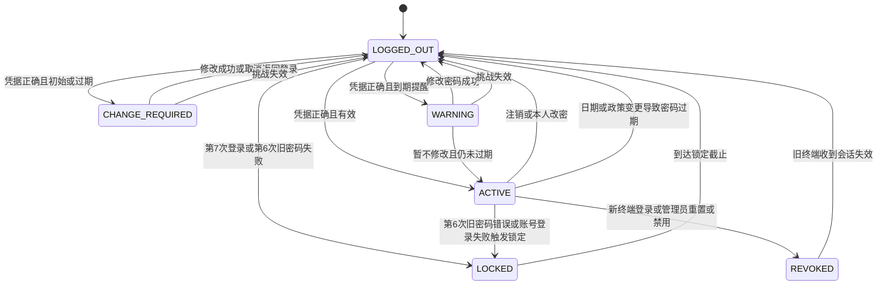
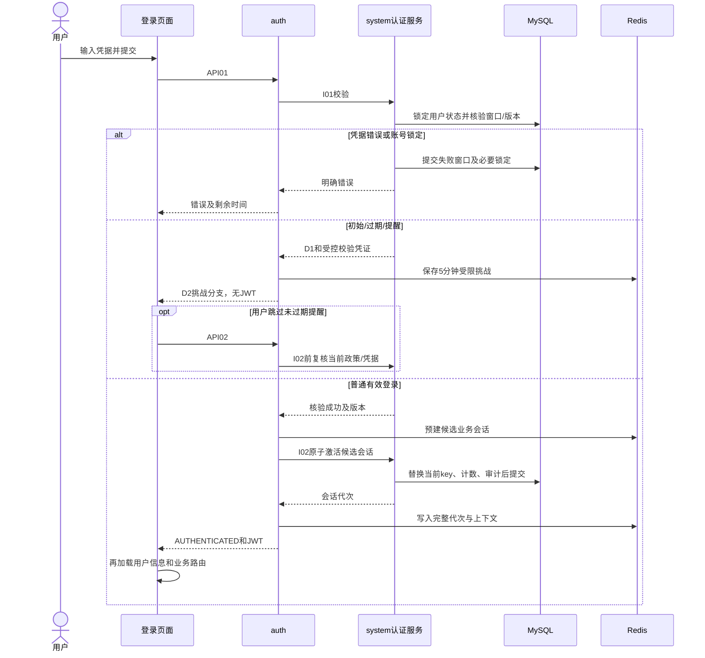
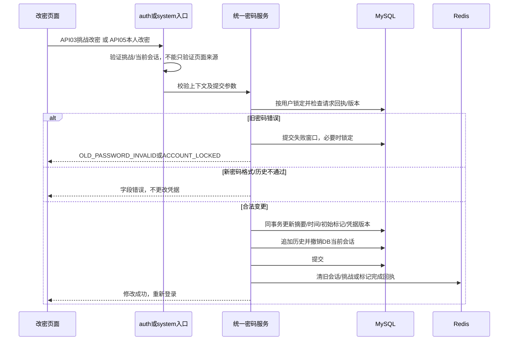
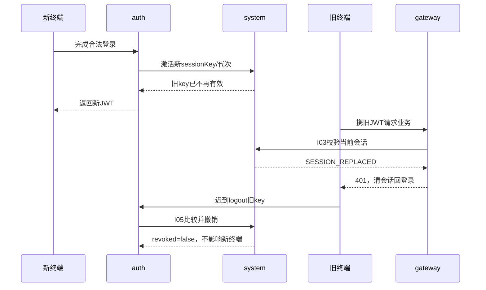
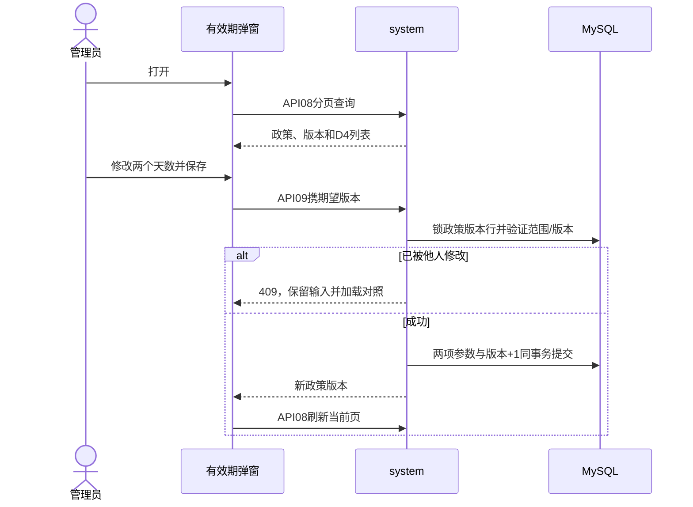
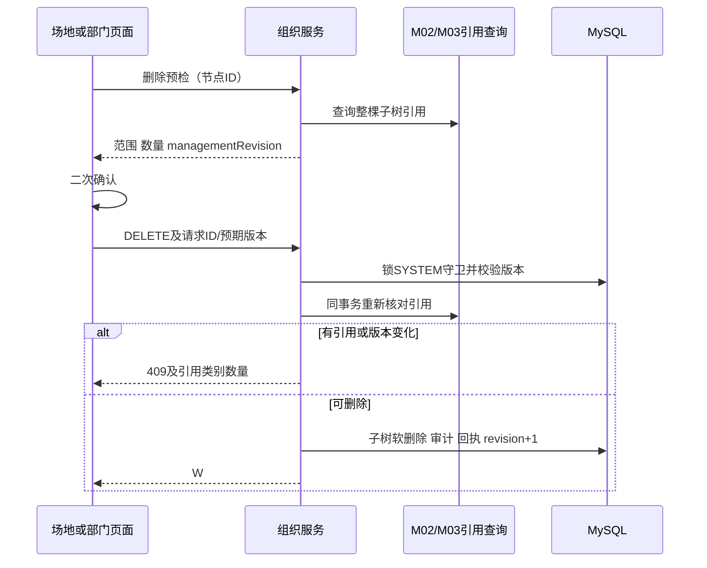
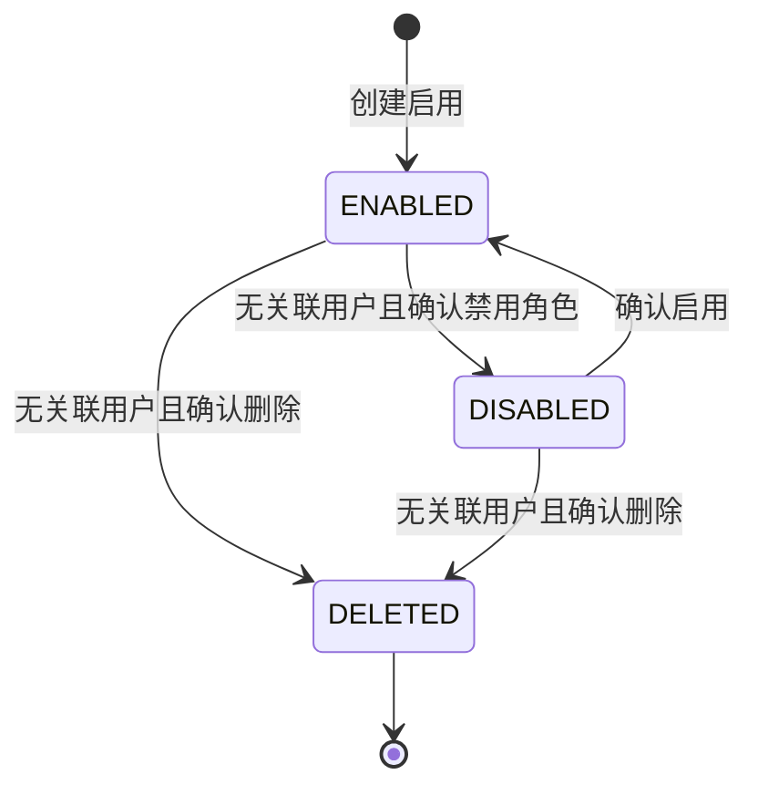
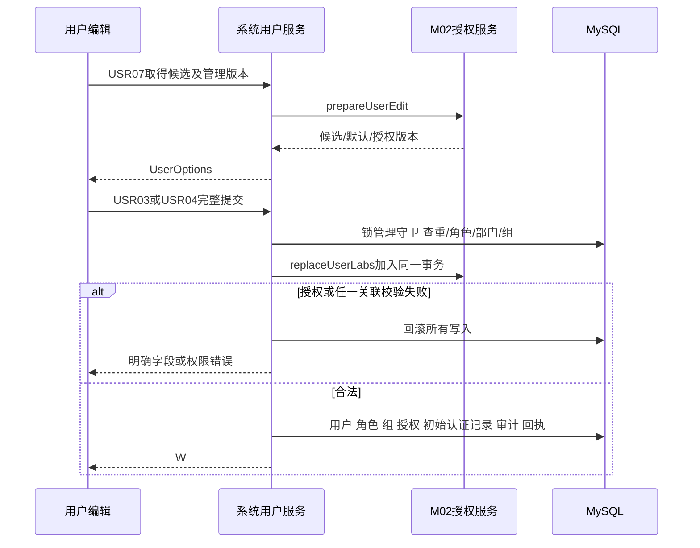
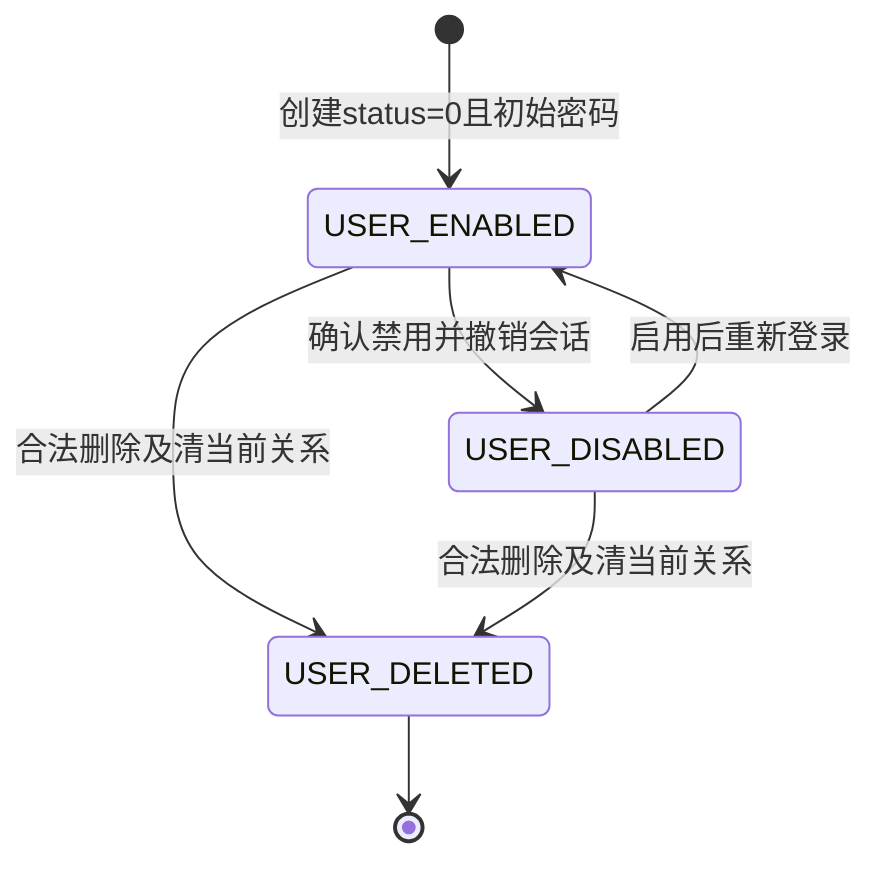

# 系统管理：详细设计

## 2026-11-01 认证安全增强

现行增补见[认证安全增强设计](认证安全增强设计.md)：验证码原子消费与分层限流；管理员重置密码API07、已有密码策略修改API09的操作绑定二次认证；本次登录前的成功/失败登录快照；匿名认证失败统一外壳。角色和权限变更不增加二次认证。该专题明确覆盖下文UI01锁定倒计时、匿名API01账号差异错误、UI05/UI06及API07/API09旧提交要求；已登录业务鉴权仍保留原错误语义。本地账号源码已接线，物理DDL已同步；源码/测试/目标数据库/HTTP/浏览器分层见实施计划。建议阈值待核准，AAD重新认证依赖客户联调，普通AAD旧成功链快照尚未统一接线。

## 开始培养专项增补（SC-20261017）

M01沿现有ActorContext/WriteMeta、功能权限和字典稳定ID提供资格载体，实验室及培养范围消费各owner事实，培养成员继承由M03解释。开始培养写请求只从统一请求头绑定WriteMeta；新后台取消/命令恢复如需用途装配须按固定capability登记，不能复用任意后台身份。具体流程权限及失败边界见专题第2、7、9节；本次不修改现有权限实现。

最新保存规则（2026-10-17）：小试、中试均只在第4步点击“完成”并成功提交后保存业务数据；未完成页面刷新或取消后从第1步重新开始，不恢复表单或中间步骤。操作审计和设备安全收尾保留，必须当天完成的限制不变。

步骤时间记录：四步分别记录服务端开始/结束时间及结束原因；刷新重开新建尝试，旧时间审计保留，未知结束时间不伪造。时间留痕不构成业务表单的中间保存点。

当前专题：[开始培养详细设计](../07-补液运行与任务执行/开始培养工作流详细设计.md)；实施拆分：[开始培养开发计划](../../开发任务/05-专题交付/小试中试开始培养开发计划-20261017.md)。本次仅文档补充，业务代码、数据库、设备操作均未执行。


## 三类实验室接入补充（INTEGRATION-20261010）

按[共同边界](../00-总纲与约定/00-三类实验室设备接入与执行边界.md)区分用户身份与Core/协议网关/检测接收服务身份。一期旧账号、旧菜单和自报actor不能直接取得新系统授权；桥接调用保留真实操作者与服务主体、来源身份及关联请求的审计，凭据不回显。

M01负责接入页面导航及现行角色/实验室权限衔接；补料启动、停止、人工恢复、工程核准和结果修复依所属模块功能权限校验。授权通过不替代设备组执行权校验。服务身份、凭据轮换及回调认证未核准时，相关写入口保持关闭。对应INTEG-01/07、INT-AC15；不新增一期旧表字段。

> 2026-09-17 公共框架补充：按[交付边界第3节](../00-范围与待核/00-M08范围与跨模块交付边界.md)，M01/公共前端负责导航、路由与默认页；登录进入首个有权且已交付的内部业务叶子，无业务菜单显示空态，加载失败显示重试。资料/改密/退出沿本模块，消息组件直接调用M09；不依赖M08工作台上下文，不因统计暂停隐藏独立业务菜单。BD07/BD08/BD13为新增待执行验收。

版本1.2；2026-09-09；状态：系统管理模块本轮18项业务选择已确认，跨章节一致性已收尾，待实现及技术验证。属于第3步，覆盖DEV-02、DEV-03的系统管理部分及DEV-26公共日志；未编码、未执行数据库脚本、未运行浏览器或数据库验收。

## 0. 模块范围与阅读导航

本模块包含登录密码、场地、部门、实验组、功能菜单、角色权限、用户及个人资料、数据字典、系统参数、登录及操作日志。实验室授权数据由M02维护，本模块设计用户编辑时的调用契约；项目分享由M03维护；消息投递归M09。

第1–13节保留登录密码功能组的完整设计及原API01–12编号；第14节起补齐其他功能及模块联动。此前“登录模块”措辞指登录功能组，不表示独立业务模块。数据库附件为系统管理统一字段字典，SQL分DD01登录基础、DD02组织权限及日志两个迁移批次，必须按第24节统一顺序处理。

| 功能组 | 设计落点 | 状态 |
| --- | --- | --- |
| 登录、密码和会话 | 第1–13节，API01–12/I01–05 | 已完成设计及本轮业务确认，待实现验证 |
| 场地、部门、实验组 | 第14–19节，ORG系列接口 | 已补齐设计及本轮业务确认，待实现验证 |
| 菜单、角色、数据权限 | 第14–20节，ACL系列接口 | 已补齐设计及本轮业务确认，待实现验证 |
| 用户、个人资料及跨模块授权 | 第14–21节，USR系列接口 | 已补齐设计，M02授权契约待其模块联动评审 |
| 字典、参数、登录/操作日志 | 第14–22节，DIC/CFG/LOG系列接口 | 已补齐设计及本轮业务确认，待实现验证 |
| 数据库、迁移、模块验收 | 数据库附件及第23–25节 | 设计稿与静态核对，不等于数据库或运行验收 |

阅读顺序：本文件业务/页面 → [完整数据库字段字典与旧库对照](数据库表结构与字段字典.md) → 本文件接口/时序/验收 → [迁移](history/sql/01-登录模块迁移设计稿.sql)、[核验](history/sql/02-登录模块核验设计稿.sql)、[回退](history/sql/03-登录模块回退设计稿.sql)。配套遵守[公共规范](../00-总纲与约定/00-编写规范与公共约定.md)。

## 1. 范围、依据与现状

| REQ | 需求依据 | 本次设计范围 |
| --- | --- | --- |
| R01 | [V5.1 01-基本设置：系统登录（V4.0 第 1 章）](../../需求说明书V5.1-1030_md/01-基本设置.md) | 本地账号密码登录、失败窗口、锁定与自动解锁 |
| R02 | 同上：单终端、首次/重置后登录 | 仅一个当前业务会话、强制改密、禁止以关闭弹窗绕过 |
| R03 | 同上：密码有效期设置与到期提醒 | 统一有效天数1–100、提醒天数1–15、提醒可跳过、过期不可跳过 |
| R04 | [澄清：密码长度与连续判定、Q41](../../需求说明书V4.0-0904_md/需求澄清决策记录.md) | 10–18位、四类字符、相同/升降连续≥3、历史最近10次；两处锁定阈值分别执行 |
| R05 | [V5.1 24-顶部导航栏：修改密码（V4.0 第 19 章）](../../需求说明书V5.1-1030_md/24-顶部导航栏（4.0）.md) | 原密码校验、本人修改、错误超过5次锁定 |
| R06 | 01用户管理：初始化/重置密码 | 新建与管理员重置读取sys.account.initPassword，缺失默认123456；强制修改由sys.account.initPasswordModify控制，缺失默认1；初始化不套本人改密强度 |
| R07 | 01登录记录、MAC澄清 | 登录/改密相关事件和字段补齐，PC/MAC不可获取时为空；日志查询页面归后续日志模块 |

排除：AAD最终集成方案、用户组织角色管理完整页面、自助找回密码、短信登录、MFA、PH/设备认证。这些不因本模块的接口扩展被顺带开发。既有验证码和锁屏能力需要兼容并防止成为新规则绕过入口。

### 1.1 当前证据与改造结论

| 证据 | 当前事实 | 设计处理 |
| --- | --- | --- |
| TokenController.login → SysLoginService.login → TokenService.createToken | 通过密码校验即创建令牌 | 增加登录结果分支，强制改密只发受限挑战，不发业务令牌 |
| SysUserController.getInfo、前端user store | 令牌后返回初始/过期提示，前端可取消提示 | 改为服务端准入；前端提示负责交互，不负责最终拦截 |
| SysPasswordService | 现有重试计数/锁定参数不符合新规则，计数使用缓存递增写入 | 统一服务端15分钟滚动窗口、登录第7次/改密第6次锁30分钟，提交失败结果也必须持久化 |
| SysProfileController、SysUserServiceImpl、SysUserMapper | 旧口令和新旧不同校验，更新口令与时间；管理员重置路径也写更新时间 | 新增初始标记，集中修改服务、历史比较、版本和会话撤销 |
| SysUserController.passwordValidity | 已有GET/PUT与validDays/remindDays，默认90/5，保存校验不完整 | 沿用路由和分页外壳，新增范围校验、政策版本和原子更新 |
| sys_user_password_history | 已有历史表与CRUD；user_id为varchar(20)，用户ID为bigint | 复用扩展，类型统一，历史改为追加，禁止普通CRUD改删摘要 |
| 当前sys_config快照 | passwordValidateDays=0，而新需求要求1–100 | 设计迁移给出检查与替换，不把0继续解释为永不过期 |

源码定位使用codebase-memory Tier2；图谱代码代次2026-09-06T05:30:22Z相关文件已变化，以上结论均回读当前源码确认。SQL有图谱解析缺口，本轮直接提取所涉CREATE TABLE及相关非敏感配置，不依赖图谱证明完整数据库行为。旧库核对范围仅认证相关表，不声称完成所有业务表映射。

## 2. 业务规则与明确的技术选择

### 2.1 认证及锁定

1. 先校验请求结构/验证码，再查询账号。禁止删除/停用账号登录；错误用户名或密码统一提示，不暴露摘要。用户不存在的失败只记安全审计，不伪造user_id。
2. 登录凭据允许初始123456和历史口令进入验证，不能在登录表单套用新密码10–18位强度而使用户无法首次改密。用户名trim后按当前库规则查询；密码不trim。
3. 登录失败采用 `(now−15分钟, now]` 滚动窗口；同请求只记一次。第1–6次错仍未锁，第7次错误立即写locked_until=now+30分钟。改密旧密码窗口第1–5次未锁，第6次立即锁。新密码格式/确认不一致不计旧密码失败。
4. 两类窗口独立计数，但共享账号锁。锁定期间正确密码也不放行，不因继续请求延长截止；now等于locked_until时清窗口后允许新尝试。密码验证成功后只清零当前场景的失败窗口：登录验证成功只清登录错误次数，修改密码时旧密码验证成功只清旧密码错误次数，不清另一个场景窗口；已锁定账号不能凭正确密码提前解锁（Q09已确认，2026-09-09）。
5. 锁定触发时撤销当前业务会话。锁屏解锁与登录共用同一错误计数窗口和锁定规则，两个入口的错误次数合并计算，不得通过切换入口绕过限制；未锁定时解锁验证成功按Q09清零登录错误次数，不清改密旧密码计数，已锁定时仍不能提前解锁（Q10已确认，2026-09-09）。数据库失败计数是权威，Redis仅缓存，缓存清空不能提前解除30分钟锁。
6. 凭据验证成功后，按优先级判定：初始或迁移待核实 → INITIAL；否则到失效日期 → EXPIRED；否则进入提醒区间 → EXPIRING；否则VALID。INITIAL/EXPIRED只发5分钟受限挑战，从服务端验证登录密码成功时起计，不因刷新页面或输入错误而延长；超时保留账号、清空密码输入及过期票据，返回身份验证入口重新验证，不改变正常登录会话有效期（Q14已确认，2026-09-09）；EXPIRING发可跳过提醒挑战；只有VALID或合法跳过提醒后才能激活业务会话。

### 2.2 新密码规则

规则来自R04：ASCII字母A–Z/a–z、数字0–9及符号 `! @ # $ % ^ & * ( ) _ - + = [ ] { } ; : ' " , . / < > ? ~`；长度10–18，四类均有。不接受空格、中文、反斜杠、反引号等未列字符，不自动过滤或截断。

连续判断：同一字符连续3次或以上；数字/字母升序、降序连续3位或以上拒绝。字母序列比较按大小写折叠处理（技术解释），如aBc、Cba也拒绝；两个字符12/ab允许。前端与后端共用规则样例，后端为权威。

新密码与当前摘要及最近10条历史逐项bcrypt matches，使用独立盐生成新摘要；不能通过数据库 `password = hash(newPassword)` 判断重复。历史包含每次修改后的口令及当前基线，当前摘要额外比较防止历史缺漏。历史不满10条时检查现有全部，不能声称已还原旧系统缺失历史。

初始化/管理员重置由服务端读取 `sys.account.initPassword`（缺失默认123456）生成bcrypt摘要，保留 `is_initial_password=1`；重置客户端不能为单个用户指定密码。`sys.account.initPasswordModify` 为字符串0/1，缺失默认1：1要求INITIAL登录先改密，0不因INITIAL单独阻断登录；已有生效日期仍执行EXPIRED到期守卫，不能以此关闭到期改密。空生效日期不伪造日期；开关0时仅允许INITIAL准入，不虚构新的密码日期。本人设置新密码继续按强度和历史防重用校验。2026-10-30用户最新确认取代此前固定初始值和固定强制改密口径。

配置口令只接受非空、非纯空白、长度1–64字符且UTF-8不超过72字节的值，不trim；缺配置才回落默认，已有非法配置明确报错且不得把原文放入错误。该传输边界不替代本人改密的强度和历史限制。配置写入口不回传明文，导出及按键查询也不得暴露初始值。

### 2.3 有效期和会话

`effectiveDate = DATE(pwd_update_date)`；`expiresDate = effectiveDate + validDays`；`remainingDays = expiresDate − today`。业务日Asia/Shanghai，到expiresDate的00:00即过期。提醒区间为 `max(effectiveDate, expiresDate-remindDays) ≤ today < expiresDate`。NULL修改时间不造日期，视为需要首次改密。

全局有效期变更后立即按新值重新计算现有用户，而非每用户复制一个失效时间。旧password_valid_days保留但不覆盖全局。登录中及业务请求鉴权使用最新政策；已登录用户因自然到期或政策调整变为过期时，下一次业务请求要求重新认证并修改密码，完成后才能继续操作，不等待用户下次主动登录，不追溯撤销已提交的业务操作（Q07已确认，2026-09-09）。

单终端会话口径：每个用户只有一个当前业务sessionKey；同一浏览器的多个标签页可共用该登录会话，不因打开新标签页互相退出；在另一浏览器或电脑重新登录成功后，原会话失效（Q17已确认，2026-09-09）。重新输入凭据登录仍按既有会话激活流程处理。浏览器clientId只辅助标识，不当MAC或安全身份依据。并发登录以最后成功提交的激活事务为准；旧JWT即使未到期，当前会话匹配失败也拒绝。旧客户端logout不得退出新客户端会话。

本人改密成功、管理员重置、账号锁定/禁用/删除、强制下线都撤销当前会话。本人改密后返回登录页，用新密码重新登录；不把旧会话直接提升为新凭据会话。JWT刷新不增加login_count。

### 2.4 已确认决策与剩余技术验证

| 项目 | 本稿选择 | 评审性质 |
| --- | --- | --- |
| 初始有效期/提醒 | 首次部署配置缺失时有效期90天、提前5天提醒；旧有效期0改90；已有合法配置保留 | Q08已确认（2026-09-09）；其他非法配置仍按迁移预检停止，不擅自覆盖 |
| 全局有效期设置权限 | 复用system:user:query/edit，且仅超级管理员可修改全系统密码有效期和到期提醒天数 | Q06已确认（2026-09-09）；不开放给实验室管理员或普通用户管理员 |
| 旧账号初始标记迁移 | 先保守为1，再用应用bcrypt与来源证据核实非初始账号并置0 | 正式启用前必须核验，不默认强迫全部旧用户改密，也不猜已非初始 |
| 强制改密身份验证有效期 | INITIAL/EXPIRED从服务端验证登录密码成功起5分钟；超时保留账号、清空密码输入，要求重新验证身份 | Q14已确认（2026-09-09）；不改变正常会话有效期或30分钟锁定期 |
| 其他挑战/重试缓存寿命 | 提醒挑战沿用5分钟、认证请求回执10分钟；管理请求回执24小时 | 实现基线参数，技术验证时核对失效/恢复行为；不是新增待用户确认的业务问题，不延长Q14强制改密验证期限 |
| 提醒/单终端/在线到期 | 在线到期及政策调整按Q07；多标签/会话替换按Q17；提醒期每次重新登录提醒一次、正常使用不重复弹窗按Q18 | Q07、Q17、Q18已确认；尚无运行验收 |
| AAD与旧用户数据 | AAD另案，不执行旧库账户迁移 | 已确认范围；旧pwd算法不能凭varchar推断兼容 |

## 3. 状态定义、流转和权限

### 3.1 状态定义

密码状态为派生值，接口返回 `INITIAL / EXPIRED / EXPIRING / VALID`，不新增四个数据库标志。账号可用性先看del_flag/status/locked_until；会话状态看current_session_key、session_version和credential_version，不压成一个status。



`CHANGE_REQUIRED` 和 `WARNING` 是挑战流程状态，不是已登录。取消强制改密只能回到登录页；未过期提醒的取消对应“暂不修改继续登录”。管理员重置后的密码状态为INITIAL，不直接成为EXPIRED。

| 转换 | 原状态/前置 | 写入及副作用 | 失败处理 |
| --- | --- | --- | --- |
| 凭据错误 | 未锁、账号存在 | 锁auth_state，裁剪并追加对应窗口；超阈值锁定并撤销session | 必须提交失败计数，再返回错误，不以抛异常回滚计数 |
| 激活会话 | 凭据/政策版本仍合法、未锁、状态VALID或合法跳过提醒 | 锁user/auth_state，替换sessionKey，代次+1，login_count+1，登录事件 | 比较失败删除候选Redis会话，返回重新登录 |
| 本人改密 | 合法挑战或当前会话+旧密码正确 | 同事务更新摘要/时间/初始标记/凭据版本、追加历史、撤销会话 | 版本冲突整笔不更新；新密码问题返回字段错误 |
| 管理员重置 | resetPwd功能和目标用户数据权限 | 初始标记1、版本+1、追加ADMIN_RESET、撤销会话 | 越权/旧版本拒绝；失败不清空历史 |
| 政策保存 | 超管+权限、范围合法、政策版本匹配 | 两配置和版本原子更新，审计 | 冲突不覆盖，重新读取但保留输入供对照 |
| 退出 | 当前sessionKey匹配 | 清当前key、代次+1；删对应缓存 | 旧key不匹配只删旧缓存，不碰新key |

### 3.2 页面动作权限

| 场景 | 登录 | 跳过提醒 | 提交新密码 | 管理员重置 | 政策设置 | 业务API |
| --- | --- | --- | --- | --- | --- | --- |
| 未认证 | 可提交凭据 | 否 | 无挑战不允许 | 否 | 否 | 否 |
| INITIAL/EXPIRED挑战 | 不重复提交登录 | 否 | 合法挑战可用 | 否 | 否 | 否 |
| EXPIRING挑战 | 不重复提交登录 | 可，提交时再查未过期 | 可 | 否 | 否 | 否 |
| 正常业务会话 | 无需重复登录 | 不适用 | 本人旧密码验证 | 需system:user:edit及目标管理权 | 按2.4策略 | 继续按业务授权 |
| 锁定/停用/删除/被替换 | 锁定到期前拒绝；停用删除拒绝 | 否 | 否 | 操作者自身须有效；目标按用户管理限制 | 否 | 否 |

## 4. 页面线框、字段与交互

保留现有登录页品牌与整体样式。线框为布局/交互规格，不是视觉定稿。密码默认掩码，可按眼睛按钮临时显示；禁止将密码写入业务localStorage、Cookie或路由参数，“记住我”改为只记账号。

### UI01 本地登录

```text
┌ 药明生物 SMP ─────────────────────┐
│ 本地登录                          │
│ 账号       [                     ]│
│ 密码       [                 眼睛]│
│ 验证码     [       ] [图片/刷新]  │ ← 按既有配置
│ □ 记住账号                       │
│ [错误信息 / 锁定剩余时间]         │
│           [ 登 录 ]              │
└──────────────────────────────────┘
```

| 字段/操作 | 规则与来源 | 交互 |
| --- | --- | --- |
| 账号 | 必填，trim后1–30字符，沿用现有账号 | 记住账号可预填；退出保留账号不保留密码 |
| 密码 | 必填，登录传输最大64字符且UTF-8不超72字节；不做新密码强度限制 | Enter等同登录；不trim；错误时清密码，焦点回密码 |
| 验证码 | 既有/code启用时必填，uuid随图片 | 更换图片清输入；失败刷新，不计账号口令失败 |
| 记住账号 | 默认沿用本机选择 | 只保存username，移除旧应用保存的口令Cookie |
| 登录 | 前端有效且不在请求中可用 | 提交API01、按钮loading禁止重复；VALID进业务，其他打开UI02/03 |

调用顺序：获取既有验证码配置/图片 → API01 → 根据outcome分支 → 只有AUTHENTICATED才存token并调用现有getInfo/路由。验证码失败和网络错误保留账号，不显示不存在的剩余尝试数。锁定剩余秒从服务端计算，前端倒计时只是展示，到0后允许重新提交，服务端再校验。

请求超时不自动重新发送密码；保留账号，提示“登录结果未确认，请重试”。同一逻辑请求短时重试沿用requestId；用户修改输入生成新requestId。请求中取消页面时忽略迟到响应，不自动跳进业务页。

### UI02 首次或过期强制改密

```text
┌ 重置密码 ────────────────────────┐
│ 首次登录请修改初始密码 / 密码已过期│
│ 新密码     [                 眼睛]│
│ 再次输入   [                 眼睛]│
│ 10–18位；大小写、数字、符号       │
│ 无连续3位；不可与最近10次重复     │
│ [字段错误或挑战已过期]           │
│ [返回登录]            [确认修改] │
└──────────────────────────────────┘
```

新密码/确认必填，失焦展示格式或不一致错误，历史重复由服务器提示新密码字段。无旧密码栏，因为挑战已经证明旧凭据；客户端不能自行指定userId。API03提交期间不关闭，不重复发送；成功清所有密码与票据，提示“密码修改成功，请使用新密码登录”，回UI01。

关闭、Escape、返回均等价取消本次认证，调用API04，清票据与密码回登录；绝不进入首页。新密码已填写时询问“放弃本次修改并返回登录？”；不强制提醒场景走同一文案。票据过期或服务器重启导致票据丢失，显示“验证已失效，请重新登录”，不自动创建新票据。

### UI03 到期提醒

提醒频率按Q18已确认（2026-09-09）：进入到期提醒期后，每次重新登录提醒一次，未过期时允许“暂不修改，继续登录”；正常业务使用、刷新页面或打开同一浏览器的新标签页不重复弹窗。刷新尚未完成的提醒页可恢复当前流程，不视为新的登录提醒；到期后按Q07强制重新认证改密。

布局同UI02，标题“密码还有N天到期”，按钮为“暂不修改，继续登录”和“修改密码”。前者调用API02，后者调用API03；空新密码允许跳过但不允许提交修改。若已输入新密码再跳过，询问是否放弃；仅窗口外取消不隐式登录。打开时未过期而提交时已过期，API02返回PASSWORD_CHANGE_REQUIRED并切UI02，不继续登录。

### UI04 登录后本人改密

```text
┌ 修改密码 ────────────────────────┐
│ 原密码*    [                 眼睛]│
│ 新密码*    [                 眼睛]│
│ 再次输入*  [                 眼睛]│
│ 规则和字段错误                    │
│ [取消]                    [保存] │
└──────────────────────────────────┘
```

导航“修改密码”和现有个人资料改密页使用同一组件/校验。打开API06读取当前凭据版本及规则；加载失败只显示重试，禁止保存。API05提交，原密码错定位原密码字段并清空原密码；第6次锁定立即清全部输入并回登录显示倒计时。格式错保留当前弹窗输入供修正，关闭一律清理。保存成功注销会话回登录；请求超时后不假设失败重改，提示可用新密码重新登录确认。

### UI05 管理员重置密码

沿用用户列表行“重置密码”，有权限且目标可管理时可见。点击先取用户管理已有详情的credentialVersion，再展示：

```text
┌ 重置密码 ────────────────────────┐
│ 确定重置 张三（zhangsan）的密码？ │
│ 将恢复初始密码，当前会话失效，    │
│ 用户下次登录必须修改密码。        │
│ [取消]                    [确定] │
└──────────────────────────────────┘
```

不提供密码输入框；API07成功提示“重置成功”，保留原用户列表筛选分页并刷新该行；失败留弹窗，版本冲突要求刷新后再确认，不能静默重置新口令。不展示现有摘要，也不把初始口令放入操作日志。

### UI06 全局有效期设置

```text
┌ 密码有效期设置 ──────────────────────────────────────┐
│ 有效期 [90] 天(1–100)   提前 [5] 天提醒(1–15)         │
│ 修改将按新设置重新计算现有用户到期日。                │
│ 序号｜显示名｜账号｜角色｜剩余天数｜生效日｜失效日    │
│  1  ｜ 张三 ｜... ｜... ｜  20   ｜ ...  ｜ ...        │
│                 每页10/20/50/100   ‹ 1 ›             │
│ [取消]                                      [保存]   │
└──────────────────────────────────────────────────────┘
```

API08初次加载并返回policyVersion。列表只读，不提供个人有效期编辑；NULL生效时间显示“首次登录待修改”，日期显示“—”；remainingDays负值展示“已过期N天”，0展示“今日已过期”。角色无值显示“—”。默认按userId升序稳定排序，页码默认1、每页10。

修改天数不会在未保存时改写列表日期；展示“列表按已生效设置展示”。切页保留未保存输入，但若服务器policyVersion变化则冻结保存，提示重新加载比较。保存API09同时提交两个值和版本，必须正整数；成功重查当前页，超出末页则回最后有效页。无用户为空态但仍可保存政策；加载政策失败不可保存。离开有改动需确认，版本冲突保留输入与最新值供对照，不盲目覆盖。

2026-10-30 保存接线修复：页面消费 API08 顶层 `policyVersion`，API09 正文发送 `validDays/remindDays/expectedPolicyVersion/requestId`，不借用用户管理修订头。加载失败、版本缺失或分页版本变化时停止保存；未知结果的手动重试沿用同身份原请求载荷、版本和 UUID，不自动换键覆盖。日期与剩余天数直接展示服务端冻结字段，不按客户端时钟重算。保留当前弹窗保存成功后关闭、再次打开重查的交互；本轮未扩展未保存离开确认等交互，分层验证与限制见 [保存修复记录](history/review/2026-10-30-密码有效期保存修复.md)。

全系统密码有效期和到期提醒天数仅超级管理员可修改，页面入口和服务端共同检查，不开放给实验室管理员或普通用户管理员（Q06已确认，2026-09-09）。

## 5. 数据库、字典和改造

完整逐字段结构、字典具体值、索引和逻辑关联在[字段字典](数据库表结构与字段字典.md)，本模块整体设计不可脱离该附件单独验收。无外键；用户、历史、状态和日志共用内部user_id，不通过用户名串联历史。

新增/改造摘要：sys_user+初始标记/凭据版本；历史表类型统一并增加版本/请求/来源/操作者；新增9列auth_state；登录记录增加身份与终端快照；sys_config复用现有键并补政策版本。旧库参考IsInitialPwd和有效期概念，不复制旧账户表、OnlineStatus或ADFS密码。

SQL三份均是完整设计语句，默认带显式停止开关，尚未在MySQL执行。仅变更docs内设计稿，原始三份SQL保持不变。迁移前在维护停写窗口做结构、重复账号/配置、历史ID类型、关联、排序及字典冲突检查。异常记录先补证据，不删数据凑约束。

旧用户的初始标记必须在上线前由应用bcrypt核验及人工证据确定；提供逐用户核验报告后按 `UPDATE sys_user SET is_initial_password=0 WHERE user_id=:核验用户ID AND credential_version=0` 的受控应用参数化操作更新。这里是数据核验流程，不是让开发者在迁移SQL中填任意默认。未核实账号保持受限，不宣称所有历史用户已可无提示登录。

## 6. 接口公共定义

### 6.1 外壳、请求与错误

所有外部写请求使用JSON，Content-Type application/json。requestId为客户端生成UUID（36字符，本模块最大64）且按用户/操作绑定；Bearer只放Authorization。用户名、密码从body传输，clientId为浏览器随机UUID，不能作为身份权限依据。ID对外十进制字符串，版本≥0，日期YYYY-MM-DD，时间ISO8601带+08:00。

沿用现有外壳：成功 `code=200,msg="操作成功"`。auth的结果在data；system普通命令也使用data；已有有效期GET保留顶层rows/total/validDays/remindDays。不把嵌套结构变化留给前端猜测。

| 公共响应字段 | 类型/可空 | 含义 |
| --- | --- | --- |
| code | integer/否 | 200成功；400参数；401会话失效；403权限；409版本；423账号锁；503依赖不可用 |
| msg | string/否 | 可直接显示的中文消息，不含敏感值 |
| data | object或null | 各接口定义，失败通常null |
| errorCode | string/失败必有 | 稳定业务码，见下表 |
| requestId | string/否 | 回显已验证请求ID；读请求服务端生成 |
| fieldErrors | array/失败可空 | 元素field:string字段路径、message:string中文说明；无字段错误为空数组 |
| retryAfterSeconds | integer/可空 | 锁定剩余秒或重试提示，向上取整，不作为客户端自行解锁凭证 |

错误时HTTP状态与code一致；客户端需在HTTP错误分支解析此外壳，不能被现有request.js统一“网络异常”覆盖。成功响应只返回本接口列出的字段。

| errorCode | HTTP/code | 场景 |
| --- | --- | --- |
| INPUT_INVALID / PASSWORD_POLICY_VIOLATION | 400 | 参数、格式、字符或连续规则失败 |
| CREDENTIALS_INVALID / OLD_PASSWORD_INVALID | 400 | 本模块登录/旧密码错误；保持表单，不触发全局401跳转 |
| PASSWORD_REUSED | 400 | 与当前/历史口令重复 |
| ACCOUNT_LOCKED | 423 | 锁定，返回retryAfterSeconds |
| ACCOUNT_UNAVAILABLE / PERMISSION_DENIED | 403 | 停用/删除或动作无权 |
| CHALLENGE_EXPIRED / SESSION_REPLACED / SESSION_INVALID | 401 | 清除相关票据/会话，回登录 |
| PASSWORD_CHANGE_REQUIRED | 409 | 提醒跳过时已变为强制改密，或在线密码已过期；重新登录获取有效挑战 |
| VERSION_CONFLICT / REQUEST_CONFLICT | 409 | 数据版本变更、同请求不同内容 |
| AUTH_DEPENDENCY_UNAVAILABLE | 503 | DB/Redis不可用，不能按正常登录放行 |

### 6.2 DTO逐字段定义

**D1 PasswordState**（只含以下字段）：

| 字段 | 类型/可空 | 含义/单位/例 |
| --- | --- | --- |
| passwordState | string/否 | INITIAL、EXPIRED、EXPIRING、VALID |
| effectiveDate | string/是 | 口令生效日，未知null |
| expiresDate | string/是 | 失效日，未知null |
| remainingDays | integer/是 | 日差，可0/负数；未知null |
| validDays | integer/否 | 全局1–100天 |
| remindDays | integer/否 | 全局1–15天 |
| policyVersion | integer/否 | ≥1，政策版本 |
| credentialVersion | integer/否 | ≥0，本人口令版本 |

**D2 LoginResult**（互斥分支）：

| 字段 | 类型/可空 | 含义 |
| --- | --- | --- |
| outcome | string/否 | AUTHENTICATED、CHANGE_REQUIRED、EXPIRY_WARNING |
| access_token | string/条件必填 | 仅AUTHENTICATED返回JWT，其余不返回而非空串 |
| expires_in | integer/条件必填 | 仅AUTHENTICATED返回，保持当前TokenService单位“分钟”，不静默改为秒 |
| challengeToken | string/条件必填 | 仅挑战分支返回，随机256bit票据，最大128字符，不能用于Authorization |
| challengeExpiresAt | string/条件必填 | 仅挑战分支返回，服务端5分钟截止 |
| password | D1 object/否 | 完整展开见D1；是状态信息，不是口令 |

**D3 MutationResult**：`applied:boolean` 必有，表示该请求已生效（含重试命中）；`credentialVersion:integer` 口令动作必有，表示变更后的凭据版本；`nextAction:string` 仅本人/挑战改密返回，固定LOGIN_REQUIRED，表示当前用户需要重新登录，管理员重置不返回；`policyVersion:integer` 仅政策保存必有，表示变更后的政策版本，其余不返回。任何结果不含口令摘要。

**D4 ValidityRow**：userId:string非空；userName:string非空；nickName:string非空；roles:array非空（空数组允许），元素roleId:string/roleName:string均非空；passwordState:string为D1枚举；effectiveDate/expiresDate:string可空；remainingDays:integer可空；credentialVersion:integer非空。显示角色来自现有用户角色关系，不能把完整SysUser含password序列化给列表。

## 7. 外部接口明细

### API01 POST /auth/login（调整）

调用UI01，无Bearer。验证码校验沿用网关既有链路，但认证分支/错误码需本轮接口改造；API内部验证码未启用时不额外要求。

| 输入Body参数 | 类型 | 必填/默认 | 含义/范围/示例 |
| --- | --- | --- | --- |
| username | string | 是/无 | trim后1–30，如zhangsan |
| password | string | 是/无 | 1–64字符且UTF-8≤72字节；允许初始口令；不trim |
| code | string | 验证码启用时必填/无 | 1–32，验证码文本 |
| uuid | string | 验证码启用时必填/无 | 1–64，当前验证码标识 |
| clientId | string | 是/无 | 浏览器随机UUID，非MAC |
| requestId | string | 是/无 | UUID，同一逻辑请求不变 |

输出：公共外壳＋data=D2。错误格式/验证码不增加口令失败数；密码错按R01计数。正确口令但强制改密只生成挑战审计，不增加login_count，不替换旧业务会话；激活成功才计一次登录。

```json
{"username":"zhangsan","password":"Q7!mR2@vT9","clientId":"5f23e7e1-91cb-4bf1-9e18-c8201df4c7aa","requestId":"c8fa4a71-9d91-4e10-b961-89ca1c53ec4f"}
```

```json
{"code":200,"msg":"需修改密码","requestId":"c8fa4a71-9d91-4e10-b961-89ca1c53ec4f","data":{"outcome":"CHANGE_REQUIRED","challengeToken":"EXAMPLE_ONLY_NOT_A_REAL_TOKEN","challengeExpiresAt":"2026-09-08T10:05:00+08:00","password":{"passwordState":"INITIAL","effectiveDate":null,"expiresDate":null,"remainingDays":null,"validDays":90,"remindDays":5,"policyVersion":1,"credentialVersion":0}}}
```

### API02 POST /auth/login/continue（新增）

UI03跳过提醒。Body：challengeToken:string必填1–128；clientId:string必填UUID，须匹配票据；requestId:string必填UUID。无Bearer。仅EXPIRY_WARNING票据可用，提交时重新检查账号、锁、凭据及政策版本，失效或变强制则不激活。输出data=D2且outcome只能AUTHENTICATED，不重新发第二个提醒挑战。失败票据仍按可重试/过期状态处理，不能变成强制改密的绕过入口。

### API03 POST /auth/password/complete（新增）

UI02/03提交改密。Body：challengeToken/clientId/requestId同API02；newPassword:string必填10–18符合R04；confirmPassword:string必填且完全相同。无userId、无oldPassword、无Bearer，用户和凭据版本从合法挑战取。事务见SEQ02。输出data=D3，nextAction=LOGIN_REQUIRED；不自动签发业务会话。

格式/历史错误不消费票据，允许5分钟内修正；成功后票据只保留同请求的完成回执，不允许再改。重传不同新密码返回REQUEST_CONFLICT。数据库已提交而票据更新失败时，以history.request_id与摘要匹配/版本证据恢复成功回执，不能重复增加凭据版本。

### API04 DELETE /auth/login/challenge（新增）

UI02/03取消。Header：X-Login-Challenge:string必填1–128；X-Client-Id:string必填UUID；X-Request-Id:string必填UUID。无Body、无Bearer；用于删除本次票据，无效/已删也返回200、data=null；不删除任何业务会话。网关和日志禁止记录此挑战请求头。

### API05 PUT /system/user/profile/updatePwd（调整）

UI04，Authorization:Bearer必填；Body如下：

| 参数 | 类型 | 必填/默认 | 含义 |
| --- | --- | --- | --- |
| oldPassword | string | 是/无 | 当前口令，登录口令传输上限，不用新强度限制 |
| newPassword | string | 是/无 | 新口令10–18位、R04 |
| confirmPassword | string | 是/无 | 与newPassword完全相同 |
| expectedCredentialVersion | integer | 是/无 | API06读到版本，≥0 |
| requestId | string | 是/无 | UUID |

用户仅从登录态取，提交userId无效并拒绝未知字段。服务端先校验会话/账号、旧口令（记录真实失败），再校验新口令、历史和版本；事务后会话撤销。输出data=D3。响应丢失后旧会话已失效，重试可能收到401，前端提示用新口令登录确认，不能承诺旧令牌永久可查询回执。

### API06 GET /system/user/profile/passwordState（新增）

UI04。只有Authorization，无Query/Body；`data`对象包含D1的全部字段，另增加必填对象`rules`，完整子字段如下。规则只读，不能从前端覆盖；当前账号已失效时返回对应401/423，不向其他用户泄露版本。

| rules子字段 | 类型/必有/可空 | 值及含义 |
| --- | --- | --- |
| minLength | integer/是/否 | 10，密码最少字符数 |
| maxLength | integer/是/否 | 18，密码最多字符数 |
| requiredClasses | string[]/是/否 | 固定四项UPPER、LOWER、DIGIT、SYMBOL，分别表示大写、小写、数字、符号，四类都必须出现 |
| allowedSymbols | string/是/否 | 第2.2节完整允许符号组成的字符串，不含分隔空格 |
| sequenceLength | integer/是/否 | 3，达到该长度的重复或连续片段禁止 |
| historyCount | integer/是/否 | 10，最近历史密码的禁止复用数量，另检查当前密码 |

### API07 PUT /system/user/resetPwd（调整）

UI05。Authorization必填；Body：userId:string必填正bigint十进制；expectedCredentialVersion:integer必填≥0；requestId:string必填UUID。删除旧body.password输入，旧客户端继续传密码返回INPUT_INVALID，不能仍允许任意管理员口令。沿用当前源码权限system:user:edit＋目标用户可管理检查＋既有超级管理员保护，不假设已存在独立resetPwd权限码。输出data={applied:true,credentialVersion:新版本}，不输出初始明文，nextAction不返回（操作者无需退出，目标会话撤销）。同requestId返回已提交结果，不能把一次重试变第二次重置。

### API08 GET /system/user/passwordValidity（调整）

UI06，Authorization及2.4的全局权限。Query：pageNum:integer可选默认1最小1；pageSize:integer可选默认10，允许10/20/50/100。无Body。输出公共code/msg/requestId，顶层validDays/remindDays/policyVersion（D1同义）、initPasswordModify:string的0/1、initPasswordConfigured:boolean及rows:D4[]、total:integer≥0。不返回data，保持已有列表外壳。仅查询未删除账号，含停用账号；排序user_id ASC。读取政策和列表使用同一次一致性快照，不出现列表日期与返回配置不一致。

```json
{"code":200,"msg":"操作成功","requestId":"1ab9c371-cf70-4c18-bf6f-9e3272c252dd","validDays":90,"remindDays":5,"policyVersion":1,"rows":[{"userId":"10001","userName":"zhangsan","nickName":"张三","roles":[{"roleId":"2","roleName":"试验员"}],"passwordState":"VALID","effectiveDate":"2026-09-01","expiresDate":"2026-11-30","remainingDays":83,"credentialVersion":2}],"total":1}
```

### API09 PUT /system/user/passwordValidity（调整）

UI06，Authorization和全局权限。Body：validDays:integer必填1–100；remindDays:integer必填1–15；expectedPolicyVersion:integer必填≥1；requestId:string必填UUID；可选initPassword:string（提供非空时更新全局初始值，省略不改）、initPasswordModify:string的0/1（省略不改）。密码输入留空时前端省略，不回填掩码。先锁政策版本行，再校验和更新本次策略字段、版本+1；禁止部分成功；可选配置行缺失时仅由专用服务在版本锁内首次创建。初始密码值只供服务内部使用，不出现在API08、普通参数查询、日志或审计原文中。输出data={applied:true,policyVersion:新版本}。同版本重传最多应用一次，若无法命中短时回执返回VERSION_CONFLICT，客户端API08确认现值，不能自动用新版本覆盖。

### API10 DELETE /auth/logout（调整）

Authorization必填；Header X-Request-Id:string必填UUID；无Body/Query。退出匹配会话，data=null。令牌已过期/已撤销可按幂等退出返回200，但不能清当前不同sessionKey；伪造/不可解析令牌按401。前端无论网络成功与否清本地令牌，服务端网络失败时不宣称会话已撤销。

### API11 POST /auth/refresh（调整）

Authorization和X-Request-Id必填，无Body/Query。校验当前会话、用户状态、凭据版本、锁及到期后再续Redis TTL；返回data={expires_in:integer分钟,expiresAt:ISO时刻}，不改变sessionVersion、login_count，不创建新token。状态不合法返回401/423，不能“只要缓存存在就续期”。

### API12 POST /auth/unlockscreen（兼容收口）

Authorization必填。Body：password:string必填（登录口令传输限制）；requestId:string必填UUID。验证当前会话后按LOGIN失败窗口校验口令，成功data=null，不发新会话、不增加login_count。锁定、凭据已改、会话被替换都要求回登录；验证码不在锁屏页新增。

### 7.1 正常、错误输出示例补充

```json
{"code":200,"msg":"操作成功","requestId":"c8fa4a71-9d91-4e10-b961-89ca1c53ec4f","data":{"outcome":"AUTHENTICATED","access_token":"EXAMPLE_ONLY_NOT_A_REAL_JWT","expires_in":720,"password":{"passwordState":"VALID","effectiveDate":"2026-09-01","expiresDate":"2026-11-30","remainingDays":83,"validDays":90,"remindDays":5,"policyVersion":1,"credentialVersion":2}}}
```

720仅演示当前分钟单位，生产值继续读取会话配置。

```json
{"code":423,"msg":"账号已锁定，请稍后重试","requestId":"c8fa4a71-9d91-4e10-b961-89ca1c53ec4f","errorCode":"ACCOUNT_LOCKED","data":null,"fieldErrors":[],"retryAfterSeconds":1800}
```

```json
{"code":400,"msg":"新密码不符合要求","requestId":"c8fa4a71-9d91-4e10-b961-89ca1c53ec4f","errorCode":"PASSWORD_POLICY_VIOLATION","data":null,"fieldErrors":[{"field":"newPassword","message":"不能包含连续3位相同字符或递增、递减序列"}],"retryAfterSeconds":null}
```

## 8. 内部服务契约与调用时序

system持有用户、口令历史、锁定与当前会话的权威写入；auth编排挑战、JWT及Redis会话；gateway与公共安全拦截器检查当前会话。新增内部路由不对浏览器开放，沿用内部调用鉴别并在网关拒绝外部 `/system/internal/auth/**`；不能仅靠客户端能伪造的普通请求头授权。

### 8.1 内部接口（Feign/受控服务调用，均POST）

内部返回沿用R：code/msg/data；同名外壳字段含义同第6节。内部操作者信息只由已验证会话或认证编排填入，不接受外部原样透传。

| 编号/路径 | 完整Body输入 | 完整data输出与行为 |
| --- | --- | --- |
| I01 /internal/auth/verify | username:string必填；password:string必填；mode:LOGIN或UNLOCK必填；sessionKey:string在UNLOCK必填；requestId:string必填 | userId:string、userName:string、password:D1均必填；LOGIN成功另返回authProof:string必填，含义见下文；UNLOCK不返回authProof。失败按公共错误处理并提交失败计数。不返摘要 |
| I02 /internal/auth/activate | userId:string、verifiedCredentialVersion:integer、verifiedPolicyVersion:integer、sessionKey:string(1–64)、requestId:string、ipaddr:string(≤128)均必填；browser/os:string可空≤50；skipWarning:boolean必填 | userId:string、userName:string、sessionVersion:integer、credentialVersion:integer、password:D1必填；锁行验证当前状态后替换会话并写一次登录计数/日志 |
| I03 /internal/auth/session/validate | userId:string、sessionKey:string、credentialVersion:integer、sessionVersion:integer、requestId:string均必填 | valid:boolean必填，仅true为成功；passwordState:string必填；否则对应错误，不返回静默false由消费者猜 |
| I04 /internal/auth/password/complete | userId:string、verifiedCredentialVersion:integer、newPassword:string、confirmPassword:string、requestId:string均必填 | data=D3；只供auth持有合法未过期挑战时调用，USER来源从票据取，不从Body外层浏览器userId取 |
| I05 /internal/auth/session/revoke | userId:string、sessionKey:string、requestId:string、reason:LOGOUT/LOCK/RESET/DISABLE/REPLACED必填 | revoked:boolean、sessionVersion:integer必填；旧key与当前不符时revoked=false，不撤新会话；账号级撤销由system本地事务处理 |

I02只能接受I01验证后由auth保管的上下文，不能作为任意内部客户端的“指定userId免密登录”接口。I01在LOGIN校验成功时由system签发authProof（string，1–2048字符，签名内容为userId、凭据版本、政策版本、originLoginRequestId及5分钟到期时刻），auth保存在服务端挑战上下文中，绝不返给浏览器。originLoginRequestId为I01的requestId；继续登录或改密各自的新requestId仅用于对应动作幂等，不能覆盖凭证内的原请求ID。I02/I04通过必填 `X-Auth-Proof` Header传回该凭证，system验证签名、有效期、用户、凭据版本及动作准入。凭证不能替代会话/历史的重复执行检查，政策变更时按当前政策重新判断。内部调用认证凭据不得由公网客户端控制，authProof和该Header禁止日志记录。

### SEQ01 登录与提醒分支



提醒跳过采用与普通登录相同的“候选会话→激活→完成缓存→JWT”过程。当前会话校验必须同时满足DB当前key/代次、凭据版本及完整Redis会话存在；未完成的候选缓存不能使用。Redis最后写入失败不能返回JWT，按requestId重试恢复同一次已激活会话，不重复计数；若期间另一登录替换，则旧请求返回SESSION_REPLACED。

### SEQ02 改密及历史防重



### SEQ03 新终端替换与旧终端退出



### SEQ04 有效期设置



## 9. 一致性、缓存及异常恢复

1. 统一锁顺序为政策版本（需要时）→用户→auth_state→历史写入。相同用户两次改密串行，候选版本过期拒绝；失效/锁定判定使用服务端同一时刻。
2. 失败窗口JSON元素只保存requestId和时刻，最多保留导致锁定所需的近期事件；裁剪边界严格按2.1。锁行后计算和提交，不通过读Redis再写导致计数丢失。bcrypt可在事务外基于快照先计算，事务内必须确认版本未变，不能使用旧摘要验证结果覆盖新口令。
3. requestId作用域为操作+用户/账号+clientId；成功重试回执10分钟，敏感Body使用服务器密钥HMAC作指纹，不把裸SHA256口令指纹写普通日志。登录短时回执只在重新验证相同凭据/请求指纹、clientId与当前会话仍匹配时返回，不可凭requestId取别人的JWT。
4. 密码历史请求唯一键承担落库幂等；回执恢复先查该请求记录，再核验提交新口令与该记录摘要匹配。版本改变但请求已成功可以返回已应用，不重新改密。过期会话的外部重试仍要经过认证，按API05的失败提示处理。
5. DB与Redis非同一事务。DB的当前会话/凭据版本决定撤销；网关通过I03复核，新旧会话绝不只凭Redis TTL判断。初版采取逐请求受控校验确保及时失效，压测后可讨论缓存方案，但不得引入未说明的撤销延迟。
6. Redis不可用时不登录、不发挑战、不续会话；MySQL不可用时不验证为成功，返回503。缓存清空后旧会话无法继续使用，DB锁定截止仍存在，服务重启不自动解锁。
7. 用户新建同事务建auth_state和INITIAL_CREATE历史；导入、管理员重置、通用用户修改、密码历史CRUD、通用配置修改全部接入统一服务。用户修改DTO不允许携带任意password/credentialVersion绕过；删除/禁用撤销当前会话且保持历史关联。
8. 政策保存两参数必须一并成功；读列表使用同一政策版本。通用配置页更新这四个键时调用专用策略或拒绝，不能绕过全局权限、范围及版本校验。

密码历史主键生成：SELF、ADMIN_RESET、INITIAL_CREATE均由system统一ID生成器生成正的64位有符号雪花ID，再转换成最长19位十进制字符串写入varchar(20)，禁止客户端指定或截断。DD01 BASELINE使用20位截断SHA256十六进制ID，旧历史ID原样保留；不按ID推断历史来源。生成器节点配置不得重复，主键冲突必须使本次改密/创建事务回滚并告警，不覆盖历史、不临时切换另一套ID规则。

## 10. 日志、运行及上线回退

登录审计保留账号/显示名快照、服务端IP、浏览器/OS、可空PC/MAC、requestId及eventType。LOGIN_CHALLENGE可记录“凭据验证成功待改密”，但不能记为LOGIN成功或增加login_count；status=0此时仅表示该阶段成功，日志页面必须同时解释eventType。未知账号失败user_id为空；旧日志不根据现在的名字虚构历史快照。

初始化/改密不得将请求体交给通用@Log自动保存；排除oldPassword/newPassword/confirmPassword/password、Authorization、X-Login-Challenge、X-Auth-Proof、JWT及摘要。审计只记字段发生变化、请求、目标、操作者、结果和版本。权限/口令错误不触发短信或邮件告警，本模块无新增通知渠道依赖。

性能需在目标环境测量：bcrypt耗时、同用户失败并发、I03每请求鉴权数据库负载及分页查询；未获得容量指标，不填虚假响应SLA。长期历史表按用户/时间索引查询最近10条，禁止读全表；保留周期按交付运维要求定稿，默认不在本模块执行历史清理。

上线顺序：核实目标库与旧用户初始状态 → 停写/备份 → 完整迁移/核验 → 部署system认证服务与新公共鉴权 → auth/gateway/UI协同切换 → 清旧会话/刷新政策字典缓存 → 冒烟后开放。不可只上线前端弹窗；未升级旧客户端需阻断旧协议的强制改密绕过。

回退：未产生新认证写入且完整迁移时使用配套03脚本恢复原表，保留失败版本表；已产生新密码/历史时禁止用旧备份覆盖，停写并恢复保留新安全规则的兼容应用。SQL部分失败记录完成位置，按备份逐项恢复；本轮未验证MySQL执行，不能称脚本已通过迁移演练。

## 11. 实施影响与接口兼容

| 范围 | 需要改造的现有路径/职责 |
| --- | --- |
| auth | TokenController、SysLoginService、SysPasswordService，登录/挑战/刷新/退出/锁屏统一准入 |
| system | SysUserController、SysProfileController、SysUserServiceImpl、用户Mapper、历史Mapper；新增认证状态/统一密码/政策服务 |
| api-system | 增加内部I01–I05 DTO/Feign契约；用户模型增加初始标记和版本，外部DTO不返回password |
| gateway/common-security | 校验DB当前会话/凭据版本，拒绝外部内部认证路径，禁止旧会话刷新复活 |
| ui | login.vue、api/login.js、api/system/user.js、store/modules/user.js、profile/resetPwd.vue、用户重置/有效期弹窗和request错误处理 |
| database | 登录批次01–03与全模块04–07共同构成数据库附件，无新增外键；不改原始ymsw/cdp/npp文件 |

改动接口的兼容点：现有前端不能不检查outcome就存access_token；passwordValidity列表不直接返回SysUser；admin reset不再接受任意password；updatePwd增加confirm/version/request；expires_in仍分钟；现有getInfo初始提示字段可以保留显示兼容，但不再承担安全准入。AAD最终接入时也必须满足同一会话唯一策略，不能先认定其已符合本地凭据规则。

## 12. 验收用例与追踪

以下均为待执行用例，设计推导不等于测试通过。例密码`Q7!mR2@vT9`满足新格式仅作为合成测试数据，不是生产口令。

| CASE | 对应REQ/UI/API/数据 | 输入与操作 | 界面及数据预期 |
| --- | --- | --- | --- |
| C01 | R01/UI01/API01/auth_state | 15分钟内连续错6次，再错第7次 | 第7次锁30分钟，窗口持久化；正确密码也不放行 |
| C02 | R05/UI04/API05/auth_state | 旧密码错5次，再错第6次 | 第6次锁定并退出；新密码格式错误不增加旧密码计数 |
| C03 | R01/API01/锁屏解锁、Q09/Q10 | 窗口左端及锁截止边界；登录错误3次、解锁错误2次；成功后再错 | 两入口合计5次；成功仅清登录窗口、改密窗口不变；已锁定正确密码不提前解锁 |
| C04 | R02/UI02/API01/03、Q14 | 初始123456登录；验证成功后5分钟前/到期时提交；关闭弹窗或请求业务API | 到期前可按规则改密；到期拒绝并保留账号、清密码、重新验证；挑战无业务JWT，关闭不能进入业务 |
| C05 | R03/UI03/API02、Q18 | 提醒期重新登录、跳过、刷新、打开同浏览器新标签，再次重新登录 | 每次重新登录一次提醒；正常使用/刷新/新标签不重复；跨失效00:00不可跳过 |
| C06 | R04/UI02/04/API03/05 | 长度9/10/18/19、缺任一类、空格和非法符号 | 仅合法10–18接受；前后端提示一致 |
| C07 | R04/API03/05 | 111、123、321、abc、Cba、bbb与12/ab | ≥3重复/升降拒绝，2位片段不因该规则拒绝 |
| C08 | R04/history | 使用历史相同明文但不同盐摘要 | 被bcrypt matches识别，不能用摘要字符串比较漏检 |
| C09 | R02/API01/I02/I03、Q17 | 同浏览器打开两标签；另一浏览器/电脑成功登录；旧会话logout/refresh | 同浏览器标签共享会话；新登录激活后旧会话拒绝；旧退出/刷新不破坏新会话 |
| C10 | R05/API05/history | 两次不同新密码携同一凭据版本并发 | 一次成功，另一次冲突/会话失效；只有一条对应版本历史 |
| C11 | R06/UI05/API07 | 管理员重置，客户端篡改password参数 | 服务端拒绝未知字段；合法重置初始标记1且旧会话失效，历史不清空 |
| C12 | R03/UI06/API09/config、Q06 | 超管/实验室管理员/普通用户管理员保存政策；0/101有效期、0/16提醒、小数、缺项 | 仅超管可修改；非法值拒绝且两参数不变；valid1/remind15允许，立即提醒 |
| C13 | R03/UI06/API08/09 | 两管理员同时保存相同政策版本 | 一次生效，另一次保留输入并展示冲突；分页日期与政策一致 |
| C14 | R01–05/恢复 | DB提交密码后Redis更新失败，重试同请求 | 不重复改密；凭据版本和历史可恢复回执，旧业务会话仍失效 |
| C15 | R01/恢复 | 锁定后Redis清空/服务重启 | 剩余锁时间保留；不能用空缓存提前解锁 |
| C16 | R07/log | 浏览器不提供PC/MAC，输入口令错误或挑战成功 | PC/MAC为空；不伪造设备身份；日志无口令、摘要、票据 |
| C17 | 迁移/DB、Q08 | 缺政策配置、有效期0、合法现值；非法历史/孤立、重复键账号 | 缺失90/5、旧0转90、合法值保留；非法/重复预检停止，不删历史或强转ID |
| C18 | R03/日期、Q07 | 2026-09-01改密、90天、09-08查询；已使用40天的密码政策由90改30；自然到期 | 样例11-30到期剩83天；新政策立即生效/自然到期后下一业务请求要求重认证改密，不撤销已提交操作 |
| C19 | R02/接口 | 伪造userId直接调用I02/I04或用挑战当Bearer | 外部路由拒绝，缺可信内部校验凭证不能激活/改密 |
| C20 | R02/03/UI | 慢网双击、请求超时、关闭窗口后迟到成功 | 不重复计数/改密；不因迟到响应进入已取消的登录流程 |

## 13. 评审状态和下一步

第1–13节为登录密码功能组，包含页面线框与交互、12个外部接口和5个内部接口、4张时序图、状态图、迁移方案和20个验收用例。它与后续系统管理功能组共同构成一份模块设计，不单独作为一个业务模块。

原登录稿字段检查结果已被本次模块级核对替代，最新结果见第25节。有效期样例日期保持一致；SQL未在MySQL执行，图形尚未进行渲染验收。

本节为登录功能组的阶段记录。2.4的业务选择已按Q01–Q18完成逐项确认；其余为实现参数与技术验证，上线前仍需目标库核验、旧账号初始密码证据、真实历史完整性与运行容量。系统管理整体评审和下一步以第25节为准。

## 14. 系统管理需求与复用核对

### 14.1 需求追踪

| 编号 | 来源 | 本模块设计内容 |
| --- | --- | --- |
| S01 | 01基本设置/场地管理 | 多级场地、名称编码、时间查询、整棵子树删除及设备引用检查 |
| S02 | 01基本设置/部门管理、编码澄清 | sys_dept部门树、排序、员工、级联删除；编码按当前实现全局唯一 |
| S03 | 01基本设置/实验组 | 多负责人、多成员、部门批量选人、成员数量、删除与日志 |
| S04 | 01基本设置/功能管理 | 目录/菜单/按钮、隐藏与停用、路由、权限标识、授权实时失效 |
| S05 | 01基本设置/角色管理 | 多选数据范围取并集、本人含创建和负责、菜单授权、关联用户禁用/删除限制 |
| S06 | 01基本设置/用户管理 | 用户2–20位、角色必选、实验组/实验室、通知偏好、登录检索、启停删除/强制下线 |
| S07 | 19顶部导航/个人信息 | 显示名只读、默认头像（全站共用一张，不分性别〔2026-10-01 需求方裁决乙，见需求澄清决策记录〕）、邮箱/手机号、站内必选；改密退出见登录功能组 |
| S08 | 05数据字典及已开发澄清 | 类型/数据项、两级关联、唯一性、系统基础项只读、启停及历史引用 |
| S09 | 现有sys_config及整体设计公共配置 | 系统参数管理兼容、敏感配置隔离、业务参数由所属模块校验 |
| S10 | 01登录记录/操作记录 | 超级管理员全局查询，显示名快照、请求与返回脱敏、操作详情 |

原需求通知页面归M09；本模块负责用户通知偏好的存取，站内固定选中。岗位、在线监控独立页面、公告、代码生成器不是本次新增业务要求；保留现有表兼容，不因扩展用户DTO而清空旧岗位关系。

### 14.2 当前实现与需要调整的差异

2026-09-08通过图谱定位后回读当前源码/Mapper。图谱代次09:09:25Z，相关文件freshness为metadata_changed，结论以直接源码为准；没有运行数据库或页面。代表调用链insertSysGroup已有事务和成员同步，图谱部分继承调用归属存在不准确，未据此断言完整调用覆盖。

| 已有实现证据 | 可复用部分 | 本次设计差异 |
| --- | --- | --- |
| SysVenueServiceImpl、SysVenueMapper | sys_venue树、级联范围收集、场地关联检查；编码全局查重 | 子树删除/改父级加统一事务与并发守卫；关联实验室和设备均检查；时间查询兼容单边并查创建或修改 |
| SysDeptServiceImpl、SysDeptMapper | sys_dept及祖先链、同级名称查重、编码实际全局查重 | 顶级parentId=0不能访问不存在的父记录；重挂子树更新祖先链；补整棵子树引用校验 |
| SysGroupServiceImpl | 主表、多负责人、多成员已有事务同步 | 负责人/成员单独集合，不擅自把负责人加入成员；所有ID存在性与权限校验、空数组清空、重复删除再建约束 |
| SysRoleServiceImpl、role/index.vue、sys_role_data_scope | 角色菜单关系、角色部门关系、多选范围表已存在 | UI仍单选dataScope，保存主要是单值；统一多选关系表权威，保留旧列兼容；描述500扩至1000 |
| SysUserServiceImpl、user/index.vue | 用户/角色/实验组/实验室同步已有事务；手机入库加密已有实现 | 关系数组替换CSV；服务端站内必选；禁用/删除撤会话；保存防越权与并发覆盖，个人资料不得改昵称 |
| SysDictType/DataServiceImpl、Mapper | sys_dict_type与sys_dict_data、parent_code两级数据、is_editable保护 | 类型查询补更新时间、删除过滤及分页口径；保留现有同dict_type两级项，不另建字典树平行表 |
| SysLogininfor/OperlogController、Mapper | 日志存储、查询和旧导出 | 补显示名/用户/请求ID关联，日志详情；旧清理/删除/手工解锁入口从本期界面关闭，不能绕过审计或锁定规则 |
| SysProfileController、SysConfigController | 个人资料和参数路由 | 个人资料使用白名单DTO；参数查询/详情/按键读取也校验权限，不能透传敏感配置 |

本轮旧库复用映射见数据库附件。场地/部门编码按当前Mapper实际校验为全局唯一，符合“已开发按实现处理”的澄清；不用部门Mapper方法参数中的parentId误判SQL仍按同级编码校验。

代表源码入口：[部门Mapper](../../../futurefab-modules/futurefab-system/src/main/resources/mapper/system/SysDeptMapper.xml)、[实验组服务](../../../futurefab-modules/futurefab-system/src/main/java/com/futurefab/system/service/impl/SysGroupServiceImpl.java)、[角色服务](../../../futurefab-modules/futurefab-system/src/main/java/com/futurefab/system/service/impl/SysRoleServiceImpl.java)、[用户服务](../../../futurefab-modules/futurefab-system/src/main/java/com/futurefab/system/service/impl/SysUserServiceImpl.java)、[数据权限切面](../../../futurefab-common/futurefab-common-datascope/src/main/java/com/futurefab/common/datascope/aspect/DataScopeAspect.java)。现有切面按单值dataScope构造范围，其“本人”分支主要比较用户字段；实现多选与“创建或负责”时必须连同该公共链路改造，不能只增加前端多选框。

## 15. 组织、权限及数据维护规则

### 15.1 组织和实验组

场地与部门主键永不复用，根parentId=0；同级有效名称唯一，有效编码全局唯一，删除记录不占唯一键。禁用记录仍占名称/编码。名称/编码先trim；查询和唯一性沿用utf8mb4_0900_ai_ci，不把仅大小写不同识别成不同编码。场地、部门名称/编码最多50字符。部门API省略orderNum时由应用显式写1，≥0整数；数据库order_num列沿用基线默认0，API不能依赖该数据库默认。场地新建省略排序列，沿用数据库默认1，编辑保留原值；树选择器同级orderNum、createTime、ID升序，管理列表根节点createTime、ID倒序。场地使用现有orderNum仅排序，页面不新增必填排序业务。

新增或重挂前检查父级存在、未删除、有效、不是自身及后代；根节点不查ID0实体。祖先链采用0及逗号分隔ID，部门与场地统一扩容到2000字符；超长返回ANCESTOR_PATH_TOO_LONG，不截断。子树路径重写必须覆盖全部后代；两人互相挂父不能生成环。

删除先取得完整子树，返回确认范围；提交时再次按同一管理版本检查。场地任一后代被未删除实验室或设备引用，整批拒绝。部门任一后代有关联未删除用户、实验组或实验室/项目部门配置，整批拒绝并返回数量，不自动转移用户。M02/M03新增这些引用时也须取得共享管理守卫，避免检查后新增引用。只删除当前有效组织记录，不删除历史事件及快照。

实验组名称必填≤20；编码选填≤50，新增时随名称自动填充，用户手改后不再覆盖，保存空串时保留为空且不占编码唯一键。负责人、成员分别多选，部门可空；负责人不会自动获得项目或实验室权限。部门全选仅把选择时的人员ID集合加入编辑草稿，后续新入职人员不动态加入；包含所选部门及全部子部门的当前人员，界面明确此范围并允许手动取消个别人（逐项确认Q02已确认）；保存的是本次选择的人员集合，后续新入职人员不自动加入。成员去重，人数按有效成员关系去重统计，不把负责人重复计数。删除组移除当前负责人/成员关联，已用该组选入的项目成员快照不回溯撤销。

### 15.2 功能与角色

功能类型固定M目录、C菜单、F按钮。M/C可包含子节点，F不能做父节点。隐藏visible=1只影响导航展示；停用status=1使本节点及其子路径不可访问、权限标识无效，直接URL/API同样拒绝。启用子节点不暗中启用祖先，要求先处理父级。外链仅允许http/https，禁止脚本地址；本地组件使用已部署组件注册表，禁止任意服务器路径。菜单、按钮及权限定义的维护权限保持现状，沿用现有system:menu:list/query/add/edit/remove权限控制及既有授权机制，不新增仅超级管理员可维护的身份限制，也不自动扩大任何角色权限（Q11已确认，2026-09-09）。

菜单及按钮权限定义按Q11保持现有权限控制。普通系统参数维护按Q12保持现有system:config相关权限及既有角色授权，不新增仅超级管理员身份限制。全系统密码有效期和到期提醒天数仍按Q06仅超级管理员可修改；部署密钥等敏感配置、受保护参数及取值校验按专用规则处理，不能通过普通参数接口绕过（Q12已确认，2026-09-09）。

角色名必填≤20、有效名称唯一，描述≤1000；status默认0。roleKey沿用现有唯一机器标识，新增由服务端生成`role_`加角色ID，编辑时只读；不因角色改名改变接口授权标识。功能权限menuIds非空，仅能授予操作者可分配的有效节点；默认保留现有树勾选行为，父级半选用于路径展示，不自动给未选按钮授权。

dataScopes必须非空，完整存储值：1全部、2自定义部门、3本部门、4本部门及以下、5本人。多选和多角色取集合并集，不以数字最大/最小决定范围；选2须有deptIds，未选2必须传空数组。5本人=当前用户创建或负责的数据，具体负责字段由M03/M05/M07契约映射；没有相应归属字段时不得伪造“全量”。已有sys_role_data_scope为权威，data_scope仅保存确定性的兼容投影，所有新权限判断禁止退回该投影。缺少多选关系的旧角色由迁移从合法旧值补一项。

最终准入同时满足：有效身份及会话、当前功能权限、领域数据权限/实验室授权、操作状态条件。角色“全部数据权限”仍受实验室授权范围限制：在已授权实验室内不再受部门或本人数据范围限制，不因此获得其他实验室的访问权；具体操作仍须满足功能权限、实验室授权等级及操作状态条件（逐项确认Q05已确认）。角色“全部”不绕过签名人与审核人分离；项目分享带来的范围按M03规则合并，不由M01擅自推导。超级管理员权限由内置账号 userId=1 或关联已启用、未删除的内置超级管理员角色（roleId=1）取得，不能仅靠可编辑 roleKey 字符串认定。内置账号的删除、停用等保护仍只按 userId=1 判定；其他超级管理员账号按正常账号管理。登录权限使用会话快照，原有要求实时复核的授权写入继续实时检查。新增超级管理员角色关联须由当前有效的超级管理员操作，已有关联可按原管理权限保留或移除。M02-Q07已确认：该受保护超级管理员保留无需逐实验室授权的全局管理权限；Q05角色“全部”仍不产生这一特权，具体业务仍校验实验室/业务状态及签名审核分离。角色仍关联未删除用户（包括停用用户）时禁止禁用或删除；新绑角色必须有效，不能绕过该限制并发绑定。

共享资源边界补充：M02-Q24已确认（2026-09-09）：共享型号库按该类型相应功能权限维护，不要求操作者同时管理全部关联实验室。型号变更按共享字段契约影响关联实例；设备实例的查询与修改仍独立校验实验室权限，关键参数变更仍受Q22未结束业务限制。 此处指型号库的全局资源操作，不改变前述实验室业务数据的授权限制；M01既有角色/菜单机制配置相应device:*功能权限。

### 15.3 用户和个人信息

M02-Q11已确认（2026-09-09）：目标用户仍有当前实验室负责人关系时禁止删除，须先在实验室管理中调整或解除其全部负责人身份，再重新发起用户删除；具有完整实验室管理范围的管理员和受保护超级管理员均遵循此规则。停用实验室的负责人关系也纳入检查，历史负责人快照不作为当前关系阻断。实验室负责人原为可选，本项不新增必须指定接替人的要求；解除负责人仍按Q03保留已有直接授权，后续删除另按Q10校验。

M02-Q10已确认（2026-09-09）：删除用户须同时通过M01用户删除功能权限、目标用户管理范围及非自身/受保护账号限制，并覆盖该用户全部相关实验室的管理范围；范围检查至少合并直接授权与负责人派生授权，不能只检查sys_user_lab。普通管理员缺少任一相关实验室管理等级2时，拒绝删除，交由覆盖全部相关范围的管理员或受保护超级管理员处理；超级管理员只豁免逐实验室范围检查，不豁免其他删除约束。停用实验室的现存关联也不能跳过范围检查。

新增userName必填2–20位，正则`^[A-Za-z0-9._]{2,20}$`；显示名必填≤50。已存在超出新建格式的账号可继续按登录输入上限验证，不自动改名；登录账号创建后不可修改，显示姓名允许有目标用户管理权限的管理员修改（2026-09-08逐项确认Q01已确认；个人资料页昵称仍按原设计只读）。删除后同名重建使用新userId，旧数据/密码历史/授权不得继承。

部门单选必填，角色多选非空；用户与实验组成员同一关系表，从任一入口修改均受相同守卫保护。authorizedLabIds首次由所选部门带出，用户手改后换部门提示“重新按部门生成/保留当前选择”；保存再次由M02校验可授权集合，默认选择不代表系统有权自动授权所有实验室。新增直接授权默认authType=0可见按M02-Q01；本期实验室授权不设有效期、直到撤销，身份及实验室状态仍限制访问（M02-Q06）；本模块不偷偷写一个新授权等级。

邮箱选填≤50且邮箱格式合法；手机号选填，用户管理和个人资料统一按中国大陆11位手机号校验；页面字段名称统一为“手机号”，本期不支持固定电话及境外号码（逐项确认Q04已确认）。复用现有手机号加密服务与密钥配置，禁止直接把明文写进varchar(128)或迁移重新加密旧密文。手机号和邮箱均可不填；填写后不能与其他有效账号重复，空值不参与唯一性（逐项确认Q03已确认）。这里有效账号指del_flag=0的未删除账号，包含停用账号，沿用现有有效记录口径；编辑查重排除本人。手机号经既有加密服务的等值查询能力查重，不比较随机密文或另存明文；历史异常联系方式只读保留，实际修改该字段时按新规则校验，不在本轮批量清洗。notifyInsite固定1，notifyEmail/notifySms为0/1；选择渠道但未填写联系方式可保存（原文未规定强制绑定），界面提示无法投递，M09记录缺少地址原因。

用户新建同事务保存用户、角色、组、授权及初始密码历史/认证状态。禁用/删除撤销会话，删除去除当前角色、成员和实验室授权关系；实验室负责人与有效实验组负责人（sys_group.del_flag=0，含停用组）都是受保护引用，删除前整批拒绝并返回REFERENCE_EXISTS，不自动转交、不级联清理负责人关系，解除只走各自的负责人变更写口；历史引用保留userId。自身禁用/删除及受保护超级管理员账号禁止；不能通过清空角色让最后一个管理员失去管理能力。用户编辑从启用改禁用时先确认，取消则整份修改不提交。

个人资料仅允许默认头像选择、邮箱、手机号和通知偏好；nickName、userName、部门、角色只读。头像以avatarPreset=DEFAULT表示全站共用的一张默认图〔2026-10-01需求方裁决乙：默认头像不分性别、全站只有一张，原MALE/FEMALE两挡作废；不新增图片资源〕，独立于sex字段；不要因为选默认头像改用户性别。默认图地址不落库——avatar为空即表示使用默认图，展示端以一张全站共用资源回落。历史自定义头像保留为CUSTOM只读展示，用户可主动切到预设。强制下线针对列表读到的sessionVersion，版本不符要求刷新确认，不能把随后新登录也误踢掉。

## 16. 页面布局及逐操作交互

### 16.1 所有管理页面共用交互

列表顶部仅放业务筛选、检索、重置及主操作。分页默认10，允许10/20/50/100；检索回第一页，重置清筛选；详情返回保留筛选/页码/树展开。新增成功定位首屏并提示，修改保留当前页，删除末条后回退合法页。请求期间按钮loading且禁重复；加载失败保留旧结果并标记未刷新，空结果显示“暂无符合条件的数据”，403显示无权限并禁操作。

表单保存前校验，错误定位字段；保存失败保留非敏感输入；关闭有修改弹出“放弃本次修改？”；确认框不提交草稿。版本冲突阻止本次保存，显示“数据已变化，请刷新后重新核对”，保留当前未保存的非敏感内容供比较；用户核对后重新提交，不自动覆盖他人修改，也不自动合并权限等敏感变更（Q15已确认，2026-09-09）。删除使用预检结果显示子项/关联数量，提交再次检查；预检不是执行授权。每次编辑打开获取当前managementRevision。

### UI11 场地、UI12 部门

```text
名称或编码 [             ] 起始日期[     ] 结束日期[     ] [检索][重置][新增]
名称（可展开） | 编码 | 创建人/时间 | 修改人/时间 | 修改 添加下级 [员工] 删除
分页：根节点数量；展开子节点不占用根分页名额
编辑弹窗：名称* [ ] 编码* [ ] 上级[树选择，可空] 部门排序[1]
                                                [取消][保存]
```

| 字段/动作 | 默认与约束 | 调用及反馈 |
| --- | --- | --- |
| 名称/编码 | 新增空，编辑原值；名称、编码均必填≤50 | ORG02/03或ORG07/08；同级重名与编码冲突分别提示 |
| 上级 | 新增根0；添加下级自动当前ID；编辑排除自身和全部后代 | ORG04/09候选树；切换时重算待移动范围，保存以服务端为准 |
| 部门排序 | 数字，默认1，整数≥0 | 随部门保存；不提供未设计的拖拽自动落库 |
| 查看员工 | 部门行按钮，system:user:list且该部门可见 | ORG11分页，显示姓名/账号/邮箱/全部角色/最后登录/在线状态 |
| 删除 | remove权限；点击ORG05/10预检 | 提示包含下级数量；有引用列出类别和数量，禁止确认；成功重查当前列表 |

根分页返回匹配子树及必要祖先路径；关键词匹配任意节点时返回其根，标记matched，祖先仅用于定位不可因搜索结果自动授予操作权。单边时间允许；时间命中定义为“创建时间在区间内 OR 修改时间在区间内”，不是两时刻各取一端拼成匹配。

### UI13 实验组

```text
组名称/编码/负责人[ ] 起止日期[ ][ ] [检索][新增]
组名 | 编码 | 负责人（多名） | 成员人数 | 修改人/时间 | 修改 删除
编辑：组名* [ ] 编码[自动带入可改] 部门[单选] 负责人[多选]
       部门/人员搜索[ ]      已选成员：姓名 部门 角色 [移除]
       部门树勾选/全选       人数：N（仅成员）
                                              [取消][保存]
```

成员选择器ORG15按关键词或部门分页查询，选部门批量展开至真实ID并回显人数；全选明确是当前部门完整匹配集合，不默默只选当前页。负责人选择不改成员集合；已停用成员回显标签，新添加禁止选停用用户。保存ORG13/14提交两个完整数组，空数组表示清空；删除ORG16二次确认“删除实验组及当前成员关系，已分配项目成员不受回溯修改”。

### UI14 功能菜单

```text
名称[ ] 状态[全部] 起止日期[ ][ ] [检索][新增]
树：目录/菜单/按钮 | 权限标识 | 状态 | 修改人/时间 | 修改 启停 添加下级
编辑：上级[树] 类型[目录/菜单/按钮] 名称* 排序*
      M/C：图标 外链 路径 显示状态
      C：路由名 组件 权限标识 路由参数 是否缓存
      F：权限标识*               功能状态[启用]
```

切换类型先提示将清除不适用字段；有子节点不能改F。路径必填于M/C，内部菜单组件必填；路由参数为JSON对象字符串，禁止执行代码。ACL01–04；停用提示“该功能及下级将不可访问，已有授权立即失效”，确认后当前导航刷新。隐藏不等同停用，界面文案分别说明。原需求没有功能删除操作，本期不提供删除按钮，旧remove入口按第23节收口。

### UI15 角色

```text
角色名/描述[ ] 创建人/修改人[ ] 起止日期[ ][ ] [检索][新增]
角色名 | 数据范围 | 状态 | 修改人/时间 | 修改 启停 查看用户 删除
编辑：名称* 状态* 描述[最多1000]
      数据权限*[多选] 自定义部门[选2时必选树]
      功能权限*[搜索/展开/全选/树勾选]
      创建修改信息只读                      [取消][保存]
```

ACL05–08；停用和删除先显示关联用户数量，存在关联则阻断，可跳“查看用户”。查看用户ACL09按关联时间倒序，旧关联时间未知置末，展示明确“未知”，不伪造迁移时间。菜单半选与全选计算由当前完整授权树决定，搜索只过滤展示，不移除未显示的已选权限。

### UI16 用户、UI17 个人资料

M02-Q08已确认（2026-09-09）：用户编辑页的授权实验室多选框旁增加“配置授权等级”入口，逐实验室配置直接授权0可见/1可操作/2管理。新选默认0，已有等级不因资料修改重置；弹窗确定只合并用户草稿，最终随用户保存统一提交。范围外授权按M02-Q05保留，负责人派生权限不在此修改。等级调整准入和authorizationChanges参数按M02-Q09及第20节执行，labIds多选本身不代表等级修改；参见M02相应交互设计。

```text
用户列表：账号/显示名[ ] 最近登录[ ][ ] 登录次数 最小[ ] 最大[ ] [检索][新增][有效期]
姓名 | 账号 | 角色 | 最后登录/IP | 次数 | 启停 | 在线 | 修改 重置 启停 删除 强制下线
用户编辑：账号*（编辑只读） 显示名* 邮箱 手机号 部门* 角色*
          实验组[多选] 授权实验室[多选] 通知[站内锁定/短信/邮件] 状态
个人资料：默认头像[全站共用一张〔2026-10-01裁决乙，原"男/女"两挡作废〕] 显示名（只读） 邮箱 手机号 通知方式
```

USR01–07及API07–09。新增无密码输入框，显示“初始密码由系统统一设置，首次登录必须修改”。编辑部门触发默认授权选择提示；资料主表与关系在同一次提交保存，不能先保存用户再逐个HTTP添加角色。状态取消确认不保存其他已改字段。强制下线按钮仅online=true显示，成功后行变离线；在线依据有效Redis会话及DB指针，不能使用旧OnlineStatus布尔值。个人资料USR08/09，保存后刷新顶部用户信息；通知投递不在本页面执行。

### UI18 字典、UI19 参数、UI20/21 日志

```text
字典类型：名称/编码[ ] 状态[全部] 起止日期[ ][ ] [检索][新增]
名称 编码 状态 层级 修改人/时间 [修改][查看]
查看：当前字典及层级 → 数据项列表（名称/上级项/状态筛选）[新增项]
编辑项：上级项（可空/二级必填） 名称* 状态* 排序* 键值（系统生成可编辑项可改）

系统参数：名称/键[ ] 内置[全部] [检索][新增]
名称 键 值（脱敏） 内置 修改时间 [详情][修改][删除]

登录日志：时间[ ][ ] IP[ ] 用户[ ] OS/浏览器/PC[ ] MAC[ ] [检索][重置]
编号 时间 系统 浏览器 PC MAC 账号/显示名 IP 结果 描述
操作日志：时间[ ][ ] IP[ ] 用户[ ] 模块/操作[ ] [检索][重置]
编号 时间 模块 操作 账号/显示名 IP 结果 [详情]
详情：基础信息 + 请求元信息 + 脱敏请求/响应 + 数据变更摘要
```

字典沿用当前结构：字典类型 → 一级数据项 → 二级数据项；类型唯一dictType，同一类型内通过parentCode关联且最多两级数据项。主列表“层级”作为展开项层级显示，不新增字典类型之间的父子层级（Q13已确认，2026-09-09）。系统基础类型或项isEditable=N仅查看；普通项禁用需确认，旧记录仍显示原值。类型改编码按第21节执行引用检查，不能只改字典表造成消费者失联。字典类型/数据项原需求未提供删除按钮，本期不开放删除，旧入口收口。

参数密码策略等受保护键显示说明及专用页面入口，普通参数编辑不能改变它们；敏感值仅显示“已配置”，不返回原文。登录/操作日志仅超级管理员可见，无普通数据范围筛选；不提供清空、删除、手工解锁。错误响应与详情中文标签明确，PC/MAC未知显示“—”。

## 17. 管理接口公共数据契约

以下是第18–22节新增/调整的完整目标契约。浏览器路由均含`/system`；控制器内部路径去掉该前缀。现有不一致返回值由前后端协同调整，不能假设旧客户端无改动即可兼容。

### 17.1 公共参数、响应和并发

所有接口Header Authorization=Bearer业务令牌，必填。写接口另有X-Request-Id（UUID字符串，必填）及X-Management-Revision（十进制非负整数字符串，必填，取最近编辑上下文）；请求Content-Type=application/json。GET无Body；除每行明确列出的Query/Body/Path外无其他参数。所有ID均字符串，bigint正值；parentId根为"0"。本节的版本以字符串返回避免JS大整数损失。

分页公共Query Q：pageNum整数可选默认1最小1；pageSize整数可选默认10、允许10/20/50/100。搜索公共Query F：keyword字符串可选≤100默认空；beginDate/endDate日期字符串可选默认无边界，前≤后，按上海时区当日0时至结束次日0时左闭右开。按原生重新澄清94，同类管理页面只有一组维护时间检索时，谓词为“createTime落区间 OR updateTime落区间”，两分支各自使用相同完整边界并与其他筛选/权限AND；单端输入只限制该端，空修改时间不妨碍创建时间命中。不得把创建时刻和修改时刻各取一端拼成跨越式匹配。不声明F的接口不接收F；登录时间、上样时间、告警触发、审批动作及明确业务起止时间继续各自专题，不套本OR规则。

成功外壳：code整数200、msg字符串中文、requestId字符串、managementRevision字符串均必有。列表额外rows数组、total整数≥0，不返回data；详情/树/写入返回data，类型由各接口确定。树仍用data数组且不分页。管理列表行带allowedActions:string[]（当前用户可执行的动作代码），完整代码为EDIT修改、ADD_CHILD添加下级、DELETE删除、ENABLE启用、DISABLE禁用、VIEW_USERS查看关联用户、VIEW查看详情、RESET_PASSWORD重置密码、FORCE_LOGOUT强制下线；只返回该对象适用且当前允许的子集。按钮使用它但服务端每次重新判权。所有错误沿用第6节，另加404 NOT_FOUND、409 NAME_CONFLICT/CODE_CONFLICT/REFERENCE_EXISTS/TREE_CYCLE/MANAGEMENT_CONFLICT/SESSION_VERSION_CONFLICT/DICT_KEY_IN_USE、403 ASSIGNMENT_DENIED、400 READ_ONLY_FIELD/ANCESTOR_PATH_TOO_LONG、503 LAB_AUTHORIZATION_UNAVAILABLE（授权依赖未就绪或调用失败，修改回滚）/MANAGEMENT_BUSY（SYSTEM守卫锁等待超时或死锁，整次回滚；结果未知先按原requestId查回执）。

写成功data=W：applied:boolean、id:string可空（批量时null）、affectedIds:string[]、managementRevision:string；重试命中回执仍applied=true。预检data=P：canDelete:boolean、targetIds:string[]、descendantCount:integer、references:Reference[]；Reference完整字段kind:string引用类别、count:integer≥0，无未授权对象名称。预检与写权限相同；用户确认后仍可能被并发检查拒绝。

写请求作用域=操作者userId+requestId；相同请求相同操作和参数返回已提交回执，不重复创建/删除；不同内容返回REQUEST_CONFLICT。sys_management_request保存HMAC参数指纹和脱敏结果24小时；过期重传也需新的有效managementRevision，不能自动重放创建。管理变更同事务锁sys_management_revision固定SYSTEM行，复核revision、引用/权限、更新数据和审计、revision+1及请求回执；第一版采用统一管理版本及SYSTEM守卫，接受不同管理页面之间、包括无直接关联修改之间可能产生保存冲突，普通查询不受此写冲突限制；上线前测试实际冲突频率，如频繁影响使用则按25.2细化版本控制（Q16已确认，2026-09-09）。

回执时间由管理服务必填：同一次服务端取时写create_time，expires_at=create_time+24小时，两者随业务事务一起提交；禁止客户端指定，数据库不增加默认或生成表达式。

### 17.2 DTO展开（无隐含实体字段）

所有字符串按字段上限；可空字段返回null，不以不返回字段造成歧义。没有列出的password、密文手机号、密钥、任意SysUser对象均不返回。

| DTO | 完整字段（类型、含义及可空） |
| --- | --- |
| Audit | createBy:string/null创建账号；createName:string/null当时显示名；createTime:ISO/null；updateBy:string/null；updateName:string/null；updateTime:ISO/null。旧行无显示名快照返回null，不冒充历史快照 |
| Option | id:string主键；label:string显示名；disabled:boolean；disabledReason:string/null；children:Option[]，叶子为空数组 |
| Person | userId:string；userName:string账号；nickName:string；deptId:string/null；deptName:string/null；email:string/null；roles:RoleLabel[]；loginDate:ISO/null；online:boolean；status:string的0启用/1禁用 |
| RoleLabel | roleId:string；roleName:string |
| VenueRow | venueId:string；parentId:string；venueName:string；venueCode:string；orderNum:integer；status:0/1字符串；remark:string/null备注；matched:boolean；children:VenueRow[]；audit:Audit；allowedActions:string[]（remark为2026-09-25复刻裁决补齐的旧界面字段） |
| DeptRow | deptId:string；parentId:string；deptName:string；deptCode:string；orderNum:integer；status:0/1字符串；leader:string/null负责人；phone:string/null联系电话；email:string/null邮箱；matched:boolean；children:DeptRow[]；audit:Audit；allowedActions:string[]（leader/phone/email为2026-09-25复刻裁决补齐的旧界面字段） |
| GroupRow | groupId:string；groupName:string；groupCode:string可空串；deptId:string/null；deptName:string/null；leaders:Person[]；memberCount:integer；audit:Audit；allowedActions:string[] |
| GroupDetail | GroupRow全部字段；leaderUserIds:string[]负责人；memberUserIds:string[]成员；members:Person[]，完整成员集合，与人数一致 |
| MenuRow | menuId:string；parentId:string；menuName:string；menuType:M/C/F字符串；orderNum:integer；icon:string/null；path:string/null；component:string/null；routeName:string/null；query:string/null；isFrame:integer的0是外链/1否；isCache:integer的0缓存/1不缓存；visible:0/1字符串；status:0/1字符串；perms:string/null；children:MenuRow[]；audit:Audit；allowedActions:string[] |
| RoleRow | roleId:string；roleName:string；roleKey:string；status:0/1字符串；dataScopes:string[]；deptIds:string[]；menuIds:string[]；remark:string/null；assignedUserCount:integer；audit:Audit；allowedActions:string[] |
| UserRow | Person全部字段；loginIp:string/null；loginCount:integer≥0；sessionVersion:string/null离线为空；audit:Audit；allowedActions:string[] |
| UserDetail | UserRow全部字段；roleIds:string[]；labGroupIds:string[]；authorizedLabIds:string[]；phonenumber:string/null（仅有用户编辑权限时解密返回）；notifyInsite固定字符串1；notifySms/notifyEmail为0/1字符串；avatarPreset:DEFAULT/CUSTOM〔2026-10-01裁决乙：原MALE/FEMALE两挡作废〕；credentialVersion:integer；labAuthorizationVersion:string（M02返回的不透明版本） |
| Profile | userId/userName/nickName:string；deptName:string/null；roles:RoleLabel[]；email/phonenumber:string/null；notifyInsite固定1、notifySms/notifyEmail为0/1字符串；avatarPreset:DEFAULT/CUSTOM〔2026-10-01裁决乙：原MALE/FEMALE两挡作废〕；avatarUrl:string/null |
| DictTypeRow | dictId:string；dictName:string；dictType:string；status:0/1字符串；isEditable:Y/N字符串；remark:string/null；audit:Audit；allowedActions:string[] |
| DictDataRow | dictCode:string；dictType:string；dictLabel:string；dictValue:string；parentCode:string根0；parentLabel:string/null；parentValue:string/null父项键值；dictLevel:integer的1/2；dictSort:integer；status:0/1字符串；listClass:string标签样式（default/primary/success/info/warning/danger）；cssClass:string/null；remark:string/null；isEditable:Y/N字符串；isDefault:Y/N字符串；audit:Audit；allowedActions:string[]（parentValue/listClass/cssClass/remark为2026-09-25复刻裁决补齐的旧界面字段） |
| ConfigRow | configId:string；configName:string；configKey:string；configValue:string/null敏感时null；configured:boolean；sensitive:boolean；configType:Y/N字符串；remark:string/null；audit:Audit；allowedActions:string[] |
| LoginLog | infoId:string；loginTime:ISO/null；userId:string/null；userName/nickName:string/null；ipaddr/os/browser/pcName/macAddress:string/null；status:0/1字符串/null旧值；msg:string/null；eventType:string（第5节字典完整枚举） |
| OperLog | operId:string；operTime:ISO/null；title:string/null模块；businessType:integer/null（数据库附件完整枚举）；operationName:string；userId:string/null；operName/nickName/deptName/operIp:string/null；status:integer的0成功/1失败/null旧值；requestId:string/null |
| OperDetail | OperLog全部字段；method/requestMethod/operUrl:string/null；operParam/jsonResult/errorMsg:string/null，均脱敏且截断提示；costTime:integer/null毫秒；changes:Change[] |
| Change | id:string；tableName:string白名单业务对象表名；recordId:string；operation:INSERT/UPDATE/DELETE字符串；description:string/null；beforeText/afterText:string/null（脱敏JSON展示文本）；changedAt:ISO；changedBy/changedNickName:string/null |

DTO继承指包含对应行全部展开字段，不是运行时返回额外domain实体。Audit显示名只从原审计快照取得；当前主表仅用户名时，可用单独“当前姓名”提示，不能填写历史createName/updateName。

## 18. 场地、部门、实验组接口

本节Body结构定义：VenueSave={venueName:string必填1–50,venueCode:string必填1–50,parentId:string可选默认0}；DeptSave={deptName:string必填1–50,deptCode:string必填1–50,parentId:string可选默认0,orderNum:integer可选默认1且≥0}。PUT均另带对应venueId/deptId:string必填；不接收ancestors、创建人或删除标志。

GroupSave={groupName:string必填1–20,groupCode:string可选默认空且≤50,deptId:string/null可选默认null,leaderUserIds:string[]必填可空数组,memberUserIds:string[]必填可空数组}；PUT另带groupId:string必填。组编码前端自动带入，接口缺省为空不偷偷改名；所有ID数组不得含null或重复，错误返回字段路径。

权限列为完整权限字符串。以下新pageList为管理根分页接口，保留旧list/tree供已核验内部树消费者使用，不静默把数组响应变成分页响应。

| API | 方法/外部路径/改造类型 | 完整输入 | 输出 | 权限及事务行为 |
| --- | --- | --- | --- | --- |
| ORG01 | GET /system/smp/venue/pageList 新增 | Query Q+F | rows:VenueRow[]，total根数量 | system:venue:list；匹配子项回传祖先路径 |
| ORG02 | POST /system/smp/venue 调整 | Body VenueSave | data W | system:venue:add；查重、父级校验、审计 |
| ORG03 | PUT /system/smp/venue 调整 | Body VenueSave+venueId | data W | system:venue:edit；子树重挂同事务 |
| ORG04 | GET /system/smp/venue/tree 调整 | Query excludeId:string可选默认无，用于排除自身子树 | data Option[] | system:venue:list；仅可使用场地 |
| ORG05 | GET /system/smp/venue/{venueId}/delete-check 新增 | Path venueId | data P | system:venue:remove |
| ORG06 | DELETE /system/smp/venue/{venueIds} 调整 | Path venueIds为逗号分隔正ID，1–100个，无Body | data W | system:venue:remove；整个合并子树原子软删除 |
| ORG07 | POST /system/dept 调整 | Body DeptSave | data W | system:dept:add |
| ORG08 | PUT /system/dept 调整 | Body DeptSave+deptId | data W | system:dept:edit |
| ORG09 | GET /system/dept/options 新增 | Query excludeId:string可选默认无 | data Option[] | system:dept:list或经验证的用户/组/角色编辑场景；不裸露全量无权部门 |
| ORG10 | GET /system/dept/{deptId}/delete-check 新增 | Path deptId | data P | system:dept:remove |
| ORG11 | GET /system/dept/{deptId}/users 新增 | Path deptId；Query Q、includeDescendants:boolean默认false | rows:Person[] | system:user:list及部门可见；默认本部门，界面勾选含下级才true |
| ORG12 | GET /system/smp/labgroup/list 调整 | Query Q+F | rows:GroupRow[] | system:labgroup:list；keyword匹配组名/编码/负责人 |
| ORG13 | POST /system/smp/labgroup 调整 | Body GroupSave | data W | system:labgroup:add；主表和成员两表原子保存 |
| ORG14 | PUT /system/smp/labgroup 调整 | Body GroupSave+groupId | data W | system:labgroup:edit；旧成员未显示也不得误删，详情提供完整集合 |
| ORG15 | GET /system/smp/labgroup/member-options 新增 | Query Q、keyword:string≤100可选空、deptId:string可选无、includeDescendants:boolean默认true | rows:Person[] | system:labgroup:add/edit或用户编辑场景，候选人员范围受限 |
| ORG16 | DELETE /system/smp/labgroup/{groupIds} 调整 | Path逗号ID 1–100，无Body | data W | system:labgroup:remove；主表软删除，清当前组关系 |
| ORG17 | GET /system/dept/pageList 新增 | Query Q+F | rows:DeptRow[] | system:dept:list |
| ORG18 | DELETE /system/dept/{deptId} 调整 | Path deptId，无Body | data W | system:dept:remove；第15节全子树检查 |
| ORG19 | GET /system/smp/venue/{venueId} 调整 | Path venueId | data VenueRow全部字段+parentName:string/null父场地名（父软删为null；2026-09-25复刻裁决），children空 | system:venue:query |
| ORG20 | GET /system/dept/{deptId} 调整 | Path deptId | data DeptRow（children空） | system:dept:query |
| ORG21 | GET /system/smp/labgroup/{groupId} 调整 | Path groupId | data GroupDetail | system:labgroup:query |
| ORG22 | POST /system/smp/labgroup/resolve-members 新增只读查询 | Body deptIds:string[]必填非空；keyword:string可选≤100默认空；includeDescendants:boolean默认true | data {userIds:string[],count:integer} | 与ORG15相同；返回当时完整可选集合，前端合并去重，需Bearer不需管理写版本 |

选人时序：ORG21详情与ORG09部门候选 → ORG15检索人员 → 如选整部门则ORG22取得ID集合 → 前端编辑合并 → ORG14一次保存 → ORG12刷新。读接口返回的不同revision不拼成“同一快照”，保存取详情版本，若期间组织变化返回冲突重查。

```json
{"groupName":"细胞培养组","groupCode":"CELL_A","deptId":"100","leaderUserIds":["10001"],"memberUserIds":["10001","10002"]}
```



## 19. 功能与角色接口

MenuSave全部Body字段：menuName:string必填1–50；parentId:string默认0；menuType:string必填M/C/F；orderNum:integer默认1且≥0；status:string必填0/1默认0；icon:string/null可选≤100默认#；path:string/null≤200在M/C必填；isFrame:integer可选0/1默认1；visible:string可选0/1默认0；component:string/null≤255在内部C必填；routeName:string/null≤50，内部C要求非空且有效菜单中唯一；query:string/null≤255默认null，内容必须合法JSON对象；isCache:integer可选0/1默认0；perms:string/null≤100在F必填，格式`模块:资源:动作`。F的path/component/routeName/query/icon应为null，isFrame=1、isCache=1、visible=0；M的component/routeName/query/perms为null，避免保留切换前残值。PUT增加menuId:string必填。

RoleSave全部Body字段：roleName:string必填1–20；status:string必填0/1默认0；remark:string可选≤1000默认空；dataScopes:string[]必填非空枚举1–5；deptIds:string[]必填、选择2时非空否则空；menuIds:string[]必填非空。menuIds承载角色完整菜单授权集合，不适用批量删除等接口的100条上限；所有项仍须为合法正ID，升序去重，并逐项通过操作者可授予菜单边界校验，不能截断或只校验前100项。PUT增加roleId:string必填；roleKey/roleSort/检查树布尔字段由服务端维护，不由任意客户端覆盖。本稿约定新建时roleSort=1，编辑时保留已有排序；该值由应用写入，数据库role_sort列不新增默认值。

| API | 方法/外部路径/类型 | 完整输入 | 输出 | 权限与行为 |
| --- | --- | --- | --- | --- |
| ACL01 | GET /system/menu/pageList 新增 | Query Q+F及status:string可选0/1默认不限 | rows:MenuRow[]，根分页 | system:menu:list（Q11保持现状） |
| ACL02 | POST /system/menu 调整 | Body MenuSave | data W | system:menu:add（Q11保持现状） |
| ACL03 | PUT /system/menu 调整 | Body MenuSave+menuId | data W | system:menu:edit（Q11保持现状）；移父防环 |
| ACL04 | PUT /system/menu/changeStatus 新增 | Body menuId:string、status:string的0/1均必填 | data W | system:menu:edit（Q11保持现状）；停用影响子路径 |
| ACL05 | GET /system/role/list 调整 | Query Q+F、operatorKeyword:string可选≤50默认空、status:string可选0/1 | rows:RoleRow[] | system:role:list |
| ACL06 | POST /system/role 调整 | Body RoleSave | data W | system:role:add；菜单/范围必须在可授予边界内 |
| ACL07 | PUT /system/role 调整 | Body RoleSave+roleId | data W | system:role:edit；主表/菜单/范围/部门一次提交 |
| ACL08 | PUT /system/role/changeStatus 调整 | Body roleId:string、status:string的0/1必填 | data W | system:role:edit；关联用户不能禁用 |
| ACL09 | GET /system/role/roleUsers 调整 | Query roleId:string必填、Q | rows:RoleMember[] | system:role:list且角色可见 |
| ACL10 | DELETE /system/role/{roleIds} 调整 | Path逗号ID 1–100，无Body | data W | system:role:remove；有关联整批拒绝 |
| ACL11 | GET /system/menu/{menuId} 调整 | Path menuId | data MenuRow（children空） | system:menu:query |
| ACL12 | GET /system/role/{roleId} 调整 | Path roleId | data RoleRow | system:role:query |
| ACL13 | GET /system/role/editor-options 新增 | Query roleId:string可选、无其他参数 | data {menus:Option[],departments:Option[],scopeOptions:ScopeOption[]} | system:role:add/edit；候选已经过滤可授予权限 |

RoleMember包含Person全部字段及assignedAt:ISO/null关联时间；ScopeOption={value:string的1–5,label:string中文,disabled:boolean}，无其他字段。全选菜单需加载全部可授予树，未选祖先作为导航容器按需返回，不自动授予操作权限。

```json
{"roleName":"检测操作员","status":"0","remark":"负责本部门及本人负责的检测","dataScopes":["3","5"],"deptIds":[],"menuIds":["200","201","202"]}
```

角色保存时序：ACL12与ACL13 → 编辑本地集合 → ACL07 → 同事务更新role、role_menu、role_data_scope、role_dept及审计/管理版本 → 通知前端权限上下文变化 → 用户下一请求重新判权。旧dataScope或dataScope独立保存入口必须调用相同应用服务，不能只更新旧单值列。



角色绑定与停用取得相同管理守卫：若先绑定则禁用失败；若先禁用则绑定失败。功能停用无需解除角色关联，权限计算过滤停用节点及祖先，恢复启用后按仍有效关联计算。

## 20. 用户与个人资料接口

UserSave全部Body字段：userName:string新增必填2–20按第15节格式、编辑不提交；nickName:string必填1–50；deptId:string必填；roleIds:string[]必填非空；labGroupIds:string[]必填可空；authorizedLabIds:string[]必填可空；authorizationChanges:AuthorizationChange[]可选默认[]，仅显式等级变更；labAuthorizationVersion:string必填由USR07取得，原样回传M02的SHA-256十进制摘要（最长78字符，不得截断或转为JS数字）；email:string可选默认空≤50；phonenumber:string可选默认空、非空按第15节中国大陆11位手机号规则校验；notifyInsite:string必填只能1；notifySms/notifyEmail:string必填0/1默认0；status:string必填0/1默认0。PUT增加userId:string必填；未知password/sex/avatar/postIds等字段拒绝而不是顺手改写旧岗位或头像。

| API | 方法/外部路径/类型 | 完整输入 | 输出 | 权限及行为 |
| --- | --- | --- | --- | --- |
| USR01 | GET /system/user/list 调整 | Query Q、keyword:string可选≤50默认空、loginBegin/loginEnd:ISO可选无边界、minLoginCount/maxLoginCount:integer可选≥0、deptId:string可选、includeDescendants:boolean默认false | rows:UserRow[] | system:user:list；最小≤最大，登录时间左闭右开，日期控件结束日换次日0时 |
| USR02 | GET /system/user/{userId} 调整 | Path userId | data UserDetail | system:user:query及目标用户数据权限 |
| USR03 | POST /system/user 调整 | Body UserSave | data W | system:user:add；整个用户与关联原子创建；初始密码服务端生成 |
| USR04 | PUT /system/user 调整 | Body UserSave减userName加userId | data W | system:user:edit及可管理目标；保留未由本期编辑的岗位关系 |
| USR05 | PUT /system/user/changeStatus 调整 | Body userId:string、status:string的0/1必填 | data W | system:user:edit；自身/受保护账号拒绝，禁用撤会话 |
| USR06 | DELETE /system/user/{userIds} 调整 | Path逗号ID 1–100，无Body | data W | system:user:remove；先按M02-Q10校验全部相关实验室管理范围，按M02-Q11确认无当前实验室负责人关系，并按实验组负责人引用保护确认无有效实验组（sys_group.del_flag=0，含停用组）负责人关系，任一目标存在引用整批返回REFERENCE_EXISTS；整批通过后当前关系清理与用户软删除原子，历史不删 |
| USR07 | GET /system/user/editor-options 新增 | Query userId:string可选、deptId:string可选 | data UserOptions | system:user:add/edit；调用M02而不是绕过授权 |
| USR08 | GET /system/user/profile 调整 | 无Query/Body | data Profile | 本人有效会话，无管理员权限要求 |
| USR09 | PUT /system/user/profile 调整 | Body email:string可选默认空≤50、phonenumber:string可选默认空、非空按第15节中国大陆11位手机号规则校验、notifyInsite:string必填1、notifySms/notifyEmail:string必填0/1、avatarPreset:string必填DEFAULT/CUSTOM（DEFAULT＝全站共用的一张默认图，落库写空串；CUSTOM只可保留原值）〔2026-10-01需求方裁决乙：原MALE/FEMALE两挡作废〕 | data W | 本人；nickName等未知字段拒绝 |
| USR10 | POST /system/user/{userId}/force-logout 新增 | Path userId；Body expectedSessionVersion:string必填非负整数 | data W | system:user:edit并具有目标管理权；系统管理员保护；旧会话版本冲突不踢新会话 |

UserOptions全部字段：departments:Option[]、roles:Option[]、groups:Option[]（按部门归组，无部门在“未归属”容器）、laboratories:Option[]、defaultAuthorizedLabIds:string[]、currentAuthorizations:AuthorizationItem[]、hasUnmanagedAuthorizations:boolean（存在当前管理范围外的已有直接授权）、labAuthorizationVersion:string、notificationOptions:ChannelOption[]。ChannelOption={value:INSITE/SMS/EMAIL字符串,label:string,required:boolean}，INSITE required=true。权限候选仅供当前编辑目的，不开放无权限目录遍历。

2026-10-30 用户授权展示补充：沿用现行 M02 `AuthorizationItem` 的 `labName/manageable/readonly/disabledReason` 回显全部既有直接授权（含范围外只读项，取代下文旧的“只返回当前可管理范围”表述）。名称优先使用 M02 返回的名称，可使用同 ID 候选名称；均缺失时显示“已有实验室授权（名称暂不可用）”，保留 ID 并提示联系管理员，不推断为范围外或已删除。只读项标“（只读）”，即使与可选候选重叠也不可移除；字段下提示已保留只读授权。`OUT_OF_MANAGE_SCOPE` 说明无权修改，停用原因按事实展示，未知只读原因仅提示暂不可修改及联系核查，不猜测权限原因。保存继续保留既有只读直接授权，负责人派生来源不新增到提交集合。实现与分层验证见 [本次记录](history/review/2026-10-30-用户授权实验室显示修正.md)。

M02-Q20已确认（2026-09-09）：实验室更换所属部门后，已有直接授权、等级和关联建立时间保持不变，不因原部门/新部门归属自动撤销或新增授权。部门变更只影响后续按M02-Q02计算的默认实验室候选；实际授权调整仍须由有权管理员明确操作并按Q04/Q05/Q09校验。

M02-Q09补充：AuthorizationChange={labId:string必填,authType:string必填0/1/2}；AuthorizationItem={labId:string,authType:string的0/1/2,effectiveAuthType:string的0/1/2,isLabLeader:boolean}。currentAuthorizations只返回当前可管理范围内既有直接关联。等级变更必须同时满足用户授权功能权限、目标用户管理范围及目标实验室管理等级；同实验室重复变更、非法等级、范围外或不在authorizedLabIds的变更拒绝整次提交。仅显式变更更新等级且保留关联时间，负责人来源不被覆盖；最终随用户同事务保存，详情见M02授权等级契约。

M02内部契约（本稿提出给实验室模块的对接规格，未实现）：

| 调用 | 输入完整字段 | 输出完整字段 | 事务与权限要求 |
| --- | --- | --- | --- |
| LabAuthorization.prepareUserEdit | actorUserId:string、targetUserId:string/null、deptId:string/null、operation:USER_CREATE/USER_UPDATE | laboratories:Option[]、defaultLabIds:string[]、currentLabIds:string[]、currentAuthorizations:AuthorizationItem[]、hasUnmanagedAuthorizations:boolean、authorizationVersion:string | 只读、调用者身份可信；按所选部门直接挂靠的实验室与可授予集合交集计算默认，不含子部门（M02-Q02已确认）；实验室换部门只影响后续默认候选，不自动改变现存授权（M02-Q20） |
| LabAuthorization.replaceUserLabs | actorUserId:string、targetUserId:string、operation:USER_CREATE/USER_UPDATE、labIds:string[]、authorizationChanges:AuthorizationChange[]可选默认[]、expectedAuthorizationVersion:string、requestId:string | applied:boolean、authorizationVersion:string、currentAuthorizations:AuthorizationItem[]、managementRevision:string | 当前同system进程加入用户事务；校验可授予范围，保留既有有效授权等级，不把只选ID当管理员授权；新增直接授权默认0，已有明确等级默认保留（M02-Q01）；仅显式authorizationChanges按M02-Q09修改等级 |
| LabAuthorization.removeUserLabs | actorUserId:string、targetUserId:string、operation:USER_DELETE、expectedAuthorizationVersion:string、requestId:string | removedCount:integer、authorizationVersion:string、managementRevision:string | 按M02-Q10在SYSTEM守卫内重检全部相关实验室管理范围，通过后同用户删除事务清直接关联，不删历史授权证据；按M02-Q11仍任实验室负责人则拒绝删除，须先在实验室管理中解除身份 |

内部接口为应用服务契约，不对浏览器新增指定userId免权限接口。M02-Q05确认：用户编辑仅增删当前可管理范围内的直接实验室授权，范围外已有授权由服务端保留原等级及关联时间；authorizedLabIds不表示全量覆盖，空数组也不清除范围外授权。编辑选项新增hasUnmanagedAuthorizations:boolean，仅提示存在其他范围授权，不返回无权查看的ID/名称；保存时重新判权并校验版本。此规则针对用户编辑；用户删除按M02-Q10先校验全部相关实验室管理范围，范围不足返回403 ASSIGNMENT_DENIED，批量操作整批拒绝且不泄露范围外实验室信息。removeUserLabs在同一SYSTEM守卫及用户事务内重检，先按M02-Q11检查当前负责人引用，存在则返回409 REFERENCE_EXISTS，提示先调整或解除实验室负责人；完整范围管理员和超级管理员同样受限。普通管理员新增授权按M02-Q04：须具有相应用户授权功能权限，且仅可选择本人管理等级2的实验室；候选与部门默认值均受此范围限制，提交再检。新增关联默认0可见，显式等级调整按M02-Q09校验。将来若拆为远程服务，必须重新设计一致性流程，不能用三个独立HTTP调用冒充原子提交。实验室负责人来源已由M02-Q03确认：派生管理等级2，取消负责人不移除直接授权；直接关联编辑不改变负责人关系。本期实验室授权无有效期已由M02-Q06确认；项目成员和分享期限由M03独立管理，其余授权契约细节由M02补齐，本稿不把用户授权集成算已验收。USR03/04/06/07及S-C12、S-C23的授权部分标记为“待M02契约确认及联调”。依赖未就绪或调用失败，相关正式请求返回HTTP 503、errorCode=LAB_AUTHORIZATION_UNAVAILABLE，沿用公共错误外壳；所有修改回滚，页面保留草稿并提示稍后重试，不返回虚假保存成功，不仅持久化实验室ID而跳过校验。仅字段隐藏不能替代后台校验；不涉及授权的独立功能可继续开发。开发/自动化测试可注入固定授权范围的模拟服务，明确标记模拟验证，生产配置禁止启用。



用户状态单独为启用0/禁用1/软删除2，账号锁定由locked_until派生，在线由会话存在和版本派生，三者不得放一个“状态”字段。启用不清密码锁定；禁用后再启用也需重新登录。强制下线不修改启停标记或密码。

## 21. 数据字典与参数接口

DictTypeSave：dictName:string必填1–20；dictType:string可选默认服务端生成`custom_`加dictId，≤100且字母数字下划线；status:string必填0/1默认0；remark:string可选默认空≤100。PUT加dictId:string必填。编码修改需完整引用注册检查，属于代码使用的固定字典或未知消费者时返回DICT_KEY_IN_USE并允许仅改显示名；不能因为原文允许编辑就只改字典表。自定义且无引用可改，所属dict_data.dict_type同事务更新。

DictDataSave：dictType:string必填≤100；parentCode:string必填根0，二级选择当前类型下的有效一级数据项；dictLabel:string必填1–100；dictValue:string可选默认使用新dictCode的十进制字符串、≤100；dictSort:integer默认1且≥0；status:string必填0/1默认0；listClass:string可选默认空≤100（default/primary/success/info/warning/danger）；cssClass:string可选默认空≤100；remark:string可选默认空≤500。PUT加dictCode:string必填。dictLevel后端推导，基础项isEditable=N不可修改；自定义值改动同样检查消费引用，已引用值不直接改存储含义。（2026-09-25 T2 裁决 R2：listClass/cssClass/remark 进入 DictDataSave 白名单，旧页面字段真实保存；PUT 中三字段缺省保留库内原值、显式空串清空，与动态列语义一致。DIC05/DIC08 查询外壳按 §17.1 携带顶层 managementRevision，供守卫写取期望版本，T2 裁决 R1。）

isDefault本期不开放运行期设置入口：新建数据项服务端写N，编辑保留数据库原值；客户端提交isDefault/is_default按未知字段拒绝。历史或初始化的Y继续用于默认选择，但仅从类型、数据项及其父项均未删除且启用的数据中选取；同一类型/父项最多一个有效默认。初始化及修正脚本必须检查重复默认项，冲突提交人工确认，不按第一条或最新一条静默选择。

| API | 方法/外部路径/类型 | 完整输入 | 输出 | 权限及行为 |
| --- | --- | --- | --- | --- |
| DIC01 | GET /system/dict/type/list 调整 | Query Q+F、status:string可选0/1 | rows:DictTypeRow[] | system:dict:list；updateTime空则createTime倒序 |
| DIC02 | POST /system/dict/type 调整 | Body DictTypeSave | data W | system:dict:add；全局名称/编码校验，isEditable由服务端设Y |
| DIC03 | PUT /system/dict/type 调整 | Body DictTypeSave+dictId | data W | system:dict:edit；内置只读、类型键引用保护 |
| DIC04 | GET /system/dict/type/{dictId} 调整 | Path dictId | data DictTypeRow | system:dict:query |
| DIC05 | GET /system/dict/data/list 调整 | Query Q、dictType:string必填、keyword:string可选≤100、parentCode:string可选、parentKeyword:string可选≤100、status:string可选0/1 | rows:DictDataRow[] | system:dict:list；createTime/ID倒序 |
| DIC06 | POST /system/dict/data 调整 | Body DictDataSave | data W | system:dict:add；类型内值唯一、标签类型内唯一；仅smp_detect_class按同父节点唯一 |
| DIC07 | PUT /system/dict/data 调整 | Body DictDataSave+dictCode | data W | system:dict:edit；二级不允许再有子级 |
| DIC08 | GET /system/dict/data/{dictCode} 调整 | Path dictCode | data DictDataRow | system:dict:query |
| DIC09 | GET /system/dict/data/type/{dictType}/tree 调整 | Path dictType；Query includeDisabled:boolean默认false，仅编辑上下文允许true | data DictOption[] | 已认证且业务使用该字典或system:dict:query |
| CFG01 | GET /system/config/list 调整 | Query Q+F、configType:string可选Y/N | rows:ConfigRow[] | system:config:list（Q12保持现状） |
| CFG02 | POST /system/config 调整 | Body ConfigSave | data W | system:config:add（Q12保持现状）；业务键先注册规则 |
| CFG03 | PUT /system/config 调整 | Body ConfigSave+configId:string必填 | data W | system:config:edit（Q12保持现状）；受保护键转专用服务 |
| CFG04 | GET /system/config/{configId} 调整 | Path configId | data ConfigRow | 沿用既有参数详情鉴权，不新增超级管理员限制；受保护项仍校验权限，敏感值脱敏（Q12） |
| CFG05 | DELETE /system/config/{configIds} 调整 | Path逗号ID 1–100，无Body | data W | system:config:remove（Q12保持现状）；内置/已引用/敏感保留键拒绝 |

DictOption完整字段：id:string(dictCode)、value:string(dictValue)、label:string、parentCode:string、level:integer1/2、disabled:boolean、children:DictOption[]。停用项及停用祖先不能成为新业务选项，历史回显使用保存值/快照，不把未知值显示为另一个默认项。字典停用不批量改历史状态。

ConfigSave全部Body字段：configName:string必填1–100；configKey:string必填1–100仅字母数字点下划线，PUT不可改键；configValue:string必填≤500可空串仅注册规则允许时；remark:string可选≤500默认空。configType由服务端决定，自定义新增N，客户端不可将其改为内置或修改敏感性。敏感参数不通过通用新增/修改，使用部署密钥配置；现有敏感条目只显示配置状态。密码四个政策键调用API09等专用路径；补糖轮询等业务参数的值域由M07注册，不能仅因放在系统设置就由M01猜测阈值。

字典唯一性预检只能改善交互，最终在事务/唯一约束中验证；以dictType字符串关联旧业务，改名时必须区分显示名与存储编码。缓存失效记录在管理revision中；请求读取最新版本，缓存版本不一致时重建，Redis失效不返回旧字典冒充当前值。

遗留配置分开处理：`sys.account.chrtype`保留历史存储，但在本期新密码创建/修改/重置策略中弃用，前后端均不得读取它来放宽强制字符规则；旧取值接口需收口，参数页显示只读兼容说明。`sys.account.captchaEnabled`是验证码的唯一开关：参数页可编辑（内置类型不可删除），网关`/code`与auth登录校验均读取参数缓存中的同一键，前端据`/code`返回的captchaEnabled展示图片。值为`false`（忽略大小写与首尾空白）时隐藏并跳过校验，其余取值（含键缺失）一律按开启处理，避免参数缓存丢失时静默关闭。验证码由网关生成并以单次消费方式存于Redis，auth在触达I01前校验并删除，无论校验成败该验证码均不可重复使用；网关与auth必须连接同一Redis。密码策略与验证码开关不做联动。实现阶段核查验证码校验链路和所有旧入口，静态接口取值证据不代表已完成运行验证。

## 22. 日志查询、权限上下文与兼容入口

| API | 方法/外部路径/类型 | 完整输入 | 输出 | 权限 |
| --- | --- | --- | --- | --- |
| LOG01 | GET /system/logininfor/list 调整 | Query Q、beginTime/endTime:ISO可选、ipaddr:string可选≤128、userKeyword:string可选≤50、clientKeyword:string可选≤100、macAddress:string可选≤64、status:string可选0/1 | rows:LoginLog[] | 超级管理员且system:logininfor:list；全局数据 |
| LOG02 | GET /system/operlog/list 调整 | Query Q、beginTime/endTime:ISO可选、operIp:string可选≤128、userKeyword:string可选≤50、operationKeyword:string可选≤100、status:integer可选0/1 | rows:OperLog[] | 超级管理员且system:operlog:list；全局数据 |
| LOG03 | GET /system/operlog/{operId} 新增 | Path operId:string | data OperDetail | 超级管理员且system:operlog:query |
| SEC01 | GET /system/user/getInfo 调整 | 无Query/Body | data CurrentIdentity | 本人有效会话；当前权限而不是登录缓存旧权限 |
| SEC02 | GET /system/menu/getRouters 调整 | 无Query/Body | data RouteNode[] | 本人有效会话；目录树依当前功能权限过滤 |

LOG查询时间左闭右开，单边允许；userKeyword匹配当时账号或显示名；clientKeyword匹配OS/浏览器/PC；operationKeyword匹配模块或操作类型中文名。排序事件时间DESC、主键DESC。登录事件与凭据挑战事件通过eventType区分，不能把所有status=0计为成功登录次数。

CurrentIdentity全部字段：user:Profile；roles:string[]角色key；permissions:string[]权限标识；permissionRevision:string当前管理版本；password:D1；allowedModules:string[]模块代码M01–M09。这里明确改为data对象，旧顶层user/roles/permissions前端须同时升级，不将domain.password返回。认证接口I03增加permissionRevision:string输出；每次鉴权读取管理版本，缓存版本不匹配时同步重算角色/菜单和领域范围，未完成重算不按旧权限放行。I03仍承担账号/会话验证，不替代业务操作本身的数据权限检查。

RouteNode全部字段：name:string；path:string；component:string/null；redirect:string/null；hidden:boolean；alwaysShow:boolean；query:string/null；meta:RouteMeta；children:RouteNode[]。RouteMeta={title:string,icon:string/null,noCache:boolean,link:string/null}。组件和query按MenuSave校验；按钮不生成路由。SEC02与SEC01返回同一管理版本，否则前端重取两者避免菜单与权限错配。

| 现有旁路入口 | 目标兼容处理 |
| --- | --- |
| /role/dataScope、/role/authUser/*、/user/authRole | 内部统一调用Role/User应用服务，具备同样版本/授权/至少一角色规则；本期页面只使用本稿完整保存入口，旧请求缺版本返回明确升级提示 |
| /smp/labgroup/{id}/members及组负责人/成员CRUD | 统一进入实验组服务，原始关系控制器不向浏览器开放直接写表 |
| /dept/updateSort、/menu/updateSort | 本期无独立拖拽提交入口；现有客户端需要时必须携管理版本并用同一排序服务，禁止平行无版本更新 |
| /dict/type、/dict/data 的DELETE、/menu DELETE | 本期页面不展示；关闭公网写入口，防止绕过只读/引用保护 |
| /logininfor POST、/operlog POST | 仅可信内部记录，网关拒绝公网伪造；字段按内部来源审计 |
| /logininfor删除/clean/unlock、/operlog删除/clean | 本期关闭公网入口；保留运维归档另案，不能直接清日志或提前解锁 |
| /user/profile/avatar及旧资料修改 | 本期仅预设头像，旧上传入口不在本期页面；资料白名单不能改显示名、权限或凭据 |
| /config/configKey/{key}、公开字典读取 | 按消费白名单返回非敏感业务值；权限校验和版本一致性适用，不能通过按键路由绕过详情保护 |
| /user import/register、其他旧新增入口 | 不作为本期新增页面；启用前必须复用初始密码、部门角色、授权、审计和幂等服务，不能直接mapper插入 |
| 组织/用户/字典/日志旧通用export | 本期原需求没有新增这些导出界面；若保留旧入口，按原权限+相同筛选及字段白名单执行，未评审的入口不开放 |

停用功能后前端隐藏按钮只是结果；后端权限校验读取当前状态和祖先状态。请求执行开始时取得有效授权，不允许已排队的管理变更在版本改变后用旧权限继续提交。正在执行的设备任务如何安全终止不由M01自动判断，交由M07状态与设备安全规则。

## 23. 模块事务、审计与状态联动

管理写锁顺序：SYSTEM管理守卫 → 业务主表按主键升序 → 用户认证状态（如涉及）→ 当前关系 → 操作日志/变更明细 → 幂等回执。用户删除的实验组负责人引用预检排在 SYSTEM 守卫锁与目标用户行锁之后、任何当前关系写之前，且为一致性普通读（不锁 sys_group/sys_group_leader，避免新增与实验组写口相反的回退锁序）；实验组负责人变更写口 ORG13/ORG14/ORG16 与本删除口共用 SYSTEM 守卫的 sys_management_revision 单行 FOR UPDATE，因而互斥，未受守卫的 legacy 组/关系写口不得向浏览器开放直接写表。登录/改密仅需用户/认证状态锁，不反向获取管理守卫；管理员用户编辑不能写password字段，因此不会覆盖同时改密结果。复合事务失败不写“成功”审计；失败审计单独记录脱敏原因，禁止因异常回滚丢失必要登录失败计数。

| 状态/事件 | 前置 | 变化及反馈 |
| --- | --- | --- |
| 用户启用→禁用 | 非自身非受保护、确认且版本一致 | status=1、清会话、代次递增；旧客户端下一请求401/403 |
| 用户禁用→启用 | 权限和版本一致 | status=0，保留锁定截止和历史；允许重新登录但不自动恢复会话 |
| 用户→已删除 | 可管理、非自身/受保护，且满足M02-Q10全部相关实验室管理范围、M02-Q11无当前实验室负责人关系、无有效实验组负责人引用 | del_flag=2、当前关系清理、会话撤销；实验室或实验组负责人引用任一命中即整批REFERENCE_EXISTS，不半批删除；旧ID历史可追溯，同名新建不继承 |
| 角色启用→禁用/删除 | 无关联未删除用户 | 状态改变、权限版本递增；有关系返回REFERENCE_EXISTS |
| 功能启用→停用 | 具有system:menu:edit权限的操作者确认（Q11） | 自身及子路径访问拒绝，保留角色关系；隐藏仅导航变化 |
| 字典启用→停用 | isEditable=Y及合法权限 | 新选择不可用，历史显示不改变；系统基础项拒绝 |
| 组织删除 | 全子树无当前引用 | 整批软删除，历史快照保留；不留下半棵树 |



此图只表示账号主数据生命周期，锁定和会话图仍见第3节。禁用不等于删除，删除不删除密码历史或已签批记录。

管理成功审计同事务写sys_oper_log并取得oper_id，再写sys_data_change_log；变更快照采用业务白名单字段，剔除密码/摘要、token、挑战、加密手机号、密钥。可展示联系方式按权限脱敏；关系集合变更记录主对象及增删ID，不将复合主键伪装成一个record_id。请求参数与响应超过日志列长度时按UTF-8字符安全截断并显示截断标识，不把完整敏感原文留在异常附件。

新增sys_oper_log.user_id为操作者内部ID、nick_name为当时显示名、request_id关联一次请求；sys_data_change_log已有changed_nick_name复用。主数据审计列create_by/update_by仍为当时用户名，不改成外键ID；组织历史显示名只能来自当时审计日志，有缺口保留为空。

## 24. 数据库交付、执行顺序与恢复

完整目标字段、每个字典值、关联表/字段及ER在[数据库表结构与字段字典](数据库表结构与字段字典.md)。当前sys表继续复用；旧cdp/npp只参考结构，不复制旧账户和密码数据。不给任何新增业务表加外键，所有关联在应用事务中校验；唯一约束与逻辑关联分开处理。

| 顺序 | 文件 | 用途和边界 |
| --- | --- | --- |
| 1 | [01 登录迁移](history/sql/01-登录模块迁移设计稿.sql) | DD01认证字段/状态/历史/配置，已修正账号只对未删除用户唯一 |
| 2 | [02 登录核验](history/sql/02-登录模块核验设计稿.sql) | DD01只读结构/数量核验及应用初始密码核验 |
| 3 | [04 系统管理迁移](history/sql/04-系统管理迁移设计稿.sql) | DD02组织唯一键、角色描述/关联时间、通知偏好、日志追溯与管理事务守卫/回执 |
| 4 | [05 系统管理核验](history/sql/05-系统管理核验设计稿.sql) | DD02字段/索引/关系/回填核对 |
| 回退 | [06 系统管理回退](history/sql/06-系统管理回退设计稿.sql) → [03 登录回退](history/sql/03-登录模块回退设计稿.sql) | 仅各批次完整执行、停写且未产生业务新写入时，严格逆序；部分执行按已完成语句清单恢复 |

DD01旧稿的全表账号唯一已改为生成列active_user_name仅对del_flag=0生效，符合删除后允许重建；已执行旧稿的目标库不能直接当新基线套用，需先比对结构，本轮没有执行过任何版本。DD02不能覆盖DD01备份，使用独立前缀；创建修改SQL均为设计稿，MySQL客户端需遇错停止，DDL不具备普通事务整体回滚。

有效场地/部门编码继续按现有实现全局唯一；数据库原先缺唯一索引不等于允许跨层级重复，是否存在重复须以目标库只读盘点为准。若预检发现重复：导出受影响ID、父ID、编码和引用清单；由数据负责人确定保留编码及逐条新编码映射；检查外部按编码引用的消费者；停写并备份后执行经审核的独立修正脚本，记录前后值、操作者和批次，保持主键和历史证据不变；复核映射、引用和重复数量为0后再启动完整迁移。无法确认映射则阻断该批迁移，不自动加后缀、删行或改为同级唯一。映射依赖真实数据，本设计不提供虚构值的UPDATE。

部分失败恢复步骤：保持停写，保留失败现场和备份，记录最后成功DDL及报错；逐表核实实际结构、备份是否完整、是否产生新写入，形成恢复语句清单；在副本演练后仅恢复已确认对象，并核对数量/索引/数据；恢复到原基线或已确认批次后，检查过程对象与备份名称占用，再决定继续迁移或重跑。不得将清理备份/失败版本作为通用重跑步骤；03/06整批回退仅用于各批完整执行且无新写入。

上线前核实数据：组织同级名称/全局编码重复、子树环或孤立、组重复、账号重复、角色/组/菜单/字典关联孤立及非法值；未知或冲突行停下出报告，不自动删重。目标schema与本文件DDL不符时重新生成迁移评审；已存在代码/表不等于所有关联数据可信。

历史关联sys_user_role新增assigned_at可空，旧记录没有绑定时间依据留NULL，不用迁移时刻冒充历史。空角色范围关系从旧data_scope合法值补一项，不把未知值转全部权限。站内通知统一置1是需求确认的数据变更，备份保留原值。密码初始状态仍由bcrypt核验，SQL不能判断。

回退守卫仅帮助发现新写入，不能替代停写证据和库备份。若已经产生用户改密、角色授权、组成员或日志新写入，禁止覆盖旧备份；使用保留新数据的兼容应用恢复方案。部署需同步更新前端、system/auth/gateway及内部契约，旧接口必须一并收口。

## 25. 模块验收、技术选择及评审状态

以下新增用例与登录C01–C20合并执行，当前均为设计预期，未运行验收。

| 编号/需求 | 场景输入 | 页面/API预期 | 数据及权限预期 |
| --- | --- | --- | --- |
| S-C01/S01–02 | 新建根组织、同级重名、跨级重复编码 | 根可保存；重复明确字段错误 | parent=0无空引用异常，全局编码唯一 |
| S-C02/S01–02 | 两人分别把A挂B、B挂A | 至少一方冲突或循环错误 | 不生成环；全部后代祖先链一致 |
| S-C03/S01–02 | 删除父节点，某孙节点有设备/员工 | 预检和提交均阻断并说明类别 | 整棵树均未删除；并发新增引用不能漏过 |
| S-C04/S01–03/S06 | 删除后同名重建，再次删除重建 | 多次操作都符合有效唯一口径 | 多条删除历史不冲突，内部ID不复用 |
| S-C05/S03、Q02 | 全选部门及子部门、手动取消个别人、跨页重复，保存后新增员工 | 范围提示与人数/回显准确 | 只保存当前去重选择，新员工不自动加入；负责人不擅自加入 |
| S-C06/S03/S06 | 用户页加组与组页改成员并发 | 一次成功、另一方提示重查 | 不丢成员、不出现反向关系不一致 |
| S-C07/S04、Q11 | 有/无现有menu权限操作菜单；隐藏后访问URL；停用父目录 | 依现有权限准入，不额外要求超管；停用后拒绝访问 | 不扩大已有授权，子权限随父失效，旧token不绕过 |
| S-C08/S05、Q05 | 范围3和5加自定义角色；改为全部但仅授权A实验室，访问B及超出等级操作 | 多范围并集；拒绝B及超等级操作 | 全部仅解除已授权实验室内部门/本人范围，不增加跨实验室或操作权限 |
| S-C09/S05 | 普通管理员篡改menuIds/roleKey/部门范围 | ASSIGNMENT_DENIED或只读字段错误 | 不创建超范围授权；不能造超级管理员 |
| S-C10/S05 | 已关联停用用户的角色再停用/删除 | 阻断并可查看用户 | 关联仍存在；并发绑定/停用仅一项合法 |
| S-C11/S06、Q01 | 新账号格式边界；旧长账号登录；编辑时篡改userName、合法修改nickName | 账号只读且API拒绝篡改；有权管理员可改显示姓名 | 不更换userId/历史归属，不把新建格式套旧登录 |
| S-C12/S06 | 保存用户时实验室授权校验失败 | 整体失败，保留草稿 | 无半个用户或部分角色/组记录 |
| S-C13/S06 | 编辑禁用确认选择取消 | 弹窗保留，未提交任何修改 | 姓名/角色/状态全不变 |
| S-C14/S06 | 强制下线前目标重新登录 | SESSION_VERSION_CONFLICT并刷新 | 不误踢新会话 |
| S-C15/S06/S07、Q03/Q04 | 用户管理/个人资料手机号邮箱空值、重复（含停用账号）、本人原值、固定电话/境外号码；篡改昵称/角色/用户ID | 两入口校验一致；空值及本人原值允许，其他有效账号重复拒绝，非大陆手机号拒绝 | 联系方式保持加密，无明文绕过；个人昵称仍只读，站内始终1 |
| S-C16/S08 | 修改系统基础字典；停用普通父数据项 | 基础项只读；子项新选择不可用 | 历史原值可读，状态不被字典停用改写 |
| S-C17/S08、Q13 | 改被引用编码/值；建立一级二级数据项、尝试三级或跨类型父项 | 引用改动阻断；允许同类型两级，拒绝三级/跨类型父项 | 不新增字典类型父子关系，业务引用不断链 |
| S-C18/S09、Q12 | 有/无现有参数权限账号维护普通参数；通过config读取密钥或改密码政策 | 有相应权限可维护普通参数，无权拒绝；敏感/政策走专用限制 | 不新增超管门槛、不扩大原授权，不绕过Q06 |
| S-C19/S10 | 普通管理员直接请求日志、超管查看旧日志 | 普通管理员403；旧未知姓名/MAC显示— | 不用当前用户信息伪造旧快照 |
| S-C20/S10 | 请求带密码/密钥，执行失败并查看审计 | 详情只有脱敏内容 | 请求、响应、变更快照均不含敏感原文 |
| S-C21/幂等并发、Q15/Q16 | 同请求重试/不同内容重复；同对象及无关管理页并发保存 | 重试回原回执，冲突阻止并保留草稿供核对，不自动合并覆盖 | 不重复生效；全局版本导致跨页冲突允许，频率纳入25.2压测 |
| S-C22/迁移 | 组旧唯一键、部门重复、角色非法范围、历史关联缺时间 | 合法数据迁移，异常停止 | 不自动删数据、不转全部权限，不伪造绑定时间 |
| S-C23/集成 | 建组织→建角色用户→授权→登录→执行业务→查日志 | 每步导航与权限正确 | 主键和请求ID可贯通；角色停用/用户撤销后请求立即受限 |
| S-C24/查询 | 仅开始/仅结束时间，子节点命中，末页删除 | 时间/根分页/回退页一致 | 数字与明细同一过滤口径 |

本轮Q01–Q18业务选择全部已确认，确认记录见25.4，跨章节与验收落实见25.5。剩余为认证/管理回执参数验证、25.2性能测试、旧数据核验及M02/M03/M09契约衔接；不再将已确认事项列为待用户拍板。技术验证未完成不等于业务规则尚未确认。

静态核对记录（2026-09-08）：22张目标表共242列，字段字典与完整目标DDL列集合一致；8个JSON示例可解析；已检查的文档本地链接有效；DDL无新增外键；原始ymsw.sql哈希与本轮开始一致。此记录不包含MySQL执行、浏览器联调、设备或性能验收，SQL仍须在测试库迁移演练。

本模块已形成覆盖所有功能组的设计评审稿，只有评审及相应数据库/前后端验证通过后才可标为可交付。M02用户授权、M03本人负责范围、M09通知偏好消费需按接口协同评审；本稿已定义输入输出和失败行为，不以外部模块尚未完成为由跳过这些边界。本轮业务确认及一致性收尾后进入M02详细设计，优先共同完善授权契约；迁移演练可在脚本评审后独立安排，M01/M02相关实现完成后执行集成验收，不要求先完成依赖M02的M01全部验收才启动M02设计。

### 25.1 两份审阅意见处理与分批评审

逐项来源、处理理由及落点见[审阅意见合并处理记录](history/review/审阅意见合并处理记录.md)。原始两份审阅意见保留，不替代最新设计。处理状态“已回写”表示设计修改完成，不表示业务验收通过。

按功能组分批评审：①登录/密码/会话；②组织/用户/角色权限（联合M02授权边界）；③字典/参数/日志；④数据库迁移恢复及模块集成。各批记录结论、未决项和验证责任，保持同一模块文件夹和一份完整主设计。

### 25.2 管理并发测试与拆分条件

第一版采用SYSTEM统一守卫及统一管理版本，跨页面冲突取舍已由Q16确认（2026-09-09）；本轮不拆表或启用按对象类型独立锁。编码前明确压测方案，编码后且上线前使用实际部署规格及预期峰值复测。以下为本稿测试建议基线，正式负载与性能指标由项目评审确认，不代表实测容量：5/10/20个管理客户端并发，预热1分钟后各持续5分钟；同时覆盖不同对象保存、同一对象保存、组织删除与M02新增引用、角色停用与用户绑定、请求重试和事务超时。浏览器场景保留实际编辑停留时间，不能只用每次提交前重取版本的脚本掩盖全局版本冲突。

记录请求P95、守卫等待P95/最大值、事务持锁时间、数据库死锁/超时、managementRevision冲突率、业务失败原因；版本冲突率与系统错误率分开。同一对象的预期冲突单独统计。建议目标为预期峰值下非冲突管理请求P95≤2秒、守卫等待P95≤200毫秒、无关对象首次保存版本冲突率≤1%；越权、重复提交生效、丢失更新及孤立引用必须为0。任一正确性失败直接阻断交付。连续两轮超过性能目标则进入方案复评，不得在运行时自动降级或绕过锁。

先缩短事务并优化慢SQL，禁止在持锁事务内进行远程调用或耗时密码摘要计算。仍不满足时，提出领域守卫与对象版本方案：组织树及其引用共享守卫，用户/角色/组授权共享必要守卫，独立字典或参数按经过验证的边界拆分；跨域操作按固定顺序取得全部相关守卫，并重做死锁、删除与引用竞态及幂等测试。需同步修订版本DTO、M02/M03契约、schema和迁移，另行评审后实施，不能只修改scope_key取值。

### 25.3 补充验证点与当前状态

以下补充到既有C01–C20和S-C01–S-C24（共44项）的执行明细，不冒充新增用例已运行：

| 所属用例 | 补充验证点 | 当前状态 |
| --- | --- | --- |
| C08/C10、S-C11 | 运行期历史ID生成、19位长度边界、与BASELINE/旧ID共存、主键冲突回滚 | 待实现后验证 |
| S-C12/S-C23 | M02异常、版本冲突、越权、模拟配置禁止进入正式环境 | 待M02契约确认及联调 |
| S-C21/S-C24 | 25.2负载、无关对象冲突、回执create_time/到期边界与过期清理 | 待实现后压测 |
| S-C16/S-C17 | 初始化默认项冲突、新建N、编辑保留Y、停用父项后不选用默认项 | 待实现及数据核验 |
| S-C18、登录UI01 | 修改chrtype不放宽新密码；网关验证码开关对图片与校验一致生效；旧数据库开关只读 | 待实现及配置联调 |
| S-C22 | 重复编码盘点和受审映射、部分迁移失败逐表恢复、整批逆序回退 | 待测试库演练 |

本轮未完成性能测试、数据库执行或用户授权联调；这些事项按对应阶段跟踪，不阻塞可独立开展的M02详细设计。

### 25.4 逐项问答确认记录

| 编号 | 问题 | 推荐方案与用户结论 | 处理状态 |
| --- | --- | --- | --- |
| Q01 | 登录账号创建后是否允许修改 | 用户同意：登录账号创建后不可修改，显示姓名允许修改；由有权限的用户管理员操作，个人资料页昵称只读边界不变。账号与显示姓名分别管理 | 已回写15节，不再列为待确认 |
| Q02 | 实验组成员“全选部门”是否包含子部门 | 用户同意：包含所选部门及全部子部门的当前人员，界面明确范围并允许手动取消个别人；后续新入职人员不自动加入 | 已回写15节，不再列为待确认 |
| Q03 | 不同用户是否允许填写相同手机号或邮箱 | 用户同意：手机号和邮箱均可不填；填写后不能与其他有效账号重复，不支持共用联系方式 | 已回写15节，不再列为待确认 |
| Q04 | 用户电话字段是否统一为中国大陆手机号 | 用户同意：字段名统一为手机号，选填，中国大陆11位手机号；用户管理与个人资料同一规则，本期不支持固定电话及境外号码 | 已回写15/16/20节及字段字典，不再列为待确认 |
| Q05 | 角色“全部数据权限”是否仍受实验室授权限制 | 用户同意：仅在已授权实验室内不受部门/本人范围限制，不新增跨实验室访问权；具体操作仍受功能权限和实验室授权等级约束 | 已回写15.2节，不再列为待确认 |
| Q06 | 谁可以修改全系统密码有效期和到期提醒天数 | 2026-09-09用户同意：仅超级管理员可修改，不开放给实验室管理员或普通用户管理员 | 已回写2.4、UI06和15.2节，不再列为待确认 |
| Q07 | 在线密码过期及有效期调整如何生效 | 2026-09-09用户同意：新规则立即作用于现有用户；自然到期或规则调整导致过期，下一次业务请求要求重新认证并改密后继续，不追溯撤销已提交操作 | 已回写第2节及2.4，不再列为待确认 |
| Q08 | 首次部署密码有效期与提醒默认值 | 2026-09-09用户同意：配置缺失时有效期90天、提前5天提醒；合法配置保留，旧有效期0调整为90天 | 已回写2.4、字段字典及DD01初始化说明，不再列为待确认 |
| Q09 | 密码验证成功后是否清零错误次数 | 2026-09-09用户同意：只清零当前场景的错误次数，登录与改密旧密码计数互不影响；已锁定账号不能凭正确密码提前解锁 | 已回写第2节，不再列为待确认 |
| Q10 | 锁屏解锁是否与登录共用错误计数和锁定规则 | 2026-09-09用户同意：两个入口共用登录错误计数和锁定规则；解锁验证成功按Q09清零登录错误次数，已锁定时不提前解锁 | 已回写第2节，不再列为待确认 |
| Q11 | 谁可以维护菜单、按钮及权限定义 | 2026-09-09用户选择保持现状：沿用现有system:menu相关权限控制，不新增仅超级管理员身份限制，不改变现有角色授权 | 已修订15.2及ACL01–04，不再列为待确认 |
| Q12 | 普通系统参数维护权限是否保持现状 | 2026-09-09用户同意：保持现有参数管理权限，不新增仅超级管理员限制；密码有效期/提醒按Q06，敏感配置、受保护参数及取值校验仍按专用规则 | 已回写15.2及CFG01–05，不再列为待确认 |
| Q13 | 数据字典层级是否沿用现有结构 | 2026-09-09用户同意：字典类型下最多两级数据项，不新增字典类型之间的父子层级 | 已回写16节，不再列为待确认 |
| Q14 | 初始/过期密码强制改密验证有效期 | 2026-09-09用户同意：从服务端验证登录密码成功起5分钟，超时保留账号、清空密码输入并重新验证身份；不影响正常登录会话有效期 | 已回写第2节及2.4，不再列为待确认 |
| Q15 | 管理页面并发修改冲突如何处理 | 2026-09-09用户同意：阻止冲突保存，提示刷新核对并保留未保存内容供比较；核对后重新提交，不自动覆盖或合并敏感变更 | 已回写16.1；不代表确认SYSTEM全局版本粒度或压测指标 |
| Q16 | 第一版是否接受跨管理页面保存冲突 | 2026-09-09用户同意：采用统一管理版本，接受无直接关联的管理修改之间可能发生保存冲突；普通查询不受影响；上线前测试实际冲突频率，频繁影响使用时细化版本控制 | 已回写17.1及25.2；具体负载/性能指标仍待验证，不视为压测通过 |
| Q17 | 同一浏览器多个标签页是否共享登录会话 | 2026-09-09用户同意：多个标签页可共用会话，不互相退出；另一浏览器或电脑重新登录成功后原会话失效 | 已回写2.3及2.4，不再列为待确认 |
| Q18 | 到期提醒出现频率 | 2026-09-09用户同意：提醒期每次重新登录提醒一次，未过期可跳过；正常使用、刷新及同浏览器新标签页不重复弹窗，到期按Q07强制改密 | 已回写UI03及2.4，不再列为待确认 |

### 25.5 Q01–Q18跨章节落实核对（2026-09-09）

本表核对规则、接口与验收设计的对应关系；“已落实”是文档一致性状态，不是运行测试通过。原44项用例编号保留，补充其输入和预期，不另造一套重复验收编号。

| 决策 | 规则/页面落点 | 接口/数据落点 | 验收用例 | 文档状态 |
| --- | --- | --- | --- | --- |
| Q01 账号只读、显示姓名可改 | 15.3、UI16用户编辑 | USR04拒绝userName；sys_user.user_name/nick_name | S-C11 | 已落实 |
| Q02 全选含子部门、人员快照 | 15.1、UI13 | ORG实验组成员集合；sys_group_member | S-C05 | 已落实 |
| Q03 联系方式选填且有效账号唯一 | 15.3、UI16/17 | USR03/04/09；sys_user.email/phonenumber | S-C15 | 已落实 |
| Q04 大陆11位手机号 | 15.3、UI16/17 | UserSave/Profile输入及字段字典 | S-C15 | 已落实 |
| Q05 全部仍限授权实验室 | 15.2、角色数据范围 | ACL范围、M02授权交集及等级判断 | S-C08 | 已落实；待M02联调 |
| Q06 仅超管修改密码政策 | 2.4、UI06 | API09及受保护参数入口 | C12 | 已落实 |
| Q07 在线过期及政策立即生效 | 2.3、登录准入 | I03/业务鉴权；sys_config与pwd_update_date | C18 | 已落实 |
| Q08 缺失90/5、旧0转90 | 2.4 | DD01初始化、字段字典政策表 | C17 | 已落实；未运行SQL |
| Q09 成功只清对应错误窗口 | 2.1 | API01/03/05及sys_user_auth_state | C02/C03 | 已落实 |
| Q10 锁屏与登录同计数 | 2.1、锁屏 | API12 LOGIN场景 | C03 | 已落实 |
| Q11 菜单权限保持现状 | 15.2、功能管理 | ACL01–04/11及既有menu权限 | S-C07 | 已落实 |
| Q12 普通参数权限保持现状 | 15.2、参数管理 | CFG01–05及受保护配置规则 | S-C18 | 已落实 |
| Q13 字典类型内最多两级项 | 16、字典页 | DIC、parent_code→dict_code，无父类型表 | S-C17 | 已落实 |
| Q14 强制改密验证5分钟 | 2.1、UI02 | API01/03挑战截止，超时清密码重认证 | C04 | 已落实 |
| Q15 冲突保留草稿人工核对 | 16.1全部管理页 | 管理写版本校验与409 | S-C21 | 已落实 |
| Q16 第一版接受跨页冲突 | 17.1、25.2 | SYSTEM守卫、managementRevision | S-C21/S-C24 | 已落实；性能待测 |
| Q17 同浏览器多标签共享 | 2.3 | I02/I03会话激活/匹配 | C09 | 已落实 |
| Q18 每次重新登录提醒一次 | UI03、2.4 | API01/02及提醒挑战 | C05 | 已落实 |

剩余工作：技术验证由实现和测试阶段落实，真实旧数据核验由迁移阶段落实；M02授权来源、默认等级及无有效期规则已分别确认，所属模块继续完善实现契约，不把它们伪装为M01已有完整实现。本轮没有新增需要重复询问用户的M01业务选择。

### 2026-09-09 M03权限消费契约补充

[M03权限服务复用与跨模块契约](../03-项目与培养管理/权限服务复用与跨模块契约.md)已明确：M01提供可信身份、当前有效功能权限及管理版本，M03按已确认业务身份与真实对象范围判权，M02提供实验室等级来源。B04-U只检查显式提交动作所需功能码，退出/撤回/重约等不复用edit代替；旧宽泛allAccess不豁免对象状态、资源或签批规则。M01菜单/角色/用户失效与M03提交共用既有SYSTEM守卫；具体代码接入及运行验证尚未完成。本补充不修改M01既定角色数据范围或功能管理规则，不新增平行权限表。

### 2026-09-10 M04权限、回执与型号字典交接

[M04主设计第9—11节](../04-工艺与方案管理/详细设计.md)定义六类模板共36个目标功能码及既有工作流权限，使用M01 SYSTEM管理修订、审计和24小时回执。operation_code区分具体模板/工作流动作，result_json保存该动作完整合法写结果，不能把回执反序列化固定为M01专属对象。菜单组件及实际角色授权须跟随对应实现配置，不批量赋权或新建第二套回执表。

[控制器型号字典交接](../04-工艺与方案管理/工程来源与接入验收.md)复用sys_dict_data，目标类型smp_bench_controller_model，dict_code为稳定引用身份。M01字典变更须调用M02/M04领域引用检查并纳入SYSTEM守卫，不能以通用字典删除绕过控制器/模板引用；实际字典条目和迁移尚未初始化。


## M06流程审批首版交接（2026-09-10）

M06目标功能码为process:approval:list/query/review/approve/withdraw及lab:approval:query/edit共7项；审批原因字典目标process_approval_reason，条目不从演示文本造默认。沿M01 SYSTEM守卫及24小时回执，角色赋权与字典发布在实现阶段执行；不建第二个公共请求回执。 详见[M06主设计](../06-流程审批管理/详细设计.md)及[接口契约](../06-流程审批管理/接口与审批生效契约.md)。

## M07运行权限与系统设置交接（2026-09-10）

[M07接口契约](../07-补液运行与任务执行/任务页面与接口契约.md)新增17个run功能码：task:list/query/add/edit/cancel/pause/resume/handle，balance:query/append，glucose:query/add/confirm，workflow:query/start/operate，service:restart。保留现有process:workflow定义维护码，两者用途不同。每动作与M02实验室/M03当前成员权限取交集；系统执行器使用可信purpose，不能由客户端伪造SYSTEM。

补糖规则检查周期沿最新D1，系统设置默认10秒、正整数秒；不复用泵监控intervalSeconds，不默认NCS061为0。M01 SYSTEM守卫用于控制面与M05/M07手工样品号碰撞原子校验，环控样本不占全局锁。菜单主键/迁移初始化值在部署核准，本文未写菜单SQL或运行代码。

### DD-20260913-R2 错误码统一入口

[错误码全集](错误码全集.md)归集本模块HTTP拒绝与异步原因，局部表为场景说明；命名和技术映射以统一入口为准。

## T9-R2 跨模块身份与版本交接

可信ActorContext、authzVersion与managementRevision边界见[T9交接核对](../00-跨模块审阅收尾/history/review/T9-身份状态模板审批交接核对.md#1-m01身份权限与版本)。领域对象版本不得被全局管理版本替代，回执重放仍须重验当前身份与可见性。

## 2026-09-17 非M08业务入口与观测权限登记

目标路由DeviceOperations由M02提供，参数与白名单沿[M02设备页](../02-实验室与资源管理/设备业务操作页与独立入口.md)；非M08新默认登录落点规则不变。页面读取按真实设备种类的query权限，培养关联列表按resource:culture:list/query分离授权，M09组件另验权限，不新增万能设备操作权限。

新增目标功能码lab:observation:query、lab:observation:maintain，由M02接口使用，采用现有F按钮/功能种子注册机制；种子父节点使用真实M02业务菜单引用，不猜菜单ID、不自动给任何角色授权。maintain不隐含query，不授予原包下载或任意历史改值；角色分配仍按M01合法管理流程。已有角色无新增授权时保持拒绝。CU-R01复用resource:culture:edit，查询复用query，审批撤回复用M06的process:approval:withdraw，不借用M07任务权限。所有功能码必须与数据范围和当前状态共同校验。权限种子与浏览器验收仍待实施。

## 2026-09-19 TASK-GATES：G1/G2/G3 业务实现前置冻结条款（裁决记录见 docs/开发任务/21-TASK-GATES-G1-G3阶段门裁决报告.md；G2 已经 TASK-GATES-R1 修订，现行边界见 docs/开发任务/22-TASK-GATES-R1-ActorContext职责边界修正报告.md）

本小节为阶段门裁决在本权威文档的登记条款；完整29行映射表、15维Port矩阵与时序图以 21 报告为唯一明细来源，两处冲突以本节为准并须回改 21 报告。

1. G1（CLOSED）：29 个 ManagementOperation 白名单编码的审计契约按 21 报告 §1.4 逐行冻结。快照时序冻结为十六步（§1.3）：Controller 只绑定→AppService 合并可信 WriteMeta→守卫先解析 ActorContext→同事务锁 SYSTEM 行→幂等→版本校验→回调内业务写前读 beforeSnapshot→业务写→写后审计前读 afterSnapshot→白名单构造审计→Hook 同事务写 sys_oper_log/sys_data_change_log→revision CAS→回执→提交→提交后仅回填 committedManagementRevision。禁止提交后回查快照、Controller 生成快照、Hook 猜业务字段、持锁事务内外部副作用；审计失败 fail-closed 整体回滚；重放不重复回调/revision/审计；冲突/校验/权限失败不写成功审计，失败审计只走 @Log 切面独立路径（异步、事务外、status=1、脱敏）；password、口令哈希、密钥、token、sessionKey、完整配置敏感值、HMAC 密钥、credential_version 禁入快照；大字段 512 字符截断+SHA-256 摘要、整快照 60000 字符聚合；集合按数值主键升序稳定排序；时间 Asia/Shanghai `yyyy-MM-dd HH:mm:ss`；ID 全 String。审计内容以类型化 AuditIntent/AuditSnapshot 模型传递，ApplicationService 不得自由传 Map；ManagementAuditHook R2 签名见 21 报告 §1.5（本阶段不建 Java 类）。sys_config.config_value 快照一律摘要化，不依赖敏感键注册表。
2. G2（CLOSED；TASK-GATES-R1 修订后重新闭合）：SEC-I01 输入维持 ActorContextQuery{requestId,sessionKey}，operationCode 只经守卫服务端枚举传递；ActorContext 输出为**五字段**（actorUserId/actorName/sessionKey/authzVersion/requestId；原 PKG-00 六字段口径与"labScopes 经 M02 领域查询服务聚合"已由 TASK-GATES-R1 废止，见 docs/开发任务/22-TASK-GATES-R1-ActorContext职责边界修正报告.md），逐字段权威来源见 21 报告 §2.2（labScopes 行除外）；roles/permissions/enabled/deleted/sessionValid/sessionVersion 均不新增为契约字段（失败以错误码表达）。authzVersion 唯一方案=复用 sys_management_revision(scope_key='SYSTEM') 当前值（即 §22 CurrentIdentity.permissionRevision 同一载体），≠session_version≠objectVersion≠M02 authorizationVersion；不新增列、不取消字段、不伪造默认值。同一请求只解析一次、锁与写入前解析、守卫/权限重检/审计/幂等键复用同一快照；sessionKey 原文禁入响应/审计/快照/普通日志；会话失效 401 SESSION_INVALID/SESSION_REPLACED、版本冲突 409 SESSION_VERSION_CONFLICT、停用/删除 403 ACCOUNT_UNAVAILABLE、依赖故障 503 AUTH_DEPENDENCY_UNAVAILABLE，全部 fail-closed，不建第二套错误码。ActorContext 只回答"是谁/会话/版本"，是纯身份/会话/版本上下文、不是长期权限票据；功能权限由 SEC-I02 实时判定；**SEC-I01/其生产适配器（INFRA-ACTOR）不得调用或注入 M02/M03/M04 等领域服务、不得读取领域私有表、不得承载实验室/部门/项目/培养任何领域范围**；对象范围由拥有模块的领域 Port 按具体业务动作在 SYSTEM 锁后同一事务内实时判定与重验（实验室=条款 3 的 LabAuthorizationPort）；菜单、角色、字典、配置、部门、实验组等不依赖实验室授权的管理写不得因 M02 不可用被阻塞。
3. G3（CLOSED）：sys_user_lab/lab_lab/lab_lab_leader 由 M02 独占读写，M01 禁止 Mapper/XML/SQL 直查、禁止组合两来源、禁止复制授权算法、禁止以页面已加载 ID 代替服务端范围判断、禁止删除只查直接授权忽略负责人、禁止信任浏览器 actor；M02 依赖失败 503 LAB_AUTHORIZATION_UNAVAILABLE 时 M01 不保存部分数据。三方法 LabAuthorizationPort（prepareUserEdit/replaceUserLabs/removeUserLabs，物理签名=PKG-00 port/m02 模型）逐维冻结见 21 报告 §3.3；同进程第一版=模块 Port 同 DataSource 同事务（守卫事务内 REQUIRED），锁序 SYSTEM→targetUser→labId 升序，任一步失败整次回滚；未来拆远程必须重设计一致性流程，不得以三个独立 HTTP 冒充原子。范围外授权只返回 hasUnmanagedAuthorizations=true 汇总标志，不返回范围外 ID/名称/等级；超管豁免不豁免受保护账号与负责人引用约束；批量删除先全量检查再整批执行，范围不足整批拒绝不泄露明细。authorizationVersion=直接授权集合+负责人事实+授权范围管理版本的稳定摘要（不透明 String，比较用、不可推导）；批量 removeUserLabs 的 expectedAuthorizationVersion 允许 null=以锁内重验为唯一权威，非 null=按 21 报告 §3.7 冻结规则生成的批量组合摘要。SmpPermissionQueryMapper 直查 sys_user_lab 属实现阶段必改违例。

### 2026-10-18 检测字典标签唯一性专项裁决

用户最新选择 A，详见[需求澄清决策记录](../../需求说明书V4.0-0904_md/需求澄清决策记录.md)“2026-10-18 检测类型与型号字典同名裁决”。仅 `smp_detect_class` 的标签唯一性从类型内调整为同一父节点内；允许一级类型与二级型号同名。dictCode 与 dictValue 唯一规则、其他字典类型内标签唯一规则、两级层次、只读基础项和守卫写规则均不变。适用于 M01-063/064（DIC06/07），须同步服务校验和数据库标签唯一索引；实施前不得宣称新规则运行生效。


2026-10-18 A裁决实施契约：GET /system/dict/data/checkLabelUnique 增加可选 parentCode（十进制主键，默认根0），smp_detect_class 预检和 M01-063/064 写入统一按同父节点校验标签。其他字典标签仍类型内唯一，值唯一规则不变；更新排除自身后按目标父节点校验，跨父移动不得产生同级重名。数据库以 dict_label_scope 生成列参与唯一索引约束并发冲突，软删除后的标签仍可复用。


2026-10-18 Vi-CELL既有重复值修复边界：在核对引用后，仅通过 M01-064 更新二级字典项dictCode=35的dictValue为其主键十进制字符串35，保留父级dictCode=31/value=Vicell、parentCode=31、显示名及历史身份。设备/实例/样品/结果的detect_class与detect_type不跟随更改；原审计、不可变配置和历史JSON不回写。smp_detect_class 的旧无版本平铺读从真实字典数据读取，其他字典缓存策略不变。测试库在排除全部有效键值重复后补齐基线既有的uk_m01_dict_value约束，不重新执行初始化或历史SQL。

## 十二月范围与澄清同步（2026-11-01）

字典实验室类型约束用于维护范围；业务下拉仍按业务授权、有效性及原候选规则读取，不因维护筛选隐藏合法业务值。未配置实验室类型的维护按已确认管理员范围执行；管理员识别沿现行受保护超级管理员身份，不以显示名/admin字符串授予权限。PUMP/MFC显示名称可编辑，稳定编号、绑定及设备寻址不变。认证安全已有专项保持，不增加本轮范围外的审批或新入口。

本节与[十二月上线范围与澄清规则](../00-范围与待核/00-十二月上线范围与澄清规则.md)共同落实；仅剩[三类具体开发对接子项](../00-范围与待核/00-十二月上线开发对接待核事项.md)，不新增业务待决。本次仅文档同步，HTTP/浏览器/设备NOT_VERIFIED。

## S04 V5.1系统配套（2026-11-07）

[新入口权限与读取配套](S04新入口权限与读取配套.md)登记M07独立Load Sample/控制台、M02库存耗材、M08对比/工作台和M03历史的目标授权边界。仅设计注册，不自动授权任何用户/角色、不新增菜单或种子SQL，不表示接口已实现。个人通知仍为站内固定、短信/邮件可选；原生107/108确认电话不增加个人选项，M09电话仅按告警规则及原接收人/联系方式条件执行，不能把未勾短信解释成禁止电话。
