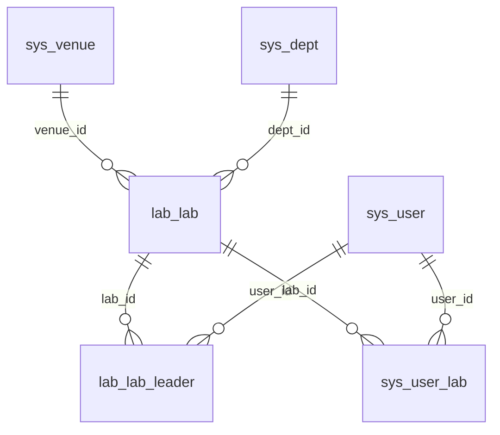

# M02现状核对与复用清单

日期：2026-09-09。性质：首轮静态证据与当前库基线，不是最终字段设计或迁移稿。主设计见[详细设计](../../详细设计.md)。

## 1. 授权和实验室实现证据

| 文件/入口 | 当前源码观察 | M02需要处理 |
| --- | --- | --- |
| [LabLabServiceImpl](../../../../../futurefab-modules/futurefab-system/src/main/java/com/futurefab/system/service/impl/LabLabServiceImpl.java) | 已有实验室名称/编码校验、列表/选项范围、负责人保存、启停前关联检查 | 复用；核验启停状态分支与用户/项目/批次/培养引用语义，并加入M01管理守卫 |
| [LabAuthorizationServiceImpl](../../../../../futurefab-modules/futurefab-system/src/main/java/com/futurefab/system/service/impl/LabAuthorizationServiceImpl.java) | 按VIEW/OPERATE/MANAGE查询；受保护管理员有特殊分支 | 不能把角色dataScope=全部当作管理员；来源/状态过滤需与查询Mapper一起核验 |
| [SmpPermissionQueryMapper](../../../../../futurefab-modules/futurefab-system/src/main/resources/mapper/smp/SmpPermissionQueryMapper.xml) | selectLabIdsByAuthLevel合并sys_user_lab和lab_lab_leader；该SQL按auth_type比较直接授权，负责人分支未按minLevel限制 | 不能仅从直接授权表判断最终范围；单独确认负责人派生授权语义 |
| [SysUserLabController](../../../../../futurefab-modules/futurefab-system/src/main/java/com/futurefab/system/controller/SysUserLabController.java) | 已有/smp/userlab/{userId}/labs读写；保存前检查目标用户范围；部分权限字面值多出尾部字符，例如system:userlab:edit后带单引号和右括号 | 统一合法权限标识、核对菜单种子及现有调用者；不能将注解存在当作完整的可授予范围校验 |
| [SysUserLabServiceImpl](../../../../../futurefab-modules/futurefab-system/src/main/java/com/futurefab/system/service/impl/SysUserLabServiceImpl.java) | saveSysUserLabs在事务中先删旧关联再规范化/重插；normalizeLabs缺authType时写0；插入填当前创建时间 | 改造为受统一契约控制的差异保存，保留未变等级与关联时间；严禁未知等级自动升级 |
| [SysUserLabMapper](../../../../../futurefab-modules/futurefab-system/src/main/resources/mapper/system/SysUserLabMapper.xml) | selectAuthorizedUsersByLabId返回关联createTime，但排序使用u.login_date desc；读取用户集合依赖直接关系 | 需求02授权用户按关联时间倒序，应修订排序及分页；直接授权列表与最终有效授权范围不能混称 |

图查询定位后阅读当前源文件；saveSysUserLabs的一跳链为SysUserLabController.saveLabs → SysUserLabServiceImpl.saveSysUserLabs → normalizeLabs/deleteSysUserLabByUserId/batchInsertSysUserLab。这是该方法的局部链，不据此断言所有用户保存入口或授权路径已覆盖。索引新鲜度有缺口时以当前源码为准，尚无运行验证。

## 2. 当前表复用候选

来源：[当前系统SQL](../../../../../sql/ymsw.sql)。下表只确认表结构存在，不等于对应功能已开发或验收；所有型号字段和设备能力仍要与需求逐项核对。

| 功能 | 已存在表 | 处置方向 |
| --- | --- | --- |
| 实验室/负责人/直接授权 | lab_lab、lab_lab_leader、sys_user_lab | 优先复用；不另建laboratory/user_lab平行模型 |
| 型号与检测项目 | dev_bench_reactor、dev_integrated_reactor、dev_culture_container_spec、dev_floor_scale_model、dev_detector_model、dev_detector_item、dev_peristaltic_pump_model、dev_air_pump_model、dev_analyzer_model | 型号库完整字段待逐表设计 |
| 实验室设备 | lab_bench_reactor、lab_balance、lab_peristaltic_pump、lab_air_pump、lab_detector、lab_integrated_reactor、lab_culture_container、lab_floor_scale、lab_downstream_device | 核对型号引用、实验室引用、设备标识与占用边界 |
| 控制器/泵连接 | lab_bench_reactor_controller、lab_bench_reactor_controller_channel、lab_integrated_reactor_pump、lab_integrated_reactor_pump_config | 先确认两种集成泵配置表各自使用者，避免错误合并或双写 |
| 通讯及其他设备 | lab_communication、lab_sound_alarm、lab_printer、lab_relay、lab_printer_layout_setting | 复用连接配置，打印业务模板与M05/M08界定 |
| 检测配置 | lab_detector_item_config、lab_detection_rule | 区分项目能力、配置与运行检测结果 |
| 资源与单元配置 | liquid_bag、feed_medium、consumable_master、consumption_rule、bottle_config | 校对单位、阈值、容量、引用与启停，不自动扣减 |
| 外部归属 | lab_workflow_node、lab_offline_alarm_config、lab_status_alarm_config | M04/M09拥有业务设计；M02保留引用协作，不重复定义 |

## 3. 三张核心表当前字段基线

以下保留当前SQL属性，不是最终目标结构；最终新增/改名/改型必须给出完整迁移、核验、回退语句。无新外键约束。当前三个表共25列。

### lab_lab

| 字段 | 当前SQL属性（类型/默认/可空） | 原注释与逻辑说明 |
| --- | --- | --- |
| lab_id | bigint NOT NULL | 实验室主键；实验室主键，当前bigint标识，不复用旧库int值作为新记录身份。 |
| venue_id | bigint NULL DEFAULT NULL | 所属场地主键；逻辑关联sys_venue.venue_id；场地必选按需求落实。 |
| dept_id | bigint NULL DEFAULT NULL | 所属部门主键；逻辑关联sys_dept.dept_id；是默认实验室关联的候选来源，不等于用户自动获权。 |
| lab_name | varchar(50) NOT NULL | 实验室名称；沿用当前基线，最终值域/必填性在详细设计中逐项落实。 |
| lab_code | varchar(50) NOT NULL | 实验室编码；沿用当前基线，最终值域/必填性在详细设计中逐项落实。 |
| lab_type | varchar(30) NULL DEFAULT '' | 实验室类型（字典smp_lab_type）；需求类型含小试上游/小试下游/中试上游/中试下游；小试下游本期保留，完整存储码与字典待核对。 |
| status | char(1) NULL DEFAULT '0' | 状态（0正常 1停用），字典：系统开关；0启用/1停用，停用必须核对关联用户及未结束业务。 |
| ip_address | varchar(45) NOT NULL | 中转服务IP；沿用当前基线，最终值域/必填性在详细设计中逐项落实。 |
| port | int NULL DEFAULT NULL | 中转服务端口；沿用当前基线，最终值域/必填性在详细设计中逐项落实。 |
| address | varchar(200) NULL DEFAULT '' | 详细位置；沿用当前基线，最终值域/必填性在详细设计中逐项落实。 |
| del_flag | char(1) NULL DEFAULT '0' | 删除标志（0存在 2删除）；0未删除/2已删除；与停用不同。 |
| create_by | varchar(64) NULL DEFAULT '' | 创建者；沿用当前基线，最终值域/必填性在详细设计中逐项落实。 |
| create_time | datetime NULL DEFAULT NULL | 创建时间；沿用当前基线，最终值域/必填性在详细设计中逐项落实。 |
| update_by | varchar(64) NULL DEFAULT '' | 更新者；沿用当前基线，最终值域/必填性在详细设计中逐项落实。 |
| update_time | datetime NULL DEFAULT NULL | 更新时间；沿用当前基线，最终值域/必填性在详细设计中逐项落实。 |
| remark | varchar(500) NULL DEFAULT NULL | 备注；沿用当前基线，最终值域/必填性在详细设计中逐项落实。 |

当前索引：

- `PRIMARY KEY (lab_id) USING BTREE`
- `INDEX idx_lab_lab_venue(venue_id ASC) USING BTREE`
- `INDEX idx_lab_lab_dept(dept_id ASC) USING BTREE`
- `INDEX idx_lab_lab_code_del(lab_code ASC, del_flag ASC) USING BTREE`
- `INDEX idx_lab_lab_lab_code_del(lab_code ASC, del_flag ASC) USING BTREE`

### lab_lab_leader

| 字段 | 当前SQL属性（类型/默认/可空） | 原注释与逻辑说明 |
| --- | --- | --- |
| lab_id | bigint NOT NULL | 实验室主键；逻辑关联lab_lab.lab_id，与user_id组成关系主键。 |
| user_id | bigint NOT NULL | 负责人用户主键；逻辑关联sys_user.user_id；负责人关系独立于直接授权关系。 |

当前索引：

- `PRIMARY KEY (lab_id, user_id) USING BTREE`
- `INDEX idx_lab_lab_leader_user(user_id ASC) USING BTREE`

### sys_user_lab

| 字段 | 当前SQL属性（类型/默认/可空） | 原注释与逻辑说明 |
| --- | --- | --- |
| user_id | bigint NOT NULL | 用户主键；逻辑关联sys_user.user_id，与lab_id组成复合主键。 |
| lab_id | bigint NOT NULL | 实验室主键；逻辑关联lab_lab.lab_id；不另建实验室身份。 |
| auth_type | char(1) NULL DEFAULT '0' | 授权类型（0可见 1可操作 2管理）；完整当前值：0可见、1可操作、2管理；默认0；新契约新增直接授权固定0可见，已有明确等级保留（M02-Q01已确认）；等级修改入口另行核对。 |
| create_by | varchar(64) NULL DEFAULT NULL | 创建者；沿用当前基线，最终值域/必填性在详细设计中逐项落实。 |
| create_time | datetime NULL DEFAULT NULL | 创建时间；关联建立时间，未变关联编辑不应重置；需求授权用户列表按此倒序。 |
| update_by | varchar(64) NULL DEFAULT NULL | 更新者；沿用当前基线，最终值域/必填性在详细设计中逐项落实。 |
| update_time | datetime NULL DEFAULT NULL | 更新时间；沿用当前基线，最终值域/必填性在详细设计中逐项落实。 |

当前索引：

- `PRIMARY KEY (user_id, lab_id) USING BTREE`
- `INDEX idx_sys_user_lab_lab(lab_id ASC) USING BTREE`

### 逻辑关系（基线）

图表示逻辑引用；不生成数据库外键。当前sys_user_lab无有效期字段；M02-Q06已确认本期保持无有效期，直到撤销，不新增到期字段或任务。项目成员和分享期限单独管理，用户/实验室状态仍限制访问。

## 4. 旧库结构参考映射

来源：[cdp.sql](../../../../接口文档/原系统数据库表结构/cdp.sql)、[npp.sql](../../../../接口文档/原系统数据库表结构/npp.sql)。仅比对相关表结构，不导入旧数据、密钥或外键。

| 旧表/字段 | 当前复用对象 | 判断 |
| --- | --- | --- |
| 两库auth_userlab.UserId/LabId，独立UserLabId | sys_user_lab.user_id/lab_id复合主键及auth_type | 当前模型已表达用户实验室关系并增加等级；不为复用旧独立主键重建关系表 |
| cdp/npp的cdp_lab.LabID/LabNo/LabName | lab_lab.lab_id/lab_code/lab_name | 业务主键/编号/名称对应，保留当前bigint及命名，不直接覆盖编号或ID |
| cdp.cdp_lab.DepartmentId | lab_lab.dept_id→sys_dept.dept_id | 复用当前部门模型；需映射旧ID，不直接当当前部门主键 |
| cdp/npp的cdp_lab.LabKey/LabSecret | 当前实验室无对应公开字段 | 仅记录旧接入身份存在，不把旧密钥复制为普通参数；实际协议需要时按敏感配置边界另行设计 |
| cdp.cdp_labdevice设备身份/设备类型、DeviceStatus | 当前按设备类型拆分的lab_*实例及公共设备契约 | 型号差异和连接/业务占用分别设计，不能直接把旧DeviceStatus当培养状态 |
| npp.cdp_labroom.RoomID/RoomNo/RoomName | 当前场地/实验室模型待语义核对 | 不因都有名称就自动合并或迁移，当前保持参考 |

## 5. 后续验证与范围限制

首轮已定位现有表与关键授权链路。设备型号与实例的完整字段、原型图片、实际协议、资源消费及所有调用入口尚未逐项核对；附件不得用于宣称这些功能已完成。下一轮按主设计D02-02/D02-03先完善授权契约和实验室功能组，再展开其他功能组。

## 6. 本轮补充核对（2026-09-09）

已目视核对需求image62实验室新增和image68授权用户原图；新增字段与用户只读列表结构已回写主设计第8节。当前用户页面getDefaultAuthorizedLabIds按deptId精确匹配。实验室类型字典smp_lab_type基线值为1小试上游、2小试下游、3中试上游、4中试下游。当前LabLabController授权用户在线判断扫描Redis令牌并按用户名匹配；目标设计改为调用M01有效会话能力按userId判断，未实际改代码。

M02-Q01（2026-09-09）已确认新增直接授权默认0可见、已有明确等级保持不变。当前事实与目标决策已区分记录，未运行授权验证。

M02-Q02（2026-09-09）已确认：默认实验室按所选deptId精确匹配，不含子部门，并限定可授予范围；其他实验室可由有权管理员手动选择，提交时重新校验。

M02-Q03（2026-09-09）已确认：lab_lab_leader负责人关系派生管理等级2，功能权限仍独立校验；取消该关系仅撤销负责人来源，不删除或覆盖sys_user_lab直接授权。当前库结构可分别表达两类来源，不需为本项新增平行关系表。

M02-Q04（2026-09-09）已确认新增授权规则：普通管理员须有相应用户授权功能权限，且只可授予本人管理等级2的实验室；可见/可操作不足以授予他人。该目标规则需在候选与保存两端落实，不等于现有授权链路已验证通过。

M02-Q05（2026-09-09）：范围外已有直接授权由服务端保留等级与关联时间；用户编辑只提交可管理范围内的目标集合。现有先删全部再插入的保存方式不能满足此规则，必须改造；新增hasUnmanagedAuthorizations存在标记且不泄露无权查看的ID/名称。

M02-Q06（2026-09-09）已确认：实验室直接授权本期无有效期，直到撤销；本项无需新增表字段或迁移语句，状态限制及M03期限规则保持独立。

M02-Q07（2026-09-09）已确认保留受保护超级管理员的全局实验室管理特权，不需逐个写授权关系；普通角色全部范围不继承此特权。状态及签批分离仍须在各业务入口校验，不以当前服务存在bypass作为运行验收通过。

M02-Q08（2026-09-09）确认新增用户编辑页“配置授权等级”入口。此为目标交互新增项，不能标为现有页面已有；等级写入参数需在准入规则确认后完善，最终需与用户保存同事务。

M02-Q09（2026-09-09）确认普通管理员同时具备用户授权功能权限、目标用户管理范围和目标实验室管理等级后，可调整他人的直接等级0/1/2。授权调整入口Q08的写入契约已补充authorizationChanges，新增默认0与显式等级调整分开；无新数据库字段，关联时间保留，最终同用户事务提交。

M02-Q10（2026-09-09）已确认：用户具有操作者管理范围外的实验室授权时禁止删除，交由完整范围管理员或受保护超级管理员处理。目标删除链路须在SYSTEM守卫内校验全部相关实验室（包括负责人派生来源），批量删除全量校验、原子提交；直接授权清理契约不得绕过检查。此为目标规则，无新增数据库字段，本轮未修改业务代码或执行运行验证。

M02-Q11（2026-09-09）已确认：删除仍担任实验室负责人的用户前，先通过实验室管理调整或解除负责人身份；完整范围管理员和超级管理员也不能自动清负责人后删除。目标删除链路新增当前负责人引用检查，409 REFERENCE_EXISTS，批量操作整批拒绝，负责人编辑与删除共用SYSTEM守卫。无新数据库字段；本轮仅更新设计，未进行业务实现或运行验证。

M02-Q12（2026-09-09）已确认：授权用户列表合并直接授权和负责人，同用户一行，增加来源和生效等级展示并保持只读。当前仅直接关系查询需调整为合并去重后排序分页；DTO增加authorizationSources、directAuthType、effectiveAuthType。负责人旧关系无可靠建立时间时返回null并置后，不伪造历史时间。本轮仅更新设计，无新数据库字段或运行验收结论。

M02-Q13（2026-09-09）已确认：实验室禁用的authorizedUserCount合并直接授权与负责人关系、按userId去重；任一来源仍在则阻止禁用，并继续校验未结束业务。禁用预检与正式提交须使用同一口径，负责人修改纳入SYSTEM守卫及并发校验；账号停用不解除关系。此为目标设计，无新增数据库字段，本轮未修改代码或执行运行验证。

M02-Q14（2026-09-09）已确认：实验室名称在全部未删除记录中全局唯一，包含停用记录，不按部门/场地划分；修改排除自身。主设计labName仍为trim后1–20字符，现状表字段varchar(50)是基线事实，不代表本轮已修改数据库。最终表结构设计须补有效记录唯一约束与重复数据预检；本轮未执行迁移或运行验证。

M02-Q15（2026-09-09）已确认保留实验室编码与设备资产编号统一唯一规则。本轮从LabGlobalAssetNoService定位并完整读取[跨表查询](../../../../../futurefab-modules/futurefab-system/src/main/resources/mapper/lab/LabGlobalAssetNoMapper.xml)：13个来源，含lab_lab.lab_code、11类设备asset_no及lab_culture_container.container_no，均过滤del_flag=0，按来源表+主键排除自身。具体来源见主设计Q15。图覆盖元数据变化后已直接读取当前源码；这是查询范围静态核验，不代表所有设备入口或并发行为已验证。目标保留此范围，并补齐共同守卫、统一冲突响应及迁移重号预检；未新增平行编号表、未改业务代码。

M02-Q16（2026-09-09）已确认：Q15统一编号范围查重不区分英文字母大小写，显示保留录入形式。目标需统一应用层比较、数据库约束及跨表迁移核验的等价口径；当前目标库collation与运行行为未验证，不能将本项标为现状已满足。无业务代码或SQL执行。

M02-Q17（2026-09-09）已确认：实验室列表起止日期按update_time筛选，上海业务时区，排序仍为create_time DESC、lab_id DESC。需求02正文原先未明确起止时间字段，现由本项补齐；LAB01查询及计数须统一过滤，历史未知修改时间不伪造。未修改代码或执行运行验证。

M02-Q18（2026-09-09）已确认保留工作流配置对实验室类型修改的限制。本轮直接读取LabLabServiceImpl.updateLabLab当前代码：类型变化且labWorkflowNodeMapper.countByLabId大于0时拒绝，提示先移除工作流。目标沿用该业务约束，以M04当前配置判定和合法移除规则为准，并补共同守卫、版本、分类错误和整次回滚；仅静态核验，未运行验证。

M02-Q19（2026-09-09）已确认：实验室存在未结束项目/批次/培养时，禁止修改中转服务IP或端口，包括端口置空；其他字段仍按各自规则。目标LAB04复用M03统一未结束业务查询并在守卫内复核，保持原连接参数不触发该变更阻断，混合请求失败整次回滚。本轮为新增目标规则的文档落实，未验证现有实现满足此规则。

M02-Q20已确认（2026-09-09）：实验室更换所属部门后，已有直接授权、等级和关联建立时间保持不变，不因原部门/新部门归属自动撤销或新增授权。部门变更只影响后续按M02-Q02计算的默认实验室候选；实际授权调整仍须由有权管理员明确操作并按Q04/Q05/Q09校验。 主设计已补LAB04只改部门不改用户授权、默认候选与当前授权分别回显及版本冲突处理；M01第20节同步此约定。无新增数据库字段，本轮未改业务代码或执行运行验证。

M02-Q21（2026-09-09）已确认：创建实验室不自动赋予创建者管理或其他隐含权限；需明确选择负责人或通过合法授权入口授予。主设计已补LAB03和创建成功后的列表刷新、无权详情跳转处理及撤权验收；此为目标规则，本轮未修改业务代码或执行运行验证。

## 设备型号库首轮核对（2026-09-09）

详见[设备型号库设计](../../设备型号库设计.md)。Tier2图定位Dev*控制器/服务，19个匹配含通讯服务并非19个型号；实际登记8个型号组及独立检测项配置。updateDevBenchReactor双向一层追踪无分页，但通用setter出现错误跨类归属，因此以当前服务与Mapper源码为准。覆盖元数据metadata_changed，SQL为partial；直接读取台式型号建表段及相关Java/XML，不对整库作完整性结论。

台式型号复用dev_bench_reactor，13列；品牌+类别有效记录查重，普通索引不等于唯一约束。实例查询联接型号共享类别、容量单位、描述和图标，brand/model仍取实例字段，max_capacity优先volume_ml；不能声称所有型号字段已同步。删除引用检查包含全部未删除实例，批量删除服务逐项检查/更新，目标须补原子事务与统一守卫。当前型号列表SQL无排序且日期仅双端同时存在时过滤，需对齐需求。原sql/ymsw.sql已有工作区修改，本轮只读未改动。以上为静态核验，未编译、运行或连接设备；本轮只目视新增原图image177。

M02-Q22（2026-09-09）已确认：型号关联设备被未结束业务使用时禁止修改共享关键参数，描述等展示字段可按其他规则修改。目标区分真实字段变化、跨实验室引用查询、M03业务口径及整次回滚；型号设计第8节已补接口约束与5项验收场景。此为目标设计，未修改业务代码或执行运行验证。

2026-09-09用户授权字段长度等常规设计细节直接定案。型号description已定为选填、最多100字符；型号日期沿用现有update_time并补齐单边查询与时间边界。上述为设计决策，不登记为用户逐项确认的M02-Q23；后续只提实质业务取舍。

## 其余型号字段核对（2026-09-09）

已读七类型号实体、控制器路由、联合唯一/删除引用SQL及建表段，并补[设备型号库字段基线](../../设备型号库字段基线.md)。集成反应器型号缺少4.0泵/MFC数量、达阈重量及三个控制能力列；检测型号缺少单次发送上限/稀释字段，既有暂存和发送方式不是同义字段。上述为指定表/实体范围的差距，不能推断整个代码库完全没有相关能力。

称重calibration_modes注释为校准，但当前页面使用通讯字典，SQL样例存HTTP/NAMED_PIPE；目标复用现列并以communicationTypes DTO适配，不新增平行字段。称重引用SQL把集成反应器floor_scale_id与型号ID比较，实际服务查询LabFloorScale实例scaleId；目标按真实实例model_id修正链路。分析检测仪页面以iconPath单一路径展示，不能当成已满足需求多图。已目视image183和image192，其他新增原图尚未全检。

图覆盖metadata_changed，相关字段/SQL/页面直接读取校验；目标接口矩阵与增量列仅为设计，未编译、运行、连接数据库或设备。源SQL既有修改未动。

M02-Q24已确认（2026-09-09）：共享型号库按该类型相应功能权限维护，不要求操作者同时管理全部关联实验室。型号变更按共享字段契约影响关联实例；设备实例的查询与修改仍独立校验实验室权限，关键参数变更仍受Q22未结束业务限制。 已同步型号维护矩阵、跨实验室引用查询边界及4项验收场景，M01公共权限原则已补充共享资源例外说明。本轮仅更新文档，未改变实际角色权限或业务代码。

## 集成反应器参数链核对（2026-09-09）

已核对LabIntegratedReactorServiceImpl聚合create/update、savePumpConfigs双向一层追踪、控制器/DTO/VO、实例及固定泵Mapper、前端选型与泵配置、SQL三表段。图对List.add及通用getter有跨类误归属，舍弃这些边，以直接源码为证。元数据变化后读取指定源码范围，不对全部M04/M07代码作缺失断言。

关键差距：实例页面型号容量/规格/压力单位可输入但需求要求只读；固定泵页面常量8且读取slice截断，服务仅非空并按数组顺序重建泵号及创建时间；目标改为型号数量驱动、显式稳定编号和差异保存。型号列表/详情通过联表读取共享值，实例volume_ml不是型号g容量。补液模板按来源展示量程与执行时实际取值需分开，见[参数契约](../../集成反应器型号与实例参数契约.md)。仅静态分析和文档设计，未写业务代码或执行SQL。

M02-Q25已确认（2026-09-09）：型号已有设备实例或模板配置引用后，禁止直接修改泵数量、MFC数量及温度/重量/压力控制能力开关，即使设备空闲或相关业务已结束也不例外。需要不同结构时另建型号，再按合法流程调整设备和模板关联；保留原配置与历史。未被配置引用的型号仍须满足Q22及其他修改约束。 已同步型号修改约束、结构字段范围及IR-C13–18验收场景。Q25与Q22分别检查当前配置引用和未结束业务，均不被Q24型号维护权限绕过；本轮未修改业务代码或执行运行验证。

## 设备资源完整设计补充核对（2026-09-09）

本节补充此前阶段性基线，最终行为以本目录详细设计附件为准。相关仓库图freshness=metadata_changed，已回读关键源码，未将图结果当作当前实现保证。

- LabBenchReactorServiceImpl.create/update明确将maxCapacity写入volume_ml；目标保留该列并补capacity_unit，不新建同义容量列。
- LabBenchReactorControllerServiceImpl及Mapper当前以balance_id查询lab_floor_scale，既有注释不足以推断是lab_balance；删除引用检查需同时补控制器地秤引用，并按balance_kind区分。
- BottleConfigMapper将reactor_id联接台式反应器主键；当前服务把耗材mL作为最大重量g的补值不能沿用，目标以PLC观测与质量/版本门控。
- LabDownstreamDevice现applyModelSnapshot没有持久化表单所选通讯方式；目标同事务写lab_communication骨架，未配置不能投用。
- DevDetectorModel.detect_type有路由消费者，新增model_name用于显示；sendMode/supportStored和稀释、单次限制分别建模。
- DevFloorScaleModel.calibration_modes当前实际用途为通讯方式，优先复用；SysFile只有name/url，无fileId，多图存路径数组。
- 消耗共享按rule_id保留源身份；检测项目无配置默认启用，批量保存协议必须区分旧全量和新差异语义。

本轮交付：[实例设计](../../设备实例详细设计.md)、[通讯契约](../../通讯与设备公共契约.md)、[检测资源设计](../../检测与资源配置详细设计.md)、[数据库增量设计](../../数据库增量设计.md)与[验收清单](../../联调与验收清单.md)。仅改docs中的设计产物，原sql/ymsw.sql继续作为只读基线。
