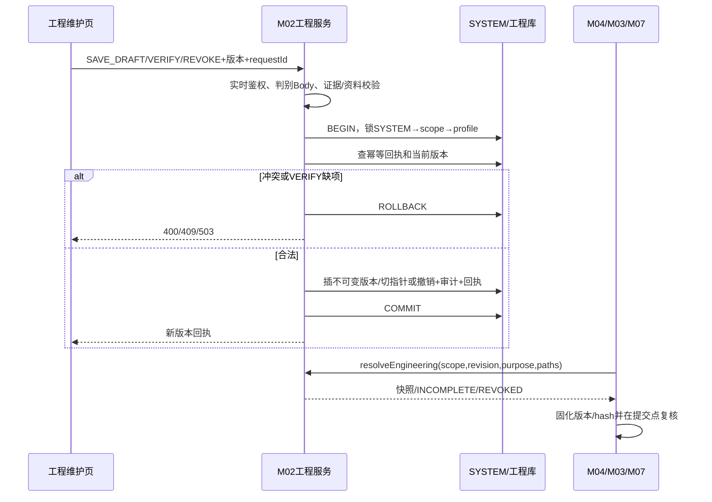

# M02 工程资料维护与解析逐接口契约

## 2026-10-31 方案使用来源修正

用户明确确认反应器型号维护信息正确即可使用，客户需求没有独立“核准工程资料”步骤。M04方案候选、型号事实及保存不再调用ENG-I01作为前置，统一使用TemplateModelResourcePort读取反应器型号库及通道数据。下文TEMPLATE_SAVE必须核准及缺资料阻断M04的旧条款由本节覆盖。M02-225/226及工程资料历史记录暂保留，不由型号维护自动生成、核准或清除。其他真实设备运行、计量和安全契约须逐项按各自需求核对，不因本条伪造能力或现场证据。

2026-10-20 ENG-I01台式实例解析来源切换：M02EngineeringInstanceIdentityMapper的普通读/锁读均从控制器model_id提供modelRefId，不读旧model_dict_code。INSTANCE/BENCH_CONTROLLER在工程资料合成前通过M02统一型号库校验有效BENCH_CONTROLLER：新ID为空、型号不存在/已删除或错类型返回INCOMPLETE＋MODEL_MAPPING_UNVERIFIED；查询故障或返回身份不一致为RESOURCE_FACTS_UNAVAILABLE，不回退字典/相似型号。MODEL作用域ID据此取统一型号ID；工程版本正文、canonicalHash及effectiveHash规则不改、不自动重写旧快照。共享身份Mapper同时用于实例工程资料权限与写前重验，其modelRefId含义同步变更。集成反应器的既有身份读取和其他消费者本批未改。

2026-10-20 M02-227统一型号切换：本口Body中的expectedModelDictCode/newModelDictCode替换为expectedModelId/newModelId，响应modelDictCode替换为modelId，均指dev_reactor_model主键；仅有效BENCH_CONTROLLER允许绑定，旧字典不再参与本口解析或回退。Path/Body连接一致、管理双头、权限、实验室MANAGE、真实核准证据、M03使用事实、M07未决命令及幂等规则保持。CAS及审计改为model_id；型号发生变化时同事务初始化空控制器的普通泵关联，已有通道返回CONFIGURATION_INCOMPLETE并整次回滚，须先明确转换，不自动删除重建；同型号更新证据不重复初始化。审计新增initialized_channels记录本次创建身份，沿现有长度截断加摘要规则，不承诺完整长数组。M02-226的BODY-ONLY例外不变。本项只切换绑定写链，工程解析/工艺消费者及前端尚未整体切换，不可单独部署。

2026-10-18 实例接线补充：M02-225/226 限 INTEGRATED_REACTOR、BENCH_CONTROLLER，从既有权威身份 Mapper 解析 labId，不要求工程主表另存 labId。读取及写前核验当前主体的实验室 MANAGE 权限；写回调内按 SYSTEM→实验室→实例锁序再核验，实例归属/型号变化拒绝整次写；回执重放也先重验当前范围。新建 INSTANCE 的型号对为空、设备对落真实身份，继续复用现有不可变版本/核准/撤销/CAS/审计。此补充不扩 EngineeringProfile v1 字段，不核准任何设备参数；用户已选择独立计量策略承载，具体契约仍待冻结。

版本DD-20260913-T8-R8，2026-10-08补G-54设计收口，同日INT-54-B接ENG-I01的INSTANCE。展开[控制器型号与工程参数收尾契约](控制器型号与工程参数收尾契约.md)已声明的3个HTTP入口和1个内部方法。当前M02-225读口、M02-226写口及ENG-I01的MODEL与INSTANCE解析已有代码和契约测试；2026-11-03状态补正：M02-227已有Controller→EngineeringApplicationService→ControllerModelVerificationWriter写链，不再记为编号化501；服务内映射与网关外部契约的静态差异仍见补登契约D-12，不能由接线证明HTTP可达。M02-225仍有最小投影与本文完整目标的差异，226的BODY-ONLY制式不变，不恢复M04方案独立工程核准前置。ENG-I01的INSTANCE只交付“无行/已软删按404隐藏”一半：§5.2的“无权404”需要操作人及其实验室等级，而PKG-00 §6.2冻结的Port入参不携身份，该半必须由M04/M03/M07在调用前按§1裁决，提供方不假装完成也不放宽。目标表结构已进入开发基线，但本文不据此宣称SQL在目标库执行或HTTP/浏览器验收通过。

## 1. 权限与公共外壳技术冻结

2026-10-10 首次草稿审计修正：M02-226 继续共用同一守卫操作码；首次 SAVE_DRAFT 无身份行时登记业务类型 1、INSERT、before 空、after 为新增身份快照。已有身份的草稿更新、VERIFY、REVOKE 仍登记业务类型 2、UPDATE，必须具备同一身份的 before/after。注册表只为 M02-226 显式登记新增变体，其他操作不得因缺 before 自动降为新增。

为支持多人并行开发，本节冻结功能码：GET工程资料为lab:engineering:query；POST SAVE_DRAFT为lab:engineering:edit、VERIFY为lab:engineering:verify、REVOKE为lab:engineering:revoke；控制器型号核准为lab:controller:model-verification。功能码还需M01菜单/角色脚本登记，不能因为代码常量写出就视为角色已授权。普通模板编辑权限不包含这些权限。MODEL作用域只需对应全局型号维护范围；INSTANCE及控制器连接另需真实实验室管理等级2。读取无范围对象按404隐藏。

HTTP外壳沿M01，ID/版本十进制字符串、时刻ISO8601毫秒、hash小写64位hex。写Body继续沿原设计携requestId、expectedManagementRevision、expectedProfileVersion；不再同时要求同名版本Header，避免两个版本来源。认证头仍必需。requestId为UUID，幂等键actor+operation+scope+requestId；同hash重放，同键异hash409 REQUEST_CONFLICT。SYSTEM→实验室→对象锁顺序固定，事务中不调用设备。

scope判别：MODEL必须kind/modelKind/modelId，deviceKind/deviceId为null；INSTANCE必须kind/deviceKind/deviceId，modelKind/modelId为null。Query中不传无关键；JSON中scope固定含五键并以null表达不适用。scope_key由服务端规范化身份计算，不接收客户端hash。

MODEL 的 modelKind 与 M04 ModelRef 共用 `INTEGRATED_MODEL` / `BENCH_CONTROLLER_MODEL` 两值；台式控制器的 modelId 为 `sys_dict_data.dict_code`，不得填连接 ID。`BENCH_REACTOR_CONTROLLER` 是设备/表名同形的旧示例值，不是型号类别，输入应拒绝。

## 2. GET /system/lab/engineering/profiles

权限lab:engineering:query。Query scopeKind必填MODEL/INSTANCE，并按上节传对应两个身份；Body空。默认返回当前profile及有效解析结果，不用“最大版本”替代current_version_id。无profile不是404，而是200、profileId/version/status均null、state=INCOMPLETE、issues指出PROFILE_NOT_FOUND，方便新建草稿；身份对象不存在/无权才404。

data固定：scope、profileId:string|null、versionId:string|null、versionNo:int|null、objectVersion:string|null、status:DRAFT/VERIFIED/REVOKED|null、profile:EngineeringProfile|null、evidence:Evidence[]、state:COMPLETE/INCOMPLETE/REVOKED、issues:[{path,code,message}]、allowedActions:(EDIT/VERIFY/REVOKE)[]、managementRevision。allowedActions根据实时权限和状态计算，不等于已核准。草稿完整响应示例：
```json
{
  "code": 200,
  "msg": "操作成功",
  "requestId": "00000000-0000-4000-8000-000000000008",
  "managementRevision": "51",
  "data": {
    "scope": {
      "kind": "MODEL",
      "modelKind": "BENCH_CONTROLLER_MODEL",
      "modelId": "7601",
      "deviceKind": null,
      "deviceId": null
    },
    "profileId": "7701",
    "versionId": "7711",
    "versionNo": 1,
    "objectVersion": "1",
    "status": "DRAFT",
    "profile": {
      "schemaVersion": 1,
      "scope": {
        "kind": "MODEL",
        "modelKind": "BENCH_CONTROLLER_MODEL",
        "modelId": "7601",
        "deviceKind": null,
        "deviceId": null
      },
      "vendor": {
        "name": "模拟厂商",
        "controllerFamily": "MOCK-CONTROLLER",
        "protocolVersion": "MOCK-1",
        "firmwareRange": null
      },
      "capabilities": {
        "pumpCount": null,
        "mfcCount": null,
        "temperatureControl": null,
        "weightControl": null,
        "pressureControl": null,
        "supportedStepCodes": [],
        "applicableInstanceIds": []
      },
      "specification": {
        "originalText": "资料未齐，仅保存草稿",
        "value": null,
        "unit": null,
        "volumeLitres": null,
        "conversionRule": null
      },
      "pidRules": [],
      "channels": [],
      "mediumMappings": [],
      "feedingPolicy": null,
      "sources": []
    },
    "evidence": [],
    "state": "INCOMPLETE",
    "issues": [
      {
        "path": "capabilities.pumpCount",
        "code": "REQUIRED_PATH_MISSING",
        "message": "运行所需能力尚未核准"
      }
    ],
    "allowedActions": [
      "EDIT",
      "VERIFY"
    ],
    "managementRevision": "51"
  }
}
```

读取依赖故障503 RESOURCE_FACTS_UNAVAILABLE；资料正常缺项仍200 INCOMPLETE，不伪装网络错误。

## 3. POST /system/lab/engineering/profiles

请求为判别联合，公共字段requestId、expectedManagementRevision、expectedProfileVersion、scope、action、reason。SAVE_DRAFT/VERIFY必须带profile和evidence数组；REVOKE必须profile/evidence为null。未知字段拒绝。

- SAVE_DRAFT：expectedProfileVersion新建为null、更新为当前objectVersion；reason可空/null≤500。允许缺工程字段，仍校验结构、单位、范围、hash及证据格式，保存不可变新版本并把profile状态DRAFT。
- VERIFY：expectedProfileVersion必填；profile完整传送，evidence非空且EngineeringProfile.sources与顶层evidence规范化后完全一致；reason可空/null。按目标scope及用途完整性规则校验，缺项400 VALIDATION_ERROR，整次不生成VERIFIED版本。
- REVOKE：profile/evidence必须null，expectedProfileVersion必填，reason必填trim后1—500。撤销profile当前状态，保留不可变版本/证据；已REVOKED原请求重放返回原结果，新请求再次撤销409 VERSION_CONFLICT。

SAVE_DRAFT完整模拟请求：
```json
{
  "requestId": "00000000-0000-4000-8000-000000000008",
  "expectedManagementRevision": "51",
  "expectedProfileVersion": "1",
  "scope": {
    "kind": "MODEL",
    "modelKind": "BENCH_CONTROLLER_MODEL",
    "modelId": "7601",
    "deviceKind": null,
    "deviceId": null
  },
  "action": "SAVE_DRAFT",
  "reason": "补充资料前保存草稿",
  "profile": {
    "schemaVersion": 1,
    "scope": {
      "kind": "MODEL",
      "modelKind": "BENCH_CONTROLLER_MODEL",
      "modelId": "7601",
      "deviceKind": null,
      "deviceId": null
    },
    "vendor": {
      "name": "模拟厂商",
      "controllerFamily": "MOCK-CONTROLLER",
      "protocolVersion": "MOCK-1",
      "firmwareRange": null
    },
    "capabilities": {
      "pumpCount": null,
      "mfcCount": null,
      "temperatureControl": null,
      "weightControl": null,
      "pressureControl": null,
      "supportedStepCodes": [],
      "applicableInstanceIds": []
    },
    "specification": {
      "originalText": "资料未齐，仅保存草稿",
      "value": null,
      "unit": null,
      "volumeLitres": null,
      "conversionRule": null
    },
    "pidRules": [],
    "channels": [],
    "mediumMappings": [],
    "feedingPolicy": null,
    "sources": []
  },
  "evidence": []
}
```

成功data固定profileId、versionId、versionNo、status、objectVersion、managementRevision、issues。每次内容变化生成新version行，禁止UPDATE旧内容。HTTP 200：
```json
{
  "code": 200,
  "msg": "操作成功",
  "requestId": "00000000-0000-4000-8000-000000000008",
  "managementRevision": "52",
  "data": {
    "profileId": "7701",
    "versionId": "7712",
    "versionNo": 2,
    "status": "DRAFT",
    "objectVersion": "2",
    "managementRevision": "52",
    "issues": [
      {
        "path": "capabilities.pumpCount",
        "code": "REQUIRED_PATH_MISSING",
        "message": "运行所需能力尚未核准"
      }
    ]
  }
}
```

VERIFY/REVOKE执行前实时重验功能、范围、证据、当前版本与引用；REVOKE不发送停止命令，运行处置交M07。VERIFY资料hash、适用范围或requiredPaths不闭合时完整400：
```json
{
  "code": 400,
  "msg": "工程资料缺少核准运行所需字段",
  "requestId": "00000000-0000-4000-8000-000000000008",
  "errorCode": "VALIDATION_ERROR",
  "data": null,
  "fieldErrors": [],
  "retryAfterSeconds": null
}
```

上例的 `fieldErrors` 是目标外壳，当前公共异常外壳没有该字段。现阶段 M02-226 将首个规范化 `{path,code}` 写入400 `VALIDATION_ERROR` 的去敏 `msg`，详细issues留在读口/内部解析结果；不得伪造已经发出的 `fieldErrors`。未来公共外壳增加结构化字段时须同批修改公共契约、Handler、测试与本例，不要求226/227在本模块内私造平行响应类型。

## 4. POST /system/lab/controllers/{connectionId}/model-verification

权限lab:controller:model-verification＋连接所属实验室管理等级2。Path connectionId必填。Body固定connectionId、expectedManagementRevision、expectedModelDictCode:string|null、newModelDictCode:string、evidence、requestId；Path/Body必须相同。evidence固定documentId、documentHash、section、verifiedByUserId、verifiedAt且均必填，verifiedByUserId必须为可信当前维护人或受控代理证据规则允许的主体，不能伪造任意用户。

完整模拟请求：
```json
{
  "connectionId": "7801",
  "expectedManagementRevision": "51",
  "expectedModelDictCode": null,
  "newModelDictCode": "7901",
  "evidence": {
    "documentId": "MOCK-DOC",
    "documentHash": "0000000000000000000000000000000000000000000000000000000000000000",
    "section": "模拟章节",
    "verifiedByUserId": "10001",
    "verifiedAt": "2026-09-13T02:00:00.000Z"
  },
  "requestId": "00000000-0000-4000-8000-000000000008"
}
```

事务内重读连接、当前型号、字典smp_bench_controller_model一级有效项及未结束业务/UNKNOWN物理命令。期望旧值不匹配409 VERSION_CONFLICT；占用409 RESOURCE_IN_USE；依赖不可判503 RESOURCE_FACTS_UNAVAILABLE。成功只保存映射和审计，不生成工程资料、不发物理命令：
```json
{
  "code": 200,
  "msg": "操作成功",
  "requestId": "00000000-0000-4000-8000-000000000008",
  "managementRevision": "52",
  "data": {
    "connectionId": "7801",
    "modelDictCode": "7901",
    "managementRevision": "52",
    "requestId": "00000000-0000-4000-8000-000000000008"
  }
}
```

### 4.1 型号核准的事实闭合与接线顺序（G-54-7）

本口是独立受管理写，操作码固定为 `M02_227`，审计对象为控制器连接，功能码固定为 `lab:controller:model-verification`。落码批须同批登记 `ManagementOperation`、`AuditObjectType`/`AuditPolicyRegistry`、Controller `@ManagementGuardedWrite` 与统一WriteMeta、管理修订CAS及幂等回执；五个工程功能码须进入M01菜单/角色安装入口。M02-226已由独立批次接线，不得因227仍为501而回退226，也不得把226的操作码复用为227。字典类型 `smp_bench_controller_model` 与有效一级项须由M01/M02权威安装数据提供；没有真实核准项时保持数据阻塞，不在代码里植入模拟型号。

连接占用使用既有 M03-API02 `checkDeviceUsage`：服务端以权威连接行构造 `deviceKind=BENCH_CONTROLLER`、`deviceId=connectionId`、`operation=UPDATE`、`changedFields=[model_dict_code]`，在同一守卫事务和固定锁顺序内重验；`blocked=true` 映射409 RESOURCE_IN_USE，事实不完整或提供方503则503 RESOURCE_FACTS_UNAVAILABLE。M03提供方必须把该连接在未结束培养/工作流中的引用纳入判定，不能用实验室级计数替代逐连接事实，也不能把UNKNOWN当空闲。

UNKNOWN物理命令不能使用现有 `DeviceCommandPort.queryCommand(commandId)` 冒充范围查询。由M07运行命令事实拥有方提供一个只读的“按精确DeviceRef检查未决命令”窄口：输入可信actor、`{deviceKind:BENCH_CONTROLLER,deviceId:connectionId}`；输出事实完整性READY、是否存在`PREPARED/INVOKING/ACCEPTED/UNKNOWN`未终结命令及观测版本。身份以命令固定的 `parameters.deviceRef` 为准，不能假定 `run_command.resource_key` 恒等于控制器连接键；M07须在提供方批次设计可索引的精确身份投影并证明历史/未决命令覆盖完整，不能对JSON作无界扫描后把超时当作零。旧行或外部命令未能证明覆盖完整时返回503，而非空列表。存在未决命令返回409 RESOURCE_IN_USE；查询/提供方不可用返回503。该窄口只判存在性，不发送、重发或确认命令，也不扩展按commandId的既有Port语义。M02不得直读M07的Mapper或表。

事务内顺序固定为：校验Body/Path与权限→锁管理修订、实验室及连接行→通过M07拥有的资源守卫窄口锁定规范键 `BENCH_CONTROLLER:<connectionId>` →读取当前映射并比对expectedModelDictCode→核对有效一级字典项及证据主体→M03逐连接占用判定→M07未决命令判定→CAS更新映射、审计与幂等回执→提交。同一连接的新M03占用及M07命令进入路径也必须先锁实验室/连接，再争用同一 `run_resource_guard.resource_key` 行，随后才写各自事实；持守卫后不得反向获取实验室/连接锁。多资源键按字典序加锁，不能在持有较后键后回头锁较前键。守卫行的首次创建、缺行重试和归属核验由M07提供方封装，M02不得直读/插入M07表。三方须在同一SYSTEM数据库事务内遵守此序；若未来拆为远程服务，必须重新设计跨服务一致性，不能沿用本地事务保证。仅在事务外先查一遍不是放行依据。任一环节未知即503且零写。实现批需以并发测试证明“检查后新占用”不会穿透；在M03/M07提供方及共锁适配未到位前保留227的编号化501，不做半链接线。

### 4.2 M02-227 本地实现的身份投影与互斥补正（2026-10-12）

- 物理命令的 `parameters.deviceRef` 在现有 W03 写方中是泵身份，不是控制器连接。不得把泵 ID 当成 connectionId，也不得从后来可变的泵配置反查旧命令。本地双资源命令的控制器身份取同次意图固定的 `resourceClaims`：严格为两条、按 ASCII 排序，首条为 `BENCH_CONTROLLER:<connectionId>`，次条等于本行 `resource_key` 且为 `PUMP:` 键。生成列 `run_command.controller_resource_key` 仅对该完整形态产生索引值；其他形态为 NULL。W03 写方在插入前比对该控制器键与工作流固定选择；后台写方在插入前逐键比对声明与本事务实际资源集合。任一未决行未覆盖时返回 503，不把 NULL 算作无命令。本条落实 4.1 的精确冻结身份要求，禁止以命令泵 `deviceRef` 替代控制器身份。
- M07 提供 `ControllerCommandFactsPort.lockAndCheck(ControllerCommandFactsQuery)`：输入已锁连接行的 labId/connectionId；可信 actor、requestId、锁定管理版本只读当前 M02-227 守卫上下文，不接收客户端自报身份。输出 `ControllerCommandFacts` 的 labId、connectionId、factsVersion、blocked、completeness。仅在同一活动守卫事务内可调用。
- 所有本地占用/命令写方与本口的串行边界是同一 SYSTEM 行首锁（HTTP 用 ManagementGuardExecutor，后台用 ResourceTransactionExecutor），并持有至事务结束。本口随后锁实验室、连接及控制器资源主键；已有 M03/M07 写方不借跨模块 Mapper 补锁实验室或连接，也不得在持资源锁后反向补锁 M02 行。本条以共同 SYSTEM 首锁的本地串行协议落实 4.1 的检查与新占用互斥；失去共同数据库或共同首锁时不得复用 READY 结论，必须重新设计跨服务协议。
- M03 API02 仅接线 `BENCH_CONTROLLER + UPDATE + [model_dict_code]` 分支：重读逐连接培养及活动占用。M07 同时查本实验室未结束工作流的固定 connectionId，不能把“无命令”当成“无工作流”。工作流快照缺身份或超过 1000 条可核验上限返回 503；存在尚未具备逐连接身份投影的未结束任务时同样返回 503，不假称任务覆盖完整。上述限制是事实不可核验的失败面，不是新的“同实验室其他任务一律占用本控制器”业务规则。
- 成功 CAS 只改 `model_dict_code`、`model_verification_evidence` 和维护元数据，复用现有控制器对象族审计；不改工程 profile、不发送命令。新增字段、索引及生成列须在模块目标 DDL、字段字典、01 建表脚本、来源清单同批登记。空库按正式安装链创建；本批不执行 SQL，不自动升级已有库。真实 MySQL 并发、执行计划、安装、HTTP 与设备行为均仍 NOT_VERIFIED。

## 5. 内部 SVC-M02-E01 resolveEngineering

仅可信服务调用，不开放HTTP。输入scope、expectedManagementRevision、purpose:TEMPLATE_SAVE/CULTURE_APPLY/RUN、requiredPaths:string[]。requiredPaths非空、去重、只允许EngineeringProfile模式1已登记JSON路径；调用方不能传通配符/脚本。M04模板保存、M03应用、M07运行按自己的用途传固定服务端白名单，用户Body不可控制purpose/requiredPaths。

处理：验证身份和版本→读取MODEL当前VERIFIED快照→INSTANCE时再读取实例VERIFIED快照→校验未撤销和适用范围→范围/枚举取交集→校验requiredPaths→计算effectiveHash。MODEL缺失返回INCOMPLETE；INSTANCE模型/实例任一必要资料缺失INCOMPLETE；撤销REVOKED；存储/授权依赖故障抛503 RESOURCE_FACTS_UNAVAILABLE。不得回退最新草稿、旧VERIFIED或相似型号。

内部输入：
```json
{
  "scope": {
    "kind": "MODEL",
    "modelKind": "BENCH_CONTROLLER_MODEL",
    "modelId": "7601",
    "deviceKind": null,
    "deviceId": null
  },
  "expectedManagementRevision": "52",
  "purpose": "TEMPLATE_SAVE",
  "requiredPaths": [
    "capabilities.pumpCount"
  ]
}
```

内部输出（不套HTTP外壳）：
```json
{
  "state": "INCOMPLETE",
  "modelSnapshot": null,
  "instanceSnapshot": null,
  "effectiveProfile": null,
  "effectiveHash": null,
  "issues": [
    {
      "path": "profile",
      "code": "PROFILE_NOT_VERIFIED",
      "message": "没有可用于模板保存的核准版本"
    }
  ],
  "managementRevision": "52"
}
```

消费者在自己的提交事务前后必须固定并复核返回版本/hash；只调用一次后长时间使用不能保证一致。生产者输出字段和M04/M03/M07消费字段须在T9逐项登记。

### 5.1 模式1路径与用途登记（G-54-2/3）

`requiredPaths` 是服务端消费者声明的存在性门禁，不是任意 JSON 查询语言。模式1只接受 `EngineeringProfilePaths.registered()` 中区分大小写的固定点分路径；不接受数组索引、通配符、过滤器或脚本。数组元素的单位、算法、上下限和唯一键由模式1类型校验及消费方对固定快照逐元素校验，不能通过传入 `channels[0]` 等路径绕过。未登记路径一律400 INPUT_INVALID；登记路径在核准资料中缺失返回INCOMPLETE并列出原路径。此规则同时适用于MODEL和INSTANCE，不为后者另造路径语法。

模式1 `TEMPLATE_SAVE` 唯一通用必需路径定为 `capabilities.pumpCount`，与现有M04调用常量一致；其他字段是否必需由模板类型的既有内容校验决定，不因字段存在于EngineeringProfile模式1就一律强制非空。M03 `CULTURE_APPLY` 和M07 `RUN` 不继承此清单：各自按实际消费的固定字段在T9登记路径、单位与阶段，未登记前不能把空清单当作已核准。每次增加必需路径，必须在同一批次同步消费者、M02路径登记/类型校验及跨模块契约测试；浏览器Body不得决定路径。真实泵数、PID参数、通道与补料量仍以核准证据为输入，不能由本条填默认值。

### 5.2 INSTANCE身份与合成（G-54-4）

模式1的INSTANCE范围只支持 `INTEGRATED_REACTOR` 与 `BENCH_CONTROLLER`。前者由 `lab_integrated_reactor.integrated_id` 精确取当前未删除行，读取该行 `lab_id` 与 `model_id`，映射MODEL `{modelKind:INTEGRATED_MODEL, modelId}`；后者由 `lab_bench_reactor_controller.connection_id` 精确取当前未删除行，读取 `lab_id` 与非空 `model_dict_code`，映射MODEL `{modelKind:BENCH_CONTROLLER_MODEL, modelId:model_dict_code}`。`model_dict_code` 必须是 `smp_bench_controller_model` 的有效一级字典项。其余设备种类没有与这两类ModelRef同一身份的已登记映射，传入时400 INPUT_INVALID，不扫描其他设备表猜测型号。请求只携设备对；实验室归属、型号及软删事实全部从M02权威行读取，不能接受调用者传入的对应事实。无行或无权统一404；依赖查询不可用503；有行但型号字段缺失或型号资料未核准返回INCOMPLETE，不回退相似型号。

合成只对两份当前VERIFIED快照进行，先固定型号再固定实例；缺任一必需快照返回INCOMPLETE，任一当前快照REVOKED返回REVOKED。实例资料只能收窄型号：数值上限取较小值、下限取较大值，闭区间/开区间按各自边界同时满足；布尔能力只能由true收窄为false，不能由false提升为true；枚举和适用ID取规范化交集，空交集为INCOMPLETE；计数取较小的非负整数。实例未填写的可选边界继承型号边界，但型号未核准的必需能力不得由实例单独补齐。通道、PID及映射集合按模式1稳定键逐项匹配，实例只能删除或收窄型号项，不能新增型号未声明项；单位、算法、身份键冲突、上下限倒置或无已核准换算规则均返回INCOMPLETE并给具体path issue，不做隐式换算。vendor、sources与原始证据不互相覆盖，两份原始快照始终分别保留；effectiveProfile只含上述有效约束，effectiveHash对规范化身份、两个版本/hash及有效约束计算，不含capturedAt。M04/M03/M07只能使用COMPLETE的有效结果，不能把INCOMPLETE或REVOKED强转为型号快照。

issues.code 固定使用 `MODEL_PROFILE_MISSING`、`INSTANCE_PROFILE_MISSING`、`MODEL_MAPPING_UNVERIFIED`、`REQUIRED_PATH_MISSING`、`INSTANCE_EXPANDS_MODEL`、`RANGE_EMPTY`、`UNIT_MISMATCH`、`ALGORITHM_MISMATCH`；path指向首个冲突叶子，按规范化路径排序保证重试稳定。它们是领域issue，不是新增HTTP错误码。提供方读失败、行/版本/hash不自洽仍抛503，不能降为上述INCOMPLETE。

### 5.3 保存错误映射（G-54-5）

M04新保存遇当前工程结果INCOMPLETE或REVOKED，按M04工程版本收尾契约 §1 返回400 CONTENT_INVALID，并在可定位的工程引用path给出issue；事实源不可用才返回503 RESOURCE_FACTS_UNAVAILABLE。REVOKED不是并发版本冲突，不映射409 STATE_CONFLICT。本条固定现有语义，除非另有新的产品裁决，不因接线批再次提出同一选择题。

## 6. 事务和并发时序



同scope并发VERIFY只有期望版本匹配者成功；SAVE_DRAFT与REVOKE同理。版本行唯一键(profileId,versionNo)只是数据库兜底，冲突映射VERSION_CONFLICT，不返回500。PROFILE内容hash必须覆盖规范化profile+evidence+scope，字段顺序和无意义空白规范化规则由服务端共享库实现并做金样测试。

## 7. 错误集合、实现分工和验收

400 INPUT_INVALID/READ_ONLY_FIELD/VALIDATION_ERROR，403 PERMISSION_DENIED，404 NOT_FOUND，409 REQUEST_CONFLICT/MANAGEMENT_CONFLICT/VERSION_CONFLICT/RESOURCE_IN_USE，503 RESOURCE_FACTS_UNAVAILABLE/MANAGEMENT_BUSY。REVOKED/INCOMPLETE是resolve正常领域状态；VERIFY请求缺项才400。新增错误细分只放issues.code，不扩展HTTP errorCode登记表。

可并行分工的先决条件：共享EngineeringProfile schema及规范化/hash库先冻结；M01登记五个功能码；M02拥有表/Controller/Service；M04/M03/M07只依赖内部DTO和契约桩；契约测试固定三种state与版本冲突。真实工程资料可以后补，开发使用明确MOCK/DRAFT数据，VERIFY测试用受控夹具；生产无资料保持INCOMPLETE。

验收：作用域互斥；新建/更新草稿；VERIFY缺项全回滚；核准版本不可变；撤销后历史可读但新解析REVOKED；实例不能扩大型号范围；错误单位阻断；同键重放；同scope并发；无权404/403边界；resolve依赖故障不冒充INCOMPLETE；控制器映射与工程profile不互相自动生成。

## 8. M04 Config 型号基础事实内部只读出口

M02 提供 `TemplateModelResourcePort` 给 M04 Config 的 API13/14 使用，只输出型号身份、名称、规格原文及基础能力，不提供实例连接查询、资源库写入或工程核准结论。集成型号从当前未删除的 `dev_integrated_reactor` 读取，按型号 ID 降序及名称包含筛选；台式共享型号从 M01 `smp_bench_controller_model` 字典的有效一级项读取，以 `dict_code` 作为 `BENCH_CONTROLLER_MODEL.modelId`。台式连接的 `connection_id` 和罐体型号 ID 均不得代替该共享身份。字典不可得须 503；指定型号不存在或已停用须 404。

出口提供分页列表和按同种类 ID 批量精确读取，返回同一次读取前后核对的 SYSTEM `managementRevision`；修订漂移须 409 `MANAGEMENT_CONFLICT`。M04 以该修订调用现有 ENG-I01 的 MODEL 作用域解析，不改变 ENG-I01 签名。Config 所需能力缺失时返回 `INCOMPLETE`，不从旧实例或连接推测值。M02-227 实例连接到共享型号的核准映射仍为独立写接口；本出口不代替该接口。


## 计量策略独立承载决定（2026-10-18）

用户已确认：保留 EngineeringProfile v1，另定计量策略承载契约。此前“新增 EngineeringProfile v2”的建议不采用；不得扩 v1 字段、重写既有版本/hash 或向旧资料回填计量参数。

独立计量策略由 M02 拥有，后续单独定义身份、不可变版本、草稿/核准/撤销、证据与权限，以及向 M07 输出冻结快照的内部契约；EngineeringProfile v1 仅作为被引用的设备能力来源。策略版本、工程能力版本、实际配置加载版本分别保存，不互相替代。读数绑定、稳定/停止窗口、执行期限和监控参数的独立载体尚未冻结或实现，本次决定不代表这些参数已核准。

泵/控制器命令网关仍需独立的受信配置绑定与同代加载回报，不能让泵假扮 FLOOR_SCALE，也不能把秤的应用版本当作泵版本。W08保持暂停。
