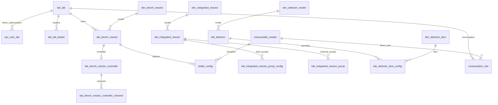

# M02 数据库增量设计

2026-09-09，详细设计评审版。以当前[建表脚本](../../../sql/ymsw.sql)为基线，复用38张既有表，新增79列（含本轮规则6列及生成列），目标645列；增加46个唯一索引，替换通讯旧唯一索引。没有新增平行业务主表。SQL均为设计稿，未连接数据库执行。

## 1. 交付及执行顺序

| 阶段 | 文件 | 准入与完成条件 |
| --- | --- | --- |
| 基线 | [完整字段字典](数据库表结构与字段字典.md) | 38表566列原定义、索引及新增列；部署库与基线有差异先逐项合并 |
| 预检 | [01迁移前核验](history/sql/01-设备资源迁移前核验.sql) | 核实MySQL版本、数据库、字段、重复、13表资产号空间及旧引用；查询有异常不得继续 |
| 扩展 | [02增量迁移](history/sql/02-设备资源增量迁移设计稿.sql) | 停相关写入，先原生一致性备份；辅助快照不替代备份；逐表DDL并记录执行位置 |
| 数据核验及约束 | [03唯一约束](history/sql/03-设备资源唯一约束设计稿.sql) | 按第4节逐主键核准映射，重跑重复检查；新通讯索引成功后才移除旧索引 |
| 复核 | [04迁移后核验](history/sql/04-设备资源迁移后核验.sql) | 数量、原主键、索引、权限、未知值与版本不变量；还须完成第7节语义核验 |
| 回退 | [05回退](history/sql/05-设备资源回退设计稿.sql) | 默认保留扩展列、停新功能；破坏性DDL全部注释，仅无新写且完成恢复演练后逐条启用 |
| 空库参考 | [06完整目标DDL](history/sql/06-设备资源目标表结构.sql) | 38表完整结构；只用于空的隔离测试库，不在已有业务库执行 |

脚本采用MySQL 8语法。DDL隐式提交，整包不是原子事务；SELECT报告不会自动阻止后续语句，实施时必须按表检查并人工控制阶段。脚本不自动猜测生产schema，不插入用户/角色/菜单/字典数据。M01的sys_management_revision、sys_management_request、sys_data_change_log沿用[系统管理设计](../01-系统管理/详细设计.md)及其DDL，应先部署；M02不重复创建或改造其结构。

## 2. 存储归属与语义修正

| 对象 | 目标字段/既有字段 | 存储规则 |
| --- | --- | --- |
| 集成型号 | pump_count、mfc_count、threshold_weight_g、三控制开关 | 六项能力新增；数量/阈重量必须满足型号表单范围；历史NULL未知，新建显式提交 |
| 台式控制器 | mfc_count、threshold_weight_g、三控制开关 | 控制器事实独立于台式型号；泵数由已初始化通道确定，不另建泵数量真值 |
| 控制器称重引用 | balance_kind＋原balance_id | PC-20261026新选择BALANCE引用同实验室天平；历史明确FLOOR_SCALE允许原样保留，不按另一表同ID自动转换；无需新增列 |
| 天平 | 新model_id | 指向dev_floor_scale_model；旧brand/model文本不能自动模糊匹配型号 |
| 台式反应器 | 原volume_ml＋新capacity_unit | 现服务把maxCapacity写入volume_ml，实际为最大容量；注释“工作体积”不再作为目标语义。培养工作体积归M03 |
| 集成反应器 | 新air_pump_id | 指向同实验室有效空气泵；其他泵仍用原固定泵/外置泵两张关系表 |
| 检测型号 | 新model_name、single_send_limit、support_dilution | 显示名与原detect_type驱动键分开；暂存/稀释不混用，0/NULL含义不同 |
| 称重通讯 | 原calibration_modes | 源码实际绑定通讯方式字典，DTO映射communicationTypes；不新增平行通讯列。未知历史值不猜测 |
| 型号多图 | 两表新image_paths | JSON有序字符串数组，最多9项；首项投影icon_path，无图为空数组或NULL，API统一返回[] |
| 通讯 | 新device_kind、期望/应用版本及应用状态 | 身份为kind+id，不能用route任意路由到实体表；旧ip/port为兼容投影 |
| 液瓶 | 新配置版本、观测版本/时间/质量/来源；取样槽控制器关联 | 原current_capacity、standard_capacity均为g；容器L/mL不能填入重量；reactor_id仍指台式反应器主键，新取样槽可用controller_id直接关联控制器并留空reactor_id |
| 权限 | sys_user_lab、lab_lab_leader | 原组合主键保留；负责人派生管理权不生成直接授权，不增加有效期列 |

不持久化configurationReady布尔：由必需字段、引用、单位可解析性、驱动能力及版本一致性计算issues。未知历史记录可管理/核验，但依赖缺失能力的新运行拒绝CONFIGURATION_INCOMPLETE，不能把NULL强制变0、false或true来消除问题。

目标DDL保留旧列类型和注释以便比对，以上是明确的业务语义勘误；实现时应同步实体注释，不据旧“ml/校准方式”命名执行转换。台式capacity_unit未核实前不转换数值，集成型号capacity是g，集成实例volume_ml与其独立。

## 3. 索引和并发

有效记录用生成列m02_active=1，逻辑删除为NULL，使删除后可重用编号，且允许多条历史删除记录。停用但未删除仍占号。目标唯一索引按型号各自业务键、项目类型+编码、资源名称/编码、实验室名称/编码、设备编号和引用聚合设置；全部列及索引见06。原有普通索引保留，本次不做无关索引清理。

Q15统一编号覆盖13表：lab_lab.lab_code，11类asset_no及lab_culture_container.container_no。m02_asset_key使用LOWER(TRIM(value))、空串转NULL和utf8mb4_bin比较；展示值不改大小写。应用同样去首尾空格并按英文字母不区分大小写检查，禁止按数据库默认不区分重音的排序规则扩大等价规则。部署预检需验证大小写、下划线及非ASCII历史数据；新实验室编码仍限定英文字母/数字/下划线。

单表索引无法保证跨表唯一，所有13类新增/改号/恢复入口及旧入口都必须在同一SYSTEM守卫中重查整个空间，再同事务保存；排除自身使用来源表+主键。培养容器container_no的全局资产约束优先于本实验室名称约束。一般device_no按本类型实验室内唯一，检测/集成各自类型全局唯一；集成已有生成列唯一索引保留。

通讯新索引为(device_kind,device_id,m02_active)，旧uk_device_id在新索引成功后才删除。device_kind历史空值必须先查清，不能利用NULL跳过唯一约束。控制器每个有效reactor_id及lab_id+controller_no唯一；检测规则每个有效lab_id一条。液瓶站位原唯一键继续保留：站位是物理初始化身份，换瓶只更新配置，不以软删重建同站位来规避约束。

非资产业务字符串沿用现有列排序规则，trim后保存；预检重复查询采用对应列实际排序规则。需要改变业务名称等价规则应另列迁移，不与Q16资产规则混为一谈。生成列仅供数据库使用，实体写白名单不含它们。

## 4. 历史映射与数据修复

不提供虚构ID的可执行UPDATE。实施者根据预检结果生成逐主键清单，至少含table、primaryKey、oldValue、newValue、evidence、reviewer；旧值作为乐观条件，每条影响行数必须为1，否则回滚该批并重核。表/列名来自固定白名单，值用参数绑定。每批普通DML同事务写审计，DDL另阶段执行。

| 清单 | 核对证据及处理 |
| --- | --- |
| 检测显示名/驱动 | 型号铭牌、已实现适配器和原detect_type；不得直接把驱动名当已确认产品名；保留历史路由键 |
| 型号能力 | 厂商资料与现场初始化；固定泵数与所有关联实例核对，冲突保留原配置并阻断投用，不按最大行数推定 |
| 天平model_id | 铭牌/品牌/规格精确核验，歧义记录由设备负责人核准；不匹配则NULL |
| 控制器balance_kind | 当前连接归属、原地秤记录和同实验室核对；跨表ID碰撞只按来源证据处理 |
| 台式容量单位 | 核对原现场输入和型号历史，证明单位后只补capacity_unit；不能仅取当前型号单位重解释旧数值 |
| 通讯kind/方式 | 固定route白名单+真实目标表+主键+实验室；孤儿或一对多映射保留并停用相关投用入口；凭据不导出 |
| 多图 | 原icon_path确为可信文件路径时映射单元素数组；空路径映射空数组；不抓取外站文件 |
| 共享消耗 | shared_rule_id指向同lab/tab其他卡片直接耗材行，保留rule_id；旧shared_source仅辅助核验，不能当主键 |
| 液瓶观测 | 不把迁移时间作为设备观测时间；默认UNKNOWN，PLC重新采集并关联当前配置后才GOOD |

有未知设备能力可以完成扩展阶段但不能将该设备验收为可投用；通讯身份/唯一业务键未知则不能完成约束切换。缺资料属于实施资料依赖，不新增未经确认的业务选项。历史重复由业务方选择保留/改号/合并方案，迁移稿不代做不可逆决定。

## 5. 关系与删除

图中是逻辑关系，不声明已经存在物理外键；通讯多态引用由DeviceRef白名单解析。M03/M05/M07业务历史通过快照保存，软删除不级联清历史。控制器通道/固定泵聚合更新按稳定编号差异写入，不删除重建所有主键；直接授权保留未变等级和建立时间。依赖查询失败时拒绝所依赖的删除/结构修改，不降级为无引用。

## 6. 版本与缓存

管理写复用M01 SYSTEM revision、请求回执及审计，同事务递增一次；模型传播和聚合子表更新属于同次提交。外部请求使用X-Request-Id和X-Management-Revision；revision作为十进制字符串返回，不用JavaScript number。

lab_communication.desired_revision在完整通讯保存时取新管理版本，适配器应用后才写applied_revision；旧回报按设备身份+revision丢弃。初始化仅选方式的通讯骨架为NOT_CONFIGURED、applied_revision=NULL；记录存在不代表已连接。读数版本和通讯回报不递增SYSTEM管理版本，使用条件UPDATE防旧回报覆盖新版本。

bottle_config.configuration_revision在换瓶/补料类型改变时取新管理版本并将质量改UNKNOWN、observed_revision/observed_at置NULL；旧current/standard值可保留供审计，接口质量门控下不输出为当前值。PLC重采成功后同次写重量、来源、时间、观测版本及GOOD。过期由配置的采集周期/超时判定并返回STALE，不能凭客户端当前时间伪造观测时间。

消耗/检测规则不再新增局部版本列，configurationRevision使用读取时SYSTEM版本，M03/M07固化时校验。管理缓存以该版本失效；未知或过期候选重新读取，不自动提交原草稿。

## 7. 迁移验收与回退条件

SQL结果为零异常只是结构检查。还须逐关系检查存在性、同实验室、软删除语义及型号类别：控制器/反应器、称重角色、全部model_id/spec_id、固定泵/外置泵、通讯DeviceRef、检测项目同类、消耗共享源、授权用户/实验室、负责人用户。源表没有物理外键并不能豁免这些检查。

对修复涉及的每行校验目标值；对未修复旧列比较备份与当前值（包括NULL、原主键、创建时间、授权等级），不能只比较行数。备份含生成列快照，恢复时须显式列出可写旧列，禁止INSERT SELECT *写入生成列。新列不是历史数据备份；不得在已有新业务写入后直接删列或以快照覆盖。

恢复演练包含备份恢复、版本回退、适配器停用/重载和13表并发编号校验。发生部分DDL失败记录已成功语句，核查information_schema后决定续跑/回退；不得从02开头重复建快照或假设事务已撤销DDL。备份保留周期按运维策略，含通讯密文快照的权限不得低于原表。

## 8. 评审补充：责任与授权核验

38表按[字段字典责任说明](数据库表结构与字段字典.md)划分；sys_user_lab是M02实验室授权领域关系，不因sys_前缀归为只读外部表。用户保存事务由M01编排，授权写入经M02契约；M01公共版本/回执/审计表按第1节先部署。SYSTEM锁定义和幂等顺序引用[联调清单第7节](联调与验收清单.md)，不另建锁表。

01/04核验脚本补充直接授权∪负责人去重人数及孤儿关系查询。人数汇总用于对比，非零人数本身不是迁移失败；同人双来源是合法状态，不删重。孤儿关系必须列入人工核验清单，不能因查询关联不到有效用户而当作零人或自动删除。账号停用仍计数；已删除/缺失用户或实验室的当前关系另行报异常。实施时将汇总与LAB05/LAB07各自语义对照：禁用计数不能静默过滤脏关系，列表不展示已删除用户。脚本仅核验，不修改权限；SQL尚未执行。

## 9. 控制器型号增量（已由09—13收尾包接续）（2026-09-10）

[M04工程交接](../04-工艺与方案管理/工程来源与接入验收.md)依据需求补出lab_bench_reactor_controller.model_dict_code BIGINT NULL及型号字典逻辑关联，无外键、无默认型号。此项尚未改写本目录01—06 SQL或现有字段基线总数；下一次M02迁移包修订必须同时补字段字典、目标结构、增量/回退、字典类型及逐连接核准输入与孤儿/错误类型核验。已有运行/模板引用时禁止通过直接SQL绕过领域守卫更换型号，当前资料不足不生成未经核准的数据回填。

## M05检测动态规则新增交接（2026-09-10，待并入SQL包）

[M05运行字段增量](../05-检测与数据签批/发送规则与运行字段增量设计.md)冻结本轮五表20列设计，M02负责dev_detector_model.rule_profile/rule_revision及lab_detector.queue_revision/applied_rule_revision/applied_rule_snapshot/position_evidence共6列。其余14列归M05样品/项目/派发日志。模型旧标量继续作为唯一主数据，实例/调用snapshot为生效或历史事实，不形成可编辑双源。

本版M02 01—06 SQL及目标新增字段字典已同步这6列，旧库另有07补丁；这是设计稿同步，不表示迁移执行完成。活动/未知请求和旧配置映射核准是发布前置；禁止将空事实回填为可发送。原台式控制器model_dict_code等待并入事项仍保留，不能因新增M05交接遗漏。

## 检测规则SQL同步完成（2026-09-10，静态设计）

本轮6列及5个CHECK已纳入02增量、03约束和06完整目标，01/04增加核验，05说明回退顺序；38表目标645列。旧版M02已经部署时只用[07检测规则补丁](history/sql/07-检测规则增量补丁.sql)，不用重新跑全量02/03；从未使用的六列可按[08回退](history/sql/08-未启用检测规则补丁回退.sql)核验后移除。

完整顺序见[M05迁移交付说明](../05-检测与数据签批/发送规则数据库交付说明.md)。M05另增14列，不能在M02重复增加；主设计此前“六列尚未进SQL”是历史阶段，本段更新其完成状态。台式控制器model_dict_code等其他待并入增量仍未在本轮处理。本轮仅生成和静态解析，不代表执行迁移。

## 2026-09-10 型号与工程版本收尾

model_dict_code已并入本轮10增量、11核验、12回退及13完整目标，另增工程身份/版本两表，最终40表672列；[收尾契约](控制器型号与工程参数收尾契约.md)及[完整字典](收尾后完整数据库字段字典.md)闭合字典初始化、逐连接核准和工程内容。原01—08为迁移基线，先完成该基线后执行09—12，13仅空库最终参考；此前“尚待并入”是历史记录，本次已完成设计，未运行迁移。
