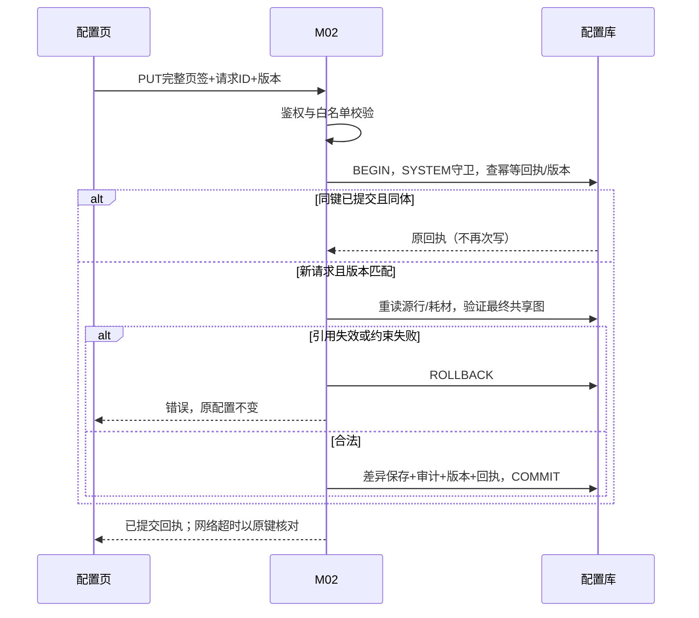

# M02 消耗配置聚合与解析契约

## 公共传输、事务与失败协议

本文为DD-20260913-T8-R5目标契约，复用[检测与资源配置详细设计](检测与资源配置详细设计.md)及M01公共响应；样例均为模拟数据，不证明接口已实现。ID为正十进制字符串，版本为非负十进制字符串；JSON整数只用于有明确int范围的数量/序号，Decimal用十进制字符串。未知与null不得转换为0。

所有配置写请求携带X-Request-Id（UUID）及X-Management-Revision（SYSTEM管理版本），示例初始21、成功22；这些不是Body字段。每个样例独立运行，真实串行提交需新请求ID及最新版本。写入先鉴权、校验白名单，然后在同一管理守卫事务内重检版本、对象和引用，更新配置、审计、版本和幂等回执一起提交。并发占用判定必须与M03/M07占用转换共用锁/守卫或等价原子协议，不能查空闲后无保护落库。T9须验证双方实际锁顺序与消费字段。无锁可靠性/依赖不可用时失败，不猜测空闲。

同请求ID同体且仍有权，回放首次已提交回执；同键异体409 REQUEST_CONFLICT；无回执且旧版本409 MANAGEMENT_CONFLICT。事务前/中任一失败均无部分保存、无成功审计、版本不增加；超时先以原键原体重试核对结果，不能新键覆盖。GET无配置写、无WriteMeta，重复读取按当前授权重新取值。

| 场景 | HTTP/错误码 | 适用 |
| --- | --- | --- |
| 结构、枚举、范围、重复ID、非法引用、缺必填 | 400 INPUT_INVALID | 有参数的读写 |
| 提交只读字段/审计/观测 | 400 READ_ONLY_FIELD | 写 |
| 缺功能权限或实验室操作/管理等级 | 403 PERMISSION_DENIED | 读写 |
| 指定对象不存在或不可见 | 404 NOT_FOUND | 对象接口 |
| 同键异体/旧管理版本 | 409 REQUEST_CONFLICT / MANAGEMENT_CONFLICT | 写 |
| 合法资源已被占用 | 409 RESOURCE_IN_USE | 液瓶写 |
| 唯一值重复 | 409 NAME_CONFLICT / CODE_CONFLICT | 四资源写；耗材编码用CODE_CONFLICT，其余名称用NAME_CONFLICT |
| 依赖不可用/管理锁争用 | 503 DEPENDENCY_UNAVAILABLE / MANAGEMENT_BUSY | 前者读写，后者写 |

认证失效沿M01认证域错误，不新增另一套认证码。下文特有失败补充在对应接口节；统一错误样例：
```json
{
  "code": 409,
  "msg": "管理版本已变化，请重新读取后核对",
  "requestId": "00000000-0000-4000-8000-000000000005",
  "errorCode": "MANAGEMENT_CONFLICT",
  "data": null,
  "fieldErrors": [],
  "retryAfterSeconds": null
}
```

## 字段与身份

复用主设计第6节；labId必填正十进制字符串，tabType必填feeding_batch/column_after/sample。卡片键沿源码buildCardKey：detectClass+"|"+(dilutionType或空串)，例如BGA|、ViCell|diluted；仅用于稳定匹配，不替代ruleId。分类大小写保持BGA、ViCell、OSMO、Cedex、留样。feeding_batch六卡片，column_after四卡片，sample五卡片；完整顺序见bootstrap样例。

CardInput必含detectClass、dilutionType（非ViCell显式null）、rows数组；页签所有卡片恰好一次。RowInput所有键必出现：ruleId（新增null/既有ID）、itemType字符串1/2、consumableId:string|null、sharedRuleId:string|null、quantity:int|null。类型1必须有效耗材，quantity为1—2147483647或null表示NA，sharedRuleId必须null；类型2必须已保存的同lab/tab其他卡片直接源ruleId，其consumableId/quantity必须null。未知只读键、重复ruleId、半填行、跨页签/卡片身份、共享环都拒绝。空卡片rows=[]是显式清空，不提交无内容占位行。

ConfigView固定labId、tabType、cards、managementRevision；card固定detectClass、dilutionType、cardName:string、rows。RowView固定ruleId、seqNumber:int≥1、itemType、consumableId、consumableLabel:string|null、sharedRuleId、sharedSourceLabel:string|null、quantity:int|null、resolvedQuantity:int|null、configurationIssue:string|null。直接行resolvedQuantity=quantity，共享行取源quantity；NA本身不是错误。失效源/耗材保留原ID，展示configurationIssue，不伪造数量0。configurationIssue本批机器值固定SOURCE_UNAVAILABLE/CONSUMABLE_UNAVAILABLE（正常null），T9须同步消费方；新增/保存不能提交失效引用。

## GET /lab/consumptionRule/bootstrap

权限lab:consumptionRule:list。无Query/Body，实验室选项仅当前可见；defaultLabId必须在其中，否则null，无权限实验室返回空labOptions。现BootstrapVo的value/label选项是局部DTO，不冒充M01 id/label类型。顶层data字段labOptions、defaultLabId、tabs、itemTypeOptions、dilutionTypeOptions均必出现，数组非null；labName/tabName/cardName/label字符串，helpText:string|null。HTTP 200模拟返回：
```json
{
  "code": 200,
  "msg": "操作成功",
  "requestId": "00000000-0000-4000-8000-000000000005",
  "managementRevision": "21",
  "data": {
    "labOptions": [
      {
        "labId": "1001",
        "labName": "模拟实验室"
      }
    ],
    "defaultLabId": "1001",
    "tabs": [
      {
        "tabType": "feeding_batch",
        "tabName": "补料批次",
        "cards": [
          {
            "detectClass": "BGA",
            "dilutionType": null,
            "cardName": "BGA",
            "helpText": null
          },
          {
            "detectClass": "ViCell",
            "dilutionType": "diluted",
            "cardName": "Vicell-稀释",
            "helpText": null
          },
          {
            "detectClass": "ViCell",
            "dilutionType": "undiluted",
            "cardName": "Vicell-未稀释",
            "helpText": null
          },
          {
            "detectClass": "OSMO",
            "dilutionType": null,
            "cardName": "OSMO",
            "helpText": null
          },
          {
            "detectClass": "Cedex",
            "dilutionType": null,
            "cardName": "Cedex",
            "helpText": null
          },
          {
            "detectClass": "留样",
            "dilutionType": null,
            "cardName": "留样",
            "helpText": null
          }
        ]
      },
      {
        "tabType": "column_after",
        "tabName": "柱后",
        "cards": [
          {
            "detectClass": "BGA",
            "dilutionType": null,
            "cardName": "BGA",
            "helpText": null
          },
          {
            "detectClass": "OSMO",
            "dilutionType": null,
            "cardName": "OSMO",
            "helpText": null
          },
          {
            "detectClass": "Cedex",
            "dilutionType": null,
            "cardName": "Cedex",
            "helpText": null
          },
          {
            "detectClass": "留样",
            "dilutionType": null,
            "cardName": "留样",
            "helpText": null
          }
        ]
      },
      {
        "tabType": "sample",
        "tabName": "样本",
        "cards": [
          {
            "detectClass": "BGA",
            "dilutionType": null,
            "cardName": "BGA",
            "helpText": null
          },
          {
            "detectClass": "ViCell",
            "dilutionType": "diluted",
            "cardName": "Vicell-稀释",
            "helpText": null
          },
          {
            "detectClass": "ViCell",
            "dilutionType": "undiluted",
            "cardName": "Vicell-未稀释",
            "helpText": null
          },
          {
            "detectClass": "OSMO",
            "dilutionType": null,
            "cardName": "OSMO",
            "helpText": null
          },
          {
            "detectClass": "Cedex",
            "dilutionType": null,
            "cardName": "Cedex",
            "helpText": null
          }
        ]
      }
    ],
    "itemTypeOptions": [
      {
        "value": "1",
        "label": "耗材"
      },
      {
        "value": "2",
        "label": "共享"
      }
    ],
    "dilutionTypeOptions": [
      {
        "value": "diluted",
        "label": "稀释"
      },
      {
        "value": "undiluted",
        "label": "未稀释"
      }
    ]
  }
}
```

## GET /lab/consumptionRule/config

权限lab:consumptionRule:query＋实验室可见等级0。Query labId/tabType必填，Body空，无分页；示例?labId=1001&tabType=feeding_batch。未配置页签返回固定卡片及空rows，GET不初始化数据库；完整HTTP 200：
```json
{
  "code": 200,
  "msg": "操作成功",
  "requestId": "00000000-0000-4000-8000-000000000005",
  "managementRevision": "21",
  "data": {
    "labId": "1001",
    "tabType": "feeding_batch",
    "cards": [
      {
        "detectClass": "BGA",
        "dilutionType": null,
        "rows": [
          {
            "ruleId": "8101",
            "itemType": "1",
            "consumableId": "7401",
            "sharedRuleId": null,
            "quantity": 1,
            "seqNumber": 1,
            "consumableLabel": "模拟耗材",
            "sharedSourceLabel": null,
            "resolvedQuantity": 1,
            "configurationIssue": null
          }
        ],
        "cardName": "BGA"
      },
      {
        "detectClass": "ViCell",
        "dilutionType": "diluted",
        "rows": [
          {
            "ruleId": "8102",
            "itemType": "2",
            "consumableId": null,
            "sharedRuleId": "8101",
            "quantity": null,
            "seqNumber": 1,
            "consumableLabel": null,
            "sharedSourceLabel": "BGA",
            "resolvedQuantity": 1,
            "configurationIssue": null
          }
        ],
        "cardName": "Vicell-稀释"
      },
      {
        "detectClass": "ViCell",
        "dilutionType": "undiluted",
        "rows": [],
        "cardName": "Vicell-未稀释"
      },
      {
        "detectClass": "OSMO",
        "dilutionType": null,
        "rows": [],
        "cardName": "OSMO"
      },
      {
        "detectClass": "Cedex",
        "dilutionType": null,
        "rows": [],
        "cardName": "Cedex"
      },
      {
        "detectClass": "留样",
        "dilutionType": null,
        "rows": [],
        "cardName": "留样"
      }
    ],
    "managementRevision": "21"
  }
}
```

## GET /lab/consumptionRule/consumable-options

权限lab:consumptionRule:list，Query/Body空。有效全局耗材候选，不虚构labId；沿既有OptionVo保留consumableId/itemCode/description/label，目标补measureUnit:string（既有数据缺单位返回null并不得执行解析）。ID不可空，历史描述/编码可空，label取可用描述否则编码/ID。输出无分页数组，排序description、consumableId升序（技术固定）。HTTP 200：
```json
{
  "code": 200,
  "msg": "操作成功",
  "requestId": "00000000-0000-4000-8000-000000000005",
  "managementRevision": "21",
  "data": [
    {
      "consumableId": "7401",
      "itemCode": "MOCK-BUCKET",
      "description": "模拟耗材",
      "label": "模拟耗材",
      "measureUnit": "个"
    }
  ]
}
```

## PUT /lab/consumptionRule/config

权限lab:consumptionRule:edit＋实际实验室管理等级2。Body严格labId/tabType/cards，WriteMeta必填。当前已保存8101/8102的完整页签提交示例：
```json
{
  "labId": "1001",
  "tabType": "feeding_batch",
  "cards": [
    {
      "detectClass": "BGA",
      "dilutionType": null,
      "rows": [
        {
          "ruleId": "8101",
          "itemType": "1",
          "consumableId": "7401",
          "sharedRuleId": null,
          "quantity": 1
        }
      ]
    },
    {
      "detectClass": "ViCell",
      "dilutionType": "diluted",
      "rows": [
        {
          "ruleId": "8102",
          "itemType": "2",
          "consumableId": null,
          "sharedRuleId": "8101",
          "quantity": null
        }
      ]
    },
    {
      "detectClass": "ViCell",
      "dilutionType": "undiluted",
      "rows": []
    },
    {
      "detectClass": "OSMO",
      "dilutionType": null,
      "rows": []
    },
    {
      "detectClass": "Cedex",
      "dilutionType": null,
      "rows": []
    },
    {
      "detectClass": "留样",
      "dilutionType": null,
      "rows": []
    }
  ]
}
```

最终引用图重检后差异更新；seqNumber按卡片输入顺序重排，未变行创建时间不变。新增行ruleId=null由服务端生成；同次新增的未保存源不能被共享引用，必须先保存后使用服务器ID。删除被保留共享引用的源拒绝400 INPUT_INVALID，同时合法删掉全部共享行才可删源。既有共享行改为耗材行必须删后新增。保存不扣库存。目标成功返回完整ConfigView及新版本。2026-11-03状态补正：ConsumptionRuleApplicationServiceImpl#saveConsumptionConfig已返回assembleConfigView，不能再以旧Service或success()描述当前聚合口；无变更分支与实际写分支分开，未在本轮验证其完整幂等、版本和审计行为。
```json
{
  "code": 200,
  "msg": "操作成功",
  "requestId": "00000000-0000-4000-8000-000000000005",
  "managementRevision": "22",
  "data": {
    "labId": "1001",
    "tabType": "feeding_batch",
    "cards": [
      {
        "detectClass": "BGA",
        "dilutionType": null,
        "rows": [
          {
            "ruleId": "8101",
            "itemType": "1",
            "consumableId": "7401",
            "sharedRuleId": null,
            "quantity": 1,
            "seqNumber": 1,
            "consumableLabel": "模拟耗材",
            "sharedSourceLabel": null,
            "resolvedQuantity": 1,
            "configurationIssue": null
          }
        ],
        "cardName": "BGA"
      },
      {
        "detectClass": "ViCell",
        "dilutionType": "diluted",
        "rows": [
          {
            "ruleId": "8102",
            "itemType": "2",
            "consumableId": null,
            "sharedRuleId": "8101",
            "quantity": null,
            "seqNumber": 1,
            "consumableLabel": null,
            "sharedSourceLabel": "BGA",
            "resolvedQuantity": 1,
            "configurationIssue": null
          }
        ],
        "cardName": "Vicell-稀释"
      },
      {
        "detectClass": "ViCell",
        "dilutionType": "undiluted",
        "rows": [],
        "cardName": "Vicell-未稀释"
      },
      {
        "detectClass": "OSMO",
        "dilutionType": null,
        "rows": [],
        "cardName": "OSMO"
      },
      {
        "detectClass": "Cedex",
        "dilutionType": null,
        "rows": [],
        "cardName": "Cedex"
      },
      {
        "detectClass": "留样",
        "dilutionType": null,
        "rows": [],
        "cardName": "留样"
      }
    ],
    "managementRevision": "22"
  }
}
```

## 内部 ResolveConsumption

不是新增公网路由。调用方为获授权M07任务编排，服务端核验可信身份及真实labId；输入labId、tabType、selectedCardKeys:string[]（非空、唯一、固定合法键）、configurationRevision必填。该版本指调用者取得ConfigView时的SYSTEM管理修订，当前不匹配409 VERSION_CONFLICT，不退回最新配置或编造旧版本。读配置和解析在一致视图内，输出随后由M07连同输入版本固化快照；双方提交间须再校验版本，见T9。

结果为数组，每项sourceRuleId/consumableId:string、quantity:int|null、unit:string、sharedBy:string[]（本次选择命中的共享行ID，非全部配置引用）。按sourceRuleId去重、升序输出，sharedBy去重升序；两个直接源即使同耗材也保留两项。无已配置用量的合法卡片允许返回[]，与依赖失败不同。源/耗材无效、单位缺失409 CONFIGURATION_INCOMPLETE；NA保留null，由M07决定执行是否具备足够信息，不自动视作免耗材。

输入同时选BGA及ViCell稀释：
```json
{
  "labId": "1001",
  "tabType": "feeding_batch",
  "selectedCardKeys": [
    "BGA|",
    "ViCell|diluted"
  ],
  "configurationRevision": "21"
}
```

内部结果（不套HTTP外壳）：
```json
[
  {
    "sourceRuleId": "8101",
    "consumableId": "7401",
    "quantity": 1,
    "unit": "个",
    "sharedBy": [
      "8102"
    ]
  }
]
```

只选择ViCell|diluted仍得到同一源数量1；只选择BGA|则sharedBy=[]。不得按选择卡片数相乘，不触发库存写。

## 时序及失败断言



失败完整样例（内部解析映射到服务错误时）：
```json
{
  "code": 409,
  "msg": "共享源耗材失效，不能生成任务用量",
  "requestId": "00000000-0000-4000-8000-000000000005",
  "errorCode": "CONFIGURATION_INCOMPLETE",
  "data": null,
  "fieldErrors": [],
  "retryAfterSeconds": null
}
```

2026-11-03状态补正：当前聚合Controller委托ConsumptionRuleApplicationServiceImpl，耗材候选已读取并装配measureUnit，保存已返回ConfigView；旧ConsumptionRuleServiceImpl不能替代新应用链的状态依据。内部解析消费方及完整失败/运行行为仍按T9单列核对，不能由候选/保存已定位推定其已完成。旧行CRUD/list/export与聚合入口分开，不增加本期功能。

## T8-R6 旧入口核实

[唯一性预检查与消耗旧入口兼容契约](唯一性预检查与消耗旧入口兼容契约.md)已核对两个预检查及页面消费、六消耗旧路由与部分源码防护；旧行完整DTO和并发双方验证仍待完成。

## T8-R7 后续完成状态

前述六个消耗旧入口的目标筛选/DTO/回执/导出列已在[逐字段契约](消耗旧接口逐字段契约.md)补齐；这替代“目标DTO尚待补齐”的历史状态。旧客户端实际适配、事务和运行验证仍待完成。2026-11-03状态补正：当前mapper/lab/ConsumptionRuleMapper.xml已使用detect_class，不再保留detect_type映射缺实现结论；本次仅改文档，未改Mapper或业务源码，SQL与消费行为本轮未验证。

## T9-R1 消费方统一解析

M04/M05消费resolvedQuantity、单位及configurationIssue，不自行追sharedRuleId建立第二套解析。iconPath三态、卡片身份和detectType兼容规则见[T9 M02消费核对](../00-跨模块审阅收尾/history/review/T9-M02消费交接逐字段核对.md#4-m02资源与消耗配置--m04m05)。
