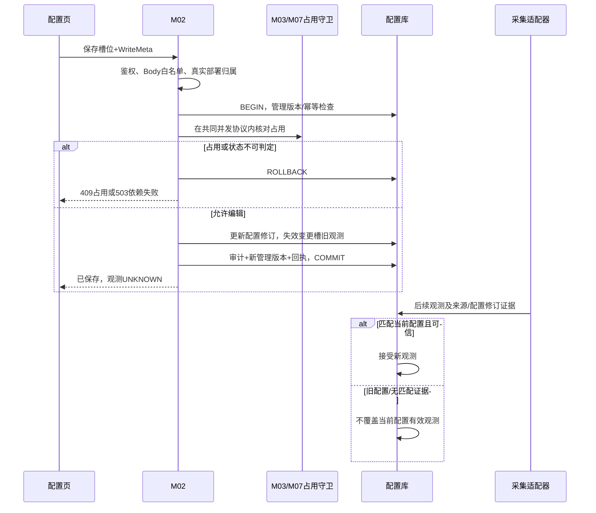

# M02 液瓶配置逐接口与观测边界

## 2026-11-03 取样单元直接关联与配置锁定

按用户确认，所有 S 取样槽以 `bottle_config.controller_id` 直接关联同实验室 `lab_bench_reactor_controller.connection_id`，并核对该控制器的 `sampling_unit_code` 与槽位单元编码一致；不推测或复用罐体、真实泵通道，不再通过旧罐体或泵通道兜底。S 槽可不填 `reactor_id` 和 `pump_code`，缺失或无法核对控制器的槽位不能编辑或参与换瓶。F 补料单元维持原有身份解释。单元三个槽必须同实验室、同 Row、同排序、同单元、同控制器且恰好为 1、2、3；Row 若经用户明确作为临时展示排序，不得描述为已验证现场布局。

按控制器查询当前培养：没有当前培养或开始培养尚未完成时，S 单元配置可编辑；开始培养全部步骤完成且培养仍在进行或延期时，整个单元三个槽位配置不可编辑；已释放的不再占用。关联缺失、事实不一致、读取失败均为未知而不可编辑。`bottle_config.status` 不是权威占用依据；该配置锁不禁止正常的手工换瓶工作流。布局是读时提示，保存须在守卫事务内重查；不能把布局返回的空闲当作持久锁。已有库定向升级须单独审查[结构升级脚本](../../开发基线/开发包/M02-液瓶取样单元控制器关联-既有库定向结构升级.sql)，不得加入空库安装链。源码、SQL、HTTP、浏览器、外部设备验证分别记录，文档本身不证明运行通过。

## 公共传输、事务与失败协议

### 2026-10-24 W08人工清理确认

`WasteLiquidSlotPort.confirmW08Clear(WasteClearConfirmation)`专供M07可信W08整批守卫回调；调用方已有非只读事务，禁止提供方另开提交。command固定workflowId、bottleId、labId、resourceKey、expectedConfigurationRevision、actorUserId、requestId与服务端confirmedAt，ID正bigint字符串，版本非负字符串，requestId合法UUID。当前实验室OPERATE、配置行、同实验室控制器直接关联、采样单元第3槽Waste身份和 `BOTTLE:<bottleId>` 槽位资源须锁内复核；资源忙闲/完整批次/版本与原键回执由M07拥有方先全量校验。

提供方复用`applyW08WasteZeroObservation`精确配置CAS，只登记current_capacity=0、WORKFLOW_CONFIRMED来源与确认时刻，不写PLC、不建立物料session。回执`WasteClearReceipt`包含瓶/资源/配置版本、真实锁前beforeGrams（可null）、afterGrams=0及confirmedAt；不得将未知原量补0。该Port不伪造`MaterialObservationCommand`要求的真实执行/归档观测身份。M07将回执与步骤、确认人、本地事件及审计同事务保存；M02异常必须传播使整批回滚，不单独承诺幂等或物理清零。接口及验收状态见[M07任务4](../07-补液运行与任务执行/任务页面与接口契约.md#w08整批完成与取消任务4)。

### 2026-10-12 明确资源映射与提供方落点

F 补料槽及真实泵工作流规格沿用 `PumpResourceKey.of(pumpId,channelNo)`，编码为 `PUMP:{正整数pumpId}:{原始channelNo}`；F 保存用 `selectExactSlotResourcesForUpdate` 锁读真实反应器、连接及通道映射，保留多命中后拒绝。S 取样槽位使用 `BOTTLE:<bottleId>`，不是物理泵或 PLC 命令身份；取样配置及 W06/W08 共用该槽位身份，不能将控制器或罐体 ID 冒充泵 ID。实际锁范围、并发等待及死锁仍须实库验证。

F 槽保存仍要求液瓶反应器在同实验室明确关联唯一有效控制器，`pump_code` 与该连接的 `channel_no` 逐字一致且命中唯一真实 `pump_id`。S 槽只接受直接关联的控制器，不读旧罐体及泵通道推断；三槽部署缺失、多义或不一致时按事实不可确认拒绝保存。

S 使用 M03 `SamplingControllerCulturePort.read(labId, controllerId, lock)` 获取 `FREE/STARTED/UNKNOWN` 培养事实，保存时以 `lock=true` 在共同管理守卫事务内重读；M07 `BottleSlotOccupationPort#requireFreeSlots` 按 `BOTTLE` 键检查三个槽位正在进行的取样换瓶、废液清理及未知会话。F 沿用 M03 `BottleCultureAssociationPort#listCurrentCultures` 与 M07 泵资源核验。缺事实不能推断空闲；明确冲突拒绝保存，未知或读取故障保持不可编辑。两模块 Port 不另开事务或反向获取 SYSTEM 首锁。

工作流两种现行持久形态分开解释：规范 `selection_snapshot.pumps` 是已选资源；当前 W03 的 `channels` 是能力候选全集，不是占用集合。后者须读取该实例非取消/跳过步骤的 `form_snapshot.rows[].resourceKey`，再结合仲裁/命令/物料会话核验；没有完整步骤事实按未知拒绝，不能把整台候选泵一律判忙，也不能把缺事实判空闲。

取样三槽仍整组保存，分别检查各自 `BOTTLE` 资源；任一槽不满足条件整组拒绝。入口拒绝加入已有事务，避免继承 SYSTEM 首锁之前已经建立的旧读视图。管理版本、配置 CAS、审计和幂等回执仍在同一守卫事务内提交；仅配置实际变化时递增 `configuration_revision`、清空旧观测和重量。满瓶换算只用于经用户确认的取样手工换瓶默认值，见文末 W06；配置保存不制造实际测量值。

252/253 使用本文定义的局部保存响应（采样 `{labId,unitCode,slots,managementRevision}`、补料 `{labId,unitCode,slot,managementRevision}`），不再使用不足以承载局部视图的通用 MutationResult。版本为原写回执版本；槽位为提交后按当前授权回读的展示投影，不承诺重放返回当时冻结的读数。回读不再次清除观测，也不把事务结束时已释放的锁冒充仍持有：未重新取得当前占用判定的展示叶保持 `editable=false/workflowConnected=null`，后续保存仍须完整重新判定。源码与契约测试不等于 SQL/HTTP/设备联调，运行验证另行进行。

### 2026-10-11 槽位保护与原子协议

S 的配置保护同时包含培养完成开始后的整单元锁和换瓶在途的槽位保护；取样三槽作为一组保存，任一槽存在冲突均不能部分保存。F 槽仍按自身资源核对。占用未知或事实不完整不放行；槽位身份使用 bottleId/unitCode/slotNo，不通过本地 status 替代 M03/M07 权威事实。

T9按[实现结构约定](../00-总纲与约定/00-开发实现结构与事务编排约定.md)“资源共锁的HTTP与后台双入口”交付后采用共同SYSTEM行锁，不假定现有HTTP管理守卫能接收后台任务。全序引用[调用总设计](../00-总纲与约定/00-Controller与模块接口调用总设计.md)第5节：SYSTEM/配置→实验室→业务根（培养等）→子对象→设备/占用→候选/审批交付→任务/命令/投递；同层稳定身份升序。M02配置修改、M03/M07占用建立/释放均须参与；拥有方Port不得在持设备锁后反向取培养锁或SYSTEM锁，不得新开事务/持锁RPC。

M07负责run_resource_guard、run_material_session等自有DAO与占用转换，并通过参与当前事务的锁读Port向M02返回槽位资源判断；对 S 使用 `BOTTLE:<bottleId>`，对 F 使用真实泵资源。M03提供控制器对应培养是否完成开始培养的事实。缺映射或读取不完整不得放行，真实占用返回冲突；无仲裁行不自动等于设备或槽位空闲，须结合对应工作流及会话事实判定。

不引入“当前任务旧配置、未来任务新配置”的双活槽位配置方案；忙碌槽保留原配置。资源共享导致其他槽实际上也被同一任务预占时，按其真实占用集合保护，不伪造其为空闲。实施批用“配置保存与占用建立同时到达，仅合法的一方成功”证明协议；本文只确定协议目标，未执行SQL或并发测试。

采样单元三槽分别拥有瓶位身份，但仍整组校验和保存；无需构造采样泵通道。独立补料槽只有在资源映射证明独立时才互不阻断。

本文为DD-20260913-T8-R5目标契约，复用[检测与资源配置详细设计](检测与资源配置详细设计.md)及M01公共响应；样例均为模拟数据，不证明接口已实现。ID为正十进制字符串，版本为非负十进制字符串；JSON整数只用于有明确int范围的数量/序号，Decimal用十进制字符串。未知与null不得转换为0。

所有配置写请求携带X-Request-Id（UUID）及X-Management-Revision（SYSTEM管理版本），示例初始21、成功22；这些不是Body字段。每个样例独立运行，真实串行提交需新请求ID及最新版本。写入先鉴权、校验白名单，然后在同一管理守卫事务内重检版本、对象和引用，更新配置、审计、版本和幂等回执一起提交。并发占用判定必须与M03/M07占用转换共用锁/守卫或等价原子协议，不能查空闲后无保护落库。T9须验证双方实际锁顺序与消费字段。无锁可靠性/依赖不可用时失败，不猜测空闲。

同请求ID同体且仍有权，回放首次已提交回执；同键异体409 REQUEST_CONFLICT；无回执且旧版本409 MANAGEMENT_CONFLICT。事务前/中任一失败均无部分保存、无成功审计、版本不增加；超时先以原键原体重试核对结果，不能新键覆盖。GET无配置写、无WriteMeta，重复读取按当前授权重新取值。

| 场景 | HTTP/错误码 | 适用 |
| --- | --- | --- |
| 结构、枚举、范围、重复ID、非法引用、缺必填 | 400 INPUT_INVALID | 有参数的读写 |
| 提交只读字段/审计/观测 | 400 READ_ONLY_FIELD | 写 |
| 缺功能权限或实验室操作/管理等级 | 403 PERMISSION_DENIED | 读写 |
| 指定对象不存在或不可见 | 404 NOT_FOUND | 对象接口 |
| 同键异体/旧管理版本 | 409 REQUEST_CONFLICT / MANAGEMENT_CONFLICT | 写 |
| 合法资源已被占用 | 409 RESOURCE_IN_USE | 液瓶写 |
| 唯一值重复 | 409 NAME_CONFLICT / CODE_CONFLICT | 四资源写；耗材编码用CODE_CONFLICT，其余名称用NAME_CONFLICT |
| 依赖不可用/管理锁争用 | 503 DEPENDENCY_UNAVAILABLE / MANAGEMENT_BUSY | 前者读写，后者写 |

认证失效沿M01认证域错误，不新增另一套认证码。下文特有失败补充在对应接口节；统一错误样例：
```json
{
  "code": 409,
  "msg": "管理版本已变化，请重新读取后核对",
  "requestId": "00000000-0000-4000-8000-000000000005",
  "errorCode": "MANAGEMENT_CONFLICT",
  "data": null,
  "fieldErrors": [],
  "retryAfterSeconds": null
}
```

## 读取叶子及观测规则

2026-10-23 W03批量登记增补：既有`BenchControllerRuntimePort`的Query可显式设置`includeFeedingSlots=true`，只在新apply活动写事务内由M02按真实反应器选择补料布局、按bottleId稳定顺序锁槽位并`selectExactSlotResourcesForUpdate`核唯一通道，与已读取的当前控制器通道精确一致后返回`feedingSlots`。保留原布局展示顺序。容量只取已核准`standard_capacity`克重；可信当前量还需GOOD、observed_revision匹配configuration_revision且observed_at完整，否则返回null。resourceKey统一`PumpResourceKey.of`，非ASCII/超长/歧义拒绝。默认false不新增锁读，不以此改变布局editable/workflowConnected或写入观测，读数不表示当前培养已确认装载。字段及用途同步PKG-00；不新增Port方法/表列，不执行SQL。

W07 使用 `FeedingLiquidSlotPort.listW07Slots(long actorId,long labId,long reactorId)` 取得补料槽位候选事实，返回 `List<FeedingLiquidSlotCandidate>`（bottleId、可空的 FeedingLiquidSlot、不可用原因）。此方法只读 M02 配置及精确通道映射、校验实验室操作权；不取保存占用锁，不判断 M07 工作流资格。配置缺失/歧义逐槽标不可用，读取故障不得伪装为空集合或空闲。M07 将这些事实组合为自身候选接口的 feedingSlots；现有液瓶布局 editable/workflowConnected 含义与配置保存保护保持不变。

复用主设计第7节的Layout/Slot，无新增部署行接口。Layout.labId:string、unitType:S/F、rows数组、managementRevision:string；row.rowNo:int、units数组；unit.unitCode:string≤50、unitSort:int、editable:boolean、lockReason:string|null、slots数组。部署序号保持数据库值，不重新编号；空布局rows=[]。身份/部署映射异常不能以临时ID补齐，保存拒绝。

Slot字段：bottleId:string、slotNo:int、pumpCode:string|null、reactorId:string|null、controllerNo:string|null、consumableId:string|null、bottleName:string|null、liquidType:string|null、bottleCapacityMl/currentCapacityG/maxCapacityG/percentage:decimal-string|null、readingQuality:GOOD/STALE/BAD/UNKNOWN、observedAt:ISO8601|null、workflowConnected:boolean|null、editable:boolean、lockReason:string|null、iconUrl:string|null。部署身份不可空，其他未知明确null。培养或关联事实未知时 editable 必须为 false；S 是否可编辑由专门的培养事实决定，不能把 workflowConnected=null 当成空闲或忙碌结论。

取样槽另返回只读 `slotDisplayCode`：由所属单元编码和槽位号组合，如 `S40.1`；事实缺失时为 null。该字段仅用于显示，不作为设备通道或液瓶身份，也不新增数据库列。

lockReason是可展示原因文本，不能作为前端判断权限的枚举；editable才是展示提示，写时服务端仍重查。GOOD仅用于可信且匹配当前配置revision的观测；STALE为曾匹配但已过期，BAD为已收到但无效，UNKNOWN为无可用观测。过期阈值由已核准采集配置提供，未核准不猜秒数。GOOD且maxCapacityG>0时percentage=current/max×100保留2位；其他情况percentage=null。人工换瓶确认值应标识其来源，不能说成PLC实测；用户对取样换瓶确认值临时约定1 mL = 1 g，该业务规则不表示物理密度。

取样单元 editable 要求三槽部署一致且对应培养尚未完成开始培养，或不存在当前培养；培养事实未知不可编辑。页面读取不持有保存锁，三个槽位同时保存时还需检查换瓶在途事实。F 补料单元现有布局保守返回不可编辑，保存按自身泵资源判定。M02 配置保存不发送物理命令、不解锁工作流。协议点位/重采匹配机制仍依赖已核准适配器输入。

## GET /lab/bottle-config/consumables

权限lab:bottle-config:list＋实验室可见等级0；Query labId必填且为本期小试上游，Body空，无分页。2026-11-03状态补正：当前BottleConsumableOptionQuery已有labId，BottleConfigApplicationServiceImpl在候选读取前核验实验室上下文，不再记为无入参/未实现；以下候选目标及运行未验证边界保留。仅有效CITEM且description包含Bucket，capacity>0，单位mL/L的候选；容量L×1000转mL。坏候选单条过滤并记录诊断，不让所有候选失败；依赖整体失败503而非[]。目标排序description、consumableId升序。

输出consumableId/description非空字符串、capacityMl正十进制字符串、iconUrl:string|null。HTTP 200：
```json
{
  "code": 200,
  "msg": "操作成功",
  "requestId": "00000000-0000-4000-8000-000000000005",
  "managementRevision": "21",
  "data": [
    {
      "consumableId": "7401",
      "description": "Bucket模拟瓶",
      "capacityMl": "2000",
      "iconUrl": null
    }
  ]
}
```

## GET /lab/bottle-config/layout

权限lab:bottle-config:list＋可见等级0；Query labId、unitType均必填，unitType严格S/F；Body空。labId必须本期小试上游且可见。按rowNo、unitSort、slotNo升序，保留真实部署布局。下面是?labId=1001&unitType=S的完整模拟返回，观测未知不会填0：
```json
{
  "code": 200,
  "msg": "操作成功",
  "requestId": "00000000-0000-4000-8000-000000000005",
  "managementRevision": "21",
  "data": {
    "labId": "1001",
    "unitType": "S",
    "rows": [
      {
        "rowNo": 1,
        "units": [
          {
            "unitCode": "MOCK-S01",
            "unitSort": 1,
            "editable": true,
            "lockReason": null,
            "slots": [
              {
                "bottleId": "9001",
                "slotNo": 1,
                "pumpCode": "MOCK-P1",
                "reactorId": "1101",
                "controllerNo": "MOCK-PLC",
                "consumableId": "7401",
                "bottleName": "Bucket模拟瓶",
                "liquidType": "water",
                "bottleCapacityMl": "2000",
                "currentCapacityG": null,
                "maxCapacityG": null,
                "percentage": null,
                "readingQuality": "UNKNOWN",
                "observedAt": null,
                "workflowConnected": false,
                "editable": true,
                "lockReason": null,
                "iconUrl": null
              },
              {
                "bottleId": "9002",
                "slotNo": 2,
                "pumpCode": "MOCK-P2",
                "reactorId": "1101",
                "controllerNo": "MOCK-PLC",
                "consumableId": "7401",
                "bottleName": "Bucket模拟瓶",
                "liquidType": "75% Ethyl alcoho",
                "bottleCapacityMl": "2000",
                "currentCapacityG": null,
                "maxCapacityG": null,
                "percentage": null,
                "readingQuality": "UNKNOWN",
                "observedAt": null,
                "workflowConnected": false,
                "editable": true,
                "lockReason": null,
                "iconUrl": null
              },
              {
                "bottleId": "9003",
                "slotNo": 3,
                "pumpCode": "MOCK-P3",
                "reactorId": "1101",
                "controllerNo": "MOCK-PLC",
                "consumableId": "7401",
                "bottleName": "Bucket模拟瓶",
                "liquidType": "Waste",
                "bottleCapacityMl": "2000",
                "currentCapacityG": null,
                "maxCapacityG": null,
                "percentage": null,
                "readingQuality": "UNKNOWN",
                "observedAt": null,
                "workflowConnected": false,
                "editable": true,
                "lockReason": null,
                "iconUrl": null
              }
            ]
          }
        ]
      }
    ],
    "managementRevision": "21"
  }
}
```

上述MOCK编码仅是部署测试夹具，不对应真实PLC地址。liquidType必须使用目标环境字典实际值，样例沿主设计初始液体值；显示标签若与字典值不同，由既有字典适配，不能发显示标签当命令点位。

## PUT /lab/bottle-config/sampling-units/{labId}/{unitCode}

权限lab:bottle-config:edit＋实际实验室管理等级2；Path labId、unitCode必填，unitCode是现部署身份，Body不得覆盖。WriteMeta必填。Body只有slots非空数组，恰好当前三槽各一次；每行bottleId必填、consumableId:string|null与liquidType:string|null两个键都必须出现，同时有值或同时null。只允许同一目标单元三槽，不能新增/调号。第3槽有瓶必须Waste，清空为两个null；第1、2槽默认分别为水、酒精，但允许用户选择 `smp_bottle_liquid_type` 中其他启用值；具体存储值取目标环境有效字典，不能擅自写显示标签。耗材取资源管理中有效 CITEM Bucket、且容量为正的 mL/L 候选。以下完整请求独立从版本21执行：
```json
{
  "slots": [
    {
      "bottleId": "9001",
      "consumableId": "7401",
      "liquidType": "water"
    },
    {
      "bottleId": "9002",
      "consumableId": "7401",
      "liquidType": "75% Ethyl alcoho"
    },
    {
      "bottleId": "9003",
      "consumableId": "7401",
      "liquidType": "Waste"
    }
  ]
}
```

单事务重新核对真实lab、控制器、三槽、有效候选及M03/M07活动状态。三槽状态一致但全部使用中仍409 RESOURCE_IN_USE。依赖不可判定503，不能只用前端editable。成功目标返回{labId,unitCode,slots:Slot[],managementRevision}，不是整实验室Layout。变更瓶/液体的槽清除旧观测并更新配置修订，未变槽保留有效观测；下面假设三槽都发生变更，HTTP 200：
```json
{
  "code": 200,
  "msg": "操作成功",
  "requestId": "00000000-0000-4000-8000-000000000005",
  "managementRevision": "22",
  "data": {
    "labId": "1001",
    "unitCode": "MOCK-S01",
    "slots": [
      {
        "bottleId": "9001",
        "slotNo": 1,
        "pumpCode": "MOCK-P1",
        "reactorId": "1101",
        "controllerNo": "MOCK-PLC",
        "consumableId": "7401",
        "bottleName": "Bucket模拟瓶",
        "liquidType": "water",
        "bottleCapacityMl": "2000",
        "currentCapacityG": null,
        "maxCapacityG": null,
        "percentage": null,
        "readingQuality": "UNKNOWN",
        "observedAt": null,
        "workflowConnected": false,
        "editable": true,
        "lockReason": null,
        "iconUrl": null
      },
      {
        "bottleId": "9002",
        "slotNo": 2,
        "pumpCode": "MOCK-P2",
        "reactorId": "1101",
        "controllerNo": "MOCK-PLC",
        "consumableId": "7401",
        "bottleName": "Bucket模拟瓶",
        "liquidType": "75% Ethyl alcoho",
        "bottleCapacityMl": "2000",
        "currentCapacityG": null,
        "maxCapacityG": null,
        "percentage": null,
        "readingQuality": "UNKNOWN",
        "observedAt": null,
        "workflowConnected": false,
        "editable": true,
        "lockReason": null,
        "iconUrl": null
      },
      {
        "bottleId": "9003",
        "slotNo": 3,
        "pumpCode": "MOCK-P3",
        "reactorId": "1101",
        "controllerNo": "MOCK-PLC",
        "consumableId": "7401",
        "bottleName": "Bucket模拟瓶",
        "liquidType": "Waste",
        "bottleCapacityMl": "2000",
        "currentCapacityG": null,
        "maxCapacityG": null,
        "percentage": null,
        "readingQuality": "UNKNOWN",
        "observedAt": null,
        "workflowConnected": false,
        "editable": true,
        "lockReason": null,
        "iconUrl": null
      }
    ],
    "managementRevision": "22"
  }
}
```

## PUT /lab/bottle-config/feeding-slots/{bottleId}

权限lab:bottle-config:edit＋该槽真实实验室管理等级2。Path bottleId必填；Body严格consumableId:string|null、liquidType:string|null且两键必出现、成对空/有值。用smp_feed_liquid有效值，允许不同槽同类型，不采用取样第三槽Waste限制。只允许F槽；WriteMeta必填。不接收labId、controllerNo、pumpCode、status、容量或观测。

清空未连接槽完整请求：
```json
{
  "consumableId": null,
  "liquidType": null
}
```

按真实槽位锁重查M03/M07连接占用，只更新本槽；另一个补料槽已连接不阻断本槽，当前槽已连接409 RESOURCE_IN_USE。变更后旧观测失效。目标返回{labId,unitCode,slot:Slot,managementRevision}。HTTP 200：
```json
{
  "code": 200,
  "msg": "操作成功",
  "requestId": "00000000-0000-4000-8000-000000000005",
  "managementRevision": "22",
  "data": {
    "labId": "1001",
    "unitCode": "MOCK-F01",
    "slot": {
      "bottleId": "9101",
      "slotNo": 1,
      "pumpCode": "MOCK-FP1",
      "reactorId": "1101",
      "controllerNo": "MOCK-PLC",
      "consumableId": null,
      "bottleName": null,
      "liquidType": null,
      "bottleCapacityMl": null,
      "currentCapacityG": null,
      "maxCapacityG": null,
      "percentage": null,
      "readingQuality": "UNKNOWN",
      "observedAt": null,
      "workflowConnected": false,
      "editable": true,
      "lockReason": null,
      "iconUrl": null
    },
    "managementRevision": "22"
  }
}
```

## 原子保存及旧观测异常分支



图中Guard为并发一致性职责，不宣称存在该名称的新HTTP服务；T9需落实双方锁顺序/事务模式，远程查询一次不足以消除占用竞争。Adapter写观测按已有采集归属，不由浏览器保存配置代写。事务外网络失败必须靠原幂等键恢复配置回执；不能把响应丢失当未保存。

完整失败样例：
```json
{
  "code": 409,
  "msg": "当前补料槽已连接，不能更换配置",
  "requestId": "00000000-0000-4000-8000-000000000005",
  "errorCode": "RESOURCE_IN_USE",
  "data": null,
  "fieldErrors": [],
  "retryAfterSeconds": null
}
```

读写公共错误见开头；非法单元/跨槽/非三槽/不成对输入400 INPUT_INVALID；无权对象404，不泄露布局；共享锁争用503 MANAGEMENT_BUSY。2026-10-12 后端两个 PUT 已返回本文局部保存视图；旧“仅 success()、未修改实现”登记被本次接线事实取代，运行 HTTP 与数据库仍未验证。

验收断言：三槽重复/缺项或跨单元整批拒绝；培养完成开始后三槽配置不可编辑；未完成时有权限且事实完整可编辑；在途换瓶与配置保存并发时不能产生错瓶记录；补料只锁占用槽；容量0/null候选排除；空布局合法；未知占用不编辑；取样手工换瓶 2000 mL 按约定写入默认 2000 g，但不标称 PLC 实测；GOOD且max=0不计算比例；同键重放不再次失效新读数。以上为设计断言，未执行HTTP/数据库/PLC验证。

## T9-R1 占用与观测交接

bottleId、unitCode、质量/体积单位、readingQuality和M03/M07占用守卫输入见[T9 M02消费核对](../00-跨模块审阅收尾/history/review/T9-M02消费交接逐字段核对.md#5-m02液瓶布局--m03m07)。UNKNOWN/null不按空闲或0处理，配置变更使旧观测失效。

## 2026-10-23 W06 槽位读取与冻结交接

`SamplingLiquidSlotPort.listW06Slots(actorId, labId)` 为M07提供无写副作用的取样槽位候选，不返回或借用M02 HTTP管理版本。M07选择页由自身读接口返回顶层`managementRevision`供M07启动使用。M02负责液瓶表、直接关联控制器及耗材库事实读取。

- 查询校验当前实验室 VIEW；选择 S 单元 1、2 号槽，液体取有效配置而不按名称限制为水或酒精。缺当前 OPERATE、控制器、耗材容量、液体或配置版本时槽位不可选择。配置页 `editable/workflowConnected` 不是 W06 业务选择资格。
- `resolveW06Slots` 用于写事务重验 1～10 个唯一槽位、同实验室 S 单元、直接控制器、耗材、液体和版本，输出 `BOTTLE:<bottleId>` 及 `controllerId`；M07 另外校验对应培养及连接补料单元前置条件，并负责工作流资格和并发保护。
- `SamplingLiquidSlot` 返回 `controllerId/controllerNo/unitCode/bottleId/slotNo/configurationRevision` 及耗材和读数投影；不以罐体、泵通道代替控制器或瓶位身份。图片与瓶描述来自真实耗材库。
- `bottleCapacityMl` 从真实 mL 或 L 容积换算；按用户临时业务约定，手工换瓶满瓶的 `fullCapacityGrams` 数值等于该容积的 mL 数值（水、酒精均同），只作为确认后的默认重量，不表示实际密度或 PLC 读数。`plcValueGrams` 为字段名，数据仍是数据库当前量投影，携原质量、时间与来源；后续 PLC 的实际写入位置及时序待现场核实。
- 旧实例及缺失事实保持null，不补当前型号伪造历史；当前批次不提供持续PLC采集刷新、设备写回或新的建库脚本。接口与字段实现、契约测试、实库 / HTTP / 浏览器 / 设备验收分层记录。
