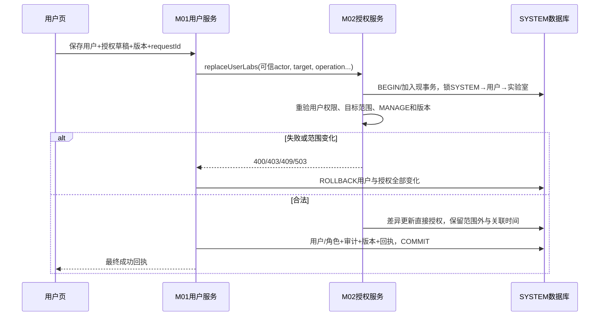

# M02 用户实验室授权内部服务逐方法契约

版本DD-20260913-T8-R9；TASK-GATES-DD-20260919-TG1物理签名对齐修订＋TASK-GATES-R1-DD-20260919-R1五字段对齐修订（裁决明细见docs/开发任务/01-契约骨架/21-TASK-GATES-G1-G3阶段门裁决报告.md§3.7/§〇-A与docs/开发任务/01-契约骨架/22-TASK-GATES-R1-ActorContext职责边界修正报告.md，语义只收敛差异不扩写）。展开M01/M02已声明的prepareUserEdit、replaceUserLabs、removeUserLabs三个同进程应用服务。它们不是浏览器HTTP，不新增指定userId的免权限接口；2026-11-03状态补正：LabAuthorizationService旧查询接口不是三个目标方法是否接线的唯一依据；当前M02LabAuthorizationAdapter已有prepareUserEdit/replaceUserLabs/removeUserLabs，M01应用服务通过LabAuthorizationPort调用，读写性质及事务目标仍按本文区分，未宣称完整运行验收。物理Port签名以PKG-00冻结的service/port/m02/LabAuthorizationPort及model为准：actor承载为ActorContext对象（SEC-I01解析的可信五字段身份/会话/版本上下文，TASK-GATES-R1修订：不含任何领域范围字段，非独立actorUserId字符串，浏览器自报无效；本契约的实验室范围一律由M02依据actorUserId、当前功能权限映射与M02当前数据在SYSTEM锁后同一事务内计算与重验，不接受调用方预置范围）；AuthorizationLevel枚举VIEW/OPERATE/MANAGE即本契约authType"0"/"1"/"2"，序列化沿用十进制字符串；AuthorizationItem.labLeader（boolean）即本契约isLabLeader。

## 1. 共享对象、调用身份与版本

actorUserId、targetUserId、实验室ID和authorizationVersion均为十进制字符串；actor身份必须由可信调用上下文传入，并与当前登录/受控系统主体一致，浏览器不能伪造。调用方operation:USER_CREATE/USER_UPDATE/USER_DELETE由守卫operationCode唯一映射（USR03≙USER_CREATE、USR04≙USER_UPDATE、USR06≙USER_DELETE），ReplaceUserLabsCommand/RemoveUserLabsCommand物理签名不再重复携带operation，M02据此要求M01对应用户功能权限和目标用户管理范围；不单靠actorUserId查权限。

Option沿M01固定id、label、disabled、disabledReason、children；实验室为叶子，children=[]。AuthorizationItem={labId,authType:0/1/2,effectiveAuthType:0/1/2,isLabLeader:boolean}；AuthorizationChange={labId,authType}。直接授权只在sys_user_lab，负责人来源只在lab_lab_leader，负责人有效等级2；二者不互相写行。

authorizationVersion是目标用户直接授权集合、相关负责人事实及授权范围管理版本的稳定摘要/对象版本，不用最大update_time或行数代替。所有数组按labId数值升序、去重；null数组拒绝，空数组有明确语义。服务故障向M01映射503 LAB_AUTHORIZATION_UNAVAILABLE。

## 2. prepareUserEdit

输入actor承载=ActorContext可信对象（UserLabEditQuery.actorContext；下文模拟输入中的actorUserId为可信身份概念性示意），targetUserId:string|null、deptId:string|null、operation（UserLabOperation枚举，本方法保留显式入参）。USER_CREATE时targetUserId=null；编辑时必填。deptId用于默认候选，精确匹配lab_lab.dept_id，不包含子部门。普通管理员须有用户授权功能权限、目标用户管理范围，候选仅本人MANAGE实验室；超级管理员按受保护身份取得全局候选。只读，不创建授权/版本。

输出laboratories:Option[]、defaultLabIds、currentLabIds、currentAuthorizations、hasUnmanagedAuthorizations、authorizationVersion。2026-10-30用户最新授权展示补充取代旧隐私展示句：回显全部既有直接授权，含范围外只读项，沿用AuthorizationItem的labName/manageable/readonly/disabledReason；hasUnmanagedAuthorizations保留存在标志，但不能用它替代全部已有授权回显。只读项不可移除，保存仍由服务端保留原授权及等级；具体回显与名称缺失处理见[M01详细设计§26.1](../01-系统管理/详细设计.md)。负责人可在currentAuthorizations中以isLabLeader=true反映有效等级，但不能因此伪造直接currentLabIds。defaultLabIds=同dept直接实验室∩可授予集合；编辑时仅用于提示，不覆盖currentLabIds。

模拟输入/输出：
```json
{
  "actorUserId": "10001",
  "targetUserId": "10002",
  "deptId": "3001",
  "operation": "USER_UPDATE"
}
```
```json
{
  "laboratories": [
    {
      "id": "1001",
      "label": "模拟实验室",
      "disabled": false,
      "disabledReason": null,
      "children": []
    }
  ],
  "defaultLabIds": [
    "1001"
  ],
  "currentLabIds": [
    "1001"
  ],
  "currentAuthorizations": [
    {
      "labId": "1001",
      "authType": "1",
      "effectiveAuthType": "2",
      "isLabLeader": true
    }
  ],
  "hasUnmanagedAuthorizations": true,
  "authorizationVersion": "71"
}
```

无可授予实验室返回空数组，不是依赖故障。无权目标用户403 ASSIGNMENT_DENIED；不可见范围信息不泄露。

## 3. replaceUserLabs

输入actor承载=ActorContext可信对象（见§1），targetUserId、labIds:string[]、authorizationChanges:AuthorizationChange[]、expectedAuthorizationVersion、requestId；创建/编辑语义由守卫operationCode（USR03/USR04）按§1映射约束。labIds表示操作者可管理范围内提交后的直接授权期望集合，并非目标用户全部授权。范围外旧授权和等级/关联时间原样保留。新增labId默认authType=0；已有且无显式change保留等级和create_time；change只能针对最终labIds且每lab一次，可设0/1/2。移除labId只删直接来源，不动负责人。

普通管理员必须同时满足用户功能权限、目标用户范围和每个实验室MANAGE，包含授予等级2。服务在SYSTEM→targetUser→labId升序下重验版本/范围；M01用户基本资料、角色和授权变化加入同一数据库事务，任何失败整体回滚。输出applied、authorizationVersion、currentAuthorizations、managementRevision，便于M01返回最终回执。

模拟请求/结果：
```json
{
  "actorUserId": "10001",
  "targetUserId": "10002",
  "operation": "USER_UPDATE",
  "labIds": [
    "1001"
  ],
  "authorizationChanges": [
    {
      "labId": "1001",
      "authType": "2"
    }
  ],
  "expectedAuthorizationVersion": "71",
  "requestId": "00000000-0000-4000-8000-000000000009"
}
```
```json
{
  "applied": true,
  "authorizationVersion": "72",
  "currentAuthorizations": [
    {
      "labId": "1001",
      "authType": "2",
      "effectiveAuthType": "2",
      "isLabLeader": false
    }
  ],
  "managementRevision": "72"
}
```

同requestId同规范载荷返回原结果，同键异载荷REQUEST_CONFLICT；旧授权版本VERSION_CONFLICT。提交包含范围外ID或重复变更整次ASSIGNMENT_DENIED/INPUT_INVALID。权限在页面打开后撤销时按最新事实拒绝。

## 4. removeUserLabs

输入actor承载=ActorContext可信对象，targetUserIds:string[]（批量，物理签名RemoveUserLabsCommand；操作语义固定USER_DELETE），expectedAuthorizationVersion（允许null=跳过摘要预检，删除并发的唯一权威是锁内事务重验；非null=批量组合版本，生成规则冻结为sha256规范化JSON{targetUserIds升序,各自authorizationVersion按用户升序对齐}的十进制稳定摘要，M02在预检阶段同规则重算，不符409 VERSION_CONFLICT；单用户删除可继续传该用户的authorizationVersion并按同规则退化为单元素组合）、requestId。批量语义：阶段①先对所有目标用户逐一全量检查直接授权和负责人关系（普通管理员必须覆盖全部相关实验室MANAGE，任一目标范围不足整批403 ASSIGNMENT_DENIED且不泄露实验室明细）；阶段②任一目标仍是任一负责人时整批409 REFERENCE_EXISTS，完整范围管理员和超级管理员也必须先显式解除负责人。本方法只删除直接授权，不删负责人、项目成员、分享或历史证据。removedCount语义落为M01 USR06回执affectedIds（实际清权完成的目标用户ID升序集合），不改UserLabAuthorizationResult物理字段。

与M01用户批量删除集成时，先对所有目标用户全量检查，再按targetUserId升序锁定，同一SYSTEM事务删除用户和直接授权；任一失败全批回滚。单用户内部请求/结果：
```json
{
  "actorUserId": "10001",
  "targetUserId": "10002",
  "operation": "USER_DELETE",
  "expectedAuthorizationVersion": "72",
  "requestId": "00000000-0000-4000-8000-000000000009"
}
```
```json
{
  "removedCount": 1,
  "authorizationVersion": "73",
  "managementRevision": "73"
}
```

如果无直接授权且无负责人，removedCount=0仍可继续用户删除；这不是未执行。并发新增授权/负责人必须竞争同一守卫，不能在检查后插入关系形成孤儿。

## 5. 与当前授权查询服务的衔接

现LabAuthorizationServiceImpl的查询按sys_user_lab与lab_lab_leader并集，负责人会进入所有最低等级集合，符合负责人等级2的结果语义；受保护管理员通过SecurityUtils.isAdmin读取全部有效实验室。实现三个写方法时复用同一受保护身份判定，不能用角色名或普通“全部数据权限”冒充超级管理员。

缓存失效必须与事务提交协调：提交后发布authorizationVersion变更/清相关用户范围缓存；事务回滚不发布。读取方遇到缓存版本旧于SYSTEM版本须回源或失败关闭，不能继续放行。具体缓存实现可由开发选择，但外部一致性与版本验收固定。

## 6. 时序与失败



错误：400 INPUT_INVALID，403 ASSIGNMENT_DENIED/PERMISSION_DENIED，404 NOT_FOUND，409 REQUEST_CONFLICT/VERSION_CONFLICT/REFERENCE_EXISTS，503 LAB_AUTHORIZATION_UNAVAILABLE/MANAGEMENT_BUSY（后者引用M01公共管理错误）。三个方法不自行吞异常返回空集合。验收覆盖新增默认0、显式升2、范围外保留、空labIds仅清管理范围内、负责人来源保留、关联时间保留、权限并发撤销、用户批量删除全回滚和缓存失效。

2026-11-03接线状态补正：M02LabAuthorizationAdapter三个方法及M01调用已定位，原“未发现源码”失效。范围外授权回显以2026-10-30用户补充为准，不新增为HTTP入口；摘要、锁内权限重验、失败回滚及缓存运行效果仍须分别验证。未来若拆服务，当前同事务契约必须重新设计，不能改成三个独立HTTP后宣称原子。
