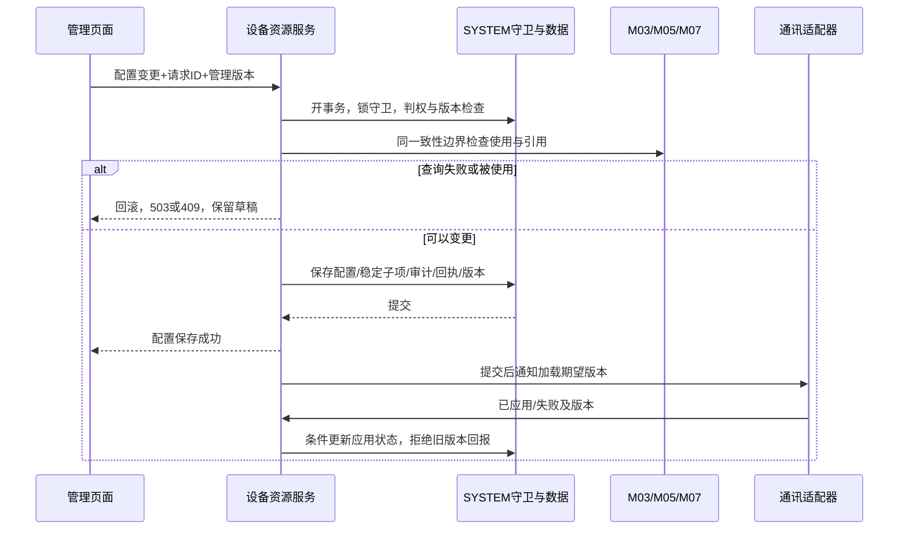

# M02 联调与验收清单

2026-09-09。本文是实施与验收设计，不是测试执行报告。实验室/授权见[主设计](详细设计.md)，设备型号见[型号设计](设备型号库设计.md)，12类设备及控制器见[实例设计](设备实例详细设计.md)，8项资源配置见[资源设计](检测与资源配置详细设计.md)。

## 1. 设计覆盖与证据

| 范围 | 交付位置 | 验收入口 |
| --- | --- | --- |
| 实验室、负责人、直接授权 | 主设计4–9节及24项确认 | LAB接口、授权并发/跨范围、Q01–22及Q24/Q25对应规则；Q23已撤回普通字段提问 |
| 8类型号 | 型号设计11–16节 | MDL-C01–32，另有集成IR-C场景 |
| 12类实例及控制器 | 实例设计3–11节 | INS-C01–18，列表/编辑/删除/维护/引用/现场配置 |
| 通讯与读数 | 通讯与设备公共契约 | COM-C01–10、方式切换/凭据/配置加载/旧回报 |
| 8项检测与资源配置 | 检测与资源配置详细设计 | RES-C01–24、默认启用/共享源/站位锁/量纲 |
| 数据库 | 数据库增量设计及01–06 SQL | 38表、旧列保留、增量/唯一索引/迁移/回退；未知数据不冒充可投用 |

本轮为静态源码、需求正文及已核对原图支持的设计。仓库图存在metadata_changed，关键结论回读源码和SQL，不声称全图覆盖；未执行Maven/前端构建、HTTP联调、SQL迁移或设备操作。原图检查范围以各附件记录为准，没有将全部插图标记为已目视验收。

## 2. 交互验收

列表沿用现有布局，先展示筛选和结果；不加无业务价值的说明大卡片。新增/编辑使用原有表单容器。只读字段显示来源，失效引用保留标签并标原因，不能默默清空。查询条件、翻页和详情返回都受权限范围限制。

| 页面动作 | 应观察的行为 |
| --- | --- |
| 有权实验室选择及切换 | 仅合法候选；有未保存草稿时提示；默认值不覆盖已有授权 |
| 选择型号 | 立即显示该型号只读共享字段；未知能力说明问题；切换型号不带入不兼容旧子项 |
| 保存冲突 | 显示冲突、保留非敏感草稿，重新读取后由用户核对重提；密码不存草稿 |
| 删除/批量删除 | 二次确认；一条无权或被使用则整批失败；历史列表不改成新同名对象 |
| 通讯方式切换 | 仅显示该分支字段；保存成功显示“配置已保存/等待应用”；在线和执行结果分别显示 |
| 项目开关 | 默认启用与明确停用正确回显；不能因省略某行恢复启用 |
| 消耗共享 | 候选只含已保存直接行，源行身份稳定；NA保持NA，不显示0 |
| 液瓶取样/补料 | 取样按三槽单元锁，补料按单槽锁；容量体积与PLC重量分开；未知/过期无伪造百分比 |
| 导出 | 与列表同筛选、排序、范围；不导出凭据、隐藏实验室或未经授权的引用详情 |

浏览器验收应至少覆盖窄屏、长名称、空数据、失效字典、无图、未知能力、403/409/503和同时打开两个编辑页；截图只作为执行证据，不能以构建通过代替页面验收。

## 3. 跨模块调用和原子边界

下图描述未命中已提交回执的新写入分支；回执命中、版本复核及锁异常的完整顺序以第7节为准。

当前同进程服务参与一致性检查，共用SYSTEM守卫与固定锁顺序；图中调用不是在数据库锁内等待设备网络。未来拆分服务时不能原样用远程预检替代原子占用保护，需要重新设计预约/版本协议。

| 所有者 | M02输入/输出契约 | 必验场景 |
| --- | --- | --- |
| M01 | prepareUserEdit/replaceUserLabs/removeUserLabs；SYSTEM版本、审计、幂等回执 | 超范围授权不变；负责人派生与直接授权分开；用户/授权任何失败一起回滚 |
| M03 | 设备使用/预约检查、开始时固化配置 | 预检后并发预约；取消但未释放仍阻断；历史快照不跟随型号变更 |
| M04 | 模板结构引用、实验室类型更改检查、型号能力和实例量程来源 | 空闲但有模板引用仍禁止结构改变；多来源量程保留来源ID；实验室类型变更不代删流程 |
| M05 | 检测能力/驱动、项目集合、检测规则快照 | 单次和工作上限独立；默认启用项目删除阻断；已发送样品回传不受新显示名干扰 |
| M06 | 实验室审批入口/上下文 | M02不重复存审批流程、不越权操作签批 |
| M07 | 泵/打印任务、运行资源快照、指令状态 | 配置保存不触发动作；ACCEPTED不等于EXECUTED；UNKNOWN先查结果不盲重试；零浓度不参与除法。继电器人工开关按M02客户接口执行，不进入本项调度 |
| M08 | 值、单位、时间、质量和配置来源 | 历史曲线不按当前单位重解释；离线/过期读数清晰可辨 |
| M09 | 资源低量/设备状态告警上下文 | M02不新增告警定义或处理记录；不恢复已取消的Waste反向告警 |

## 4. 旧接口升级与兼容

所有旧CRUD、状态和批量入口都进入相同应用服务，禁止保留不判权/不校验引用的旁路。新版请求必须带M01两个请求头；缺版本旧客户端返回可识别的版本升级错误，不由服务端静默读取最新版本后替客户端提交。

检测项目batch-save新增请求头X-M02-Contract-Version:2，用显式差异语义保存；旧客户端协议必须由兼容层识别为旧全量状态集合。兼容层在同一守卫内将旧集合转换为每个当前候选的明确状态，再调用同一校验；无法判定旧请求是否完整（包括空数组、候选版本不明）时返回409 CLIENT_UPGRADE_REQUIRED。不能直接把旧“删除重建”代码用于新版省略项语义。

检测型号旧detectType继续用驱动键，新增modelName用于显示；不能通过兼容赋值改变路由。称重旧calibrationModes映射communicationTypes，存储继续用calibration_modes。主键和字符串版本不变为数字。旧共用实体接收只读字段时返回字段错误，避免页面展示“保存成功”但实际忽略。

下游设备主表没有communication_type列，表单选定方式在同一事务保存到lab_communication的对应DeviceRef骨架（NOT_CONFIGURED，未应用），完整通讯参数在通讯页补齐；旧应用applyModelSnapshot不能再丢掉用户选择。设备详情返回selectedCommunicationType、communicationId和configurationReady；只选方式不发送连接请求。若旧通讯记录已完整配置且方式实际改变，必须走方式切换及占用检查，不覆盖成空骨架。

批量导入如后续启用，应复用逐行同样的白名单、守卫及整批策略；本版不新增原需求没有的导入按钮。权限菜单沿用既有权限串，新子路由复用对应query/edit权限，不凭空增加管理员角色授权。

## 5. 实施资料与执行门槛

| 资料/环境 | 用途 | 缺失时处理 |
| --- | --- | --- |
| 厂商型号能力及现场通道初始化 | 核准旧泵/MFC/控制能力和称重型号映射 | 保留NULL并列配置问题，相应设备不投用 |
| PLC液瓶字段、单位、站位映射和重采确认方式 | 建立current/standard重量及版本归属 | 显示UNKNOWN；禁止用耗材体积代替标准重量 |
| 小试管重写库责任及外部接入资料 | 对接原需求明确的外部责任 | 沿原依赖跟踪，不能由M02设计推定已完成写库 |
| 实际检测/泵/控制器协议与中转环境 | 驱动兼容、凭据、热更新、超时及执行回执 | 仅系统侧契约可审阅，不标实机兼容通过 |
| 实施库副本与完整备份恢复环境 | 迁移/并发/回退演练 | SQL设计可评审，发布前必须执行并保留结果 |

这些是部署数据核验及实施验证门槛，不新增业务确认题。M02设计覆盖完成后仍需评审、实现及上述验收；不得将本文的预期列填写为已通过。

## 6. 编码前契约冻结与改造准入（评审补充）

本节为目标契约和验收要求，不代表M03/M04已完成设计或接口已实现。相关业务分支编码前须完成双方契约评审；冻结记录应包含版本、提供方、调用方、字段定义、状态口径、异常及并发用例。不能用模拟返回0/空闲代替依赖交付。独立部分可按现有设计推进，但不据此宣布整个M02可投用。

| 编号 | 提供方与调用方 | 必须冻结的内容 | 当前状态及准入证据 |
| --- | --- | --- | --- |
| CT-01 | M03提供，M02实验室禁用/IP端口变更调用 | 可信操作者上下文、labId；返回unfinishedProjectCount/unfinishedBatchCount/unfinishedCultureCount非负计数；各实体哪些状态计入、删除/取消/结束的处理、查询失败语义 | M03-Q01已确认按下属培养汇总，不新增项目/批次人工结束流程；Q02已确认草稿/已过期计入未结束业务；Q03已确认按目标实验室培养汇总；业务计数口径已确定，事务一致性及旧数据适配仍待细化；复用DisableCheck |
| CT-02 | M03提供设备预约/占用事实，M02设备删除和参数修改调用；涉及检测/执行时与M05/M07衔接 | DeviceRef(kind,id,labId)、操作类型及实际变更字段；返回是否阻断及可安全展示的原因；预约、在用、取消未释放、释放失败的判定 | M03-Q08已确认草稿/已过期关联本身不阻止设备逻辑删除；用户已更正为已过期不占用，修改时间重新检查培养冲突；设备删除/改参数仍检查预约、运行任务、其他引用与释放事实，运行资源展开及参数修改待细化；不能拿CT-01计数代替设备级检查 |
| CT-03 | M04拥有实验室工作流选择保存；M03提供培养引用事实，M02提供页面上下文 | labId、待取消的一级流程标识集合、配置版本；逐流程阻断结果及异常语义；培养引用范围由M03/M04共同确认，不擅自缩成“正在运行” | 待M03/M04冻结；依据需求02实验室设置“当该实验室存在使用该一级流程的培养时，不允许取消勾选” |
| CT-04 | M01编排用户事务和公共管理能力；M02实现实验室授权领域契约 | prepareUserEdit/replaceUserLabs/removeUserLabs沿主设计第4节；调用方与实现方共享事务、SYSTEM守卫、回执和审计 | 契约已有，改造及联调待完成；现状差距直接引用现状核对与复用清单第1节，不重新编造基线 |

CT-01/02正式写入前必须在共享一致性边界内复核；新增业务引用、预约与释放写入也须参与该边界，不能先远程预检再无保护地提交。未来拆服务另行冻结预约/版本协议。CT-03由M04保存服务执行检查，页面预检仅提示；存在引用则409 REFERENCE_EXISTS，依赖不可用则503，配置整次不变。取消流程与新培养建立引用的并发必须至少阻断一方；M02不能绕过M04直接改工作流表。

CT-04准入清单：M01用户新增/修改/删除和既有授权独立入口全部收口；M02差异保存保留未变等级、时间和范围外授权；列表合并负责人来源后统一分页；旧权限标识与目标用户范围复核；任一步失败用户/授权/管理版本/成功回执全回滚。现状文档中的观察仍需实施时回读代码，不等于当前实现已验收。

## 7. SYSTEM守卫与管理请求处理顺序

沿用[M01详细设计§17.1](../01-系统管理/详细设计.md)：sys_management_revision的固定SYSTEM行锁是数据库事务行锁，不是进程锁；第一版接受全局管理写冲突。所有编号入口在同一守卫内跨13表查重；不再增加一套独立分布式锁。普通查询、设备读数回报不因此递增管理版本。

1. 校验登录身份、请求格式与当前接口准入；作用域使用操作者userId＋requestId，不跨用户返回回执。
2. 开事务先锁SYSTEM，再查询该作用域有效回执。同操作同参数命中已提交回执时返回原脱敏结果，不因原提交已递增版本而再次执行或报旧版本冲突；同ID不同内容返回REQUEST_CONFLICT。回执不能授权后续详情读取。
3. 无有效回执时复核managementRevision、当前对象权限及全部引用，再按固定业务表顺序、同表主键升序取得必要行锁。各参与服务须在契约冻结时登记一致的业务表顺序；禁止先锁业务行再反向申请SYSTEM。跨表查重采用锁后当前数据，不能使用锁前缓存或旧事务快照。
4. 数据、来源明确的审计、revision递增一次及成功回执同事务提交；设备网络通知仅在提交后进行。失败不产生成功回执，不部分保存。

并发同requestId请求在SYSTEM处串行，后到者在取得锁后重查回执。管理版本冲突保留非敏感草稿，刷新后人工核对，以新requestId和新版本提交。24小时过期回执不得自动重放创建，按M01要求重新取得有效管理版本；客户端不把过期请求当作网络重试自动发送。

锁等待超时或死锁须回滚整次事务，返回503 MANAGEMENT_BUSY（本次补充的目标错误码，随CT-04统一联调），不伪装成版本冲突或保存成功。后端不自动重放业务事务；客户端保留非敏感草稿，短时间禁止连续点击。结果不确定的网络失败仅用原requestId和原参数重试并先查回执，不自动生成新ID。锁等待上限应配置且短于接口总超时，具体值和业务表锁序在实施环境验收记录中固化，不以本文声称压测已通过。

| 场景 | 预期结果（均未执行） |
| --- | --- |
| 两用户不同设备表并发同号新增 | 至多一个成功；另一方版本冲突或编号冲突，失败无部分行 |
| 同用户同requestId同时保存、提交后旧版本重试 | 仅一次业务写、一次revision递增、一份成功审计，重试取得原回执 |
| 同requestId改参数、不同用户使用相同requestId | 前者REQUEST_CONFLICT；后者不共享回执，独立判权与版本检查 |
| 锁超时/死锁、提交后响应丢失 | 前者回滚并返回可识别503；后者原ID重试不重复写 |
| CT-01实验室新业务与禁用并发；CT-02取消但未释放 | 不出现禁用后新增有效引用；未释放仍阻断设备操作 |
| CT-03取消流程与建立培养引用并发 | 不出现培养仍引用却配置已被取消；查询失败整次不保存 |

## 8. 审计来源与评审闭环

沿用M01公共审计结构，以真实关系表及脱敏前后值表达来源，不新增平行审计表。直接授权0改1：sys_user_lab记录auth_type的0→1，来源DIRECT；解除负责人：lab_lab_leader记录关系删除，来源LAB_LEADER，不伪造sys_user_lab的2→0更新。直接0与负责人并存时解除负责人，生效等级变为0只是计算结果；保留直接行及其create_time。来源可在既有beforeText/afterText的脱敏JSON与description中表达，具体序列化随CT-04冻结并测试。

评审意见与回写位置见[评审意见处理记录](history/review/评审意见处理记录.md)。文档修订、跨模块契约冻结、代码实现、SQL/浏览器/实机验收分别记录状态；未执行不得填“通过”。

### CT-01业务口径确认补充（2026-09-09）

[M03-Q01](../03-项目与培养管理/详细设计.md)已获用户确认：空项目/空批次，以及全部培养已结束/已取消且相关占用已释放的项目/批次，不因历史记录仍在而独立阻止实验室禁用或IP/端口修改；有未结束培养仍阻断。项目与批次不再额外要求人工点“结束”。本规则不能豁免负责人/直接授权、其他引用、权限、版本或设备释放检查；不能只按旧project_status/batch_status判定。M03-Q02已获用户确认：未删除的草稿/已过期培养均计入未结束业务，阻断实验室禁用及IP/端口修改；草稿不占用设备、已过期释放预约的规则保持原确认。合法删除后不再计入业务引用，其他条件继续检查。M03-Q03已确认：仅以目标labId下未删除的未结束培养为集合，分别按培养/批次/项目主键去重计数，同项目其他实验室的培养不扩大本实验室计数。计入草稿、未开始、进行中、已过期、已延期；已结束/已取消不计入业务数，释放事实仍独立检查。未知旧状态或归属异常不得猜成0。CT-01业务口径已确定，事务一致性及旧数据适配仍待细化。对应验收见M03-C07/C08/C09/C10/C11，均未执行。

### CT-02草稿/已过期设备关联确认（2026-09-09）

[M03-Q08](../03-项目与培养管理/详细设计.md)已确认：仅关联草稿/已过期培养且无预约、运行任务或其他阻断引用、事实可靠时，允许设备逻辑删除。保留培养中的原设备身份，显示已删除不可使用；重新预约必须重选有效设备，不自动关联同名新设备。状态不能替代真实引用/释放核验，依赖事实不可得不放行；删除与预约的提交检查须共享一致性保护。参数修改和其余运行契约仍待细化。对应M03-C24/C25/C26为设计验收场景，未执行。

### CT-02已过期重新预约补充（2026-09-09）

用户明确将上一条“已延期”更正为“已过期”：已过期不占用设备，修改培养开始/结束时间需重新检查与其他培养的冲突。保留设备关联，不保留旧预约资格；校验通过后按既有规则变为未开始并重新预约，冲突则拒绝且不影响其他培养。已延期保留原持续占用规则，原口误引入的已延期解除占用说明撤销。CT-01仍将已过期和已延期计入未结束业务。对应M03-C30/C31/C32为设计验收场景，未执行。

### CT-02已延期释放条件确认（2026-09-09）

用户再次明确：已延期设备仍占用，必须变成已取消或者已结束才算释放。已延期修改时间或恢复进行中均不释放，也不允许其他培养取得同设备占用；终态后的实际释放仍按运行任务/设备事实核验，不能通过手改状态宣称可用。与已过期解除预约、改时间重新检查冲突的规则分开。对应M03-C33为设计验收场景，未执行。

### CT-02建立预约的日期条件（2026-09-09）

用户明确开始日期、结束日期两个缺一不可；双方完整并通过冲突校验保存后立即占用，缺任意一个的草稿不占用。不等待计划开始日，也不能仅凭完整日期覆盖其他培养的占用。已过期和已取消/已结束按已确认释放规则处理，已延期持续占用；当前占用不可仅通过历史日期是否非空推断。对应M03-C34为设计验收场景，未执行。

### CT-02开始日期截止时点（M03-Q16，2026-09-09）

用户已确认开始当天允许操作，开始日次日00:00（Asia/Shanghai）才判断过期或开始阶段延期。例如开始日09-10，至09-11 00:00：未开任何工作流则过期并释放自身预约；已开流程但未完成开始培养则已延期、保持占用。M02在开始当天不得因日期已到即将设备判空闲，须读取M03按同一截止判断的当前占用事实；判定不可得不报可用。建立预约仍为完整日期校验保存即占用，草稿单侧日期无预约。对应M03-CU-C13—C18为设计验收场景，未执行；结束阶段截止现已由M03-Q17确认见下。

### CT-02结束日期截止时点（M03-Q17，2026-09-09）

用户已确认结束日次日00:00（Asia/Shanghai）才判断结束阶段延期。结束09-16则当天允许完成结束培养，09-17 00:00仍未完成才延期并持续占用；M02不得因结束日到达或延期标签出现而自动释放设备。已经完成的培养不被迟到定时任务改回延期，实际可用仍依终态及释放事实核验。本期结束工作流仍仅隔离模拟。对应M03-ST-C09—C12为设计验收场景，未执行。

## CT-03范围与清空入口补充（2026-09-10）

业务引用范围现由M04-Q13确认：全部仍保留的培养引用，不按结束/取消/历史状态排除；Q14独立清空同样执行该规则。输入输出、缺项失败、SYSTEM锁序、并发建立引用及18条工作流用例见[M04第11节](../04-工艺与方案管理/详细设计.md)。本表早期“待M03/M04冻结”中的业务范围已解决，剩余为M03真实引用存储映射、接口接入及联调；不能将完成文档解释为该验收已通过。
## M05-Q02无培养检测审核交接（2026-09-10，已确认）

M02按M05服务端核实的真实labId返回当前有效实验室等级：至少可操作1/可管理2才满足无培养检测审核的实验室因子，仅查看0拒绝。M05另检查审核功能权限、结果状态、稳定签名人与审核人不同、对象版本。授权读取失败不是无权限或默认允许；不能接受客户端传入其他labId放行。此为接口验收要求，未运行接口或设备验证。

## M05规则配置联调（2026-09-10，Q03已按最新说明修订）

sendMode只控制行/列提交；锁范围、容量单位、排队和遮挡独立配置。验收HT整列锁且其他列可发、圆盘工作期间合法空位追加、新1号物理轮询，以及单发每次1条。supportStored启用同时提供行暂存和列暂存；批量删除逐项跳过不可删除项，不能沿用本文件M02资源批删整批失败的规则。

以[M05规则验收RULE01—30](../05-检测与数据签批/可配置发送暂存与删除规则设计.md)为目标；0上限不越过状态/遮挡保护。活动与未知请求阻断影响运行的配置发布，规则版本固定。新增规则物理字段及迁移包待同步，接口/设备用例未执行。

## 检测规则数据库包静态交接（2026-09-10）

M02六列及5个CHECK、M05十四列及8个CHECK/5个索引已形成设计稿，路径与静态检查边界见[M05数据库交付说明](../05-检测与数据签批/发送规则数据库交付说明.md)。新增列NULL未知不等于设备ready；验证旧库补丁重复执行阻断、部分迁移阻断、备份原字段不变、使用后回退拒绝。MySQL存储过程编译/执行和设备联调未运行。
