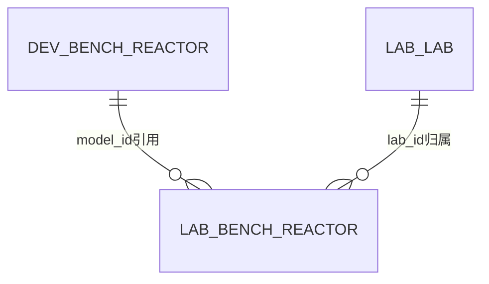

# 设备型号库设计（M02）

## 2026-10-31 检测型号行列数自动同步

用户要求行数、列数仅在“基本信息”维护，保存一次即同步。M02-144 在同一 SYSTEM 管理守卫事务内，将已存在、schemaVersion=1 且可解析的 rule_profile.layout.rowsPerColumn / columnCount 同步为 channel_count / column_count；只修改这两个布局叶子，保留拓扑、排队、遮挡、输入约束等其他规则。布局实际变化时复用规则修订 CAS 并递增 rule_revision；业务变更沿用 M02-144 已登记的行数、列数审计字段，不扩展共享审计白名单；同步冲突则整个基本信息保存失败，幂等重放不重复递增。布局已一致时不额外递增规则修订。

未发布规则或规则内容损坏时，不凭基本信息补造完整运行配置，原就绪阻断继续保留。规则页在基本信息保存后重新读取已同步的行列数及规则修订，保留其他未保存草稿；刷新失败时禁止继续用旧规则修订提交。无需再点击“保存接入与规则”同步行列数。型号变更不自动覆盖实验室设备实例快照，具体设备仍通过既有“应用检测规则”入口更新。

状态：详细设计评审版，2026-09-09。已补齐八类型号字段/接口、显示名与驱动兼容、实例同步、图片存储、数据库及验收设计。第1节保留分阶段源码证据；当前设计范围与实施限制以第16节和数据库/验收附件为准，未执行运行验收。

## 1. 范围与复用

依据[资源管理需求（V4.0 第 3 章）](../../需求说明书V5.1-1030_md/03-资源管理.md)。开头“五类”概述与后文目录不完全一致，按具体章节登记八个型号功能组，不删除后文蠕动泵、空气泵、分析检测仪章节。分析检测仪②的分期沿用需求，登记不代表提前交付。

| 功能组 | 当前定位的服务类 | 本轮核验深度 |
| --- | --- | --- |
| 台式反应器 | DevBenchReactorServiceImpl | 需求、控制器、服务、实体、型号Mapper、实例查询关键SQL及建表段已读 |
| 集成反应器 | DevIntegratedReactorServiceImpl | 实体、路由、唯一/引用SQL及表字段已读；完整调用链待核对 |
| 培养容器 | DevCultureContainerSpecServiceImpl | 实体、路由、唯一/引用SQL及表字段已读；容量来源待核对 |
| 称重设备 | DevFloorScaleServiceImpl | 字段与路由已读，通讯旧列和实例ID混比已核对 |
| 检测设备 | DevDetectorServiceImpl | 实体/路由/服务及唯一SQL已读；检测项独立设计 |
| 蠕动泵 | DevPeristalticPumpServiceImpl | 实体、路由、唯一/引用SQL及字段已读 |
| 空气泵 | DevAirPumpServiceImpl | 实体、路由、唯一/引用SQL及字段已读 |
| 分析检测仪② | DevAnalyzerModelServiceImpl | 实体、路由、唯一/引用SQL及字段已读，保留②分期 |

标准型号保存共享产品参数；实验室实例保存资产编号、IP、负责人等现场配置。优先复用已有dev_*与lab_*关系，不新增统一大表替代现有型号表，也不把型号ID当作Q15资产编号。各类型联合唯一键按各自需求定义，不能统一套用实验室名称或资产号规则。

## 2. 台式反应器：明确规则与差距

已阅读需求正文及新增原图image177；其他原图本轮未逐图验收。品牌、类别、容量单位来自字典，品牌+类别唯一；描述最多100字符；图标由配置决定，仅展示。查询为品牌/描述模糊检索、日期联合条件，创建时间倒序分页。修改须执行新增校验，并将共享型号参数反映到各实验室设备。删除须二次确认，所有实验室移除引用设备后才可删除。

| 项目 | 当前源码/SQL事实 | 目标设计 |
| --- | --- | --- |
| 唯一范围 | countDevBenchReactorUnique按del_flag=0、brand+category计数，编辑排除modelId | 保留联合业务键；提交与数据库约束、并发校验一致 |
| 删除引用 | countLabInstancesReferencing统计lab_bench_reactor中同model_id且del_flag=0记录 | 停用、空闲设备仍是引用；不能只按运行状态判断；引用跨实验室完整检查 |
| 型号修改 | 服务更新型号表；实例SQL关联读取category、capacity_unit、description、icon_path | 共享字段查询生效，不能宣称所有实例列都已同步 |
| 实例差异 | brand/model取实例列；max_capacity为coalesce(lbr.volume_ml,dbr.capacity) | 明确共享值与实例覆盖值，不能把volume_ml无条件用型号capacity覆盖；单位换算另行核对 |
| 查询 | 型号Mapper品牌列表精确匹配；描述模糊；日期仅双端都有时按update_time过滤；该列表SQL无ORDER BY | 补品牌显示名称/描述联合模糊检索及create_time DESC、model_id DESC；日期按当前实现与列表修改时间列统一采用update_time；单边日期也生效，上海时区开始含当日00:00、结束排除次日00:00，不以Q17作为型号业务已确认的依据 |
| 批量删除 | 服务逐个检查、逐个软删除；所读服务类未声明事务注解 | 目标一次校验全部ID并同事务提交，不能前面删除后面引用冲突留下部分成功；尚未运行验证 |
| 写入白名单 | 实体式请求；Mapper可写审计列、删除标志、icon_path等 | 浏览器业务DTO白名单；服务端写审计和删除标志，图标只读；不接受客户端改创建时间 |
| 字段差异 | schema描述varchar(200)，实体还有capacity；需求新增表单无独立容量值 | 业务描述≤100；保留capacity历史列，先核对来源，不新增未经确认的必填容量输入 |

## 3. 页面与字段草案

列表以查询与结果为主：品牌/描述、起止日期、检索/重置/新增；结果列为序号、图标、品牌、类别、容量单位、描述、修改人、修改时间、修改/删除。多个状态图标并列展示，不增加图标上传按钮。新增/修改沿用单列弹窗。

| 输入/返回字段 | 类型及约束 | 说明 |
| --- | --- | --- |
| modelId | 十进制string，修改/详情必填 | 服务端雪花ID；新增不接受客户端指定ID |
| brand | string，必填，有效字典值，存储上限50 | 展示字典名称，保存值；不能从自由文本新建字典 |
| category | string，必填，有效字典值，上限50 | 与brand联合唯一，修改排除自身 |
| capacityUnit | string，必填，有效字典值，上限20 | M02-Q22：有关联设备被未结束业务使用时禁止变更 |
| description | string，最多100字符 | 选填，默认空字符串，最多100字符；依据用户授权由设计直接定案，原图星号不沿用 |
| iconPaths | string[]，只读 | 展示配置解析后的图标；旧icon_path由兼容层读取，不允许表单写入 |
| capacity | decimal，现状列 | 本轮不开放额外输入，未编辑保持原值，来源待核对 |
| create/update审计 | 服务端维护 | 用户输入不覆盖；失败/取消不写成功审计 |

保留M01非敏感草稿、版本冲突、幂等与整次回滚规则。唯一冲突409 CODE_CONFLICT定位brand/category；引用阻断409 REFERENCE_EXISTS，不泄露无权查看的实验室及设备明细。型号库功能权限与实例实验室权限分开校验，M02-Q24已确认（2026-09-09）：共享型号库按该类型相应功能权限维护，不要求操作者同时管理全部关联实验室。型号变更按共享字段契约影响关联实例；设备实例的查询与修改仍独立校验实验室权限，关键参数变更仍受Q22未结束业务限制。

## 4. 接口草案

以下为system进程控制器路径，外部网关前缀按公共路由约定；沿用现有/device/benchreactor，不另建一套并行CRUD。正式目标接口按第16节及配套数据库增量设计收口，外部设备实测独立验收；普通字段细节由设计直接定案。

通用写Header沿用M01的X-Request-Id及X-Management-Revision；响应外壳、string ID、日期时区和错误字段规则一致。BenchSave包含brand、category、capacityUnit、description，PUT增加modelId；description选填、默认空字符串、最多100字符，客户端不得提交capacity、icon_path、del_flag或审计列。

| 编号/路径 | 输入 | 输出/目标行为 |
| --- | --- | --- |
| MDL-B01 GET /device/benchreactor/list | keyword可选≤100；beginDate/endDate可选；pageNum≥1、pageSize=10/20/50/100 | rows:BenchRow[]、total；device:benchreactor:list；日期筛选创建或修改任一时间命中，支持单边日期（原生94），排序create_time DESC、model_id DESC |
| MDL-B02 GET /device/benchreactor/{modelId} | modelId | data:BenchRow；device:benchreactor:query；已删除/不存在返回404 |
| MDL-B03 POST /device/benchreactor | BenchSave | data:ModelWriteResult；device:benchreactor:add；字典、联合唯一、白名单、版本及事务检查 |
| MDL-B04 PUT /device/benchreactor | BenchSave+modelId | data:ModelWriteResult；device:benchreactor:edit；按M02-Q22检查关键字段差异及关联设备未结束业务；命中则整次拒绝，描述更新仍按其他准入执行 |
| MDL-B05 GET /device/benchreactor/{modelId}/check-delete | modelId | data:{allowed:boolean,reasonCodes:string[],referenceCount:integer,managementRevision:string}（PKG-00 通用壳 DeletePrecheckResult）；device:benchreactor:query；仅预检 |
| MDL-B06 DELETE /device/benchreactor/{modelIds} | 逗号分隔ID，1–100，去重 | data:ModelWriteResult；device:benchreactor:remove；全量检查引用后整批软删除，保留业务历史 |
| MDL-B07 GET /device/benchreactor/check-unique | brand、category、可选modelId | data:{unique:boolean}；沿用query权限；提交仍须重检，预检不保留名称 |

BenchRow={modelId:string,brand:string,brandLabel:string,category:string,categoryLabel:string,capacityUnit:string,capacityUnitLabel:string,description:string/null,iconPaths:string[],updateBy:string/null,updateDisplayName:string/null,updateTime:ISO/null,allowedActions:string[]}。ModelWriteResult={applied:boolean,managementRevision:string}。已存在export入口须纳入兼容与权限核验，需求未要求时不擅自增加新页面按钮；本轮不宣称该入口已收口。

删除、型号修改与实例新增/绑定须共享SYSTEM管理守卫，避免删除预检后新增引用；单独的先查再写不能保证并发安全。型号数据、审计、管理版本及回执同事务提交。引用依赖不可用不能当作零引用。

## 5. 表结构复用基线

当前dev_bench_reactor共13列：model_id bigint主键；brand varchar(50)非空；category varchar(50)；capacity decimal(12,3)；capacity_unit varchar(20)；description varchar(200)；icon_path varchar(255)；del_flag char(1)；create_by/update_by varchar(64)；create_time/update_time datetime；remark varchar(500)。brand/category/del_flag现有索引是普通索引，不能当作数据库唯一约束。最终迁移需先盘点有效brand+category重复以及描述超过100等历史数据，再设计约束；本轮未修改原sql/ymsw.sql或执行SQL。

此为逻辑关系图，不声称目标库已建立外键。型号共享参数生效不应改写已经归档的业务证据；历史快照具体落点随M03/M08设计核对。

## 6. 验收设计（未执行）

| 编号 | 场景 | 预期 |
| --- | --- | --- |
| MDL-C01 | 同品牌同类别、新增/修改、自身原值 | 联合重复拒绝，自身排除；不同品牌同类别允许 |
| MDL-C02 | 字典失效、描述100/101、提交审计或图标字段 | 字段规则一致，未知/只读写入拒绝，不部分保存 |
| MDL-C03 | 型号被停用/空闲设备引用 | 删除仍阻止；移除全部当前实例后方通过引用检查 |
| MDL-C04 | 批量第二个型号有引用 | 第一个也不删除，全部事务回滚 |
| MDL-C05 | 删除预检后并发绑定实例 | 版本冲突或引用阻断，不出现悬空当前引用 |
| MDL-C06 | 更新共享描述后查询实例 | 按共享来源显示；IP/资产号/负责人等实例配置不被覆盖 |
| MDL-C07 | 共享容量与实例volume_ml同时存在 | 保留现有覆盖关系；在单位语义明确前不能假定换算正确 |
| MDL-C08 | 详情请求已删除型号、范围外引用错误 | 404或通用引用阻断，不泄露无权明细 |

## 7. 决策及核对归档

M02-Q22已确认（2026-09-09）：型号关联设备仍被未结束业务使用时，禁止修改品牌、类别、容量单位等共享关键参数；允许修改描述等展示性内容。待相关业务结束后再调整，并按需求同步到关联设备。具体提交规则见第8节，本项已从待确认列表移出。

型号跨实验室维护权限已由M02-Q24确认，见第14节。描述必填性、长度和资源型号日期查询细节由设计依据现有行为及页面语义定案，不再逐项询问用户。容量来源、单位、逐型号返回及同步已在第16节落实；依据为源码核对与设计定案，不冒充新增用户业务确认。

## 8. 型号关键参数修改限制（M02-Q22已确认）

台式反应器BenchSave中brand、category、capacityUnit为关键字段，description为展示字段。服务端比较数据库当前值与请求值，关键字段实际发生变化才触发本项检查；仅随表单提交原值不算修改。capacity当前不在可写DTO内，本项不开放该字段；后续明确容量输入时应纳入关键参数保护。其他型号共享关键字段逐类列明，不允许把未经分类的参数当成展示内容放行。

通过该型号全部当前关联设备查询M03未结束业务使用情况，任一设备被未结束业务使用即阻止关键参数修改；不能只查操作者当前实验室、只看设备在线状态或把暂停当作结束。这里检查的是关联设备被业务使用，不扩大为实验室存在任意无关项目就阻断该型号。业务引用口径与终态由M03提供，不能以本地设备状态替代。

命中限制返回409 REFERENCE_EXISTS，定位发生变化的关键字段，提示“该型号关联设备仍被未结束业务使用，暂不能修改关键参数”。不返回无权查看的实验室、项目及设备明细。管理员或超级管理员同样遵循本项。若请求同时修改关键参数和描述，则整个请求拒绝并保留非敏感草稿，不先保存描述；仅修改描述时仍校验权限、版本、字段和唯一规则，按既有共享查询生效。

在SYSTEM守卫内复核版本、型号当前值、关联实例及业务使用；实例绑定、业务启动/结束须采用一致的并发保护。引用查询不可用时拒绝关键参数修改，不将异常解释为无引用。待业务结束再发起新的修改，不排队自动执行旧草稿；共享字段按已确认需求反映到设备，实例IP、资产号、负责人及历史快照不被覆盖。具体冗余字段同步和单位换算见第16.2节；此处完成设计，不声称已完成同步实现。

已知型号有关联设备被使用时，页面将关键参数显示为只读并说明原因；后台仍复核，页面旧状态不能绕过。允许描述更新不表示允许编辑配置图标，图标继续只读。

| 编号 | 场景 | 预期 |
| --- | --- | --- |
| MDL-C09 | 关联设备被未结束业务使用，修改品牌/类别/单位 | 409，超级管理员也阻止；只提交原关键值不误判 |
| MDL-C10 | 只改描述，或描述与关键参数混合修改 | 前者按其他规则允许；后者命中限制时全部回滚 |
| MDL-C11 | 其他实验室关联设备仍被业务使用 | 同样阻止，响应不泄露范围外业务明细 |
| MDL-C12 | 预检后绑定设备/启动业务、引用查询失败 | 冲突或阻断，不能漏检或以零引用放行 |
| MDL-C13 | 相关业务结束后重新修改 | 通过本项检查后仍校验其他约束；同步共享值，不覆盖实例配置及历史证据 |

上述为验收设计，未执行。

## 9. 常规设计细节的处理原则

2026-09-09用户明确授权：字段长度等常规设计问题由设计者决定，无需逐项确认。本轮将台式反应器型号description定为选填、默认空字符串、最多100字符；原图描述必填星号与正文不一致，采用正文长度约束且不额外要求补充说明。新增/修改、前后端校验统一；列表兼容历史null显示为空，迁移前仍核验历史超长数据，不自动截断。资源型号日期按现有update_time语义与展示列定案，补单边筛选及上海时区边界；非法日期或倒置范围返回400 INPUT_INVALID，历史未知修改时间在日期筛选下不命中，不造时间。排序独立按创建时间及ID倒序。

后续优先依据明确需求、当前实现和公共规范直接完成字段长度、普通说明字段必填性、提示文案、分页及日期边界等细节；仅将权限、流程、运行安全、数据删除/同步等实质业务取舍提交用户确认。此为用户授权后的设计定案，不伪记为用户逐项认可具体字段值。

## 10. 其余七类型号的字段和行为

本节将明确需求直接落实，普通长度、数值序列化和描述必填性由设计定案。所有描述默认选填空字符串，除分析检测仪≤200字符外均≤100字符。字典字段提交实际值，不保存显示名称替代值；字符串按字段上限校验，数字不接受NaN、无穷或超范围值。小数通过十进制字符串传输并用BigDecimal处理，避免浮点舍入影响参数。修改只写本类白名单字段，未展示旧配置保留，不用默认值覆盖。

### 10.1 集成反应器（4.0调整）

复用dev_integrated_reactor；modelName必填1–50，未删除范围内唯一；spec选填≤50。capacity复用现有decimal(12,3)列，目标输入为正整数、单位g，不把该值当mL；受现列整数位容量限制，最大999999999。pressureUnit必填有效字典值≤20。图标配置只读。

需求明确新增的共享参数：pumpCount、mfcCount均为正整数，thresholdWeightG为正整数g；temperatureControl、weightControl、pressureControl为必选boolean，新建默认true。pumpCount按现有实例pump_no存储范围限制为1–65535，mfcCount使用int正范围，重量采用十进制整数并与容量同级存储精度约束，具体设备能力仍受真实配置检查；不能把int上限当作设备实际能力。拟增加pump_count、mfc_count、threshold_weight_g及三个控制能力列，当前所读型号实体和表结构没有这些列。

原文说明小试台式反应器的MFC数量、达阈重量、温度/重量/压力控制能力应落控制器库；不能把这些字段错误补到台式反应器型号表。本节登记该跨功能组依赖，控制器具体表结构及参数来源在实例/控制器设计中核对。

modelName、capacity、spec、pumpCount、mfcCount、pressureUnit、thresholdWeightG及控制能力均按Q22保护。 其中pumpCount、mfcCount及三个控制能力开关另受Q25保护：已有实例/模板配置引用时即禁止改变结构，不限于运行期间。修改泵数量还需检查既有泵配置/模板引用一致性；本轮不自动截断多余配置或生成缺少参数的泵。新字段对旧型号先按资料核验补齐，不能将所有旧设备一律补为1或具备三类控制能力。

### 10.2 培养容器规格

复用dev_culture_container_spec，主键specId。containerType必填有效字典值≤50，需求列WAVE、RM、Pre-warm Container、Mixing Container、SF；spec必填≤50，输入数字+单位，类型+规格唯一。类别内容由字典维护，不硬编码新增第六类。规格文本与volume_ml数值分开：保留既有volume_ml，不能直接截取文本数字视为mL，单位解析和换算须在实例能力核对中明确。containerType、spec及后续合法容量变化按Q22保护。删除检查lab_culture_container.spec_id全部未删除引用。

### 10.3 称重设备

复用dev_floor_scale_model；brand必填字典值≤50，modelName必填字典值≤50，品牌+型号唯一；量程复用spec，必填≤50，不把文字量程强制转成单一数值。precisionValue选填正十进制数、单位g，接口按十进制字符串≤50字符处理；现列是varchar(50)，历史值先核验可解析性，不能直接批量CAST丢失表达式。

communicationTypes为必填非空去重字典值数组，至少一种。进一步核对当前页面：calibrationModes实际绑定smp_communication_type，SQL样例也存HTTP/NAMED_PIPE，表注释“校准方式”与实际用途不一致。目标优先复用现有calibration_modes物理列，DTO用communicationTypes表达真实语义，由兼容适配层转换；不再新增平行通讯列。迁移先核验旧值，再修正列注释及调用命名，不能将未知旧值直接认定为通讯协议，也不能把真正的校准配置塞进同一列。图片选传，≤3MiB，由文件服务验证实际类型和大小；DTO imagePaths为有序已上传图片路径数组，仅接受既有文件服务上传返回且归属配置存储域的路径，不接受任意外部URL。当前icon_path兼容历史显示，多图/文件引用落库方案在字段字典中统一，不以varchar长度假装已支持任意数量文件。

品牌、型号、量程、精度及通讯能力变化按Q22保护；后续实例选定的通讯方式必须属于型号支持集合。旧型号的通讯集合未知时需核验补齐；已知HTTP/NAMED_PIPE按字典值映射，旧数字值必须按可靠历史映射转换，不能按字典当前顺序推断，也不能把所有方式全选作为迁移默认。

现有删除SQL把lab_integrated_reactor.floor_scale_id直接与型号ID比较，但当前集成反应器服务用该值查询LabFloorScale实例的scaleId，两者不是同一个标识。目标应通过lab_floor_scale.model_id追踪真实引用，不能依赖不同表ID偶然相等；反应器地秤和补料地秤均应在实例引用设计中核对。型号已有未删除称重实例即不能删除，不需要等设备被反应器实际启用才阻断。

### 10.4 检测设备

2026-10-18 实现核对补正：`support_stored`、`send_mode` 在目标 DDL 与开发基线中允许 NULL、默认 NULL，表示尚未配置运行能力；既有值保持原样。普通型号新增仍不提交这两列，不能为满足旧 NOT NULL 约束而填“否”或“单发”。型号主数据与运行配置分离的业务规则不变。既有新系统测试库的定向结构修复见[开发包](../../开发基线/开发包/M02-检测型号未配置运行字段-定向结构修复-20261018.sql)，不加入空库三步安装链。

复用dev_detector_model；detectClass为检测类型（字典值≤30），modelName为设备型号显示名（文本1–50），旧detectType保留为协议识别键（见第16节），按检测类型+型号唯一。需求末尾“容器类型+规格唯一性”是本节复制残留，采用本节设备型号条款及当前Mapper的detect_class+detect_type口径。现表注释把型号描述为二级字典值，目标显示文本存新增model_name，现有检测路由消费者仍用detect_type协议键，不能静默改写旧值。

singleSendLimit、channelCount、columnCount必填整数1–99；carrierType必填，1单管/2圆盘/3矩阵或多层；workSendLimit必填整数≥0，其中0明确为不限制；timeout必填正整数秒（2026-09-30第十三轮问答确认新建时默认预填600秒、每台可按台自定义，同日第十四轮问答确认七台一律使用600秒无例外，字段校验不变，见第10.4节裁决4）；supportDilution为boolean默认false。channelCount、columnCount、workSendLimit、timeout、carrierType复用现列；singleSendLimit拟补single_send_limit，supportDilution拟补support_dilution。

通道数与排数的语义轴已按2026-09-29用户确认登记（见需求澄清记录“检测设备型号的通道数与排数语义”）：channelCount为检测分析页面左侧填写区的**行数**，对应运行配置layout.rowsPerColumn；columnCount为需求“排数”，即填写区的**列数**，对应layout.columnCount。两者是型号库人工填写的页面布局值，与[可配置发送暂存与删除规则设计](../05-检测与数据签批/可配置发送暂存与删除规则设计.md)第51—59行模板表“列×行”读法一致；本确认不等于该行列数等于设备物理检测工位数，物理并发只能由workCapacity.unit、workSendLimit与queueEnabled显式表达，禁止由rowsPerColumn推导。逐型号物理容量与位置键的现场事实与仍待确认项见[位置布局与物理容量现场事实确认](history/review/位置布局与物理容量现场事实确认-20260930.md)。

2026-09-30用户追加四项裁决（本轮只改文档，代码与契约测试待另行提交复核；其中第2项的inputProfile例外与第4项的超时默认值来自同日第十三轮问答）：

1. **排数唯一写口**：column_count只在型号库保存口（第11节D行）修改；M02-169运行配置发布口对layout.columnCount**只核对不写**，不允许同一物理列存在两个写源。
2. **inputProfile本批一律留空**：七型号本批不写入受控入参描述。留空期间业务字段约束仍按现行固定DTO白名单校验，既不得因留空放开必填/范围校验，也不得把留空当缺项参与就绪判定。**同日第十三轮问答对该裁决做了局部例外（R5、R6）**：需求方确认了两条需求原文未写、沿用老系统现行行为的字段约束，现登记为该型号的inputProfile真值——**BGA温度15–40℃、最多保留1位小数**（老系统前端文案一致，但其正则把整数位限死为1位，实际有效域只到9.9、">40"分支不可达，该缺陷不得复刻；后端`DetConstants`曾把稀释上限写成2.0，同样属实现偏差，现行需求口径为稀释1.0–20.0一位小数）；**样品编号最长20位、输入自动转大写**。两条均属**需求方陈述层级**，设备侧对编号的长度与字符限制尚未取得（索取见[现场设备资料索取清单](history/review/现场设备资料索取清单-20260930.md)第7项，确认级、不阻断）。其余型号其余字段**仍保持留空**，本项不构成批量开放inputProfile的先例。
3. **布局判定降级为一致性校验**：运行配置校验只在layout.rowsPerColumn与channel_count、layout.columnCount与column_count不一致时报布局不一致问题；一致时不再以“映射尚未经设计核准”为由恒发该码，configurationReady不因此恒false。
4. **timeout默认值（R4，同日第十三轮问答；适用范围由同日第十四轮问答补齐）**：需求方裁决七台超时**统一默认600秒（10分钟）**，型号配置页该项仍**必填、正整数、单位秒、可按台自定义**，字段与校验规则不变，仅新增"新建型号时预填600"的默认值口径；该值不由代码写死、不参与`configurationReady`判定、不产生位置释放证据。**第十四轮问答确认：七台一律使用该默认值、没有例外**（BGA、OSMO-1/2/3、Cedex Bio、Cedex Bio HT、Vi-CELL 不存在按台另填的初始差异），按台自定义能力保留但本批不使用，故本批七型号的timeout初始值一律为600秒。**同日第二十三轮问答补计时的起停口径（本模块只存数值，判定在M05）**：该数值量的是样品**停留在"检测中"状态的时长**，**排队等待（待检测）不计**；需求 `08-检测分析.md` 第 180 行为准、第 276 行后半句"以发送检测需求的时间作为起点"作废。对本模块的影响只有一句：**配置页该项的含义是"单条在测的停留上限"，不是"从发点到收口的总时长"**，页面说明文字与校验提示须按此写，不得暗示含排队时间；字段定义、必填与正整数校验一律未改。**同日第二十四轮问答进一步确认：不为本页新增任何时间字段**——"待检测"排队**不设等待上限**，需求方选择"不设新时限，但显示排队时长"（展示归 M05 页面侧，从"我方记录成功发送"时刻起算，仅展示不判定、不报超时、不释放位置）；本模块的"超时设置"**仍只有一个值**，不得为实现排队展示而加第二个阈值字段。出处见[需求澄清决策记录](../../需求说明书V4.0-0904_md/需求澄清决策记录.md)同日第二十四轮问答。出处见[需求澄清决策记录](../../需求说明书V4.0-0904_md/需求澄清决策记录.md)同日第二十三轮问答，消费侧落点见[设备发送结果接收与位置释放契约](../05-检测与数据签批/设备发送结果接收与位置释放契约.md)第7节与用例M05-RX32。**本项推翻同日第七轮问答"不在系统与文档里预设固定值"的口径**，第六轮为BGA建议的900秒参考值同时作废。消费侧规则见[可配置发送暂存与删除规则设计](../05-检测与数据签批/可配置发送暂存与删除规则设计.md)第4节。

**通讯方式的"候选集合"与"实际取值"分两层（2026-10-01 第三十六轮问答）**：需求方两句原话——"**这个要看实验室绑定检测设备时选择的通信方式**""**不同的实验室，选择的检测设备通信方式有所不同**"。本段是对既有口径的**再确认＋收窄表述**，不新增规则：型号库 `communication_types` 只是**候选能力集合**（§10.6 已写"后续实例只可从支持集合选择一种"），该台真正走哪条口由**实验室绑定检测设备实例时选定**，运行读取**只取 `lab_communication`**（见[通讯与设备公共契约](通讯与设备公共契约.md)第1/2节）。三条硬口径：① **候选值不得当作该台的答案**——M05 的准入判定、结果取数与页面展示一律**逐台读该台绑定值**，**不得缓存型号级默认、不得按型号汇总推定**（承第二十六轮"每台一条通讯配置"与第二十七轮"取结果入库那一刻的当前值"）；② 因"同一型号跨实验室可不同"，**"某型号统一走某口"这类表述一律不成立**，文档与实现都不得写按型号判通道；③ **fail-closed 不放宽**：绑定值缺失、不是那两种写法、同一台多条互斥配置或写法无法判定 ⇒ 该台自动入库**保持关闭**并记 `BLOCKED_INPUT`。附带后果：该绑定值由此成为**该台自动入库的唯一开关**，属受控配置变更，须留痕（谁／何时／由何值改为何值）；**是否走守卫写与 `operation_code` 扩号仍未登记**＝`NEEDS_DESIGN`，本文件不虚构功能码；**改值不追溯改变历史结果入库那一刻的准入判定**，之后到达的迟到结果按到达时刻当前值判定并与占用代次联合校验。据此，[现场设备资料索取清单](history/review/现场设备资料索取清单-20260930.md)中"每台实际接哪条通讯方式"一问**由外部索取收回为我方配置自查**；**"配置值与现场实际接线的一致性怎么验收"＝下一题**〔已由同日第三十七轮问答裁决＝**接入时校验一次＋每次进操作页面探活**，**不设**首次接入取真实结果存档的样本核验，见下一段〕。本轮未改任何配置数值与状态列，`NOT_VERIFIED`。

**接入该台时必须校验一次（2026-10-01 第三十七轮问答，需求方原话"**接入时，填写配置参数也要校验一次**"）**：上一段把"每台走哪条口"收回成我方配置自查项之后，验收方式就此定为**两道通讯校验**——**接入时一次**（在实验室绑定检测设备实例、填写该台通讯配置参数时，按所填参数实际去连一次，管"配的这条口能不能连上"）＋**每次进检测操作界面探活**（管"这台现在通不通"，落点见[检测工作台接口与位置生命周期](../05-检测与数据签批/检测工作台接口与位置生命周期.md)第 4 节）。四条口径：**① 校验只是门禁与自查，不是核准凭据**——"能连通"**不证明该台真挂在所配的那条口上**（管道侧可能只是本地子系统／中间表活着，平台侧可能只是平台在响应），**不得据校验通过把[现场能力核准矩阵](../05-检测与数据签批/现场能力核准矩阵.md)任何一格转"已核准"**，也不得据以解除 BGA 参数代码的阻断；该残留缺口**已由需求方知悉并接受**（同一轮里明确"只进页面探活"、否掉了取真实结果存档的样本核验）。**② 不得造假通过**：Mock、手工往中间表插一条、前端自报成功、缓存旧结果一律不算校验通过；缺外部参数按 `BLOCKED_INPUT` 记"未验证"，**不得默认通过**。**③ 校验不产生数据后果**：不改占用态、不释放位置、不写设备回报值、**不翻转 `configurationReady`**（配置就绪判定仍按本文件既有规则，不因探活结果增减）。**④ 未登记事项＝`NEEDS_DESIGN`**：这次校验由谁触发（保存动作内联还是独立"测试连接"按钮）、接口路径／方法／入参主键（以设备实例还是通讯配置记录为准）／返回语义／超时、**校验不通过时这份配置让不让保存**〔已由同日**第三十八轮问答**裁决＝**乙**：允许保存，但该台标记为"通讯未验证"；判定见下一段〕、通讯配置变更后是否强制重新校验，全部未定，**本文件不虚构接口号与字段**。**本轮不产生开工授权**（承第三十五轮"丙＝不开工"，第五轮"M02 判定代码等 work4 复核完"限制仍挂）；本文件**只登记口径，未改任何配置数值、字段定义与状态列**，实现与联调一律 `NOT_VERIFIED`。出处见[需求澄清决策记录](../../需求说明书V4.0-0904_md/需求澄清决策记录.md)同日第三十七轮问答。

**校验没过也允许保存配置，但该台标"通讯未验证"（2026-10-01 第三十八轮问答，需求方原话"乙"）**：上一段那道"接入时校验"**不是保存的前置条件**——**填完该台通讯配置参数、即便这次校验不通过，也允许把配置保存下来**（可查、可改），**不做"必须先连通才能存"的硬拦**；同时**必须给该台打一个"通讯未验证"标记**，且**"能保存"绝不等于"已验证"**。四条口径：**① 该标记的语义＝"这台还没验过"，不是"这台已确认"**：**不得**因配置已保存就把该台读成通道已确认，其**自动入库与自动对项保持关闭**（与第三十六轮"缺失／非那两种写法／同机多条互斥一律 fail-closed 并记 `BLOCKED_INPUT`"同一取向，**本轮一条都没放宽**）；**② 检测操作仍由"进页面那道探活"拦**、点发送时那道在线校验照旧，**三道校验分工一律未改**——乙案**不是**一条绕开门禁的通道；**③ 改过配置后不得复用旧的校验结果**充当本次通过（属 fail-closed 的直接推论，与第三十七轮"缓存旧结果不算通过"同源；**是否强制重探、页面停留期间重探频率与缓存时长＝仍 `NEEDS_DESIGN`**）；**④ 保存、打标都不产生数据后果**：不改占用态、不释放位置、不写设备回报值、**不翻转 `configurationReady`**，也**不构成核准凭据**——不得因"配置已保存"或"某次校验曾通过"给[现场能力核准矩阵](../05-检测与数据签批/现场能力核准矩阵.md)任何一格签"已核准"，**不得据此解除 BGA 参数代码阻断**。**仍未登记＝`NEEDS_DESIGN`**：该标记的**名称、存储位置与是否进字典**（**不新增枚举值前不得自行造字典项**）、保存流程与页面提示的接口形态。**本轮新留一处开放点**：这个"未验证"标记**什么时候、由谁摘掉**——甲＝接入时再校验通过即自动摘／乙＝必须由人在页面确认后才摘／丙＝此后任何一次进页面探活通过即自动摘，**三种走法均未裁决，实现侧与后续文档一律不得自行选一种**〔**该开放点已由同日第三十九轮问答裁决＝丙**（需求方原话"丙"）：**此后任何一次进入该台检测操作界面时那道探活结果正常，就自动摘掉"通讯未验证"标记**——**不需要**在接入页专门再点一次校验（甲案未采纳），**也不需要**任何人在页面上确认（乙案未采纳）；探活不正常时标记**保持**。摘标后该台不再因"未验证"而关自动入库，改按第三十六轮逐台绑定值与第二十七轮通道分治判定（**管道台仍关闭、BGA 那台仍被参数代码阻断**）。三条硬边界：**① 摘标不等于接线已核实**——一次偶然连通即可摘标正是丙案的**已知代价**（需求方在代价明写后仍选丙），故**不得把"标记已摘"当任何核准凭据**、不得据此给核准矩阵任一格签"已核准"、**不得解除 BGA 参数代码阻断**（第三十七轮"校验通过≠这台真挂在那条口上"一律未变）；**② 摘标不产生数据后果**：不改占用态、不释放位置与列锁、不写 `queue_status`、不把在测样品判成失败或完成、不参与 600 秒超时判定、**不翻转 `configurationReady`**；**③ 摘标不改变任何门禁与判定**：进页面那道探活照样可能拦、发送前那道在线校验照样跑、位置释放仍只认第三十至三十四轮那条链。摘标的写入时机／是否留痕／配置改动后是否回到未验证＝`NEEDS_DESIGN`，**不虚构**。〕。**本轮不产生开工授权**（承第三十五轮"丙＝不开工"，第五轮"M02 判定代码等 work4 复核完"限制仍挂）；本文件**只登记口径，未改任何配置数值、字段定义与状态列**，保存流程与标记实现一律 `NOT_VERIFIED`。出处见[需求澄清决策记录](../../需求说明书V4.0-0904_md/需求澄清决策记录.md)同日第三十八轮问答，判定用例见[检测状态三向映射表](../05-检测与数据签批/检测状态三向映射表.md)M05-ST19／**ST20**。〔**并行改动提醒**：M02 侧的通讯配置读写细节属[通讯与设备公共契约](通讯与设备公共契约.md)，该文件此刻有并行代理在途修改，本轮**不触碰它**，待协调后再把接入校验的落点补进去。〕
**"未验证"标记此后靠进页面探活自动摘掉（2026-10-01 第三十九轮问答，需求方原话"丙"）**：上一段留下的"这个标记什么时候、由谁摘"裁决为**丙**——**此后该台任何一次进入检测操作界面时那道通讯校验（探活）结果正常，就自动摘掉"通讯未验证"标记**；**不需要**再回接入页专门点一次校验（甲案未采纳），**不需要**任何人在页面上点"确认已验证"（乙案未采纳），**两者都不得自行加回**。三条口径：**① 摘标只改变"这台验没验过"这一格**，摘标后该台的自动入库与自动对项**改按第三十六轮逐台绑定值与第二十七轮通道分治判定**（走 HTTP 的台次可进入，走管道的那台**自动入库仍保持关闭**，BGA 那台**仍被第 6 项第 2 条参数代码阻断**）；**探活不正常时标记保持**，该台继续按乙案处理。**② "标记已摘"不是接线已核实**：一次偶然连通可能只是本地子系统／中间表活着或平台在响应，**不得据摘标给[现场能力核准矩阵](../05-检测与数据签批/现场能力核准矩阵.md)任何一格签"已核准"**、**不得据以解除 BGA 参数代码阻断**——**"值班员进页面时恰好连通一次就把标摘了、之后再没人回头看"是丙案的已知代价，需求方在代价明写后仍选丙，该代价由需求方承担**。**③ 摘标不产生数据后果、不改变门禁**：不改占用态、不释放位置与列锁、不写 `queue_status`、不把在测样品判成失败或完成、不参与超时判定、**不翻转 `configurationReady`**；进页面那道探活与发送前那道在线校验照旧各管一刻。**未登记事项＝`NEEDS_DESIGN`**：摘标的写入时机（每次探活成功都写还是首次成功即写）、是否留痕与由谁可见、多久内重复探活算同一次、**该台通讯配置被改动后是否重新回到"未验证"**（第三十八轮"改后不得复用旧结果"与本条的衔接点）〔**已由同日第四十轮问答裁决＝丙：配置被改动时当场再校验一次，通过即继续算已验证、不通过挂回"未验证"**，见下一段〕，其余各项一律**不虚构、不自行约定**，留给 M02 开发轮并须取得设计裁决。本文件**只登记口径，未改任何配置数值、字段定义与状态列**；**本轮不产生开工授权**（承第三十五轮"丙＝不开工"，第五轮"M02 判定代码等 work4 复核完"限制仍挂），摘标与打标实现一律 `NOT_VERIFIED`。出处见[需求澄清决策记录](../../需求说明书V4.0-0904_md/需求澄清决策记录.md)同日第三十九轮问答，判定用例见[检测状态三向映射表](../05-检测与数据签批/检测状态三向映射表.md)M05-ST20／**ST21**。

**配置被改动时当场再校验一次（2026-10-01 第四十轮问答，需求方原话"丙"）**：上一段留下的"该台通讯配置被改动后是否重新回到'未验证'"裁决为**丙**——**该台通讯配置被改动时，系统当场再跑一次那道通讯校验：通过就继续算"已验证"（不必等下一次进检测操作界面探活），不通过就挂回"通讯未验证"标记**；**甲案（改一下即自动退回未验证、等下次探活才摘）与乙案（改动不影响已摘的标记）均未采纳，不得自行加回**。四条口径：**① "允许保存"不动摇**：与第三十八轮一致，**当场校验不是配置保存的前置条件**，通不通都能存（可查、可改）；改动只决定**存下之后带不带标记**——不通过即带"通讯未验证"，其**自动入库与自动对项保持关闭**，**一条 fail-closed 都没有放宽**，"配置已保存"仍不等于"通道已确认"。**② 这不是第四道校验**：本轮只是把**接入时那道校验**（本文件上面第三十七轮段）的触发时机由"接入"扩展为"接入＋每次改动"，**同一道校验、同一套判据**；三道校验的分工一律未变，各道仍只当门禁、**不产生任何数据后果**（不改占用态、不释放位置与列锁、不写 `queue_status`、不判失败或完成、不参与超时判定、**不翻转 `configurationReady`**）。**③ 与第三十九轮并存不互替**：本轮管"改动当下"，第三十九轮管"此后任何一次进页面探活正常即自动摘"；完整走法＝改动⇒当场重验⇒不过则挂标⇒此后某次进页面探活过了则自动摘。**不得**读成"以后只看改动时的校验、进页面那道不用管"，也**不得**读成"改动不用重验"。**④ 证据层级未变**：当场校验通过**仍不等于接线已核实**，**不得**据以给[现场能力核准矩阵](../05-检测与数据签批/现场能力核准矩阵.md)任何一格签"已核准"、**不得**据以解除 BGA 参数代码阻断；**不得**以 Mock、手工插中间表记录、前端自报或**缓存改动前的旧校验结果**充当"改动后这一次通过"。**代价已知并由需求方承担**：每改一次参数就要在配置页当场等一次连通结果，"改参数"本身多一道卡点，网络抖动时改参数会连带校验失败并把该台挂回"未验证"、自动入库随即关闭；需求方在代价明写后仍选丙。**未登记事项＝`NEEDS_DESIGN` 与本轮开放点**：**"改到哪一项配置才算改过配置、要当场再校验"尚未裁决**（换取数方式才算／连到哪儿的那几项都算／任何一项都算，三案均未裁决，**实现侧不得自行划定范围**）〔**已由同日第四十一轮问答裁决＝丙：任何一项改动都算，见下一段**〕；此外改动校验结果是否留痕与由谁可见、多久内重复保存算同一次改动、"通讯未验证"标记的名称与存储位置、配置页那次校验的入口与是否走守卫写，一律**不虚构、不自行约定**。本文件**只登记口径，未改任何配置数值、字段定义（含 `lab_communication` 各列）与状态列**；**本轮不产生开工授权**（承第三十五轮"丙＝不开工"，第五轮"M02 判定代码等 work4 复核完"限制仍挂），改动触发校验与挂标实现一律 `NOT_VERIFIED`。出处见[需求澄清决策记录](../../需求说明书V4.0-0904_md/需求澄清决策记录.md)同日第四十轮问答，判定用例见[检测状态三向映射表](../05-检测与数据签批/检测状态三向映射表.md)**M05-ST22**。〔**并行改动提醒**：M02 侧的通讯配置读写细节属[通讯与设备公共契约](通讯与设备公共契约.md)，该文件此刻仍有并行代理在途修改，本轮**不触碰它**，待协调后再把"改动时校验"的读写落点补进去。〕

**"改到哪一项"＝任何一项都算（2026-10-01 第四十一轮问答，需求方原话"我定丙"）**：上一段留下的"改到哪一项配置才算改过配置"裁决为**丙**——**该台通讯配置里任何一项改动都算"改过配置"，都要按上一段当场再校验一次**；**甲案（只有换取数方式才算）与乙案（换方式＋"连到哪儿"那几项才算）均未采纳，实现侧不得自行缩小范围**。四条口径：**① 覆盖范围（只列项目、不列取值）**：取数方式（走平台接口／走本机管道程序）、接口地址（网址）、接口账号、接口密码或设备密钥类字段、设备编码、子系统侧 MAC／IP、管道侧设备编号等现有各项全部在内，具体以 `lab_communication` 现行列与字段字典为准，**本文件不新增字段、不改列定义**。**② 敏感值纪律**：判定"改没改"只能由**系统保存时自行比对新旧值**得出；**任何文档、清单、核对表、审计明细与日志一律不得出现账号、密码、密钥、服务器地址或数据库连接的取值**，留痕最多到"**哪一项被改过＋时刻与人员**"，**不含值本身**。**③ 实现侧陷阱＝`NEEDS_DESIGN`（不得假定）**：密码／密钥类字段是**加密存储**，若直接比较**密文**，同一明文重新加密可能得到不同密文，**会把每次保存都判成"改过配置"、每次都触发当场校验**；比对口径须先核实加密存储形态再定，**不得**为便于比对而把明文落库或落日志。**④ 已知代价归需求方**：因为"任何一项"都算，**改一个与连通没有直接关系的项**（例如只做标识用的设备编码一类）同样触发当场校验；那次校验若恰逢网络抖动没过，该台就挂回"通讯未验证"、**自动入库与自动对项随即关闭**，直到此后某次进检测操作界面探活正常才自动摘（承第三十九轮）——需求方在"任何一项改动都算"的表述下选丙，该代价由需求方承担，**不得美化**。**一律未变**：本轮只定宽"改动"的字段范围，**不新增第四道校验**；三道分工、逐台读绑定值、fail-closed（缺失／写法不合法／同一台互斥配置 ⇒ 自动入库保持关闭并记 `BLOCKED_INPUT`）、"校验通过≠接线已核实"、**不产生数据后果与不翻转 `configurationReady`** 全部照旧；**[现场能力核准矩阵](../05-检测与数据签批/现场能力核准矩阵.md) 的 49 格状态列与本文件的配置数值一律未改**。本文件**只登记口径**；**本轮不产生开工授权**（承第三十五轮"丙＝不开工"，第五轮"M02 判定代码等 work4 复核完"限制仍挂），改动判定与当场校验实现一律 `NOT_VERIFIED`。出处见[需求澄清决策记录](../../需求说明书V4.0-0904_md/需求澄清决策记录.md)同日第四十一轮问答，判定用例见[检测状态三向映射表](../05-检测与数据签批/检测状态三向映射表.md)**M05-ST23**。

**校验没过必须让操作的人看见（2026-10-01 第四十二轮问答，需求方原话"还是选丙吧"）**：上一段把"改到哪一项都算改过配置"定宽之后，我方另起一问：那次当场校验没过，要不要告诉操作的人？裁决＝**两处显示并存**——**① 当场就告**：改动该台通讯配置后系统去连、没连上时，保存的同一处页面就要明确显示"这次没连通，该台已标为'通讯未验证'，自动入库与自动对项已关闭"，**不得**只回一句"保存成功"；**② 此后每次打开这台设备相关的页面都显示该状态**，直到第三十九轮那道探活成功自动摘标为止。**甲案（只当场告一次）与乙案（不专门提示、只挂标记靠人自己看）均未采纳**——乙案与第三十六轮登记的"**配错的表现是静默不入库或静默走口不对、不报错也不造假日数据**"（见[现场能力核准矩阵](../05-检测与数据签批/现场能力核准矩阵.md)第三十六轮条）是同一条风险，本轮正是为消掉它。**四条护栏**：**① 提示只是展示，不产生数据后果**——不改占用态、不释放位置与列锁、不写 `queue_status`、不参与超时判定、**不翻转 `configurationReady`**，**不新增第四道校验**，三道分工与门禁一律未变；**② 提示里不得出现敏感取值**——不得显示接口地址、账号、密码、设备密钥、服务器地址或数据库连接信息，只到"哪一项没连通／这台已标未验证／自动入库已关闭"这一层，也不得把这些值塞进提示所需查询参数、日志或前端缓存；**③ 状态只有一份、由后端给**——不得由前端按"上次校验报没报错"自行推断、缓存或各页各判一套，摘标后各处显示随之消失；**④ 显示"已验证"不等于接线已核实**，不签"已核准"、不解除 BGA 参数代码阻断。**代价归需求方**（明写后仍选丙）：凡涉及该台的页面都要能读到并显示这个状态，展示面变宽、多一处显示口径要维护，夜班每次进这台的页面都会看到提示。**未登记＝`NEEDS_DESIGN`**：到底显示在哪几页（配置页／检测设备列表页／检测操作界面／详情页）、是否需要点"我知道了"并留痕、状态字段名与来源接口、列表页是否默认筛出这类设备、标记的名称与存储位置——**不新增枚举值、不虚构功能码**；其中"显示在哪几页"已由同日第四十三轮问答裁决＝甲（只显示在两处，清单页不显示，见下一段）；"列表页是否默认筛出这类设备"随甲案作废。本文件**只登记口径，未改任何配置数值、字段定义与状态列**；**本轮不产生开工授权**（承第三十五轮"丙＝不开工"，第五轮"M02 判定代码等 work4 复核完"限制仍挂），当场提示与跨页显示实现一律 `NOT_VERIFIED`，更未做浏览器验收。出处见[需求澄清决策记录](../../需求说明书V4.0-0904_md/需求澄清决策记录.md)同日第四十二轮问答，判定用例见[检测状态三向映射表](../05-检测与数据签批/检测状态三向映射表.md)**M05-ST24**。〔**并行改动提醒**：本段只涉及展示口径，不改 M02 侧通讯配置的读写实现；[通讯与设备公共契约](通讯与设备公共契约.md)与相关 Java／Mapper 此刻由并行代理在途修改，本轮**不触碰**。〕

**提醒只显示在两处（2026-10-01 第四十三轮问答，需求方原话"甲"）**：上一段把"必须让操作的人看见"定下之后，我方另起一问：那行"这台还没验证、自动入库已关"的提醒**到底出现在哪几页**。裁决＝**甲（最少两处，不多不少）**——该台带着"通讯未验证"标记时，提醒**只显示在 ① 改通讯配置那一页**（也就是上一段"当场就告"的那一处）与**② 该台的检测操作界面**（也就是第三十七轮那道进页面探活所在的页面）；**实验室的检测设备清单页、单台详情页、发送记录等其他页面一律不显示**。**被否两案不得自行加回**：乙＝甲那两处再加设备清单页（挑设备时该台旁边直接写着"没验证过"）；丙＝凡出现这台的页面都显示，并且清单页可一键只把"没验证过"的那几台筛出来。**已知代价归需求方（明写后仍选甲）**：我方出题时已写明"老张在清单里挑设备时看不出 A 台有问题，点进去了才知道""甲最省事，但挑设备的人看不见原因"，需求方仍选甲 ⇒ 该代价由需求方承担；**实现侧不得**为"让用户早点看见"自行在清单页加一行，那属于已否的乙案／丙案。**接续关系必须写清**：第四十二轮丙案原话是"此后每次打开这台设备相关的页面都继续显示"，"在哪几页"当时留为待定并提交本轮 ⇒ 本轮甲案就是那一格的填答，**"这台设备相关的页面"在本系列的落点＝上列两处**；不得引用第四十二轮原句主张清单页或详情页也要显示，也**不得**反过来主张"当场就告"或"持续显示直到摘标"被取消——那两条一律未变，本轮**只收窄页面范围**，也**不改摘标时机**。**今后要扩大显示范围＝新的设计变更登记**：任何页面（含清单页、详情页、发送记录、看板类）将来要显示该状态，须先经需求方裁决并登记变更，**不得**由实现侧自行判断"这里也该显示"而加显示（丙案那句"以后新增页面也要记得加"的维护负担因未采纳而不发生）。**判定与三道校验一律未变**：本轮只定展示位置，接入／变更时当场校验、进页面探活、发送前在线校验三道分工照旧，**不新增第四道校验**；**不产生数据后果**——不改占用态、不释放位置与列锁、不写 `queue_status`、不参与 600 秒超时判定、**不翻转 `configurationReady`**，门禁不放宽也不收紧。三条护栏继续适用（承第四十二轮）：**提示文案不得出现接口地址、账号、密码、设备密钥、服务器地址或数据库连接等取值**，也不得进查询参数／日志／前端缓存；**状态只有一份、由后端给**，两处页面读同一份结果，前端不得自行推断或两处各判一套；**显示"已验证"不等于接线已核实**，不签"已核准"、不解除 BGA 参数代码阻断。**未登记＝`NEEDS_DESIGN`（不虚构、实现侧不得自行约定）**：提示是否需要操作者点"我知道了"才算看过并留痕（**已由同日第四十四轮问答裁决＝甲：不用点、不留痕，见下一段**）、该状态的字段名与来源接口（两处页面各按什么接口读到、是否走守卫写读口）、"通讯未验证"标记的名称与存储位置（承第四十一轮在册项）；**不新增枚举值、不虚构功能码**。本文件**只登记口径，未改任何配置数值、字段定义与状态列，也未画任何页面原型**；**本轮不产生开工授权**（承第三十五轮"丙＝不开工"，第五轮"M02 判定代码等 work4 复核完"限制仍挂），两处页面的显示实现一律 `NOT_VERIFIED`，更未做浏览器验收。出处见[需求澄清决策记录](../../需求说明书V4.0-0904_md/需求澄清决策记录.md)同日第四十三轮问答，判定用例见[检测状态三向映射表](../05-检测与数据签批/检测状态三向映射表.md)**M05-ST25**。〔**并行改动提醒**：本段只涉及展示范围，不改 M02 侧通讯配置的读写实现；[通讯与设备公共契约](通讯与设备公共契约.md)与相关 Java／Mapper 此刻由并行代理在途修改，本轮**不触碰**。〕

**提醒显示即可、不要求确认也不留痕（2026-10-01 第四十四轮问答，需求方原话"甲"）**：上一段定了提醒只显示在两处之后，我方另起一问：那行提醒要不要操作的人点一下"我知道了"才算看过，并记下谁在什么时候看过。裁决＝**显示即算数**——页面把提醒显示出来即为完成，**不要求任何确认动作**，**不新增**"已读／已确认"记录、**不新增**表／字段／审计明细／埋点、**不新增**接口或功能码来记"谁看过、何时看过"；显示范围仍按上一轮＝两处（改通讯配置那一页＋该台检测操作界面）。**被否两案不得自行加回**：乙＝必须点一下并记下"谁、什么时候点的"（点过后下次打开仍显示直到摘标）；丙＝必须点，不点就不让在这页填样品或发送。**两条连带口径必须写清**：**① 系统不得声称知道"谁看过"**——选了甲就没有凭据，出了争议**不得**把"页面显示过这行提醒"当作某人已知情的证据，也**不得**写"已通知本人"一类表述，该代价由需求方承担（我方出题时已明写"谁看没看、什么时候看的，系统一概不知道"）；**② 确认动作不构成门禁**——**不得**因"没点确认"而不让填、不让发，也不得把"先点确认"做成新的前置卡口；该拦的仍只有三道校验（接入／变更时当场校验、每次进检测操作界面探活、点发送前在线校验），**不新增第四道校验**，门禁不放宽也不收紧。**连带收口**：第四十二轮在册的"要不要点'我知道了'并留痕"**以及"这份留痕记什么、存哪里、算不算敏感信息"整串问题随甲案作废**；今后若有人提"补个已读记录更稳妥"，属乙／丙案回潮，**须先经需求方重新裁决并登记设计变更**。**判定与数据后果一律未变**：提示只是展示——不改占用态、不释放位置与列锁、不写 `queue_status`、不把在测样品判成失败或完成、不参与 600 秒超时判定、**不翻转 `configurationReady`**；摘标时机照旧（承第三十九轮探活自动摘、第四十轮改动当场再校验、第四十一轮"任何一项改动都算"）。三条护栏继续适用：**提示文案不得出现接口地址、账号、密码、设备密钥、服务器地址或数据库连接等取值**，也不得进查询参数／日志／前端缓存；**状态只有一份、由后端给**，两处页面读同一份结果，前端不得自行推断或各页各判一套；**显示"已验证"不等于接线已核实**，不签"已核准"、不解除 BGA 参数代码阻断。**未登记＝`NEEDS_DESIGN`（属我方技术设计项，不向现场／厂家索取、也不向需求方提问；定案前实现侧不得自行约定）**：该状态的字段名与来源接口（两处页面各按什么接口读到、是否走守卫写读口）、"通讯未验证"标记的名称与存储位置（承第四十一轮在册项）〔**这两条的定案时点已由同日第四十五轮问答裁决＝乙：先不定，待开工授权后与实际开发一并定案，见下一段；"暂缓"不等于"已定"，上一句"定案前实现侧不得自行约定"一律有效；"暂无下一题"仍成立，本轮并未把题目退回需求方**〕；**需要需求方裁决的通讯口径题至此暂无下一题**。**不新增枚举值、不虚构功能码、不新增审计项**。本文件**只登记口径，未改任何配置数值、字段定义与状态列，也未画任何页面原型**；**本轮不产生开工授权**（承第三十五轮"丙＝不开工"，第五轮"M02 判定代码等 work4 复核完"限制仍挂），显示与不留痕的实现一律 `NOT_VERIFIED`，更未做浏览器验收。出处见[需求澄清决策记录](../../需求说明书V4.0-0904_md/需求澄清决策记录.md)同日第四十四轮问答，判定用例见[检测状态三向映射表](../05-检测与数据签批/检测状态三向映射表.md)**M05-ST26**。〔**并行改动提醒**：本段只涉及展示与留痕口径，不改 M02 侧通讯配置的读写实现与审计组件；[通讯与设备公共契约](通讯与设备公共契约.md)、审计相关 Java／Mapper 此刻由并行代理在途修改，本轮**不触碰**。〕

**两条我方技术设计项暂缓到开工再定（2026-10-01 第四十五轮问答，需求方原话"按乙办"）**：上一段在册的两条 `NEEDS_DESIGN`（该状态的字段名与来源接口、"通讯未验证"标记的名称与存储位置）**本轮只裁"何时定"，未定案**——裁决＝**乙：先不定**，等需求方给出开工授权后**与实际开发一并定**；**甲案（现在就两条一起写进设计文档）与丙案（只先定"标记叫什么、存在哪"这一条）均未采纳**，实现侧**不得**自行加回，也**不得**自行填答案。**为什么选乙而不是现在定（事实，不是推测）**：新系统 `lab_communication` **没有任何通讯验证状态列**，"记在哪一格"一旦现在写死，就须同步改[01-完整建表.sql](../../开发基线/01-完整建表.sql)、模块字段字典、目标 DDL 与 `来源清单.json` 四处（AGENTS.md 第 7 节）；而[通讯与设备公共契约](通讯与设备公共契约.md)与 M02 侧 `LabCommunication.java`、`LabCommunicationMapper.xml` **此刻正由并行代理在途修改**，"上哪儿去查"那一条恰好要写进这份契约。**两个空白是 fail-closed 的**：在册文字"**定案前实现侧不得自行约定**"一律有效，**不得**把暂缓读成"随便实现一种"，也**不得**为填满文档抢先写死字段名、列名、接口路径或读写口。**解除条件（我方登记，不属需求方裁决，需求方可随时改写）**：并行代理那份契约与 M02 侧实体／Mapper 落地（提交完成、不再与这两条冲突）**且**需求方给出开工授权，二者都到齐后我方再定案；未到齐前维持 `NEEDS_DESIGN`。〔**并行改动提醒**：本轮**未触碰**上述任何在途文件，**未改** `docs/开发基线/` 任何脚本，**未新增列／字段／枚举值／功能码／审计项，也未新增判定用例**（映射表仍 26 条）；第四十二至四十四轮的展示口径、三道校验分工与挂标摘标时机**一律照旧**。**本轮不产生开工授权**（承第三十五轮"丙＝不开工"，第五轮"M02 判定代码等 work4 复核完"限制仍挂）；本轮只登记口径＝DESIGN_VERIFIED，实现一律 `NOT_VERIFIED`。出处见[需求澄清决策记录](../../需求说明书V4.0-0904_md/需求澄清决策记录.md)同日第四十五轮问答。〕

现有support_stored表示支持暂存，send_mode表示单发/列发，都不能替代单次发送上限或支持稀释。communication_types、support_stored、send_mode仍被现服务校验并影响发送逻辑，保留现值；新型号这些旧运行配置须完成M05兼容映射后才能正式投用，不能为了通过非空校验虚构默认。型号的发送上限、载具与稀释是能力声明，M05发送准入仍实时校验，界面设置不等于设备驱动已经支持。

上述身份与运行能力字段按Q22保护，描述除外。设备检测项属于独立配置，保留dev_detector_item及其类型内编号唯一规则，不将其内容塞入型号DTO；检项配置和发送映射在后续专节细化。

### 10.5 蠕动泵和空气泵

分别复用dev_peristaltic_pump_model、dev_air_pump_model；brand必填字典值≤50、modelName必填文本≤50，各表按品牌+型号唯一。maxFlow选填十进制字符串、最多4位小数，单位L/min；现有decimal(12,4)保留。需求“参考0.0002～35”作为正常范围提示，不将参考值擅自提升为硬件安全上限；填写值要求大于0且在字段可表示范围内，超参考范围提示核对设备资料。设备执行的实际边界由M07协议及型号能力核验确定，不仅靠表单。

品牌、型号、最大流量按Q22保护；修改后按共享字段契约读取，不自动改写现场泵校准/控制参数。删除分别检查lab_peristaltic_pump、lab_air_pump所有未删除引用。两类型号不能因字段相同合并主键或跨类型删除。

### 10.6 分析检测仪②

复用dev_analyzer_model，主键analyzerId。deviceType必填字典值≤30，需求五种为密度分析仪、多参数仪、ND2000紫外分光光度计、SoloVPE分光光度计、完整性测试仪；brand必填字典值≤50、modelName必填文本≤50，品牌+型号唯一，不额外按deviceType放宽重号。

communicationTypes必填非空字典数组；后续实例只可从支持集合选择一种。图标必传、支持多个，DTO imagePaths至少一个有效文件ID；沿用文件服务图片校验，单张上限按统一型号图片规则3MiB实施。description选填≤200字符，以正文明确200为准，不采用原图0/1000占位提示。设备类型、品牌、型号、通讯方式属于Q22关键字段；图标、描述为展示内容，但上传文件本身仍校验权限和有效性。

当前引用SQL通过lab_downstream_device.model_id检查实例。保留此关系并在下游设备功能组核对类型约束；不能把analyzerId与检测设备modelId混用。本组沿用②分期，不提前承诺运行集成完成。

## 11. 七类型号的路由与请求矩阵

保留各控制器现有路径、大小写及权限前缀，包括devairpum的既有拼写，避免仅改名造成旧页面断链。所有ID均为string；列表默认10条、支持10/20/50/100，keyword≤100，单组维护日期beginDate/endDate按原生94取创建或修改任一命中。所有型号的查询结果按创建时间、主键倒序，查询和total使用相同条件。按字典显示名称做检索时由服务端解析匹配字典值，不让客户端拼SQL。

| 组代码 | basePath | 权限前缀P | 主键K | SaveDTO业务字段（约束见第10节） |
| --- | --- | --- | --- | --- |
| I | /device/integratedreactor | device:integratedreactor | modelId | modelName、capacity、spec、pumpCount、mfcCount、pressureUnit、thresholdWeightG、temperatureControl、weightControl、pressureControl、description |
| C | /device/containerspec | device:containerspec | specId | containerType、spec、description |
| W | /device/devfloorscale | device:devfloorscale | modelId | brand、modelName、spec、precisionValue、communicationTypes、imagePaths、description |
| D | /device/devdetector | device:devdetector | modelId | detectClass、modelName、singleSendLimit、channelCount、columnCount、carrierType、workSendLimit、timeout、supportDilution、description；技术适配配置按第16节独立维护，保留旧detectType为协议键 |
| P | /device/devperistalticpump | device:devperistalticpump | modelId | brand、modelName、maxFlow、description |
| A | /device/devairpum | device:devairpum | modelId | brand、modelName、maxFlow、description |
| N | /device/devAnalyzerModel | device:devAnalyzerModel | analyzerId | deviceType、brand、modelName、communicationTypes、imagePaths、description |

每组生成以下接口（例如MDL-I01、MDL-W04），是各既有路径的目标统一约定，不能理解为已实现：

| 后缀 | 方法/路径 | 输入 | 输出 | 准入及行为 |
| --- | --- | --- | --- | --- |
| 01 | GET basePath/list | keyword、日期、分页；另可选各类字典筛选 | rows:Row[]、total | P:list；按本类品牌/型号/规格/描述适用字段联合模糊过滤 |
| 02 | GET basePath/{K} | K | data:Detail | P:query；未删除对象详情，缺失404 |
| 03 | POST basePath | SaveDTO | data:ModelWriteResult | P:add；白名单、字典、联合唯一、版本及同事务保存 |
| 04 | PUT basePath | SaveDTO+K | data:ModelWriteResult | P:edit；Q22真实字段变化及全范围业务使用检查，集成型号结构字段另按Q25查配置引用，全部提交或回滚 |
| 05 | GET basePath/{K}/check-delete | K | data:{allowed,reasonCodes,referenceCount,managementRevision}（PKG-00 通用壳 DeletePrecheckResult，跨模块同壳） | P:query；全范围引用预检，不保留后续结果 |
| 06 | DELETE basePath/{keys} | 1–100个逗号分隔主键 | data:ModelWriteResult | P:remove；整批重检、软删除及审计，不级联清实例 |
| 07 | GET basePath/check-unique | 本类联合键、可选K | data:{unique:boolean} | P:query；仅预检，提交重新判唯一 |

分析检测仪当前路径已核对为/{analyzerId}/check-delete，与矩阵相符；矩阵其余行为是目标约定，不等于现有DTO、错误及事务已完成改造。Row采用各类标识字段、可展示参数、字典标签、description、只读图标信息、修改人/时间及allowedActions；Detail增加本类完整SaveDTO对应字段和只读兼容字段。不同类不得返回“全部实体字段”作为公共Row，完整响应字段按第16节展开。通用ModelWriteResult、错误外壳、Header同第4节。

## 12. 数据库增量与兼容工作清单

[型号表字段基线](设备型号库字段基线.md)列出当前8张表全部字段；这是当前SQL文件快照的字段字典，不是目标库实测或最终迁移结果。

| 变化 | 目标落点 | 迁移/兼容要求 |
| --- | --- | --- |
| 集成反应器泵/MFC数量、达阈重量、三类控制能力 | dev_integrated_reactor增量列 | 先允许历史未知并盘点补齐，再开启依赖功能；不得填虚假设备能力 |
| 小试控制能力 | 控制器功能组对应既有表 | 后续核对后落点，不误加到台式型号表 |
| 称重通讯能力集合 | 复用dev_floor_scale_model.calibration_modes，DTO命名communicationTypes | 当前页面和样例已用作通讯；核验旧值、修正注释及适配，不新增平行字段 |
| 检测单次发送上限、支持稀释 | dev_detector_model.single_send_limit/support_dilution | 暂存/单列发送语义保留；M05消费者与新字段协同升级 |
| 分析检测仪多图、称重图片引用 | 文件服务引用与旧icon_path兼容 | 当前页面只把iconPath作为单一图片路径展示/提交；多图要求需扩展兼容方案，不将逗号分隔协议字段的做法直接套给图片 |
| 有效联合唯一键 | 各表按业务键补约束 | 当前普通索引不保证唯一；先查重，再构建有效记录约束；历史删除行不冲突 |
| 数值与历史缺失 | 原decimal/varchar兼容 | 核验超范围、不可解析值、未知能力及g/mL语义，不靠隐式CAST或固定密度换算 |
| 引用校验 | 各型号到实例链 | 修正称重型号ID/实例ID混比；批量操作原子，守卫覆盖绑定与运行状态 |

本轮不执行DDL、不修改原始ymsw.sql。同步权限已由Q24确认；迁移、核验与回退SQL在新字段消费者及兼容映射清晰后集中编写，不能把字段基线当作可部署脚本。

## 13. 补充验收场景（未执行）

| 编号 | 场景 | 预期 |
| --- | --- | --- |
| MDL-C14 | 集成泵/MFC数量非整数、容量g误用mL、缺少控制能力 | 字段拒绝或缺失待补齐，不伪造能力或隐式单位换算 |
| MDL-C15 | 称重旧列含HTTP/NAMED_PIPE或未知值 | 已知通讯值按字典映射；未知值提示核验，不按列注释误清有效通讯配置 |
| MDL-C16 | 称重型号ID与无关地秤实例ID恰好相同 | 不误判引用；通过实例model_id核对真实链路 |
| MDL-C17 | 检测单次0/1/99/100与工作上限0 | 单次只允许1–99；工作0不限制，不混用两个字段 |
| MDL-C18 | 支持暂存为是、支持稀释为否 | 两能力独立，不能据暂存开启稀释入口 |
| MDL-C19 | 两类泵小数5位、0、空、超参考范围 | 5位或0拒绝；空允许；参考范围外提示核对，不冒充驱动安全校验 |
| MDL-C20 | 分析检测仪无图/多图、描述200/201 | 无图拒绝，合法多图保留顺序，描述201拒绝 |
| MDL-C21 | 型号删去仍被实例选用的通讯方式 | 必须由通讯能力变更规则处理，不静默改实例协议或令配置失效 |

M02-Q24已确认（2026-09-09）：共享型号库按该类型相应功能权限维护，不要求操作者同时管理全部关联实验室。型号变更按共享字段契约影响关联实例；设备实例的查询与修改仍独立校验实验室权限，关键参数变更仍受Q22未结束业务限制。删除引用及Q22检查必须查完整引用，但错误响应不泄露范围外详情。

## 14. 共享型号维护权限（M02-Q24已确认）

M02-Q24已确认（2026-09-09）：共享型号库按该类型相应功能权限维护，不要求操作者同时管理全部关联实验室。型号变更按共享字段契约影响关联实例；设备实例的查询与修改仍独立校验实验室权限，关键参数变更仍受Q22未结束业务限制。

第4/11节的P:list/query/add/edit/remove分别控制对应共享型号操作，拥有edit不自动获得remove，管理某实验室也不自动获得型号维护功能权限。M01通过既有菜单/角色功能权限配置这些权限，不新增“必须超级管理员”的限制。实验室数据范围不用于裁剪型号的引用检查或只同步部分实验室；没有型号维护权限时，不能借实例编辑入口反向改共享型号。

服务端先校验身份和相应型号功能权限，再在统一守卫内检查版本、全部实例引用及Q22业务限制。同步仅限已定义的型号共享参数，不修改实例资产号、IP、负责人、实验室归属、直接授权或历史快照。具有型号维护权限不代表可查看关联实验室业务明细；阻断提示返回必要的通用原因，明细查询仍按其自身权限校验。型号读取权限同样不自动授予实验室实例访问权。

| 编号 | 场景 | 预期 |
| --- | --- | --- |
| MDL-C22 | 有型号edit权限，无部分关联实验室管理权限 | 可按其他约束维护共享型号，共享值按契约生效，不只同步其管理范围 |
| MDL-C23 | 有实验室管理权限但无型号edit权限 | 修改型号拒绝，不能借实例保存绕过；合法实例操作仍按自身权限 |
| MDL-C24 | 有型号edit但无remove，或型号关键参数被Q22阻断 | 不能删除或绕过运行限制；范围外明细不泄露 |
| MDL-C25 | 型号修改影响多实验室实例 | 仅共享字段变化，不改实例配置、授权或历史证据 |

以上为目标验收设计，未执行。

## 15. 集成反应器参数来源补充

[型号与实例参数契约](集成反应器型号与实例参数契约.md)已明确型号只读能力、实例固定泵量程/策略、M04模板兼容及M03使用快照边界。固定泵数量取型号，不沿用页面最多8路或自动截断；pumpCount不能超过现有pump_no字段兼容上限。M02-Q25已确认（2026-09-09）：型号已有设备实例或模板配置引用后，禁止直接修改泵数量、MFC数量及温度/重量/压力控制能力开关，即使设备空闲或相关业务已结束也不例外。需要不同结构时另建型号，再按合法流程调整设备和模板关联；保留原配置与历史。未被配置引用的型号仍须满足Q22及其他修改约束。

## 16. 完整响应、同步和技术兼容定案

本节补齐此前草案中的响应、旧发送配置和文件引用。所有写入使用M01请求头X-Request-Id(UUID)、X-Management-Revision(非负十进制整数字符串)，不另设Body版本。CommonModelView={description:string/null,iconPaths:string[],createBy:string/null,createTime:ISO/null,updateBy:string/null,updateDisplayName:string/null,updateTime:ISO/null,allowedActions:string[],managementRevision:string,configurationReady:boolean,configurationIssues:string[]}。以下逐类字段加CommonModelView构成完整Detail；Row使用相同结构（每个型号字段少），不返回实体隐藏列、凭据或跨实验室实例明细。

| 类型 | 除CommonModelView外的全部字段（所有ID为string） |
| --- | --- |
| Bench | modelId、brand:string、brandLabel:string/null、category:string、categoryLabel:string/null、capacityUnit:string、capacityUnitLabel:string/null；旧capacity不输出可编辑值 |
| Integrated | modelId、modelName:string、capacity:decimal-string/null（g）、spec:string/null、pumpCount:integer/null、mfcCount:integer/null、pressureUnit:string、pressureUnitLabel:string/null、thresholdWeightG:decimal-string/null、temperatureControl:boolean/null、weightControl:boolean/null、pressureControl:boolean/null |
| ContainerSpec | specId、containerType:string、containerTypeLabel:string/null、spec:string、volumeMl:decimal-string/null（解析/核验后的只读值） |
| FloorScale | modelId、brand:string、brandLabel:string/null、modelName:string、modelNameLabel:string/null、spec:string、precisionValue:decimal-string/null、communicationTypes:string[]、imagePaths:string[] |
| Detector | modelId、detectClass:string、detectClassLabel:string/null、modelName:string/null、detectType:string/null（旧协议键只读）、singleSendLimit:integer/null、channelCount:integer/null、columnCount:integer/null、carrierType:string、workSendLimit:integer/null、timeout:integer/null、supportDilution:boolean/null、communicationTypes:string[]、supportStored:boolean/null、sendMode:string/null |
| Peristaltic/Air | modelId、brand:string、brandLabel:string/null、modelName:string、maxFlow:decimal-string/null |
| Analyzer | analyzerId、deviceType:string、deviceTypeLabel:string/null、brand:string、brandLabel:string/null、modelName:string、communicationTypes:string[]、imagePaths:string[] |

常规缺失字典标签回显原值并标已失效，不把失效字典误作可选新值。ModelWriteResult补充id:string（新增返回实际主键），applied:boolean、managementRevision:string；删除可另含removedIds:string[]。MDL各list允许对应类型字典精确过滤和keyword模糊，beginDate/endDate按原生94取create_time或update_time任一满足同一完整区间，创建时间倒序；不将设备实例可选timeField引入旧型号查询造成歧义。

### 16.1 检测型号显示名和协议键

当前dev_detector_model.detect_type、lab_detector.detect_type参与BGA/Vicell/OSMO1/OSMO2/CedexBio/CedexBioHT等路由，不可改为任意“设备型号文本”。新增model_name专门保存用户输入型号名称，检测类型+model_name为目标联合唯一；历史detect_type原样保留。旧页面仍显示detectType时通过适配层增加modelName供升级页面使用，不将新显示名写回协议字段。

新增/修改型号业务表单提交第11节Detector字段。已有communication_types、support_stored、send_mode保留原值；新型号没有设备适配配置时允许保存完整主数据，但configurationReady=false，禁止绑定后发送，不能假设单发或支持暂存。技术适配配置通过GET/PUT /device/devdetector/{modelId}/runtime-profile维护，沿用device:devdetector:query/edit功能权限，PUT带公共版本头；旧最小字段为{detectType:string≤32,communicationTypes:string[]非空,supportStored:boolean,sendMode:single/column}；目标另接入M05规则设计中的layout/scheduling/workCapacity/protection/occlusion与服务端profileRevision，必要规则缺失时不得标ready。该区与普通型号参数分开，明确为设备接入配置；不包含通讯密钥。

2026-10-18 用户确认的前端组织：检测型号新增/修改统一为一个编辑窗口，分“基本信息”和“检测规则”两个页签，列表只保留一个修改入口。singleSendLimit、workSendLimit、channelCount、columnCount只在基本信息维护；规则发布从已保存主数据取得这些值，不提供重复输入。两个页签分别按原接口保存，按钮明确标识当前保存范围；基本信息未保存时禁止发布规则，切换页签保留草稿。新建先保存主数据，使用回执objectId进入规则配置，不按名称查找新型号。物理遮挡关闭时禁用初始位置与运行偏移并保留值；不排队时顺序显示和提交NONE，同次编辑重新开启恢复先前顺序。各接口的权限、管理版本与profileRevision校验不变；窗口合并不代表两次保存具有跨接口原子性。

runtime-profile字段在本期冻结为`DetectorRuntimeProfile{schemaVersion:1,modelId:string,detectType:string≤32,communicationTypes:string[]非空,supportStored:boolean,sendMode:single/column,singleSendLimit:正整数,workSendLimit:整数≥0,layout:{columnCount:正整数,rowsPerColumn:正整数,topology:LIST/MATRIX/RING},scheduling:{queueEnabled:boolean,selectionOrder:NONE/PHYSICAL_CYCLE/ADAPTER_REPORTED},workCapacity:{unit:SAMPLE/COLUMN},protection:{lockScope:POSITION/COLUMN},occlusion:{enabled:boolean,initialBlockedPositions:integer[],activeOffsets:integer[]},profileRevision:string,configurationReady:boolean,issues:Issue[]}`。GET返回完整对象；PUT接收除modelId、profileRevision、configurationReady、issues外的配置字段及`expectedProfileRevision`、`requestId`，服务端校验M05规则约束后递增revision。未知字段拒绝，缺少必要规则保存草稿但configurationReady=false；通讯密钥仍由通讯配置契约维护。

2026-10-18 协议候选实现补充：M02-170 的运行配置读对象增加只读 protocolOptions:[{value,label}]；由 M05 DetectorProtocolCatalogPort 从实际 NamedPipeRouter 的已注册设备协议路由装配，协议选择与 resolveService 共用同一注册表，无设备服务的项不登记。此清单表示现有 detectType 可识别路由，不表示新耐久派发执行器已注册、设备受理/完成证据已核准或现场验收通过。M02 通过 Port 读取，不跨模块访问内部表；不新建协议主表。前端不从型号字典猜协议，不自由输入，未知存量键保留并标注，未选已注册键时不发规则写请求。protocolOptions 不属于 M02-169 发布字段。位置布局、顺序、容量量纲、保护范围的选项本地化展示，提交枚举值不变；七项规则标题提供用途与示例悬停提示，原开关联动保留。

detectType必须匹配已实现且与detectClass相容的驱动标识；候选由M05适配器注册表提供，未知型号不默认映射到“最接近”驱动。不新增平行驱动主表。历史协议键匹配不上当前适配器时保留记录、列配置问题并阻断发送。一次运行配置修改同时按Q22检查全部关联实例和M05活动样品；删去某通讯方式前，任一未删除实例仍使用该方式即阻断，须先合法调整实例配置，不能自动换协议。

M05消费DetectorCapabilities沿用已有身份和能力字段，并增加经核准的ruleProfile/profileRevision；完整字段见[M05可配置规则](../05-检测与数据签批/可配置发送暂存与删除规则设计.md)。sendMode只定义单行/整列提交；workSendLimit按显式workCapacity.unit计量，不能按sendMode推导单位；lockScope独立定义位置/整列保护，圆盘遮挡和排队独立配置。single请求严格一条，singleSendLimit只是本次上限；布局行列不等同检测并发容量。暂存开关启用即行/列暂存同时提供，支持稀释与之独立。M05-Q03旧统一列锁已由本次详细说明替代。规则不按设备名称/大类分支；协议路由仍按既有键，未知能力不默认可用。

### 16.2 型号到实例的字段来源

| 型号 | 关联实例 | 当前详情/列表共享字段 | 保持实例独立的字段 |
| --- | --- | --- | --- |
| dev_bench_reactor | lab_bench_reactor.model_id | brand、category、capacityUnit、description、icon | maxCapacity/单位事实、资产/罐体/控制器编码、实验室、通讯 |
| dev_integrated_reactor | lab_integrated_reactor.model_id | modelName、capacityG、spec、pressureUnit、六项能力 | 固定泵量程/策略、地秤上下限覆盖、外置泵、现场关联 |
| dev_culture_container_spec | lab_culture_container.spec_id | containerType、spec、已核验volumeMl | containerName、容器编号、场地、历史使用体积 |
| dev_floor_scale_model | lab_floor_scale.model_id、lab_balance.model_id（新增）、lab_downstream_device.model_id且device_type=floor_scale | brand、modelName、spec、precisionValue、communicationTypes、imagePaths | 报警阈值、补料角色、实验室、资产/设备号、已选通讯配置 |
| dev_detector_model | lab_detector.model_id | modelName、description、能力；detectType只从合法适配配置同步 | 项目启停、计数、资产/设备号、现场通讯凭据 |
| dev_peristaltic_pump_model | lab_peristaltic_pump.model_id | modelName、brand、maxFlow、description | 现场pumpSpeed、timeout、speedFactor、连接 |
| dev_air_pump_model | lab_air_pump.model_id | modelName、brand、maxFlow、description | workSpeed、duration、speedFactor、连接 |
| dev_analyzer_model | lab_downstream_device.model_id且device_type匹配分析类别 | brand、modelName、description、communicationTypes、imagePaths | 设备号、负责人、启停、现场通讯 |

目标显示统一从型号join解析，运行使用快照。兼容实例冗余品牌/型号/描述仅由M02同事务按明确model_id同步；不得使用名称模糊查找批量覆盖。型号改名或描述同步不改变实例update_time含义：若确实更新投影，审计记录来源MODEL_PROPAGATION，不冒充现场管理员修改；历史业务不更新。

本轮继续核对LabBenchReactorServiceImpl第84/114行，现实现明确把maxCapacity写到volume_ml。因此保留volume_ml承载最大容量并修正注释，不新增平行max_capacity；新增capacity_unit保存实际量纲。该列不是培养过程的工作体积，后者由M03使用方案保存。新输入maxCapacity与型号单位绑定保存，型号改单位时不重新解释既有数值：只有明确同维度单位可精确转换且转换结果满足目标输入精度/范围，否则提示关联实例参数需先核对并拒绝这次单位变更。允许型号维护不等于允许把1000mL变成1000g。台式型号旧capacity列保留历史读取，不能当现场最大容量的默认真值。

培养容器spec采用明确“正十进制数＋mL或L”的可计算子集（容许大小写/空格），按L×1000得到volumeMl，最大999999999.999mL；不支持解析的旧规格原文仍显示，volumeMl未知，依赖容量的业务阻断，不能截数字猜单位。规格修改时不重写历史培养容量；新配置用新解析值。

### 16.3 图片复用

当前文件接口返回SysFile{name,url}，没有fileId；因此本版将此前imageFileIds草案修正为imagePaths:string[]，不新建文件主表。称重最多9张可空、每张≤3MiB；分析仪1–9张、每张≤3MiB，按需求顺序显示，重复路径去重但不打乱顺序。新增image_paths JSON保存有序路径，原icon_path只保留第一张兼容投影。单图资源继续用icon_path。

上传沿用文件服务，补服务端MIME/大小/图片解码校验；M02只接受配置文件存储域的规范路径，单路径≤255，不接受任意外站URL或临时data URL。没有对象ID不伪造文件记录。已有图片引用删除只解绑，不在主数据事务中远程删除文件；共享或历史引用仍需可读。图标由配置控制的台式/集成型号不开放上传。

### 16.4 追加验收

| 编号 | 场景 | 预期 |
| --- | --- | --- |
| MDL-C26 | 型号显示名改为中文/长产品名 | 新modelName显示，旧detectType路由键不变 |
| MDL-C27 | 新型号无runtime-profile | 可保存主数据但ready=false，不允许发送 |
| MDL-C28 | 删除仍被空闲实例使用的协议 | 引用阻断，不自动修改实例配置 |
| MDL-C29 | 单次上限小于工作剩余容量 | 仍按单次上限拒绝超量请求 |
| MDL-C30 | 同型号多张图片保存/删除第一张 | 有序JSON及兼容首图正确，不删除共享文件 |
| MDL-C31 | 台式单位mL改L/g | 可证明的体积换算按精确值处理；跨维度拒绝 |
| MDL-C32 | 规格100L、旧“特殊容器” | 前者100000mL；后者显示原文但容量未知 |

完整目标列、唯一约束和迁移对应[数据库增量设计](数据库增量设计.md)及[目标DDL](history/sql/06-设备资源目标表结构.sql)；第1节为分阶段源码核对记录，不代表当前设计完成度。

## 17. 评审追溯补充

第1节按八个具体型号章节登记的依据亦已收录于[需求澄清记录“03/05模块零散疑点”](../../需求说明书V4.0-0904_md/需求澄清决策记录.md)。该文件后续“低风险默认项（三组）”记录用户要求已开发部分忽略，不再要求文档修订；不能只读前面的默认待确认状态，把五类/八类重新列成业务确认题。型号分期仍按第1节，登记不代表提前交付。描述按第9节已定案的正文选填规则，不重新采纳原图星号作为必填要求。

### 2026-09-10 M05规则能力交接（Q03按最新说明修订）

旧“所有column逐列完成”的交接作废，改为[M05可配置发送暂存与删除规则](../05-检测与数据签批/可配置发送暂存与删除规则设计.md)。HT配置COLUMN锁与COLUMN/6容量；圆盘配置POSITION锁、SAMPLE/0容量、队列及物理遮挡/轮询，合法空位可追加。

已有support_stored/send_mode等标量仍为原字段来源，新增队列/锁/容量量纲/遮挡等拟采用型号规则扩展JSON，不重复存放旧字段形成双源。物理列、约束及迁移设计稿现已同步；尚未执行迁移或接入规则引擎，不宣称已可配置运行。channel_count与填写行数的对应关系已按2026-09-29用户确认登记（通道数=页面左侧填写区行数=layout.rowsPerColumn，排数=列数=layout.columnCount）；不把列表容量当物理并发数。BGA、Cedex Bio、Cedex Bio HT、OSMO-1、OSMO-2、OSMO-3、Vi-CELL的同时检测容量口径已按2026-09-30用户逐台确认并与模板一致（该确认为用户陈述与需求表列定义层级，非设备协议证据），位置键回报对应全部型号均未取证据，见[位置布局与物理容量现场事实确认](history/review/位置布局与物理容量现场事实确认-20260930.md)第3、6节。

有活动/未知请求的实例不允许发布影响其运行的结构规则变更；读取实际已应用快照，保存未应用不改变运行占用。接口和设备尚未实测。

### 2026-09-10 M05规则物理字段与输入能力

按[M05运行字段增量](../05-检测与数据签批/发送规则与运行字段增量设计.md)，型号扩展rule_profile/rule_revision两列设计已明确；规则中inputProfile只允许受控业务字段与约束，本批七型号一律留空（2026-09-30用户确认；留空不放开字段校验，也不参与就绪缺项判定；**同日第十三轮问答登记两条局部例外——BGA温度15–40℃一位小数、样品编号20位上限并自动转大写，见第10.4节裁决2**）。既有channel_count不无条件当最大检测并发（2026-09-29已确认channel_count即页面左侧填写区行数、column_count即列数；2026-09-30已逐台确认七型号同时检测容量口径，全部型号的位置键回报仍待现场或工程证据）。实例实际生效快照与位置证据另存lab_detector拟增4列。当前迁移/目标DDL已包含本批6列，数据库实施仍未执行。

### 2026-09-10 检测规则SQL同步状态

本轮型号2列及实例4列已经纳入M02目标DDL、迁移与核验设计稿，旧库升级见[07补丁](history/sql/07-检测规则增量补丁.sql)。前文“未合入SQL”的阶段状态由此更新；应用规则引擎、适配配置和实际数据库仍未实施。

## T8 查询契约样例补充

第16节CommonModelView与8类Row/Detail的完整非空成功响应、错误外壳和读取断言见[型号查询响应与契约样例](型号查询响应与契约样例.md)。不新增查询字段，不以模拟configurationReady表示真实设备已核准。

2026-10-18 Vi-CELL字典键去重接入修正：设备型号筛选使用真实 dev_detector_model.model_id。M02-141 新增可选 modelId（正bigint十进制字符串，精确匹配），旧 detectType 协议筛选继续兼容；不把二级字典值翻译或写入 detect_type。已有 /device/devdetector/select-options 返回 id=型号主键、name=型号显示名（缺失才回落协议键）、code=检测类型，并支持 keyword 的受限远程查询。型号库筛选与实验室设备绑定筛选按 modelId 提交；二级字典仅提供业务分类/名称建议，不是协议路由标识。
