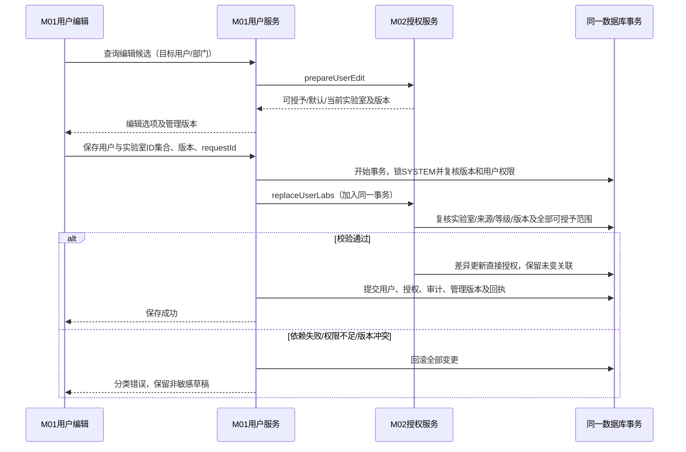
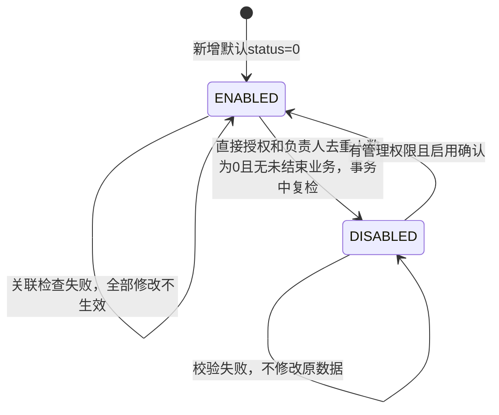

# 实验室与资源管理（M02）详细设计

2026-11-04 控制器空闲按 M03 有效占用计算，无记录或仅 RELEASED 历史均为空闲，不新增持久占用字段。默认连接详情按实际占用选择实验室默认配置或占用培养方案；实验室默认配置保存须在 SYSTEM 守卫内重查占用。字段、批量读取与本批实现边界见[默认连接契约 OC-20261104](默认连接与打印排版接口契约.md#oc-20261104控制器有效占用与默认连接来源)。

## 2026-10-31 型号信息直接用于工艺方案

用户确认取消工艺方案保存对“已核准工程资料”的前置要求，直接使用反应器型号维护信息。M04型号候选、事实读取与版本保存的旧ENG-I01核准门禁由[本次来源与版本规则](../04-工艺与方案管理/工程版本固定与评审收尾.md)覆盖；保留字段合法性、型号适配、权限、SYSTEM修订及不可变快照校验，不生成伪造核准记录。设备运行及安全规则不由此放宽。

2026-10-28 控制器补料单元关系：按用户确认，补料单元归属实验室并对应控制器；按默认连接全部通道的泵号数字顺序实时生成瓶位，不新增维护页面，暂不考虑流程快照。字段、后台读写接口和 W03 候选只读投影已接入；新关系下的 W03 连接写流程仍未接入。详见[控制器补料单元关系设计](控制器补料单元关系设计.md)。

## CB-20261024：独立台式控制器与罐体绑定（最新确认）

台式控制器为独立实验室实例，主键沿用 `lab_bench_reactor_controller.connection_id`，对外命名 `controllerId`。允许控制器尚未绑定罐体；一个控制器可绑定多个罐体，一个罐体最多绑定一个控制器。规范关联改为 `lab_bench_reactor.controller_id → lab_bench_reactor_controller.connection_id`，可空且索引不唯一，不新增表。关联必须同实验室、目标有效；变更仍须实验室操作权限、SYSTEM管理守卫、真实设备使用/引用检查及审计，不以型号、编号或名称猜测关系。

控制器 `reactor_id` 仅保留迁移兼容事实，允许NULL，停止新增业务依赖或双写；旧字段不得限制新控制器的独立生命周期或一控多罐关系。反应器旧 `controller_no` 亦为兼容列，真实编号只读自控制器 `controller_no`。型号采用统一 `dev_reactor_model` 的有效 `BENCH_CONTROLLER`，型号无实验室归属；`model_name` 为型号名称，`spec` 为规格，均不代替实例编号或资产号。小试上游按 `lab_lab.lab_type='1'` 与授权实验室集合过滤实例 `lab_id`，不按型号归属筛选。

默认连接新主接口为 `GET /lab/pumpconnection/controller/{controllerId}`、`PUT /lab/pumpconnection/controller/{controllerId}`。沿原查询/编辑功能权限和实验室准入，PUT沿Header/WriteMeta双头，读响应顶层返回SYSTEM `managementRevision`；`controllerId` 解析为 `connection_id`，响应同时保留 `connectionId`。`controllerNo` 取该控制器真实编号，通道按稳定 `channelId` 读写，不要求先绑定罐体。响应 `reactorId` 为旧兼容字段，可空且不得解释为完整罐体集合。

旧 `GET/PUT /lab/pumpconnection/reactor/{reactorId}` 保留兼容：由该罐体的 `controller_id` 解析控制器并复用同一配置链，禁止按控制器旧 `reactor_id`、编号或“最后一条”解析；未绑定返回配置未就绪，不创建控制器或自动绑定。旧调用不能通过控制器配置修改罐体绑定。一个控制器的默认连接及通道由多个罐体共用，配置前必须检查该控制器及全部已绑定罐体的使用状态，任一阻断或事实未知即整次拒绝，不以当前入口罐体空闲代替全量检查。

空库仍只执行开发基线01/02/03；既有库单独使用 [RM-04升级来源](RM-04-现有开发库控制器罐体绑定升级.sql)，明确确认目标、停写和备份后执行。仅依据唯一、同实验室且无冲突的旧 `reactor_id` 回填；已有不同绑定、失效目标或多连接歧义拒绝，不猜测、不覆盖。脚本支持修正冲突后重跑；MySQL DDL隐式提交，不能承诺整个DDL与回填原子回滚。没有执行SQL或运行验收的证据时仅标静态设计同步，不能宣称数据库/HTTP/浏览器通过。

2026-10-21：[反应器与台式控制器统一型号设计](反应器与台式控制器统一型号设计.md)补充型号级PID设置，五类回路、温度/压力能力联动及范围以该专题和逐接口契约为准。PID是资源型号默认参数，不关联实验室，不自动覆盖工艺模板PID；新增目标表已纳入开发基线，已有测试库升级及运行验收尚未执行。

2026-10-20 M02-227绑定写链已按统一型号接线：请求expectedModelId/newModelId、响应modelId，保留原核准证据/权限/使用守卫；变更绑定时同事务初始化空控制器普通泵关联，已有通道不自动转换。详见[工程接口增补](工程资料维护与解析逐接口契约.md)。消费端及前端尚未整体切换，不可据此单独部署或宣称运行完成。

2026-10-20台式普通泵口径补充：旧“最高速度”maxSpeed与新“最大量程”maxRange是同一参数，单位g/min，不设计两套独立上限；实例默认速度不得超过该最大量程。转换冲突与切换边界见[统一型号设计§6.4](反应器与台式控制器统一型号设计.md#64-台式最高速度与最大量程用户最新确认)。原设计正文保留；此项最新确认覆盖旧字段解释，尚未完成实例读写切换。

2026-10-20：[反应器与台式控制器统一型号设计](反应器与台式控制器统一型号设计.md)登记已确认的两类型号字段、隐藏组件及名称唯一规则。原设计正文保留；仅该专题覆盖范围采用用户最新确认，其余契约继续有效。新表基线及新增口RM-C01已落源码；其余新接口、测试数据转换及运行验收未完成，不表示现有型号来源已经切换。

2026-10-18：CMD-I01/I02条件装配的固定HTTP网关客户端、设备侧通讯关联发布客户端及核准前置见[适配与关联发布契约](固定执行器HTTP适配与关联发布契约.md)。代码/隔离HTTP契约测试与现场协议核准分别登记；默认关闭物理提供方，不生成设备验证事实。

## 开始培养专项增补（SC-20261017）

M02提供StartCultureDevicePort的resolve/observe、真实台控/反应器/地秤/取样泵/服务身份及观测；命令沿现有DeviceCommandPort和通信登记。取样预填充固定OUTWARD，不能复用补料泵身份；MFC/加热/搅拌确认与OPC重启须核准profile及真实回执。协议/时效/重启影响范围未到货只阻断相关能力，不返回假成功。签名与责任见专题第2、7、9、13节。

最新保存规则（2026-10-17）：小试、中试均只在第4步点击“完成”并成功提交后保存业务数据；未完成页面刷新或取消后从第1步重新开始，不恢复表单或中间步骤。操作审计和设备安全收尾保留，必须当天完成的限制不变。

步骤时间记录：四步分别记录服务端开始/结束时间及结束原因；刷新重开新建尝试，旧时间审计保留，未知结束时间不伪造。时间留痕不构成业务表单的中间保存点。

当前专题：[开始培养详细设计](../07-补液运行与任务执行/开始培养工作流详细设计.md)；实施拆分：[开始培养开发计划](../../开发任务/05-专题交付/小试中试开始培养开发计划-20261017.md)。本次仅文档补充，业务代码、数据库、设备操作均未执行。

## 三类实验室接入补充（INTEGRATION-20261010）

[设备适配契约](三类实验室设备适配契约.md)补齐一期/二期/中试的来源身份、协议/能力登记、真实配置应用、物理资源组和停止核准；[共同边界](../00-总纲与约定/00-三类实验室设备接入与执行边界.md)定义范围与验收。

M02是CMD-I01/I02提供方，M07拥有业务命令意图与结算账。通用通讯设备白名单以[通讯公共契约](通讯与设备公共契约.md)第1节为准；泵/控制器沿工程或专属接入，不能因新增代际默认增加deviceKind。对应INTEG-01/03/07，未取得真实协议与停止证据不标记可执行。

> 2026-09-17 G01补充：[设备业务操作页](设备业务操作页与独立入口.md)提供无cultureId设备入口，复用本模块详情及M09配置；统计延期不影响该入口。

> 2026-09-17 OBS增补：[在线业务观测存储与查询契约](在线业务观测存储与查询契约.md)补齐业务接收、历史/当前值、重处理、查询权限及M09事实交接；新增8表105列及OBS-01—04 SQL设计稿，旧40表672列基线之外单独计入。M08延期不阻断这些业务职责。

> 2026-09-17 业务观测责任修订：按[交付边界第4节](../00-范围与待核/00-M08范围与跨模块交付边界.md)，M02设备接入承担非运行业务观测的接收、去重、质量/时刻/配置版本、持久化与授权查询，M03提供记录时培养关联；执行专属采样归M07。原M08归档草案的业务必需约束按[责任迁移说明](../08-数据统计与工作台/在线归档与培养关联契约.md)承接；统计副本继续延期。接入存储复用核验、逐字段物理落点和迁移须纳入本模块后续细化，不能等待M08，也不能以原40表基线冒称已包含本次承接。BD09/BD13待执行。

**当前收尾入口：[控制器型号与工程参数收尾契约](控制器型号与工程参数收尾契约.md)、[最终完整字段字典](收尾后完整数据库字段字典.md)、[收尾验收与完成核对](history/review/收尾验收与设计完成核对.md)。下方早期分批记录的“待其他模块设计/待补物理字段”已由本次收尾包接续；代码、真实资料核准及运行验收仍未完成，不混作设计待办。**

2026-09-10；状态：当前确认范围详细设计完成。控制器型号、工程资料版本及M04交接已补齐；最终40表672列，SQL与完整字典见收尾包。未编写业务代码、执行SQL或完成设备/接口验证。

## 1. 依据、范围及组织

依据[02实验室设置（V4.0 第 2 章）](../../需求说明书V5.1-1030_md/02-实验室设置.md)、[03资源管理（V4.0 第 3 章）](../../需求说明书V5.1-1030_md/03-资源管理.md)、[01基本设置的用户授权（V4.0 第 1 章）](../../需求说明书V5.1-1030_md/01-基本设置.md)、[澄清决策记录](../../需求说明书V4.0-0904_md/需求澄清决策记录.md)、[已确认模块边界](../00-总纲与约定/00-业务模块划分与设计目录.md)。M01的18项确认及授权接口规格见[系统管理设计25.4/25.5及20节](../01-系统管理/详细设计.md)。

本模块以本文件为总入口；字段字典、迁移/核验/回退SQL、关系图及页面交互规格均在当前文件夹。当前[现状核对与复用清单](history/review/现状核对与复用清单.md)是基线证据，不是最终数据库设计。

| 功能组 | 需求来源 | 设计内容 | 边界 |
| --- | --- | --- | --- |
| 实验室及用户授权 | 02实验室管理；01用户授权实验室 | 主数据、负责人、场地部门、启停、授权用户查询及用户编辑契约 | 组织用户归M01；负责人关系与直接授权区别保留 |
| 设备型号库 | 03设备库 | 台式/集成反应器、培养容器规格、称重、检测、泵、分析仪型号及能力 | 型号定义不混入实例占用状态 |
| 实验室设备实例 | 02设备配置/其他设备 | 台式反应器及控制器、默认泵连接、天平、蠕动泵、空气泵、检测设备、集成反应器、培养容器、地秤、下游设备、声光报警器、打印机、继电器 | 培养占用由M03提供，检测发送归M05，泵执行归M07 |
| 通讯与设备公共契约 | 02各设备通讯设置 | 实验室/设备身份、连接参数、能力、采集时间、单位、读数质量及指令响应 | 不把通讯保存成功当作设备连接或执行成功；在线历史归档归M08 |
| 检测项目、规则及校准对象 | 03检测设备检测项/检测规则/校准对象，02检测实例配置 | 项目引用、型号与实例支持范围、校准对象配置 | 检测结果与签批归M05；本期不执行PH校准操作或生成其记录 |
| 液袋、培养基及耗材 | 03液袋/补液培养基/耗材 | 主数据、单位/阈值、启停、引用限制 | 不启用耗材自动扣减；计算与任务实际量归M07 |
| 液瓶与消耗配置 | 02液瓶配置/消耗设置 | 取样/补料单元引用、液瓶容量/位置、耗材配置 | 告警规则、通知及处理归M09；运行步骤实例归M07 |

M04拥有实验室工作流/节点定义与选择配置，M06拥有实验室审批设置；M02仅提供实验室上下文及页面入口对接，不因需求章节位置重复建表。离线/状态告警配置依已确认分工交给M09。本期小试下游类型保留，不扩展其业务实现。M02-Q18确认：已配置工作流时禁止直接修改实验室类型；须先按M04规则移除配置，M02不能代为删除工作流。

## 2. 首轮发现与设计优先级

首先复用现有lab_lab、lab_lab_leader、sys_user_lab以及已存在的dev_*、lab_*和资源表；旧cdp/npp只按业务含义映射，不能把旧外键或账号数据直接带入当前库。

首轮授权发现：现有授权表有0可见/1可操作/2管理；保存授权列表会删旧重建并重写创建时间；授权用户列表实际按登录时间排序；实验室负责人也被查询合并为授权来源。必须先厘清这些行为与需求/契约的差异，再设计最终授权写入。具体证据及旧库映射见附件。

| 顺序/任务 | 具体产物 | 当前状态 |
| --- | --- | --- |
| D02-01 实验室和授权基线 | 当前/旧库映射、直接授权与负责人来源、列表排序和接口差距 | 已完成静态基线及后续纠偏记录 |
| D02-02 M01/M02授权契约 | 可授予集合、默认关联部门、等级保留、版本、事务、有效期来源与失败行为 | 已完成，第4–9节及Q01–Q21 |
| D02-03 实验室页面与状态 | 列表/编辑/启停/授权用户、逐字段API、状态图、删除/停用引用检查 | 已完成页面/接口/状态/授权规则及数据库设计 |
| D02-04 型号库与设备实例 | 逐设备类型页面、字段、验证、型号到实例引用、占用前置条件 | 已完成8类型号、12类实例及控制器设计，见独立附件 |
| D02-05 通讯和设备契约 | 读数/命令/单位/异常、型号适配、协议证据及真实验证方式 | 系统侧通讯/读数/指令边界设计已完成；实际协议验证另列实施门槛 |
| D02-06 检测及资源配置 | 项目/校准对象/规则、液袋/培养基/耗材/液瓶/消耗 | 已完成8项功能、接口、事务与验收场景 |
| D02-07 完整数据库附件 | 每字段含义/字典值/逻辑关联、ER、全部改造SQL与核验回退 | 已完成38表字段字典、增量及01–06 SQL设计稿 |
| D02-08 交互与验收复核 | 原图比对、接口调用时序、异常与并发、跨模块及实机验证清单 | 交互/并发/兼容/跨模块与实机验收清单已完成，尚未执行 |

## 3. 已继承且不重复询问的规则

- M01 Q05：“全部数据权限”不能扩大实验室授权；操作还须满足功能权限与实验室等级。不能仅靠前端下拉过滤保护授权。
- M01 Q15/Q16：管理写使用第一版统一管理版本及SYSTEM守卫；冲突保留非敏感草稿，人工核对后重提。实验室新增部门/场地引用必须与M01组织删除共享守卫。
- M01 Q01–Q04：用户ID及登录账号保持稳定，用户基本信息和联系方式由M01处理，不在本模块另建账号模型。
- M01 Q11/Q12仅决定菜单和普通参数维护权限保持现状，不能据此推断任意管理员有权授予任意实验室。
- 液袋下限体积用于余量告警阈值；残余量为不可泵出的死体积。秤原始读数与用于计算的净重/净体积分别处理，不将g/kg/L直接混用。具体设备读数方向及净重来源仍依协议和现场证据验证。
- 只配置资源不等于完成补料、补糖实机执行；本期不包含PH校准执行、连续式泵速策略或耗材自动扣减。

## 4. M01/M02授权契约承接

继续使用M01第20节已定义的三个**应用服务契约**。2026-11-03状态补正：当前M02LabAuthorizationAdapter已有对应三个方法，M01应用服务调用已定位；本句只更新接线状态，不声明各失败分支及运行已经验收。当前同system进程，用户和授权变更必须在同一事务内；未来拆远程服务需另行设计一致性流程。

| 契约 | 输入 | 输出 | 设计要求 |
| --- | --- | --- | --- |
| prepareUserEdit | actorUserId:string、targetUserId:string/null、deptId:string/null | laboratories:Option[]、defaultLabIds:string[]、currentLabIds:string[]、currentAuthorizations:AuthorizationItem[]、hasUnmanagedAuthorizations:boolean、authorizationVersion:string | Option沿用M01逐字段定义；默认值取lab_lab.dept_id等于所选deptId的实验室，并与可授予集合取交集，不包含子部门（M02-Q02已确认）；普通管理员须具备用户授权功能权限且仅能授予本人管理等级2的实验室（M02-Q04） |
| replaceUserLabs | actorUserId:string、targetUserId:string、labIds:string[]、authorizationChanges:AuthorizationChange[]、expectedAuthorizationVersion:string、requestId:string | applied:boolean、authorizationVersion:string | 按可管理集合差异更新：labIds表示本次可管理范围内期望保留的直接授权，管理范围外旧授权由服务端保留；未显式变更的等级及既有关联时间不变，显式等级变更按M02-Q09；先校验再写，不全量删旧重建（M02-Q05） |
| removeUserLabs | actorUserId:string、targetUserId:string、requestId:string | removedCount:integer | 按M02-Q10在SYSTEM守卫内重检全部相关实验室管理范围，通过后同用户删除事务清直接关联并留审计，不删除业务历史；按M02-Q11仍任实验室负责人则拒绝删除，须先在实验室管理中解除身份 |

直接选择实验室只传ID，新增直接关联未显式调整等级时由服务端默认写auth_type=0（可见），不自动获得操作或管理权限；已有明确授权等级在未显式调整时保持不变，不能因保存其他用户信息而降级、升级或重置（M02-Q01已确认，2026-09-09）。等级变更入口按M02-Q08，准入按M02-Q09；只选择ID仍不代表请求修改等级。负责人资格、用户直接授权、项目分享分别记录来源，移除直接关联不等于取消负责人资格。实验室负责人由lab_lab_leader关系派生该实验室的管理等级2，不自动新增或覆盖sys_user_lab直接授权行；具体操作仍要求对应功能权限。取消负责人只撤销负责人来源，保留其他直接授予的权限，最终范围按剩余有效来源重新计算（M02-Q03已确认，2026-09-09）。

普通管理员新增实验室授权须同时具有相应的用户授权功能权限及该实验室管理等级2；仅可见0或可操作1不能向他人授予。可授予候选集合限定为本人可管理实验室，提交时重新校验；部门默认集合也与此集合取交集。仅通过多选新增直接关联仍默认0可见；显式等级调整须另外满足M02-Q09，不能把只勾选实验室当作升级请求（M02-Q04已确认，2026-09-09）。编辑用户时，当前管理员管理范围之外的已有直接授权必须由服务端保留，等级和关联时间均不变，不能修改或撤销；界面提示“存在其他管理范围的授权，本次修改不影响”，不泄露无权查看的实验室名称（M02-Q05已确认，2026-09-09）。受保护超级管理员的既有特殊规则不因本次确认改变。

超级管理员沿用既有受保护身份判定，保留全局实验室管理权限，无需为其逐个新增sys_user_lab记录；不能通过创建同名角色或配置dataScopes=1取得该特权。停用实验室可由有权超级管理员进行管理和重新启用，但其业务使用仍受实验室状态、业务状态及签名审核分离等规则限制，不允许将管理特权当作设备执行或签批规则豁免（M02-Q07已确认，2026-09-09）。

本期直接实验室授权不设置有效期，持续有效直到撤销；不新增授权起止时间、续期或自动到期任务。用户停用/删除及实验室停用仍按身份和资源状态规则限制访问，权限记录存在不代表一定可执行；项目成员及分享授权期限由M03独立管理（M02-Q06已确认，2026-09-09）。

依赖未实现/不可用时按M01返回503 LAB_AUTHORIZATION_UNAVAILABLE，回滚用户变更并保留草稿；不采用“只保存ID、不校验”的正式降级。版本冲突和授权不足按M01公共冲突/权限错误响应，不伪装成网络故障。测试模拟必须与生产隔离，不能作为授权联调已通过的证据。

## 5. 调用时序（目标契约，尚未实现）

## 6. 需要继续核对的事项

此处是后续设计任务，不代表要求用户重新确认M01的18项选择。

| 事项 | 已知事实 | 下一步 |
| --- | --- | --- |
| 实验室授权有效期 | M02-Q06已确认：本期不设有效期，直到撤销 | 用户停用/删除及实验室停用仍限制访问；项目成员/分享期限独立管理，不新增实验室授权到期字段 |
| 授权来源与等级 | M02-Q03已确认：负责人派生管理等级2，具体操作仍需功能权限 | 取消负责人只撤销该来源、保留直接授权；按真实来源回显与重新计算 |
| 默认部门关联 | M02-Q02已确认：仅直接挂靠所选部门，不含子部门 | 按dept_id精确匹配并限定可授予范围；其他实验室需有权管理员手动选择 |
| 当前超级管理员行为 | M02-Q07已确认：超级管理员无需逐个授权，保留全局实验室管理权限 | 仅识别既有受保护超级管理员身份；业务状态及签批分离仍校验，普通角色全部范围不继承特权 |
| 设备执行依赖 | 设备资料/读数方向/重量写入责任尚需后续验证 | 引用基线依赖逐项对接，不凭默认值启用执行路径 |

## 7. 下一阶段完成标准

先完成实验室和授权功能组的页面/字段/接口/时序/最终表结构，再补齐型号、实例、通讯及资源功能组。最终一个模块必须提供完整的设计、字段字典、ER及所需全部迁移/核验/回退语句；在此之前保持“设计进行中”。本轮未写业务代码、未执行SQL、未连接设备，也未做页面原图逐图验收。

## 8. 实验室管理功能组

本节已对照需求02实验室管理正文及原图[新增实验室](../../需求说明书V4.0-0904_md/images/image62.png)、[授权用户列表](../../需求说明书V4.0-0904_md/images/image68.png)。仅完成这两张图片的目视核对，不代表所有设备页面已核对。以下为目标接口设计，尚未实现；授权等级与可授予规则按第9节已确认记录执行，其余未决项继续逐项确认。

### 8.1 页面和字段

LAB-UI01实验室列表：顶部名称/编码、起止日期、检索、重置、新增；列表列为序号、实验室名称、编码、类型、负责人、修改人、修改时间、操作。按create_time DESC、lab_id DESC稳定分页。起止日期按上海时区的修改时间update_time筛选（M02-Q17），排序仍按创建时间倒序，单边允许，结束日按次日00:00排除；前后顺序非法时字段提示。没有权限的操作隐藏，直接访问API仍校验，不将隐藏当作授权。

LAB-UI02新增/修改弹窗字段如下，沿用原图单列结构；修改时带入现值。负责人多选，场地和部门单选；对话框不新增地址、备注或授权等级等需求未列出的必填业务字段。

| 字段/接口参数 | 输入规则 | 交互/数据说明 |
| --- | --- | --- |
| 实验室名称labName | string，必填，trim后1–20字符 | M02-Q14：所有未删除实验室全局唯一，包含停用记录，不按部门/场地分组；修改排除自身，冲突定位labName |
| 编码labCode | string，必填，1–50，英文字母/数字/下划线 | M02-Q15：保留与设备资产编号的统一唯一校验，覆盖现有跨表编号范围；重复阻止保存，修改只按来源表及主键排除自身；M02-Q16查重不区分英文字母大小写，显示保留录入形式 |
| 实验室类型labType | string，必填，字典smp_lab_type | 1小试上游、2小试下游、3中试上游、4中试下游；2为保留类型，本期新增不可选，旧数据只读回显；M02-Q18：已配置工作流时类型不可直接修改，保持原类型可编辑其他字段 |
| 负责人leaderUserIds | string[]，可选默认[] | 从有权查看的人员树多选、去重，保存实际用户ID；负责人派生管理等级2，取消时只撤销该来源，操作仍须功能权限（M02-Q03） |
| 场地venueId | string，必填，正整数ID | 引用sys_venue.venue_id，提交时校验当前有效记录 |
| 部门deptId | string，必填，正整数ID | 引用sys_dept.dept_id，提交时校验当前有效记录；M02-Q20：更换所属部门不自动增删已有用户授权或改变等级 |
| 中转服务IP ipAddress | string，必填，IPv4点分十进制 | 四段各0–255；M02-Q19：存在未结束项目/批次/培养时禁止改值；不把IP格式正确当作网络连接成功 |
| 端口port | integer/null，可选默认null，填写时1–65535 | 留空不擅自填设备协议默认端口；M02-Q19：存在未结束项目/批次/培养时禁止改值；连接必须有协议依据 |
| 状态status | string，必填，0启用/1禁用，新增默认0 | 编辑改为禁用与单独禁用执行同一检查；取消确认不得保存其他修改 |

保存使用M01管理版本/requestId规则；网络失败保留非敏感草稿，重复提交按同请求处理；关闭有改动时确认放弃。编辑只修改白名单字段，未在本页编辑的address/remark等既有列保留，不以空值覆盖。字段未知或越权不默默忽略。选择失效的关联记录需提示重新选择，不能按旧候选直接保存。

LAB-UI03授权用户只读弹窗：标题包含实验室名称；列为序号、显示姓名、用户名、部门、角色、授权来源、生效等级、上次登录时间、在线状态；按M02-Q12合并直接授权用户与实验室负责人，同一userId只展示一行。默认10条，按associatedAt DESC（未知null置后）、userId数值DESC。关联时间决定排序，登录时间只是展示字段。角色多值使用完整列表，在线状态根据M01有效会话查询并按userId匹配，不再扫描全部Redis令牌或单凭同名账号判断在线。只读弹窗不增加授权等级编辑入口；授权来源显示“直接授权”“实验室负责人”，两者并存时均显示；生效等级按现存来源取最高等级（M02-Q12）。

### 8.2 基础接口与输出结构

通用Header：Authorization有效会话；写请求另需X-Request-Id:string UUID及X-Management-Revision:string非负整数字符串。ID在JSON中均为十进制字符串，后端bigint，避免浏览器精度丢失。响应外壳与错误格式复用M01第17节，以下不返回原始实体或其params。

| 编号/接口 | 输入 | 输出 | 权限/行为 |
| --- | --- | --- | --- |
| LAB01 GET /lab/lab/list | Query：keyword:string可选≤50默认空；beginDate/endDate:YYYY-MM-DD可选，限定update_time（M02-Q17）；pageNum:integer默认1且≥1；pageSize:integer默认10、10/20/50/100 | rows:LabRow[]、total:integer | lab:lab:list及有效可见实验室范围；不返回范围外总数 |
| LAB02 GET /lab/lab/{labId} | Path labId:string必填 | data:LabDetail | lab:lab:query及目标实验室可见范围；目标不存在404，无权限403 |
| LAB03 POST /lab/lab | Body：8.1全部字段（无labId） | data:LabWriteResult | lab:lab:add；场地/部门与负责人范围复核，负责人按M02-Q03获得派生管理等级，M02-Q21：创建者不因创建动作自动获得管理或其他未声明授权，需管理时明确选为负责人或另行合法授予 |
| LAB04 PUT /lab/lab | Body：8.1全部字段加labId:string必填 | data:LabWriteResult | lab:lab:edit及目标管理权限；类型发生变化时按M02-Q18检查工作流引用，IP/端口变化时按M02-Q19检查未结束业务；状态变更、负责人变更和主数据一起提交或一起回滚 |
| LAB05 GET /lab/lab/{labId}/check-disable | Path labId:string必填 | data:DisableCheck | lab:lab:query及目标管理范围；只读预检，不锁定后续业务结果 |
| LAB06 PUT /lab/lab/{labId}/status | Path labId:string必填；Query status:string必填0/1；无Body | data:LabWriteResult | lab:lab:edit及管理权限；提交再检引用，不能依赖之前预检 |
| LAB07 GET /lab/lab/{labId}/authorized-users | Path labId:string必填；Query pageNum/pageSize同LAB01 | rows:AuthorizedUserRow[]、total:integer | lab:lab:query及目标可见范围；按M02-Q12合并直接授权与负责人，按userId去重后计数、排序、分页 |

LabRow全部字段：labId:string、labName:string、labCode:string、labType:string、labTypeLabel:string、venueId:string/null、deptId:string/null、status:string的0/1、leaders:PersonRef[]、updateBy:string/null（用户名快照）、updateDisplayName:string/null（有可靠审计依据才填，未知返回null）、updateTime:ISO/null、allowedActions:string[]（EDIT、DISABLE、VIEW_USERS、WORKFLOW、APPROVAL的适用且有权子集）。列表以venueId/deptId解析所属场地和部门的当前授权显示名，不额外返回名称；旧空值显示占位。PersonRef={userId:string,displayName:string}。当前负责人名称可按用户当前显示姓名展示，修改人历史姓名不可用当前姓名冒充。

LabDetail包含LabRow全部字段，另有ipAddress:string、port:integer/null、leaderUserIds:string[]，对应字段含义见8.1；旧空值按兼容读取处理，编辑提交需满足新规则。LabWriteResult={applied:boolean,labId:string,managementRevision:string}。日期采用M01上海业务时区格式。

DisableCheck={canDisable:boolean,authorizedUserCount:integer,unfinishedProjectCount:integer,unfinishedBatchCount:integer,unfinishedCultureCount:integer,managementRevision:string}；authorizedUserCount按M02-Q13合并当前直接授权与负责人关系、按userId去重计数；仍有任一来源则不能禁用。所有数量≥0，范围无权不返回明细。依赖计数不可用应报错，不能用0假装可停用。项目/批次/培养未结束定义由M03提供统一查询，M02不自创终态。

AuthorizedUserRow={userId:string,displayName:string,userName:string,deptName:string/null,roleNames:string[],authorizationSources:string[],directAuthType:string/null,effectiveAuthType:string,lastLoginTime:ISO/null,online:boolean,associatedAt:ISO/null}。authorizationSources为DIRECT、LAB_LEADER的非空去重数组，固定按此顺序展示；directAuthType为直接授权0/1/2，无直接关联则null；effectiveAuthType为这些来源合并后的0/1/2，负责人来源为2。online表示有效会话存在，与用户启停状态不同。associatedAt沿用该用户现存直接关联的create_time；无直接关联且负责人关系无可靠建立时间时为null，未知保持null，不用查询时间或新迁移时间补造，也不用实验室整体更新时间替代负责人建立时间。

旧参数名/实体式接口调用方、导出、独立负责人修改入口必须在兼容清单中逐一收口，不能仅完成以上7条新设计就宣称所有入口安全一致。M04/M06入口仅在对应模块可用且有权时启用；不为了显示按钮伪造工作流或审批配置已交付。

### 8.3 启停状态和一致性

state仅对应lab_lab.status，删除标志、连接状态和培养占用分别处理。禁用后业务实验室导航不可用，管理页仍需允许有权管理员查询和重新启用；启用不会恢复已撤销的用户直接授权。编辑状态和独立状态接口共用领域服务；M01新增用户授权、M02负责人变更、M03新增业务引用必须与本次禁用检查共享守卫；关联人数按M02-Q13合并直接授权和负责人去重计算。主数据成功写入不触发设备连接/停泵指令。

### 8.4 基础验收设计（未执行）

| 编号 | 输入与操作 | 预期 |
| --- | --- | --- |
| LAB-C01 | 必填缺失、20/21字符名称、非法IP、端口0/65536、小试下游新增 | 字段错误明确，全部不落库 |
| LAB-C02 | 旧数据编辑只改名称 | 未由页面编辑的列、负责人及授权按请求约定保留，不误清空 |
| LAB-C03 | 编辑状态改禁用后取消确认 | 所有修改不提交，草稿保留 |
| LAB-C04 | 预检后另一管理员新增直接授权/负责人/业务引用 | 至少一方版本冲突或引用阻断，不能漏检负责人来源，不出现禁用后新增有效引用 |
| LAB-C05 | 授权时间与登录时间顺序相反、负责人来源无时间、同用户双来源 | 按associatedAt倒序且未知置后，再按userId数值倒序；双来源一行，total与去重后集合一致，登录时间仅展示 |
| LAB-C06 | 无授权直接访问详情/列表/授权用户 | 无数据泄露，列表数量与范围一致 |
| LAB-C07 | 两标签共享会话、另端登录替换、同名重建账号 | online按有效userId会话判断，旧用户名缓存不能冒充在线 |
| LAB-C08 | 禁用/启用实验室 | 导航与访问准入一致；启用不自动重新授权、不下发设备运行命令 |

## 9. 授权业务逐项确认

采用“你问我答”，每次只确认一个实质业务取舍；未回答的业务决策不默认采纳。2026-09-09用户授权字段长度等常规细节由设计者决定，后续不逐项询问普通字段长度、描述必填性、提示文案等；依据需求和现有实现定案，并记录依据。

| 编号 | 待确认事项 | 当前依据与推荐 | 状态 |
| --- | --- | --- | --- |
| M02-Q01 | 用户勾选实验室后，新关联默认获得什么等级 | 需求01说明影响数据可见范围；当前normalizeLabs缺等级写0。用户同意：新增直接授权默认0可见，保留已有明确等级；操作/管理资格需另有合法授权，不能只因勾选自动升级 | 已确认（2026-09-09），已回写第4节及M01第20节 |
| M02-Q02 | 部门默认实验室是否包含子部门 | 用户同意：仅默认勾选直接挂靠所选部门的实验室，不包含子部门；其他实验室由有权管理员手动选择，全部选择均需授权校验 | 已确认（2026-09-09），已回写第4/6节及M01契约 |
| M02-Q03 | 负责人是否自动获得实验室管理等级 | 用户同意：负责人派生该实验室管理等级2，操作仍需功能权限；取消负责人仅撤销该来源，保留直接授权 | 已确认（2026-09-09），已回写第4/6/8节 |
| M02-Q04 | 普通管理员可为用户新增哪些实验室授权 | 用户同意：须具有相应用户授权功能权限，且只能选择本人具有管理等级2的实验室；可见/可操作不能授予，新关联仍默认0可见 | 已确认（2026-09-09），已回写第4节与M01契约 |
| M02-Q05 | 管理范围外已有实验室授权如何处理 | 用户同意：保留原授权及等级，不允许当前管理员修改/撤销；提示存在其他范围授权，不泄露无权查看的实验室名称 | 已确认（2026-09-09），已回写第4节及M01保存契约 |
| M02-Q06 | 实验室授权是否设置有效期 | 用户同意：本期不设有效期，直到撤销；用户/实验室状态仍限制访问，项目成员及分享期限独立管理 | 已确认（2026-09-09），已回写第4/6节及M01契约 |
| M02-Q07 | 超级管理员是否无需逐实验室授权即可全局管理 | 用户同意保持现状：超级管理员全局管理，无需逐个授权；业务状态及签批分离仍校验，普通角色全部数据范围无此特权 | 已确认（2026-09-09），已回写第4/6节及M01边界 |
| M02-Q08 | 是否增加实验室授权等级配置入口 | 用户同意：用户编辑页保留实验室多选，旁边增加配置授权等级入口；有权限者逐实验室调整，新增默认可见、资料修改不改变已有等级 | 已确认（2026-09-09），页面设计已回写；等级准入已由M02-Q09确认 |
| M02-Q09 | 普通管理员是否可授予他人管理等级 | 用户同意：同时具备用户授权功能权限及该实验室管理等级时，可调整他人的直接授权为0/1/2；仍受目标用户管理范围限制，范围外授权不可修改 | 已确认（2026-09-09），已补齐等级写入契约 |
| M02-Q10 | 删除用户是否允许间接撤销管理范围外授权 | 用户同意：存在范围外实验室授权则阻止删除，交由覆盖全部相关实验室管理范围的管理员或超级管理员处理；普通资料编辑仍按Q05 | 已确认（2026-09-09），已同步M01删除准入及清理契约 |
| M02-Q11 | 待删除用户仍是实验室负责人如何处理 | 用户同意：先在实验室管理中调整或解除其负责人身份，再删除用户；完整范围管理员和超级管理员同样遵循 | 已确认（2026-09-09），已同步M01删除约束及验收场景 |
| M02-Q12 | 授权用户列表是否同时展示直接授权与负责人 | 用户同意：两类都展示，同一用户合并一行，显示授权来源及最终生效等级，列表保持只读 | 已确认（2026-09-09），已回写LAB-UI03、LAB07、DTO及验收场景 |
| M02-Q13 | 禁用实验室的关联用户检查是否包含负责人 | 用户同意：直接授权与负责人合并、按用户去重计数；任一关联仍在则禁止禁用，须解除相关关系且满足无未结束业务等条件 | 已确认（2026-09-09），已同步DisableCheck、状态约束及验收场景 |
| M02-Q14 | 不同部门或场地下是否允许实验室名称重复 | 用户同意：所有未删除实验室名称全局唯一，包含已停用实验室；不按部门或场地分组 | 已确认（2026-09-09），已同步字段校验及验收场景 |
| M02-Q15 | 实验室编码是否继续与设备资产编号共用唯一编号范围 | 用户同意：保留现有跨表统一唯一规则，实验室编码不能与设备资产编号重复 | 已确认（2026-09-09），已回写labCode及现有校验范围 |
| M02-Q16 | 统一编号查重是否区分英文字母大小写 | 用户同意：查重不区分大小写，LAB001与lab001视为同号；显示保留录入的大小写 | 已确认（2026-09-09），已同步跨表比较口径及验收场景 |
| M02-Q17 | 实验室列表起止时间按创建还是修改时间筛选 | 用户同意：按修改时间筛选，与展示列一致；结果仍按创建时间倒序 | 已确认（2026-09-09），已同步LAB-UI01、LAB01及验收场景 |
| M02-Q18 | 已配置工作流时是否允许修改实验室类型 | 用户同意：保留限制，禁止直接修改；先按工作流管理规则移除相关配置，再修改类型 | 已确认（2026-09-09），已同步类型字段、LAB04及M04约定 |
| M02-Q19 | 存在未结束业务时是否允许修改中转服务IP和端口 | 用户同意：存在未结束项目、批次或培养时禁止修改这两个参数，待相关业务结束后调整；其他字段按各自规则 | 已确认（2026-09-09），已同步字段、LAB04及验收场景 |
| M02-Q20 | 实验室更换所属部门后如何处理已有授权 | 用户同意：保留现有授权及等级，不自动撤销或给新部门人员授权；部门变更只影响后续默认候选 | 已确认（2026-09-09），已同步部门字段及M01默认授权约定 |
| M02-Q21 | 创建实验室是否自动获得管理权限 | 用户同意：不自动授予；创建者需要管理时明确设为负责人，或由有权管理员授予管理等级 | 已确认（2026-09-09），已同步LAB03及创建后交互、验收场景 |
| M02-Q22 | 型号关联设备被未结束业务使用时能否改共享关键参数 | 用户同意：禁止修改品牌、类别、容量单位等关键参数，允许描述等展示性修改；业务结束后再调整并同步 | 已确认（2026-09-09），已落实型号MDL-B04及MDL-C09–13 |
| M02-Q24 | 共享型号维护是否要求全部关联实验室管理权限 | 用户同意：按相应型号维护功能权限统一维护，不要求管理每个实验室；实例权限及Q22运行限制独立执行 | 已确认（2026-09-09），已同步型号接口及M01权限边界 |
| M02-Q25 | 已有配置引用后能否改变型号泵数/MFC数/控制能力 | 用户同意：已有设备或模板配置引用时禁止直接改变结构，空闲也适用；另建型号后按流程调整关联并保留历史 | 已确认（2026-09-09），已落实参数契约第8节及型号修改约束 |

默认部门关联现状已核对：当前用户页getDefaultAuthorizedLabIds精确匹配deptId，不自动包含子部门。此事实作为后续设计依据，不能把M01实验组全选包含子部门的Q02套用于实验室授权。

M02-Q01验收补充：新增直接关联应写0；原1/2级关联在只保存用户基本信息或原ID集合时保持等级与关联建立时间不变；仅勾选实验室不能执行需要操作/管理等级的动作。此为待执行验收，非运行通过。

M02-Q02验收补充：父部门用户默认集合不含子部门实验室；直接挂靠但不在可授予集合内的实验室也不得默认勾选；手动添加仍重新校验权限。

M02-Q03验收补充：仅负责人关系也可取得管理等级但无对应功能权限时不能操作；直接授权0加负责人时有效等级为2，取消负责人后回到0；直接授权2加负责人时取消负责人仍保留直接等级2。负责人变更与主数据、审计及权限版本同事务，未提交不影响现行权限。

M02-Q04验收补充：管理员可管理A、仅可见B、仅可操作C时，新增候选只含A；篡改请求加入B/C应拒绝且全部回滚；缺用户授权功能权限时即使可管理A也不能新增授权；默认部门实验室集合不得包含B/C。

M02-Q05接口展示按2026-10-30用户最新补充：prepareUserEdit回显全部既有直接授权（含范围外只读项），以manageable/readonly/disabledReason标识不能修改的项目；hasUnmanagedAuthorizations保留存在标志，不再用旧“仅返回范围内/不回ID名称”规则隐藏已有授权。回显不授予修改权，详见[M01详细设计§26.1](../01-系统管理/详细设计.md)。保存时服务端在统一守卫内重算可管理集合：旧授权中范围外部分原样保留；范围内部分按labIds差异增删。labIds包含范围外ID时拒绝整次修改；空数组只撤销范围内直接授权，不清除全部实验室授权。权限变化造成管理版本变化时返回冲突，不按过期范围执行。

M02-Q05验收补充：仅管理A时编辑拥有A/B授权的用户，增删A不影响B的等级和关联时间；labIds=[]仅清范围内直接关联；越权提交B应拒绝且不产生部分修改；页面按2026-10-30用户补充回显B为只读既有授权，保留ID及可用名称；只读项不提交为新的授权变更，不能移除或改级。

M02-Q06验收补充：仅日期变化不使实验室直接授权到期；用户停用或实验室停用时拒绝相应访问；项目分享到期不删除sys_user_lab直接授权，也不能借实验室授权绕过项目范围校验。

M02-Q07验收补充：受保护超级管理员无sys_user_lab记录仍可管理实验室；普通角色设全部或改名为超级管理员不能获得同等权限；停用实验室允许合法管理/重新启用但禁止不符合状态的业务操作；签名审核分离不被管理员特权绕过。

### 授权等级配置交互（M02-Q08已确认）

M01用户编辑页“授权实验室”多选框旁增加“配置授权等级”按钮，弹窗按实验室逐行展示名称与等级（0可见、1可操作、2管理）。该入口只调整直接授权，不修改负责人关系或其派生管理等级。普通管理员须同时具备相应用户授权功能权限和目标实验室管理等级2，才可将他人直接授权调整为0/1/2，包含授予管理等级；仍须通过M01目标用户可管理范围检查（M02-Q09已确认，2026-09-09）。无权查看的实验室不返回ID/名称；管理范围外已有授权继续按M02-Q05保留，不能经弹窗覆盖。

打开时读取本次编辑草稿的实验室集合及已有直接等级，新选实验室默认0；仅显式调整等级才形成变更，修改姓名等其他资料不得重置等级。弹窗“确定”只合并到用户编辑草稿，“取消”丢弃本次弹窗改动；最终用户保存统一校验并提交，取消用户编辑不提交任何等级修改。负责人来源如导致有效等级高于直接等级，需说明来源，不能显示成直接授予2而误改原记录。

M02-Q08确认交互、M02-Q09确认准入，具体写入DTO见下文；旧labIds只选ID契约不能被解释为等级修改请求。实验室页面的“授权用户”仍为只读列表，不因本项新增第二个编辑入口。

M02-Q08验收补充：打开/取消等级弹窗不写库；取消用户编辑不保存等级；修改姓名保留等级；新增默认0；显式等级调整与用户其他修改必须统一成功或回滚，不能出现用户保存失败但等级已变化。

### 授权等级调整契约补充（M02-Q09）

prepareUserEdit增加currentAuthorizations:AuthorizationItem[]；只包含当前可管理范围内已存在的直接授权。AuthorizationItem全部字段：labId:string实验室ID、authType:string枚举0/1/2直接等级、effectiveAuthType:string枚举0/1/2当前有效等级、isLabLeader:boolean是否另有负责人来源。其显示名称由原laboratories选项映射；effectiveAuthType为只读，不用于写回；范围外信息仅通过hasUnmanagedAuthorizations存在标记提示。负责人有派生权限但没有直接关联时，不伪造一条currentAuthorizations记录；负责人只读来源说明可由有权实验室详情查询提供。

M01 UserSave及replaceUserLabs增加authorizationChanges:AuthorizationChange[]，可选默认[]；AuthorizationChange全部字段为labId:string必填实验室ID、authType:string必填枚举0/1/2。仅显式操作等级时传变更；labId必须出现在本次可管理范围内期望保留的labIds/authorizedLabIds集合中，同labId重复项、非法等级或范围外ID均返回400 INPUT_INVALID或403 ASSIGNMENT_DENIED，不采用后值覆盖或静默忽略。

保存次序：按M01先校验功能权限、目标用户范围及管理版本，在SYSTEM守卫内重算实验室管理集合；校验全部授权增删和等级变更，再一次性应用。新关联先使用默认0，有显式且合法等级变更时使用该请求等级；旧关联仅在authorizationChanges明确列出时改等级，create_time始终保留，仅更新update_by/update_time。管理员或负责人只能授予自己有管理等级的实验室；只有可见或可操作仍不能改他人等级。角色“全部”不能替代这些条件。

授权增删、显式等级变更、用户资料、操作审计、管理版本与请求回执同事务。审计记录直接授权等级前后值及来源，禁止把负责人派生等级写成直接授权变更。权限在读取候选后发生变化时要求重新核对，不使用旧候选放行。移除直接授权不撤销负责人身份，取消负责人也不移除直接授权。

M02-Q09验收补充：满足功能权限和实验室管理等级者可将他人0改1、1改2、2改0；缺任一条件应拒绝。负责人有相应功能权限时可授权他人共同管理；范围外变更拒绝且整次回滚。仅修改姓名或只提交原ID集合时等级不变；升降级保留关联建立时间；取消最终用户保存不产生等级变更。

### 用户删除的实验室范围校验（M02-Q10）

M02-Q10已确认（2026-09-09）：删除用户须同时通过M01用户删除功能权限、目标用户管理范围及非自身/受保护账号限制，并覆盖该用户全部相关实验室的管理范围；范围检查至少合并直接授权与负责人派生授权，不能只检查sys_user_lab。普通管理员缺少任一相关实验室管理等级2时，拒绝删除，交由覆盖全部相关范围的管理员或受保护超级管理员处理；超级管理员只豁免逐实验室范围检查，不豁免其他删除约束。停用实验室的现存关联也不能跳过范围检查。

在SYSTEM统一守卫内，先复核管理版本、目标用户当前全部相关实验室及操作者最新管理范围，校验通过后才执行用户软删除和当前直接关联清理。批量删除先校验全部目标，任一越权则整批拒绝，不能部分删除。范围不足返回HTTP 403、errorCode=ASSIGNMENT_DENIED，提示“该用户存在其他管理范围的实验室授权，请联系具有完整管理范围的管理员处理”，不返回无权查看的实验室ID或名称。用户状态、关联、权限版本和成功回执均不改变；拒绝按M01记录失败审计。并发授权或负责人变更须共用守卫和版本规则，不能在范围检查之后新增关联而漏检。

removeUserLabs只清理直接授权，负责人删除处理已由M02-Q11确认：先在实验室管理中调整或解除，再删除用户，不自动移除负责人。项目成员及分享由M03独立处理，本项不冒称已完成跨模块全部业务引用检查。

M02-Q10验收补充（设计、未执行）：管理员仅可管理A，目标有A/B直接授权，删除返回403且全部数据不变；目标仅以负责人身份关联B同样不能漏检。覆盖A/B范围的管理员或受保护超级管理员通过本项范围检查后仍须满足其他删除约束。批量目标中一人越权则全部不删；预检后授权范围变化应冲突或按最新范围拒绝；响应不得泄露B的ID/名称。

### 用户删除前的实验室负责人检查（M02-Q11）

M02-Q11已确认（2026-09-09）：目标用户仍有当前实验室负责人关系时禁止删除，须先在实验室管理中调整或解除其全部负责人身份，再重新发起用户删除；具有完整实验室管理范围的管理员和受保护超级管理员均遵循此规则。停用实验室的负责人关系也纳入检查，历史负责人快照不作为当前关系阻断。实验室负责人原为可选，本项不新增必须指定接替人的要求；解除负责人仍按Q03保留已有直接授权，后续删除另按Q10校验。

删除在SYSTEM统一守卫内先完成身份、功能权限、目标用户范围及Q10实验室范围检查，再检查当前lab_lab_leader引用；存在引用返回HTTP 409、errorCode=REFERENCE_EXISTS，提示“该用户仍是实验室负责人，请先在实验室管理中调整或解除负责人身份”。范围不足仍按Q10返回403，不借负责人阻断泄露无权查看的信息。批量目标中任一人存在负责人关系，整批拒绝；不软删除用户、不清直接授权、不撤销会话、不变更管理版本或生成成功回执，失败审计沿用M01。

负责人解除与用户删除是两个明确业务操作：前者提交后才可重新删除，后者失败不回滚已经提交的负责人调整。负责人保存与用户删除共用SYSTEM守卫和版本校验，新增负责人必须确认目标用户未删除且满足人员准入条件，避免检查后并发绑定留下孤立关系。删除事务和removeUserLabs均不能绕过本项检查。

M02-Q11验收补充（设计、未执行）：目标仍负责一个或多个实验室时，完整范围管理员和超级管理员均被阻止；解除部分负责人关系后仍阻止，解除全部后再按Q10和M01其他约束决定。解除负责人保留直接授权，删除前仍重检其管理范围。批量混合普通用户与负责人则全部不删；并发设置负责人和删除用户只能产生合法结果，不能保留指向已删除用户的当前负责人关系。

### 授权用户列表的来源合并（M02-Q12）

以目标实验室的当前直接关联sys_user_lab和负责人关系lab_lab_leader合并用户集合，同userId只返回一行。先聚合来源及等级，再排序和分页，total为合并去重后的用户数；不能分别分页两张关系表再合并，不能把负责人漏在直接授权列表之外。列表只描述当前实验室这两类授权关系；超级管理员全局特权、M03项目成员及分享不伪造成逐实验室直接关联。已删除用户不作为当前授权用户展示，其残留关系须列入数据核验，不因查询时过滤而视为已清理。

界面显示的生效等级是来源合并结果，实际访问仍同时受账号、实验室状态及功能权限限制；不能以此列的“管理”证明用户当前可以执行操作。只负责人来源时directAuthType=null、生效2；直接0加负责人时两个来源并列、生效2；解除负责人且保留直接0后显示直接来源、生效0。若移除直接关联但负责人仍在，用户仍显示一行，不能随直接关系删除而从列表消失。时间字段及稳定排序按8.1/8.2，不新增虚构历史时间。

M02-Q12验收补充（设计、未执行）：仅直接0/1/2分别显示对应等级；仅负责人显示负责人来源及2；同用户双来源只占一行和一个total；取消任一来源后按剩余来源显示，两个来源都无则消失。多页数据无因先分页后合并导致的重复或缺行；无负责人时间置后且排序稳定；全程只读、不产生授权写入。实验室停用计数已由M02-Q13单独确认：两类来源合并去重，有任一关联则阻止禁用。

### 实验室禁用的关联用户口径（M02-Q13）

禁用预检LAB05和正式写入LAB04/LAB06共用同一计数规则：取目标实验室sys_user_lab直接关联与lab_lab_leader负责人关系的userId并集，同一用户双来源计1人。仅移除直接授权但仍是负责人时仍计1；仅解除负责人但仍有直接授权时仍计1。账号停用不等于解除关系，不能只数当前可登录的用户；历史快照不计入当前关系。历史脏数据残留的当前关系不能因关联不到有效用户而静默跳过，应先核验处理，不能据此返回可禁用。超级管理员全局特权不生成关联人数，也不豁免禁用条件。

任一关联用户存在或任一未结束业务计数大于0时canDisable=false；正式禁用返回409 REFERENCE_EXISTS，提示先解除用户授权/负责人关系或处理未结束业务。不能在禁用动作中自动删除这些关系。预检仅供提示，提交在SYSTEM守卫内重新校验当前管理权限、版本及全部引用；编辑状态与单独禁用执行相同准入，失败则整个编辑事务回滚。解除关系后操作者若已失去管理资格，须交由仍有合法管理权限的人员处理，不能沿用此前页面权限。

M02-Q13验收补充（设计、未执行）：仅直接关联1人、仅负责人1人均阻止禁用；同人双来源计1，不同人分别占1；移除一个来源后仍阻止，全部当前关系解除且无未结束业务才可通过引用检查。停用账号的现存关系仍阻止；超级管理员也不能跳过引用检查。预检后新增负责人会导致版本冲突或提交时引用阻断；禁用失败不保存同次编辑中的其他修改。

### 实验室名称唯一范围（M02-Q14）

LAB03新增、LAB04修改按同一规则校验：labName先trim并检查1–20字符，再在lab_lab所有del_flag=0记录中检查重名，启用和停用均占用名称，修改时只排除当前labId。部门、场地、实验室类型及操作者可见范围均不缩小唯一性检查；无权查看的同名实验室也会阻止保存，但响应不得返回该记录的ID、部门、负责人等信息。冲突返回HTTP 409、errorCode=NAME_CONFLICT，错误字段labName，提示“实验室名称已存在”。

已逻辑删除记录不占用名称；如通过既有合法流程形成删除记录，后续同名新建使用新ID，不继承旧授权和业务历史。本项不新增实验室删除入口。名称预检不能替代提交检查；提交在统一管理守卫内复核，并在最终数据库设计中提供与该有效范围一致的唯一约束及迁移前重复数据核验。历史重名不得自动删除或擅自改名，应先由业务确认处理后再执行约束迁移。本轮仅确认规则，未编写或执行该迁移。

M02-Q14验收补充（设计、未执行）：跨部门、跨场地、跨类型的同名未删除实验室均拒绝；仅停用原记录后仍拒绝重名；只改其他字段或保存原名不与自身冲突。仅存在已删除同名记录时可按其他条件新建；前后空格经trim后同名仍冲突。并发同名新增不能都成功，失败无部分写入；范围外名称冲突仅返回通用字段错误，不泄露实验室明细。

### 实验室编码与资产编号统一校验（M02-Q15）

实验室编码与设备资产编号继续使用现有全局唯一校验，复用LabGlobalAssetNoService及其跨表查询，不另建平行编号模型。当前LabGlobalAssetNoMapper.xml逐项核对范围为13个来源：实验室lab_lab.lab_code、空气泵lab_air_pump.asset_no、天平lab_balance.asset_no、台式反应器lab_bench_reactor.asset_no、称重设备lab_floor_scale.asset_no、集成反应器lab_integrated_reactor.asset_no、蠕动泵lab_peristaltic_pump.asset_no、打印机lab_printer.asset_no、继电器lab_relay.asset_no、声光报警器lab_sound_alarm.asset_no、培养容器lab_culture_container.container_no、检测设备lab_detector.asset_no、下游设备lab_downstream_device.asset_no。培养容器编号已在现有范围内，保留该覆盖，不把此次规则缩减为仅asset_no字段。

现有查询各来源均按del_flag=0过滤；保留该有效范围，停用不释放编号，已删除记录不占用当前编号。新增不排除任何记录，编辑只按来源表与主键排除自身，不能仅因不同表主键相同而排除其他资产；不按部门、场地或可见实验室范围缩小重号检查。编码冲突统一返回409 CODE_CONFLICT，字段定位labCode/对应资产编号字段，提示“编号已被实验室或设备使用”，不向无权限者暴露冲突记录位置和详情。

所有纳入该范围的编号新增、修改及恢复有效状态入口均须在共同管理守卫内先校验再写入，跨表校验与写入同事务；不能只保护实验室入口而允许设备入口并发写入同号。各表独立唯一索引不足以保证跨表唯一。后续设备逐接口设计须逐一核对写入入口和守卫接入；当前只核对查询覆盖及实验室调用，不据此宣称13类写入均已运行验证。迁移前盘点范围内重复编号，按业务确认处理，不静默覆盖、改号或删除历史数据。

M02-Q15验收补充（设计、未执行）：实验室已用LAB001时，纳入范围的设备/培养容器不能新增同号；设备已用同号时实验室也不能新增。同记录保留原号可保存，不同来源同主键仍须查重；停用对象仍占号。跨表并发同号新增不能同时成功，失败事务无部分写入；范围外冲突不泄露记录详情。编号字母大小写规则已由M02-Q16确认：查重不区分英文字母大小写，显示保留录入形式。

### 统一编号的字母大小写规则（M02-Q16）

Q15全部编号来源统一采用英文字母大小写不敏感的查重语义，LAB001、lab001、Lab001视为同号；原编号字段保留合法录入的大小写供详情、列表及导出展示，不强制改写为全大写。比较用值与展示用值分开处理，服务端必须同时规范化输入和被比较值，不能只转换请求后依赖各表碰巧相同的数据库排序规则。不得把不区分英文字母大小写额外扩展为忽略下划线或其他合法字符差异；各类编号原有格式限制分别执行。

跨表校验、单表唯一约束及迁移重号检查须使用一致的比较语义；具体排序规则或规范化表达式在最终数据库设计中明确并核验，不将当前数据库默认collation当作已验证满足要求。仍遵循Q15的有效记录范围、自身排除与共同事务守卫。修改同一对象编号的字母大小写不与自身冲突，保存后显示新录入形式并记录真实前后值；与另一对象仅大小写不同则返回409 CODE_CONFLICT。

迁移预检同时查找同表及跨表仅大小写不同的有效重复编号，存在冲突先按业务确认处理，不能仅统一大小写后继续迁移或自动合并对象。本项不改变对象ID，不重写历史记录中的编号快照，也不声称外部设备协议已支持大小写等价；协议定位仍按对应通讯契约处理。

M02-Q16验收补充（设计、未执行）：实验室LAB001与设备lab001冲突，反向新增亦冲突；同表Lab001与LAB001冲突；同记录仅修改大小写可通过自身排除并保留新显示形式。LAB_001与LAB001不因大小写规则被合并；跨表并发提交不同大小写同号不能同时成功。页面、详情及导出保留已保存大小写；仅大小写不同的历史重号被迁移预检检出。

### 实验室列表的日期筛选（M02-Q17）

2026-11-07原生重新澄清94覆盖本节旧仅修改时间口径：LAB01的单组beginDate/endDate按lab_lab.create_time或update_time任一落入相同完整区间，采用Asia/Shanghai。开始日含00:00、结束日转次日00:00排他，单端只限制该端，均空不限制；任一支必须独立满足所有已填边界，不将创建和修改各取一端。非法日期/前后顺序返回400 INPUT_INVALID。页面只保留原时间输入，不新增timeField开关。

筛选和排序独立：先按权限、关键字及上项创建/修改OR日期过滤，再按create_time DESC、lab_id DESC排序分页；total用同一条件。上月创建今天修改、今天创建历史修改在范围外，都可因其中一个真实时刻命中；不改为修改时间排序。

历史update_time未知仍显示未知，不填补；有日期筛选时真实create_time可独立命中，两个时间均未知则不能冒充命中。新增成功创建/修改审计时间使用同次服务端提交时间，后续有效修改刷新update_time；查询/预检/取消/失败保存不更新时间，审计与主数据同事务。

S04验收补充（未执行）：创建或修改任一命中即返回；update_time为空但真实创建时间命中仍返回。两时刻分别位于区间两外侧不得拼接命中。起日00:00含、结束次日00:00不含，单端/无日期/非法/反向均覆盖；排序和total条件一致。本补充依据94替代旧Q17仅修改时间，不扩到明确定义的上样/告警触发时间。

### 实验室类型变更与工作流引用（M02-Q18）

LAB04比较数据库当前labType与请求值，值发生变化且实验室仍有当前工作流配置时返回409 REFERENCE_EXISTS，错误定位labType，提示“实验室已配置工作流，请先按工作流管理规则移除配置后再修改实验室类型”。保留原类型不因该检查阻止名称等其他合法字段修改。界面已知存在配置时将类型显示为只读并说明原因，后台提交仍复核，不能仅禁用控件。完整管理范围或超级管理员不绕过此引用约束。

当前实现以labWorkflowNodeMapper.countByLabId检查工作流节点引用；目标以M04提供的当前配置存在性判断为权威，不能因配置停用、未展开节点或未启用执行而当作不存在。已归档业务历史和流程快照由所属模块保留，不等同于当前可编辑配置。M04配置合法移除后重新发起类型修改；如M04因业务引用禁止移除，应先满足M04规则，M02不得直接删节点或自动改写原工作流。

M02类型修改和M04配置新增/绑定须共用管理守卫与版本检查，提交在守卫内复核引用；读取依赖失败则拒绝保存并回滚，不能把不可用当作零引用。移除配置与类型修改为先后提交的两个操作，后者失败不撤销已提交的配置移除。类型修改失败时，同请求其他主数据、负责人和状态变更全部回滚。本项只确认工作流对类型修改的限制，其他设备或运行业务兼容约束仍由相应功能组设计核对，不以“无工作流”代替所有准入检查。

M02-Q18验收补充（设计、未执行）：存在配置时改类型拒绝，原类型不变且修改名称可按其他规则保存；超级管理员同样受限。按M04规则移除配置后可重新通过本项引用检查，但仍需其他准入。预检后并发新增配置或读取依赖失败不能漏检；类型修改失败不产生部分字段更新，不删除工作流或历史快照。

### 中转服务连接参数修改的业务限制（M02-Q19）

LAB04将请求ipAddress、port与数据库当前值比较，任一参数实际变化时，调用M03统一业务引用能力检查该实验室是否有未结束项目、批次或培养；任一存在则拒绝修改，不限于正在执行设备动作的业务。未结束口径沿用M03，与实验室禁用引用查询一致，M02不自行推断终态。端口从null改为数值、从数值改为null及数值变化均属于参数修改，不能通过清空绕过。

阻断返回409 RESOURCE_IN_USE（与《实验室主数据逐接口契约.md》LAB04 错误登记一致；此前本条 REFERENCE_EXISTS 表述与该专题契约冲突，按文档权威顺序以模块现行专题契约为准），定位实际变化的ipAddress和/或port字段，提示“实验室存在未结束的项目、批次或培养，暂不能修改中转服务IP或端口”。已知有未结束业务时页面将这两个字段显示为只读并解释原因，后台仍须复核。保持原连接参数时，名称等其他字段按其自身规则保存，不因存在未结束业务而整体禁止编辑；一次请求同时包含被禁止的参数修改与其他字段修改时则全部回滚，不能只保存部分字段。超级管理员也遵循此限制。

在SYSTEM守卫内重新判权、校验管理版本并检查最新引用；M03业务创建/绑定及相关状态变更须与参数修改保持一致的并发约束，不能检查后启动业务仍允许改连接参数。引用查询失败则拒绝本次参数修改，不能将失败解释为没有业务。业务结束仅解除本项限制，仍须满足字段格式、权限、版本及其他业务准入；配置提交不代表新地址已连接，也不自动下发设备重启或停泵指令。

M02-Q19验收补充（设计、未执行）：分别存在未结束项目、批次、培养时，修改IP、端口或清空原端口均拒绝；超级管理员同样拒绝。两参数不变且只修改其他合法字段可通过本项检查；混合修改命中阻断时原数据全部不变。业务结束后可重新提交但不冒充设备连通成功；并发启动业务或引用查询失败不能漏检。

### 实验室所属部门变更与已有授权（M02-Q20）

M02-Q20已确认（2026-09-09）：实验室更换所属部门后，已有直接授权、等级和关联建立时间保持不变，不因原部门/新部门归属自动撤销或新增授权。部门变更只影响后续按M02-Q02计算的默认实验室候选；实际授权调整仍须由有权管理员明确操作并按Q04/Q05/Q09校验。

LAB04只修改deptId时不调用replaceUserLabs，不扫描新部门员工批量授予，也不清理原部门员工的sys_user_lab关联。负责人关系同样不因实验室归属部门变化而自动重建或清空；如本次请求明确修改负责人，仍按负责人变更规则独立校验后随主数据同事务提交。授权关系保留不等于免除后续功能权限、领域数据范围及状态检查，不将部门变化推定为所有访问结果都不变。

实验室从A部门改到B部门后，后续默认候选从A的直接挂靠集合移出、进入B的直接挂靠集合，并仍与操作者可授予集合取交集；这只是候选变化，不是自动写入任何用户授权。M01用户编辑已保存的当前授权与默认候选分别回显，不能拿新默认集合覆盖旧授权或既有草稿。部门修改须更新统一管理版本，旧页面提交按版本冲突要求重新核对，不能以过期候选绕过最新判权。

M02-Q20验收补充（设计、未执行）：实验室A部门改B部门后，原用户直接0/1/2及关联时间不变，原负责人关系不变，B部门员工不自动获得授权；新查询A/B默认候选反映归属变化且均受管理范围限制。只改deptId不产生用户授权增删审计；若另有明确授权或负责人操作，按对应规则记录。已打开用户编辑页遇到管理版本变化不能自动覆盖已保存授权或静默提交旧版本。

### 实验室创建者权限（M02-Q21）

创建实验室的功能权限lab:lab:add只允许发起合法创建，不产生以create_by为依据的隐含可见、操作或管理权限。LAB03不得为创建者自动插入sys_user_lab，也不得自动把创建者加入leaderUserIds；负责人多选保留可选，创建者在准入范围内明确选择自己时，按M02-Q03获得负责人来源的管理等级2。另行直接授予管理等级须由有权管理员通过M01授权入口，按M02-Q04/Q09检查，不给创建者设置免校验自授权通道。受保护超级管理员已有的全局管理资格仍按Q07执行，其来源不是创建行为。

创建提交成功后返回正常LabWriteResult并关闭新增弹窗，刷新当前有权实验室列表及导航。创建者未获得访问权限时，新实验室可以不出现在其列表中，不自动跳入其无权查看的详情页；不能把后续无权查询当作创建失败而重复创建。成功提示可说明“创建成功，后续访问取决于实验室授权”。返回创建所得labId作为本次操作回执不代表后续访问免授权，详情和编辑接口仍独立判权。

创建者日志仅用于追溯；日后取消其负责人身份或撤销直接授权后，按剩余来源判权，不能因其曾创建实验室保留永久访问权。负责人和直接管理授权都未设置时，不自动补授权，可由受保护超级管理员按既有权限管理。

M02-Q21验收补充（设计、未执行）：普通用户有新增功能权限、合法创建但未选自己为负责人时，无自动直接关联或负责人关系，创建成功后列表按真实权限返回；明确选自己且准入合法时，获得负责人派生2但不伪造直接2。仅有创建者审计信息不能访问详情或编辑。撤销其全部授权来源后不能凭创建身份继续访问；超级管理员无需逐实验室关联仍按Q07管理。

## 10. 设备型号库功能组

已建立[设备型号库设计](设备型号库设计.md)，按具体需求章节登记八类型号入口，并完成型号页面、字段、接口、逻辑关系及验收设计。已有21项实验室确认不自动扩展为所有型号业务规则；型号共享参数在运行期间的变更限制已由M02-Q22确认，详见型号设计第8节。八类型号的完整返回、实例同步、兼容规则和验收场景已在型号设计第16节补齐；目标DDL与迁移见数据库附件。

共享型号权限补充：M02-Q24已确认（2026-09-09）：共享型号库按该类型相应功能权限维护，不要求操作者同时管理全部关联实验室。型号变更按共享字段契约影响关联实例；设备实例的查询与修改仍独立校验实验室权限，关键参数变更仍受Q22未结束业务限制。 详见[型号设计第14节](设备型号库设计.md)。Q23普通描述字段已按用户授权由设计定案，不计入逐项业务确认。

## 11. 集成反应器型号与实例参数

已补[参数来源、固定泵契约与消费者边界](集成反应器型号与实例参数契约.md)，保留现有型号/实例/固定泵/外置泵分层，核对原图image111。共享能力与现场配置分开；当前记录更新与历史快照分开。实例页面、通讯和迁移设计已在本目录附件补齐；运行验证尚未执行。结构变更引用规则已由M02-Q25确认，已有配置引用时禁止直接改变结构。

## 12. 设备实例与通讯

[设备实例详细设计](设备实例详细设计.md)覆盖12类实例及台式控制器/默认连接：逐类白名单、候选、分页筛选、增改删、维护状态、批量事务、引用检查及INS验收。型号共享能力按[型号设计第16节](设备型号库设计.md)解析；最大容量与培养工作体积区分，控制器balance_id当前关联地秤，不按名称猜表。

[通讯与设备公共契约](通讯与设备公共契约.md)定义DeviceRef、分方式参数、凭据更新、配置加载版本、质量/单位和指令状态。M02保存配置；M07拥有物理执行，M08拥有采集归档。完整通讯保存成功不等于已经加载或设备在线。

## 13. 检测与资源配置

[检测与资源配置详细设计](检测与资源配置详细设计.md)覆盖检测项目、实例项目开关、校准对象；检测规则按Q-6-01退出本期，下列旧结构保留追溯；其余包括、液袋、补液培养基、耗材、消耗和液瓶配置；实例开关附属于检测项目功能组。保留默认启用、NA、直接共享源身份、三槽/单槽锁及PLC重量来源。不新增PH校准执行、耗材自动扣减或M09告警表。

## 14. 数据库与实施

[数据库增量设计](数据库增量设计.md)为目标存储及迁移入口；[字段字典](数据库表结构与字段字典.md)包含38表566个基线列及79个新增列（含本轮规则6列及生成列），目标645列。沿用M01 SYSTEM管理版本/回执/审计，沿用13表编号空间，不新建平行设备或资产主表。01–06脚本包括迁移前核验、扩展、约束、迁移后核验、回退及完整目标DDL，均未执行。

## 15. 完成范围与验收

[联调与验收清单](联调与验收清单.md)统一页面行为、跨模块原子边界、旧接口升级、数据库演练和实机门槛。当前完成的是M02详细设计交付；未知历史能力、PLC字段和实机协议按实施资料处理，既不伪造默认真值，也不重复向用户提出普通技术选择。24项已确认决策保持原记录；Q23撤回，不作为未决问题。

## 16. 架构评审补充与实施边界

两份评审按[评审意见处理记录](history/review/评审意见处理记录.md)逐项核实，未将全部建议视为新增业务决策。编码前契约与执行准入统一见[联调与验收清单第6–8节](联调与验收清单.md)：M03实验室未结束业务与设备占用分开查询；M04拥有工作流选择保存并调用培养引用校验，存在使用该一级流程的培养时不允许取消勾选；M01/M02授权按既有三契约分工改造。

设备计数统一为12类设备实例，另有台式控制器、默认泵连接等配套配置；主文档第1节列的是功能项，并非13类实例。13表编号空间是实验室编码＋11类asset_no＋培养容器container_no，与设备实例类别计数不是同一口径。打印排版、固定泵等聚合子项不另计实例类别。

小试下游保留限制沿第8节执行，实例入口不得以历史labType=2开放本期新增业务；历史数据回显和具体允许的资料维护按既有范围处理。该限制不等于禁止维护全局共享型号库。验收须同时覆盖页面候选过滤和直接API提交，不能仅依赖隐藏按钮。

离线/状态告警归M09，反应器详情聚合入口归M08，读数和运行事实仍由相应业务模块提供。需求“14-反应器详情”是章节编号，不是新增M14模块；离线告警具体页面接入在M08/M09设计时冻结，M02不重复建表或扩大本期功能。

### 2026-09-09 M03实验室授权消费契约补充

[M03权限服务复用与跨模块契约](../03-项目与培养管理/权限服务复用与跨模块契约.md)复用LabAuthorizationService及既有0可见/1可操作/2管理语义：Q29培养操作要求OPERATE，Q31下级查看和Q32分享历史查看/打印/导出要求VIEW，并始终与相应项目侧来源、功能权限取交集。项目成员/分享不自动写sys_user_lab。目标批量实验室解析区分无授权与来源不可用，保留负责人派生及既有受保护管理员实验室来源；实验室真实状态和设备可用性仍独立校验。源实现适配与即时失效/并发验证待实现阶段完成，不因本文确认就记为M02运行验收通过。

### M04-Q13/Q14与实验室类型修改交接（2026-09-10）

[M04第11节](../04-工艺与方案管理/详细设计.md)已冻结工作流维护目标接口。Q13确认所有培养引用包括已结束/已取消历史均阻止取消节点；Q14确认新增独立清空操作，管理等级2及原lab:lab:edit、二次确认、全部节点无任何培养引用时才清空。普通流程保存仍至少一项。M02-Q18类型修改前的移除入口由该操作提供，M02不得自行删关系；清空和类型修改独立提交，后者失败不回滚前者。引用服务及代码仍待实现验证。

## M06流程审批首版交接（2026-09-10）

M06拥有每实验室场景政策及不可变版本，M02仅挂审批设置入口并提供真实lab_id与当前授权；配置写要求lab:approval:edit及实验室MANAGE，查询按用途。四档审核/三档批准按A5；Q39初始化沿已核准资料，不把0812旧表空白当当前配置。 详见[M06主设计](../06-流程审批管理/详细设计.md)及[接口契约](../06-流程审批管理/接口与审批生效契约.md)。

## M07计量、物料与物理命令交接（2026-09-10）

[M07执行契约](../07-补液运行与任务执行/泵速执行与设备恢复契约.md)要求固定配置/能力版本、正负方向、净重口径、精度、新鲜度、稳定/停止证据、fence和watchdog；未知不能当已执行。M07拥有物理袋瓶装载会话及认可计量，M02继续拥有资源定义和实例当前量投影。applyMaterialObservation按resourceRef/旧版本/session幂等更新，迟到旧袋/PLC数据不能覆盖新会话；记录完成与PLC已更新分开。W06满瓶、W08归零属于确认事实，不实现自动耗材扣减。各型号协议及实机能力仍待接入验证。

## 2026-09-10 当前确认范围收尾完成

2026-09-10；状态：当前确认范围详细设计完成。控制器型号、工程资料版本及M04交接已补齐；最终40表672列，SQL与完整字典见收尾包。未编写业务代码、执行SQL或完成设备/接口验证。 本次设计补齐项及逐条验收见[收尾验收](history/review/收尾验收与设计完成核对.md)。当前没有新增需要用户确认的业务选择；设备工程资料、历史数据核准和实测属于实施准入，不伪造默认值。M08继续暂停。

### DD-20260913-R2 错误码统一入口

[错误码全集](错误码全集.md)归集本模块HTTP拒绝与异步原因，局部表为场景说明；命名和技术映射以统一入口为准。

### DD-20260913-R2 逐接口展开

[逐接口完整契约清单](逐接口完整契约清单.md)给出12类实例与8类型号的完整路径及输入输出定位。条件维护和兼容入口按清单单独核对，不扩展不支持的操作。

## T8-R9 逐接口展开

2026-10-18新增检测实例规则显式应用：读口M02-256、管理写M02-257；完整快照、占用阻断、CAS、权限与幂等见[检测实例规则应用与命名管道接线契约](检测实例规则应用与命名管道接线契约.md)。型号保存不自动覆盖实例。复用既有实例字段，无新增表或列；源码、运行和浏览器验收分别报告。

[实验室主数据12个HTTP](实验室主数据逐接口契约.md)与[用户实验室授权3个内部方法](用户实验室授权内部服务逐方法契约.md)已补齐字段、样例、权限、事务和错误。授权用户合并/排序/在线判定、停用计数及负责人差异保存的源码偏差已明确登记。

## 十二月范围与澄清同步（2026-11-01）

小试耗材主数据/有效用量、补料单元泵配置及取样资源按既有范围保留；Q-6-02将V5.1库存&耗材运行页面整章退出本期，下列载具布局只留后续参考，实际执行仍沿唯一原控制方。泵数按设备有效配置，不固化“三固定＋一自定义”；离心机8孔1—8，STP1/STP4均6列×8行A1—F8，纵向从下到上1—8，横向分别A—F/F—A，H6为笔误。库存计算须按真实需求及有效共享关系，不编造固定用量或新增预留系统。中试下游专属设备校准/控制台/操作记录十二月暂不处理；已有共享设备型号、检测仪、砝码等主数据维护继续保留。

## S04资源与库存配套（2026-11-07）

[库存耗材工作台](库存耗材工作台与原执行方交付契约.md)补齐V5.1第19章独立页面，不以“只做耗材配置”排除该页。原生38的PUMP/MFC最大量程最多2位在[统一型号第2节](反应器与台式控制器统一型号设计.md)已有，保持并供M04/M07读取，不迁为输出或任务参数精度。旧122项泵速策略本期仅二段/三段及原监控/引用；连续式仍按“待后续补充/本期不做下拉不保留”的有效确认排除，M04拥有工艺参数、M07拥有执行，M02只读合法有效策略候选/配置引用，不复制计算器。

观测三类测量设备与培养主设备是不同身份维度，M08秒级源及21列原始导出映射继续关联Q-5-03/05，不扩大现有OBS白名单、从型号猜协议或以聚合值伪原始数据。M03历史和完整完成新增Port只是目标，不表示已实现。旧125项定稿的是三条业务通道：小试离线结果查对方数据库，中试补液与在线数据先内部接口占位、倾向HTTP且待客户客户端；不回退Named Pipe直连，也不把通信配置支持类型当已接通。具体读取源参数/协议未齐只阻对应适配，不报成功。

本节与[十二月上线范围与澄清规则](../00-范围与待核/00-十二月上线范围与澄清规则.md)共同落实；此前[三类具体开发对接子项](../00-范围与待核/00-十二月上线开发对接待核事项.md)继续保留，本轮局部问题另见第6组报告，不能据旧数量宣称缺口闭合。本次仅文档同步，HTTP/浏览器/设备NOT_VERIFIED。

2026-11-03时效说明：M02-Q05历史确认表格保留2026-09-09原确认来源，其中“不得回显范围外名称”的展示规则已由2026-10-30最新补充取代；保存范围外授权及禁止越权修改的要求继续有效，不把历史答复反向覆盖当前回显契约。
