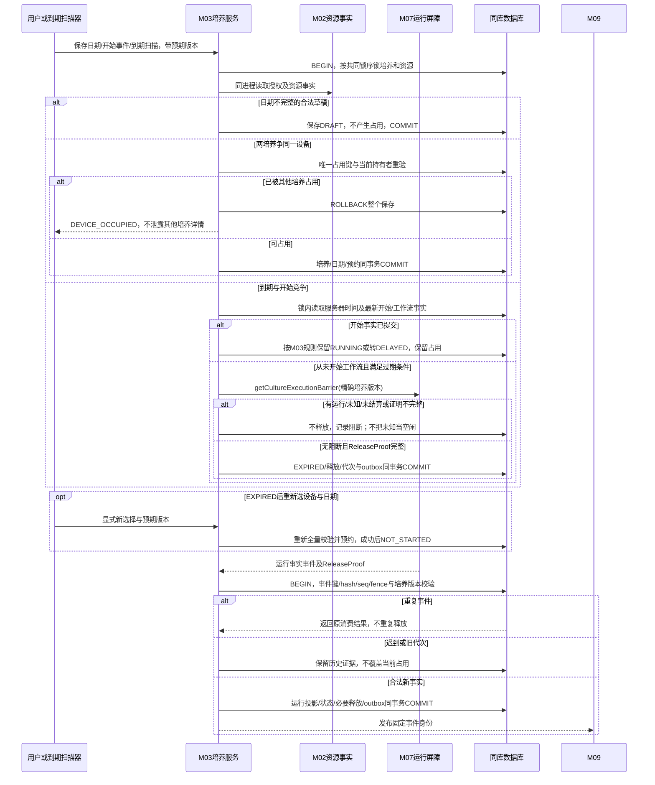

# 培养七态与占用释放

契约版本：DD-20260913-R2。依据[运行事件资源释放与延期收尾契约](运行事件资源释放与延期收尾契约.md)及所属模块接口定义。模块标签表示应用职责，不强制拆为独立微服务。本图为设计规格，未执行联调。

DELAYED持续占用；FINISHED/CANCELLED不单凭状态名释放真实资源。结束培养仅限本期模拟，不新增生产结束操作；精确到期判据采用M03现行规则。

## 验收断言

- 正常路径按固定身份只产生一次业务生效。
- 在每个提交前后注入响应丢失／重启，恢复后保留原身份及不可变证据。
- 同键异载荷、旧版本、无权限与依赖未知不得返回虚假成功。
- 图中物理与外部调用在事务提交后；同库业务调用不擅自改为远程RPC。
