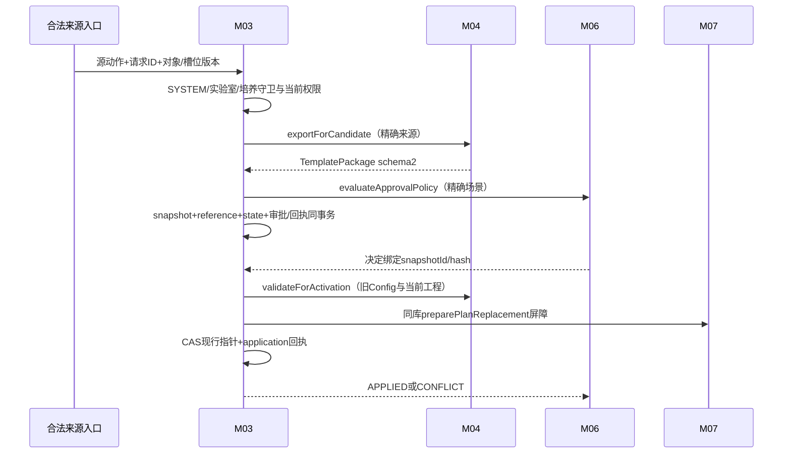

# M03 培养参数快照与审批生效收尾契约

2026-09-10。补齐M04固定包的M03物理落点、历史引用及应用回执。最终18表254列，原13表170列基线保留，新增5列和5表79列；见[完整字典](收尾后完整数据库字段字典.md)。新增表不替代res_culture、M04模板版本、M06审批或M07执行表。十二月目标已纳入Config、灌注、自动控制培养预设及完整工作流；下述FEEDING专用Port/路由仍只承接其原用途，其他类别须按当前范围补齐契约，不能借此直接复用补液任务替换算法。内部服务存在不代表其他入口获准开放。

## 1. 三类版本与稳定槽位

固定泵来源回显使用 M03-P04 专用只读用途 `M07_PUMP_CONNECTION_SOURCE_READ`，仅允许 FEEDING；按当前可信用户校验培养对象范围与实验室查看权限，不授予运行或修改资格。读取精确节点和期望代次，校验生效快照、状态回执及 M04 固定包摘要，再与页面回显的方案身份、设备和包摘要核对。该用途不核验不可变 application 原件，不能作为 SC026 写入或设备安全准入证据；相关接口运行与浏览器验证须另行记录。

台式固定泵决定生效时，派生 FEEDING 包须在计算包摘要前按已确认的培养基与耗材 ID 读取 M02 资源并固化快照，糖属性和浓度用于后续生成任务；来源修订取本次已锁定的 SYSTEM 管理修订，未知的耗材下限保持 null。资源采集时间取本次应用时间；原方案和审批原件不改写。普通补液方案单独保存的资源快照和任务运行字段对齐仍须另行完成。

### 2026-10-24 RULE 执行时原件读取

`CultureGenerationFactsPort.readFactsForExecution` 是独立于生成预估的窄只读入口。请求固定原任务、培养、实验室、补料快照、代次和包摘要，且必须处于该任务的 `M07_RESOURCE_CLAIM`、已持有 SYSTEM 锁的真实事务。M03 从原补料快照解析工作流节点，再重验同节点现行 FEEDING 槽、不可变包、唯一 APPLIED 回执及适用 SAMPLING 槽。连接工作流实例 ID 不能当作节点 ID。读取初始重量时保留重量版本、候选和生效时刻；取样映射通过 M04 `decodeForExecution` 校验原包。缺原件或版本变化阻断，不借生成用途、不反锁培养、不写新候选或生效回执。M07 随后核对本方认可量账和 M05 当日有效结果；本端口不决定补量、不扩大批准目标。

### 2026-10-24 中试结束培养Config只读用途

新增`PilotEndCultureConfigPort#read(PilotEndCultureConfigQuery) -> PilotEndCultureConfigView`，提供方`M03PilotEndCultureConfigService`，消费者仅中试`PilotEndCulturePumpDisplayService`。可信actor、labId、cultureId、reactorId及expectedCultureVersion由启动服务构造，M03复用当前培养操作范围和版本，限定培养已选节点的CONFIG生效指针；无生效指针返回明确空config，不创建方案。唯一生效来源继续调用M03-P04，固定`M07/M07-END-CULTURE-DISPLAY`且templateKind仅CONFIG；不冒用M07-017或扩大M07-022/023的FEEDING语义。未唯一定位时拒绝选包，不按节点顺序、模板更新时间或名称合并决定。

P04沿中试既有PilotWorkflowCultureAccess核验当前会话与操作资格，并完整核验槽位、不可变快照、应用回执、代次、捕获设备及M04摘要。旧候选等待审批/驳回不抹去仍合法的effective_snapshot_id，不以apply_state=APPLIED筛掉有效旧方案。只读不更新参数或审批，不暴露完整包给浏览器。V4.2规定培养单选Config模板并保存最终表单，同培养Config功能泵与补液固定泵冲突时先提示，操作人确认后采用后修改的配置，取消保留原配置（原生第1问）；不采用补液永久优先或先配永久占位；本出口不新增多Config名称合并业务或代替上游方案冲突校验。

### 2026-10-20 中试候选及启动读取来源登记

用户明确授权本任务补齐必要提供方与用途登记。新增精确组合：调用 Bean `PilotWorkflowCandidateService` 固定来源 `M07/M07-022`，以及 `PilotWorkflowStartService` 固定来源 `M07/M07-023`，templateKind **仅 FEEDING**，分别用于中试连接补料单元候选核验和守卫事务内启动重验；不开放 P02 生效或任意模板读取。来源由公共应用服务分派固定，浏览器不能提供 actor/sourceAction/templateKind。M03-P04 对这两项用途使用 `PilotWorkflowCultureAccess`：当前会话身份、培养可见、实验室 OPERATE 与管理资格或项目/批次/培养三级有效 MEMBER（allAccess 沿现有权限语义）；SHARE 不作为操作资格。其他既有用途的范围规则不改变。

仍精确校验槽位、期望代次、不可变快照、应用回执和 M04 包摘要；候选读取再匹配捕获设备种类/ID与当前主设备。无合法生效指针是候选不可选原因，已有指针但事实损坏/代次冲突不得伪装成未配置。提供方不创建现行方案，不因新增用途宣称 M03-P02 已实现。

2026-10-23补充小试W03消费者：`BenchConnectionCandidateService`复用已登记的`M07-022/023`，仅读取`FEEDING`，允许当前设备为`BENCH_CONTROLLER`；中试仍为`INTEGRATED_REACTOR`。两类均保持上述当前操作范围、精确槽位、生效代次及捕获设备一致性验证，不开放其他templateKind或绕过授权。W03候选和启动锁内使用同一准入链，并核验真实开始培养完成实例及已有W03防重；此扩展不创建生效方案或物理执行。

### 2026-10-11已有任务的方案边界

用户确认已有任务固定创建时版本，新任务采用当前合法生效版本。M03保存候选、新模板版本或新方案，不自动修改M07已有任务。明确执行“应用/替换方案”时仍须走既有审批、生效回执与M07替换屏障：旧未开始任务取消/失效后新建，不能覆盖旧任务；物理已开始/暂停/UNKNOWN保持原方案并按安全前置处理。

M03是培养lab/project/batch归属和关联工作流槽位事实的拥有方，工作流节点/templateKind定义仍归M04。最小归属查询与M03-P04精确槽位读取分开：M03-P06 `CultureOperationFactsPort#resolveCultureOperationFacts`输入由服务端固定的sourceModule/sourceAction及单个cultureId，以当前会话操作者逐次核验操作范围，返回同一M03读投影的cultureId、labId、projectId、batchId、cultureObjectVersion、planVersion、runtimeVersion、lifecycleState、主设备及计划日期。授权失败/无对象统一404，事实缺失503；它不返回成员来源、不代替M07运行/方案/资源准入，也不放宽CultureReadEligibilityDecision脱敏结构或逆用设备到培养解析口。

M03-P04保持现有EffectivePackageQuery的可信sourceModule/sourceAction、cultureId、workflowNodeId、templateKind、expectedGeneration输入。EffectivePackageView已经承载snapshotId、parameterGeneration、packageHash、TemplatePackage、捕获设备与activation；不为补一个已有字段重复改Port。消费方把输入槽位与输出快照/代次/摘要共同绑定，提供方必须验证同槽位和生效回执。parameter_generation是槽位内代次，不是全局版本；读取res_culture_parameter_state及不可变res_culture_parameter_snapshot/res_culture_parameter_application形成同源投影，不存在名为res_culture_parameter的承载表，也不凭读取需求额外新建组合唯一索引。

M03-P03/P04已按现有字段接线只读实现：P03仅在可信查询完整时区分精确NOT_FOUND，同决定键异摘要返回冲突，持久回执正文缺失、损坏或与不可变索引不一致时失败关闭；P04逐次核验登记的M07用途、当前操作者对象范围、槽位代次、生效指针/快照/应用回执同源，并经M04-SVC03重验包摘要，缺生效指针/槽位/包时显式拒绝，不返回空包/默认版本。2026-10-15 新 P01 已写入可复核的候选信封和独立 candidateHash，来源阻塞已在源码消除，禁止用 decisionHash/requestHash 替代；APPROVAL 路由已将完整 M06 审批快照和精确候选身份提交并回写审批单 ID，新增列尚未执行到环境。M03-P02生效仍未接线，后续须完成 P01 的 DIRECT 编排、M06 决定按候选类型路由、P02 生效事务和 M07 新旧任务替换收尾（READY 不等于 APPLIED）。因此P03只能查询已存在的合法决定回执，P04只能读取已存在的合法生效事实，二者均不会自行创造现行包。M03-P06已与PKG-00物理签名同批登记，不改共享HTTP DTO。当前证据层级为源码实现及契约测试；MySQL/HTTP/浏览器未验证。

#### 2026-10-11第三轮：可信调用来源

sourceModule/sourceAction是服务端声明与受信来源的交叉核验字段，不是授权凭据。HTTP调用由应用入口在认证后根据固定契约ID映射来源，操作者从已验证会话获取；Body/Query中的同名来源字段拒绝，不能透传。后台调用从公共ResourceTransactionContext取得已登记调用者/用途，跨服务将来需独立认证与固定来源适配，不能因字符串相同放行。M03在PKG-00登记允许调用Bean、契约ID/后台用途、允许templateKind和培养操作范围的精确矩阵；矩阵外组合403 FORBIDDEN，身份服务不可用503 AUTH_DEPENDENCY_UNAVAILABLE，未核验范围不返回包。端口适配器必须验证声明等于可信上下文来源；不能只检查非空或任意sourceModule==M07。

P04及归属查询是只读调用：合法HTTP查询使用已验证会话和固定入口映射，不要求GuardCallbackContext，不锁SYSTEM、不递增管理版本；合法后台只读调用使用核准调用Bean的固定用途和领域身份，若已处资源事务则加入其读视图。P02生效另按原管理/审批事务合同执行，不能借P04查询权限进行生效。输出槽位、快照、代次和摘要均从同一生效事实投影，期望代次冲突按既有版本错误处理；查询来源、越范围、伪造来源和P02/P04权限不互通必须同批测试。该来源矩阵属于work2接口窗口交付，不新增客户端自报身份字段，也不重复扩展EffectivePackageView。

res_culture.plan_version仍是日期/预约版本，runtime_version仍是运行事实版本；参数使用独立parameter_generation，不互相冒用。槽位=(cultureId,workflowNodeId,templateKind)，每槽唯一parameter_state。不可变snapshot保存完整M04包及来源、前版、捕获时对象/计划/设备、Config基线、操作者/请求和原因；state仅保存现行/活动候选指针与版本；parameter_application保存每次决定最终回执，不能被下一候选覆盖。

新候选snapshotId不重复，previousSnapshotId和baseEffectiveSnapshotId必须属于同培养槽位；灌注baseConfigSnapshotId必须同培养、当前设备、合法已生效Config。M04来源禁用/删除不改变已经提交的候选包；尚未提交预览无引用，取消预览不留假快照。来源当前名称与当时nameSnapshot分别展示。

res_culture_workflow_reference记录SNAPSHOT/WORKFLOW_SELECTION/LEGACY_VERIFIED真实引用；引用key=SHA256(sourceKind,sourceStableId,labId,nodeId)。成功保存候选即有引用，即使之后驳回/撤回/培养逻辑删除也保留。只有经过核准的真实历史引用更正可经审计修正，不能为通过实验室流程清空而删引用。批量首次成员规则不使用此表；历史权限继续M01/M02/M03现有关系。

## 2. 候选提交与精确决定

### 2026-10-24 补料 APPLY 生命周期复核

首次应用补料候选时，锁内读取的培养生命周期只接受正式七态中的非终态：`DRAFT/NOT_STARTED/RUNNING/EXPIRED/DELAYED`；仍须同时通过原候选、对象/计划/设备版本、权限、M04固定包和M07替换屏障校验。`FINISHED/CANCELLED`、空值及不属于正式枚举的状态均阻断，不取消旧任务、不切换参数指针、不写成功应用回执。`ENDED/ARCHIVED/IN_PROGRESS`不能当作新系统状态的别名。已提交成功的同一决定依不可变原回执重放，不因培养随后结束而重复生成任务或重新应用指针。状态取值依据本模块《详细设计》§3及现行培养DDL；本条不赋予设备启动或资源释放资格。

### 2026-10-15 用户确认：候选摘要来源与 P02 实施合同

本节补齐此前 candidateHash 来源阻塞，属于已确认的实施设计，不表示 P02 已接线。`packageHash` 继续由 M04 对完整 TemplatePackage 计算；`candidateHash` 由 M03 对不可变候选信封独立计算；M06 决定摘要与管理请求摘要保持各自语义。

候选信封 schemaVersion=1 的必需键为 `{schemaVersion:1,candidateKind:"CULTURE_PARAMETER",cultureId,workflowNodeId,templateKind,snapshotId,expectedSlotVersion,packageHash}`。ID、槽位版本均为规范十进制字符串；首次不存在槽位时 expectedSlotVersion 明确为 null，已有槽位取锁内实际版本，不能把调用方漏传等同于新槽位。packageHash 为64位小写十六进制。按对象键字典序、UTF-8、无额外空白、保留显式 null 的规范 JSON 计算 SHA-256；摘要不包含 candidateHash 自身、审批结果、requestId、操作者或时间。固定包的规范化仍使用 M04 实现，不在 M03 重算另一份包摘要。

P01 在分配 snapshotId、锁定槽位及验证 M04 固定包后，先生成信封及 candidateHash，再调用 M06 判策。M06 ChangeSnapshotRef 的 candidateId 指向该 snapshotId，candidateHash 使用信封摘要，ownerSchemaRef 固定为 `M03:CULTURE_PARAMETER_CANDIDATE:1`；其 candidateVersion 为本次挂候选后将写入的槽位 object_version（新槽位为 1），不是 parameter_generation。`snapshotPayloadJson` 必须是 M03 基于该固定身份和培养祖先事实构造的完整 M06 `ChangeSnapshot`：逐项回显 candidateId/version/hash、ownerSchemaRef、影响和 relatedCulture，供 API10 严格解析及审阅；不得用原始候选信封或 M04 包正文冒充该审批快照。原始候选信封只持久化在 `snapshot.candidate_identity`，作为 P02 复算 candidateHash 的唯一身份依据；审批快照不是第二个摘要来源。完整 TemplatePackage 保留在 snapshot.template_package，审批详情通过拥有方候选读取核验信封及包，不信任客户端组合。

持久化实施要求：在 res_culture_parameter_snapshot 增加 `candidate_identity JSON` 与 `candidate_hash CHAR(64) CHARACTER SET ascii COLLATE ascii_bin`，两列必须同时有值或同时为空；新 P01 必须写入且只允许 INSERT。candidate_identity 保存完整信封（含捕获时槽位版本），P02 读取后复算摘要并逐项核对既有槽位身份、snapshot_id 和 package_hash。该列设计须与模块目标 DDL、字段字典、开发基线及来源摘要在实现批同步更新；本文登记不等于数据库已加列，禁止仅发新版代码让旧库报缺列。

历史两列为空只表示旧候选，不能从当前槽位版本重建当时 expectedSlotVersion，也不能改写已进入 M06 的原 candidateHash。只有不可变原证据确实保存全部信封输入时，才允许经独立核准维护流程补齐，保留原审批身份并核验 M06 是否绑定同一摘要；已审批身份不同或缺原槽位版本的候选保持不可生效，通过原流程撤回/作废后重新提交。不得在普通 P02 请求中自动回填，不能把字段 NULL 当作通过条件。

P02 不增加客户端 candidateHash 输入，始终从候选持久化读取。可信 M06 决定或 P01 DIRECT 内部编排必须验证 snapshotId、packageHash、policyEvidence、原候选摘要及决定身份同源；DIRECT 同样需要真实豁免证据。P01 的 APPROVAL 分支必须同事务建立 M06 审批单并绑定候选；仅返回 PENDING 且没有审批单属于待接线，不能当作完整审批流程。

P02 的实现顺序为：原决定键回执重放 → SYSTEM/实验室及培养/槽位锁内核验 → 固定信封和 M04 包复核 → 当前权限、对象/计划版本、设备、旧现行和适用Config基线验证 → 仅FEEDING执行已定义的M07替换编排 → 槽位CAS与不可变application回执。候选保存及DIRECT在其原事务锁定并消费当前政策；已经形成的普通审批决定消费原冻结政策，不再次调用仅限候选来源的政策锁或按当前政策重算审批结果。DISCARD只清本候选，不改现行；同决定键异摘要返回冲突。旧决定重放返回原回执，不按新候选覆盖旧结果。所有同库状态、审批、引用及适用任务变更同事务提交或回滚，设备I/O不属于该事务。

FEEDING调用M07 `preparePlanReplacement`的READY仅表示屏障准备完成。若返回时尚未取消/失效旧未开始任务及其待审候选、建立新版本任务身份、完成屏障收尾，则该分支P02不得返回APPLIED或单独提交新现行指针。现有已开始、暂停、UNKNOWN或未结算执行阻断其切换；设备动作不在此事务内发起。不将这一补液算法复制给CONFIG/PERFUSION，不以早期七配置页排除记录覆盖当前已纳入的培养预设；其余未批准入口仍不开放。

验收必须覆盖：同包不同培养/节点/模板类型/快照/槽位版本摘要不同；null与缺键、非法ID/版本和未知字段拒绝；M06判策引用与实际落库信封一致；信封或包篡改拒绝；旧候选不伪造回填；同决定重放不改新指针；M07屏障或任务替换失败时整组回滚；DIRECT与审批分支均有真实最终回执。SQL、HTTP、浏览器及设备验收独立记录。

在同库部署下固定锁序SYSTEM→lab→M06政策→培养/参数槽→来源节点/模板按ID→审批单→M07运行/任务及资源固定顺序；任何持有来源锁的调用不能反向再取SYSTEM。事务内只调用同进程仓储/校验，不等待设备网络。将来跨库必须改为持久化编排及对账，不能把当前原子设计直接拆RPC。

提交先校验原入口在本期允许、身份/功能/实验室与状态、日期及设备、固定包hash，再判断M06政策。草稿/未开始/已过期仅已允许修改走明确DIRECT豁免；进行中/已延期的合法操作按政策，缺政策BLOCKED。方案初始未配置与普通修改分场景映射，不能用任意planKey绕审批。changeKey=PLAN:{cultureId}:{workflowNodeId}:{templateKind}，同槽已有待审或已通过待生效/UNKNOWN禁止新候选。

需审批时候选、引用、state=PENDING及M06审批单在同事务提交；DIRECT也写精确豁免policyEvidence与application，不将approvalId=NULL当豁免证据。审批通过只表明决定完成。APPLY重新核验snapshotHash、对象/日期/设备/旧现行代次、Config基线和工程资料，全部合法才切effectiveSnapshotId、generation+1并写APPLIED回执；候选清空但history引用不删。DISCARD不动现行，只清活动候选并写DISCARDED。冲突写CONFLICT，保留旧现行，不自动合并或替换成最新模板。

decisionKey=M06 approvalId+decisionVersion或DIRECT稳定请求键，decisionHash不一致409。重放同决定从parameter_application返回原结果，即使该槽后来已有新候选，也不回写旧指针。application含scope、policyEvidence、精确candidate/hash、前后指针与代次、发生时间和原因；新旧数据同时提交，回执失败则业务也回滚。

## 3. M07替换屏障与运行消费

只对M03已授权允许替换的参数应用调用M07；下述取消/重生成屏障仅是补液方案既有算法；新增Config、灌注、自动控制不据此统一取消任务。自动控制方案经原校验及适用审批生效后自动更新监控规则，不要求重跑工作流。影响任务的方案切换在同培养守卫下设plan_barrier_state=REPLACING，枚举旧snapshot所有未开始补料/补糖（含待审候选）并取消，失效M06候选，生成新版本固定任务；现行指针、屏障、旧任务取消和新任务生成身份在同库事务提交。存在EXECUTING/PAUSED/UNKNOWN或任何未结算物理事实则本次应用CONFLICT/BLOCKED，不先切指针再停泵。

M07 prepare返回{barrierVersion,oldSnapshotId,newSnapshotId,affectedTaskIds,blockingTaskIds,resourcesVerified,issues}；仅同事务内部使用。失败整次回滚，旧方案继续有效；发布后scheduler只读OPEN屏障及与effectiveSnapshotId一致的固定包。新的动态规则版本不重置M07每日稳定ruleId额度，旧已创建/取消/驳回任务仍占一次；不借方案替换重建同日额度。已执行任务保留当时包、工程与物料，不由新现行指针解释旧量。

非任务性Config生效只改变业务现行设置，不发送设备命令；M07执行时按该动作需要的能力/当前自动模式/读数/占用重新检查。配置生效、审批通过、命令ACCEPTED、物理EXECUTED分别显示，不能以PASS配置校验当作开泵票据。

## 4. 五个内部方法与详情

Header沿M01当前身份/管理版本；ID与版本字符串、时间UTC ISO；HTTP不新增通用“应用任意模板”接口。

| 方法 | 完整输入 | 完整输出 |
| --- | --- | --- |
| M03-P01 saveParameterCandidate | actor由会话,sourceAction,requestId,expectedCultureVersion,expectedPlanVersion,expectedSlotVersion\|null,cultureId,workflowNodeId,templateKind,templateId,expectedSourceVersionId,expectedSourceObjectVersion,reason\|null | {snapshotId,packageHash,stateId,slotVersion,parameterGeneration,approvalId\|null,outcome:PENDING/APPLIED,issues:[{path,code,message}]} |
| M03-P02 applyParameterDecision | decisionKey,decisionHash,approvalId\|null,decisionVersion,decision:APPLY/DISCARD,snapshotId,packageHash,policyEvidence:第5节结构 | {applicationId,outcome:APPLIED/DISCARDED/CONFLICT,snapshotId,effectiveSnapshotId\|null,parameterGeneration,slotVersion,handledAt,issues} |
| M03-P03 queryParameterApplication | 可信M06身份,decisionKey,decisionHash | 原P02结果或{outcome:NOT_FOUND}；NOT_FOUND只有查询完整可信时返回，依赖故障503 |
| M03-P04 readEffectivePackage | 可信来源模块和action,cultureId,workflowNodeId,templateKind,expectedGeneration\|null | {snapshotId,parameterGeneration,packageHash,package:TemplatePackage,deviceAtCapture,activation:ApplicationReceipt}；运行使用必须M03对象授权与M07资格，不暴露给普通模板查看人 |
| M03-P05 WorkflowReference.checkRemoval | 可信M04调用,actorContext,labId,nodeIds[],managementRevision | {complete:boolean,results:[{nodeId,hasAnyCultureReference:boolean}]}；包括全历史，无培养明细；未知503不能complete=true且全false |

源页面已有初始化/修改操作复用P01。详情线框：现行参数版本→当前候选及待审批/冲突标签→与现行差异（字段/旧/新/来源）→来源模板版本/工程证据→审批历史→应用历史。只读详情通过M03原培养query保护，内部完整包不原样返浏览器；无权子资源只显示有权历史快照及缺失提示，不泄露当前隐藏实例。普通输入409保留，改候选须先合法撤回再提交新包，不覆盖已审内容。

## 5. JSON与逻辑关联

2026-10-22 W01联调读取补充：既有培养级补液方案的Q31旁路应用回执在policy中持久化`route=BYPASS_Q31`和`reasonRequired`。M03-P04按已登记字段只读保留这两项，不重写旧回执、摘要或伪造M06审批证据；普通M06 PolicyEvidence不新增这两个空字段，未登记字段仍严格拒绝。该读取兼容不取消下文M06政策来源约束，也不代表新写政策证据的`mode/exemptionCode`已补齐。

template_package采用[M04工程版本固定收尾](../04-工艺与方案管理/工程版本固定与评审收尾.md)的schema2，完整包含schema1八键加engineeringBundle，hash覆盖工程包；不接受任意JSON。PolicyEvidence={approvalId:null或ID,decisionVersion:string,policyRevision:string,sceneCode:string,mode:DIRECT/REVIEW/APPROVE/REVIEW_APPROVE,candidateSnapshotId,packageHash,decisionAt:ISO,exemptionCode:string|null}；必须来自M06，DIRECT需明确exemptionCode。

ApplicationReceipt={schemaVersion:1,decisionKey,decisionHash,candidateSnapshotId,packageHash,previousSnapshotId|null,effectiveSnapshotId|null,parameterGeneration,policy:PolicyEvidence,validation:{managementRevision,cultureVersion,planVersion,configSnapshotId|null,engineeringHashes:[64hex],checkedAt},barrier:{version,oldSnapshotId|null,newSnapshotId,affectedTaskIds:[ID]}|null,issues:[{path,code,message}]}。state.application_receipt为最近投影，application.result_json为不可变历史。workflow_reference.evidence_ref={schemaVersion:1,sourceModule,sourceKind,sourceId,sourceVersion,sourceHash,recordedByUserId,recordedAt}，源身份都需逻辑存在和同范围检查。

snapshot.culture_id→res_culture；workflow_node_id→M04固定一级节点；state快照指针、application.snapshot_id、reference.snapshot_id→snapshot；approval_id→M06精确单据；source模板与工程身份通过固定包引用。snapshot前版不能跨槽/成环；当前Config必须同培养/设备且已生效。删除培养保留全部历史，不级联删除快照、引用或应用回执。

## 6. 迁移、恢复与兼容

M03原01—08基础包完成后执行09—12本次增量，13为最终空库结构。历史无当时完整模板/工程证据不能从当前模板回填。现有已运行培养若缺参数包，显示LEGACY_UNVERIFIED并阻断依赖参数的新操作，历史查询保留；受控核准使用P01同一验证器和真实旧证据，不回放审批/通知/物理动作。字段迁移成功不表示历史核准完成。

状态指针、引用、回执同库持久化；进程崩溃查原request/decision键，不重建候选。UNKNOWN审批交付先P03，精确NOT_FOUND才允许原决定重交；CONFLICT保留来源和原因。未使用回退门禁检查全部5张新表空及旧5列NULL，使用后仅前滚修复或受控恢复，禁止删审计绕过。验收见[收尾验收](history/review/收尾验收与设计完成核对.md)。

## 2026-09-11审阅收尾衔接

当前技术补充见[培养基础变更候选与生效契约.md](培养基础变更候选与生效契约.md)；完整物理结构以[审阅收尾字典](审阅收尾完整字段字典.md)及该字典链接的最新DDL为准。本文保留此前版本设计，冲突处按该补充执行。实施前必须完成领域实现、隔离迁移和对应CLOSE验收，不代表现已运行。

## 2026-10-24 补液方案唯一候选入口（用户确认）

正式生效／送审入口为`POST /resource/culture/{cultureId}/plans/feeding/candidates`，权限`resource:culture:edit`，管理动作`M03-FEEDING-CANDIDATE`，必须使用同模块读口的`X-Management-Revision`和原`X-Request-Id`。浏览器原输入为一级流程、培养／计划／槽位期望版本、精确模板／版本／对象版本及原因；2026-10-25为已获用户确认的免审批预核准准备增加原准备引用三字段，详见下节。不接受actor、lab、scene、templateKind、任意固定包正文或审批结果；prepare／材料查询／撤销仅服务于同一补液方案候选，不开放其他配置页。

服务端在 SYSTEM → lab → M06 政策根 → culture/slot 的同一事务中判权并重验原槽位。无现行快照使用 `M06_SC019 / PLAN_INITIALIZATION / INIT / M03`；有现行快照使用新增 `M06_SC048 / CULTURE_OPERATION / MODIFY / M03`。两者按场景分别选取当前合法完整政策，不借用 M07 的 SC038 补料任务修改，不从目录存在推导默认 DIRECT。政策缺失或损坏时失败关闭，不创建候选；政策自身不再要求单独核准、启用或暂停。

来源必须是 M04 精确导出及复核的补液模板版本。APPROVAL 路由同事务创建不可变参数候选和原审批单，现行方案不变；M06 真实审核/批准后经原 P02、M07 替换屏障生效。免审批路由仍须有精确豁免/政策证据及同事务生效实现，未实现时整笔回滚并明确拒绝，不能仅挂 PENDING 冒充已生效。已开始、暂停、未知执行或安全收尾未完成均继续阻止替换；安全收尾已完成的异常任务可释放设备，但同培养异常队列约束仍适用。

现有 Q31 `PUT .../plans/feeding` 的草稿/未开始/已过期直接编辑范围保持原规则，不扩展到运行中。新增入口只处理补液方案；其他配置编辑、批量工艺及连续式策略不在本次授权内。输入、政策、原件、事务、幂等、真实签批、生效屏障、HTTP 和浏览器分别验证；页面按钮或候选服务存在不代表完整链路完成。

候选HTTP回执的`APPLIED`只表示原候选当前生效；`PENDING`必须同时返回原审批单ID；`HISTORICAL`表示原请求对应候选已成为历史，不能展示为仍待审批或当前生效。页面收到缺候选ID、缺审批单的PENDING、互相冲突或未知状态回执时，保留原UUID、输入和管理版本供原请求重试，不以HTTP成功清除未知结果。展示回执后刷新当前方案，历史回执不恢复旧候选权限。

## 2026-10-24 补液候选免审同事务生效

仅对已开放的补液方案INIT（M06_SC019）和MODIFY（M06_SC048），DIRECT／DIRECT_REASON先按下节准备取得真实冻结候选，供独立生成批准核准与发布；正式P01提交必须引用该原准备。在原`M03-FEEDING-CANDIDATE`管理事务内重验准备、版本、来源及M06明确政策原件，再复用M03FeedingPlanApplyService → M04激活校验 → M07方案替换屏障／旧任务收尾／新任务生成 → 槽位CAS → 不可变application。任何一环失败整体回滚，不返回仅挂PENDING或先APPLIED后补批准的免审成功结果。APPROVAL仍提交真实审批单，等待原决定投递；不构造审批ID或APPROVED。Q31沿已有拥有方证据路径处理，本次政策端口不从生命周期或缺政策推导BYPASS_Q31。

成功 DIRECT 返回 approvalBranch=DIRECT、原 approvalRoute、approvalId=null、真实 applicationId、完成后的 slotVersion 和 parameterGeneration。原槽为 APPLIED、candidate_snapshot_id=null、effective_snapshot_id=本次候选；原任务和资源屏障仍由 M07 核验。首次初始化必须无旧现行，替换必须锚定原旧现行；均不得取消已开始任务或跨越未完成安全收尾。

M06 `DirectParameterDecisionPort.withDecision` 只接受原守卫、真实活动事务、精确申请人/请求/场景/培养/槽位/候选及当前合法完整政策，锁政策根后复用原判策。证据只能在同一同步回调中消费，拷贝/反序列化的值不能取得当前权限；回调退出或异常即清理。`requireOriginal` 仅校验已存原件完整性，不授予再次生效权限。原审批资源事务和管理事务互斥，不绑定伪造 ResourceTransactionContext。

DIRECT application.result_json 与 state.application_receipt 使用 **schemaVersion=2**：在原 schema1 字段上增加必填 `directDecision`。其精确字段为 `decisionKey,decisionHash,requestId,actorUserId,cultureId,workflowNodeId,labId,sceneCode,candidateId,candidateHash,packageHash,policyRevision,route,reason,decisionAt,managementRevision`。route 仅 DIRECT / DIRECT_REASON；decisionKey=`M06:DIRECT:<candidateId>:<requestId>`；decisionHash 为 M06 对该原件 decisionHash=null 的固定 JSON（JavaTime ISO，不使用时间戳数组）SHA-256。decisionAt 是实际判策时刻；reason、policyRevision 与原请求及当次判策快照一致，不补默认值。

原审批和既有 Q31 回执保留 schema1，且不输出 directDecision:null。schema2 必须有 M06 原件、mode=DIRECT、approvalId=null，政策/候选/申请人/请求/摘要逐项同源；未知版本拒绝。P01重放与后台生成读取不可变 application 原件，不依赖后来槽位的候选指针，不重算当前政策，不再次生成任务。本段2026-10-24的directDecision扩展本身只改既有JSON、不新增表／列或索引；2026-10-25预核准准备所需可空JSON列及PREPARED槽位阶段按后文与现行字段字典／目标DDL／开发基线同步，不据本段旧批次说明省略结构变更。

## 2026-10-25 初始化／替换后的独立生成批准与执行准备

用户已允许任务生成批准目录运行时受控更新，M03仍只拥有冻结候选、审批／豁免原件及同事务生效。M07生成批准必须来自外部独立核准文件，绑定真实`cultureId/labId/snapshotId/parameterGeneration/packageHash`，由生成专用发布通道进入`M07GenerationApprovalCatalog`；不能从SC019／SC048的批准或DIRECT判策自动构造D0、残糖确认政策、算法或时钟资格。

APPROVAL路由可在原P01候选及精确冻结来源已经提交可见后，取得目标绑定并发布独立生成批准；原M06决定及投递随后仍由P02重验原培养、槽位、M04包和M07屏障，按原事务生效并生成任务。DIRECT／DIRECT_REASON按用户确认的下节预核准准备入口取得真实候选ID和可核准材料，独立批准发布后才正式提交。准备与生效是明确不同操作：准备不改有效指针、旧任务或新任务；正式提交仍同事务生效，缺原件整体回滚，不猜未来ID、不以“稍后补批准”返回APPLIED。具体路由的实际接续证据按原开发计划登记，不用预知TEST身份替代原来源。

新方案生成后，以实际产生的taskId、任务版本及规格摘要另行取得并发布逐任务执行准备，再交原M07准入、claim、原登记双ACK和实际启动链。两个目录使用不同权限、签名域、文件schema和版本；生成批准不授执行准备，执行准备不补生成政策，任何发布也不改M06业务政策。旧snapshot／旧generation批准不能漂移匹配新方案，旧任务／父任务批准不能授新任务启动；原未决命令、安全收尾、同培养异常队列、实际停止及资源释放约束全部保留。

配置、原件持久化／历史恢复及错误处理见[M02受控部署契约](../07-补液运行与任务执行/M02受控补料写入口部署契约.md)的生成发布小节。生成批准目录本身不新增业务表、审批状态、前端装载页或默认参数；下节预核准准备的JSON列及槽位阶段按对应字段字典和DDL同步。真实SQL、HTTP、浏览器、客户接口及现场验收仍分别报告。

## 2026-10-25 免审批预核准准备入口（用户确认）

此入口解决DIRECT同事务内新snapshotId尚未对外可见、无法提前独立核准生成来源的问题。只在M06当前明确政策为DIRECT／DIRECT_REASON时允许准备，不把APPROVAL路线绕过送审。准备不等于独立生成批准、业务批准、方案已生效或执行准备；不改effective_snapshot_id、不取消旧任务、不生成新任务、不取得设备资源和命令权限。

| 方法／路径（前缀`/resource/culture`） | 权限、元数据及输入 | 返回与职责 |
| --- | --- | --- |
| `POST /{cultureId}/plans/feeding/candidates/prepare` | `resource:culture:edit`、培养对象及实验室OPERATE范围；双管理头，动作`M03-FEEDING-PREPARE`；原8字段，prepared三字段不得非空 | 同事务分配并固化真实候选、候选摘要和拟生效代次，槽位PREPARED；返回下述PreparationResult，不产生M06审批单或application。 |
| `GET /{cultureId}/plans/feeding/candidates/{candidateId}/approval-material` | 同`edit`及对象／实验室范围，仅原准备申请人读取其候选；`@CurrentManagementRevision`返回同模块当前管理版本 | 只读原准备及真实冻结来源，返回PreparationResult；不核准或生成批准文件，不改状态。 |
| `POST /{cultureId}/plans/feeding/candidates/{candidateId}/discard-preparation` | 同`edit`及范围；双管理头，动作`M03-FEEDING-PREPARATION-DISCARD`；body精确为`candidateHash,expectedSlotVersion` | 仅原申请人可撤销当前PREPARED且无审批单的原候选；CAS槽位至DISCARDED，保留原件及审计，返回原Result、applyState=DISCARDED，不改生效方案及任务。 |

原8字段精确为`workflowNodeId,expectedCultureVersion,expectedPlanVersion,expectedSlotVersion,templateId,expectedSourceVersionId,expectedSourceObjectVersion,reason`。PreparationResult精确为`candidateId,candidateHash,preparationRequestId,workflowNodeId,slotVersion,generationBinding,source,input,phase,replayed`。`generationBinding`是`cultureId,labId,snapshotId,parameterGeneration,packageHash`；`source`是原M04 `templateId,versionId,sourceObjectVersion,versionNo,canonicalHash`；`input`保存原8字段，`preparedCandidateId/preparedCandidateHash/preparationRequestId`均为null。绑定及来源均由服务端原件产生，不接浏览器自报D0、lab、actor或未来snapshotId。

当前槽位仍指向原准备时，phase为PREPARED；已经正式生效可只读返回APPLIED，其他历史原件可返回HISTORICAL／对应当前阶段。这些历史材料只供追溯，不恢复旧候选的提交或撤销权限。页面刷新后可重新读取同一原准备材料，不创建另一候选或假审批；准备结果未知时保留原准备请求UUID与载荷重放，不能换键重复准备。材料查询返回的顶层managementRevision用于后续管理写，不能沿用无关模块或写死版本。

准备后，操作方根据真实generationBinding及独立D0／残糖／算法等批准材料，经生成专用部署权限发布批准。正式`POST .../candidates`在原8字段之外必须成组提供`preparedCandidateId,preparedCandidateHash,preparationRequestId`；`expectedSlotVersion`使用准备后的当前槽位版本，其余原选择及期望来源必须仍与准备原件相符。正式提交使用自己的原请求UUID和最新同模块managementRevision，不能把准备请求UUID冒充提交请求；原preparationRequestId只用来绑定准备来源。缺字段、错候选／摘要／原请求、越权、版本或政策漂移均拒绝，不替换原准备或静默重新选模板。后端从原准备固化输入复核，不以页面缓存自洽作为通过依据。

持久化复用M03参数快照和槽位：snapshot增加可空JSON `preparation_input`，schemaVersion=1，含完整原输入及拟生效parameterGeneration，并以原requestKey／requestHash及候选摘要复核防篡改；该输入中的prepared三字段必须为null。槽位新增PREPARED只是M03候选准备阶段，既不冒充PENDING／M06审批，也不扩展M07任务的十一个业务状态。旧候选preparation_input保持NULL，不以新代码回填或推导历史准备；当前generation和有效指针只在正式P02同事务提交后改变。字段字典、目标DDL、唯一开发基线及来源清单同步记录，不新增平行准备表、量账或设备状态机。

正式DIRECT提交仍沿SYSTEM → lab → M06政策根 → culture／slot原顺序锁定和重验，再原P02同事务完成生效、旧任务处理及新任务生成；独立生成批准缺失或下游失败整笔回滚，原准备保留供原请求重试／显式撤销，不返回半完成APPLIED。随后新任务仍需其自身执行准备独立发布和全部执行门禁。具体SQL／HTTP／浏览器覆盖以原开发计划最新证据为准，本节不预填验证通过。

### 2026-10-25 原准备身份与当前提交事务的精确桥接

准备与正式提交使用不同的`X-Request-Id` UUID：M01回执查询键是`actorUserId + requestId`，同键换operationCode或正文会返回`REQUEST_CONFLICT`，不能以为操作码不同就可共用UUID。准备／正式提交／撤销各自保留自己的原UUID重放；正式提交输入`preparationRequestId`引用原准备UUID，不等于本次提交头UUID。

`ParameterPackagePortImpl.submitPreparedFeedingCandidate`先按真实持久原件核验原申请人、培养、节点、candidateId／candidateHash／preparationRequestId，读取`M03FeedingPreparationIdentity`并核验原输入及原requestKey／requestHash。通过后，内部`M03PreparedFeedingCommitScope.withOriginal`只允许当前`M03-FEEDING-CANDIDATE`原管理守卫、活动事务、同原申请人；不允许嵌套能力。绑定原snapshotId、candidateHash、cultureId、workflowNodeId、actor、原准备UUID与packageHash。后续仍锁定并复核PREPARED槽位、准备后版本、原effective指针、拟生效代次及M04原包，不以桥接代替业务检查。

桥接的`permitsContext`仅授同actor／原准备请求／培养／节点；`permitsDecision`额外要求query原requestId与sourceRequestId均为原准备UUID，contextRef=`M03-P01:<原准备UUID>`，changeKey=`PLAN:<cultureId>:<workflowNodeId>:FEEDING`，candidateId、candidateHash及packageHash精确一致。能力还须绑定同一个当前守卫引用与活动事务，并在finally清除，不能从历史材料、任意ThreadLocal或PREPARE请求取得。

M06只在正式`M03-FEEDING-CANDIDATE`守卫内形成DIRECT／DIRECT_REASON生效原件；`M03-FEEDING-PREPARE`和`M03-FEEDING-PREPARATION-DISCARD`仅可按真实登记锁政策与复核，不能触发生效、派生任务或代替M06决定。Evidence.requestId及`decisionKey=M06:DIRECT:<candidateId>:<原准备UUID>`保留原准备UUID，Evidence.managementRevision使用当前commit守卫锁定版本；当前管理回执仍绑定本次正式提交头UUID。不得为了对齐两个UUID而重写原候选、审计或历史decisionKey。

## 2026-10-26 FEEDING审批内容固定投影

P01的FEEDING候选在原提交事务内，将已通过M04导出、精确来源和固定包核验的本次原包投影到M06 `afterSections`。初始化无原生效指针时，`beforeSections=[]`如实表示无原方案；替换时必须按当前已锁槽位的 `effectiveSnapshotId`读取同培养、同一级流程、同FEEDING类别的不可变快照，核对行内schema与packageHash，并由M04以原snapshotId、原包及原摘要复核。原件缺失、不同源、摘要/schema不一致或M04拒绝时，候选及审批提交均失败关闭；不得读取当前模板拼造“修改前”或将缺失解释为空方案。历史schema1不补工程段来假装完整。

固定展示段为 `package`（schema、原来源引用及packageHash）、`content`、`bindings`、`applicability`、`workflowDefinition`、`engineeringBundle`。后五段沿M04已核验的完整五键原件递归展示全部叶子，空对象/空数组保留为显式值；字段路径沿该schema以点号和数组索引形成，限128字符，根段及M04字段树共同构成拥有方展示白名单。数值按精确字符串展示，不执行公式，不转为设备设定。未确认参数的null、原始文本和原工程证据均按原值展示，不补业务默认值或控制单位。

`diffFields`只比较上述固定路径在原before与新after中的真实值；初始化的before值为NULL，新增/删除字段分别保留NULL端，不把完整计划截取为仅差异字段。投影不产生新packageHash、candidateHash或第二份量账，不变更候选身份/schema、版本或政策。该投影仅接入本次FEEDING候选，其他模板kind维持原开放边界。

M06提交后仅保存并读取原 `apr_request.change_snapshot`。既有空快照审批不回填或用现行方案重建；如需审阅完整内容，应按原合法撤回/作废和重新提交路径生成新候选。审批页面内容齐备只表示可审阅冻结原件，不表示客户参数已核准、执行准备已批准或设备已安全收尾。实现、定向测试及新审批HTTP/浏览器证据分别记录。

原P02及M07派生仍在本次正式提交同事务内；缺精确桥接、原件不符、政策变化或下游失败均拒绝／回滚，不能降级成未核准直接生效。代码与契约对齐不代替隔离SQL、HTTP及并发验证，结果按原计划实际证据登记。

2026-10-25整体回归修正：上述内部提交Port采用单一`PreparedFeedingCandidateCommand`模型，字段精确为`command,candidateId,candidateHash,preparationRequestId`；HTTP字段、原件、身份、事务和安全语义不变。`prepareFeedingCandidate`沿用原`ParameterCandidateCommand`。两方法物理签名及HTTP_ONLY来源同步PKG-00；不为多参数实现添加通用例外。

### 2026-10-26 M03-P04 的 Q31 原回执兼容

activation.policy 保留原来的联合语义：普通M06 PolicyEvidence与Q31PlanActivationEvidence分别解析。Q31的schema、用途、培养/实验室/节点/快照、包摘要及原决定身份须与生效槽位一致，再读取公共回执；输出仍保留原Q31完整结构，不转成M06 DIRECT或审批通过。服务内 typed getPolicy() 对Q31为空，getQ31Policy() 承载独立类型，JSON仍在原policy位置返回。不得通过忽略未知JSON字段来混合两类证据；M03GenerationPlanAdapter 仍按原不可变应用行、独立核准及目录发布规则核对，读取兼容不授予任务生成或设备启动权。

## 2026-11-07 Config/灌注既有P04用途补齐（设计，未编码）

保持EffectivePackageQuery/View原签名，不新增HTTP、DTO字段、类型或状态。M07-022候选和M07-023启动的既有`RunWorkflowApplicationApplicationServiceImpl`在当前已认证入口中，依据M04实际定义和M03已选槽位固定CONFIG或PERFUSION，扩展现有可信Bean/用途矩阵；浏览器提交的templateKind/sourceAction不作为授权依据。
M03按本培养真实实验室/当前操作范围、已选节点及精确templateKind验证，CONFIG/PERFUSION只允许其对应流程，原FEEDING用途不放宽。候选只读与启动锁内读共用同一槽位/固定包校验；仍重验expectedGeneration、捕获设备、当前effectiveSnapshotId、不可变快照及合法application回执，经M04解码核包。
无生效包返回既有FACTS_UNAVAILABLE/配置未完成类结果，不回退最新模板；越范围按原NOT_FOUND/权限外壳。P04不创建生效方案，不发送设备指令。M07-024—026使用已冻结本实例/槽位的可信来源时逐次核验；具体已有用途未登记不得借022/023名义绕过。
实施需同步提供方用途矩阵及消费方Config/灌注分派，覆盖错templateKind、错节点、旧代次、不同设备、无application及当前失权；本轮只设计，源码当前022/023仍只允许FEEDING。

## 2026-11-07 CONFIG P02本地生效审计

普通CONFIG审批决定沿原ParameterPackagePort.applyParameterDecision应用，仅切换本培养原参数槽并保存原应用回执，不发送设备命令。原八列槽位前后像使用具名技术审计操作M03-P02（ManagementOperation.M03_PARAMETER_APPLY），UPDATE原res_culture_parameter_state，RES_CULTURE/OUTCOME_ID绑定真实cultureId；字段为culture_id、workflow_node_id、template_kind、effective_snapshot_id、candidate_snapshot_id、approval_id、apply_state、object_version。原申请人savedByUserId及原snapshot.request_id用于审计，决定身份另沿原application/receipt核对。SYSTEM版本、槽位、应用及审计同事务；不借FEEDING操作名，不另建守卫、HTTP入口、回执框架或数据库结构。此登记不扩展Q31、DIRECT及设备执行授权，实际实现/验证见本轮B12报告。

## 2026-11-07 CONFIG与PERFUSION最终正文保存及消费补齐

本节是设计合同，不表示源码、测试、数据库或页面已经通过。依据V5.1《项目设置①》“培养方案修改”明确的“创建培养ID后”维护、CONFIG与灌注两个预设段，以及当前十二月范围、原生第1问/Q-R05和M04-Q11。主线为已有cultureId的培养自身方案：不增加创建ID前暂存、批次创建联合提交或通用“应用任意模板”入口，不把模板复制本身当作用户最终保存。培养管理和运行期工艺设置各自保留原状态/操作范围，不由本节开放运行中培养管理编辑或任意批量预设。

### 输入、读取与用户动作

| 项目 | CONFIG | PERFUSION |
| --- | --- | --- |
| 原培养资源下具名读/写 | `GET/PUT /resource/culture/{cultureId}/plans/config` | `GET/PUT /resource/culture/{cultureId}/plans/perfusion` |
| 读输入 | Path cultureId；Query workflowNodeId，必须为本培养已选的对应一级流程 | 相同要求，节点必须为灌注，不能填CONFIG节点 |
| 写入公共字段 | workflowNodeId、expectedCultureVersion、expectedPlanVersion、expectedSlotVersion（槽位未存在才为null）、sourceMode原值回显可空、sourceTemplateId/sourceTemplateVersionId（新选模板必填，保留来源时与原包一致）、expectedSourceObjectVersion（新选/更换模板必填）、reason可空；来源以服务器原有效包/本次合法选择判断 | 相同，不接收浏览器actor/sourceAction/templateKind/labId、候选ID、摘要、审批结果或设备型号证明 |
| 最终正文 | contentSchemaVersion=2及M04现行CONFIG完整content：MFC、泵、控制回路、适用工艺值；小试沿原规则无中试工艺值 | contentSchemaVersion=1及M04现行PERFUSION完整content；取样子绑定复用原BindingInput，仅`detection/sampling`、SAMPLING来源和原允许effectiveInput，禁止额外绑定/旧泵速字段 |
| 读输出 | cultureId/node、cultureVersion/planVersion/slotVersion、effectiveSnapshotId/parameterGeneration、candidateId/approvalId/applyState、原contentSchemaVersion/content、原来源身份、当前设备型号最小事实、原allowedActions与issues；未存在项显式null | 同一业务字段；另回显实际baseConfigSnapshotId，不由浏览器指定合法Config基线 |
| 写结果 | data={candidateId,approvalId或null,workflowNodeId,slotVersion,applyState,replayed}；PENDING只表示原候选及审批已提交，APPLIED必须有原生效回执 | 相同；不以模板保存、PENDING或审批APPROVED替代生效 |

读口顶层managementRevision取M03同次读取；写必须携原X-Request-Id与该revision，Header为权威，另保留三个独立对象/计划/槽版本。上述HTTP ID/版本按现有十进制字符串；expectedPlanVersion沿真实非负计划版本，无完整日期草稿可为0，不能套正ID校验或伪造1；其他对象/槽/来源版本沿原规则。数值按原内容精度，不增加默认ID、代次0或虚构单位。缺revision在前端短路；409保留编辑值、重读并显式确认；结果未知固定原UUID、版本、正文和账号恢复，不换键补发，不以新读取的revision改写旧未决请求。

未配置返回明确无方案元数据；有指针但原件缺失/损坏必须失败，不能显示“未设置”。PENDING/DISCARDED/CONFLICT是最近候选/决定状态，当前有效正文继续按真实effective指针读取。历史包按原schema解释，不自动把旧CONFIG schema1补第三路输出或重算旧hash；新编辑正文须经过本次实际输入与现行校验。

已有培养包保留同一原来源时，以该已核原件为保留基线，不因来源模板后来改版而自动替换培养正文。原合法schema3 DEVICE_DEFAULT包保留再编辑时保持服务器原sourceMode及空模板身份，原TEMPLATE_DERIVED或schema2模板包保留原精确来源；不能强迫原DEVICE_DEFAULT包重新选模板。初始化/新选来源仍按本次已确认模板选择，真正更换模板才沿M04当前启用候选、精确版本及对象版本核验。浏览器回显sourceMode不能授权创建新DEVICE_DEFAULT、拼设备默认数值，空模板ID也不是默认来源凭据；没有原合法包也未选择合法模板时拒绝。

新编辑正文仍须通过本类别现行Normalizer与当前型号条件，不复用旧包校验结果跳过本次参数校验。选择模板的查询资格沿M04原候选接口，不将模板库edit权限当作培养保存前提，也不以培养edit绕过原候选查询功能。只读标签/旧来源名称未知可显示原稳定ID，不读取新模板标签覆盖原快照。

### 来源、权限、状态和编排

读取沿原培养query与该用途当前对象/lab读取范围；历史SHARE不升级成编辑、运行或跨实验室资格。写沿`resource:culture:edit`、原培养当前成员/负责人规则及lab OPERATE，先当前资格再产生候选。功能权限、对象范围、M04来源资格均须服务端重验；GET不强造写Guard、P02不伪造HTTP会话。

CONFIG源使用具名`CultureConfigPresetApplicationService`及固定`M03-CONFIG-PRESET-SAVE`守卫；PERFUSION采用同模块对应具名预设应用/固定来源，不借CONFIG或FEEDING守卫冒用途，具体技术操作及共享来源由PKG登记。Controller只收参数/鉴权/调用；这两个真实来源应用在原事务组织本培养事实、节点及最终正文，再复用原ParameterPackagePort实现。不得新建统一所有方案的保存框架，亦不借CultureChange其他业务流程。

最终正文的目标内部物理承接明确为原`ParameterPackagePort.saveFixedParameterCandidate(FixedParameterCandidateCommand) -> ParameterCandidateResult`，仅上述CONFIG/PERFUSION来源应用调用，当前尚未编码。新命令字段为`actorUserId,requestId,sourceAction,cultureId,workflowNodeId,templateKind,expectedCultureVersion,expectedPlanVersion,expectedSlotVersion,reason,fixedPackage`，另可选`confirmedPresetConflicts`，只承认已呈现的精确原预设身份/版本及泵集合，详见本节末Q-R05；`fixedPackage`直接复用原M04 `TemplatePackage`，只接受来源应用在同一真实守卫事务内调用`freezeCulturePlan`取得并经原decode核验的固定原件，不是HTTP输入。新选/更换模板时另保留该次原`expectedSourceObjectVersion`用于来源及请求意图核验，保留原合法来源时可空；原模板ID/版本及sourceMode由固定包的source/cultureSource与服务器原有效包共同核定。不得将模板字段必填的旧`ParameterCandidateCommand`填假ID来承接DEVICE_DEFAULT，也不直接接受浏览器拼装包或hash。

实现须在原`ParameterPackagePortImpl`抽取并复用现有候选身份固化、政策判定、M06提交、reference及槽位CAS步骤；旧`saveParameterCandidate(ParameterCandidateCommand)`仍按原输入经`exportForCandidate`后交同一步骤，旧FEEDING/准备/Q31范围不变。原申请摘要覆盖本次实际最终content、绑定、选择/保留的来源、来源期望版本、培养/计划/槽版本及原因等完整规范输入，不仅比较packageHash，也不把新capturedAt等服务器生成值当作新的请求意图；原守卫仍校验完整HTTP原载荷，同UUID异意图拒绝。PERFUSION的`baseConfigSnapshotId`由该实现同事务从本培养真实已选CONFIG有效槽派生并核验，不增加客户端字段、默认值或额外hash/generation表列。

初始化按真实本槽无effective指针分别映射M06_SC017/018；修改按已有effective指针映射M06_SC036/037。不按“是否选过模板”或页面文本决定场景。允许的培养状态与当前来源入口一致；草稿/未开始/已过期按已确认合法保存边界，运行/延期按已确认工艺设置和当前实验室场景政策。日期NA的允许预设保存不升级为工作流可执行。政策合法保存即可使用，不增加ENABLED/核准前置；缺真实政策失败关闭，不默认DIRECT。

原锁序为SYSTEM→lab→政策根（仅保存判策/DIRECT）→culture/参数槽→必要来源与工作流/步骤；同类资源稳定ID顺序。P01先核真实本节点未完成，M04冻结用户最终正文为schema3培养原件，原requestHash覆盖实际正文及来源/版本，原candidateHash仍覆盖实际packageHash和稳定槽身份；不修改旧v1或历史摘要。APPROVAL的snapshot/reference/PENDING槽/M06申请同库提交；DIRECT经原DirectParameterDecisionPort在该真实守卫取得同候选原件并同事务P02生效，写原schema2 directDecision回执，不能用空approvalId/FEEDING准备/Q31代替。只产生本地参数事实，不发设备命令。

M04负责复用各自Normalizer、M02真实型号能力、原M01字典与原SAMPLING绑定冻结：PERFUSION的medium.dictType固定`smp_initial_medium`，value来自合法选项，labelSnapshot由拥有方固定，不能信浏览器标签；不把CONFIG DO Nothing规则推广到灌注。M03负责真实当前设备型号比对，原`CultureChangeDevicePort.readConfigModel`仅返回labId/deviceKind/deviceId/modelKind/modelId；小试取controller自身统一型号，中试取integrated实例型号，不挑罐体、不接受客户端models自证。完整能力仍经M04原TemplateModelResourcePort。

### P02本节点检查、冲突及原回执

P02仍在原ParameterPackagePortImpl拥有的本地应用事务完成，不新增异步委托层、预条件Port或ThreadLocal。原申请人当前资格、原候选/hash/审批、对象/计划/槽版本、当前设备及绑定型号、旧现行和适用Config基线逐项核验；同原决定先读不可变回执重放，不重新写旧指针。

CONFIG/PERFUSION允许精确正向调用原`RuntimeFactProofPort.hasCompletedSelectedWorkflow(cultureId,labId,[本节点])`，只作当前已完成事实读取，不调用替换屏障、M07实现/Mapper、设备I/O或运行资格。调用身份、节点和单元素集合均由M03服务器原件确定；不能传自报布尔值或用别的节点完成来拒本节点。P01源保存前也复用此具名读。P01原“禁整个M07包”的门禁应仅为这一个必要Port读收窄，继续禁止PlanReplacementPort及其他M07实现/表，不整包放行。

当前完成生产者在培养已RUNNING/DELAYED时可不再递增culture/plan版本，不能只靠版本比对替代该检查。提供方须在原SYSTEM→lab→culture→workflow/step顺序下，以原自有Mapper的当前读和原对象版本核完整实例/步骤；不能以后取SYSTEM锁掩盖前面已形成的RR快照。复用SELECT FOR UPDATE/原版本，不新增隔离配置、REQUIRES_NEW或新锁框架。

上述当前锁读仅用于真实保存/P02写前核验。新GET plans在原只读事务中读取正文及展示allowedActions，不为展示锁SYSTEM、推进管理revision或进入只读事务的FOR UPDATE路径；完成事实可沿同一Port的原只读事务视图展示，false不承诺后续写入仍可成功。提供方按实际只读/写事务语义使用自身对应查询，不新增客户端完成布尔、Port签名或写授权；真正保存与P02仍按原锁序重新核验当前节点/步骤。

真实本节点已完成、明确版本/当前绑定或合法依赖漂移，复用原CONFLICT槽CAS/application/原因回执/审计，旧有效指针和代次不切换，M06原APPROVED事实不撤销。坏候选身份/摘要、事实损坏或依赖故障继续按原错误失败回滚，不能catch所有异常写CONFLICT，也不能把未知完成事实当false；M06由原query取得确定原回执。DISCARD仅处置本候选不改变现行；重放不因该培养后来结束而改原结果。

CONFIG/PERFUSION的本地状态变更复用原参数八列审计；原守卫、SYSTEM递增、槽位、不可变application及审计同事务。没有设备外发、运行任务取消/重生成或新增参数状态。审计使用真实原申请人、原snapshot请求UUID及原决定身份，不创造后台会话。

### 灌注Config基线与P04/统计来源

M04-Q11只允许灌注模板缺实际培养量程完成结构保存；灌注培养应用前仍须合法Config及实际设备能力。M03从本培养真实已选CONFIG节点的有效槽中定位唯一来源，保留真实snapshotId/hash/generation和捕获设备；不能拿灌注workflowNodeId查CONFIG、按名称/顺序挑一个、取最新模板或补默认范围。优先复用自有查询，原来源缺失、多有效源、同培养/设备不符或原应用回执损坏均按原错误拒绝相关生效。P02再次核对冻结baseConfigSnapshotId与实际合法基线，漂移不自动换为新Config。

P04仍用原EffectivePackageQuery/View。CONFIG/PERFUSION按cult/node/kind、当前effective_snapshot_id及generation读取原不可变快照，并定位同身份唯一APPLIED application及原回执，核hash、来源、决定/豁免及M04 decode。最近state.application_receipt可能是后续DISCARD/CONFLICT投影，不能据此抹去仍合法的旧有效包；缺/多/坏APPLIED原件失败关闭，不按第一条/最新条猜。DIRECT schema2只对已登记的本类别真实DIRECT原件核验，不借FEEDING的Q31或固定泵派生schema3回执。

| 正式读取来源 | 资格与最小范围 |
| --- | --- |
| M07-022/023及本节前文已登记运行消费 | 仅真实已选对应CONFIG/PERFUSION节点；保留原M03当前操作/实验室范围及运行端另行准入，不把包校验当设备可执行 |
| `sourceModule=M03,sourceAction=M03-049`，未来原M03历史应用只读编排 | 先resource:culture:query及当前历史SHARE/所属lab可见交集；actor由当前会话服务端构造，不伪造M07来源或写Guard。仅本cult/node/kind/effective指针/原APPLIED application decode；无方案明确缺记录，不取当前模板，不泛化为所有M03 Bean可调用 |
| P2专用`StatisticsCultureOriginPort.readComparison`的M03同owner窄读 | 沿原统计/历史培养范围，仅读本培养当前已选PERFUSION有效包的medium.labelSnapshot及该真实snapshotId/generation；无有效槽/无指针时三字段null，合法原件中标签未知仅保留名称null、已知快照/代次仍取原值；存在指针而原件坏/多源/少回执拒绝，不回读新字典/模板，也不授予运行权限 |

同owner窄读可复用原校验与M04 decode，不为补培养基标签新增运行用途或假M07上下文。原P1/M09的StatisticsCultureOriginPort.read不因此添加M04/参数依赖。M03 source query对请求cultureId须逐项精确回执，null/少行/外来/重复不能当无方案。

### 尚需跨owner落实的最小字段与边界

M03拥有真实GET/PUT、源App、候选及P02/P04/统计只读；M04拥有CONFIG/PERFUSION最终正文Normalizer、不可变子绑定和Q11量程交集；M02仅提供当前绑定型号/能力，M01提供合法字典和当前权限；M06拥有SC017/018/036/037政策与原决定；M07仅提供当前完整完成事实和已登记真实运行消费者。共享签名/来源矩阵按PKG逐项登记，不能靠有一个Port或只有Mock原件宣称上游可用。

同培养CONFIG功能泵与FEEDING固定泵冲突继续按原生第1问/Q-R05：必须提示真实影响，确认后采用后修改配置并清理失效选择，取消不写；不自动抢占运行资源、停任务或修改原模板。该分支必须先冻结双方实际snapshotId/generation/slotVersion、pumpNos及需失效的业务字段，再将确认事实纳M03自身不可变候选（原candidate_identity可为此定义严格新版本，旧v1/hash不变）；M06 ChangeSnapshot仅审阅副本，不替代拥有方原件。无合法双方原件或失效映射时仅此冲突分支保持未接，不伪称已确认/自动让某方优先，不把内部映射缺口当新客户业务Q。不得为补此分支新增确认token、表、哈希收据或照搬补液任务替换算法。

实际存储必须区分三者：页面`culture-editor.vue`的`stagedFeeding`仅为本次表单内存，未独立落库；FEEDING预设在原`res_culture_parameter_snapshot.template_package`的`content.pumps[]`保存pumpNo、mediumId、consumable、speedSelection及resourceSnapshot，相关`content.rules.feeding/sugar[].pumpNo`与原速度binding须一并核受影响引用；培养固定泵连接则在`res_culture_pump_connection_revision.channels_json`保存channelId、pumpNo、mediumId、consumable、speedSelection、speedBinding、externalPumpId和resourceSnapshot，经其独立state指针/应用原件生效。不能把页面内存选择、FEEDING原件和实际固定泵连接视为同一可清字段。

现有`ResCultureParameterStateMapper.casClearEffectiveForDateChange`会清整个FEEDING有效指针并推进代次/对象版本，不能复用为Q-R05的单泵失效清理；`M03PumpConnectionStateMapper`现有prepare/submit/apply/discard CAS只转换原修订指针，也没有按泵清理预设方法。本规则不自动派生第二套旧方已生效新包，不清整个FEEDING槽，不改固定泵实际连接revision，不撤旧审批，也不新增联合多审批协调。

### Q-R05预设选择影响的最小持久承接（设计，未编码）

新采纳方原候选`candidate_identity`及其原APPLIED `application.result_json`记录具名`selectionImpacts`。每项最小记录旧预设`sourceKind`、真实`sourceId`，及该来源实际适用的槽位/节点/类别、generation和slotVersion，或原revision及其版本，另有`pumpNo`、服务器计算的精确失效字段路径与对应原选择值；不为不适用的身份补0、空串或假版本。来源必须指同培养的真实原预设，不将页面内存或执行占用伪作预设原件。sourceKind仅以PARAMETER_SLOT/PUMP_CONNECTION_PRESET区分上述两种现有持久源；前者冻结真实snapshot/slot/node/kind/generation/slotVersion，后者原revision及版本。不适用身份不补默认值，实际已连接/占用不能冒充合法预设。带此影响的新候选信封schemaVersion=2、ownerSchemaRef=M03:CULTURE_PARAMETER_CANDIDATE:2，沿原v1八字段仅新增selectionImpacts，candidateKind仍CULTURE_PARAMETER；原candidate_hash规范计算覆盖完整新信封。没有此影响不为形式升级旧schema，旧v1信封/hash原样读取，不补写影响。M06 ChangeSnapshot仅保存该原影响的审阅副本。

来源应用及原P01在服务器锁内从最终正文和真实双方预设重新计算冲突；失效path及原值只由服务器按原schema字段白名单提取。客户端的可选`confirmedPresetConflicts`只承认已呈现的精确来源身份/版本及泵集合，不提交任意失效字段、替代sourceKind或自报无冲突。应提示而未确认、确认不完整或多报对象不能提交；取消不写。原管理/候选请求摘要覆盖该原确认与完整最终输入，结果未知保留原UUID/载荷。PENDING期间影响不生效；原批准/DIRECT的实际APPLY在同事务重验双方仍是冻结身份、当前合法预设和同一影响集合，漂移复用原CONFLICT；匹配后仅随新APPLIED原件保存影响。拒绝/取消不写生效影响，依赖不明或原件损坏仍失败关闭。

旧不可变包/hash和现有任务原件完全保留。旧预设当前编辑回显按对该真实来源身份累计的已APPLIED影响清对应选择并提示重选；历史只读仍显示原值及已失效说明，不把编辑投影写回旧包。后续采纳方改别的值、其新包不再显示同一泵，均不能使旧被清选择自动复活；旧方重新选择并合法保存生成新原件后，按新的来源身份不再匹配旧影响。读取消费须查该旧来源身份全部适用的APPLIED影响，不能只看最新采纳方包或最近槽位回执。

精确字段沿原合法形状投影：CONFIG受影响泵以`pumps[].configured=false,values=null`清该选择；原schema2的关联`loops.ph.outputs[]`按同泵source清为Nothing形状，source/inputStart/inputEnd/outputStart/outputEnd均null，其余未受影响通道/回路保留。FEEDING受影响泵按原UNUSED形状清mediumId/consumable及speed的code/slotKey，对应速度binding与关联`rules.feeding/sugar[].pumpNo`的选择在编辑投影同步清并要求重选；不得把悬空规则投影直接保存成合法有效包。投影依原schema解释，不升级/重算旧包，不借此清固定泵实际连接的speedBinding/externalPumpId或任何执行事实。未持久的stagedFeeding仅由本编辑页在明确确认后清对应输入，不作为数据库影响来源。

在旧方重新合法保存前，受影响旧预设不能作为当前完整可执行新方案。M03-P04当前用途、M03有效方案的新生成来源及M07新workflow启动必须核同一已APPLIED影响；不能只清前端或让调用方自行忽略问题。历史只读展示与已有task执行分别保留各自原用途：已有task沿原冻结来源和物理安全核验，不因预设marker自动改、删、取消或仅以旧版本本身拒绝执行。实际已连接/执行占用仍由原同泵安全前置拒绝新操作，marker不解除该前置。此设计只复用原identity/application JSON及拥有方原读写链，不新表、状态、token、哈希收据或任务替换算法；所有实际消费者尚待实施和统一验证。
