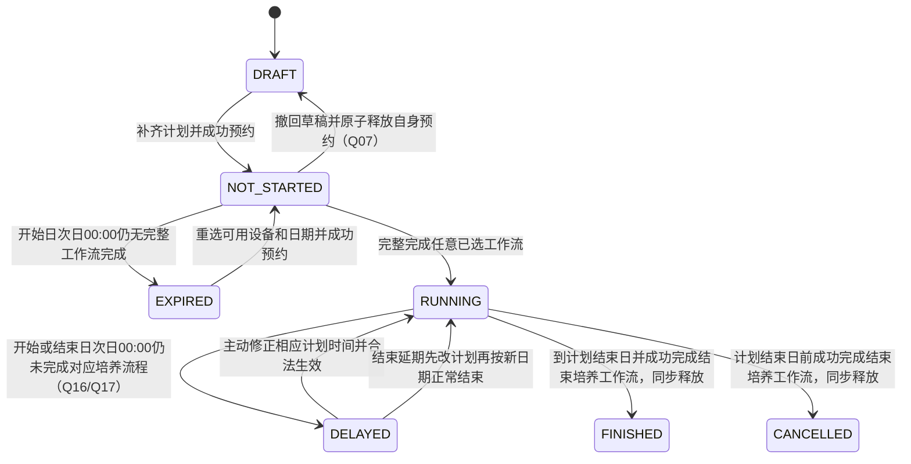
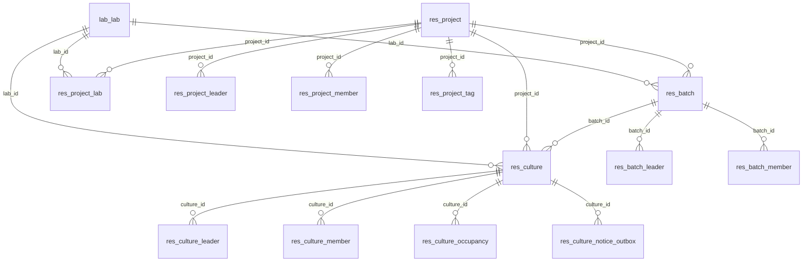
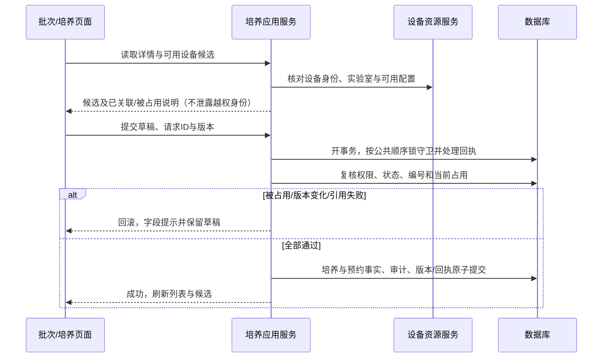

# M03 项目与培养管理详细设计

2026-11-06 用户确认批量修改新规则：同批次、同状态且计划开始与结束日期分别一致（未填写相互一致）的草稿培养可批量修改；未开始不允许（原生草稿与未开始状态补充明确替代状态范围）；进行中不可在培养管理修改。已设置与未设置工艺不可混选，全部已设置时须比较工作流程、补液计算规则及预设方案业务内容并完全一致；已选择补液时默认规则可以直接使用。设备泵数量一致性仍需核验；未分配设备的草稿允许保留空泵数。入口提示复用公共警告消息，保存时在事务内重新校验。此条覆盖下方2026-10-26仅限未开始及禁止已设置方案的旧口径；实际验证层级另行记录。

2026-10-27 单条培养修改允许先本地设置补液，再由外层一次保存。DRAFT、NOT_STARTED且未启动工作流时，CU02-W可携带顶层feedingPlan，与基础字段、补液计算规则及设备占用在同一SYSTEM守卫事务提交；补液失败全部回滚。方案提交旧培养/计划版本及独立槽版本，服务端先校验旧版本，再按修改后设备、流程、周期与新版本保存方案。只有补液时changes可空且不空增培养版本；无有效周期不自动补默认值。正文及审计边界见[接口目录与契约定位](接口目录与契约定位.md)2026-10-27单条联合保存；批量资格和独立接口不变。

2026-11-06原生“草稿与未开始状态补充”仅收窄批量状态为DRAFT；上段同批次/日期一致、已设方案业务内容一致及未分配设备草稿空泵数等已确认条件继续适用，不恢复旧“一律禁止已设方案”要求。已开始过工作流的基础直写安全屏障保持，工作流自身批量步骤不套培养管理规则。

CU01/CU02-R及批次editor-cultures共享输出 `batchEditEligibility={eligible,reasonCode,hasSavedProcessPlan,currentPumpCount}`。reasonCode沿已有枚举，在状态不符时提示仅草稿可批量；旧STATE_NOT_NOT_STARTED代码名不再解释成允许未开始批量；其余既有原因按原优先顺序取首个，不拒绝时为null。eligible仅表示该行资格，不代表任意其他行可与其组合；两个批量保存接口在守卫事务内重新验证全组身份、状态、方案事实及当前泵数。基本批量修改允许逐行换设备时，按提交后实际已选设备重查同实验室真实泵数；已分配设备的事实未知或泵数不一致拒绝，未分配设备草稿允许保留空泵数，不猜测为0。查询以SQL EXISTS和当前设备泵通道投影一次返回，无逐行方案读。中试泵数沿现有补液校验读取当前型号有效PUMP通道，小试读取当前控制器连接通道；外置泵绑定占用逻辑泵位，不额外叠加supportedPumpCount，规格文字不替代通道事实。

2026-10-26 工作流启动后的编辑门槛：以服务端 `first_workflow_started_at` 为权威，任何工作流已启动后，培养管理CU02-W/CU02-B基本修改及单条/批量完整补液方案直接保存均返回STATE_CONFLICT，提示从工作台提交原因并进入审批流程。该门槛覆盖别名、日期、周期、流程和计算规则，不局限于设备修改；不因生命周期暂仍显示未开始而放行。批量任一行命中即整批拒绝，不写培养、方案或成功审计，不增长管理版本。此门槛不代表工作台完整补液方案审批生效链已经实现；本次不修改M07或扩展其审批能力。

十二月范围已按最新确认纳入Config、灌注培养基、自动控制完整工作流及对应培养预设，pH校准/调整、搅拌/温度/通气调整、DO校准、取样测样按各自已确认入口纳入；不能继续用Q33/Q36/A3早期排除覆盖。未批准的其余配置页、独立接种字段、连续泵速等不自动恢复。详见[十二月上线范围与澄清规则](../00-范围与待核/00-十二月上线范围与澄清规则.md)。原CU02-W/CU02-B与补液批量接口、暂存联合提交的既有资格、泵绑定和事务边界保持，不推导任意配置均可批量编辑。

2026-10-23 用户确认补齐中试下游项目检测规则；新增 M03-046/047 的来源、权限、六项值域复用、项目版本及前端入口统一见[项目级检测规则配置契约](项目级检测规则配置契约.md)。反应器容量的小试专用新增暂缓；本次不重算历史检测结果。

## 开始培养专项增补（SC-20261017）

M03新增受信工作流首次登记目标，保存合并初始重量、细胞类型/中试前缀及来源；START_COMPLETED必须核验并应用，不能用FIRST_WORKFLOW_STARTED代替。开始日期当天可创建，次日零点截止沿Q16/Q17；最新业务确认两类开始培养必须当天完成，小试原实例也不得跨天续做；次日不补写完成，不自动清延期，查询与安全收尾保留。后续重量/模式/配置变更仍走原政策，不扩大首次免审为通用变更免审。

最新保存规则（2026-10-17）：小试、中试均只在第4步点击“完成”并成功提交后保存业务数据；未完成页面刷新或取消后从第1步重新开始，不恢复表单或中间步骤。操作审计和设备安全收尾保留，必须当天完成的限制不变。

步骤时间记录：四步分别记录服务端开始/结束时间及结束原因；刷新重开新建尝试，旧时间审计保留，未知结束时间不伪造。时间留痕不构成业务表单的中间保存点。

当前专题：[开始培养详细设计](../07-补液运行与任务执行/开始培养工作流详细设计.md)；实施拆分：[开始培养开发计划](../../开发任务/08-专题交付/小试中试开始培养开发计划-20261017.md)。本次仅文档补充，业务代码、数据库、设备操作均未执行。


2026-10-24 用户最新确认：反应器/控制器与培养容器必须二选一，编辑时允许切换；培养容器允许重复选择并在已有草稿关联时显示“（已关联）”。本项覆盖2026-10-13“设备与培养容器独立选择”的旧口径。批次间隔及中试下游规则不变，实际实现与运行验证分别登记。

2026-10-24 用户确认中试下游批次规则：不创建培养且不显示补料/取测间隔；批次编号旁提供引用弹窗，只能引用同项目的中试上游批次，选中后复制其编号作为可编辑初值，保存前必须改为项目内唯一编号，也可不引用而直接输入独立编号；检测规则先带出当前实验室规则，可按项目要求修改并保存到项目；成员继续沿用项目层与批次层两级设置。

## 三类实验室接入补充（INTEGRATION-20261010）

2026-10-13 M03-013/032/033 收口规则见[培养运行变更契约](培养运行变更页面与接口契约.md)、[模式与重量契约](模式与初始重量开发契约.md)及[Controller 时序](Controller请求调用时序设计.md)：FEEDING 单包承载补料/补糖；直接政策证据读写一致；审批回调先 SYSTEM 锁并复核原申请人实时资格，前置拒绝持久化冲突回执；延期解除写证据与通知 outbox。只按实际验证层级报告，不代表运行验收完成。

按[共同边界](../00-总纲与约定/00-三类实验室设备接入与执行边界.md)建立来源系统实例＋对象类型＋旧主键到新项目/批次/培养的唯一映射，不能按相同显示编号关联。映射物理承载须在实现前冻结，不修改一期旧表。

一期继续由原系统拥有的培养状态、方案和量只做兼容投影与对账，逐动作明确唯一写入方；不得让原Core与新M03同时更新同一实际量。二期/中试目标路径由M03提供生效方案版本、生命周期及占用屏障，M07固定执行规格；占用释放依赖可信终结/停止证据，不能因新页面显示结束解除未决物理动作。对应INTEG-02/04、INT-AC01/03/10/12/14。

> DD-20260917 开发补齐：B05-M及初始重量以[模式与初始重量开发契约](模式与初始重量开发契约.md)为当前开发权威；新增CU-W01/02，M03唯一写入，SC030由M03承接。旧18目标结构需叠加20增量，23为新完整参考。

> 2026-09-17 G02补充：[培养运行变更页面与接口](培养运行变更页面与接口契约.md)为运行中编号/日期变更的HTTP与页面权威。拥有方仍为M03，M07仅承载组件及原子执行影响；不再以“后续M07契约”代替公开接口。

> 2026-09-17 OBS增补：[观测时培养关联与历史修订](观测时培养关联与历史修订契约.md)新增2表23列及OBS-01—04迁移包。复用occupancy作为占用证据，不把预约时间直接当物理测点绑定；业务读取按观测时刻及历史修订解析，独立于M08。

> 2026-09-17 交叉入口补充：培养列表增加有权对象的“运行操作”入口，目标CultureOperations及稳定cultureId，见[培养运行操作页](../07-补液运行与任务执行/培养运行操作页与独立入口.md)。本模块仍拥有培养查询/变更、占用和记录时设备关联版本，业务操作与历史查询不依赖M08。当前培养读权限、原变更白名单与审批屏障保持；BD03/BD10/BD13待执行。

> 2026-09-11审阅收尾：本模块最新补充见[培养基础变更候选与生效契约.md](培养基础变更候选与生效契约.md)与[审阅收尾完整字段字典](审阅收尾完整字段字典.md)，当前目标19表276列。下文旧表数/包号属于当时基线；以最新增量包及[统一处置表](../00-跨模块审阅收尾/history/review/统一审阅收尾核对.md)为准。仅设计完成，运行验证未执行。

**当前收尾入口：[培养参数快照与审批生效收尾契约](培养参数快照与审批生效收尾契约.md)、[最终完整字段字典](收尾后完整数据库字段字典.md)、[收尾验收与完成核对](history/review/收尾验收与设计完成核对.md)。下方早期分批记录的“待其他模块设计/待补物理字段”已由本次收尾包接续；代码、真实资料核准及运行验收仍未完成，不混作设计待办。**

2026-09-10；状态：当前确认范围详细设计完成。培养参数快照、审批应用回执、全历史流程引用、运行事件与资源释放及多延期原因已收口；最终18表254列。未编写业务代码、执行SQL或完成设备/接口验证。

阅读入口：[权限服务复用与跨模块契约](权限服务复用与跨模块契约.md)、[权限矩阵与基础设计复核](权限矩阵与基础设计复核.md)、[现状核对与复用清单](history/review/现状核对与复用清单.md)、[数据库字段基线](数据库字段基线.md)、[M02契约与验收](../02-实验室与资源管理/联调与验收清单.md)。已建立范围、现状证据、状态及UI01—UI04交互，页面接口字段/错误契约见第7节，事务边界见第9.1节；基础范围目标DDL/迁移见第5/6节；基础动作角色已按Q20—Q30确认；查看范围已按Q31/Q32确认；方案快照与运行事件设计已由收尾包补齐，跨模块联调仍待实施。当前复核结论、已修正项及剩余事项见上述复核附件。

## 1. 范围与需求追踪

依据[V5.1 04-项目设置①（V4.0 第 4 章）](../../需求说明书V5.1-1030_md/04-项目设置①.md)、[最新澄清记录](../../需求说明书V4.0-0904_md/需求澄清决策记录.md)、[模块分工](../00-总纲与约定/00-业务模块划分与设计目录.md)。最新用户确认优先于旧状态图、旧字段注释及旧实现。

| REQ | 本模块责任 | 依据与边界 | 设计落点 |
| --- | --- | --- | --- |
| M03-REQ01 | 项目新增、编辑、查询、负责人、参与实验室、标签、空项目删除 | 04项目管理；项目负责人可创建批次；组织与实验室引用由M01/M02提供 | §4项目页面、§5表关系及§7.4完整基础API |
| M03-REQ02 | 批次新增、编辑、培养行管理、详情、空批次删除 | 04批次管理；项目内批次编号唯一，实验室候选受权 | §4 UI02-A—G、§9聚合写入 |
| M03-REQ03 | 培养编号、查询、别名、模式、设备选择、修改与删除 | 培养编号全局唯一但排除删除/取消；内部主键不可复用 | §2/3/5/12 |
| M03-REQ04 | 项目/批次/培养成员、历史分享、期限、继承与退出 | 成员与分享用途不同；下级不能移除上级来源 | §2权限约束及UI04-A—F；培养成员单个/批量均保留（Q13）；批次成员操作者Q14已确认；完整权限契约继续核对 |
| M03-REQ05 | 七态、预约占用、过期释放与重新预约、延期 | 澄清培养状态＋Q31/Q32；不按时间区间不重叠提前允许第二个预约 | §3、§8/9 |
| M03-REQ06 | 向M02提供未结束业务及设备引用检查 | M02 CT-01/02；培养工作流引用事实参与CT-03 | §7、§13 |
| M03-REQ07 | 培养使用方案及现行/候选快照、变更生效 | M04提供模板，M06给审批结果，M03拥有培养生效数据 | 保留接口边界，依赖模块设计后补齐；按已确认Config、灌注、自动控制及补液预设落实，其余未批准页不扩展 |
| M03-REQ08 | N阶段标记及培养模式变更历史 | A1仅外部标签；批次详情普通培养→反应器培养单向转换并记录时间 | M03保存事实，M09外部推送；具体接口待展开 |

本期不恢复删除线中的批次结束/Titer表单；培养方案按最新已恢复类别落实，不再以Q33整组排除。2026-10-16 用户确认将 M03-045 扩展为“预检自动判定＋安全确认”闭环：GET 预检根据是否早于计划结束日、未完成工作流步骤和未闭合任务建议 NORMAL/ABNORMAL，并把活动资源守卫、未决命令和未结算执行列为阻断项；POST 写入前必须重新计算并核验 M07 ReleaseProof，事实变化或未安全收口均拒绝。入口不得自动停止设备、强制取消任务或绕过释放证明；仅安全收口后 M03 才写 FINISHED/CANCELLED 并释放占用。中试完整结束专项以M07现行结束培养契约及最新三步确认落实；其他未批准外部通知不因此扩展。M05检测签批、M07实际工作流/任务/停泵、M08看板、M09告警投递各自负责。

## 2. 已有规则与数据口径

- 项目编号必填且不能重复；批次编号在项目内唯一；培养业务编号全局唯一，已删除/已取消不占用编号。内部projectId/batchId/cultureId为稳定主键，旧历史不可重新指向同号新培养。
- 项目负责人必选多选，批次负责人按正文选填多选。参与实验室按部门关联带出且可以调整；不能把默认选择视为用户自动获得实验室权限。
- 分享仅提供相应历史培养、历史检测、历史签名列表的查看/打印/导出，不能自动获得在线操作、成员管理或设备执行权限。无期限表示不限制授权期限，仍受身份/资源状态和功能权限约束。
- 继承与直接来源分开计算，下级不能删除上级来源；目标成员表已在第5/6节扩展为对象ID＋userId＋grant_type复合主键，MEMBER/SHARE独立期限，复用既有表而不新建平行权限主表。
- 每条培养在反应器/控制器与培养容器之间必须且只能选择一类：小试可选控制器或培养容器，中试可选集成反应器或培养容器；培养容器允许重复且不参与独占冲突。实际选择必须解析kind＋id＋labId并校验同实验室。
- 开始/结束时间均无值时显示NA，接口及数据库使用null，不把NA存日期列；补齐日期保存后立即占用，不等计划开始日才加锁。草稿或过期关联但不占用的设备可显示“已关联”。
- 七态采用最新叫法“已延期”，含开始阶段延误和结束阶段延误。Q31规定草稿、未开始、已过期的修改/删除不走审批；进行中修改走工作看板/对应流程，不能从批次内培养行绕过。
- Q7初始培养重量为试验人员合并录入，Q46“开始天/结束天/培养周期”用于培养天数语义，不能把计划日期与实际事件时间混用。N阶段不参与本系统业务计算。

### 预约占用的日期条件（用户明确，2026-09-09）

用户明确：“只要是输入了开始日期和结束日期 设备就算被占用了。两个缺一不可。”培养开始日期与结束日期必须同时有值，完整日期经校验保存成功即占用设备，不等到计划开始日。双方都空或缺任意一个时，草稿不能取得设备占用；若根据日期与培养周期推算补齐，按保存时的完整日期处理。设备被其他培养占用时仍必须拒绝冲突，不能仅因两个日期有值而形成重复占用。

日期齐全是建立预约的条件，不用历史日期是否仍有值代替当前占用事实：已过期按已确认规则释放，修改日期后重新检查冲突再取得预约；已延期继续占用，必须已取消/已结束才释放。已预约培养清空日期须通过Q07撤回草稿规则，不能直接将进行中/已延期的日期删空以绕过释放条件。

## 2026-11-07 V5.1培养日期与方案主责

本模块是D0/培养状态的唯一拥有方。计划周期含首尾，D0之前阶段统一D-1，之后按上海自然日差；未选开始培养仍按计划开始日算阶段，实际开始时刻可未记录。分析图相对D0和M08批次对比小数D按各自专题，不改变业务阶段。
实际开始保留开始培养操作记录时刻，D0修正不改该时刻、不拼接新日期/旧秒数；小试首次初始量是接种后实际剩余量，已包含的D-1取样不再从初始基准重复扣除（原生120/142）。培养记录列表现重量与详情方案初始量分别取原有数据来源（147）。
所有工作流执行前已有确定起止日期及容器的方案；只有草稿可在培养管理批量维护。结束培养必选且至少另选一个环节；补液/自动控制选择时必须选择开始培养，取样测样是任务不算独立环节（3/32/114）。工作流自身批量选择仍按各自步骤，不把培养管理批量限制跨用。
D0修正与任务影响见[日期变更契约](培养运行变更页面与接口契约.md)第3节；结束延期先改计划，正常结束检查方案其他已选环节有操作记录，提前取消不强求补齐；未执行任务提醒/确认后按原取消规则，执行/暂停补液先单独处理，执行取测不阻断，详见M07两类结束专题。

## 3. 培养状态与占用模型

下列英文为本轮目标lifecycle_state固定存储值，尚未执行DDL；当前culture_status三态保留，不能直接重解释。旧数据映射必须按第6节核准，运行事件来源仍须联调。

| 状态 | 进入条件 | 基础页面修改/删除 | 占用含义 |
| --- | --- | --- | --- |
| DRAFT 草稿 | 培养的计划开始/结束时间不完整，双方均空或仅填一个（Q09） | 可修改、可删除，不审批 | 不占用，不能开启工作流 |
| NOT_STARTED 未开始 | 完整日期已保存，尚未完整完成任一工作流且未到开始日次日00:00（原生30/33/34） | 可修改、可删除，不审批 | 从提交起预约占用；未开启流程可撤回草稿并释放（Q07） |
| RUNNING 进行中 | 已完整完成任意一个实际已选工作流，未命中延期/终止条件（原生第3问） | 基础页面不允许，业务变更走对应流程 | 持续占用，不因计划日期变化直接释放 |
| EXPIRED 已过期 | 到开始日次日00:00仍无任何完整工作流完成，部分步骤也不例外（原生30/33/34） | 可修改、可删除，不审批；重新选可用设备与日期 | 释放预约；重开前重新取得占用 |
| DELAYED 已延期 | 已有完整工作流完成，已选开始培养且次日仍未完成该完整流程，或结束日次日未结束；未选开始培养不判断开始延期（原生4/29/31） | 基础页面不允许 | 持续占用；必须变为已取消或已结束才释放，不能靠延期或改时间释放；告警交M09 |
| CANCELLED 已取消 | 进行中培养在计划结束日前成功完成结束培养工作流（2026-11-04确认） | 不允许 | 完成前核验安全收尾，同事务释放本培养原占用；历史关联保留 |
| FINISHED 已结束 | 按当前生效计划结束日成功完成结束培养；结束延期须先主动改计划再正常完成（原生7/9/37） | 不允许 | 同事务释放本培养原占用；仅到期或延期不进入本态 |



原需求04第746行已明确“已延期→用户延长结束时间→进行中”，本图已补齐；按合法流程延长结束时间生效，设备保持占用。原文第763行还定义开始阶段延期，但不能由此推定“迟到完成开始培养即自动恢复”；当前不加入该自动转换。Q09已确认草稿可只填一个培养计划时间，日期边界及事件/时钟优先级随技术设计细化。2026-11-04用户确认终态必须来自结束培养工作流成功完成：先核验设备停止、任务收尾和释放证明，再同事务写终态与释放；未通过时原状态与占用不变。到期、延期、保存原因或审批通过均不能代替完成。草稿关联不等于预约，模拟停稳不等于真实设备验收；设备是否可用仍检查全部当前有效占用，不仅看某个历史培养状态。

### 3.1 状态判定输入与事实来源

本节为技术设计，落实已确认业务规则，不声明事件生产方或存储已实现。日期采用Q15首尾包含的自然日周期；开始截止采用Q16开始日次日00:00；结束截止采用Q17结束日次日00:00。状态变更和设备占用分别记录，不允许用一个状态码表示所有设备执行结果。

| 输入事实 | 维护方/来源 | 使用要求 |
| --- | --- | --- |
| cultureId、逻辑删除标记、项目/批次/实验室、当前状态 | M03培养主记录 | 内部主键不复用；未知旧枚举不猜测为草稿或已结束 |
| 完整计划、计划版本、startDeadline/endDeadline | M03有效计划，Q15/Q16及Q17 | 截止基于当前生效计划，不使用尚未批准候选；不依赖浏览器时区 |
| 是否完整完成过任意工作流、已选开始培养是否完整完成 | M07可信流程实例和确认事件 | “否”和“事实不可得”分开；不能把查询超时当成从未开始 |
| 正常/异常结束结果、结束培养完成事实 | M07小试/中试结束工作流及原可信来源 | 工作流完成和释放证明均合法才同事务写FINISHED/CANCELLED与释放；不开放浏览器直接指定状态 |
| 当前占用者、预约/运行占用及释放确认 | M03预约事实，M02资源身份，M07运行释放事实 | 完整DeviceRef核验；释放仅针对当前培养自身占用，不可释放同设备的新持有者 |
| 当前用户、功能/对象权限、管理版本 | 认证上下文和M01/M03当前授权 | 打开页面时可操作不等于提交时可操作；技术事件也须校验来源身份 |
| eventId、来源、事件版本/序号、事件发生和接收时间 | M07事件及M03接收记录 | 用于去重与排序校验；具体事件叶子字段、顺序契约仍须与M07冻结 |

客户端提交的是明确动作及业务字段，不是期望写入的status。源事件缺失或矛盾时保留最近可信状态并标记待核验，设备不回报空闲；技术标记不新增第八种业务状态。后台补偿只能补读/重放可信事实，不能猜测设备已停或擅自结束培养。

### 3.2 状态转换与事务内变化

所有写入均复核当前版本和最新事实；下列事务变化包含相应审计/幂等回执。表中“保持”指不改变本次规则外的状态/关系，不能通过重复请求重复加锁、重复释放或重复通知。

| 转换ID | 原状态→目标状态 | 触发与必要条件 | 事务内变化与失败处理 |
| --- | --- | --- | --- |
| M03-TR01 | 新建→草稿；草稿→草稿 | 仅保存不完整计划，必填基础字段合法，Q09 | 保存培养及设备关联；无预约，不产生流程启动；保存失败不留部分培养 |
| M03-TR02 | 草稿→未开始 | 日期已输入/推算完整且公式一致，now早于开始截止，设备合法可用 | 原子保存生效计划并取得唯一预约；冲突整体失败，保留草稿或未提交输入 |
| M03-TR03 | 未开始→未开始 | 修改允许资料或完整计划，仍未开启流程且未到开始截止 | 重检变更后设备/计划与自身预约；需换设备时旧释放与新取得在一致性边界内完成；失败保持原计划/占用 |
| M03-TR04 | 未开始→草稿 | 用户确认Q07撤回，尚未开启流程，预约确属本培养 | 清空两计划日期，释放自身预约，保留编号/资料/设备关联；禁止周期反向自动补回日期 |
| M03-TR05 | 未开始→已过期 | now≥startDeadline，当前无任何完整工作流完成（含仅部分操作），原生30/33/34 | 状态改过期并释放自身预约；计划/设备关联保留；重读当前完整完成事实及原占用身份，不用扫描初始快照覆盖已合法完整完成或新取得的占用 |
| M03-TR06 | 未开始→进行中 | M07确认任意实际已选工作流完整完成；此前仅START/某步完成不改变培养为RUNNING | 保存完整工作流完成事实及状态，占用持续；不以按钮、启动或部分步骤替代 |
| M03-TR07 | 进行中→进行中 | 收到合法开始培养完成事件，尚未发生相应延期/终态冲突 | 保存真实完成时间，不释放设备；已延期时不复用本转换自动恢复，沿Q10边界另行处理 |
| M03-TR08 | 进行中→已延期 | 已有完整流程完成且已选开始培养，now≥startDeadline仍未完成开始培养；未选该环节不检查 | 保存开始阶段延期事实，保持占用，生成告警待投递记录；尚无完整流程完成必须走TR05，不能混用 |
| M03-TR09 | 进行中→已延期 | 已有完整流程完成，now≥结束日次日00:00且仍未完成结束培养（待审取消不冻结判定，原生44） | 保存结束阶段延期事实，保持占用，生成告警待投递记录；通知失败不改回进行中、不释放设备 |
| M03-TR10 | 已过期→未开始 | 用户重新选当前可用设备和完整有效计划，提交未过新开始截止 | 同一身份保留历史、更新计划并重新取得预约；不能恢复旧设备占用资格，冲突不影响他人 |
| M03-TR11 | 已延期→进行中 | 按延期原因主动修正对应计划时间并合法生效；结束延期须先改结束日期，原生3/7 | 保存新生效计划/变更时间及延期历史，状态恢复进行中，保持全部占用；仅保存候选/审批中不转换 |
| M03-TR12 | 进行中→已结束/已取消 | 结束培养工作流成功完成且安全释放证明合法；当日正常完成为已结束，进行中提前完成为已取消；延期按TR11修正计划并合法生效后再核验，跨期待审提前取消按Q-3-06原取消申请生效，实际结束取申请内记录时间、审批另记 | 同事务保存终态、实际结束时间、原占用RELEASED与观测解绑及回执；任何失败均不留下终态/待释放组合 |
| M03-TR13 | 草稿/未开始/已过期→逻辑删除 | 用户确认删除，当前仍允许且无不合法运行事实 | 逻辑删除并合法释放自身预约，保留历史身份；不是新增第八态，不允许运行/终态培养走此动作 |

TR08/TR09记录不同延期原因以便追溯，但业务显示仍统一“已延期”。重复扫描同一延期事实不重复产生通知。已经延期时又出现另一阶段延期事实，保留各自时间与原因、维持占用，不以已有标签掩盖新事实。告警是否合并展示和重复提醒频率由M09告警契约决定，本节不创建新的用户通知偏好。

TR11按原文保留“延长结束时间恢复进行中”；若还存在未完成开始培养等其他延期原因，后续定时判定如何避免无意义的立即反复切换，须在多原因事件规则中核对，不能悄悄删除原因，也不能自行新增“迟到完成开始培养就恢复”转换。此为事件细化缺口，不撤销Q10已确认转换。

### 3.3 并发、重试与结果不明确

| 并发/故障场景 | 技术处理 |
| --- | --- |
| 启动/完整完成工作流与开始截止扫描并发 | 在共享一致性边界重读截止与可信完整完成事实，按TR05/TR06及实际已选环节准入判定；尚无任何完整完成时，仅启动/部分操作不阻止次日过期，不得借旧预检绕过当前状态/日期或伪造截止前完成事实。已有合法完整完成不适用TR05过期分支，延期按TR08/TR09核验；各流程合法续做仍按自身契约，不额外套开始培养当天完成规则 |
| 撤回/删除与启动并发 | 任一动作先合法提交后，另一动作复核最新状态；不出现培养已删/草稿但工作流仍被新启动的情况 |
| 两培养同时预约同一DeviceRef | 最多一方成功；比较最终所有者而非只看计划日期；冲突不提交半条计划 |
| 过期释放后同设备被新培养取得，旧释放请求重试 | 以原培养/占用身份条件释放，不能删除新培养的占用；同一requestId返回原结果 |
| 结束或释放事件重复/乱序 | 按eventId及来源顺序核验；终态不被旧开始事件复活，释放确认也不能套到新的占用身份 |
| 已接收事件与查询事实矛盾/依赖不可用 | 保留最近可信结果并待核验，不猜成“未开流程/已释放”；受影响写入失败或待确认，不能报告成功可用 |
| 数据提交成功但告警投递失败 | 同事务保存待投递事实，M09可重试；不回滚业务状态，不再用通知成功证明状态转换成功 |

管理操作版本、有效计划版本、运行事件版本不能无说明复用一个SYSTEM版本值。第7.2与9.1现定义全局管理版本、对象/计划/运行版本及逻辑锁序，基础目标列与约束现见第5/6节及SQL附件，尚未执行；事件发布不能在持锁期间等待远程设备。前端只呈现服务端结果与待核验原因，不能根据超时自行释放占用或改状态。

### 3.4 状态转换验收设计（未执行）

| CASE | 覆盖转换 | 场景与预期 |
| --- | --- | --- |
| M03-ST-C01 | TR02/TR03/TR10 | 创建、改设备、重约使用同一占用守卫；冲突均不留下部分计划或提前释放原预约 |
| M03-ST-C02 | TR05/TR06/TR08 | 截止并发以可信最新流程事实区分过期释放与延期占用，不能仅看旧状态 |
| M03-ST-C03 | TR04/TR06/TR13 | 撤回/删除和启动竞争只产生合法结果，失败分支无半次释放 |
| M03-ST-C04 | TR08/TR09 | 重复扫描同一延期事实只保留一次转移/待投递记录；新增原因保留来源时间 |
| M03-ST-C05 | TR11 | 延长结束时间仅在合法生效后恢复；审批中的候选不生效，占用始终保留 |
| M03-ST-C06 | TR12 | 到期/延期但工作流未完成时仍占用；工作流完成且证明合法才原子写终态/释放；无证明、错原占用、最终CAS失败均保持原状态及占用 |
| M03-ST-C07 | TR05/TR10 | 旧培养释放请求重放不释放同设备的新占用者 |
| M03-ST-C08 | 全部 | 缺失运行事实与明确未开启分开，依赖失败不写过期/不报空闲；重复事件不复活终态 |

## 4. 页面与交互首轮

本轮继续按页面细化。UI01项目、UI02批次、UI03培养列表及UI04授权相关原图已按各节列出的范围目视核对；未逐张核验整个需求图片目录，不称全部原型验收通过。

```text
项目：编号/标签/备注 [ ] 时间类型[创建/修改] 日期[起—止] [检索][重置][新增]
      序号 编号 部门 负责人 标签 修改人 修改时间 操作
批次：关键词[ ] 项目[ ] 实验室[ ] 日期[起—止] [检索][重置][新增]
      序号 编号 别名 项目 标签 培养数量 实验室 修改人 修改时间 操作
培养：关键词[ ] 项目[ ] 批次[ ] 实验室[ ] 日期[起—止] [检索][重置]
      序号 培养ID 批次 项目 模式 容器 状态 开始时间 结束时间 修改人 修改时间 操作
```

| UI | 交互与权限原则 | 下一轮细化 |
| --- | --- | --- |
| M03-UI01 项目列表/表单 | 默认创建时间倒序；项目部门带出参与实验室候选，负责人多选；已有未删除批次的实验室不可移除（Q05），切换部门也不得间接清除这些关联；仅创建人/负责人可修改仍须功能与范围校验 | UI01-A—F已补列表/表单/查看、字段、联动及页面调用映射；成员/分享/删除/退出见UI04及第7节目标API，角色汇总见权限矩阵与基础设计复核 |
| M03-UI02 批次编辑 | 项目、部门和项目负责人联动；已有未删除培养时锁定所属项目和实验室（Q06）；培养行可新增、移除；＋1只建议编号，设备不复制；整批保存失败保留草稿 | UI02-A—G已细化字段/联动/显式培养变更/验收；周期公式Q15已确认（包含首尾），完整基础API见第7节 |
| M03-UI03 培养列表 | 默认修改时间倒序；项目切换重载批次；状态禁用操作需说明原因；批量权限不能取多个对象权限的并集放行 | UI03-A—H已细化七态操作、基础/工艺边界、成员/分享/删除/退出；开始日次日00:00为截止（Q16已确认） |
| M03-UI04 成员/分享弹窗 | 部门/实验组选择，去重用户，期限可空，“应用全部”只改当前草稿；继承项只读并显示来源 | UI04-A—F已细化来源/期限/选择器/保存与验收；培养成员范围Q13、批次操作者Q14已确认；权限汇总与剩余查看边界见权限矩阵与基础设计复核 |
| M03-UI05 过期重新预约 | 原日期/设备供查看；重新查询可用设备；提交前再次检查占用，冲突保留输入并定位设备 | 日期边界、完整接口和调用时序 |

共同行为：加载时禁提交，空数据有明确提示；关闭未保存需确认；成功刷新相应列表并保留筛选/分页。403不泄露范围外项目/实验室/创建人；409保留非敏感草稿；503不解释为空闲或成功。前端按钮隐藏不能代替服务端校验。

### M03-UI01 项目列表、查看与新增/编辑表单（2026-09-09细化）

**证据**：需求04「项目管理」正文及image228—231已逐张目视核对。以下标注“需求”的规则来自原文；Q05为用户已确认；标注“技术设计”的默认值、参数名及交互细节为本稿方案，不冒充原文业务要求。成员/分享弹窗和完整API另行展开，本节不表示M03整体完成。

#### UI01-A 列表与检索

```text
[项目编号/标签/备注             ] [创建时间▼] [开始日期 — 结束日期] [检索] [重置] [新增]
序号 | 项目编号 | 项目部门 | 负责人 | 标签 | 修改人 | 修改时间 | 操作
                                                        查看 修改 成员 分享 删除 退出
                                                      [上一页] [页码] [每页条数] [下一页]
```

原图228仅画日期区间，正文明确支持创建和修改时间，因此以时间类型选择器补足交互；原图没有退出按钮但正文有退出规则，按Q04权限条件显示。按钮并非对所有用户同时可见。

| 项目 | 控件、默认值及行为 | 来源/性质 |
| --- | --- | --- |
| 关键词 | 单行文本，默认空；项目编号、标签名称、备注三者任一模糊命中；与时间条件取交集 | 需求；正文“描述”统一对应本表单“备注”，不新增描述字段 |
| 时间类型 | 创建时间/修改时间单选，技术默认创建时间；无日期时不产生时间过滤 | 正文支持两种时间；默认值为技术设计 |
| 日期区间 | 默认空；完整区间起日不得晚于止日；只选单侧时提示补齐或清空，不提交半个检索条件 | 技术设计；此处不沿用培养草稿单侧日期规则 |
| 时间边界 | Asia/Shanghai；包含所选起止日期，服务端转换为起日00:00含、止日次日00:00不含；仅作用于选中的创建/修改字段 | 公共时间约定＋技术设计 |
| 检索/重置 | 检索回到第1页；重置清关键词/日期并恢复创建时间、第1页；修改筛选草稿尚未检索时不自动混用新旧条件 | 技术设计 |
| 列表排序 | 创建时间倒序；相同时间以projectId倒序稳定分页，不因显示修改时间而按修改时间排序 | 需求＋稳定次序技术设计 |
| 分页 | 技术默认每页10条，切换页大小回到第1页；加载失败保留筛选供重试 | 原图10条示意＋技术设计 |
| 负责人/标签 | 负责人多名用逗号分隔；标签显示字典名称；过长内容可展开或悬浮查看全文 | 需求＋展示技术设计 |
| 修改人/修改时间 | 显示真实审计值，无值用“—”；不为填满表格伪造一次修改 | 技术设计 |

项目管理模块入口在原文创建人、项目负责人和被授权查看全部者之外，按Q30增加有效项目成员的只读入口；功能权限与对象范围仍须同时满足。“查看全部”只扩大已授权的查看范围，不自动获得修改、成员管理或分享权限。普通项目成员按Q30仅查看本人有效参与项目的基础信息，退出仍沿Q04处理当前层级直接成员来源，不从列表入口推导管理权。

#### UI01-B 新增与编辑字段

```text
新增项目 / 编辑项目
项目编号*    [                         ]
项目部门*    [部门树单选              ▼]
负责人*      [按部门选人，姓名/用户名检索，多选]
参与实验室*  [实验室多选              ▼]
标签         [字典多选                ▼]
备注         [                         ] 0/100
                         [保存] [取消]
```

字段顺序与图229/231一致。新增各输入初始为空，选择部门后带出参与实验室；不擅自将当前用户设为负责人。编辑从项目详情及版本读取真实值，不重新应用新增默认值覆盖已保存的实验室。

| 顺序/逻辑字段 | 控件/必填 | 校验与联动 | 数据来源及保存去向 |
| --- | --- | --- | --- |
| 1 projectCode 项目编号 | 文本，必填 | 不重复；技术建议复用基线varchar(50)限制为最多50字符，前后空白规范化后非空；编辑唯一性排除当前projectId。项目删除后允许复用编号（Q18），内部ID和历史记录保持独立 | res_project.project_code；50字符和规范化为技术设计，原文未给具体长度 |
| 2 deptId 项目部门 | 部门树单选，必填 | 按真实部门层级展示；必须是当前允许选择的有效节点，不以部门名称作关联键；编辑切换部门仍执行Q05 | M01部门候选；复用sys_dept，保存res_project.dept_id |
| 3 leaderUserIds 负责人 | 按部门树选人，多选，至少1人 | 姓名和用户名检索，按userId去重；不因项目部门切换自动清除已选负责人；选人树不额外限制为项目部门人员，实际候选沿M01授权 | M01人员候选；res_project_leader；不能把当前页面可见范围视为任意用户授权 |
| 4 labIds 参与实验室 | 多选，至少1个 | 选部门后由部门关联实验室带出并允许调整；候选须合法且满足既有授权；Q05禁止移除仍有本项目未删除批次的实验室 | M02实验室候选和部门关联；res_project_lab |
| 5 tagIds 标签 | 字典多选，必填，至少1项 | 只能选择对应标签字典候选，按ID去重；提交前重新验证；历史已停用项需可读回显，不静默清空 | M01字典；res_project_tag；历史停用项保存规则沿公共字典约定 |
| 6 remark 备注 | 文本框，可空，最多100字符 | 显示字数及超长提示；前后端一致限制，101字符拒绝；基线列500不构成放宽需求的理由 | res_project.remark |

不将当前基线中的project_name、project_status、start_date、end_date直接增加为本表单输入，原图和正文没有这些字段；原有字段的兼容处理进入数据库章节。项目的检索日期也不是项目计划开始/结束日期。

字符长度按Unicode码点计数作为技术方案，前后端一致，避免中文与补充字符长度差异；编号比较沿现有utf8mb4_0900_ai_ci，大小写/重音等价仍判重；Q18已确认项目/批次删除后可复用，目标有效唯一键见第5.2节。

#### UI01-C 部门与参与实验室联动

1. **新增首次选部门**：查询部门关联且合法的实验室，自动填入；无候选则显示“该部门暂无可选实验室，请调整部门或实验室配置”，不自动创建实验室或授予权限。用户可按授权范围调整，至少保留1个。
2. **编辑首次打开**：回显已保存的参与实验室，不按部门当前配置重算并覆盖。候选请求失败保留已有值并禁止提交，不将失败解释为“没有实验室”。历史失效关联显示原因，按M02现行状态规则处理。
3. **手动调整后再切换部门（技术交互）**：先加载新候选，在表单草稿中展示拟带出的实验室及拟移除项，用户可取消本次切换；不得无提示覆盖手工选择。任何拟移除项存在本项目未删除批次时，按Q05拒绝移除；如新部门与必须保留的实验室关系不合法，提示调整部门，不能自动迁移批次。
4. **提交复核**：服务端根据当前保存关系与提交关系计算删除集合，复核未删除批次引用、候选合法性及权限。前端禁用和预检仅作提示；并发创建批次必须与移除实验室使用同一一致性保护。
5. **取消或失败**：表单草稿变化不即时更新项目/实验室关联；409保留输入、标明被引用实验室及当前有权查看的批次，不能因一次关联错误保存其他部分。

#### UI01-D 查看及操作条件

查看弹窗按图230展示：项目编号、项目部门、负责人、参与实验室、标签、包含批次、备注、参与人、分享给。多个值使用名称展示，内部关联始终用ID。无分享显示“暂未分享”；其余空文本显示“—”。“包含批次”采用未逻辑删除批次的数量作为技术方案，权限受限时不得输出无权访问对象的详情；计数与可见范围的统一口径随权限接口细化。

| 动作 | 已有业务条件 | 交互与提交 |
| --- | --- | --- |
| 新增 | 具备项目新增功能权限及合法字段候选范围 | 打开空表单；服务器校验后创建；不要求用户预先是尚未创建项目的负责人 |
| 查看 | 具备查看功能权限及该项目查看范围 | 只读详情；关闭返回原筛选和页码 |
| 修改 | 创建人或项目负责人，且具备功能/范围权限 | 回显表单；保持全部新增校验并叠加Q05；提交时重新判断身份，不能沿用打开时的旧权限 |
| 成员 | 创建人或项目负责人，且具备功能/范围权限 | 进入成员弹窗；详细字段、期限及继承在UI04展开 |
| 分享 | 仅项目负责人，且具备功能/范围权限 | 创建人若不是负责人，不能仅凭创建人身份分享；仅授予既定历史查看/打印/导出能力 |
| 删除 | 项目创建人或当前项目负责人，且具备删除功能权限并通过对象范围等公共校验（Q20）；二次确认且无未逻辑删除培养（Q19） | 不将“没有批次”冒充原文的空项目定义；按已确认M03-Q12提示批次后随项目一并逻辑删除 |
| 退出 | 当前层级存在直接成员关系；具体入口随成员权限展开 | 执行已确认Q04，仅撤销直接成员，不删除负责人或其他来源；退出后按剩余来源刷新 |

#### UI01-E 保存过程与反馈

页面逻辑调用标识为M03-P01—P05，仅用于本节追踪；不占用已存在的M03-API01—03内部契约编号，也不声明URL或接口实现已经冻结。

| 调用标识 | 页面调用 | 本轮明确的输入/输出边界 |
| --- | --- | --- |
| M03-P01 | 列表查询 | 输入关键词、时间类型、日期区间、页码/大小；输出列表列、projectId、分页总数和逐对象操作能力；筛选范围在服务端执行 |
| M03-P02 | 项目详情 | 输入projectId；输出表单六字段、展示名称、只读详情、管理版本和操作能力；ID按公共约定传字符串 |
| M03-P03 | 部门/人员/实验室/标签候选 | 按字段调用M01/M02候选能力；结果含稳定ID、名称和可选状态；不返回越权候选；不同字段的搜索请求不得相互覆盖 |
| M03-P04 | 新增保存 | 输入六字段、requestId；返回projectId和管理版本；真实创建人由认证上下文确定，不接受客户端指定 |
| M03-P05 | 编辑保存 | 输入projectId、六字段、管理版本、requestId；返回新管理版本；真实修改人由认证上下文确定 |

上述为页面映射，参数范围、返回模型、URL及错误契约见第7.2—7.8节；未冻结项以该节的明确标记为准。

提交顺序（M03-SEQ-P01，技术设计）：前端必填/长度校验→锁定保存按钮→提交P04/P05→服务端复核认证、功能/对象范围、编号、候选和Q05→同事务保存项目、负责人/实验室/标签关系、审计与版本/回执→成功关闭表单并刷新列表。任何失败不得留下半个项目或一部分关系。保存不产生培养、不取得设备占用。

新增成功回第1页，保留当前筛选；若新项目不匹配筛选，提示“项目已保存，当前筛选条件下不显示”，不篡改过滤条件假装可见。编辑成功保留原页和筛选；不再匹配则从本次结果移出。负责人变更后重新计算操作者剩余权限；后续操作按新权限执行。

必填/超长/重复分别定位字段，重复编号不得泄露无权查看的项目负责人或创建人。列表无数据与加载失败分开展示；加载/保存时禁止重复提交。版本冲突提示“项目已更新，请刷新后核对修改”，保留原输入供对照但不自动覆盖新数据；权限丢失不继续暴露范围外详情。网络超时显示“保存结果待确认”，重试沿用相同requestId及原提交内容，通过回执确认结果，不生成新请求重复创建。取消、关闭或离开有修改的表单先提示放弃未保存修改；未改动可直接关闭。

#### UI01-F 本节验收设计（未执行）

| CASE | 对应 | 场景 | 预期 |
| --- | --- | --- | --- |
| M03-P-C01 | REQ01/UI01-A/P01 | 关键词仅命中标签或备注，并设置修改日期 | 三字段内部取OR、时间取AND，仍按创建时间倒序 |
| M03-P-C02 | REQ01/UI01-A/P01 | 查询同一天，记录位于当日00:00及次日00:00 | 当日起点包含，次日起点排除；数据库时区转换一致 |
| M03-P-C03 | REQ01/UI01-B/P04 | 缺负责人或参与实验室；备注100/101字符 | 缺必填拒绝；100允许，101拒绝；不因列长度500放宽 |
| M03-P-C04 | REQ01/UI01-B/P04/P05 | 两人并发提交相同编号；编辑保持自身编号 | 重号至多一个成功；自身编号不误判重号；冲突不残留关联 |
| M03-P-C05 | REQ01/UI01-C/P03/P05 | 编辑项目打开时部门实验室配置已经变化 | 回显原保存值，不自动重置；保存重新验证合法性 |
| M03-P-C06 | REQ01/UI01-C/Q05 | 切换部门拟移除某实验室，该实验室存在空批次 | 即使没有培养也阻止移除；不自动删除或迁移批次 |
| M03-P-C07 | REQ01/UI01-D | 创建人不是负责人；另一个用户仅获查看全部 | 前者可按规则修改/管理成员但不可分享；后者不因查看全部获得写权限 |
| M03-P-C08 | REQ01/UI01-E/P05 | 打开后被移除负责人且无创建人身份，再提交 | 服务端按最新权限拒绝，表单打开时权限不能放行 |
| M03-P-C09 | REQ01/UI01-E/P04 | 保存已成功但响应丢失，重复提交同requestId | 返回原结果，不重复创建项目或关联；未确定结果不报告失败后另建 |
| M03-P-C10 | REQ01/UI01-E/P05 | 版本冲突或关联校验失败 | 整体不写入，保留允许保留的输入，不以刷新列表掩盖失败 |

### M03-UI02 批次列表、新增/编辑与培养行（2026-09-09细化）

依据：需求04「批次管理」第260—426、523—579行；image242/243/248/249/257已目视核对；日期交叉核对14第249—274行及原图429、21字段公式表；Q05—Q09、Q12—Q14沿用。默认值、逻辑字段名、编号复制边界和提交协议中标注技术设计的内容为本稿方案，不冒充原文已确认。

#### UI02-A 列表检索与详情

```text
[批次编号/项目标签/别名] [项目▼] [实验室▼] [修改时间▼] [日期范围] [检索] [重置] [新增]
序号 | 批次编号 | 别名 | 项目编号 | 项目标签 | 培养数量 | 实验室 | 修改人 | 修改时间 | 操作
                                                                   查看 修改 成员 分享 删除 退出
                                                                    分页及每页条数
```

| 项目 | 规则 |
| --- | --- |
| 关键词 | 批次编号、项目标签名称、批次别名内部取OR模糊匹配，与其余筛选取AND；批次表单无独立标签字段，不能由列表“标签”新增批次标签模型 |
| 项目/实验室 | 均可空，仅展示用户授权范围内候选；检索输入按真实ID校验，不以隐藏无权选项代替后台判权 |
| 日期 | 创建时间/修改时间二选一，技术默认修改时间；默认日期空。完整日期区间及Asia/Shanghai包含首尾查询日的规则复用UI01-A，检索日期不参与培养计划推算 |
| 排序/分页 | 需求按修改时间倒序；技术增加batchId倒序稳定排序，每页默认10条。旧修改时间空值不伪造审计，显示“—”，排序空值末尾作为技术口径 |
| 培养数量 | 本批次未逻辑删除培养数量；已取消、已结束等仍未删除行也计数，不等同于CT-01未结束培养数或设备占用数量 |
| 操作 | 查看按有效数据范围；修改、成员管理按Q22/Q14，仅批次创建人或项目负责人；独立删除按Q21（项目创建人/项目负责人/该批次负责人之一且具备批次删除功能权限）；分享仅项目负责人或批次负责人；退出按Q04，仅当前用户存在有效批次直接MEMBER时显示。批次内培养增删改仍逐条独立判权 |
| 返回 | 检索/重置回第1页；关闭详情/取消编辑保留原筛选与页码；修改后按修改时间重排，提示成功而不承诺还在原行 |

查看按原图257展示项目编号、批次编号/别名、实验室、负责人、审计信息，以及分页培养列表（培养ID及N阶段标识、当前培养类型、容器名、开始天、结束天、修改人/时间）。正文“开始时间/结束时间”显示名称按最新Q46改为开始天/结束天，语义仍为培养计划日期，不是D编号。

查看中的普通培养→反应器培养按原文单向切换，直接保存并记录切换时间；已经是反应器培养不能切回。小试模式固定普通培养，不因公共组件而显示转换按钮。N阶段标记/取消标记保存事实供M09推送，不参与本系统计算。两个动作分别校验操作权限/版本并审计，不因按钮位于“查看”弹窗而给予只读用户写权限；不通过整批基础保存重写进行中培养。动作API见第7.5节，精确角色已由Q28确认；M09外部投递契约仍需后续冻结。

#### UI02-B 批次表单字段

```text
所属项目* [下拉]      项目部门 [只读]      项目负责人 [只读，多名]
批次编号* [文本]      别名 [文本]          批次负责人 [人员多选，可空]
实验室*   [下拉]
[＋培养]
  培养ID* [文本]  别名[文本]  培养模式*[中试下拉/小试隐藏固定]   [＋1] [删除]
  设备*   [名称/房间搜索]     开始天[日期] 结束天[日期] 培养周期[整数]天
[保存] [取消]
```

批次新增按Q23限定为所选项目创建人或当前项目负责人，且具备批次新增功能权限及其余公共准入；仅可查看的项目不能作为可创建目标。技术初始状态为空批次表单，培养行按“＋培养”加入，可保存无培养的空批次；空批次已在需求删除规则和Q06/Q12场景中成立，不新增必须至少1条培养的约束。

| 逻辑字段 | 控件/默认/必填 | 规则与保存来源 |
| --- | --- | --- |
| projectId | 项目单选，必填 | 用户合法项目候选；进入指定项目新增时可预选该项目，仍服务端校验；保存res_batch.project_id |
| projectDept / projectLeaders | 只读 | 由项目联动，多个负责人逗号分隔；不作为批次独立部门或负责人数组提交 |
| batchCode | 文本，必填 | 同项目内唯一，编辑排除当前batchId；技术复用基线最多50字符及UI01统一规范化/计数；项目变更需重判重 |
| alias | 文本，可空，技术默认空 | 不把示意图同号例子当成自动命名规则；技术复用基线最多100字符，保存res_batch.alias |
| batchLeaderUserIds | 人员多选，可空，默认空数组 | 选择实际人员ID，去重；与只读项目负责人明确区分；保存res_batch_leader。不能因为原图两处都写“负责人”覆盖项目负责人 |
| labId | 实验室单选，必填 | 候选满足项目参与实验室与用户合法授权等既有条件；默认当前实验室仅在合法候选中才使用；若上下文不明确则技术方案为唯一候选可带出、多个时要求选择，不任意取第一条 |

Q06约束：已有任一未删除培养时，项目和实验室只读且服务端拒绝变更；涵盖草稿、已过期及历史状态。该请求内删除全部培养不能绕过锁定，须先合法删完成为空批次再单独调整归属。空批次变更时复核目标项目/实验室、批次编号以及继承权限，不自动携带旧项目继承。

新建批次或尚无持久培养的表单改变项目/实验室时，先展示对未保存培养行的影响；技术上保留编号、别名和日期草稿，清除不再合法的设备并按新实验室类型重新要求合法模式，标明需要重选。用户可取消本次切换，不静默丢弃整行或保存跨实验室设备。

#### UI02-C 培养行字段与设备

| 逻辑字段 | 控件/规则 | 已知来源/边界 |
| --- | --- | --- |
| cultureCode（页面培养ID） | 必填文本，全局唯一；技术最多50字符 | 已删除/已取消不占业务编号，其他状态都占；同一请求内新行/改号也互相判重。内部cultureId始终稳定且不可复用 |
| cultureAlias | 可空文本，技术最多100字符 | 候选映射res_culture.culture_name，不新增另一套别名列；是否保留历史列名在字段设计说明 |
| cultureMode | 中试普通/反应器培养，必选，技术默认普通；小试隐藏且固定普通 | 目标mode_code使用NORMAL/REACTOR；旧culture_mode保留且必须核准，不能按旧batch/perfusion/normal字面直接迁移 |
| device / container | 两项二选一，支持名称、型号检索 | device：中试选择本实验室集成反应器、小试选择本实验室绑定的控制器默认连接；两者型号均来自统一反应器型号库，小试选择项只展示型号。container：选择本实验室培养容器。选择一项后另一项不可同时保留，编辑可先清空再切换；实际选择校验kind＋id＋labId。反应器/控制器参与占用，container允许重复选择；已有草稿关联显示“（已关联）”但保持可选 |
| plannedStartDate / plannedEndDate | 可空日期；空值存null、展示NA | 按Q09可只填一个并保存草稿；不是实际流程事件时间；基础页面仅在允许状态编辑 |
| plannedDurationDays | 可空、纯数字、>0整数 | 任意两个输入推算第三个；按Q15已确认周期＝结束日期－开始日期＋1，包含首尾；同日起止为1天 |
| cultureId / rowKey / version | 不显示为可编辑字段 | 已有行使用稳定cultureId及管理版本；新行使用仅供请求定位的rowKey，不把培养编号用作持久行身份 |

设备候选必须符合M02当前有效性、实验室归属和可用规则，并且不在工作状态、不被有效预约占用。草稿（含只填单侧日期）或已过期的关联不占用，可显示“已关联”；这里可关联与可立即预约是两次不同判断。当前行自己的合法预约应回显，不因“已占用”过滤器丢失；回显旧设备不表示允许选择它作为另一行的新预约。

同一反应器/控制器可有多个不占用的草稿关联，亦可在满足既有准入时被一条完整计划行预约。提交时同一完整反应器/控制器DeviceRef至多有一个有效占用者，不因日期段不重叠而允许多个预约。培养容器作为二选一的另一类引用，允许不同培养重复选择且不写occupancy。进行中/已延期的反应器/控制器持续占用；服务端事实不可得返回不可判定，不以候选空列表或false冒充空闲。

已有培养引用已逻辑删除设备时，按Q08保留旧身份并显示不可使用，重新预约前重选有效设备；不能将同名新设备自动代替旧引用。整批仅修改批次字段时，不因未修改的历史设备失效去改写或删除对应培养。

#### UI02-D “＋培养”“＋1”与删除行

“＋培养”在表单增加空草稿行，不立即写库或占设备。“＋1”按原文复制当前行普通录入字段，培养ID末尾数字加1、设备清空；新行不复制内部主键、状态、版本、实际事件、成员/分享、审批或运行记录。

技术算法示例：PY009→PY010，PY099→PY100；只递增末尾连续数字串，保留前缀和已有数字宽度，溢出自然扩展。无末尾数字或源编号空时生成空编号的新草稿并提示“请填写培养ID”，不猜测命名规范。生成编号若重号或超长在本行提示，不自动跳号掩盖冲突。＋1后复制的日期仍是草稿值，必须重选设备并保存才可能预约。

删除未保存行只撤销本地草稿；已有行删除使用显式删除意图，保存前列出待删除培养编号供确认。草稿、未开始、已过期可按Q31删除，仍逐行校验权限、工作流和自身预约；进行中/已延期/已取消/已结束不允许从此删除。未开始删除须原子释放自身预约，不能发送停止工作流的设备命令冒充删除。后台重检失败则整批不写，不能只从界面消失。

培养列表可分页/折叠，但没有出现在本次界面的行不等于删除；省略不变行不删除。服务端采用新增/修改/删除显式变更集合，兼容旧全量列表协议须单独设计，不能直接套用“传入差集即删除”。批次删除仅无未逻辑删除培养时允许（Q19），曾建后全部合法删除也满足；不使用“整批删除”绕过培养状态准入，历史培养不物理清除。

#### UI02-E 日期联动与状态边界

所有日期为Asia/Shanghai业务日，前端使用日期值而非浏览器UTC字符串截断。Q46显示名称为开始天、结束天、培养周期，D0—D(周期−1)是已确认的规则天序号；Q15现已确认周期包含首尾自然日，原图429优先于21字段表的旧相减公式。

Q15已确认的统一公式（使用业务日期的自然日运算）：

- `周期 = DAYS.between(开始天, 结束天) + 1`
- `结束天 = 开始天.plusDays(周期 - 1)`
- `开始天 = 结束天.minusDays(周期 - 1)`

开始天≤结束天，周期为正整数；开始天等于结束天时周期为1，仅有D0。三项同时提交必须满足同一等式，不一致则返回字段冲突，不能由服务器任选一项覆盖而不提示。月末、跨年、闰日均按自然日计算，不用毫秒差除24小时代替日期运算。此规则计算计划总周期；当前阶段D编号在开始日前统一D-1，其后为相对计划开始天的自然日差，不额外加1，实际工作流时间戳不受此公式覆盖。

技术交互：不足两个值时不推算；第二个有效值补齐后计算第三项并回显来源。三项已有值后用户修改日期时，以两日期重算周期；仅修改周期时优先保持开始天重算结束天，若无开始天则保持结束天反推开始天。回显后仍允许用户调整，服务器按统一公式复核，不只信前端传来的三个值。日期顺序/周期约束冲突时就地提示，不静默将三值之一截断或当作有效预约。

双方日期仍缺一项且未能推算补齐：按Q09保存DRAFT，不占设备、不能启动流程。推算或输入补齐两日期并保存通过：执行预约一致性检查并即时取得占用，不等开始天。已预约未开始不能靠删空日期释放，按Q07走独立撤回草稿；撤回后培养周期不得偷偷把日期再补回。已过期重约按Q08/Q09重查设备及完整计划；已延期修改结束日期按合法流程恢复进行中且不释放设备。

Q16已确认开始当天允许操作，开始日次日00:00才判断已过期或开始阶段延期，Asia/Shanghai。当天补齐计划可在其余准入和预约检查通过后保存并操作；已有完整计划保持预约至合法释放，不能在开始日00:00误释放。新建/重约提交若已达到该计划的开始截止时点，不得返回可启动的未开始状态，要求调整日期；结束截止同样为结束日次日00:00（Q17）；具体事件来源仍随运行契约细化。Q15总周期公式保持不变。

#### UI02-F 保存调用与反馈

| 页面调用标识 | 用途 | 主要边界 |
| --- | --- | --- |
| M03-B01 | 批次列表 | 关键词、projectId/labId、时间类型/区间、分页；返回列表列及逐对象动作能力 |
| M03-B02 | 批次详情/编辑 | batchId；B02返回批次字段、版本及是否有未删除培养，B02-E按目标批次返回完整培养行及逐行状态/操作能力；页面省略行不改变写入含义 |
| M03-B03 | 项目、实验室和设备候选 | 可信用户上下文＋目标项目/实验室、设备种类、关键词；返回稳定设备ID、统一型号与可用/已关联说明，预检不替代提交复核 |
| M03-B04 | 新增/编辑批次聚合保存 | 批次字段、批次版本、cultureCreates/cultureUpdates/cultureDeletes显式集合、已有培养版本、requestId；成功返回批次/培养ID映射与新版本 |
| M03-B05 | 培养模式切换/N阶段标记 | 独立目标培养、目标值、版本、requestId；按具体动作判权和记录事件，不复用基础表单覆盖运行数据 |

以上为页面调用映射，不是最终URL和完整叶子字段契约。标识独立于M03-API01—03内部契约，不宣称已经实现。

M03-SEQ-B01：表单校验→提交B04→复核当前批次/项目/实验室及操作者→逐行检查归属、权限、状态、编号/设备和版本→在同一事务、一致性守卫下保存批次、负责人、培养变更、预约增删、审计与回执→成功刷新。任何一条失败整批回滚；错误包含可见对象的rowKey/cultureId与字段，页面定位失败行、保留输入。绝不将用户无权查看的重号项目/批次/创建人明细用于错误提示。

同一请求同时释放A的预约并尝试给B预约同设备，不能仅凭客户端变更顺序放行；须在最终事务状态检查唯一占用及各自合法操作，准确方案随锁序设计展开。预约事务不等待远程设备执行；培养取消/结束与设备释放仍是独立事实。

新增成功保留筛选回到第1页，若筛选不匹配则提示已保存但当前条件不显示；编辑成功保留筛选并刷新，普通状态不强制跳工作流页面。加载失败和空结果分开，保存中禁止重复操作；取消有变更时确认放弃；版本冲突保留输入并刷新核对；网络超时用原requestId核实结果，不能另建批次重试。新增批次按钮或普通查看权限不能替代子培养写入权限。

#### UI02-G 验收设计（未执行）

| CASE | 场景 | 预期 |
| --- | --- | --- |
| M03-B-C01 | 批次含草稿、已取消、已结束、已删除培养 | 培养数量只排除已删除；不套未结束计数 |
| M03-B-C02 | 无培养保存批次；存在未删除培养后试图改项目/实验室 | 前者允许空批次，后者按Q06拒绝；同请求删除培养不能绕过 |
| M03-B-C03 | 项目负责人只读与批次负责人多选同时出现 | 两者分别显示和保存，编辑批次负责人不改项目关系 |
| M03-B-C04 | PY009点击＋1，或无数字后缀点击＋1 | 前者建议PY010并清设备；后者空编号提示填写；不复制内部身份和权限 |
| M03-B-C05 | 两新培养编号冲突，或与已取消编号相同 | 同请求冲突拒绝；已取消可复用业务号但生成新主键，旧历史不重指 |
| M03-B-C06 | 小试/中试选择设备，同ID跨设备表 | 分别使用控制器/集成反应器及培养容器，按kind＋id＋labId判定，不混用 |
| M03-B-C07 | 同设备两条只有单侧日期的草稿；两条完整计划预约 | 前者仅关联无占用；后者即使日期不重叠也不能同时预约 |
| M03-B-C08 | 编辑页未返回某培养，提交其他行修改 | 未返回行保留，不按列表差集删除 |
| M03-B-C09 | 删除未开始行后另一行校验失败 | 整批回滚，原培养及预约保留，不发生半次释放 |
| M03-B-C10 | 编辑页打开后某待删培养启动工作流 | 提交重检拒绝，不能沿旧状态删掉运行培养 |
| M03-B-C11 | 有效自身预约回显；历史设备已删除 | 自身预约不被候选过滤丢失；旧删除设备保留身份但重约必须重选 |
| M03-B-C12 | 中试普通转反应器；反向转换或小试调用相同接口 | 合法单向转换保存时间；非法转换拒绝，不影响预约和历史 |
| M03-B-C13 | 页上已填写两日期但取消；保存成功后马上检查设备 | 取消无预约，成功提交即占用；不等开始天 |
| M03-B-C14 | 日期或周期冲突、草稿单侧日期、已预约删空日期 | 冲突提示；单侧草稿按Q09；已有预约清空必须Q07，不自动补回撤回日期 |

### M03-UI03 培养列表、基础操作与状态反馈（2026-09-09细化）

依据：需求04第614—919行、状态图image272；原图265、269—272、277、280—281已目视核对，成员/分享图已在UI04核验。最新澄清培养七态、Q31—Q33及本设计Q04、Q07—Q10、Q13、Q15覆盖旧状态文案。技术交互和调用编号为设计建议，未完成运行验收。

#### UI03-A 列表与筛选

```text
[批次编号/项目标签/批次别名] [项目▼] [批次▼] [实验室▼] [时间类型▼] [日期区间] [检索] [重置]
[设置成员] [分享] [编辑基础资料]                 已选N条（显示选择范围）
选择 | 序号 | 培养ID | 批次 | 项目 | 培养模式 | 容器 | 状态 | 开始天 | 结束天 | 修改人 | 修改时间 | 操作
                                                                     分页
```

关键词保持原文的批次编号/标签/别名检索，标签按项目标签、别名按批次别名匹配，不未经说明改成只查培养ID。技术建议后续可补独立培养ID定位输入，但本轮不把它冒充原文已有条件。

项目选择变化重新加载批次候选，原批次不属于新项目则清空；只有当前授权范围的项目/批次/实验室可作有效条件。筛选之间取AND，关键词字段内部取OR。时间类型支持创建/修改，技术默认修改时间、日期空；日期范围复用UI01-A完整区间和业务时区规则。检索日期是审计筛选，不是开始天/结束天，不改变状态。

列表按修改时间倒序，技术增加cultureId倒序保证同时间稳定分页；显示业务培养ID，行定位/勾选使用不可复用的内部cultureId。开始天、结束天按Q46显示计划日期，空值NA；旧状态“已逾期”统一显示“已延期”，新增草稿，旧图六态不作为完整枚举。容器显示实际关联设备名称及必要的种类说明；已删除设备保留历史身份，不静默改为同名新设备。

状态由服务端依据当前业务及运行事实返回，前端不得根据本机时间自行宣布已过期或设备空闲。技术可在列表增加只读占用提示（已关联/已预约/运行占用/待核验），不能把“已结束”文字当作物理释放证明。各状态转移沿第3节；准确日期截止口径见Q16/Q17。

技术选择行为：全选明确只作用当前页，翻页保留显式已选ID并展示总数；新检索/重置清除旧选择，避免在看不到的旧结果上误操作。打开批量弹窗列出完整目标培养编号，提交再次按这些ID判断权限/状态，不将后来新增的查询匹配结果自动纳入。

#### UI03-B 状态与基础操作矩阵

下表“允许”仅指状态准入，仍需功能权限、对象范围和具体角色；不是只要这个状态所有用户就可操作。普通基础修改角色按Q25，培养删除角色按Q26，不能以Q14批次成员管理身份替代。

| 培养状态 | 基础资料编辑 | 删除 | 撤回草稿 | 重新预约 | 成员/分享/退出 |
| --- | --- | --- | --- | --- | --- |
| 草稿 | 允许，不审批 | 允许，不审批 | 不适用 | 补齐计划并预约 | 按UI04/Q04/Q13独立判断 |
| 未开始 | 允许，不审批 | 允许，不审批，释放自身预约 | 允许，Q07 | 现有预约修改时重检，不另造第二份预约 | 同上 |
| 已过期 | 允许，不审批 | 允许，不审批 | 不适用 | 重选有效可用设备＋完整日期后重新预约 | 同上 |
| 进行中 | 此基础页面禁止，去工作看板对应流程 | 禁止 | 禁止 | 禁止 | 同上；不能由基础修改禁用推导所有授权操作禁用 |
| 已延期 | 此基础页面禁止；合法延长结束时间后恢复进行中 | 禁止 | 禁止 | 禁止，仍占用 | 同上 |
| 已取消 | 此基础页面禁止 | 禁止 | 禁止 | 禁止 | 同上；分享仍仅限历史三列表 |
| 已结束 | 此基础页面禁止 | 禁止 | 禁止 | 禁止 | 同上；分享仍仅限历史三列表 |

草稿补齐日期可预约、草稿单侧日期不占用、已过期释放以及已延期保持占用沿已确认规则，不重复交用户确认。成员和分享仍要求项目/批次负责人等UI04身份，退出仅撤销本人直接成员；它们不等同于培养方案/设备执行动作，不能从“修改禁止”一列泛化限制。

无功能/对象权限的动作隐藏；有相应权限但状态不允许时禁用并显示具体原因。若预检显示允许但提交时状态变化，409后刷新当前状态，保留可合法保留的输入；不在后台自动改状态以迁就旧请求。只读历史入口按其功能授权提供，不能因状态不允许修改而隐藏所有历史数据。

#### UI03-C 单个与批量基础编辑的范围

原列表基础培养编辑复用UI02-C/E字段及校验；Config、灌注、自动控制和补液方案设置按已确认入口保存本培养方案，不回写模板。保留原批量资格与事务约束，不借本次同步开放其余配置页。

单个编辑先取对象、当前版本和允许字段；项目/批次/实验室只读，不能通过独立培养编辑迁移归属。状态只读；前端只提交用户实际修改字段，服务端拒绝运行事实、审批结果或未知字段写入。基础状态不允许时显示到对应业务入口的说明，不创建通用“手工改状态”入口。

批量基础编辑按当前有效确认：同项目/批次/实验室、状态仅DRAFT、计划起止日期分别一致（未填相互一致），且未开始工作流。已设置与未设置工艺不可混选；全部已设置时比较工作流程、补液计算规则及预设方案实际业务内容完全一致，不仅比模板ID或参数hash。已分配设备的泵数须按真实来源一致；未分配设备草稿允许空泵数。逐行编号/设备与权限独立验证，日期/配置明确修改后逐项展开；至少一个非法行整批拒绝。NOT_STARTED与EXPIRED不允许本培养管理批量入口。

2026-10-26用户将“未保存具体工艺方案”和“当前设备泵数一致”明确应用于培养管理批量修改及批量补液方案设置，包括批量编号/别名修改；单条修改、成员和分享不借此改变各自准入规则。流程勾选不算保存具体方案；恢复已明确的补液、Config、灌注、自动控制预设；其余预设不自动扩展。

#### UI03-D 成员、分享与退出入口

单个/批量成员设置按Q13保留：批量选中的培养必须全部未设置过成员，单个可维护已有直接成员。并集仅作上级来源展示，每来源标明覆盖培养，不把上级并集向所有培养扩散。分享与成员类型独立，项目/批次继承均只读；批量分享逐对象判权。表单、期限与保存沿UI04，不重复另一套期限公式。

退出前按Q04显示“将退出培养C1的直接成员关系”及剩余授权来源；有上级成员/负责人/独立分享时明确保留的能力。只有继承来源而没有本人直接成员关系时不执行退出，说明应到授权来源处理。原文一处写“校验批次成员”但图281明确“培养成员”，本页按Q04当前层级判断，不能误删批次成员。

本页原图批量栏只有成员、分享、修改，不因此追加批量删除或批量退出入口。单个删除/退出的二次确认作用于明确培养ID，不能复用表格勾选集合悄悄扩大目标。

#### UI03-E 删除、撤回与已过期重新预约

删除确认文案采用最新状态口径：“确定删除培养C1吗？仅草稿、未开始、已过期允许删除；若有本培养的有效预约，将随删除一并释放。”不沿用旧图277仅允许未开始的文字。提示本操作不会停止正在运行的设备；提交已发现运行事实时拒绝，不能靠先写删除状态继续执行。

服务端重新核验身份/功能/对象范围、培养版本、允许状态、工作流开始与预约归属；逻辑删除培养、合法释放自身预约、审计与回执原子提交。历史检测/任务等保留旧cultureId，不改指向可复用同号新培养；删除后从正常列表移除，数量按未删除培养刷新。其他业务引用的保留/阻断沿契约核验，不能用按钮状态绕过。

撤回草稿是未开始培养的独立动作，明确确认“清空开始天和结束天并释放预约，培养编号和设备关联保留”；按Q07禁止运行后撤回，避免周期字段自动补回日期。不是删除培养，仍计入实验室未结束业务。

已过期重新预约回显旧资料供核对，要求重新选择当前可用设备和完整日期；同一设备仍可用也须重新查询验证，不恢复旧预约资格。提交成功才转为未开始并取得占用；冲突保留输入，不影响其他培养。计划准入按Q16开始日次日00:00截止执行；提交时已到截止则提示调整开始/结束日期，不能先提示可启动再立即被另一套时钟逻辑释放。

#### UI03-F 日期截止与并发判断

Q16已确认：`startDeadline = plannedStartDate.plusDays(1).atStartOfDay(Asia/Shanghai)`，`now >= startDeadline`才触发过期/开始阶段延期判定。计划开始当天仍允许按功能、状态、设备与流程规则操作；服务器统一取业务时区，不由浏览器时钟决定。Q17已确认：`endDeadline = plannedEndDate.plusDays(1).atStartOfDay(Asia/Shanghai)`；已有完整工作流完成且now≥endDeadline仍未完成结束培养，判结束阶段延期并保持占用。结束当天可以执行结束培养；若已完成，则不能仅因随后到达截止而重新标延期。正常/异常结束还需检查流程步骤和剩余任务等原规则，不能仅因在结束当天、早于延期截止完成就认定为提前异常。

截止检查按同一一致性边界内的最新事实处理，技术规则如下：

1. 不完整日期的草稿不进入已预约培养的过期释放逻辑；已删除对象不再产生新运行状态写入。
2. 已满足终态的培养不被迟到定时任务改回进行中/延期；终态设备是否可用仍取释放事实。
3. 同步重读M07完整工作流完成事实；仅开始/部分步骤不豁免过期。已完整完成其他流程才判断已选开始培养是否完成并分出延期；已有物理操作事实和附属资源安全另行保留，不以主预约释放证明设备停止。
4. 无完整工作流完成且达到开始截止时转已过期并释放自身主预约，部分步骤也适用；已有完整完成且实际已选开始培养未完整完成则判开始延期并保持占用。
5. 延期后合法延长结束时间恢复进行中保持占用；不能推导出“迟到完成开始培养就自动恢复”这一未经确认的转换。
6. 2026-11-04用户确认：定时状态更新不覆盖培养修改人、修改时间（`update_by`、`update_time`）及其他人工维护资料；仍保存状态与延期原因、内部并发版本及事件留痕，已过期释放自身预约、已延期保持占用的规则不变。
7. 2026-11-04用户确认：M07 由用户操作引起的培养更新沿用普通修改的审计字段：`update_by` 保存登录账号（如 zoujun），`modifier_user_id` 保存实际操作人 ID，不将昵称（如邹军）或模块名 M07 写入账号字段；页面姓名沿既有用户信息展示。同步工作流使用可信 ActorContext，异步首次启动使用原 `run_event.actor_user_id`，运行规则变更使用持久化原申请人 ID，经 M01 身份端口解析账号，不借后台线程会话、创建人或重试人代替。原事件/账号缺失时拒绝本次应用并保留原事实供重试，不伪造身份。

所有启动/过期/撤回/删除/重约操作共享版本与守卫；批量提交按所有目标重新判断，不能依赖前端可见按钮。事件具体时间字段、事件确认来源和接收顺序还需与M07冻结；上述不宣称已经完成设备对账或全部锁序设计。

#### UI03-G 页面调用与失败反馈

| 页面调用标识 | 用途 | 本节边界 |
| --- | --- | --- |
| M03-CU01 | 列表/筛选候选 | 返回列、七态、对象版本和逐动作能力/禁用原因，依据认证上下文执行范围查询 |
| M03-CU02 | 基础编辑详情与保存 | 显式目标ID/修改字段及版本、requestId；单个/批量复用UI02校验，基础编辑不可写状态或运行事实 |
| M03-CU03 | 单个删除 | cultureId、版本、requestId；原子逻辑删除/合法释放/审计 |
| M03-CU04 | 撤回草稿 | 单个未开始对象，沿Q07原子清日期和释放 |
| M03-CU05 | 已过期重约 | 目标ID、重新选择的DeviceRef、完整日期/周期、版本、requestId；沿Q15与占用检查 |
| M03-A01—A04 | 成员/分享/退出 | 复用UI04，不因从培养列表进入而跳过身份、期限、继承和逐对象范围检查 |

这些是页面映射，目标URL、请求/返回字段及错误契约见第7.2—7.8节；尚未冻结的业务角色和运行依赖按该节明确标记。加载失败与空列表分开展示；候选或权限事实不可得禁止提交，不能假定无占用。版本/状态冲突刷新当前对象并保留合法输入；权限丢失不继续泄露对象详情。未知保存结果沿原requestId查询/重试，不另造请求重复释放或重约。列表成功刷新保留筛选，删除末页最后一条回退有效页；批量选择保存成功后清除，失败则保留目标供定位。

#### UI03-H 验收设计（未执行）

| CASE | 场景 | 预期 |
| --- | --- | --- |
| M03-CU-C01 | 切项目后旧批次不属新项目；筛选后原勾选仍存在 | 清无效批次并重新查候选，新检索清旧勾选，不扩大批量目标 |
| M03-CU-C02 | 七种状态分别请求基础修改/删除 | 仅草稿/未开始/已过期通过状态门槛；角色/范围仍各自校验 |
| M03-CU-C03 | 旧图仅允许删除未开始，但目标为草稿/已过期 | 按最新澄清允许合法删除，不沿用旧图限制 |
| M03-CU-C04 | 进行中或已延期请求改日期以释放设备 | 基础页面拒绝；延期合法延长仍保持占用 |
| M03-CU-C05 | 成员过期、仅剩分享后请求基础写入 | 分享不变为编辑权，不能因列表可见而放行 |
| M03-CU-C06 | 批量成员已有一条设置过；批量分享含越权目标 | 各自按对应前置条件整批拒绝，不套工艺泵数规则 |
| M03-CU-C07 | 无培养直接成员但有批次继承后点退出 | 不删除批次成员，提示当前授权来源；有直接来源时只撤当前层级 |
| M03-CU-C08 | 删除预检后工作流已启动 | 重检拒绝，不逻辑删除运行培养或错误释放预约 |
| M03-CU-C09 | 过期后别人已预约同设备，再次用旧详情提交 | 冲突拒绝并保留输入，不恢复旧资格 |
| M03-CU-C10 | 本机时间错误、定时任务迟到且流程已启动 | 前端不自改状态；后台最新事实优先，不误转过期释放 |
| M03-CU-C11 | 同名/复用业务编号的旧历史培养和新培养 | 按内部ID选中及操作，历史关系不重指 |
| M03-CU-C12 | 只取消撤回/删除确认；重复发送已成功请求 | 取消无写入；原requestId返回原结果，不重复释放或审计 |

### M03-UI04 成员、分享、期限与继承（2026-09-09细化）

依据：需求04项目成员/分享正文第94—198行、批次第427—519行、培养分享第666—690及806—851行；原图232—235、250—253、267—268、274—276已目视核对；M01第15.1/15.2及UI13；M03-Q04退出已确认。以下权限分解、日期端点、页面状态及保存协议为技术设计；目标字段见第5节，接口见第7节，未冻结角色仍单列。

**本期范围（Q13已确认）**：用户2026-09-09答复“保留”，明确保留单个及批量培养成员设置。此项最新确认覆盖04第1125—1133行相应删除线，按原成员功能规则细化；不恢复其他已排除内容。项目/批次成员、培养分享以及Q04退出/继承规则继续有效。

#### UI04-A 授权类型和操作者

| 对象/动作 | 原文明确的操作者 | 权限结果和边界 |
| --- | --- | --- |
| 项目成员设置 | 项目创建人或项目负责人 | 本项目成员可见本项目下批次和培养信息；具体业务动作仍校验功能、实验室、状态及操作者条件，不因成为成员自动获得管理权 |
| 项目分享 | 项目负责人 | 仅本项目范围内历史培养、历史检测、历史数据签名三个列表的查看/打印/导出 |
| 批次成员设置 | 批次创建人或项目负责人（Q14按2026-10-13最新确认修订） | 两种身份任一满足，再叠加功能/对象范围校验；项目创建人、批次负责人若不同时具备上述身份，以及普通项目/批次成员、仅有查看全部权限者，均不自动获得成员管理权 |
| 批次分享 | 项目负责人或批次负责人 | 仅该批次范围内上述三类历史列表；项目来源分享在此只读 |
| 培养分享（单个/批量） | 项目负责人或批次负责人 | 仅目标培养范围内上述三类历史列表；培养负责人身份本身不在原文列出的分享操作者中 |
| 培养成员设置（单个/批量） | 原成员规则为项目负责人或批次负责人；Q13确认保留功能 | 单个可维护本培养直接成员；批量仅用于所选培养均未设置过成员时，上级来源只读；具体见UI04-D |
| 退出直接成员 | 当前用户存在当前层级的直接成员关系 | 沿Q04撤销自身该条直接成员来源，保留负责人、上级来源和独立分享 |

以上身份条件都叠加有效身份/会话、相应功能权限、对象合法范围和状态条件；“拥有查看全部”不自动获得成员或分享写权限。成员与分享可为同一人独立存在，不能把分享的历史查看能力合并成成员操作能力。

#### UI04-B 弹窗字段与人员选择

```text
成员 / 分享                     本次授权覆盖范围提示
对象编号及归属（只读）           [按部门选择] [按实验组选择]
负责人/标签/创建修改信息          [搜索人员/实验组] [全选范围说明]
                               候选树 [加入→]  姓名 用户名 部门 角色 授权来源 截止日期 操作
                                              继承行：来源及期限只读
                                              直接行：[日期/不限制] [移除]
                               批量日期[     ] [应用到本次可编辑人员]
                                                        [保存] [取消]
```

| 区域/字段 | 展示或控件 | 行为与数据来源 |
| --- | --- | --- |
| 对象身份 | 项目编号/部门；批次编号/别名/项目；培养编号/别名/批次及项目 | 只读，服务端按对象ID返回；批量培养逐一列出，不用首条归属冒充全部 |
| 元数据 | 负责人、标签及创建/修改人时间 | 对照对象原图展示，空值明确；培养批量元数据不同则按对象展开，不拼成虚假公共值 |
| 部门选人 | M01人员部门树、关键词搜索、单选/多选/部门全选 | 按userId去重；技术复用M01已确认的“所选部门及全部子部门当前人员快照”，显示范围及人数，不仅选择分页已加载项 |
| 实验组选人 | 实验组名称搜索、展开、整组选择、跨组选人 | 使用当前成员ID快照，不保存一个可随组变化自动授予新人的动态规则；已用组快照不因组删除/人员变动回溯撤销（M01已确认） |
| 姓名/用户名 | 姓名、用户名只读 | 避免同名误认；同用户跨部门/组重复选择只保留当前来源的一条候选，不覆盖已有期限 |
| 部门/角色 | 人员当前信息，只读 | 是人员展示字段，不是本弹窗授予角色的控件；不在此写sys_user_role |
| 授权类型 | 成员或分享，由当前弹窗明确 | 不能依据图251/274中的“项目分享”标签把分享变成成员；显示真实类型 |
| 授权来源 | 项目/批次/培养＋来源对象编号＋直接/继承 | 继承行不能改日期或移除；同人多来源可分行或展开，必须能逐来源识别 |
| 截止日期 | 可空日期选择，空显示“不限制” | 新增直接行默认空；已保存直接行保留原值；继承行显示源授权日期，只读 |
| 移除 | 仅当前可编辑的直接来源有按钮 | 只改草稿，保存后才生效；有其他来源时提示该用户仍可能访问，不写“已完全取消权限” |

按组加入与手动加入最终均属于当前对象的直接授权；部门/组只作为选择出处和审计信息，不在授权链中制造额外继承层。选择器不带入停用/已删除用户作为新增对象；旧关联仍显示状态以便清理，不能静默误删历史。搜索切换不清空已选草稿，取消不落库。

“应用到本次可编辑人员”对应原文“应用到全部”：只将选定日期（包括空值）复制到当前弹窗、当前授权类型、当前可编辑直接行。先显示影响人数，再修改草稿；不修改继承行、不影响另一个授权类型或其他未选对象。再次加入新人默认不限制，不沿用一次性批量动作作为隐藏默认值。保存前允许逐人修改。

#### UI04-C 有效期与多来源计算

技术日期口径：截止日期使用YYYY-MM-DD、Asia/Shanghai，截止当日有效，到次日00:00失效；例如2026-09-10表示当日结束前有效。空值不限制授权期限，但仍受用户、资源、功能权限等准入条件影响。新增/修改为非空日期时不得早于当前业务日期；历史已过期行保留为已过期，未修改它不构成保存其他行的错误，也不能自动清空变成永久。

每条来源独立判断有效性：记录未撤销、来源对象有效、受领用户有效、日期未到期；继承来源还必须属于当前对象真实祖先链。每次业务请求按当前事实核验，不能只在登录时或每日定时任务清理后才失效。定时任务可维护展示缓存，但不是权限失效的唯一依据。

按“用户＋目标对象＋具体动作”收集仍有效且覆盖该动作的来源，再取并集；禁止对同人的所有行取一个最大日期后用于全部动作。

| 例子 | 正确结果 |
| --- | --- |
| 项目成员到9月10日，批次直接成员到9月12日 | 9月11日项目成员来源失效；该批次仍可从直接成员来源取得对应范围，不扩到其他批次 |
| 项目成员已过期，项目分享无期限 | 只剩历史三列表的查看/打印/导出；不能继续使用成员范围操作 |
| 同人既有项目分享又有批次分享，撤销批次分享 | 仅撤销当前批次直接分享；项目分享仍按自身期限覆盖该批次历史数据 |
| 批次继承项目成员与本批次直接成员并存，用户退出批次 | 只撤销本批次直接成员；显示仍由项目成员授权访问，不能假报失去所有权限 |

从原始来源计算继承，技术上不把继承行复制成可独立编辑的子级直接授权。父级移除/到期后，相关子级来源随即无效；合法的其他直接来源不受影响。批次合法变更归属后按新祖先链计算，旧项目的继承不残留；直接来源依既有归属变更规则处理，不通过批量重写虚构继承。

成员/分享是M03领域范围，不能自行写入M02实验室授权。M01已明确角色“全部”仍受实验室范围限制；培养操作与实验室操作权限交集已由Q29确认，普通项目成员项目只读入口已由Q30确认；批次/培养查看的实验室可见权限交集按Q31；历史分享查看/打印/导出按Q32叠加所属实验室可见权限，不重复提问已确认操作规则。

历史分享的实际访问按Q32校验：有效SHARE来源覆盖目标历史记录、具备所请求历史列表查看/打印/导出功能权限、目标所属实验室至少可见0，三者同时满足。1可操作/2管理也满足可见因子，但SHARE本身不授予培养操作权。实验室归属以历史记录关联的稳定培养/实验室ID为准，不以同号新项目、同号新培养或客户端labId替换。成员/分享并存时按当前动作的有效来源分别计算，不因分享有效延长已过期成员操作权。

历史列表、详情、打印、导出及异步任务共用上述数据范围，不能仅过滤页面。批量打印/导出先固定用户请求的数据范围并逐条复核；任一显式选中记录无权则整项拒绝，不静默跳过、扩大范围或产生部分输出。按筛选条件发起时先形成当前有权范围快照，实际读取数据和生成前再核验；异步任务执行和下载交付时也检查当前身份、功能、SHARE有效期及实验室可见权限，失权则停止交付并返回脱敏原因，不继续提供已生成文件的可访问链接。任务快照不冻结授权有效期，不重复执行已成功写事务回执；打印/导出产物的任务与存储生命周期由承接历史模块设计。

分享创建/保存不自动新增sys_user_lab授权；接受人暂时没有实验室可见权限时，分享关系本身不构成访问放行依据。后来取得可见授权且分享仍有效，才按交集访问；实验室授权撤销后即失去相关分享访问能力，即使分享期限尚未到期。用户停用/对象不可访问等公共条件继续生效。此处不把历史分享扩展到项目/批次管理页或生产工作流。

#### UI04-D 批量培养分享与成员设置

原文要求展示所有所选培养的上级批次/项目已授权用户的并集。这个并集用于展示来源，不是将每个继承用户授予所有所选培养。每行须显示覆盖的培养编号/数量，展开可见“哪条来源覆盖哪个培养”；姓名去重不能抹掉来源和期限差别。

例：培养C1属于项目P1，C2属于P2，张三只由P1分享获得C1的历史范围。批量选择C1/C2时显示张三及“仅覆盖C1”，不得自动向C2新增张三。只有操作者明确新加入的直接分享才按本次选择对象分别生成变更。

批量提交对每个培养独立校验操作者是否具有该项目/批次负责人身份及分享功能/范围；任何一个不满足则整体拒绝，不用某一培养的权限给整个批次放行。新直接授权及显式移除/改期按对象展开，省略未编辑行不是删除。继承行不进入写入数组；伪造继承行写入应拒绝。

**培养成员设置（Q13确认保留）**：单个成员设置复用UI04-B/C/E交互，仅可修改本培养直接来源，项目/批次继承行展示来源与期限且只读。按原成员规则由项目负责人或批次负责人操作，服务端逐对象复核，不因普通成员或培养负责人身份自动获得此权。

批量成员设置沿原图267及对应成员规则：所选培养必须全部未进行过成员设置；任一已设置则整批拒绝，提示“所选培养中存在已设置过成员的培养，不能批量设置，请分别编辑”，列出操作者有权查看的受限培养编号。不自动跳过这些培养，也不覆盖已有成员。上级成员的展示并集仍须标明各自覆盖对象，不能把并集写入每个培养。

技术实现需记录“曾经成功设置过本培养成员”的事实，不能仅通过当前成员数量判断；清空/退出全部直接成员后不重新取得首次批量设置资格。仅打开/取消弹窗不算设置；无任何新增/改期/移除的空操作不创建设置事实。历史是否设置过不明确时先核验，不因现表无行就猜测从未设置。该事实字段member_setup_state及旧数据核准见第5/6节。

预检用于界面提示，提交时重新检查所有目标的成员设置事实、权限及版本；并发单个设置与批量设置共享一致性保护，任一已被成功设置时整批请求回滚。批量成员的这一首次设置限制不自动转成批量分享的额外限制；两种授权类型保持独立。

#### UI04-E 保存与关系复用

本节沿用res_project_member、res_batch_member、res_culture_member作为当前候选事实表，不新建平行权限主表。字段基线显示三表均以对象ID＋userId为主键，只有单个permission_type/expire_date/source_type，不能直接表达同一人在同层级同时具有独立成员与分享两种期限。

技术方向：扩展既有关联表，使当前对象的直接成员、直接分享可以分别存储和改期；继承由源对象计算，负责人仍来自独立负责人关系。不把旧permission_type=admin/view按名字猜成新的成员或负责人。完整目标列、三字段复合键、核准输入和迁移核验现见第5/6节附件；MEMBER/SHARE分行，不用覆盖旧行实现并存。

| 页面调用标识 | 输入边界 | 输出/保存边界 |
| --- | --- | --- |
| M03-A01 授权详情 | targetType、targetIds、grantType | 对象元数据；每用户每来源的类型、源对象、直接/继承、期限、状态、覆盖对象、可编辑标记；本次管理版本。只读详情不是客户端授权凭证 |
| M03-A02 候选人员 | 查询词、部门/组及分页、目标上下文 | 复用M01候选及完整选人快照，返回稳定ID和可选状态，不泄露范围外个人信息 |
| M03-A03 保存授权 | 对象集合、grantType、显式新增/改期/移除、逐对象管理版本、requestId | 服务端展开并核验每项，仅修改当前可管理的直接关系；授权、审计及版本/回执同事务提交 |
| M03-A04 退出成员 | 单个对象及管理版本、requestId；用户取认证上下文 | 仅撤销本人当前直接成员；返回仍有效的访问来源摘要，供Q04提示 |

调用标识为页面设计映射，最终URL、叶子字段、限额和错误码现见第7.7/7.8节。客户端不能传任意actorUserId替代认证上下文，也不能把可编辑标记当成服务端免检依据。

保存先核对最新操作权限、对象存在性、人员、期限及来源版本，再原子更新关系与审计；并发父级撤销、负责人调整及批次归属变化必须进入同一权限一致性设计。两人修改同一授权时，旧版本拒绝并保留差异供刷新核对，不能用全量覆盖清掉另一人的变更。身份/依赖事实不可得时不得当作空授权列表提交。

加载中/保存中禁止提交；空候选明确提示；失败可重试并保留合法草稿。取消/关闭有修改时确认放弃。无权限不继续展示范围外成员。超时使用原requestId确认结果，不能新建另一次增删。保存成功重新读取直接/继承来源，提示“已保存成员/分享设置”；只有重新核验确无任何访问来源时才显示失去访问权限。

审计记录对象、目标用户、授权类型、源对象、操作者、原/新期限、增删/退出动作和选择出处；不把上级自然到期伪造成下级管理员手动移除，不追溯更改历史签名或操作记录。

#### UI04-F 验收设计（未执行）

| CASE | 场景 | 预期 |
| --- | --- | --- |
| M03-A-C01 | 非负责人项目创建人管理成员后尝试分享 | 成员操作按规则可用；分享拒绝，不因前一步成功扩大权限 |
| M03-A-C02 | 同用户通过部门和两个实验组重复选入 | 当前直接类型一条候选，已有期限不被重复选择清空 |
| M03-A-C03 | 保存后实验组新增/移除人员或删除组 | 已授予的人员快照不回溯变化，未选新人不自动取得范围 |
| M03-A-C04 | 应用到全部，列表含直接和继承行 | 仅修改当前类型的可编辑直接行；继承及其他类型完全不变 |
| M03-A-C05 | 到截止日次日00:00仍持有已登录会话 | 下一请求不能继续使用已过期来源，其他有效来源独立计算 |
| M03-A-C06 | 成员已过期但分享无期限 | 只保留三类历史列表能力，不能沿用成员操作 |
| M03-A-C07 | 同人项目继承与批次直接成员并存后退出批次 | 只撤销批次直接成员，提示仍有项目来源；负责人不被删除 |
| M03-A-C08 | 下级伪造修改上级来源的截止日或移除项 | 服务端拒绝整笔请求，源授权和其他提交均不写入 |
| M03-A-C09 | 多培养并集里某用户只覆盖C1 | 展示覆盖C1，不自动赋权C2；只有明确新直接授权才新增 |
| M03-A-C10 | 批量培养分享只有部分对象具备管理权 | 整笔拒绝且不泄露越权对象成员，不部分成功 |
| M03-A-C11 | 一个用户同对象有成员和分享，修改成员期限 | 仅成员期限变化，分享及其期限保持；旧单行覆盖实现不得通过 |
| M03-A-C12 | 并发改期、父级撤销或负责人变更 | 根据一致性边界重新核验；旧版本或已丢权限拒绝，无部分关系/审计写入 |

### 退出交互（Q04已确认）

退出前读取当前层级的直接成员关系及其他有效授权来源。存在直接成员关系时允许二次确认，提示“将退出当前培养的直接成员关系”，并列出退出后仍有效的来源，例如“退出后，你仍可通过项目成员权限访问”。没有其他来源时才提示退出后将失去访问权限。只有继承关系时不执行退出，说明“你没有此培养的直接成员关系，当前权限来自项目/批次，请到授权来源处理”。

提交时重新核验操作者、对象及当前授权，仅撤销对应直接成员关系；不删除负责人、上级成员或独立分享。成功后重新计算权限并刷新页面，提示“已退出直接成员关系”及仍有效来源；若仅剩分享，只保留相应历史查看/打印/导出能力，不能保留成员操作。权限变化与审计在同一事务保存，具体接口随权限模型展开。

### 项目参与实验室调整（Q05已确认）

项目编辑按原参与实验室集合与提交集合计算移除项。任一待移除实验室仍有本项目未删除批次，即拒绝整个保存并说明关联批次，不自动迁移或删除下属数据；空批次、仅含历史培养的批次也在检查范围。没有未删除批次的实验室可移除，但仍需满足至少一个参与实验室、候选范围和操作权限等校验。切换项目部门不能绕过此检查。

服务端提交时复核引用，批次创建/归属变更与项目实验室移除须采用一致的并发保护，避免检查后新增批次产生悬空归属。具体锁序在事务设计展开。该引用条件只约束项目参与关系的移除，实验室禁用/IP端口修改仍使用Q01—Q03口径。

### 批次归属调整（Q06已确认）

读取批次详情时返回是否存在未删除培养，存在时禁用所属项目、实验室字段并提示“批次已有培养，不能更换归属”。涵盖草稿、未开始、运行及历史状态；仅修改其他允许字段不受此项阻断。

提交时按数据库当前未删除培养重新核验，不相信前端数量。已有培养且归属发生变化，拒绝整批请求，不自动重写培养的project_id/lab_id或设备引用。同一请求中先移除全部培养再改归属不能绕过检查；需按既有状态/权限规则完成删除，成为空批次后再提交归属调整。空批次调整时复核原对象管理权限、目标项目与实验室授权、项目参与实验室关系、批次编号唯一性，并重新计算上级继承权限。并发新增培养与归属调整共享一致性保护；完整锁序随事务设计展开。

### 培养计划时间与草稿保存（Q09已确认）

这里的“计划时间”仅指单条培养的计划开始时间、计划结束时间，与实际工作流开始/结束事件时间分开；不新增培养计划业务对象。新建或编辑草稿时，双方均空或仅填一个都可保存为DRAFT，空值存null，不占用设备、不能启动工作流。草稿即使所填单侧时间已到，也不按完整预约培养自动释放或改为已过期。

按需求用两个已知值推算开始/结束时间或培养周期后，再判断时间是否完整；若完整则显示预约提示，保存时执行日期与设备可用性校验，成功才转NOT_STARTED并立即预约，冲突不留下部分状态。推算结果应先回显供用户核对。已有预约的未开始培养不得靠清空一侧时间绕过释放校验，需走Q07撤回草稿；过期重新预约的既有路径仍要求重选可用设备并补齐时间。

## 5. 数据库复用与逻辑关系

本轮按基础管理接口模型展开目标结构，属于设计交付，未修改或连接数据库。当前文件基线仍是[数据库字段基线](数据库字段基线.md)的11表78列；[完整目标字段字典](数据库表结构与字段字典.md)与[08完整目标建表SQL](history/sql/08-项目培养目标表结构.sql)列出本轮基础管理/控制器或反应器占用范围13表170列（含既有兼容列与生成列），没有以省略号跳过旧列。方案快照及M07入站运行事件依赖后续模块，不以这13表代替其设计。目标表属性、列类型/可空/默认/枚举/维护时机及索引均在附件逐项给出，以下说明业务落点和迁移边界。

### 5.1 表归属、复用及接口落点

| DB | 目标表 / 改造 | 事实与维护入口 |
| --- | --- | --- |
| M03-DB01 | res_project，扩展 | 项目编号、部门、备注及版本/真实创建身份；P04/P05/P07；旧项目状态和计划列保留兼容，不参与未结束计数 |
| M03-DB02 | res_batch，扩展 | 所属项目/实验室、编号、别名及对象版本；B04/B07；旧批次结束/Titer列保留原值，不恢复结束入口 |
| M03-DB03 | res_culture，扩展 | 稳定内部ID、七态、模式、培养设备、计划日期/周期、N标记、成员设置历史及管理/计划/运行版本；B04、B05、CU02—05及可信运行事实 |
| M03-DB04 | res_project_leader、res_batch_leader、res_culture_leader，复用 | 前两者维护真实负责人；培养负责人旧关系保留，但不能由其推导培养成员管理或分享权 |
| M03-DB05 | res_project_lab，复用 | 项目参与实验室；P04/P05，Q05引用保护；不能用sys_user_lab替代本关系 |
| M03-DB06 | res_project_tag，复用 | dict_code+tag_value逻辑引用M01标签字典，tag_label保留快照；API tagIds是对应类型的稳定值 |
| M03-DB07 | 三类res_*_member，扩展既有表 | 主键改为对象ID+user_id+grant_type，同时支持直接MEMBER和SHARE各自到期；A03/A04，不新建平行授权主表 |
| M03-DB08 | res_culture_occupancy，新增 | 一次控制器/反应器占用及释放历史，唯一槽位约束；M03预约/删除/撤回/重约事务及M07可信释放事实 |
| M03-DB09 | res_culture_notice_outbox，新增 | 与N标记/延期变化同事务产生的待交付记录；M09拥有接收人与实际投递，本表不发送设备命令 |

M01的sys_management_revision、sys_management_request、sys_oper_log、sys_data_change_log继续复用，不在M03重复建表。管理回执operation_code使用M03_加本节API标识（例如M03_P04、M03_A03），仍在原varchar(64)内，幂等作用域和寿命不变。迁移核准/备份表是本次迁移证据，不计入13张运行目标表，切换后不得成为接口查询或赋权来源。



以上全为逻辑关系，无物理外键。培养project_id必须等于批次project_id，lab_id须等于批次及实际设备所属实验室。设备多态映射为INTEGRATED_REACTOR→lab_integrated_reactor.integrated_id、CULTURE_CONTAINER→lab_culture_container.container_id、BENCH_CONTROLLER→lab_bench_reactor_controller.connection_id；与M02共用身份，不按同名/同号重绑。2026-10-31 用户确认小试新选择设备时保存当前实验室台式反应器类别字典值至reactor_category；后续工作流按类别取当前实验室符合条件且稳定排序的第一台罐体，不依赖控制器原绑定，并冻结罐体身份供后续核验。不按历史容量猜测类别，历史容量仍保留原匹配路径。中试继续保存所选集成反应器型号capacity_g及单位g；选择培养容器时类别及容量均为空。上轮接口中的CONTROLLER技术别名已改为BENCH_CONTROLLER，不作为另一种可接受设备类型。

### 5.2 旧新字段、状态和编号约束

| 接口/逻辑事实 | 目标物理列 | 原值与新值关系 |
| --- | --- | --- |
| projectCode / batchCode / cultureCode | 原*_code列 | 保留原列，服务端对新输入trim；索引由m03_live_code参与。内部*_id永不复用 |
| cultureAlias | 原culture_name | 复用别名列，不新增另一套别名；新输入≤100 |
| State | 新lifecycle_state | 明确保存DRAFT/NOT_STARTED/RUNNING/EXPIRED/DELAYED/CANCELLED/FINISHED；旧culture_status原样保留，不能按0/1/2直接批量映射 |
| cultureMode | 新mode_code | NORMAL/REACTOR；旧culture_mode与is_special分别留存，不能将batch/perfusion或特殊培养直接当本期模式/N标记 |
| DeviceRef | 新device_kind/device_id＋原lab_id | 旧reactor_type/reactor_id/container_id保留；必须核准真实类型、主键与实验室，控制器关联不等于罐体名称 |
| plannedStartDate/EndDate/DurationDays | 新planned_start_date/end_date/duration_days | 业务日期和包含首尾周期；旧start_time/end_time不自动DATE截断。三项有两项即可推算第三项，单侧日期且无周期仍可草稿保存 |
| version / planVersion / runtimeVersion | object_version / plan_version / runtime_version | 对象版本初始1；无任何计划输入的新草稿plan_version=0，已有计划输入首次为1；运行基线0，不重演历史事件凑版本 |
| nMarked / memberSetup | n_marked / member_setup_state | N标记0/1；成员NEVER/CONFIGURED/UNKNOWN，历史未知不当NEVER，清空/退出不复位 |
| 当前延期原因 / 延期历史 | *_delay_active / *_delay_at | active控制当前原因，at保留首次已知历史；保留历史时间不能自动再次触发延期 |
| 创建人永久身份 | creator_user_id | 新建由认证上下文写真实ID；create_by旧用户名仍留审计，不因用户改名、重用用户名而重新认领项目 |
| 事实核准 | facts_status | READY或REVIEW；REVIEW映射API factsStatus=UNAVAILABLE，未知字段按null只读呈现，依赖它的操作503 |

计划日期限制在MySQL DATE可表示范围1000-01-01至9999-12-31；周期为正int且运算不越界。开始/结束截止仍为相应业务日次日00:00，不落另一个可编辑截止列。无时分信息的新日期不改成UTC零点再截取日期；新明确标UTC的事实时间与旧上海datetime审计字段分开适配。

Q18已确认项目、批次逻辑删除后允许复用编号。目标唯一键为：项目m03_live_code全局唯一，批次(project_id,m03_live_code)唯一，培养m03_live_code全局唯一。生成键对项目/批次仅在del_flag='0'时取TRIM(编号)，否则NULL；培养在未删除且非CANCELLED时取编号，否则NULL。培养未知状态保守占号，不因尚未核准旧“已终止”就释放编号。FINISHED、EXPIRED、DRAFT仍占号；CANCELLED即使设备释放尚待核验，也按已确认业务规则释放编号，但绝不因此释放设备。

旧(project_id,batch_code,del_flag)、(batch_id,culture_code,del_flag)等唯一键在核验后替换，避免第二次删除同编号记录与第一条删除历史冲突。沿当前utf8mb4_0900_ai_ci比较规则，大小写/重音等价值仍视为重复，不引入区分大小写的新业务语义；旧空白与等价重号先报告，不能截断、自动改号或删除记录来通过约束。MySQL唯一索引允许多个NULL，生成列使失效记录退出有效唯一集合；CHECK约束需MySQL 8.0.16及以上实际支持。[MySQL唯一索引说明](https://dev.mysql.com/doc/refman/8.0/en/create-index.html)、[MySQL检查约束版本说明](https://dev.mysql.com/doc/refman/8.0/en/alter-table.html)

### 5.3 控制器/反应器占用与释放

res_culture_occupancy每行表示一次真实取得占用，主键occupancy_id不可复用。有效唯一键(device_kind,device_id,active_slot)排除另一培养占用同一控制器/反应器；(culture_id,active_slot)限制同一培养最多一条当前控制器/反应器占用。active_slot在RESERVED/RUNNING/RELEASE_PENDING为1，在RELEASED为NULL，因此可保留任意多次释放历史，不以计划时间段排程。

| 培养情形 | 占用记录及写入 |
| --- | --- |
| 草稿、已过期 | 无当前控制器/反应器占用；仍可保留device_kind/id历史关联。过期若曾预约，原占用须写RELEASED及EXPIRED证据，不抹掉取得历史 |
| 完整计划保存、未开始 | 同事务插入RESERVED，立即排他。单独一条占用记录不足以证明没有并发启动，撤回/删除还必须核验first_workflow_started_at及M07最新事实 |
| 任意工作流可信开启、进行中、已延期 | 沿TR06进入进行中并将当前占用转RUNNING，不等待“开始培养”步骤完成；延期不会释放。开始培养完成只补充完成事实，不把它当首次进入进行中的条件 |
| 未开始合法更换培养设备 | 原控制器/反应器占用按REBOOK_REPLACED条件释放；新选控制器/反应器时插入新occupancy_id，改选培养容器时不新增占用；同事务成功或全回滚 |
| 结束工作流成功完成 | 同事务保存已取消/已结束和原占用RELEASED；安全校验失败不得先写终态 |
| 历史已取消/已结束但尚无释放确认 | 保留RELEASE_PENDING并定向核验，不能凭历史终态猜测空闲；新完成路径不再产生该组合 |
| 可信释放确认 | 对culture_id+occupancy_id+object_version条件更新为RELEASED，并写released_at/reason/evidence；影响数异常则拒绝，不误放后来取得的预约 |

控制器/反应器占用账本不替代M07对泵、地秤、连接单元和未知设备命令结果的检查。关联资源展开尚须M02/M07共同冻结；仅没有占用行不能自动宣称整套设备可用。未解决运行证据新鲜度/事件排序前，生产启动与释放不开放，隔离模拟与真实设备验收分别记录。

### 5.4 授权、审计与通知

三个既有成员表的目标主键为(对象ID,user_id,grant_type)。MEMBER和SHARE各一行、各自expire_date，撤销当前直接来源时只删除相应行，前后值先随业务事务写M01审计；期限当日有效，到次日00:00失效，不能取同人所有行最大日期提升全部能力。下级继承由真实祖先链、负责人/直接来源及各自期限计算，不落一份可在下级改写的复制行。

原permission_type/source_type/joined_time保留历史语义；新查询以grant_type为权威。LEGACY是迁移识别值，不是普通成员权限，旧admin/view/group/share等须核准含义。核准为继承的旧复制行必须记录实际祖先对象及来源类型，并验证对应父级来源存在；核准为失效保留证据后退出直接关系，不默默丢弃。原单行若经独立证据证明包含两种直接来源，可分别写MEMBER/SHARE及各自期限；证据不足不能凭名字拆分。

培养曾设置成员用member_setup_state持久记录，首次真实增删改成员才记CONFIGURED。取消弹窗或空操作不记，清空全部/本人退出不重置。迁移不能只看当前成员表是否为空，旧设置历史无法证明时保持UNKNOWN并阻止首次批量设置资格判断。

通知记录与N标记/延期变化同事务插入outbox，事件唯一键(culture_id,event_type,culture_version)，空操作不插入。old_value/new_value闭合为N标记的{marked:boolean}或延期的{state:State,startActive:boolean,endActive:boolean}；写前校验类型，不收任意设备命令。业务提交成功后，工作者独立领取PENDING或租约过期的LEASED行、增加attempt_count、写随机lease_token及lease_until；网络调用在事务外，完成回写必须匹配令牌，旧工作者不能覆盖新租约。

M09以event_id去重确认接收后置DELIVERED；未知/失败仍可重试，退避和租约时长属于运行配置，发布前按实际延迟压测，不影响已提交业务。投递状态写只锁outbox自身行，不递增SYSTEM或培养业务版本。迁移不产生N标记/延期通知，禁止导入历史时补发全部历史消息。M07入站设备/运行事件去重与payload仍归运行契约，本表不能替代。

## 6. 迁移与兼容安排

### 6.1 脚本清单与执行边界

下列均为设计附件，本轮未执行。SQL基线SHA256仍为B3F185BD23B399CAC0E1B12593F9F68D0E42CDE7C457EDD3B2F472A7286F4366，未覆盖用户已修改的sql/ymsw.sql。正式部署前先以实际目标库SHOW CREATE TABLE、版本/字符集、数据量及已有索引核对文件基线；不同则重评迁移，不能直接运行。

| 阶段 | 文件 | 必须满足的退出条件 |
| --- | --- | --- |
| 01只读盘点 | [迁移前核验](history/sql/01-迁移前核验.sql) | 表结构匹配；SYSTEM公共表已由M01部署；检查重号、删除标志、父子归属、用户/负责人/实验室引用、旧状态/日期/权限分布；输出不是自动批准 |
| 02备份与扩展 | [备份与字段增量](history/sql/02-备份与字段增量.sql) | 已停止相关写和消费者；完成受保护灾备及恢复演练；11张旧表复制为一次性m03_bak_20260909_*并核对数量/结构；增加兼容列、两张事实表和迁移记录 |
| 03提供核准依据 | [迁移核准输入表](history/sql/03-迁移核准输入表.sql) | 真实核准对象、培养、授权三类输入；每行有基线完整字段指纹、核准人、UTC时刻和受保护证据引用；没有示例填充或数字推断状态 |
| 04原子回填 | [核准回填](history/sql/04-核准回填.sql) | 锁SYSTEM，检查原表与备份指纹、全部有效对象核准、设备/状态/占用及授权来源；同事务回填或回滚；升级SYSTEM一次以废弃旧表单 |
| 05约束切换 | [目标约束与索引](history/sql/05-目标约束与索引.sql) | 04完成、相关写仍暂停；再次核验有效事实与重号，逐表替换编号唯一键并增加CHECK/查询索引；DDL失败停止，不清洗数据重试 |
| 06只读验收 | [迁移后核验](history/sql/06-迁移后核验.sql) | 不变量异常数均0；非成员主表/关系数量相等；成员数量按保留旧行+核准直接来源精确对账，期限一致；迁移outbox为0；核查实际生成列/索引 |
| 07必要时回退 | [维护窗口回退](history/sql/07-维护窗口回退.sql) | 仅首次恢复业务写前且相关写仍停；SYSTEM及对象/运行/占用版本未变化、无新通知；保留迁移后表，原表从备份用一次RENAME TABLE恢复 |
| 08独立目标参考 | [完整目标表](history/sql/08-项目培养目标表结构.sql) | 只供空库结构审阅/隔离初始化，不能与02/05在同库连跑，不替代实际迁移 |

所有脚本固定一次性批号M03_20260909，不使用IF NOT EXISTS掩盖旧备份/半完成结构，也不使用INSERT IGNORE/REPLACE跳过冲突。正式投产重跑须分配新批号并重新形成脚本，不能机械重放；不得把数据库导出的个人/授权数据填进设计附件或普通日志。

### 6.2 核准与旧数据处理

新列先使用REVIEW/LEGACY/UNKNOWN兼容标识，原列不丢弃。所有未删除项目、批次、培养以及其直接关系必须完成适用核准才能整体切换；删除历史可以保持未知且只读，但凡导入核准记录同样验证指纹和证据。核准创建人必须指向真实历史用户ID；只有当前用户名相等不足以永久认领创建身份。无法确认的记录保留并阻止相关迁移，不能删行让计数为0。

培养核准输入独立列出七态、模式、培养设备、两个计划业务日/周期、N标记、曾设置成员事实、可信流程时刻、当前延期原因及当前占用。旧日期只是线索，不执行“有两日期就未开始”或“旧状态1就是已结束”之类批量猜测。当前占用需提供真实取得时刻及不可复用occupancy_id；无释放依据的终态应核准为RELEASE_PENDING，不能凭CANCELLED/FINISHED直接判NONE。历史已释放的旧预约若缺取得/释放时刻，不伪造完整历史行，用核准证据说明迁移前历史不可还原。

成员核准支持MEMBER/SHARE/INHERITED/RETIRED四种结果；前两种可以在有独立证据时从一条旧行形成两条不同来源，后两种与其他决定互斥。INHERITED必须指定真实祖先及其MEMBER/SHARE/CREATOR/LEADER来源并由脚本检查证据存在；不能仅凭source_type文字删下级权限。组来源若其实为选人快照，则按直接授权核准，不制造动态组继承。核准表及原始备份保留，不用当前人员组关系反向重算历史授权。

新固定状态/技术枚举不依赖可编辑字典项，不插入编号未经确认的sys_dict_data。旧状态字典保留给历史兼容显示，业务标签继续使用M01当前字典类型和值；不新增平行标签表。成员/分享/退出及mode/nMark/withdraw/rebook的业务身份沿UI04、Q04/Q14及Q27/Q28；功能码清单见第7.2节。具体sys_menu主键和角色配置仍须实施时核验，本批SQL不猜测角色授权数据。

### 6.3 部分失败、回退及发布准入

MySQL DDL存在隐式提交；02/05每条DDL成功即可能持久化，不能用普通ROLLBACK恢复整包。执行台账逐条登记成功语句和SHOW CREATE TABLE，失败后保持维护窗口，核对已变结构后选择定点继续或恢复；02若备份尚未全部完成，07不适用，必须使用已核准灾备恢复/专门恢复计划，不能重跑02覆盖证据。[MySQL DDL隐式提交说明](https://dev.mysql.com/doc/refman/8.0/en/implicit-commit.html)

04的数据回填使用异常处理器ROLLBACK并重新抛错，不能先写一部分培养再继续授权；核准指纹与备份不一致时整个回填拒绝。05若部分索引已建成，只能依据实际元数据恢复剩余步骤，不重跑已完成DROP/ADD。完整目标结构和增量脚本必须再次比对全部列/主键/索引/检查约束，不能只对建表数量。

07将迁移后11表整体改名为m03_failed_20260909_*、原备份改回原名，保留迁移后数据，新增事实/核准表封存只读；不DROP，也不回退M01共享SYSTEM版本。07只适用于首次恢复写前的维护窗口；若新请求、运行事件或外部动作已发生，必须做保留新增业务的前向修复或单独核准恢复，不能把备份改回来丢掉新数据。恢复旧应用前再核对原结构/行指纹、权限语义及流程消费者状态。

发布仍受实验室授权技术对接、M07可信事件/释放/资源展开及多延期原因消解约束；本批结构不替这些业务问题做默认决定。未冻结的生产运行入口保持关闭，隔离初始化不等于正式可上线。

### 6.4 数据库验收用例（设计，未执行）

| CASE | 场景 | 预期 |
| --- | --- | --- |
| M03-DB-C01 | 创建P001→删除→再建P001→再删→第三次新建；批次同项目重复此过程 | 每条内部ID不同，旧历史保留，不出现第二次删除唯一冲突；未删除同号仍拒绝 |
| M03-DB-C02 | 不同批次同培养编号；已取消重建；已结束/过期同号 | 有效培养全局拒重，取消/删除释放编号，已结束/过期仍占号 |
| M03-DB-C03 | 同设备两条日期不重叠的完整计划并发 | 唯一槽位最多一条有效占用，不按日期放行；失败整批回滚 |
| M03-DB-C04 | 旧occupancy_id释放重试时设备已被新培养取得 | 只匹配原占用，不能更新新占用；多条RELEASED历史共存 |
| M03-DB-C05 | 历史终态但释放未知；延期改结束日期 | 历史RELEASE_PENDING仍占用且须原证明恢复，新结束不得生成该组合；延期改期不释放，当前原因与历史原因不混用 |
| M03-DB-C06 | 同人直接MEMBER短期＋SHARE长期；仅撤MEMBER | 两行独立期限，分享仍在，不抹掉其他来源审计 |
| M03-DB-C07 | 清空全部培养成员、退出、空操作、旧表无行但历史未知 | 曾设置仍CONFIGURED；空操作不建事实；UNKNOWN不能当首次批量资格 |
| M03-DB-C08 | 旧culture_status/日期/设备冲突或创建身份不明 | 核准前REVIEW，04拒绝猜测回填；原列与备份保留 |
| M03-DB-C09 | 同一原成员行核准两直接来源、或继承来源不存在 | 前者按独立证据拆分并精确对账；后者回填失败不丢旧关系 |
| M03-DB-C10 | 03取得指纹后旧客户端改行；04末项失败 | 指纹变化拒绝；末项失败全部DML回滚，SYSTEM不错误递增 |
| M03-DB-C11 | 05中途DDL失败；业务尚未恢复执行07 | 不假设事务回滚DDL；按执行台账恢复；07保留失败结构并恢复原表 |
| M03-DB-C12 | 已恢复业务写/已有新运行事件后尝试07 | 版本/事实检查拒绝，不以旧备份覆盖新业务 |
| M03-DB-C13 | N标记提交成功但M09超时；租约过期后重投 | 业务仍成功，event_id稳定；旧租约不能覆盖新结果，M09幂等接收 |
| M03-DB-C14 | 新增与迁移目标结构比较、非法枚举/不一致日期直接SQL | 全列/键/检查约束一致；实际MySQL隔离库验证CHECK生效，不以静态文本检查冒充通过 |

## 7. 页面接口与跨模块契约

本节为目标接口设计，尚未实现或运行验证。覆盖UI01—UI04本期页面；方案、审批、生产运行控制、历史列表导出分别由相应模块设计，不借本节恢复被排除的生产结束入口。URL为system服务相对路径，不假设网关前缀。页面映射标识P/B/CU/A与下列接口对应；复用模型的字段定义同样是接口契约的一部分。

### 培养操作公共准入（Q29已确认）

对Q24—Q28的培养新增、基础修改、删除、撤回草稿、重新预约、模式转换和N标记操作，统一要求：`允许操作 = 当前项目侧合格身份 AND 对应功能权限 AND 所属实验室操作权限 AND 对象/状态/资源等既有业务条件`。项目创建人、项目负责人、该批次负责人或有效项目成员均不因该身份自动获得实验室操作权；仅有实验室操作权也不能绕过项目侧身份或动作功能权限。

培养新增按目标批次当前lab_id，已有培养按服务端保存的培养lab_id及其归属一致性核验，不能用客户端labId代替；归属事实不一致则拒绝并核查。候选、allowedActions、删除预览和提交共用对应动作的准入语义，最终提交重新检查实时权限。跨实验室批量操作逐个目标检查，任一不满足则整批回滚，不能把不同实验室授权取并集放行。项目参与实验室关系、实验室查看权限和项目成员关系均不能代替实验室操作授权。

实验室授权来源及有效性复用M01/M02既有权限契约，不新增平行授权表，不将本业务确认当作已完成运行验证；权限来源不可得时沿公共失败关闭规则，不能默认允许。此处约束培养操作，不据此推导只读查看/历史分享必须具备实验室操作权，也不扩展到未交付的运行工作流。

### 权限实现对接（本轮技术设计）

M01功能权限、M02实验室来源与M03动作/对象范围的目标内部模型、调用位置、源码差距及验收见[权限服务复用与跨模块契约](权限服务复用与跨模块契约.md)。继续演进现有SmpPermissionService、LabAuthorizationService和SmpPermissionQueryMapper，复用已设计表结构；不新建权限中心。普通MEMBER与历史SHARE查询分开，历史记录在最终真实labId上执行Q32交集，B04-U不统一前置要求batch:edit。

该附件明确ALLOW/DENY/UNAVAILABLE、最小可信上下文、业务日期及来源时效、范围查询、当前功能权限与SYSTEM守卫。旧canManage*、fillBatchPermissions标记、allAccess和历史三层OR不能直接作为目标动作的完整授权；每个旧调用点在后续实现阶段按实际动作迁移。M06审批范围、M05/M08历史功能码映射仍由各自模块落实，不通过本轮源码阅读扩展原范围。技术契约已补齐，不等于代码已修改或跨模块联调通过。

### 7.1 当前源码基线与协议迁移

2026-09-09核对三个ResProject/ResBatch/ResCultureController、对应前端resource API文件、ResBatchServiceImpl.syncCulturesForBatch、三个成员ServiceImpl及公共AjaxResult/TableDataInfo/BaseController。图谱项目为D-Code-zhixianweilai-yaoming-cloud，代次2026-09-09T08:07:43Z；相关路径覆盖检查无记录解析缺口，但源码元数据变化，关键方法和路由已直接读取复核。图谱同名方法边可能混连，不能据此声称完整权限链已核验。本轮为局部静态核验，不代表数据库、前端拦截器或真实权限运行通过。

| 当前协议/实现事实 | 目标处理 |
| --- | --- |
| 三类/list返回TableDataInfo，详情用AjaxResult；新增/修改通常toAjax(行数) | 保留列表顶层rows/total和详情data，增加明确写结果、版本、请求ID；清空关系不以插入0行判失败 |
| POST/PUT直接接收ResProject/ResBatch/ResCulture实体 | 改为本节白名单DTO；拒绝createBy、状态、运行时间等服务端字段，不把实体字段自动开放给页面 |
| 批次syncCulturesForBatch按输入cultures列表差集调用删除 | 新协议仅接受cultureCreates/Updates/Deletes；省略行不删除。旧全量列表不能无提示翻译成删除 |
| 成员保存接收实体数组，replace方法先清关系再插入 | 改为按授权类型、对象与用户的显式增删改；继承来源不进入直接关系写集合 |
| 项目退出POST /resource/project/{id}/exit；批次/培养退出PUT /resource/{type}/exit，Body为Long | 目标统一POST /resource/{type}/{id}/exit并使用W0；旧无版本写协议退役，不能代填最新版本后放行 |
| list-by-batch接口在Controller直接调用培养Mapper | 目标由领域查询入口独立检查批次和培养范围并分页；不能信任“调用者已校验”注释作为边界 |
| check-culture-code的data返回重复实体或null | 目标只返回可用布尔值及通用原因，不暴露其他项目、创建人或培养详情 |

新旧前端随协议切换发布；相同路径收到旧数组、实体扩展字段、旧cultures或缺版本Body，返回400 PROTOCOL_UPGRADE_REQUIRED。旧DELETE多ID和批次/培养PUT退出入口关闭旧语义，返回同一升级错误，不作为绕过新规则的备用通道。旧读入口在兼容期也必须应用目标范围过滤，旧list-by-batch若无法分页安全适配则同样停用。现有三个/export不是本期新增管理页按钮的依据；保留与否由历史/导出模块核对，其存在不能扩大分享为管理列表全量导出权。

> DD-20261001-LEGACY-EXEMPT / DD-20261002-M03-044：上述"关闭旧语义并返回 400 PROTOCOL_UPGRADE_REQUIRED"是 M03-039—044 的**停用终态**，不是现状。
> 包0 收口后这五条登记为 legacy 委派态（旧口仍由 `IResProjectService`/`IResBatchService`/`IResCultureService` 承载且可用），
> 停用动作排在停旧口批次（包5）；逐编号载体、主替代口与豁免见[接口目录与契约定位](接口目录与契约定位.md) DD-20261001 登记表，
> 由 `SkeletonEngine.checkDialect`/`checkDelegation` 与 `M03SkeletonContractTest` 把关。
> M03-044（`POST /resource/project/{projectId}/exit`）已由包3补登记，同为 legacy 委派态：载体 `IResProjectService#exitProject`、
> 主替代口 M03-029（预览口 M03-028），未挂 `stopPending`（按 D6 只在主替代口已 wired 时翻面），旧口在本包期间仍可用且未停用。

### 7.2 公共类型、返回、版本与权限

外部请求均需有效会话，写入为application/json。ID为正bigint十进制字符串；内部主键不使用JS Number。Version为非负十进制字符串，客户端只原样传回。Date为严格YYYY-MM-DD业务日期，范围1000-01-01至9999-12-31且相关推算不得越界，ISO为带时区时间戳，统一Asia/Shanghai；空日期为null。未知字段拒绝，不接受任意params、数据范围、操作者或排序SQL。编号前后空白规范化，长度按Unicode码点；大小写比较沿现有排序规则，历史编号复用及有效唯一键沿Q18与第5/6节，不能由客户端判重替代约束。

| 模型 | 完整字段与语义 |
| --- | --- |
| W0管理写公共Body | requestId:string必填UUID；managementRevision:Version必填，来自同一编辑快照。创建也需版本，防止回执到期后旧创建请求自动重放 |
| Existing目标 | id:ID必填；expectedVersion:Version必填。页面cultureId/batchId/projectId在具体接口按其字段名传递，不能另传一个不一致id |
| DeviceRef | kind:INTEGRATED_REACTOR/CULTURE_CONTAINER/BENCH_CONTROLLER；id:ID；labId:ID，三项必填。为目标逻辑枚举，沿M02三类身份适配，不把不同表同号视为同设备 |
| NamedRef | id:ID；name:string，已允许展示的对象名称；失效历史名称可为null，不以名称反查绑定 |
| DictionaryRef | id:string，1–100字符字典稳定键；name:string/null，不假定字典值为bigint主键 |
| AuditView | creator:NamedRef/null；createdAt:ISO/null；modifier:NamedRef/null；modifiedAt:ISO/null；旧身份未知用null，不伪造真实用户ID |
| TargetRef | type:PROJECT/BATCH/CULTURE；id:ID；code:string；version:Version；三类code分别是项目/批次/培养业务编号 |
| W写结果 | applied:boolean，是否产生领域变更（false时results=[]）；managementRevision:Version；results:WriteItem[]；重试返回首次结果，包括首次applied=false |
| WriteItem | type:PROJECT/BATCH/CULTURE；id:ID；rowKey:string/null；operation:CREATE/UPDATE/DELETE/GRANT/EXIT/WITHDRAW/REBOOK/MODE/N_MARK；version:Version；cultureState:State/null；planVersion:Version/null；runtimeVersion:Version/null。非培养后三项null；删除返回墓碑版本，批量逐项成功，失败无成功项 |
| State | DRAFT/NOT_STARTED/RUNNING/EXPIRED/DELAYED/CANCELLED/FINISHED，仅目标逻辑枚举，数据库旧值核准见第6节及迁移稿；只读未知旧状态用null并返回factsStatus=UNAVAILABLE |
| PageQuery | pageNum:integer≥1默认1；pageSize:10/20/50/100默认10；keyword:string≤100默认空；timeType:CREATE/UPDATE；fromDate/toDate:Date可选但须成对。日期含首尾，转换为左闭右开时间区间 |
| FieldError | field:string，如cultureUpdates[0].plannedEndDate；message:string中文；rowKey:string/null；targetType:PROJECT/BATCH/CULTURE/null；targetId:ID/null。对象不可见时后三项null，不能透露越权行名称 |

成功统一code=200、msg:string、requestId:UUID、managementRevision:Version。列表另有rows:T[]、total:integer≥0，不返回data；详情/候选/预览/写返回data:T。错误HTTP状态与code一致，另有errorCode:string、data:null、fieldErrors:FieldError[]、retryAfterSeconds:integer/null；不回传任意异常栈或越权详情。读请求requestId由服务端生成。列表与版本从同一一致性快照读取；详情所需多次请求如版本变化须整体重新加载，不能拼接旧字段和新版本。

第一版复用M01的sys_management_revision固定SYSTEM行、sys_management_request及24小时回执，不另建M03平行管理回执表。管理写锁SYSTEM并核对managementRevision；有效管理变更只递增一次全局版本。每个项目/批次/培养另有对象version：自身资料、直接关系及会影响本对象操作资格的事实改变时递增；培养计划改变递增planVersion，可信运行事实改变递增runtimeVersion及培养version。上级继承改变由全局管理版本和实时判权覆盖，不批量复制继承记录。目标列、约束及增量DDL设计现见第5/6节附件，尚未执行。

运行事件/定时转换须取得同一SYSTEM守卫以与M02删除/禁用等互斥，但不冒充用户管理请求，也不因每个运行事件递增全局管理版本；它们更新培养version/runtimeVersion，浏览器提交还要逐培养比对expectedVersion及当前状态。不得用仅比较全局版本替代运行事实校验。运行入口锁序、事件幂等落库见9.1和7.9，需M07联调后冻结。

请求幂等作用域为actorUserId+requestId，指纹包含操作/路由/目标与规范化全部Body，复用M01 HMAC及过期字段。会话校验后先核对同操作者回执，再做对象存在性和旧版本检查，已成功删除/退出不会因失去对象访问而把重试报为首次失败。回执只返回该次已脱敏写确认，不重新暴露详情；同ID不同内容409 REQUEST_CONFLICT。24小时后旧版本拒绝，不能自动换最新版本重放；超时沿原请求重试，401先重新登录。修改输入或明确失败后重新提交使用新requestId。

权限顺序为会话→本次实际动作功能→对象范围/动作身份及所需实验室等级→最新状态与引用；B04-U先解析显式动作集合，不统一前置要求batch:edit。沿当前resource:{project|batch|culture}:list/query/add/edit/remove为已有基础功能码；目标增加members/share/exit/mode/nMark/withdraw/rebook动作码，具体sys_menu配置随迁移设计，不声称当前已存在。批次聚合写还要逐项满足培养add/edit/remove。EXIT独立功能码避免普通直接成员被edit管理权误挡，但不授予资料编辑权。

allowedActions返回VIEW/CREATE_BATCH/CREATE_CULTURE/EDIT/DELETE/MEMBERS/SHARE/EXIT/WITHDRAW/REBOOK/MODE/N_MARK中当前对象适用且允许的子集，仅供显示。批次EDIT/MEMBERS仅批次创建人或项目负责人，SHARE仅项目负责人或批次负责人，EXIT仅当前用户存在有效批次直接MEMBER；服务端写接口必须执行相同身份校验，不能只隐藏按钮。项目EDIT为创建人或负责人。项目删除、批次基础增改删、培养新增/基础修改/删除/撤回/重约及模式/N标记的身份分别按Q20—Q28，培养操作与实验室权限交集按Q29，不能继续将这些已确认规则列为POLICY_NOT_READY。普通项目成员项目列表/基础详情只读入口按Q30；其他确未确认事项仍独立列入冻结前置条件，不把canManageBatch旧集合或“有edit按钮”当已确认规则。此类策略未就绪时对应接口503 POLICY_NOT_READY且不给可执行动作，不影响已明确规则的设计评审。

项目PView中的CREATE_BATCH按Q23表示在该项目新建批次；批次BView中的CREATE_CULTURE按Q24/Q29表示在该批次新建培养。EDIT/DELETE等始终作用于该行对象，不能把项目/批次EDIT当培养操作前提，也不能把培养创建能力显示为批次新增。项目集合级新增由P03的PROJECT_CREATE准入提供，不附着于任一既有项目。候选中的purpose只选择检查策略，不能关闭任何服务端检查。

功能码技术映射：培养撤回使用resource:culture:withdraw，重新预约使用resource:culture:rebook；模式和N标记分别使用resource:culture:mode、resource:culture:nMark。项目/批次/培养的成员、分享、退出分别使用resource:{project|batch|culture}:members/share/exit。查看按相应list/query功能码，新建/基础修改/删除分别add/edit/remove；组合请求只要求所提交动作各自的码。以上是目标命名设计，不代表当前sys_menu已有配置，也不插入猜测菜单ID。

实验室操作权限技术映射复用M02-Q01/Q03/Q07/Q12：普通用户从直接授权与实验室负责人来源取有效最高等级，1可操作和2管理满足Q29实验室操作因子，0可见不满足；受保护超级管理员沿M02已有全局实验室管理来源，无须新插逐实验室授权。此映射只解决实验室因子，不能据此推导其他项目侧角色豁免。实验室禁用/设备状态等业务条件仍独立执行。M01/M02权限变更与本模块提交共用SYSTEM守卫，不能仅依赖登录时缓存。授权来源不可得返回503 LAB_AUTHORIZATION_UNAVAILABLE，前端保留草稿且不显示可执行能力；不请求用户重复决定已明确的等级语义。

### 7.3 页面数据模型

以下模型字段均返回，标null者可空；输入可空字段在完整表单保存时须显式传null/空数组，不用缺字段暗示清除。PATCH中省略表示不变，null只允许可空字段；禁止把整个历史实体回传。

| 模型 | 字段 |
| --- | --- |
| PInput项目完整表单 | projectCode:string必填1–50；deptId:ID必填；leaderUserIds:ID[]必填至少1；labIds:ID[]必填至少1；tagIds:string[]必填至少1项（每项1–100字符，使用字典稳定键）；remark:string/null≤100。数组ID去重；标签候选稳定键需与M01字典适配核对 |
| BInput批次完整表单 | projectId:ID、batchCode:string1–50、labId:ID必填；alias:string/null≤100；batchLeaderUserIds:ID[]必填可空。Q06以事务开始时已有未删除培养判定归属锁定 |
| CInput培养完整表单 | cultureCode:string1–50必填；cultureAlias:string/null≤100；cultureMode:NORMAL/REACTOR必填；device:DeviceRef必填（仅BENCH_CONTROLLER/INTEGRATED_REACTOR）；container:DeviceRef必填且kind=CULTURE_CONTAINER；plannedStartDate/plannedEndDate:Date/null；plannedDurationDays:integer≥1/null。小试只能NORMAL；device参与占用，container允许重复；两项均须与批次同实验室；三日期/周期字段沿Q09/Q15规范化，冲突拒绝，状态由服务端推导 |
| PView项目行/详情 | projectId:ID；version:Version；projectCode:string；dept:NamedRef；leaders:NamedRef[]；labs:NamedRef[]；tags:DictionaryRef[]；remark:string/null；batchCount:integer/null；countsComplete:boolean；audit:AuditView；allowedActions:string[]。batchCount沿UI01未删除总数，范围不允许披露完整数则null/false，不能把可见数冒充总数 |
| BView批次行/详情 | batchId:ID；version:Version；batchCode:string；alias:string/null；project:NamedRef（name为项目编号）；projectDept:NamedRef；projectLeaders:NamedRef[]；projectTags:DictionaryRef[]；lab:NamedRef；leaders:NamedRef[]；cultureCount:integer/null；countsComplete:boolean；audit:AuditView；allowedActions:string[]。培养行另分页加载，不内嵌隐式全量集合 |
| CView培养行/详情 | cultureId:ID；version/planVersion/runtimeVersion:Version；project/batch/lab:NamedRef；cultureCode:string；cultureAlias:string/null；cultureMode:NORMAL/REACTOR/null；nMarked:boolean/null（旧事实未知时null，不显示成未标记）；device:DeviceView；plannedStartDate/plannedEndDate:Date/null；plannedDurationDays:integer/null；startDeadline/endDeadline:ISO/null；state:State/null；factsStatus:READY/UNAVAILABLE；delayReasons:START_NOT_COMPLETED/END_NOT_COMPLETED数组；memberSetup:NEVER/CONFIGURED/UNKNOWN；audit:AuditView；allowedActions:string[] |
| DeviceView | ref:DeviceRef/null（仅历史身份无法核准时null）；name:string/null；roomName:string/null；availability:AVAILABLE/OWN_RESERVED/OTHER_OCCUPIED/INVALID/UNKNOWN；reasonCodes:string[]。UNKNOWN不能被当可用；只展示冲突类别，不返回他人cultureId |
| Option | id:ID（TAG为string字典稳定键）；name:string；selectable:boolean；reasonCode:string/null；parentId:ID/null；userName:string/null（仅人员）；deptName:string/null（仅人员）；roles:NamedRef[]（仅人员，其余[]）。返回字段仍受调用方可见范围限制 |

P/B/C详情的成员与分享展示用7.7的授权读取，不在三个View重复创造memberNames权限事实。CView不提供客户端直接写legacy的isSpecial、reactorType、reactorId、containerId、cultureStatus、startTime/endTime、createBy；新写入通过CInput.device/container表达二选一的培养设备，服务端同步维护legacy投影。原culture_name映射cultureAlias，计划日期与旧datetime的迁移不能直接截掉历史时间。历史UNKNOWN信息只读显示，依赖它的写入拒绝并进入核验。

### 7.4 项目接口（UI01/P01—P07）

| API / 方法与路径 | 输入 | 输出及事务规则 |
| --- | --- | --- |
| P01 GET /resource/project/list | Query=PageQuery，timeType默认CREATE；无Body | 列表PView，关键词与日期语义沿UI01，createdAt DESC、projectId DESC；按Q30纳入有效项目成员本人参与范围，先范围过滤再分页计数 |
| P02 GET /resource/project/{projectId} | Path projectId:ID；无Body | data=PView；不存在/不可见统一404 NOT_FOUND，不能返回200/null假装空项目 |
| P03 GET /resource/project/options | Query purpose:PROJECT_CREATE/PROJECT_EDIT必填；field:DEPT/LEADER/LAB/TAG；deptId:ID可选；projectId:ID编辑时必填；keyword:string≤100、pageNum/pageSize同PageQuery | data={items:Option[],total:integer≥0,defaultLabIds:ID[]}；仅LAB提供默认ID，其余[]；按purpose校验新增/编辑资格，Q30只读权不授予完整编辑候选；LEADER不强制只限项目部门 |
| P04 POST /resource/project | Body=W0+PInput | data=W；原子保存项目及负责人/实验室/标签、审计与回执。创建结果1条PROJECT/CREATE |
| P05 PUT /resource/project/{projectId} | Path ID；Body=W0+expectedVersion:Version+PInput | data=W；核验Q05，不允许移除仍有未删除批次的实验室；任何一项失败全回滚 |
| P06 POST /resource/project/{projectId}/delete-preview | Path ID；Body={} | data=DeletePreview；按Q20检查项目删除权及可展示完整范围；Q12必须列全部空批次 |
| P07 POST /resource/project/{projectId}/delete | Path ID；Body=W0+expectedVersion:Version+snapshotToken:string1–2048 | data=W；锁后复核Q20当前身份及删除功能权限并重比快照，PROJECT/DELETE及所有BATCH/DELETE结果。不能扩大已确认清单 |

项目删除资格按Q19核验项目下未逻辑删除培养是否为零，包含曾建后全部合法删除的情况，不再因存在已删除培养返回POLICY_NOT_READY。P06/P07检查完整项目范围，不能按当前用户可见培养计数，也不能因批次被删除而漏掉异常残留的未删除培养；存在则REFERENCE_EXISTS。Q12仍要求列明并原子逻辑删除全部受影响未删除空批次，保留已删除培养和原归属。P03不存在由“获取选项”新增授权的副作用；全选人员快照沿A05，不将候选分页首屏当全部负责人。

DeletePreview完整字段：target:TargetRef；canDelete:boolean；blockers:{code:string,message:string}[]；cascadeBatches:TargetRef[]；cascadeBatchCount:integer≥0；snapshotToken:string/null；expiresAt:ISO/null。允许删除时token必有、总数等于完整数组长度；阻断时token和expiresAt为null。token由服务端签名或服务端存储，绑定actor、动作、目标版本、全局版本、排序后的批次ID/版本及10分钟技术有效期；不可由客户端自报哈希。预览本身不修改领域数据。清单过大须分页完整加载且同一快照，分页实现作为优化不能截断后确认；第一版允许完整返回清单，接口负载限制超出则明确失败，不偷偷少删/多删。

#### P06/P07 删除预览快照令牌细化（DD-20261003-PT-01，总控 2026-10-04 逐条裁决后转现行）

> 裁决来源：[开发任务/65 号](../../开发任务/03-接线与阻塞记录/编号记录-49至89/65-M03项目删除M03-006-007批次交付-20261004.md) §1（总控本轮裁决正文第 1—8 项）。本节原“待确认”标记已按该裁决清除，可作为编码与契约断言依据；本节不改动词、路径、字段名与 P06/P07 的输入输出形状。未列入该裁决的业务规则（Q19/Q20/Q12 的既有口径）沿用本节上文，未作变更。

- 签名载体（已裁决）：复用系统管理守卫既有的规范化 HMAC 签名能力，与幂等回执同一来源（7.2 已登记“复用 M01 HMAC 及过期字段”）；密钥唯一来源为部署配置项 `futurefab.management.receipt-hmac-key`，值由环境或密钥管理注入。M03 不新建第二套签名算法、不新增 M03 专属密钥配置键、不使用编译期常量密钥、不在源码、文档、测试、日志或异常消息中出现密钥值。该配置缺失属部署问题，按既有**启动期失败关闭**语义处理，不延迟到首次签发才暴露，也不回退明文摘要或默认密钥；运行期签名依赖不可得才走 503（见下表）。
- 令牌形态（已裁决）：服务端签发、自包含、无状态；服务端不落库、不新建 M03 平行快照表或回执表（沿用 7.2 “第一版复用 M01 sys_management_revision 固定 SYSTEM 行与 sys_management_request”口径）。令牌由服务端规范化载荷段与签名段组成，客户端只原样回传；载荷段可被读取但不可被客户端构造出合法签名。
- 域隔离（已裁决）：项目删除预览使用固定独立域串 `M03-006:P06:v1`，签发与复核使用同一串；批次删除预览、培养删除预览各用互不相同的域串。域串不一致的令牌必须验签失败，禁止跨入口、跨目标、跨操作者复用。
- 载荷字段白名单（已裁决）：`schemaVersion`、actor 用户 ID、目标类型与目标 ID、项目对象版本、签发时的 SYSTEM 全局管理版本、**完整且按批次 ID 升序排列**的（批次 ID，批次对象版本）集合、签发时刻与到期时刻。只放判定所需事实；凭据、会话密钥、姓名、电话、邮箱、备注原文与行为流水不得进入载荷。绑定集合须足以在锁内逐项重比，缺一不可视为范围不完整。
- 长度与负载上限（已裁决）：令牌必须满足既有 1–2048 长度约束；载荷超限使令牌超出该约束时**签发失败关闭，返回 400 `BATCH_LIMIT_EXCEEDED`**。不得截断批次清单后签发、不得只绑项目而省略批次集合，也不得把该分支伪装成 503 依赖故障。
- 校验顺序（已裁决，沿用现有守卫链，不改公共守卫行为）：P07 依次为 ①令牌结构与签名校验（失败即 400，不进入守卫链）→ ②目标与 actor 绑定校验 → ③守卫链：幂等回执冲突/重放判定 → SYSTEM 全局管理版本判定 → 新请求业务回调 → ④回调内：令牌有效期核验、锁内重读项目与批次事实并逐项比对令牌绑定范围、Q19/Q20/Q12 与删除功能权限复核、对象版本 CAS、原子逻辑删除项目及其全部受影响空批次。任一环节失败整体回滚，版本、审计与回执一并不落，不返回部分成功 WriteItem。
- 幂等与重放（已裁决）：`snapshotToken` 必须进入规范化幂等载荷（参与 requestHash）。**成功请求的同键同载荷重放返回原回执，不得因令牌此后过期或对象已被删除而失败**；同键异载荷按 409 `REQUEST_CONFLICT` 保留原回执。
- 冲突优先级（已裁决）：全局管理版本与令牌绑定范围**同时**漂移时，先返回 409 `MANAGEMENT_CONFLICT`（守卫链在业务回调之前比对 SYSTEM 版本）；进入回调后才区分 409 `DELETE_SCOPE_CHANGED`（绑定范围任一不一致）与 409 `VERSION_CONFLICT`（客户端 expectedVersion 与项目当前对象版本不符）。§7.8 末段原“无条件先比范围”的表述按本裁决同步修正；对用户可见处理不变：重新预览并刷新 revision。
- 错误映射（已裁决；码名与 HTTP 沿[错误码全集](错误码全集.md)）：

| 场景 | errorCode / HTTP | 处理 |
| --- | --- | --- |
| 令牌缺失、为空、结构无法解析、未知字段或载荷越界 | INPUT_INVALID / 400 | 要求重新预览；不回显令牌内容差异 |
| 令牌签名不符（被篡改或由非服务端构造）、域串不符 | INPUT_INVALID / 400 | 失败关闭，不透露不符点 |
| 令牌目标与路径 projectId 不一致 | PERMISSION_DENIED / 403 | 拒绝，不泄露对方项目是否存在 |
| 令牌 actor 与当前会话用户不一致 | PERMISSION_DENIED / 403 | 拒绝，要求本人重新预览 |
| 令牌已过 10 分钟技术有效期（新请求） | PREVIEW_EXPIRED / 409 | 重新预览并重新确认完整清单；成功回执的同键同载荷重放不受该过期影响 |
| 回调内项目版本、批次集合或任一批次版本与令牌绑定不一致（范围变化） | DELETE_SCOPE_CHANGED / 409 | 重新预览完整清单；不部分删除、不扩大清单 |
| 全局管理版本已变更（含与范围同时漂移） | MANAGEMENT_CONFLICT / 409 | 刷新 revision 后重新预览确认；优先级见上节“冲突优先级” |
| 客户端 expectedVersion 与项目当前对象版本不符（范围相同） | VERSION_CONFLICT / 409 | 重新读取并确认，不自动换最新版本 |
| 批次清单使令牌超出 1–2048 载荷上限（签发侧） | BATCH_LIMIT_EXCEEDED / 400 | 签发失败关闭；不截断清单、不只绑项目、不伪装为 503 依赖故障 |
| 签发或复核所需的服务端运行期签名能力、当前全局管理版本不可得 | DEPENDENCY_UNAVAILABLE / 503 | 失败关闭并保留草稿；禁止降级放行、禁止签发未签名令牌、禁止改用本地常量密钥；密钥配置缺失属启动失败，不落入本行 |

- 与其他删除预览入口的关系（已裁决边界）：B06/B07 与 CU03-P/CU03-D 使用同一签名载体与同一绑定面，仅域串和载荷集合按各自入口不同；A05 选人快照 token 沿用本节的载体口径，绑定项仍按 7.7 的操作者、GrantContext、ID 集合及有效期。**已接线实现若与本节不一致（例如自带编译期常量密钥、缺少 actor 或全局版本绑定），属实现偏差，由对应批次收敛，不得作为本契约的设计依据**；本批不复用、不扩展、也不改写 `BatchSnapshotToken` 与批次/培养入口的现行行为。

### A05 选人快照令牌：载体已定，仅余三项待补（2026-10-12 复核确认，来源等级【需求已有】）

上段"沿用本节的载体口径"此前未被识别为已裁决，导致长期误判为"签名算法完全未定"。**本轮复核确认：A05 的载体、密钥来源、长度上限与有效期均已随本节一并冻结**——复用规范化 HMAC 能力、密钥唯一来源 `futurefab.management.receipt-hmac-key`、服务端签发的自包含无状态令牌、10 分钟技术有效期、1—2048 长度上限且超限拒绝不截断人员集合。**无需重新裁决签名算法或密钥共用。**

**仍需开发补成精确合同的三项**（不得照搬删除入口域串）：

| 待补项 | 要求 |
| --- | --- |
| 独立用途域串 | 与删除预览各入口域串**互不相同**，禁止跨入口/跨目标/跨操作者复用；域串不一致须验签失败 |
| 规范化载荷字段与排序 | 按 7.7 绑定项：操作者、GrantContext、ID 集合及有效期；ID 集合须**按稳定顺序排列**以便锁内逐项重比 |
| 错误映射 | 按[错误码全集](错误码全集.md)给出；令牌缺失/验签失败/域串不符/过期/操作者不符分别映射到哪个码 |

**保存时仍须重新检查人员有效性与当前授权——签名不能代替权限校验。**

⚠️ **【技术建议·待 owner 评审】** 实验组查询的提供方缺口：A05 的 `GROUP` 模式需要按实验组真实成员展开，但 M01 侧候选查询端口当前**只有 `deptId` 轴、没有 `groupId` 轴**（实验组不是部门，**不得把 `groupId` 塞进 `deptId`**，也不得让 M03 直接读 M01 内部表）。建议由 **M01 提供真实实验组成员查询能力**、M03 在授权上下文内消费：部门模式按部门及子部门展开，实验组模式按该组真实成员展开，**集合完整、去重，不拿当前分页充当"全选"**；保存只允许使用快照中的人员或其子集，**不随组成员后来变化自动扩大授权**。该分工属实施建议，需 M01 owner 会签。

### 7.5 批次与培养聚合接口（UI02/B01—B07）

| API / 方法与路径 | 输入 | 输出及事务规则 |
| --- | --- | --- |
| B01 GET /resource/batch/list | PageQuery，timeType默认UPDATE；projectId/labId:ID可选 | 列表BView；按Q31叠加所属实验室可见范围，先过滤再计数/分页；modifiedAt DESC NULLS LAST、batchId DESC；筛选交集沿UI02 |
| B02 GET /resource/batch/{batchId} | Path ID | data=BView；按Q31复核所属实验室可见权限，批次编辑器另用B02-E读取完整培养投影 |
| B02-E GET /resource/batch/{batchId}/editor-cultures | Path ID | data=CultureRow[]；按目标批次定向复核Q31与实验室VIEW权限，不展开当前用户全部项目/批次/培养范围；保留版本、计划、设备、容量及allowedActions，范围外与不存在统一404 |
| B03 GET /resource/batch/options | Query purpose:BATCH_CREATE/BATCH_EDIT/CULTURE_CREATE/CULTURE_EDIT/CULTURE_REBOOK/BATCH_FILTER/CULTURE_FILTER必填；field:PROJECT/BATCH/LAB/LEADER/DEVICE；其余参数与purpose组合见下文 | data={items:Option[]或DeviceView[],total:integer≥0,context:CandidateContext/null}；DEVICE返回DeviceView，其余Option。按实际动作判权，候选不可得503，不返回空列表假装无资源 |
| B04-C POST /resource/batch | Body=W0+BInput+ChangeSet；创建时Updates/Deletes必须空 | data=W，含批次及所有新培养rowKey→cultureId映射；按Q23核验所选项目下批次新增权，新增培养另行逐条判权，整批原子提交 |
| B04-U PUT /resource/batch/{batchId} | Path ID；Body=W0+expectedVersion:Version+ChangeSet，可选完整BInput（见下方Q24动作拆分） | data=W，仅返回实际变更对象；提交BInput才按Q22校验批次基础修改权；培养新增按Q24、基础修改按Q25、删除按Q26，逐条独立判权并核验归属，不能跨批次更新/删除 |
| B05-M POST /resource/culture/{cultureId}/mode | Path ID；Body=W0+expectedVersion:Version+mode:REACTOR+reason:null或1..500字（按政策必填） | data=RuntimeChangeView；SC029及Q28/Q29，单向/中试/设备条件不变；见[模式与初始重量开发契约](模式与初始重量开发契约.md)，PENDING不返回同步W假成功 |
| B05-N POST /resource/culture/{cultureId}/n-mark | Path ID；Body=W0+expectedVersion:Version+marked:boolean | data=W；按Q28核验身份及N标记功能权限；标记/取消标记显式目标值，重复相同值不重复产生推送事件 |
| B06 POST /resource/batch/{batchId}/delete-preview | Path ID；Body={} | data=DeletePreview，cascadeBatches=[]；先按Q21判权，再按Q19仅无未逻辑删除培养时允许，已删除历史不阻断；存在未删除培养则REFERENCE_EXISTS |
| B07 POST /resource/batch/{batchId}/delete | Path ID；Body=W0+expectedVersion:Version+snapshotToken:string1–2048 | data=W，单BATCH/DELETE；锁内复核Q21当前身份及删除功能权限、Q19空对象资格，不自动删除培养或清除已删除历史 |

B03候选上下文为技术协议，不是客户端声明即获授权：keyword:string≤100默认空、pageNum/pageSize沿PageQuery。服务端按下表校验参数组合，再按对应动作过滤；未知purpose或不允许field返回400 INPUT_INVALID。编辑设备候选也不能代替提交时的状态/预约校验。

| purpose | 允许field及上下文 | 权限与返回范围 |
| --- | --- | --- |
| BATCH_CREATE | PROJECT/LEADER/LAB/DEVICE；LAB必填projectId；DEVICE必填projectId、labId；可选项目后查LEADER | Q23批次新增资格；PROJECT只列可新建批次项目，项目确定后的LAB限制参与关系及既有实验室准入；随批新建培养的DEVICE在批次尚无ID时按拟选项目/实验室校验Q23、Q24、Q29和参与关系，context=null，顶层返回同一快照managementRevision |
| BATCH_EDIT | PROJECT/LEADER/LAB；必填batchId，LAB必填拟选projectId | Q22原批次基础修改权；目标项目/实验室按Q06变更准入筛选，不能通过候选扩大管理范围 |
| CULTURE_CREATE | PROJECT/BATCH/DEVICE；BATCH必填projectId，DEVICE必填batchId | Q24/Q29；项目成员可选自己有新增培养资格且有可操作实验室批次的项目，不要求Q23批次新增权或Q22批次修改权；设备labId从目标批次读取 |
| CULTURE_EDIT | DEVICE；必填cultureId | Q25/Q29，使用培养真实归属和允许编辑状态；不能借其他培养ID回显自己无权占用信息 |
| CULTURE_REBOOK | DEVICE；必填cultureId | Q27/Q29及EXPIRED，沿专用重约规则；不借基础编辑功能权限放行 |
| BATCH_FILTER / CULTURE_FILTER | PROJECT/BATCH/LAB；BATCH必填projectId | 各自列表查看功能及范围，仅提供有权筛选项，不因没有写权限隐藏合法只读筛选；项目成员的批次/培养查看按Q31实验室可见范围过滤，历史分享入口按Q32取分享与实验室可见权限交集 |

LEADER人员候选仍受组织人员可见范围；批次新增负责人可在选定项目后查询，不能通过未授权项目定位候选。DEVICE场景可带projectId/labId/batchId辅助参数，但若与服务端对象归属不一致则PARENT_MISMATCH，不能据其更换范围。未要求的cultureId不能被用于扩张授权。设备停用/删除及预约归属沿DeviceView返回；无权目标按既有NOT_FOUND/拒绝契约处理。

CandidateContext={batchId:ID,batchVersion:Version,projectId:ID,labId:ID,cultureId:ID/null,cultureVersion:Version/null,managementRevision:Version}。CULTURE_CREATE选定batchId后返回所属批次快照；CULTURE_EDIT/REBOOK从目标培养返回。其余场景context=null；上下文和items从同一一致性快照读取，版本变化须重新加载。项目成员可据此构造无BInput的B04-U，不必先取得批次基础编辑详情；此上下文不包含批次负责人编辑数据，也不授予批次修改权。页与页版本变化时不得拼成同一次保存依据。

B04-U按动作判权（Q24）：BInput字段组可全部省略，表示不提交批次基础信息，服务端保留原值；若出现任一BInput字段，则要求完整字段组并按Q22校验批次修改权，即使值与原值相同也不能绕过。仅有培养新增权的入口不得携带BInput，只发送W0、expectedVersion及ChangeSet；三个数组中Updates/Deletes为空，Creates逐条按Q24校验。仍使用当前批次归属、版本与既有事务守卫；新增培养导致批次版本及派生数量更新不属于批次基础信息编辑，不额外要求Q22。空变更不产生业务写入。B04-C仍须完整BInput并按Q23判断批次新增权。

ChangeSet三个数组均必填且可空：cultureCreates:{rowKey:string1–64,fields:CInput}[]；cultureUpdates:{rowKey:string1–64,cultureId:ID,expectedVersion:Version,changes:CPatch}[]；cultureDeletes:{rowKey:string1–64,cultureId:ID,expectedVersion:Version}[]。CPatch仅含CInput的可改字段且至少一项，按状态限制；所有数组合计技术上限100条，超限400 BATCH_LIMIT_EXCEEDED，不允许客户端静默拆批破坏原子性。rowKey在本请求内唯一，同cultureId不能跨集合或重复；不接受客户端cultureId新建、不接受客户端projectId/labId覆盖行归属。对未提交的培养不写入、不重新校验其无关历史设备。

同请求新增/改号先按最终编号集合交叉检查，再核对数据库受约束集合；批次编号同项目唯一，培养编号按UI02已确认占号状态全局唯一。删除必须在保存前列出所有待删除培养编号并得到页面确认；服务端依显式ID执行，不能把“本页未加载”当删除。对预约设备也按最终集合核对，任何冲突整批回滚。两行交换编号/设备如无安全原子实现，返回409 COMPOSITE_CHANGE_CONFLICT，不先写一行再报另一行失败。

### 7.6 培养列表、基础修改与状态动作（UI03/CU01—CU05）

2026-10-26 基本信息界面沿用培养自身的设备与容量快照，小试展示控制器编号、带单位的反应器容量和天平编号，中试展示反应器名称、规格、空气泵编号与补料地秤编号。候选、默认值、设备切换和批次编辑回读约定见[接口目录与契约定位](接口目录与契约定位.md)定位024；不复制第二份批次培养数据，不新增数据库字段。

| API / 方法与路径 | 输入 | 输出及规则 |
| --- | --- | --- |
| CU01 GET /resource/culture/list | PageQuery（默认UPDATE）；projectId/batchId/labId:ID可选 | 列表CView；按Q31叠加所属实验室可见范围，过滤范围、关键词及分组展示沿UI03；modifiedAt DESC NULLS LAST、cultureId DESC稳定分页；batchId并不豁免培养范围检查 |
| CU02-R GET /resource/culture/{cultureId} | Path ID | data=CView；按Q31核验所属实验室可见权限，编辑必须取得培养version及managementRevision |
| CU02-W PATCH /resource/culture/{cultureId} | Path ID；Body=W0+expectedVersion:Version+changes:CPatch+feedingPlan?:CultureFeedingPlanSaveCommand | data=W；按Q25核验基础修改身份及培养修改功能权限，单条草稿/未开始可按2026-10-27契约联合保存暂存补液，不能用基础PATCH替代撤回、重约、模式切换或运行变更 |
| CU02-B POST /resource/culture/basic-batch | Body=W0+items:{cultureId:ID,expectedVersion:Version,rowKey:string1–64,changes:CPatch}[]，2–100条 | data=W；逐条按Q25判权，同批次、同允许状态及全部逐项规则，整批回滚；不混入已过期重约，不沿用被删除的工艺配置泵数限制 |
| CU03-P POST /resource/culture/{cultureId}/delete-preview | Path ID；Body={} | data=DeletePreview，cascadeBatches=[]；先按Q26校验删除身份及培养删除功能权限；DRAFT/NOT_STARTED/EXPIRED可按UI03校验，无合法释放事实不得放行 |
| CU03-D POST /resource/culture/{cultureId}/delete | Path ID；Body=W0+expectedVersion:Version+snapshotToken:string1–2048 | data=W；锁内重新按Q26判权并校验状态及工作流事实，同事务逻辑删除及释放属于该培养的预约，其他引用保留/阻断按既定契约 |
| CU04 POST /resource/culture/{cultureId}/withdraw | Path ID；Body=W0+expectedVersion:Version | data=W；按Q27核验身份及撤回草稿功能权限；Q07，锁内确认NOT_STARTED且未开任何流程，清空两个日期及派生周期、转DRAFT、释放自身预约；设备关联保留 |
| CU05 POST /resource/culture/{cultureId}/rebook | Path ID；Body=W0+expectedVersion:Version+device:DeviceRef+plannedStartDate:Date+plannedEndDate:Date+plannedDurationDays:integer≥1 | data=W；按Q27核验身份及重新预约功能权限；必须EXPIRED，完整日期三项一致，重新选择合法设备并取得预约后转NOT_STARTED；失败保持已过期、不抢占他人资源 |

独立新增培养由B04-U的Creates进入所属批次聚合，按Q24允许有效项目成员；仅新增培养时省略全部BInput字段，不要求批次基础修改权，也不改写批次基础字段，不再维护另一条实体POST新增逻辑；基础列表的普通删除仍为单条，批次表单的多行显式删除受B04整批规则限制。任何时间相关动作先按服务器now及Q16/Q17重算当前准入；定时任务未扫描不能允许过期启动。CPatch不允许对NOT_STARTED清空一侧日期变草稿；EXPIRED只改编号/别名等不涉及重约的合法基础字段可用PATCH，修改设备或计划日期必须CU05一次完整提交，不能用PATCH恢复预约。运行态也不能经PATCH延长结束时间；Q10的合法运行变更由M03《培养运行变更页面与接口契约》处理，M07承载组件并参与任务影响事务。前端改变cultureMode的持久值始终走B05-M；CPatch中cultureMode仅允许与当前值一致，DRAFT首次创建的模式由CInput确定。

### 7.7 成员、分享、选人快照与退出（UI04/A01—A05）

授权类型GrantType为MEMBER/SHARE，两种独立存储及到期；项目创建/负责人、批次负责人作为角色来源，不伪装成可编辑直接成员。targetType为PROJECT/BATCH时targetIds恰好1个；CULTURE可1–100个，每个都独立判权。仅批量MEMBER受Q13首次设置限制，批量SHARE不添加该限制。

| 模型 | 完整字段 |
| --- | --- |
| GrantContext | targetType:PROJECT/BATCH/CULTURE；targetIds:ID[]；grantType:GrantType，全部必填 |
| GrantSource | sourceKey:string稳定不透明来源键；user:Option；grantType:MEMBER/SHARE/CREATOR/LEADER；source:TargetRef；inherited:boolean；expiresOn:Date/null；status:ACTIVE/EXPIRED/INVALID；editable:boolean；coveredTargetIds:ID[]；capabilities:string[]。capabilities仅MEMBER_SCOPE、HISTORY_CULTURE_VIEW/PRINT/EXPORT、HISTORY_DETECTION_VIEW/PRINT/EXPORT、HISTORY_SIGNATURE_VIEW/PRINT/EXPORT中适用项，不等于管理动作授权 |
| GrantsView | targets:TargetRef[]；sources:GrantSource[]；memberSetup:{cultureId:ID,state:NEVER/CONFIGURED/UNKNOWN}[]；canSubmit:boolean；reasonCodes:string[]；非培养memberSetup=[] |
| GrantChanges | adds:{userId:ID,expiresOn:Date/null}[]；updates:{userId:ID,expiresOn:Date/null}[]；removes:ID[]，三个数组均必填可空。每用户每类型每对象至多一项，不能同增同删；不接受sourceKey/角色或继承来源写入 |
| AccessSummary | canView:boolean；sources:GrantSource[]，仅本人仍有效来源；若无范围则sources=[]；功能与实验室条件仍独立检查 |

| API / 方法与路径 | 输入 | 输出及规则 |
| --- | --- | --- |
| A01 POST /resource/grants/query | Body=GrantContext+purpose:SELF/MANAGE必填；只读，不带W0 | data=GrantsView；SELF仅本人来源且单目标、canSubmit=false；MANAGE须逐目标具备该grantType管理权才返回完整可管理来源，按每来源展示期限和覆盖对象 |
| A02 POST /resource/grants/candidates | Body=GrantContext+keyword:string≤100默认空+deptId/groupId:ID可选+pageNum/pageSize；deptId/groupId不能同时非空 | 列表Option；须有该授权动作管理权，范围内选人，不向普通可查看用户暴露完整组织人员 |
| A03 POST /resource/grants/save | Body=W0+GrantContext+targets:{id:ID,expectedVersion:Version}[]+changes:GrantChanges+selectionToken:string/null | data=W，每目标一条GRANT结果；targets与targetIds恰好一致；同changes应用于全部显式目标，所选任何目标不合格整批拒绝 |
| A04-P POST /resource/{type}/{id}/exit-preview | type为project/batch/culture；Path id:ID；Body={} | data={target:TargetRef,hasDirectMembership:boolean,remainingAccess:AccessSummary}；本人无直接成员则不可退出，上级来源仍显示；结果为预估 |
| A04-W POST /resource/{type}/{id}/exit | Path同上；Body=W0+expectedVersion:Version | data={write:W,remainingAccess:AccessSummary}；仅撤本人当前直接MEMBER，返回提交时剩余访问来源，不接收userId或grantType，不撤分享/负责人 |
| A05 POST /resource/grants/selection-snapshot | Body=GrantContext+mode:DEPARTMENT/GROUP/USERS+departmentId/groupId:ID/null+userIds:ID[]；DEPARTMENT仅departmentId有效且含全部子部门，GROUP仅groupId有效，USERS仅userIds非空 | data={selectionToken:string1–2048,expiresAt:ISO,users:Option[],count:integer}；完整可选择用户快照，按ID去重，技术10分钟有效。超服务负载上限明确失败，不截为当前页 |

A01的SELF用于只读详情中的本人访问来源，必须具有目标合法查看范围，sources仅含当前认证用户的相应来源，editable=false、canSubmit=false；targetIds恰好1个。它不公开其他成员/分享对象、期限或人员候选。MANAGE按UI04-A和相应members/share功能权限逐目标检查，Q30项目基础只读权不能打开完整授权配置。成员/分享管理页及A02/A03/A05沿管理模式判权，不能将SELF结果作为写授权。需要完整管理列表的用户使用MANAGE，普通项目成员基础详情不因无管理权而加载失败。A04仍仅返回本人退出后来源，不复用完整成员列表。

批次的成员和分享管理弹窗均展示所属项目的成员及分享来源；每条来源保留其真实授权类型和期限，并标记为继承、不可编辑。该展示不复制授权，不改变成员和分享各自的能力，也不能在批次保存或移除项目授权；仅返回当前批次所属项目的来源。

授权来源的姓名、部门和系统角色标签通过受人员数据范围约束的 M01 名册事实回读，角色标签仅供展示，不作为授权判断依据。批次已选成员姓名列优先显示人员名称，名称为空时回退账号。

反应器详情成员展示：`POST /resource/culture/member-display/query`，body 为 `cultureIds`（1—100 个不重复培养 ID），返回各培养的 `cultureId`、`sourceLevel`（CULTURE/BATCH/PROJECT/NONE）和成员 ID、姓名及不可见原因。以当前用户可见培养及实验室范围校验全部目标；培养有效直接 MEMBER 非空时返回培养成员，否则取批次有效直接 MEMBER 与批次负责人并集，再为空取项目有效直接 MEMBER 与项目负责人并集，同层按用户 ID 去重；不读取 SHARE 或 LEGACY，成员到期日含当天。逐层批量查询与名册分批回读，失败不伪装为空成员；仅供展示，不改变授权。现有工作流成员展示口径不因该接口改变。

选部门树/实验组节点复用M01现有组织/组查询契约，不新增平行主数据。A05只固化“选择时的人员集合”，不产生授权；服务端token绑定操作者、GrantContext、ID集合及有效期。A03有selectionToken时adds必须来自该快照，可提交其子集以允许用户移除，不能悄悄扩充新组成员；手选且不使用整组选中时selectionToken=null、逐userId重新校验。保存不依赖组的后续动态成员，快照到期要求重新展示确认；用户停用/范围丢失仍在提交时拒绝。负责人多选使用同一快照算法，由项目/批次options权限上下文适配，不冒用授权对象不存在的GrantContext。

新增/改期非空expiresOn不得早于当前业务日，null不限制；历史过期但未修改的来源保留不阻断其他合法变更。adds遇已存在同类型直接来源返回GRANT_CONFLICT，updates/removes遇不存在返回GRANT_CONFLICT，不默认为全量替换；上级来源不受影响。无变更时applied=false、不递增版本、不建立“曾设置过成员”事实；清空最后一条是真实变更，applied=true且曾设置事实保持CONFIGURED。UNKNOWN历史设置事实返回FACTS_UNAVAILABLE，不能当NEVER批量覆盖。

### 7.8 错误契约与接口验收

| HTTP / errorCode | 触发与前端处理 |
| --- | --- |
| 400 INPUT_INVALID / READ_ONLY_FIELD / PROTOCOL_UPGRADE_REQUIRED | 类型、必填、超长、未知字段或旧协议；定位字段，保留输入，旧协议提示升级页面 |
| 400 PLAN_INCONSISTENT / BATCH_LIMIT_EXCEEDED | 日期周期不一致/日期越界或技术批量上限；不截断、不部分保存 |
| 401 UNAUTHENTICATED | 会话无效，重新登录；不因requestId跳过认证 |
| 403 PERMISSION_DENIED / ASSIGNMENT_DENIED | 功能/身份或授予范围不足；停止相应操作，不泄露范围外人员或对象。旧客户端收到的ACTION_DENIED仅在兼容适配层映射，不作为canonical错误码 |
| 404 NOT_FOUND | 目标不存在、已删除或对调用者不可见；同请求已完成先匹配回执 |
| 409 MANAGEMENT_CONFLICT / VERSION_CONFLICT | 全局管理版本/对象版本变化；刷新核对并保留草稿，不自动换版本覆盖 |
| 409 REQUEST_CONFLICT | 同requestId不同操作/内容；不覆盖原回执 |
| 409 CODE_CONFLICT / REFERENCE_EXISTS / PARENT_MISMATCH | 编号冲突、引用阻断、提交培养归属不符；只给可见字段及通用原因 |
| 409 STATE_CONFLICT / DEVICE_OCCUPIED / DEVICE_INVALID / PLAN_DEADLINE_PASSED | 状态已变、设备占用/失效、计划已过截止；刷新事实并重新选择，不自动释放或改日期 |
| 409 DELETE_SCOPE_CHANGED / PREVIEW_EXPIRED | 删除快照不一致/过期；重新预览全部清单并重新确认 |
| 409 MEMBER_ALREADY_CONFIGURED / GRANT_CONFLICT / SELECTION_EXPIRED | Q13首次资格失败、直接授权冲突、选人快照过期；整批拒绝，继承不变 |
| 409 COMPOSITE_CHANGE_CONFLICT | 组合更改无法按最终集合安全生效；整批不写，要求调整明确变更 |
| 503 FACTS_UNAVAILABLE / POLICY_NOT_READY | 状态/运行/资源/历史事实不可得或复核清单中明确未冻结的业务策略；已确认Q20—Q30不能因此整体封锁；禁止以false/0降级放行 |
| 503 LAB_AUTHORIZATION_UNAVAILABLE | M02实验室授权来源不可得；拒绝相关写入、保留草稿，不猜测无权限或自动授权 |
| 503 RETRY_LATER | 短暂锁等待/依赖失败，retryAfterSeconds服务端给定或null；结果未知时先沿原请求确认 |
| 503 DEPENDENCY_UNAVAILABLE | 本模块沿用码（主表行见[错误码全集](错误码全集.md)，DD-20261003-PT-01 已裁决转现行）：删除预览快照令牌的签发或复核所需服务端**运行期**签名能力、当前全局管理版本不可得时按本码失败关闭，保留草稿，不降级放行、不签发未签名令牌、不改用本地常量密钥；`futurefab.management.receipt-hmac-key` 配置缺失属部署问题，按启动失败处理，不表现为本码 |

删除提交同时发生全局变化和清单变化时，按 7.4 “冲突优先级”（总控 2026-10-04 裁决）处理：守卫链在进入业务回调之前比对 SYSTEM 全局管理版本，因此该情形先返回 MANAGEMENT_CONFLICT；进入回调后才比对 token 绑定范围，范围变化报 DELETE_SCOPE_CHANGED，客户端 expectedVersion 与项目当前对象版本不符报 VERSION_CONFLICT。原“无条件先比范围再比版本”的表述已作废。两种失败的用户可见处理相同：重新预览并刷新 revision。失败事务不返回成功WriteItem，错误fieldErrors仅定位用户已有权访问的行。

| CASE | 输入/竞争场景 | 预期（设计，未执行） |
| --- | --- | --- |
| M03-API-C01 | Long大ID、null日期、未知createBy/cultureStatus字段 | ID不丢精度，null合法处保持null，服务端字段拒绝 |
| M03-API-C02 | 批次有未加载培养，只提交一条Updates | 其他培养保留；跨批次cultureId整批拒绝 |
| M03-API-C03 | 100条最后一条占用冲突；或101条 | 前者全回滚，后者明确上限错误，不截断、不分批假成功 |
| M03-API-C04 | 清最后一成员、空操作、同requestId重试/异参 | 分别真实成功、无变更成功、原结果/REQUEST_CONFLICT |
| M03-API-C05 | 删除预览后新增空批次/培养 | 分别重确认范围/拒绝引用，项目及全部批次不部分删除 |
| M03-API-C06 | 退出成功后访问已丢失且响应丢失 | 合法同操作者原请求命中脱敏回执，不重复退出或重新暴露详情 |
| M03-API-C07 | 管理版本未变但培养被运行事件改状态 | expectedVersion或当前状态拒绝旧表单，不覆盖运行状态 |
| M03-API-C08 | 组快照后新人入组、既选人被停用 | 不自动加新人；停用用户在提交重新核验，不绕过候选资格 |
| M03-API-C09 | 同人短期MEMBER+长期SHARE、上级继承与下级退出 | 各来源独立到期；分享不延长成员管理能力，退出不撤上级 |
| M03-API-C10 | 09-10开始，09-11 00:00过期扫描与启动/完整完成并发 | 以受保护可信完整完成事实及实际已选环节按TR05/06/08判定；仅启动或部分操作仍可能过期，释放仅本培养原预约；已完整完成按相应延期规则保留占用 |
| M03-API-C11 | 三个旧写路径、旧members数组或cultures全量列表 | 停旧口后返回400 PROTOCOL_UPGRADE_REQUIRED；不作为跳过版本、授权类型或显式删除的后门。旧写路径的 legacy 委派态与豁免期限沿 DD-20261001-LEGACY-EXEMPT 登记，其余旧协议形态仍按本节即时拒绝 |
| M03-API-C12 | 旧创建请求超过24小时重传、不可得资源事实 | 旧版本拒绝/事实503；不重复创建、不把未知设备当空闲 |

### 7.9 M02/M04内部应用服务契约

内部接口为同system进程应用服务，不对浏览器开放actorUserId或内部身份Header。TrustedContext包含actorUserId:ID（系统任务用可信系统身份）、requestId:UUID、callerModule:M02/M04/M07、purpose:string受允许动作映射约束，全部由服务端构造。读操作本身不递增版本、不产生预约。预检不是后续免检凭证，正式修改须加入调用方同一事务及SYSTEM守卫；未来拆远程时必须重新设计一致性，不能把三个HTTP调用称同事务。

| API / 调用方与输入 | 输出叶子字段 | 一致性与剩余冻结项 |
| --- | --- | --- |
| M03-API01实验室未结束业务；M02；TrustedContext+labId:ID | unfinishedProjectCount/unfinishedBatchCount/unfinishedCultureCount:integer≥0；observedAt:ISO；managementRevision:Version | 目标实验室下未删除DRAFT/NOT_STARTED/RUNNING/EXPIRED/DELAYED培养，分别按三主键去重；Q01—Q03已确认。正式M02写在持SYSTEM锁时重算，未知状态/归属不一致503，不猜0 |
| M03-API02设备使用检查；M02；TrustedContext+device:DeviceRef+operation:DELETE/UPDATE+changedFields:string[] | blocked:boolean；reasonCodes:string[]；factsStatus:READY；observedAt:ISO。不能获取完整事实直接503，不返回factsStatus=UNKNOWN且blocked=false | DELETE的changedFields=[]，UPDATE非空且限M02目标设备已定义可改属性路径；不接受客户端任意字段绕过检查。占用/运行/其他引用阻断与Q08草稿过期仅关联分开；资源展开和参数逐字段阻断矩阵待M02/M07冻结 |
| M03-API03流程引用事实（WorkflowReference.checkRemoval）；M04；context:TrustedContext、labId:ID、nodeIds:ID[]非空去重、managementRevision:Version | complete:boolean；results:{nodeId:ID,hasAnyCultureReference:boolean}[]；每个输入ID恰有一结果 | 同事务保护M04取消选择与新增引用；M04-Q13确认全部培养引用含已结束/已取消及历史保留记录；未就绪或结果不完整503，不返回无引用；无越权培养明细。与M04第11/12节同一服务，不另建平行计数 |

CT-01三个计数不能相加当培养数；FINISHED/CANCELLED不计未结束业务数，设备是否真正释放独立检查。空项目/空批次及目标实验室只有已终态培养时计数0，不因同项目其他实验室仍运行扩大本实验室计数。Q08允许删除的草稿/过期仅关联保留原DeviceRef，培养显示设备已删除；重约必须重新选有效设备，不能换绑同名新设备。

M02-227控制器型号核准的M03-API02窄矩阵已在M02[工程资料维护与解析逐接口契约](../02-实验室与资源管理/工程资料维护与解析逐接口契约.md) §4.1固定：`deviceKind=BENCH_CONTROLLER`、`operation=UPDATE`、`changedFields=[model_id]`，按connectionId判未结束培养/工作流引用；有关联即blocked=true，事实不完整503。M03新占用写入与M02-227核准同争用M07拥有的 `BENCH_CONTROLLER:<connectionId>` 资源守卫行，不能先返回“空闲”再在未锁住同一资源的情况下创建引用。它不替其他设备、其他属性或DELETE动作解锁矩阵；提供方实现和共锁仍须与M02/M07同批验证，不能把本条设计登记冒充API02已接线。

【历史草案，已由《运行事件资源释放与延期收尾契约》替代，禁止据此实现第二套事件】【历史草案，已由《运行事件资源释放与延期收尾契约》替代，禁止据此实现第二套事件】M07运行输入不在本节伪造最终URL。最低可评审事件模型为eventId:ID、cultureId:ID、eventType:WORKFLOW_STARTED/START_CULTURE_COMPLETED/END_CULTURE_COMPLETED/CANCEL_CONFIRMED/END_DATE_CHANGE_EFFECTIVE、occurredAt:ISO、producer:string可信注册生产者、producerSequence:Version、expectedPlanVersion:Version、payload:按事件类型闭合的对象。工作流实例ID、实际设备释放凭据、审批版本、结束结果等payload叶子字段与乱序补偿尚须M07冻结，未完成前禁止生产接收该草案模型。开始/结束截止已由Q16/Q17确定；多个延期原因与Q10延长结束后恢复的具体消解顺序仍须结合合法工作流确认，不能延长结束后又被旧开始原因立即重新判延期。

### 7.10 请求与响应示例

示例ID/版本仅用于契约阅读，不代表实际数据库数据。以下为有效项目成员在已存在批次新增一条完整计划培养的B04-U Body；省略全部BInput字段，不要求批次基础修改权；batchVersion及managementRevision从CULTURE_CREATE候选上下文取得；两日期含首尾共7天，提交即校验并取得预约，不等开始日。

```json
{
  "requestId": "ad46856e-8adf-4a1d-a3ab-ccf9796d7101",
  "managementRevision": "42",
  "expectedVersion": "5",
  "cultureCreates": [{
    "rowKey": "new-1",
    "fields": {
      "cultureCode": "PY001",
      "cultureAlias": null,
      "cultureMode": "NORMAL",
      "device": {"kind": "CULTURE_CONTAINER", "id": "3001", "labId": "2001"},
      "plannedStartDate": "2026-09-10",
      "plannedEndDate": "2026-09-16",
      "plannedDurationDays": 7
    }
  }],
  "cultureUpdates": [],
  "cultureDeletes": []
}
```

成功响应示例（请求路径中的batchId为4001；对象初始版本技术基线1，迁移历史版本不得回退）：

```json
{
  "code": 200,
  "msg": "保存成功",
  "requestId": "ad46856e-8adf-4a1d-a3ab-ccf9796d7101",
  "managementRevision": "43",
  "data": {
    "applied": true,
    "managementRevision": "43",
    "results": [
      {"type": "BATCH", "id": "4001", "rowKey": null, "operation": "UPDATE", "version": "6", "cultureState": null, "planVersion": null, "runtimeVersion": null},
      {"type": "CULTURE", "id": "5001", "rowKey": "new-1", "operation": "CREATE", "version": "1", "cultureState": "NOT_STARTED", "planVersion": "1", "runtimeVersion": "0"}
    ]
  }
}
```

同一请求若设备被其他培养占用，HTTP 409，整个批次聚合不提交；不返回冲突培养身份：

```json
{
  "code": 409,
  "msg": "所选设备已被占用，请重新选择",
  "requestId": "ad46856e-8adf-4a1d-a3ab-ccf9796d7101",
  "errorCode": "DEVICE_OCCUPIED",
  "data": null,
  "fieldErrors": [{"field": "cultureCreates[0].fields.device", "message": "设备已被占用", "rowKey": "new-1", "targetType": null, "targetId": null}],
  "retryAfterSeconds": null
}
```

## 8. 调用时序（预约目标流程）



管理接口与逻辑锁序现见第7节及9.1；控制器/反应器预约存储DDL现见第5节；关联资源展开、M07事件叶子字段和运行新鲜度仍须细化，当前图不是实现已完成的证据。

## 9. 一致性与旧入口收口

批次内培养列表和独立培养CRUD必须共用同一领域校验：先核对每个已有cultureId确属当前批次，再检查操作权限、七态、编号及设备引用。批量请求任一失败整批回滚，不将未返回的隐藏子项当作待删除行。当前syncCulturesForBatch以传入列表差异调用删除，需在目标设计中明确显式变更语义与旧协议适配。

两次预约即使计划日期不重叠，也不能同时占用尚未释放的同一设备；草稿保存不取得占用。过期释放与开始工作流必须共享一致性保护，开始事实成立后不能被迟到过期任务释放。培养取消与设备释放分开记录和核验，禁止靠状态更新宣称泵停止。

### 撤回草稿（Q07已确认）

未开始培养提供“撤回草稿”，二次确认提示将清空计划开始/结束日期并释放设备预约，保留培养编号与资料；设备仍显示已关联。提交在同一事务及一致性保护内复核权限、版本、NOT_STARTED状态、尚无任何工作流开始事实，以及预约确属当前cultureId；清空日期、状态改DRAFT、释放自身预约、记录前后值审计和请求回执须原子完成。任一步失败整体回滚，不得释放其他培养预约，也不以此动作发送停泵命令。

与工作流启动、自动过期并发时以受保护的最新事实判断：若启动已成功则撤回拒绝；若撤回已成功则工作流启动因草稿拒绝；若已过期则提示状态变化并刷新，不沿用未开始撤回请求。计划日期清空后不允许由保留的培养周期自动重新生成日期。再次补齐日期保存必须重新查询和校验设备可用性，原设备已被占用时提示重选，不能恢复旧预约。完整版本/锁序随运行契约展开。

### 已延期占用释放条件（用户明确，2026-09-09）

用户明确：“已延期状态设备还是占用状态，必须变成已取消或者已结束才算释放。”2026-11-04进一步确认：已延期后成功完成结束培养工作流保存已结束并同步释放；进行中培养提前成功完成该工作流才保存已取消并同步释放。因此延期、修改时间、迟到完成开始培养或恢复进行中都不能单独释放。设备/任务安全及原占用证明在最终完成前核验，不以手改状态、保存原因或审批通过代替结束培养完成。详见[运行事件与释放契约](运行事件资源释放与延期收尾契约.md)，真实设备验收独立报告。

该规则与已过期不同：已过期已释放预约，修改时间后需要重新校验其他培养冲突并预约；已延期没有释放，其他培养不能抢占该设备。需求04第746行明确延长结束时间后恢复进行中，详见Q10原文核对，不重复提问。

### 已过期修改时间与重新预约（用户术语更正）

2026-09-09用户将上一条中的“已延期”更正为“已过期”：已过期状态不占用设备，修改培养开始/结束时间时需要重新判断与其他培养是否冲突。此前基于口误加入的“已延期解除占用”设计已撤销；已延期保留原持续占用规则，延长结束时间恢复进行中已由原文明确，详见Q10原文核对。

已过期培养保留设备关联，但不保留旧预约资格。修改时间时重新查询可用设备、检查与其他培养的冲突，并在提交的一致性边界内复核；冲突则拒绝此次重新预约并保留输入，不影响其他培养。通过完整时间及设备校验后，按既有规则变为未开始并重新取得预约。其他培养仍有效占用设备时，不能因时间段不重叠而跳过占用检查；本次术语更正不改成时间段排程。

### 9.1 写事务与跨入口锁序（接口技术设计）

本节固定第一版逻辑锁序，对应目标列/占用表设计见第5/6节，但尚未实际建成。所有可能改变M02引用检查结果的M03写入，包括定时过期、删除和运行事实落库，先取得同一个SYSTEM守卫；然后按项目ID升序→批次ID升序→培养ID升序→设备kind字典序及ID数值升序→授权/预约等关系→审计/待投递事件→请求回执。一次请求涉及旧/新项目、实验室、设备时先收集完整锁集合，禁止拿培养锁后反向请求SYSTEM。M02设备变更同样SYSTEM先行；其设备锁与M03业务锁交叉前提是二者均持同一守卫。若后续拆分守卫，这个序列必须重审，不能直接沿用本节互斥结论。

服务器在取得一致性保护后统一取now，复核会话有效状态、功能/动作身份、最新祖先关系、管理版本和每个目标版本。鉴权所依赖的负责人/用户/实验室管理变更也须遵循公共守卫；期限则始终按now判定。先前候选、按钮、预览和缓存均不作为免检证据。依赖实时资源事实不可得时503回滚；锁内不发设备命令、不等网络请求，设备状态由可信已落库事实及新鲜度条件检查。事实新鲜度和事件确认来源属于M07冻结项，不能凭未同步的缓存完成释放。

| 事务编号 / 入口 | 同事务必须提交的事实 | 失败与并发核验 |
| --- | --- | --- |
| M03-TX01 P04/P05 | 项目主表、负责人/参与实验室/标签关系、对象版本、SYSTEM版本、真实审计、回执 | Q05引用检查与新增批次互斥；任一候选/编号失败整项不写 |
| M03-TX02 B04-C/U | 批次/负责人、显式培养变更、计划版本、合法预约增删、相关对象版本、SYSTEM版本、审计、回执 | 先构造最终编号/设备集合并全量校验本次变更；Q06看事务开始前的培养，不能同请求删完后迁移；任何行失败全回滚 |
| M03-TX03 CU02/04/05/03-D | 培养资料/日期/状态、计划与对象版本、合法预约变化、SYSTEM版本、审计、回执 | 撤回/重约按Q27、删除按Q26复核当前身份及各自动作功能权限，并对当前状态与可信开始事实重检；释放按cultureId+原占用身份条件更新，影响数不符则失败，不误删新占用 |
| M03-TX04 P07/B07 | 主对象及已确认空子批次墓碑、对象版本、SYSTEM版本、审计、回执 | 持锁再核对完整快照、完整范围内未逻辑删除培养存在性（Q19）和角色（项目Q20、批次独立删除Q21）；逻辑删除后所有查询/授权/子项创建均拒绝已删除祖先，关系保留审计所需身份 |
| M03-TX05 A03/A04-W | 指定直接MEMBER或SHARE关系、培养曾设置事实（适用时）、对象版本、SYSTEM版本、审计、回执 | 每对象判权、每来源改期；继承不复制、不在下级删除。退出计算提交时剩余权限；清空最后关系必须返回真实成功 |
| M03-TX06 B05-M/N | 模式或N标记值、对象版本、SYSTEM版本、审计、待投递事件、回执 | 模式只能单向；同值空操作不重复通知。待投递记录落库后异步交M09，失败重试不撤销已成功业务 |
| M03-TX07 到期任务/可信运行事件 | 培养状态/延期原因、运行及对象版本、条件预约释放、审计、事件处理去重证据/待投递事件 | 获取SYSTEM守卫但不递增全局管理版本；到期任务不覆盖修改人/修改时间等人工维护信息，内部版本及已过期释放仍保留；终态不能被迟到事件改回延期 |

所有目标接口的成功响应在事务提交后产生；审计或回执写失败必须回滚相应领域变更，不用事务外补写宣称原子性。失败审计独立保存脱敏原因，不能记成成功。无变化请求也要校验并保存applied=false回执，但不增加领域版本或成员首次设置事实。

批次聚合一次真实变更使批次version增加一次，显式变化的培养各增加一次；单独培养新增/删除或影响批次展示/删除资格的变更同步递增批次version。新增/删除批次同步递增项目version，避免删除快照漏变；其他下级变化无需机械递增整个祖先链，删除/引用资格仍锁内重新查询。直接授权写影响对应对象version；运行事件影响培养version，由SYSTEM守卫保护M02的现场计数检查。

接口幂等成功回执在SYSTEM锁内检查，首次请求与相同requestId并发只有一个生效；不在失败回滚事务中留下“成功处理中”占坑。唯一键异常按编号/回执语义转换，未知数据库异常返回脱敏失败并保留请求ID。控制器/反应器占用唯一约束、领域通知去重键和outbox目标表设计现见第5/6节；M07入站事件去重仍须随运行契约补齐，本节不以应用层先查后写替代数据库约束。

## 10. 审计、通知与历史

项目/批次/培养资料与权限变更保存真实操作者、时间、修改前后值和来源；继承变化不能伪造成直接授权写入。模式单向切换记录时间；N标记变更由M03提供事件，M09负责推送与重试，推送失败不能改写为未曾标记。延期事实由M03产生，告警接收人/投递由M09负责。M03通知事件字段见第5.4节；M09外部交付与保留策略已定稿，按其可靠收件和未知恢复契约接入。

## 11. 实施顺序

本轮基础管理的页面、接口、事务、目标字段及迁移稿已形成。基础设计已完成本轮文档一致性复核，详见权限矩阵与基础设计复核；下一步只核对真正未决的查看范围并完成跨模块授权技术对接；随后按总体依赖顺序推进M04/M05/M06，补齐培养方案快照及审批联动，最终与M07冻结运行事件和真实释放。仍属第3步详细设计，不启动业务代码、数据库迁移或设备操作。

## 12. 首轮验收场景（设计，未执行）

| CASE | 关联 | 输入/操作 | 预期 |
| --- | --- | --- | --- |
| M03-C01 | REQ03/05、UI02/05 | 两培养提交同设备且计划日期不重叠 | 尚未释放仍至多一方占用成功，失败不留半条培养 |
| M03-C02 | REQ05、UI02 | 设备已关联草稿，新培养预约 | 草稿不占用，候选显示已关联，保存仍需复核 |
| M03-C03 | REQ05、UI05 | 过期释放与工作流启动/完整完成并发 | 重读可信完整完成及原占用事实；只有启动/部分操作仍按TR05过期，已合法完整完成不再适用该过期分支，按已选开始/结束延期条件另判；不释放后来新取得的占用 |
| M03-C04 | REQ03、UI03 | 复用已取消培养编号 | 新内部主键，历史检测/任务仍关联旧主键 |
| M03-C05 | REQ02/03、UI02 | 批次编辑携带其他批次cultureId，或删进行中子项 | 服务端整批拒绝，不绕过独立培养限制 |
| M03-C06 | REQ04、UI04 | 下级移除继承来源、分享用户尝试执行操作 | 不撤销上级来源，不以历史分享授权业务执行 |
| M03-C07 | REQ06、API01 | 空项目/空批次或全部培养已结束/已取消且占用已释放 | 不因项目/批次历史记录或旧状态列单独阻断；授权等其他条件仍检查（Q01已确认，未执行） |
| M03-C08 | REQ06、API02 | 历史已取消但设备释放事实未知 | 不回报可用，核验原证明恢复；新结束流程在写已取消时同步释放 |
| M03-C09 | REQ06、API01、Q02 | 实验室仅有未删除草稿，设备空闲 | 草稿计入未结束培养，所属项目/批次按Q01汇总，阻断实验室禁用及IP/端口修改；草稿本身不阻止其他培养预约设备 |
| M03-C10 | REQ05/06、API01、Q02 | 实验室仅有已过期培养且预约已释放 | 仍计入未结束业务并阻断实验室禁用及IP/端口修改；已释放设备可按正常校验重新预约，合法删除该培养后不再计入业务引用 |
| M03-C11 | REQ06、API01、Q03 | 同项目A实验室培养全终态且已释放，B仍有进行中培养；分别检查A/B | A的M03三项业务计数均为0，B按其未结束培养及所属批次/项目去重计数；A其他禁用条件仍检查 |
| M03-C12 | REQ04、UI04、Q04 | 同时有项目成员与培养直接成员，退出培养 | 仅撤销培养直接成员关系，项目来源保留；确认及成功提示均说明剩余来源 |
| M03-C13 | REQ04、UI04、Q04 | 只有上级成员来源，尝试退出培养 | 不撤销上级授权，说明无当前层级直接成员关系及授权来源 |
| M03-C14 | REQ04、UI04、Q04 | 退出直接成员后仅剩独立分享或无其他来源 | 前者仅保留分享允许的历史权限，后者失去访问；服务端重新计算，不能只靠前端隐藏 |
| M03-C15 | REQ01/02、UI01、Q05 | 项目移除仍有未删除批次的实验室，或换部门间接移除；批次可为空/仅含历史培养 | 整体保存拒绝，保留原关联并提示批次，不迁移/删除子项 |
| M03-C16 | REQ01、UI01、Q05 | 移除无未删除批次的实验室 | 其他必填/范围/权限校验通过后允许；不能移除最后一个必选参与实验室 |
| M03-C17 | REQ01/02、Q05 | 项目移除实验室与该实验室新增批次并发 | 至多符合最终归属约束的提交成功，不留下批次实验室脱离项目参与范围 |
| M03-C18 | REQ02/03、UI02、Q06 | 批次含未删除培养（含草稿/历史），前端或直接API修改项目/实验室 | 页面锁定，服务端整批拒绝归属变更，培养及设备引用不改变 |
| M03-C19 | REQ02、UI02、Q06 | 无未删除培养的空批次更换归属 | 原/目标权限、参与实验室及编号校验通过后允许；重新计算继承来源 |
| M03-C20 | REQ02/03、Q06 | 批次归属调整与新增培养并发 | 提交后批次、培养项目/实验室始终一致，不产生错误设备归属 |
| M03-C21 | REQ05、Q07 | 未开始且无工作流，撤回草稿 | 日期清空、状态DRAFT、自身预约释放原子提交；资料与设备关联保留，仍计未结束业务 |
| M03-C22 | REQ05、Q07 | 撤回与工作流启动/自动过期并发 | 按最新受保护状态至多合法路径成功；不出现已启动工作流却被撤回释放 |
| M03-C23 | REQ05、Q07 | 撤回后原设备已被其他培养占用，再补齐日期 | 重新预约冲突并提示重选，不夺回设备；失败不留部分状态/预约 |
| M03-C24 | REQ05/06、API02、Q08 | 设备仅关联草稿/已过期，无预约/运行/其他阻断且事实可靠，逻辑删除 | 不因该关联阻断；培养保留旧设备身份并显示已删除，后续预约必须重选 |
| M03-C25 | REQ05/06、API02、Q08 | 状态为草稿/已过期，但有预约/任务/其他阻断或释放事实未知 | 按实际引用阻断或返回事实不可得，不按状态直接放行 |
| M03-C26 | REQ05/06、Q08 | 设备删除与培养预约并发；之后新建同名设备 | 不出现删除成功且新预约占用旧设备；培养不自动改指向同名新设备 |
| M03-C27 | REQ05、Q09 | 新建/编辑草稿仅填培养计划开始时间或结束时间，另一时间无法推算 | 可保存DRAFT，不占用且不能启动工作流；单侧时间到达仍不当作完整预约过期 |
| M03-C28 | REQ05、Q09 | 草稿填日期与周期，能推算另一日期 | 回显完整时间，保存按完整预约校验；冲突不留部分状态 |
| M03-C29 | REQ05、Q07/09 | 已预约未开始培养直接清空一侧时间提交 | 不按草稿单侧规则释放，提示通过撤回草稿操作处理 |
| M03-C30 | REQ05/06、已过期更正 | 培养到开始日次日00:00仍未开启任何工作流，进入已过期（Q16） | 释放自身预约、不再占用设备，保留关联；仍计未结束业务 |
| M03-C31 | REQ05、已过期更正 | 已过期培养修改开始/结束时间，其他培养已取得有效占用 | 重新核验并拒绝冲突提交，不恢复旧占用、不影响其他培养，保留输入 |
| M03-C32 | REQ05、已过期更正 | 已过期重新预约与其他培养预约并发 | 提交时按最新事实检查，不形成双重占用；成功后变为未开始并取得预约 |
| M03-C33 | REQ05/06、已延期释放确认 | 已延期培养修改时间或迟到完成开始培养，其他培养尝试预约 | 原培养仍占用，其他培养不能预约；只有原培养变已取消/已结束并完成释放核验后才可使用 |
| M03-C34 | REQ05、日期成对确认 | 草稿分别提交仅开始日期、仅结束日期、双方空、双方完整 | 前三种不占用；双方完整且校验保存成功即占用，不等待开始日；其他培养占用时拒绝冲突 |
| M03-C35 | REQ05、Q10、需求04第746行 | 已延期培养通过合法流程延长结束时间生效 | 恢复进行中，设备持续占用，延期历史保留；基础列表不因此允许修改 |

## 13. 业务确认与完成状态

### M03-Q01 项目/批次“未结束”的判定依据

状态：已确认（2026-09-09）。用户在业务示例解释后答复“同意”。需求删除线已移除批次结束入口，当前project_status/batch_status旧三态不能直接作为新契约依据。

已确认规则：本期不新增项目/批次人工结束流程，项目/批次是否存在未结束业务由其下培养状态汇总。空项目、空批次，以及全部培养已结束/已取消且相关占用已释放的项目/批次，不单独阻断实验室禁用和IP/端口修改；仍有未结束培养则阻断。负责人/直接授权等其他禁用条件继续执行。本项已同步M02 CT-01；汇总原则及Q02草稿/已过期计数已确认，Q03实验室统计归属已确认；业务计数口径已确定，完整技术契约仍待细化。旧project_status/batch_status列先保留兼容，不因本次确认直接删除或批量改写历史值。

后续细化运行释放及权限来源；这些是待核对的设计工作，不把尚未分析的内容预先列成一串业务问题。字段长度/提示等常规细节由设计决定；最新已确认规则不重复提问。


### M03-Q02 草稿、已过期培养是否算未结束业务

状态：已确认（2026-09-09），用户答复“同意”。草稿、已过期培养均计入实验室禁用/IP端口修改检查的未结束业务；草稿不占用设备，已过期释放预约，两类事实分别判断。

业务例子：实验室还有一条留待以后继续使用的草稿，或一条已过期、准备重新预约的培养，设备目前空闲。已确认两类仍计入未结束业务，因为培养尚未结束且可以继续编辑/重新预约；如不再使用，可按既有规则删除后再调整实验室。项目/批次随该培养汇总为有未结束业务。不能将“设备空闲”直接等同于“无未结束业务”。本项已同步M02 CT-01；合法删除后不再计入业务引用，其他禁用条件仍须检查。

### M03-Q03 跨实验室项目的未结束业务统计范围

状态：已确认（2026-09-09），用户答复“同意”。

业务例子：同一项目关联A、B两个实验室。A实验室的培养全部已结束/已取消且相关占用已释放，B实验室仍有进行中的培养。现在禁用A或修改A的IP/端口。

已确认规则：仅按目标实验室下的培养统计未结束业务，再汇总其所属批次和项目。B的未结束培养不因属于同一项目而阻断A；A若存在草稿或已过期培养，仍按Q02阻断。本规则只限定M03业务计数范围，不豁免A的授权、其他引用及设备释放检查。已同步M02 CT-01。

### M03-Q04 退出培养时仍有上级授权的处理

状态：已确认（2026-09-09），用户答复“同意”。需求原退出提示“数据不可见”改为根据剩余授权显示，不能覆盖上级授权规则。

业务例子：张三是项目成员，又被直接加入某条培养。在培养页面点“退出”时，若仅移除培养直接成员关系，他仍可通过项目成员身份访问该培养。

已确认规则：退出只移除当前层级的直接成员关系，保留上级成员、负责人及独立分享等其他有效来源；确认前列出退出后仍保留的访问来源，成功提示不承诺数据一定不可见。只有上级来源而没有当前层级直接成员关系时，说明需到授权来源处理，不允许下级退出撤销上级权限。不引入退出屏蔽上级授权的规则。

### M03-Q05 项目移除已有批次的参与实验室

状态：已确认（2026-09-09），用户答复“同意”。已有未删除批次的实验室必须保留在项目参与实验室中。

业务例子：项目参与实验室为A、B，A已有批次，即使其中培养全部结束，历史批次仍保留。编辑项目时取消勾选A。

已确认规则：只要A仍有未删除批次，就不允许从项目参与实验室中移除A，提示关联批次；保留历史归属，不自动迁移批次/培养。没有未删除批次时才允许移除。此规则与Q01—Q03的实验室禁用检查不同：历史批次可以不阻止禁用实验室，但仍保留其项目参与关系。移除前及保存提交时均须核验，不以页面预检替代提交校验。

### M03-Q06 已有培养的批次能否更换所属项目或实验室

状态：已确认（2026-09-09），用户答复“同意”。批次存在未删除培养时，不允许更换所属项目或实验室，保留培养设备、上级授权和历史归属。

业务例子：批次属于项目P、实验室A，已经创建培养。编辑批次时拟改到项目Q或实验室B。

已确认规则：批次存在任何未删除培养时，锁定所属项目和实验室，包含草稿和已结束培养；不通过批次编辑迁移已有培养。没有未删除培养的空批次可以调整，但须重新校验目标项目/实验室权限、参与范围及批次编号唯一性。页面锁定相应字段，服务端独立复核；新增与批量编辑入口执行相同归属约束。

### M03-Q07 未开始培养能否撤回草稿并释放预约

状态：已确认（2026-09-09），用户答复“同意”。未开始且无任意完整工作流完成的培养允许撤回草稿并释放自己的预约。

业务例子：培养已保存完整计划日期并预约设备，尚未开启任何工作流。试验人员暂时不做，希望保留培养资料，清空开始/结束日期，释放设备供其他培养使用。

已确认规则：允许未开始培养通过“撤回草稿”清空计划日期并释放自己的预约，保留培养编号、资料和设备关联（仅关联、不占用）；以后补齐计划时重新校验设备并取得预约。提交时必须确认仍未开启任何工作流，若工作流已开始则拒绝撤回。已加入状态图；日期派生字段须避免清空后自动回填计划。草稿仍按Q02计入未结束业务，不因撤回而允许禁用实验室。

### M03-Q08 草稿/已过期的设备关联是否阻止设备删除

状态：已确认（2026-09-09），用户答复“同意”。草稿/已过期培养的关联本身不阻止设备逻辑删除；Q02实验室级业务计数不能代替设备级检查。

业务例子：设备只被草稿或已过期培养关联，没有有效预约，也没有运行任务或其他阻断引用。管理员要删除该设备。

已确认规则：草稿/已过期的关联本身不阻止设备逻辑删除，仍检查其他业务引用及释放事实；保留旧设备身份供追溯，培养显示设备已删除、不可使用。重新预约或开启工作流前必须选择有效可用设备，不能沿用删除设备或同名新设备。已同步M02 CT-02；本项仅确认草稿/已过期关联的删除边界，运行资源展开、释放事件及参数修改口径仍需细化。

### M03-Q09 草稿只填一个计划日期是否允许保存

状态：已确认（2026-09-09）。用户先确认此处“计划”指这条培养的计划开始时间、计划结束时间，再答复“同意”；不新增“培养计划”模块。

业务例子：新建培养时已经知道计划开始日期，但暂时不知道结束日期，想先保存资料。

已确认规则：允许新建/已有草稿只保存培养的计划开始时间或计划结束时间中的一个，仍为草稿、不占用设备且不能启动工作流；补齐另一日期并通过校验后才转为未开始并预约。若日期与培养周期已能推算出另一日期，则按补齐后的完整计划处理。不把草稿的单侧时间规则扩展成未开始培养直接清空一侧释放设备；后者仍走Q07明确的撤回草稿操作。

### M03-Q10 原状态流转图核对（撤下重复提问）

状态：依据需求原文已明确（2026-09-09核对），不再列为待用户确认。来源：[V5.1 04-项目设置①状态流转图（V4.0 第 4 章）](../../需求说明书V5.1-1030_md/04-项目设置①.md)，第729行起、第746行明确“Overdue -- 用户延长结束时间 --> InProgress”（行号按 V4.0 副本；V5.1 该状态流转仅存于图片）。

设计规则：已延期培养经合法流程延长结束时间后恢复进行中，保持设备占用并保留延期历史；基础列表不能因此开放修改入口。源图第741—742行及第753—756行同时明确：未开启工作流且到开始截止时点即已过期并释放（Q16现明确为开始日次日00:00），需重选可用反应器、修改开始结束时间后回到未开始；重新预约时检查冲突。

此前提出的“迟到完成开始培养即自动恢复”不在这条原文转换中，不作为已确认需求或自动转换。原文第763行的开始阶段延期仍保留；后续运行事件设计若发现真实缺口，再结合对应工作流核对，不将未经核对的推测交由用户重复确认。用户口误引入的Q11已撤回。

### M03-Q12 删除空项目时一并逻辑删除空批次

状态：已确认（2026-09-09）。用户选择“一并逻辑删除空批次，保留审计记录”，并补充“但是需要提示用户会删除项目下的批次”。

原文依据：04「项目管理—删除」明确空项目指“该项目下未建立任何培养”，并未要求没有批次。本次确认补齐空批次的处置方式，不把存在空批次设成删除阻断条件。

业务例子：项目P下已有B1、B2，均从未建立培养。删除P时，在同一事务中逻辑删除P、B1、B2，保留原主键、归属及审计，不物理清除历史记录。各批次的入口、查询和授权判定同步视为已删除，不能留下可继续新增培养的孤立批次。

确认弹窗必须在执行前明示（文案示例）：

> 确定删除项目「P」吗？
>
> 本操作将同时删除该项目下的2个空批次：B1、B2。
>
> 项目和这些批次将不再出现在正常业务列表中，审计记录将保留。
>
> 【取消】【删除项目及2个批次】

批次多时显示总数及可展开的完整清单，不仅显示“相关数据也会删除”等笼统提示。没有批次时提示仅删除项目，不显示虚构的批次清单。预览接口先核验删除操作权限；如不能合法展示完整受影响范围，应拒绝本次删除而不是隐藏批次后继续执行。Q12本次确认不扩大删除权；后续Q20已明确项目删除由项目创建人或当前项目负责人执行，且须具备删除功能权限及其他公共准入。

技术设计：删除预览返回项目管理版本与受影响未删除批次清单的快照标识；确认提交携带该标识和requestId。服务端在一致性保护下重新核对权限、项目/批次、培养存在性及快照。已新增培养则拒绝删除；空批次数量或身份变化则返回清单已变化，重新展示并要求确认，不能直接扩大用户已确认的删除范围。项目、空批次逻辑删除和审计同事务提交，任何失败全部回滚；并发新增批次/培养必须使用一致的守卫，删除完成后拒绝向这些对象新增数据。

审计记录操作者、时间、项目ID/编号、批次ID/编号清单及删除前后值，用户提示与审计均明确项目和批次一起删除。重试同一requestId返回原结果，不因对象已删除把已成功操作报为另一笔失败。删除成功刷新原筛选列表，页码超出末页时回退有效页；取消确认不修改任何数据。

| CASE | 场景 | 预期 |
| --- | --- | --- |
| M03-P-C11 | 项目有B1、B2且从未建立培养 | 执行前明确显示删除2个批次及编号；确认后项目与两批次原子逻辑删除并保留审计 |
| M03-P-C12 | 用户在带批次提示的确认框选择取消 | 项目、批次、授权和审计无删除变更 |
| M03-P-C13 | 预览后新增空批次B3 | 拒绝按旧清单删除；更新为3个批次并重新确认 |
| M03-P-C14 | 预览后B1新增培养 | 提交拒绝，不删除项目或任一批次 |
| M03-P-C15 | 删除中任一写入失败或成功响应丢失 | 写入失败整体回滚；响应丢失重试同请求返回原结果，不重复删除 |

本次Q12确认原先仅覆盖“从未建立培养的空批次”；后续Q19已确认曾建后全部合法逻辑删除培养也满足空对象删除资格。两者均保留历史培养，不自动清除。

### M03-Q13 培养成员设置的本期范围

状态：已确认（2026-09-09）。针对“本期是否保留单个和批量培养成员设置”，用户答复“保留”。因此两种入口均纳入本期，覆盖原文相应删除线，不恢复其他被排除业务。

已回写UI04-A/D：单个维护当前培养直接成员；批量沿原成员规则只允许全部目标均未设置过成员，继承用户展示但不可在下级移除；成员期限、快照选人、保存及Q04退出共用UI04既定规则。保留功能不等于运行验收通过，历史成员设置事实的目标字段及核准方式现见第5/6节，真实旧数据仍须核准。

| CASE | 场景 | 预期 |
| --- | --- | --- |
| M03-A-C13 | 两培养均未设置过成员，批量新增 | 提交逐一判权、复核后原子创建各自直接授权；继承并集不被复制成直接成员 |
| M03-A-C14 | 所选培养至少一条已设置过成员 | 整批拒绝并提示分别编辑，不覆盖、不跳过 |
| M03-A-C15 | 曾经设置后全部退出或移除；另一条仅取消弹窗 | 前者仍不具备首次批量资格；后者不因打开弹窗失去资格 |
| M03-A-C16 | 批量预检后另一人完成单个培养成员设置 | 提交复核拒绝整批，不覆盖并发设置，不残留其他目标的部分授权 |

### M03-Q14 批次成员管理的操作者范围

状态：已确认并修订（2026-10-13）。用户最新明确“修改、成员管理限创建人+项目负责人”，结合上下文“创建人”指批次创建人；该确认覆盖2026-09-09的旧三身份口径。

规则：操作者是当前批次的可信创建人或该批次所属项目的当前负责人之一，且通过批次成员管理功能权限 `resource:batch:members`、对象范围及其他公共准入校验时，才能新增/移除批次直接成员或修改其期限。项目创建人、批次负责人若不同时具备上述身份，以及普通项目成员、普通批次成员、仅有查看全部权限者，均不自动获得管理权。成员管理和分享分别使用 `resource:batch:members`、`resource:batch:share`，基础修改功能权限 `resource:batch:edit` 不替代两者；分享仍按项目负责人或批次负责人的既有身份规则核验。A01 MANAGE、A02 候选及 A03 保存均按本次 `grantType` 选择对应独立功能码。

已同步UI04-A。UI04-E的M03-A01编辑能力和M03-A03写入均使用此规则；打开页面、人员候选与提交时各自校验，负责人变化或批次合法变更所属项目后重新核对当前身份。批次创建人从本批次稳定 `creator_user_id` 事实取得，不接受客户端传入创建人，也不将用户名改名后的字符串比较作为永久身份依据；历史创建身份映射随迁移设计核验。

无管理权时不显示成员管理入口，直接访问或伪造请求由服务端拒绝；有权管理也只能修改批次直接成员，项目继承来源仍不可在批次移除。此确认不扩大分享权限，也不改变普通成员的既有查看或Q04退出能力。

| CASE | 场景 | 预期 |
| --- | --- | --- |
| M03-A-C17 | 批次创建人、项目负责人分别管理批次成员 | 两种身份各自通过其余权限校验后允许；不要求同时具备两种身份 |
| M03-A-C18 | 仅项目创建人、仅批次负责人、普通项目/批次成员或仅有查看全部权限者提交 | 没有上述管理身份则拒绝，不因可查看项目或批次而允许写入 |
| M03-A-C19 | 打开弹窗后失去最后一个管理身份再提交 | 服务器按最新身份拒绝，成员及期限不变 |
| M03-A-C20 | 有管理身份但缺少功能权限，或试图移除项目继承成员 | 均拒绝相应非法请求，不能以身份条件代替完整准入或越级改授权 |

### M03-Q15 培养周期包含首尾日期

状态：已确认（2026-09-09）。用户针对“建议按原图，周期＝日期差＋1”答复“建议按原图”。按此确定包含开始与结束两天的自然日数；7月1日至7月7日为7天，D0—D6。

原文依据：04第361行要求任意两个值推算第三个；21字段表写单纯相减，与14原图429中7月1日至7日为7天、至8日为8天冲突。本次确认采用原图，UI02-C/E已回写三向公式及同日起止为1天的校验。后续M04方案周期、M07计划/任务与培养详情必须使用同一总周期口径，不重新沿用21旧式；这不是修改当前阶段D编号或实际运行时长算法。本轮保留原需求文件不改，以确认记录说明覆盖关系。

| CASE | 输入/操作 | 预期 |
| --- | --- | --- |
| M03-B-C15 | 开始2026-07-01，结束2026-07-07 | 周期7天，规则天编号D0—D6 |
| M03-B-C16 | 开始2026-07-01，周期7；结束2026-07-07，周期7 | 分别推算结束07-07、开始07-01，双向一致 |
| M03-B-C17 | 开始和结束均2026-07-01，或开始07-01＋周期1 | 周期1天，仅D0；反推结束仍07-01 |
| M03-B-C18 | 2026-12-31至2027-01-01；2028-02-28至2028-03-01 | 分别2天、3天，自然日运算正确处理跨年和闰日 |
| M03-B-C19 | 三项为07-01、07-07、周期6；或结束早于开始 | 拒绝不一致/反向日期，不静默改值或取得预约 |
| M03-B-C20 | 周期0、负数、小数；草稿只填开始日期 | 非正整数拒绝；仅单侧且无法推算时沿Q09保存草稿、不占用 |

### M03-Q16 开始日次日00:00判断过期/开始阶段延期

状态：已确认（2026-09-09）。用户明确：“开始天是9月10日，允许当天操作，到9月11日00:00才判断过期或开始阶段延期”。统一业务时区Asia/Shanghai。

因此开始当天未开任何流程仍为未开始并保留预约；允许按既有准入执行操作，不在当日00:00提前释放。到开始日次日00:00，若仍未开启任何工作流，则转已过期并释放自身预约；若已有完整工作流完成且已选开始培养但未完整完成，则转已延期且保持占用；若已完成开始培养，则不因开始阶段截止产生延期（其他结束条件独立判断）。完整计划保存立即占用的规则不变，草稿单侧日期仍不纳入该预约截止判断。

技术截止比较使用now≥startDeadline，日期加一天后取业务时区日界线。批量/单个保存、启动、过期任务、撤回和删除共用同一截止及最新事实；不能仅因定时任务尚未扫描就放行已过期计划启动。截止前已确认的工作流事实必须参与判断，不能以迟到缓存释放运行设备；精确事件确认及排序仍由M03/M07运行契约落实。

已回写第3节状态表/图、UI02-E、UI03-F、C30及M02 CT-02。Q15包含首尾的周期公式不变；本项确定开始阶段，结束阶段现已由Q17另行确认。

| CASE | 场景 | 预期 |
| --- | --- | --- |
| M03-CU-C13 | 开始日09-10，当日00:00/12:00未开流程 | 保持未开始和预约，仍可按既有条件操作，不转过期 |
| M03-CU-C14 | 09-10 23:59:59仍未开流程；随后09-11 00:00 | 截止前仍未开始；达到截止后过期并释放自身预约 |
| M03-CU-C15 | 到09-11 00:00已开某流程但未完成开始培养 | 已延期，保持设备占用，不能按未开流程分支释放 |
| M03-CU-C16 | 截止前已完成开始培养，或只有单侧日期的草稿 | 前者不触发开始阶段延期；后者不触发预约过期释放 |
| M03-CU-C17 | 开始日当天补齐计划且校验通过；截止后用原日期重约 | 当天可保存预约并操作；截止后要求调整日期，不返回可启动状态 |
| M03-CU-C18 | 计划12-31，跨年；定时任务尚未运行时直接请求启动 | 截止为次年01-01 00:00，接口按同一截止核验，不能靠任务延迟越过准入 |

### M03-Q17 结束日次日00:00判断结束阶段延期

状态：已确认（2026-09-09）。用户选择“是，结束日次日00:00判断”。例如结束天09-16，当天可完成结束培养；到09-17 00:00仍未完成时才判结束阶段延期，设备继续占用。业务时区Asia/Shanghai。

公式：`endDeadline = plannedEndDate.plusDays(1).atStartOfDay(Asia/Shanghai)`，截止比较now≥endDeadline。只对已开启流程且未完成结束培养的相应运行对象判定；已终态不能被定时任务改回延期。若培养本已因开始阶段延期，则保留新增结束阶段原因及时间，不释放占用、不抹掉旧原因。

延期截止不等于“提前异常结束”的判断线，不能把结束日当天的完成仅因早于次日00:00认定异常；正常/异常结果仍须核验原规则中的流程步骤、任务等条件。实际结束/释放事件叶子字段及来源由M07契约细化。中试结束按现行获授权专项落实；设备/HTTP/浏览器完成度仍以该专项证据为准，不以Q36早期排除覆盖。

已同步第3节状态表/图、TR09、UI02-E、UI03-F及M02 CT-02。与Q16开始截止一起统一使用自然日加一天，不使用23:59:59截断，也不受浏览器时区影响。

| CASE | 场景 | 预期 |
| --- | --- | --- |
| M03-ST-C09 | 结束09-16，当日00:00或23:59:59尚未完成 | 不因结束日已到而提前判结束阶段延期，仍保持占用 |
| M03-ST-C10 | 到09-17 00:00已开流程但未完成结束培养 | 判已延期且保持占用；已有开始阶段延期则追加原因事实 |
| M03-ST-C11 | 09-16当天已合法完成结束培养，定时任务后来到达 | 不重置为延期；设备是否可用仍核验释放事实 |
| M03-ST-C12 | 结束日为12-31；或单日周期开始结束都09-10 | 分别使用次年01-01、09-11 00:00；单日两个阶段截止相同，按各自可信完成事实判断 |

### M03-Q18 项目与批次逻辑删除后的编号复用

状态：已确认（2026-09-09）。用户选择“允许复用，历史记录仍按不同内部ID保留”。项目P001删除后可新建另一个P001；同一项目内批次B001删除后也可新建另一个B001。每条项目/批次始终使用不同内部主键，原历史数据、培养归属和审计不能改绑新对象。

已回写UI01编号规则、第5.2节生成唯一键和05/08 SQL设计稿；项目仅未删除编号全局唯一，批次仅同项目内未删除编号唯一，删除历史不参与有效唯一键。培养取消/删除释放编号沿既有已确认规则，不因本项改变。项目/批次编号采用现有排序规则比较，不新引入大小写可区分语义。

本次Q18只确认编号复用；后续Q19已独立确认曾建后全部合法逻辑删除培养的项目/批次满足空对象删除条件。Q12项目删除空批次的显式提示和原子逻辑删除继续执行。

### M03-Q19 曾建立培养但已全部逻辑删除后的空对象删除资格

状态：已确认（2026-09-09）。针对培养C合法逻辑删除后是否允许删除批次B及无其他培养的项目P，用户答复“删除后仍保留所有历史记录和审计，只从正常业务列表隐藏”。据此允许继续逻辑删除空批次和空项目，补齐原文“未建立任何培养”的历史边界。

规则：批次/项目完整范围内不存在未逻辑删除培养时，满足空对象删除条件；曾建立但已全部合法逻辑删除的培养不再阻断。未删除的草稿、未开始、已过期、进行中、已延期、已取消、已结束培养均阻断，不把取消、结束或当前用户不可见当成已删除。培养自身删除仍限Q31允许的状态并完成自身预约释放；本项不开放运行/终态培养删除，也不增加物理删除或清理历史入口。

项目删除继续按Q12明确提示同时删除的未删除空批次数量和完整清单，经确认后原子逻辑删除项目和这些批次。原项目、批次、培养内部ID、历史归属、成员/分享来源和审计保留；正常业务列表隐藏已删除对象，保留的授权记录不能使已删除对象重新获得业务访问。历史/审计追溯仍按对应权限访问，不表示新增面向所有人的回收站或恢复功能。Q18同号新建使用新ID，旧记录不能改绑新对象。

预览与提交都按完整数据范围检查del_flag，提交在既有SYSTEM守卫和对象锁内重新核验；并发新增培养则拒绝删除，批次清单变化则重新确认。若历史删除数据仍残留有效预约或运行事实，按既有事实冲突处理，不通过删上级掩盖或释放其他培养资源。本项只冻结业务删除资格；后续Q20/Q21已分别确认项目及批次独立删除角色。

已回写UI01/UI02、P06/P07、B06/B07、TX04并移除历史删除资格待办。现有del_flag、删除人/时间、稳定主键及审计设计能够表达本规则，本项无需新增字段或变更SQL稿；SQL仍未执行。

| CASE | 场景 | 预期 |
| --- | --- | --- |
| M03-DEL-C01 | B下培养均已合法逻辑删除，再删除B | 允许通过空对象校验；仅逻辑删除B，历史培养、原ID/归属及审计保留 |
| M03-DEL-C02 | P下仅有已删除培养及未删除空批次B1/B2 | 预览明确显示两个批次；确认后P/B1/B2原子逻辑删除，正常列表隐藏，历史保留 |
| M03-DEL-C03 | 仍有未删除的已取消或已结束培养；或培养对操作者不可见 | 均阻断删除；不以状态、可见数量或已删除批次过滤掩盖残留引用 |
| M03-DEL-C04 | 预览后新增培养，或新增空批次 | 前者拒绝删除；后者更新完整清单重新确认，无部分删除 |
| M03-DEL-C05 | 删除后用相同项目/批次编号新建 | 按Q18使用不同内部ID；原培养、权限历史和审计不改绑、不泄露给新对象 |
| M03-DEL-C06 | 已删除培养异常残留有效占用/运行事实 | 拒绝相关删除并报告事实冲突；不借删除上级执行运行终止或清理历史 |

### M03-Q20 项目删除的操作者范围

状态：已确认（2026-09-09）。用户对“项目删除限定为项目创建人或项目负责人，且具备删除功能权限；普通成员、仅有查看全部权限的人不能删除”答复“是”。

规则：项目可信创建人或当前项目负责人任一身份成立，并具备项目删除功能权限、通过对象范围及其他公共准入校验时，才可执行项目删除预览和确认提交。普通项目成员、仅有查看全部权限者，以及仅为下属批次负责人但不满足项目管理身份者，均不因此获得项目删除权；有项目身份但无删除功能权限仍拒绝。身份以稳定用户ID和当前负责人关系判断，不接受客户端身份声明或将create_by用户名字符串作为永久身份依据。

UI01无权时不显示删除入口；P06在返回项目删除范围前判权，P07持锁按当前身份及权限复核。预览后失去最后一个合格身份或删除功能权限，提交拒绝，不删除任何对象，也不继续返回无权查看的详情。Q19空对象资格及Q12完整清单确认继续校验，角色合格不等于存在培养也可删除。

Q12项目删除中的空批次一并删除属于已授权项目删除事务，必须按完整清单确认、原子执行和审计，不要求把项目删除拆成逐批次操作；这不授予操作者独立调用B06/B07的权限，批次独立删除按后续Q21单独判权。已删除历史及同号新对象仍沿Q18/Q19规则保留与隔离。

已回写UI01、P06/P07及Q12/Q19交叉说明；仅修改设计文档，不改变现有业务实现或执行SQL。

| CASE | 场景 | 预期 |
| --- | --- | --- |
| M03-P-C16 | 项目创建人或当前负责人分别删除空项目，具备删除功能权限及其余准入 | 任一身份即可，按Q12/Q19预览、确认和原子逻辑删除 |
| M03-P-C17 | 普通成员、仅查看全部者或仅下属批次负责人直接请求P06/P07 | 没有项目创建人/当前负责人身份则拒绝，不泄露删除范围、不写数据 |
| M03-P-C18 | 项目创建人/负责人缺少删除功能权限 | 拒绝；身份不能代替功能权限 |
| M03-P-C19 | 预览后失去最后一个合格身份或删除功能权限 | 提交复核拒绝，项目及批次均不删除 |
| M03-P-C20 | 合格操作者删除含空批次项目；或项目仍有未删除培养 | 前者完整提示清单后按Q12原子删除；后者按Q19阻断，不能以项目权限绕过 |

### M03-Q21 批次独立删除的操作者范围

状态：已确认（2026-09-09）。用户对推荐方案答复“同意你的推荐”。推荐方案为：项目创建人、项目负责人或该批次负责人，任一身份成立，且具备批次删除功能权限，才允许删除空批次；仅为批次创建人、普通成员或仅有查看全部权限，不自动获得删除权。

规则：按当前批次所属项目的可信创建人、该项目当前负责人、该批次当前负责人三类身份取并集，并同时校验批次删除功能权限、对象范围及其他公共准入。仅批次创建人不满足三类身份时拒绝；不能以可查看或成员管理功能权限替代删除功能权限。此规则独立确认了删除角色，不自动扩大批次修改、培养新增/修改/删除权限。

UI02无权时不显示独立删除入口；B06在返回删除预览前判权，B07持锁按当前所属项目、负责人关系及权限重新核验。负责人变更、批次合法变更所属项目或功能权限被收回后，不沿用预览时旧身份；失去最后一个合格身份或功能权限则拒绝，数据不变。身份使用稳定用户ID，历史创建身份未知时不得猜测授权。

满足身份仍须按Q19确认批次无未逻辑删除培养、按既有规则二次确认并检查并发变化；仅逻辑删除批次，保留历史培养、原归属和审计。Q12项目删除带空批次的整体事务继续由Q20项目删除权控制，不改成逐个独立删除。

已回写UI02、B06/B07、TX04及Q19/Q20交叉说明；本项不变更表结构、不执行业务代码或SQL。

| CASE | 场景 | 预期 |
| --- | --- | --- |
| M03-B-C21 | 项目创建人、项目负责人、该批次负责人分别请求删除空批次 | 三类任一身份且有批次删除功能权限及其余准入，即可预览确认后逻辑删除 |
| M03-B-C22 | 仅批次创建人、普通项目/批次成员或仅查看全部者 | 不满足三类身份则拒绝B06/B07，不因可见或创建行为自动授予删除权 |
| M03-B-C23 | 有合格身份但无批次删除功能权限，或仅有成员管理功能权限 | 拒绝，不写入删除或审计成功记录 |
| M03-B-C24 | 预览后失去最后一个合格身份、所属项目改变后不再合格或删除功能权限被收回 | 提交重新判权并拒绝，不沿用旧快照授权 |
| M03-B-C25 | 合格操作者请求删除仍有未删除培养的批次 | 按Q19阻断，不自动删除培养；全部合法删除后方可重新预览确认 |

### M03-Q22 批次基础信息修改的操作者范围

状态：已确认（2026-09-09）。用户对推荐“项目创建人、项目负责人或该批次负责人，任一身份成立，且具备批次修改功能权限；批次内培养修改另行判权”答复“同意”。本项明确原文“拥有批次权限”的基础信息修改身份范围。

规则：操作者属于当前批次的可信创建人或该批次所属项目的当前负责人之一，并具备批次修改功能权限、通过对象范围及其他公共准入，才允许修改批次基础信息。项目创建人、批次负责人若不同时具备上述身份，以及普通项目/批次成员或仅有查看全部权限者，不因此自动获得修改权；分享或删除功能权限也不能替代修改功能权限。

UI02按该规则显示修改入口、加载编辑表单及候选；B04-U在提交时根据稳定用户ID、当前项目归属和负责人关系重新判权。预览/打开后权限或身份变化则按最新事实处理，失去最后一个合格身份或修改功能权限时拒绝，保留合法草稿供用户处理但不继续披露无权访问数据。Q06仍约束项目/实验室变更，有未删除培养时不能更换归属；空批次变更须同时通过原对象管理权限及目标项目/实验室准入，不能依靠提交后的目标负责人身份获得原对象修改权。

批次修改权只覆盖批次基础信息，不自动授予培养新增、修改或删除权限。B04-U中的cultureCreates/cultureUpdates/cultureDeletes仍按每项动作、对象、状态及资源事实独立校验；任一项不合法则整个聚合请求回滚。未提交的培养不产生修改，不因操作者没有培养修改权而要求重写这些培养；单独修改批次基础信息也不能间接改变其培养历史归属。批次新增角色已由后续Q23确认，培养新增/基础修改/删除/撤回/重约/模式/N标记已由Q24—Q28分别确认，不能继续列为角色待办。

已回写UI02及B04-U；修改与成员管理身份集合按2026-10-13最新确认统一为批次创建人或项目负责人，删除仍独立沿Q21，分享仍限项目负责人或批次负责人。各动作继续叠加功能权限。业务代码需与本规则保持一致，SQL执行另行验证。

| CASE | 场景 | 预期 |
| --- | --- | --- |
| M03-B-C26 | 三类合格身份分别修改批次别名等基础字段，具备修改功能权限 | 各自通过公共准入与字段校验后允许，不要求同时具备三类身份 |
| M03-B-C27 | 仅批次创建人、普通成员或仅查看全部者；或合格身份缺少修改功能权限 | 拒绝基础修改，不以其他动作权限代替 |
| M03-B-C28 | 打开表单后失去最后一个合格身份或修改功能权限 | 提交按最新事实拒绝，批次和培养均不变 |
| M03-B-C29 | 有批次修改权但无某条培养动作权限，聚合请求包含该培养变更 | 整批拒绝，不部分保存；仅提交合法批次基础信息且无培养变更可独立通过 |
| M03-B-C30 | 批次有未删除培养却请求更换项目/实验室；或空批次拟移入无权目标 | 分别按Q06/目标准入拒绝，不用修改权绕过归属限制 |

### M03-Q23 项目下新建批次的操作者范围

状态：已确认（2026-09-09）。用户对推荐“项目创建人或项目负责人，且具备批次新增功能权限；普通项目成员不自动获得新增权”答复“同意”。项目负责人可创建批次沿需求原文，本项同时明确项目创建人的新增资格。

规则：操作者是所选项目的可信创建人或该项目当前负责人之一，并具备批次新增功能权限、通过对象范围及实验室等公共准入时，才可在该项目下新建批次。仅普通项目成员、仅有查看全部权限者或仅为该项目其他批次负责人，不自动获得新增批次权。新建表单中将自己选为拟建批次负责人，也不能替代所属项目的新增资格。

UI02新增入口按功能权限及可创建项目范围提供；创建场景的项目候选按本规则过滤，编辑/查看候选仍按各自动作判断，不混用。切换项目时重新核验身份并联动合法实验室等候选。B04-C提交时按当前项目创建人ID/负责人关系与新增功能权限复核，项目已删除、失去最后一个合格身份或新增功能权限均拒绝；不沿用打开表单时的授权。仍须通过项目参与实验室、实验室授权及状态、编号唯一性等既有校验。

本权限允许创建无培养的空批次；同时提交cultureCreates时，培养新增资格、字段和设备预约仍逐条独立校验，任一失败则批次和培养整批回滚。不能以批次新增权自动获得培养新增权，也不能先部分创建批次再把培养失败当作成功。培养新增角色已由后续Q24确认，包含有效项目成员。

已回写UI02及B04-C，并更新Q22后续事项。仅更新设计文档，不执行业务代码或SQL。

| CASE | 场景 | 预期 |
| --- | --- | --- |
| M03-B-C31 | 项目创建人或当前项目负责人分别新建空批次，具备新增功能权限 | 任一身份即可，完整准入和字段校验通过后创建 |
| M03-B-C32 | 普通项目成员、仅查看全部者或仅为其他批次负责人 | 不因上述身份获得新增权，候选与直接请求均按Q23限制 |
| M03-B-C33 | 将自己设为拟建批次负责人，但不具备项目新增资格 | 拒绝，不以请求中的负责人选择反向授予创建权 |
| M03-B-C34 | 打开后项目被删除、失去最后一个合格身份或新增功能权限 | 提交拒绝，不产生批次、培养或预约 |
| M03-B-C35 | 批次新增权合法，但附带培养任一项权限或预约校验失败 | 整批回滚；仅创建合法空批次的独立请求仍可按规则通过 |

### M03-Q24 批次下新增培养的操作者范围

状态：已确认（2026-09-09）。用户将推荐角色补充为“项目创建人、项目负责人或该批次负责人、项目成员都可以”。因此有效项目成员纳入培养新增范围，不沿用此前推荐中普通项目成员不能新增的限制。

规则：操作者是当前批次所属项目的可信创建人、当前项目负责人、该批次当前负责人或有效项目MEMBER成员任一身份，并具备培养新增功能权限、通过实验室授权及其余公共准入，才可在该批次下新增培养。项目成员须在提交时仍有效且未到期；仅SHARE分享来源、仅查看全部权限不等同项目成员。仅普通批次成员而没有上述四种身份，不因本项自动获得新增权。项目成员新增培养不自动获得批次新增、基础修改、成员管理或删除权。

UI02/UI03新增培养入口按Q24单独提供项目/批次选择与培养字段录入，不以能否打开批次基础编辑表单作为前置条件；只展示新增动作所需且有权访问的上下文，不因此开放整个项目/批次管理模块。创建候选按Q24和当前归属过滤，项目成员可选其成员项目内通过实验室等准入的批次；仍检查项目、批次未删除、实验室参与关系及有效设备、计划和预约。提交重新检查当前成员有效期、负责人身份及功能权限，失去最后一个合格来源则拒绝。

B04-U按上方动作拆分处理：仅新增培养的项目成员省略BInput，不能被批次修改权限提前拦截，也不能顺带修改批次别名、项目、实验室或负责人；若携带BInput则独立要求Q22。培养Creates逐条核验Q24及设备/日期/编号约束，Updates/Deletes另按相应动作判权，任一失败整批回滚。B04-C同时新建批次时还须Q23，不因允许项目成员创建培养而允许其新建批次。

已回写B04-U请求字段、聚合动作校验、独立新增培养入口及Q23后续说明。仅更新设计文档，不修改业务实现或执行SQL。

| CASE | 场景 | 预期 |
| --- | --- | --- |
| M03-CREATE-C01 | 四类身份分别新增培养，具备培养新增功能权限及其余准入 | 任一有效身份即可，按计划完整性保存草稿或取得预约 |
| M03-CREATE-C02 | 有效项目成员没有批次修改权，仅发送Creates且省略BInput | 允许按培养新增规则提交，不被Q22挡住；批次基础字段不变 |
| M03-CREATE-C03 | 项目成员无批次修改权却附带BInput，或无批次新增权调用B04-C | 分别按Q22/Q23拒绝，整批不写入 |
| M03-CREATE-C04 | 项目成员到期/被移除，且无其他合格身份；或仅有SHARE/查看全部来源 | 拒绝新增；若仍有其他合格身份则按该来源及其余准入判断 |
| M03-CREATE-C05 | 身份合法但无培养新增功能权限、无实验室准入或设备已被占用 | 拒绝相应请求，不以项目成员身份替代功能或资源检查 |
| M03-CREATE-C06 | 批量新增中任一行权限、编号或预约校验失败 | 整批回滚，无部分培养或预约残留 |

### M03-Q25 培养基础信息修改的操作者范围

状态：已确认（2026-09-09）。用户对推荐“项目创建人、项目负责人、该批次负责人或有效项目成员，且具备培养修改功能权限；适用于草稿、未开始、已过期培养基础信息，运行中修改仍走既定工作流”答复“同意”。

规则：操作者是培养当前所属项目的可信创建人、当前项目负责人、所属批次当前负责人或有效项目MEMBER成员之一，并具备培养修改功能权限、通过对象范围和实验室等公共准入，才可修改允许状态下的基础字段。仅有SHARE、查看全部、普通批次/培养成员或培养创建人身份而无上述四类来源，不因本项自动获得基础修改权；其他角色同时满足四类来源时按有效来源判定。成员期限和关系在提交时复核，失去最后一个合格来源即拒绝。

UI03及批次内培养编辑按培养动作独立提供入口，不能以是否具有批次基础修改权作为前置。CU02-W、CU02-B及B04-U的cultureUpdates共用Q25判权；仅更新培养时B04-U省略全部BInput字段，批次基础字段不变。批量逐条校验当前身份、功能权限、状态及字段，任一失败整批回滚，不取不同目标权限的并集放行。加载详情的查看权不等于编辑权，提交仍按最新事实独立核验。

仅DRAFT/NOT_STARTED/EXPIRED通过基础修改状态门槛，沿既有字段与日期/设备限制：已过期培养调整设备或计划日期走专用重约接口，未开始撤回草稿走专用撤回接口，不能用CPatch绕过。进行中、已延期、已取消、已结束均不因此开放基础编辑。Q25不额外授予删除、成员管理、分享、模式切换、N标记、撤回、重约或运行工作流动作权限；对应动作的身份和功能权限另按各自契约冻结。

已回写UI03状态说明、CU02-W/CU02-B及B04-U；不修改业务代码，不执行SQL或运行验收。

| CASE | 场景 | 预期 |
| --- | --- | --- |
| M03-EDIT-C01 | 四类合格身份分别修改允许状态培养的基础字段，具备修改功能权限 | 任一来源有效且其余准入通过即允许 |
| M03-EDIT-C02 | 有效项目成员无批次基础修改权，仅更新培养且省略BInput | 按Q25允许，不要求Q22；批次基础字段不变 |
| M03-EDIT-C03 | 仅分享/查看全部来源，或只有培养创建人/普通下级成员身份 | 不满足四类来源则拒绝，不因可见或曾创建自动授权 |
| M03-EDIT-C04 | 提交前成员到期/被移除且无其他合格来源，或修改功能权限被收回 | 拒绝，无培养或预约部分变更 |
| M03-EDIT-C05 | 批量中一条权限失效或已进入运行态 | 整批拒绝，不能跳过失败目标保存其余 |
| M03-EDIT-C06 | 使用基础PATCH修改运行态，或绕过专用撤回/重约协议 | 拒绝；Q25只确认基础修改角色，不开放其他状态转换 |

### M03-Q26 培养删除的操作者范围

状态：已确认（2026-09-09）。用户对推荐“项目创建人、项目负责人、该批次负责人或有效项目成员，且具备培养删除功能权限；仅草稿、未开始、已过期，二次确认、校验未开启工作流，逻辑删除并保留历史与审计”答复“同意”。

规则：操作者是培养当前所属项目的可信创建人、当前项目负责人、所属批次当前负责人或有效项目MEMBER成员任一身份，并具备培养删除功能权限、通过对象范围和其余公共准入，才可删除允许状态的培养。仅SHARE、查看全部、培养创建人或普通批次/培养成员身份而无上述四类来源，不自动获得删除权。新增/修改功能权限不能替代删除功能权限；项目成员到期或被移除后，须仍有其他合格来源才可继续通过身份校验。

UI03无权时不显示删除入口；CU03-P先判权再返回删除预览，CU03-D持锁复核最新身份、功能权限、状态、版本及可信工作流事实。仅DRAFT/NOT_STARTED/EXPIRED且未开启任何工作流、符合资源释放条件时允许；若预览后流程已开始或失去最后一个合格来源/删除功能权限，则拒绝，不删除也不释放运行资源。不能仅凭页面状态或定时任务尚未刷新放行。

B04-U的cultureDeletes共用Q26，不能用批次修改权或批次删除权代替。仅删除培养时省略BInput，不要求批次基础修改权；若同时提交批次字段则独立按Q22判权。已有培养行执行删除前按UI02明确列出培养编号并确认，逐条校验权限和合法释放事实，任一失败整批回滚。基础列表仍采用单条删除入口，不因本项新增列表批量删除功能。

删除与自身预约释放、对象/相关批次版本、审计和幂等回执按既有事务原子提交；以cultureId及原占用身份条件释放，不释放其他培养资源。仅逻辑删除，保留内部ID、历史归属、相关历史与审计，正常业务列表隐藏；Q18/Q19编号复用和空对象删除继续适用。Q26不授予培养成员管理、分享、撤回、重约或运行操作权限。

已回写UI03、CU03-P/CU03-D及B04-U；仅更新设计文档，不修改业务代码、不执行SQL或运行验收。

| CASE | 场景 | 预期 |
| --- | --- | --- |
| M03-DEL-C07 | 四类身份分别删除允许状态培养，具备删除功能权限及其余准入 | 确认后合法逻辑删除并释放自身预约，历史和审计保留 |
| M03-DEL-C08 | 有效项目成员无批次修改权，仅提交cultureDeletes且省略BInput | 按Q26独立判权，不被Q22提前拦截；批次基础字段不变 |
| M03-DEL-C09 | 仅查看/分享、仅培养创建人/普通下级成员，或只有新增/修改功能权限 | 无合格身份或培养删除功能权限即拒绝预览与提交 |
| M03-DEL-C10 | 预览后成员失效且无其他来源、删除功能权限被收回或工作流开始 | 提交拒绝，不删除培养、不释放运行资源 |
| M03-DEL-C11 | 批次内多行删除有一条权限/状态/释放校验失败 | 整批回滚，不部分删除、不误释放其他培养占用 |
| M03-DEL-C12 | 删除成功响应丢失，使用原requestId重试 | 返回原成功结果，不重复删除或释放，不改绑同号新培养 |

### M03-Q27 撤回草稿与已过期重新预约的操作者范围

状态：已确认（2026-09-09）。用户对推荐“项目创建人、项目负责人、该批次负责人或有效项目成员，且具备对应操作功能权限；撤回须未开启工作流，重约须重新校验日期、设备和预约冲突”答复“同意”。

规则：操作者是培养当前所属项目的可信创建人、当前项目负责人、所属批次当前负责人或有效项目MEMBER成员任一身份，并通过对象范围、实验室等公共准入，才具备上述动作的业务身份资格。撤回草稿和重新预约分别校验各自功能权限，不以培养基础修改、新增或删除功能权限代替；具备其中一项不自动具备另一项。仅SHARE、查看全部或无四类来源的普通下级成员/培养创建人不自动获得资格。

UI03按各自动作能力独立显示入口，CU04/CU05在提交时按当前负责人关系、项目成员期限及对应功能权限重新判权，不要求批次基础修改权。成员到期、被移除或功能权限收回且不再满足完整准入时拒绝；其他合格身份仍有效时按该来源继续核验。

CU04继续沿Q07：仅未开始且未开启任何工作流时，明确确认后原子清空计划日期及派生周期、转草稿并释放自身预约，保留培养资料和设备关联。提交前按Q16当前时点和可信事件复核，已开流程或已不满足未开始准入则拒绝，不用撤回发送停止运行命令。不能以基础PATCH清空日期绕过该动作。

CU05继续沿既有重约规则：仅已过期，重新选择有效可用设备并提交完整、一致且符合当前截止规则的计划日期/周期；通过实验室授权、设备可用性及预约冲突校验后原子取得预约并转未开始。失败保持原培养和占用事实，不抢占他人设备；不能以基础PATCH绕过重约。Q27只冻结身份与功能权限边界，不扩大两项动作的状态或字段范围。

已回写CU04、CU05及TX03；仅更新设计文档，不修改业务代码、不执行SQL或设备操作。

| CASE | 场景 | 预期 |
| --- | --- | --- |
| M03-PLAN-C01 | 四类身份分别执行撤回或重约，具备所执行动作功能权限及其余准入 | 按各自状态/事实校验后允许，不要求批次基础修改权 |
| M03-PLAN-C02 | 仅有基础修改功能权限，或有撤回权限却无重约权限 | 缺少对应功能权限的动作拒绝，不相互代替 |
| M03-PLAN-C03 | 打开页面后成员失效且无其他来源，或对应功能权限收回 | 提交拒绝，日期、状态和占用不变 |
| M03-PLAN-C04 | 撤回与工作流启动并发，或提交时已达到过期截止 | 按最新可信事实与Q16判定，只提交合法转换，不释放运行资源 |
| M03-PLAN-C05 | 已过期培养重约时设备被占用、设备失效或日期不合法 | 整体拒绝，保持原事实，无部分预约 |
| M03-PLAN-C06 | 撤回/重约成功响应丢失，以原requestId重试 | 返回原结果，不重复释放或取得预约 |

### M03-Q28 培养模式转换与N阶段标记的操作者范围

状态：已确认（2026-09-09）。用户对推荐“项目创建人、项目负责人、该批次负责人或有效项目成员，且具备对应功能权限；模式转换保持单向转换及设备条件，N标记变更保留审计并触发既定通知”答复“同意”。

规则：操作者是培养当前所属项目的可信创建人、当前项目负责人、所属批次当前负责人或有效项目MEMBER成员之一，并通过对象范围、实验室等公共准入时，具备两项动作的业务身份资格。普通培养转反应器培养须具备模式转换功能权限；N阶段标记和取消标记须具备N标记功能权限。两类功能权限独立，不以培养新增、基础修改、删除或其中另一项代替。仅SHARE、查看全部或没有上述四类来源的普通下级成员/培养创建人不自动获得资格。

UI02/UI03分别按动作能力显示入口；B05-M/B05-N提交时重新核验当前负责人关系、项目成员有效期及对应功能权限，不要求批次基础修改权。失去最后一个合格身份或对应功能权限时拒绝；仍有其他合格身份则按当前有效来源及其余条件判断。客户端传入身份、页面缓存或其他培养的权限不能作为授权依据。

B05-M沿既有模式转换条件：只支持普通培养向反应器培养的合法单向转换，小试限制、状态和设备条件按现有契约执行，不借本确认增加反向转换、改变计划或预约归属；模式变更及其时间、版本、审计与回执按既有事务保存。基础PATCH或批次字段不能绕过该动作权限。

B05-N使用显式marked目标值；标记和取消标记共用N标记功能权限，实际变化时按既有事务写培养版本、审计及N_MARK_CHANGED通知提交箱事件。重复相同值不重复产生变更通知；通知投递失败不回滚已完成的业务变更，沿M09既定重试/幂等契约处理。该标记不等同工作流推进或运行状态修改。本项仅冻结角色及功能权限，不扩大原状态、字段或运行操作范围。

已回写B05-M/B05-N并形成验收用例；仅更新设计文档，不修改业务代码、不执行SQL或设备操作。

| CASE | 场景 | 预期 |
| --- | --- | --- |
| M03-MARK-C01 | 四类合格身份分别执行模式转换或N标记，具备对应功能权限 | 通过各自状态/设备及公共准入后允许，不要求批次基础修改权 |
| M03-MARK-C02 | 有模式转换权限但无N标记权限，或只有基础修改功能权限 | 缺少对应功能权限的动作拒绝，不相互代替 |
| M03-MARK-C03 | 页面打开后成员失效且无其他合格来源，或对应功能权限收回 | 提交拒绝，模式/N标记、审计成功记录及通知事件不变 |
| M03-MARK-C04 | 请求反向模式转换，或不满足原小试/状态/设备条件 | 拒绝，Q28角色合格不覆盖业务限制 |
| M03-MARK-C05 | N标记实际变化、重复相同值、取消标记 | 两次实际变化各产生对应审计和事件；相同值不重复产生变更通知 |
| M03-MARK-C06 | 变更成功响应丢失或通知投递失败 | 原requestId重试返回原结果；通知沿既有重试处理，不撤销已保存标记 |

### M03-Q29 培养操作必须同时具有所属实验室操作权限

状态：已确认（2026-09-09）。用户对推荐“项目成员没有所属实验室操作权限时，不允许新增、修改、删除培养等操作；必须同时具备项目侧身份、对应功能权限和所属实验室操作权限”答复“同意”。

规则：Q24—Q28的四类身份与动作功能权限之外，培养操作还须满足所属实验室操作权限，三者取交集；加入项目不会自动获得其全部参与实验室操作权。项目P参与实验室A、B，张三是P成员但只有A操作权，则可在满足其余条件时操作A的培养，不能操作B的培养；仅有B实验室查看权限也不能代替操作权。

已回写第7节公共准入、allowedActions与待办说明，覆盖B04的培养变更、CU02—CU05及B05-M/B05-N；页面入口、候选和预览按相应操作权限过滤，提交再次校验，不能只做前端限制。实验室权限在页面打开后被收回则拒绝新提交；本项不改变已经合法提交事务的原requestId幂等语义，不重复执行原动作。

本项确认操作权限交集，未将实验室操作权作为只读查看或历史分享的必要条件；这些查看入口与数据范围仍按各自规则核对。实验室授权接口实现、时效和跨模块运行验证仍需技术对接。仅修改设计文档，不变更代码或执行SQL。

| CASE | 场景 | 预期 |
| --- | --- | --- |
| M03-LABAUTH-C01 | 四类合格身份具有对应功能权限和所属实验室操作权 | 继续校验状态/资源等条件，通过后允许 |
| M03-LABAUTH-C02 | 项目成员只有A操作权，拟操作同项目B实验室培养 | 拒绝，不因同项目或参与实验室关系自动授权 |
| M03-LABAUTH-C03 | 有实验室操作权但无合格项目侧身份或对应功能权限 | 拒绝，三者不能相互替代 |
| M03-LABAUTH-C04 | 仅有实验室查看权，或打开页面后操作权限收回 | 拒绝新提交，不产生培养或预约部分变更 |
| M03-LABAUTH-C05 | 批量中一个目标实验室无操作权限，或伪造客户端labId | 整批拒绝；始终按服务端真实归属判权 |
| M03-LABAUTH-C06 | 实验室授权来源不可得，或培养与批次归属事实冲突 | 沿公共错误契约拒绝，不猜测权限、不继续写入 |

### M03-Q30 普通项目成员的项目列表与基础详情只读入口

状态：已确认（2026-09-09）。用户对推荐“普通项目成员可以进入项目列表，但仅查看自己参与项目的基础信息；不因此获得项目修改、删除、成员管理或分享权限”答复“同意”。本项补充原文项目模块入口仅列创建人、负责人和查看全部人员的范围。

规则：具备项目查看功能权限且具有当前有效项目MEMBER来源的用户，可以进入项目列表，查看本人参与且未删除项目的基础信息。P01先按当前有效来源过滤再分页、计数和搜索，P02按同一对象范围校验；不得通过直接ID、关键词、总数或下拉候选泄露其他项目。项目成员期限及删除状态在查询时判断，不把过期成员、历史关系或SHARE来源自动当成当前项目成员；用户另有合法查看来源时按该来源既定范围处理。

普通成员入口为只读项目列表与基础详情，不新增项目修改、删除、成员管理、分享或批次新增权。这些按钮和接口仍按Q20/Q23及UI04既有身份与各自功能权限独立校验。成员管理/分享配置数据不能仅因开放基础详情而完整披露；关联批次与培养的具体详情仍按各自查看范围加载，不以项目只读入口绕过下级数据权限。退出按Q04，只撤销本人当前层级直接成员来源。

项目只读查看不要求所属参与实验室操作权限；Q29的实验室操作权限交集继续约束培养操作。没有实验室操作权时可按本项查看有权项目的基础信息，但不能据此执行培养增改删、撤回、重约、模式或N标记操作。加入项目本身也不授予项目查看功能权限，角色功能配置仍按M01管理。

页面与服务端按当前有效来源判断，成员到期/被移除且无其他合法查看来源后，不再出现在正常列表，直接访问按既有NOT_FOUND契约处理；失效后的页面刷新不能继续披露对象详情。只读入口不扩大SHARE的历史列表范围，不新增项目或培养恢复功能。

已回写UI01入口、P01范围和公共动作说明，移除普通成员项目入口待办。仅修改设计文档，不修改代码、执行SQL或声称运行验收通过。

| CASE | 场景 | 预期 |
| --- | --- | --- |
| M03-VIEW-C01 | 有效项目成员具备项目查看功能权限 | 列表及基础详情只显示本人有权参与的未删除项目 |
| M03-VIEW-C02 | 普通成员直接请求项目修改、删除、成员管理、分享或批次新增 | 不因只读入口获得写权限，各按已确认动作角色独立拒绝非法请求 |
| M03-VIEW-C03 | 搜索、分页计数或直接ID访问其他项目 | 按真实查看范围过滤/拒绝，不泄露范围外项目 |
| M03-VIEW-C04 | 成员到期/被移除且无其他查看来源；项目已删除 | 正常列表隐藏，详情按既有不存在/不可见契约处理 |
| M03-VIEW-C05 | 项目成员无实验室操作权限，但具备项目查看功能权限 | 可查看有权项目基础信息；培养操作仍按Q29拒绝 |
| M03-VIEW-C06 | 仅有SHARE来源，或有效项目成员缺少项目查看功能权限 | 不因Q30开放项目入口，仍按各自既有查看/功能权限规则处理 |

### M03-Q31 项目成员查看批次与培养的实验室权限

状态：已确认（2026-09-09）。用户对推荐“项目成员查看批次、培养数据，需要所属实验室至少可见权限；项目涉及A/B但仅有A查看授权时，只能查看A的批次和培养，项目基础信息仍按Q30可见”答复“同意”。

规则：项目成员通过有效项目MEMBER来源查看下级批次/培养时，必须同时具备相应列表/详情查看功能权限及所属实验室至少可见权限。实验室有效等级0/1/2均满足可见因子，无授权不满足；实验室权限不能替代有效项目侧查看来源。Q31限定查看范围，Q29培养操作仍须等级1或2及对应动作身份/功能权限，不把可见等级0升级为可操作。

B01/B02、CU01/CU02-R及B03 BATCH_FILTER/CULTURE_FILTER按服务端真实归属的labId核验。列表先对有效项目侧查看来源与实验室可见范围取交集，再执行搜索、计数、分页及分组；筛选候选不得列出因缺少实验室可见权限而无权查询的下级对象。项目P涉及A/B，成员仅可见A时，P基础详情仍按Q30可读；关联批次、培养及其数量不能借项目基础详情泄露B的数据。原PView/BView计数规则继续适用：不能披露完整总数时返回null及countsComplete=false，不把局部可见数伪装成总数。

直接访问无实验室可见权限的批次/培养ID，按已有NOT_FOUND契约处理；用户伪造labId不能扩大范围。页面打开后项目成员失效或实验室查看授权撤销，后续查询按最新事实过滤/拒绝，不沿用旧页面缓存。实验室授权来源不可得沿LAB_AUTHORIZATION_UNAVAILABLE处理，不返回虚假空列表掩盖查询失败。

本项不改变负责人、直接批次/培养成员等其他既有查看来源本身的定义，不把它们扩大为项目MEMBER；实验室查看因子与对象侧有效来源独立计算。仅有SHARE来源的历史三类列表，其与实验室可见授权的组合已由后续Q32独立确认，不从Q31扩展分享为普通成员。项目基础只读入口无需实验室操作权的Q30继续执行。

已回写列表/详情、筛选候选及复核清单，移除“普通项目成员下级查看范围”待办；仅更新设计文档，不修改代码、不执行SQL或运行验收。

| CASE | 场景 | 预期 |
| --- | --- | --- |
| M03-READ-C01 | 有效项目成员具备查询功能权限，实验室授权分别为0/1/2 | 三种等级均可通过查看因子，操作另按Q29 |
| M03-READ-C02 | 同项目含A/B，成员只有A可见权限 | 仅返回A的批次/培养及合法筛选候选；项目基础信息仍按Q30可见 |
| M03-READ-C03 | 项目详情关联数据/计数含无权B对象，或直接请求B的ID | 不披露B关联详情或完整计数；直接请求按NOT_FOUND处理 |
| M03-READ-C04 | 实验室可见权限存在但项目成员失效且无其他有效查看来源 | 不因实验室授权获得项目下级数据范围 |
| M03-READ-C05 | 仅有实验室等级0并请求培养新增/修改等操作 | 查看可通过，操作按Q29拒绝 |
| M03-READ-C06 | 查询前实验室查看权撤销、伪造labId或授权来源不可用 | 分别按最新范围拒绝/过滤、真实归属判定、明确依赖失败；不泄露无权数据 |

### M03-Q32 历史分享查看、打印与导出的实验室权限

状态：已确认（2026-09-09）。用户针对“通过分享获得历史培养、检测、签名数据访问权的人，是否也需要所属实验室至少可见权限”答复“需要”。此前推荐同时明确查看、打印、导出均取分享范围与实验室可见范围的交集。

规则：对三类历史列表的每个目标数据，须有当前有效且覆盖该动作/对象的SHARE来源、对应查看/打印/导出功能权限和所属实验室至少可见权限。没有实验室可见授权时，即使分享有效也不能访问；仅有可见0即可满足实验室因子，无需操作1，但分享不会因此授予新增、修改、删除培养等管理能力。

例：项目P在A/B均有历史培养，李四获得P分享但仅有A可见权限，则只能按对应功能权限查看、打印和导出P在A的有权历史数据。查询统计、检索候选、详情和直接ID访问也必须使用该交集，不显示B数据或借打印/导出旁路获取。项目分享/批次分享/培养分享均按各自真实覆盖范围计算，撤销其中一来源不误删其他仍有效来源。

接口与异步输出按UI04-C新增规则实时复核授权，不能以页面曾可见、任务创建时曾有权或已有文件链接作为后续免检条件。数据的历史ID和原归属保留，不改绑同号新对象。缺少权限拒绝相应访问；授权来源不可得按LAB_AUTHORIZATION_UNAVAILABLE失败关闭，不降级为全量分享。

已回写UI04分享范围及复核清单，移除历史分享实验室边界待办。M05/M08等承接历史列表与输出的模块须落实同一契约；本轮不虚构其最终API、任务表或文件访问实现，也未执行运行验收。

| CASE | 场景 | 预期 |
| --- | --- | --- |
| M03-SHARE-C01 | 有效SHARE＋相应查看/打印/导出功能权限＋实验室等级0/1/2 | 三种等级均满足可见因子，仅访问分享覆盖的目标数据 |
| M03-SHARE-C02 | 项目分享覆盖A/B，接受人仅可见A | 列表、详情、统计、打印和导出均不能返回B数据 |
| M03-SHARE-C03 | 分享有效但无实验室可见权，或实验室可见但分享已失效且无其他合法来源 | 拒绝相应历史访问，不以单一来源代替交集 |
| M03-SHARE-C04 | 显式多选打印/导出包含一条无权记录 | 整项拒绝，不悄悄跳过或输出部分文件 |
| M03-SHARE-C05 | 异步输出创建后分享到期/撤销或实验室可见授权撤销 | 执行及交付再次核验，停止非法输出/下载，不让旧任务快照冻结权限 |
| M03-SHARE-C06 | 用户同时有其他有效分享来源；或访问同号新培养 | 前者按剩余来源及实验室范围判断；后者不继承旧ID分享，不改绑历史 |

完成状态：已补齐本轮基础范围UI01—UI04、页面接口、状态与事务设计，新增13表170列目标字典、8份分阶段SQL设计稿和14条数据库验收用例；静态结构/链接/示例检查不等于SQL已执行。授权技术契约、方案快照、M07事件与资源展开/释放及多延期原因消解设计已由收尾包补齐；跨模块联调及数据库/前端/设备运行验收仍待实施。

## M04实验室流程移除的培养引用交接（2026-09-10）

[M04第11节](../04-工艺与方案管理/详细设计.md)定义WorkflowReference.checkRemoval应用服务：在SYSTEM守卫内按labId和一级流程稳定身份查询，输出逐节点hasAnyCultureReference及完整性标记，不返回培养明细。M04-Q13已确认全部培养引用均计入，包括已结束、已取消及其他历史保留引用，不可复用仅统计未结束业务的DisableCheck代替。Q14独立清空同样受限。

M03建立培养流程引用、初始化及历史核准导入必须与M04移除使用共同守卫；引用落点已由res_culture_workflow_reference及收尾契约补齐；真实旧映射需实施时核准。来源无法核准则503阻断，不用猜测名称或零计数通过；业务代码、接口和并发验收尚未执行。
## M04固定包与培养参数快照交接（2026-09-10）

[M04第12节](../04-工艺与方案管理/详细设计.md)已定义完整固定包、精确来源/嵌套参数及Q11应用前校验。M03保存候选与培养流程引用同事务；M04不读本模块仓储，M03提供已判权并锁定的上下文。参数快照身份和候选/现行指针不得复用日程plan_version；最小字段及后续物理落点责任列在该节，不认为现有13表170列已包含这些增量。

候选持久化后保存的全部历史引用按Q13阻止取消实验室流程，即使候选被拒/撤回也不删除证据；仅未提交预览不构成引用。审批精确关联候选snapshotId/hash，生效时复核培养/设备/合法固定Config；未完成M06配置及M07消费协议时阻断相关入口。当前培养设置范围按最新确认落实；本段既有交接不自动开放其余批量工艺入口。本补充只完成M04提供方与M03责任交接，物理快照迁移设计已由本模块09—13及收尾专章完成；审批/运行联调仍未执行。

## 2026-09-10 当前确认范围收尾完成

2026-09-10；状态：当前确认范围详细设计完成。培养参数快照、审批应用回执、全历史流程引用、运行事件与资源释放及多延期原因已收口；最终18表254列。未编写业务代码、执行SQL或完成设备/接口验证。 本次设计补齐项及逐条验收见[收尾验收](history/review/收尾验收与设计完成核对.md)。该结论仅为2026-09-10当时确认范围；当前局部问题见第3组执行报告。设备工程资料、历史数据核准和实测属于实施准入，不伪造默认值。M08继续暂停。

### DD-20260913-R2 开发级时序图：模板固定包与候选审批

[模板固定包与候选审批](培养方案开发级时序图.md)覆盖本链事务和恢复分支，接口字段仍以引用的权威契约为准。

### DD-20260913-R2 开发级时序图：培养七态与占用释放

[培养七态与占用释放](培养占用开发级时序图.md)覆盖本链事务和恢复分支，接口字段仍以引用的权威契约为准。

### DD-20260913-R2 错误码统一入口

[错误码全集](错误码全集.md)归集本模块HTTP拒绝与异步原因，局部表为场景说明；命名和技术映射以统一入口为准。

### DD-20261001 遗留端点三轴方言与停用豁免登记

M03-004/011/039—044 的可用性、报文方言与委派载体三轴取值，以及停用终态和豁免批次，统一登记在
[接口目录与契约定位](接口目录与契约定位.md)的"DD-20261001 遗留端点停用与三轴方言登记"一节（M03-044 由包3 补登记，
见同文件"DD-20261002 M03-044 遗留项目退出口登记"一节）；
错误码口径见[错误码全集](错误码全集.md)同名补登记节。机器可读事实源是
`src/test/resources/contract/skeleton-m03.json`，正文不得另行拼接第二套计数或载体清单。
本节只登记口径，不新增业务入口：包0 未改任何业务 Controller，M03-039—044 均未宣布业务完成。

## 十二月范围与澄清同步（2026-11-01）

当前培养补液、Config、灌注、自动控制预设保存本培养数据，不回写模板；同型号复制仅为新方案无数据时初始化，不建立跨方案运行优先级。自动控制方案经原校验及适用审批生效后自动更新规则，不要求重跑工作流，不擅自取消/重算已有任务。

首次开始培养第4步以实际确认初始量保存并留修改前后值，不新增纠错入口、权限或审批。≤15L用g、>15L用kg，最小1g、g整数、kg最多3位，1L=1000g。Vi-CELL前缀类型取字典键值；真实完整串及回传只列K03待核。培养历史双入口/只读详情完整筛选、权限、投影及四类记录来源见[培养历史双入口与只读详情契约](培养历史双入口与只读详情契约.md)，由M03提供培养上下文，各来源记录仍由原模块持有。

本节与[十二月上线范围与澄清规则](../00-范围与待核/00-十二月上线范围与澄清规则.md)共同落实；原有[三类具体开发对接子项](../00-范围与待核/00-十二月上线开发对接待核事项.md)继续有效；本轮V5.1局部待确认另见第3组报告。本次仅文档同步，HTTP/浏览器/设备NOT_VERIFIED。
