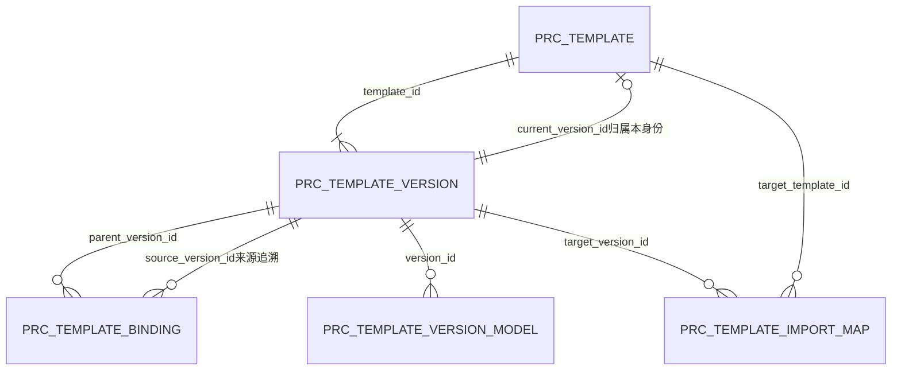

# M04 数据库模型与版本字段字典

日期：2026-09-09；状态：核心模型首轮稿。入口：[主设计](详细设计.md)、[当前及旧库字段基线](数据库字段基线.md)。本文件完整列出本轮五张新增核心表的67列（含Q10名称生成列），不等于六类模板全部业务叶子字段、工作流增量或迁移SQL已经完成；取样/泵速已形成[完整存储契约第一批](模板内容存储契约.md)，第二批Config/灌注字段树已展开且Q11已确认，但工程约束仍待闭合，自动控制/补液第三批已展开，六类工程约束、接口与迁移仍须闭合后才能作为全模块编码基线。

## 1. 建模选择与维护边界

现有workflow_node/workflow_subflow/workflow_step及lab_workflow_node继续负责固定流程结构与实验室启用关系，全部既有列见字段基线。不将工艺参数塞进workflow_step.remark，也不将实验室当前设备配置表改成模板库。模板身份、内容版本和嵌套来源另建专用结构；新表名为本轮技术设计，尚未存在于已核对的当前SQL快照。

| 标识/表 | 改造类型与用途 | 维护主体及生命周期 |
| --- | --- | --- |
| M04-DB01 prc_template | 新增，六类模板统一身份、当前内容指针与管理状态 | M04；逻辑删除保留身份，不能硬删被引用版本 |
| M04-DB02 prc_template_version | 新增，不可变内容版本、查询投影及适配限制 | M04；每次内容保存新增，提交后禁止UPDATE/DELETE |
| M04-DB03 prc_template_binding | 新增，某父版本内每个嵌套槽位的来源版本与有效参数 | M04；随父版本一次提交后不可变，不跟随子模板当前指针 |
| M04-DB04 prc_template_version_model | 新增，版本允许的型号集合查询投影 | M04；从版本内容派生、与版本同事务写入；不重复维护型号主数据 |
| M04-DB05 prc_template_import_map | 新增，核准旧数据到新身份/版本的溯源映射 | 迁移工具；核准后写入，应用模板维护不修改 |

五表目标均为MySQL InnoDB、utf8mb4/utf8mb4_0900_ai_ci；ID采用现有统一bigint生成机制，前端传十进制字符串，不把旧int ID直接转成新主键。code/hash/request/locator等技术标识使用ASCII二进制精确比较；名称使用当前大小写不敏感查重口径。全部为逻辑关联，不建数据库外键。

新表UTC时间用datetime(3)，写入时由服务端一次取时；展示转换Asia/Shanghai。下面“无默认”表示调用方必须显式给值，不靠数据库猜测。历史迁移身份/时间未知保留NULL并由导入核准记录说明；正常新增的操作者与创建时间必填。源表create_by等列仍保留原含义，不在本轮重命名。

## 2. 核心字段字典

### 2.1 prc_template（模板身份）

| 列 | 类型 | 空/默认 | 含义、来源与更新时机 |
| --- | --- | --- | --- |
| template_id | bigint PK | 否/无默认 | 稳定身份；服务端新建生成 |
| template_kind | varchar(16) | 否/无默认 | CONFIG配置、PERFUSION灌注、SAMPLING取样测样、AUTO_CONTROL自动控制、FEEDING补液、PUMP_SPEED泵速；固定技术枚举，不可运行时新增字典值 |
| template_name | varchar(50) | 否/无默认 | 当前名称；保存时去首尾空白，按类型执行原文长度规则；与当前版本name_snapshot一致 |
| current_version_id | bigint | 是/NULL | 指向本身份当前版本；仅创建事务内部允许NULL，事务提交的可见身份必须有合法版本 |
| object_version | bigint | 否/1 | 每次内容、名称、启停、删除变更递增，用于乐观并发；不能只凭内容版本判断状态未变化 |
| status | char(1) | 否/'0' | 0启用、1禁用；沿现有管理编码，不能直接映射旧bit默认值 |
| del_flag | char(1) | 否/'0' | 0未删除、2已删除；逻辑删除不更新已有内容版本 |
| created_by_user_id | bigint | 是/NULL | 创建者关联sys_user.user_id；正常新增必填，旧来源无法核实不猜测 |
| created_at | datetime(3) | 是/NULL | UTC创建时间；正常新增必填，历史未知可空 |
| updated_by_user_id | bigint | 是/NULL | 最近管理变更者sys_user.user_id，新建时与创建者一致 |
| updated_at | datetime(3) | 是/NULL | 最近管理变更UTC时间，新建时与created_at一致 |
| deleted_by_user_id | bigint | 是/NULL | 删除时写sys_user.user_id；未删除为空 |
| deleted_at | datetime(3) | 是/NULL | 删除时写UTC时间；未删除为空 |
| created_request_id | varchar(64) | 是/NULL | 创建请求标识，正常新增必填；不单独替代M01幂等回执 |
| origin_kind | varchar(12) | 否/无默认 | NEW新建、COPY复制、IMPORT核准导入；固定枚举 |
| copied_from_version_id | bigint | 是/NULL | COPY时必填prc_template_version.version_id；其他来源为空，复制不共用新身份或内部行ID |
| live_name | varchar(50) GENERATED STORED | 是/生成值，无手工默认 | CASE WHEN del_flag='0' THEN TRIM(template_name) ELSE NULL END；沿utf8mb4_0900_ai_ci比较；未删除含禁用占名，删除生成NULL；客户端不可写 |

约束：template_kind创建后不可改变；版本指针须属于同template_id。未删除时删除身份/时间为空，正常删除时两者必填；导入历史删除事实缺失需核准说明，不能造时间。名称唯一空间为template_kind，不按实验室缩窄。Q10已确认删除释放名称、禁用仍占名：唯一索引uk_prc_template_live_name(template_kind,live_name)，live_name仅在del_flag=0时取去首尾空白的名称；删除行生成NULL，允许保留多个历史同名身份。新增/复制/改名走同一规则，唯一键冲突返回NAME_CONFLICT；不能以预检查替代数据库约束。普通模板编辑不提供已删除身份复活入口，新建同名必须生成新ID。

### 2.2 prc_template_version（不可变内容版本）

| 列 | 类型 | 空/默认 | 含义、来源与更新时机 |
| --- | --- | --- | --- |
| version_id | bigint PK | 否/无默认 | 服务端生成的版本身份 |
| template_id | bigint | 否/无默认 | 逻辑关联prc_template.template_id |
| version_no | bigint | 否/无默认 | 同模板从1递增；在身份锁内分配，失败事务不发布版本 |
| previous_version_id | bigint | 是/NULL | 同身份前一内容版本；版本1为空，不用复制来源代替此链 |
| name_snapshot | varchar(50) | 否/无默认 | 本版本保存时的模板名称；以后改名不覆盖历史 |
| content_schema_version | int | 否/无默认 | 对应template_kind的存储模式版本，≥1；未知版本只读或阻断，禁止猜测解析 |
| calculation_profile | varchar(32) | 否/无默认 | NONE或M04_CALC_V1；后者包括Q04/Q05/Q08/Q09等本轮适用规则版本，不代表运行算法全部完成 |
| content_json | json | 否/无默认 | 该类模板自身字段、稳定行ID及嵌套槽位标识；严格白名单、有类型对象，不允许任意设备命令或自由JSON入库 |
| applicability_json | json | 否/无默认 | 由本体与全部生效嵌套参数推导的适配交集，结构见第3节；禁止客户端自报扩大范围 |
| canonical_hash | char(64) | 否/无默认 | 服务端对本体、适配、排序确定的绑定有效值、模式/公式版本生成SHA-256，用于内容完整性核对；不是权限凭证 |
| reactor_type | varchar(24) | 是/NULL | 查询投影INTEGRATED_REACTOR/BENCH_REACTOR；不适用该筛选的类型为空，取值从合法内容派生 |
| control_platform | varchar(16) | 是/NULL | Config查询投影当前DELTAV；其他类型为空 |
| lab_type | varchar(12) | 是/NULL | 泵速查询投影PILOT/SMALL/COMMON；不作为实际实验室授权。其他类型无该独立字段时为空 |
| applicable_lab_id | bigint | 是/NULL | 若最终适配限定一个实验室，投影该lab_id；无实验室限定为空。取样必填，父模板带入取样也派生相同限制 |
| culture_days | int | 是/NULL | 自动控制/补液的培养周期投影，单位天；范围随对应页面，其他类型为空 |
| strategy_type | varchar(12) | 是/NULL | 泵速TWO_STAGE/THREE_STAGE，其他类型为空；无连续式值 |
| duration_display_min | decimal(20,2) | 是/NULL | 泵速理论总时长的两位小数展示/查询投影，其他类型为空；运行不能用已舍入投影代替原公式 |
| saved_by_user_id | bigint | 是/NULL | sys_user.user_id，正常保存必填；核准迁移的未知旧作者不猜测 |
| saved_at | datetime(3) | 是/NULL | 原内容保存UTC时间，正常保存必填；不能用导入执行时间冒充历史时间 |
| saved_request_id | varchar(64) | 是/NULL | 正常保存请求标识；导入可空，导入批次由映射表记录 |
| change_kind | varchar(12) | 否/无默认 | CREATE首次、EDIT编辑、COPY复制首次、IMPORT导入；启停/删除不产生内容版本 |
| recorded_at | datetime(3) | 否/无默认 | 此行实际落入新系统的UTC时间；与历史saved_at分开 |

唯一(template_id,version_no)；索引(template_id,version_id)用于归属核验，(applicable_lab_id,version_id)、(strategy_type,duration_display_min,version_id)、(reactor_type,control_platform,version_id)分别支持对应筛选。模板列表先限当前指针，历史版本不得混入当前候选。具体执行计划和组合索引取舍需在目标库数据量下验证，不宣称现阶段已完成性能验收。

名称属于版本内容：单独改名也生成新内容版本并更新当前名称；启停/删除只更新身份管理状态、object_version及审计。历史页面需同时区分“当时名称”和“来源当前状态”，不能把当前状态写进canonical_hash导致历史内容变动。

### 2.3 prc_template_binding（父版本的嵌套槽位）

| 列 | 类型 | 空/默认 | 含义、来源与更新时机 |
| --- | --- | --- | --- |
| binding_id | bigint PK | 否/无默认 | 本次版本新建绑定行身份；不复用其他父版本的物理行 |
| parent_version_id | bigint | 否/无默认 | 父prc_template_version.version_id |
| slot_key | varchar(128) | 否/无默认 | 服务端定义的稳定ASCII槽位标识，如rule/{ruleId}/sampling；按规则ID定位，禁止使用数组下标 |
| parent_rule_id | varchar(36) | 是/NULL | 有规则行时为父content_json内稳定UUID；模板级单槽位为空，必须与slot_key和父内容一致 |
| source_template_id | bigint | 否/无默认 | 被载入的来源prc_template.template_id，保留后续删除来源 |
| source_version_id | bigint | 否/无默认 | 精确来源版本且须属于source_template_id，不追当前指针 |
| source_kind | varchar(16) | 否/无默认 | 来源六类技术枚举，必须与来源身份一致且在父槽位允许的类型中 |
| effective_schema_version | int | 否/无默认 | effective_parameters_json的来源类型模式版本，≥1 |
| effective_parameters_json | json | 否/无默认 | 完整有效参数：来源固定内容加允许的局部修改；自身还存在嵌套时递归固定，不能只存差异补丁 |
| effective_applicability_json | json | 否/无默认 | 有效嵌套内容的适配约束，按Q03保留来源实验室限制并重算交集；不允许局部编辑将X变Y |
| effective_hash | char(64) | 否/无默认 | 对模式及完整有效嵌套内容/适配计算的SHA-256；不把当前启停状态算进去 |
| derived_from_binding_id | bigint | 是/NULL | 服务端证明沿用的上一父版本/复制源绑定；新选为空，重新载入不冒充沿用，规则见第4节 |

唯一(parent_version_id,slot_key)；索引(source_template_id,source_version_id,parent_version_id)支持引用定位，索引(derived_from_binding_id)支持沿用追踪。父content_json内列出的生效槽位与绑定表必须一一对应；少行、多行、错规则均整体拒绝。全部嵌套参数采用固定树，原始来源版本不被局部修改污染。

### 2.4 prc_template_version_model（版本型号查询投影）

| 列 | 类型 | 空/默认 | 含义、来源与更新时机 |
| --- | --- | --- | --- |
| version_id | bigint PK部分 | 否/无默认 | 所属prc_template_version.version_id |
| model_kind | varchar(32) PK部分 | 否/无默认 | INTEGRATED_MODEL集成型号、BENCH_CONTROLLER_MODEL台式控制器型号；固定判别码 |
| model_id | bigint PK部分 | 否/无默认 | 对应M02型号主键；精确物理表/列映射随M02类型模型复核，不能仅凭数字在两个来源表中混查 |
| display_order | int | 否/无默认 | ≥0，保留用户选择顺序，不能当作型号身份 |

联合主键(version_id,model_kind,model_id)；唯一(version_id,display_order)，反向索引(model_kind,model_id,version_id)。此表只投影显式的型号集合，不将全部现有型号展开成“通用”；零行可能是不适用型号选择，语义由content_schema_version和applicability_json确定。范围为空的非法配置不能借零行解释成通用。

### 2.5 prc_template_import_map（核准导入溯源）

| 列 | 类型 | 空/默认 | 含义、来源与更新时机 |
| --- | --- | --- | --- |
| import_map_id | bigint PK | 否/无默认 | 新系统生成 |
| import_batch_id | varchar(64) | 否/无默认 | 一次核准导入批次，与受保护备份/核准清单对应 |
| source_system | varchar(16) | 否/无默认 | CDP/NPP，其他来源须另行扩展设计，不与当前库同名表混用 |
| source_table | varchar(64) | 否/无默认 | 精确旧表名，必须处于导入白名单，不能据此拼接任意SQL执行 |
| source_key | varchar(128) | 否/无默认 | 旧主键规范化字符串，映射定义到具体列；单表同键不能因批次不同重复导入 |
| source_hash | char(64) | 否/无默认 | 核准时旧行及所需子行的规范化摘要；实际导入前重验防漂移 |
| target_template_id | bigint | 否/无默认 | 新prc_template.template_id |
| target_version_id | bigint | 否/无默认 | 新prc_template_version.version_id，须属于目标身份 |
| reviewed_by_user_id | bigint | 否/无默认 | 当前核准者sys_user.user_id，不冒充旧创建者 |
| reviewed_at | datetime(3) | 否/无默认 | 核准UTC时间 |
| evidence_ref | varchar(255) | 否/无默认 | 受控核准记录标识，不写敏感数据正文 |
| imported_at | datetime(3) | 否/无默认 | 实际导入UTC时间 |

唯一(source_system,source_table,source_key)，索引(target_template_id,target_version_id)及(import_batch_id,import_map_id)。当前按一条完整旧模板映射一个新模板首版本设计；需要拆分旧数据或导入多次历史版本时先扩展核准映射契约，不能用INSERT IGNORE跳过冲突。不同旧来源ID相同不冲突；无映射的旧子行不能直接写新外部资源ID。

## 3. JSON边界与逻辑ER

JSON用于原子保存一个不可变版本的复杂类型内容；名称、当前指针、状态、来源版本、规则槽位与重要筛选字段仍以可约束列管理。不得以json类型免除叶子字段、单位、范围和跨字段校验。服务端只接收对应类型DTO，拒绝未知属性、运行事实字段、客户端hash及自行声明的适配投影。

applicability_json固定三个叶子集合：labTypes为PILOT/SMALL非空去重数组；labIds为NULL（未限定具体实验室）或非空实验室ID字符串数组；modelRefs为NULL（无型号限定）或非空{modelKind,modelId}数组。实验室ID逻辑指向M02实验室身份，型号指向M02类型主数据；禁止空数组表达“全部”。父本体与每个生效嵌套限制逐项求交，NULL为该维度不额外限制，交集为空拒绝；最终有单一labId时同步投影列。该结构描述适用范围，不包含用户授权，也不保证当前设备可执行。

content_json保存模板自身配置，所有嵌套生效槽位引用binding的slot_key；effective_parameters_json保存可独立解释的嵌套完整内容，含再下一层固定参数及来源，而不是运行时继续沿模板当前ID加载。树深度、总大小及数组项数技术上必须有限制，精确限额随六类叶子结构与需求最大规则数核定；不在未完成展开前随意定低上限截断合法方案。

规范化hash要固定对象键顺序、十进制数字表示、ID字符串和Unicode编码；有业务顺序的数组保持顺序，集合型数组按稳定键排序。实现阶段用独立相同内容/不同属性顺序样例校验跨语言一致性；原始输入文本的空白不能改变内容身份。

ER全部为逻辑关系。M03培养快照复制完整有效参数及来源版本；M04版本不是培养快照的可变替身。M03/M06决定培养方案的审批与生效，M05/M07保存默认温度解析、有效时间、泵命令和告警等运行事实；这些字段不能反写本表内容。

## 4. 保存、沿用与并发

1. 沿M01 sys_management_revision的SYSTEM守卫及sys_management_request公共回执；操作者+requestId幂等，参数冲突拒绝，成功回执与业务同事务。再核验模板object_version、当前版本及当前权限，不能以客户端按钮状态判权。
2. 按稳定顺序读取/锁定本模板及需要校验的新来源身份，使用不可变版本读取内容。对“沿用”由服务端从原父版本或明确复制源定位相同规则/槽位和来源版本；客户端不能伪造derived_from_binding_id，以“沿用”偷用从未保存的新禁用来源。
3. Q02允许合法沿用绑定在来源禁用/删除后继续编辑其允许的局部参数；来源身份/版本及实验室限制不变，effective_hash可以因合法局部修改变化。不是只有字节完全不变才允许沿用。新选/重新载入必须重检来源当前可选状态及所载入版本，载入后来源发生改版则提示版本冲突并保留输入，不静默替换参数。
4. Q03对父版本最终实验室/型号交集重验；从X复制取样模板到Y建立新模板身份并重新核验Y资源，不能修改已引用来源版本的实验室列。复制父模板时为新规则生成新行ID并映射新槽位，保留旧绑定作为服务端追溯依据，不错误沿用原内部ID。
5. 校验所有自身字段和嵌套叶子、计算派生值及查询投影；一次写新版本、绑定、型号投影，最后更新身份当前指针/name/object_version，写M01审计及回执。任何一步失败整体回滚，不能出现当前指针指向缺少绑定的半成品。
6. 两个并发内容修改只能一个成功；内容修改与禁用/删除同样核验object_version。只重试数据库写入不能跨过版本冲突；回执过期后的重传沿M01最新managementRevision规则。

版本记录不可变是应用写入口和数据库账号权限共同约束，不能仅靠UI隐藏编辑按钮。没有业务需要的版本硬删除、归档清理接口本期不提供。状态变更不生成内容版本，但审计和object_version必须变化；新培养读取时必须核验父模板当前状态，历史展示则读取固定版本且另行判权。

## 5. 旧数据核准与未完成边界

基线已发现NPP cdp_feedingconfig与当前泵速字段较接近，但其HighSpeedVolumePercent默认85不符合当前三段式60—80范围；IsTwoStep、Status等数值枚举没有充分映射证据，不能将非零一律转换成真。CDP同名表缺少完整阶段字段，不能与NPP同名表使用同一导入映射。旧固定泵只有ConfigId，不足以恢复历史所用策略版本；没有当时参数证据不得拿当前策略补造历史快照。

迁移先核准范围、主子行、资源身份/单位、枚举、适配实验室、创建者/时间、名称冲突及历史快照完整性，重算全部本期规则后再决定是否可导入为可选模板。原数据只读保留；不合规项记录核准待办，不能自动截数、补默认值、删除问题行或启用为可执行状态。若无旧库业务数据，仅有DDL，不能宣称迁移回填已核验。

仍需完成：六类已展开字段的工程约束及资源快照获取协议、M02型号精确表列映射、工作流公共并发/审计及API字段已在主设计第9—11节展开，M04固定包交接见第12节；仍需迁移前核验/备份/DDL/回填/核验/回退脚本及目标数据库执行验证。当前新增表仅为文档模型，无任何CREATE/ALTER在数据库执行。

## 6. 核心模型验收（设计用例，未运行）

| 编号 | 场景 | 预期 |
| --- | --- | --- |
| M04-DBCASE01 | 一次保存任意Tab校验失败 | 不产生可见身份/版本/绑定/查询投影半成品 |
| M04-DBCASE02 | 两人从相同object_version编辑 | 一个提交成功，另一个版本冲突，不覆盖 |
| M04-DBCASE03 | 编辑过程中模板被禁用或删除 | 管理版本/对象版本变化使旧提交失败，不复活已删除身份 |
| M04-DBCASE04 | 子模板B改版 | 父A绑定的source_version_id及有效值不变，新培养使用A也不追B当前版本 |
| M04-DBCASE05 | B禁用/删除，A已有合法绑定 | 沿用/允许的局部修改可保存；新选/重新载入拒绝 |
| M04-DBCASE06 | 客户端伪造沿用绑定ID | 服务端对原父版本或复制源证明失败，拒绝 |
| M04-DBCASE07 | 来源固定X实验室，父模板声称可供Y | 适配交集校验失败，不因来源禁用沿用例外而跨实验室 |
| M04-DBCASE08 | 复制A并保留嵌套内容 | 新模板/版本/规则行/物理绑定ID，来源版本和有效参数保持；槽位重新映射 |
| M04-DBCASE09 | 槽位缺绑定、多绑定或错挂规则 | 整体拒绝；不能以数组位置凑匹配 |
| M04-DBCASE10 | 相同请求重试或同请求改参数 | 沿M01回执返回原结果或REQUEST_CONFLICT，不重复版本 |
| M04-DBCASE11 | 仅启停/删除，或仅改名 | 前者不产生内容版本但更新object_version/审计；后者生成新内容版本 |
| M04-DBCASE12 | 旧三段高速默认85或阶段枚举未知 | 不自动导入启用模板，要求核准，不截成80 |
| M04-DBCASE13 | 只有旧ConfigId，无当时策略参数 | 不用策略当前值补造历史快照 |
| M04-DBCASE14 | 当前内容、嵌套有效值或查询投影被伪造 | 服务端重算投影/hash；存量完整性异常阻止消费并记录核查 |
| M04-DBCASE15 | 核准后旧主/子行变化或重复导入 | hash不符或唯一映射冲突，停止该批，不跳过问题行 |
| M04-DBCASE16 | 同类同名新建/改名/复制；原对象启用、禁用或删除；并发创建 | 原对象启用或禁用均拒绝重名；删除后允许新身份同名，旧父模板/培养仍引用原ID和版本；两个并发同类同名创建仅一个成功；多次删除后可继续复用，不因历史同名行阻断 |

## 7. 第一批内容叶子落地（2026-09-10）

[模板内容存储契约](模板内容存储契约.md)已定义SAMPLING/PUMP_SPEED schema 1。两类根结构分别为七键/六键，独立版本无binding及model投影行；取样Cedex项目有服务端历史快照，默认温度保持模式而不解析；泵速保存输入和版本，派生占比/时长按固定公式计算。第一批未新增核心表列，仍为五表67列。整数容量、小数编码、空值及只读字段严格区分，详见附件。

## 8. 第二批Config/灌注字段树（2026-09-10）

[模板内容存储契约](模板内容存储契约.md)第7—10节已展开类型化型号引用、MAP2输出、PID_SET、Config九键根结构及灌注七键根结构；灌注固定一个detection/sampling来源绑定，沿用SAMPLING schema 1且只允许检测类型子集选择。新增16条验收用例，核心表仍五表67列。Q11保存/应用量程时点已确认，PID工程规则和台式控制器类型映射仍有明确依赖，未生成迁移DDL。

## 9. 第三批自动控制/补液字段树（2026-09-10）

[存储契约](模板内容存储契约.md)第11—14节已展开稳定规则ID、DetectionSpec基准与槽位、六类自动规则和结束通知、固定泵速度互斥、资源快照及两种补糖分支。第三批16条用例使存储验收总计48条，核心表仍五表67列。Q08硬冲突与补料临近提醒分开；运行计数、任务事实及实时取数不进入模板内容。来源版本/能力接口、权限、SQL及执行验证仍待完成。

## 10. 模板维护 API 首批承接（2026-09-10）

[主设计第9节](详细设计.md)给出10个目标接口及完整公共DTO：API06/07/08分别创建/编辑/复制内容版本，API09/10只变身份管理状态；输入排除schema/hash/快照/投影，服务端核对来源与生成数据。SELECT/RELOAD/RETAIN由明确父基线取证，复制规则映射不能伪造derived_from_binding_id。继续复用M01 SYSTEM管理守卫和24小时回执，不新增模板回执表。五表67列本轮未变；Q12已确认可操作1/可管理2加功能权限可维护限定实验室模板，资源事实及培养应用接口尚待闭合，不作为编码/数据库验证完成的结论。
## 11. 固定包交付与培养存储边界（2026-09-10）

[主设计第12节](详细设计.md)定义TemplatePackage、3个内部应用服务和16条用例。M04仅从自身五表/固定流程导出不可变全量包；M03负责独立快照身份、候选/现行指针和培养引用，不复用res_culture.plan_version表示模板参数代次。M04不直接读M03仓储，使用M03当次可信上下文；Q13全历史引用的存储/核准责任由M03承接。五表67列本轮不变，未产生设备指令或数据库执行。
## 12. 核心SQL与约束核对（2026-09-10）

[数据库交付与核验说明](数据库交付与核验说明.md)和[完整目标DDL](history/sql/05-核心目标表结构.sql)列出五表全部67列、24条基础CHECK及完整索引；SQLGlot解析及列名/顺序比对通过。prc_template新增current_version_id及按kind/del_flag/created_at或updated_at排序的辅助索引，服务于第10节列表与指针核验；其他索引沿本字典。并未执行MySQL、过程编译、导入、回退、权限或设备验证；旧数据实际核准和M02/M03/M06/M07依赖仍按交付说明阻断，不以SQL文件存在宣称完成全模块实施。

## 2026-09-10 最终结构入口

本文件保留前期数据库基线；本轮收尾后的完整目标为5表70列，全部原列及新增列见[收尾后完整数据库字段字典](收尾后完整数据库字段字典.md)。旧计数不含收尾增量，不用于最终部署结构核对。
