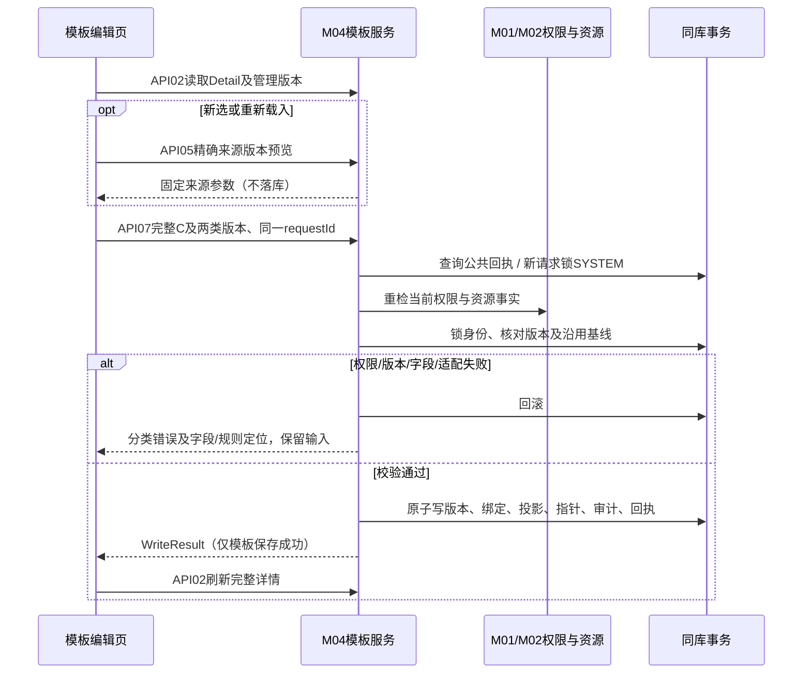
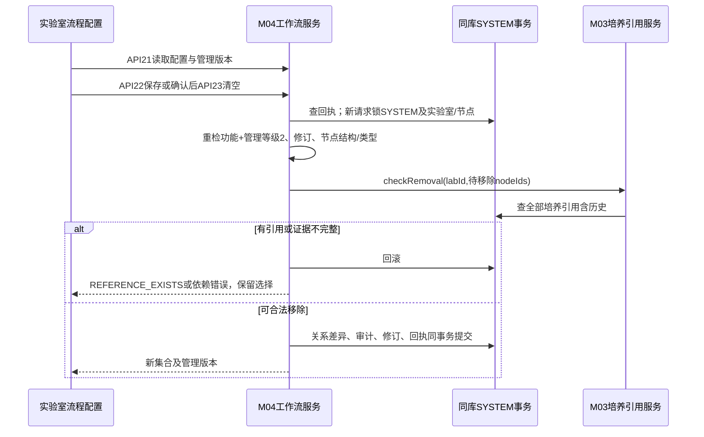
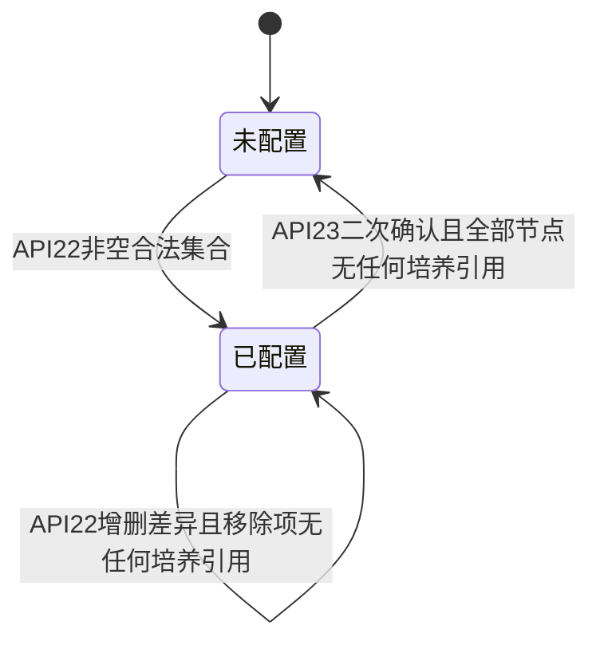

# M04 工艺与方案管理详细设计

## 2026-11-05 默认连接已保存策略名称投影

M02 默认连接通过既有 `PumpSpeedStrategyCatalogPort` 新增的 `findStrategyNames(List<Long>)` 批量读取所引用策略的名称。调用方先执行原默认连接权限与实验室范围核验；内部投影只返回 ID/名称，不增加工艺方案查询权限，不暴露策略计算参数。去重后每批最多 1000 个 ID，空集合不查询，停用但未删除引用仍返回名称，失效引用不生成替代名称，依赖错误向上传播。新选择的可用性继续由 `isBenchReactorStrategyAvailable` 校验，未放宽启用及适用范围规则。对外字段与验证状态见 [默认连接契约 OC-20261104](../02-实验室与资源管理/默认连接与打印排版接口契约.md#oc-20261104控制器有效占用与默认连接来源)。

## 固定工作流适配实验室类型（2026-11-04）

固定工作流包读取按可信的当前实验室类型筛选适用子流程；不将不同实验室类型的子流程混入当前培养方案。模板选择仍按现行实验室范围和启用状态核验，固定包及版本保护不变。此项对应 `5112411dc` 的实现修复；源码存在不代表运行和浏览器已复验。

## 2026-10-31 型号信息直接用于工艺方案

用户确认取消工艺方案保存对“已核准工程资料”的前置要求，直接使用反应器型号维护信息。M04型号候选、事实读取与版本保存的旧ENG-I01核准门禁由[本次来源与版本规则](工程版本固定与评审收尾.md)覆盖；保留字段合法性、型号适配、权限、SYSTEM修订及不可变快照校验，不生成伪造核准记录。设备运行及安全规则不由此放宽。

## 开始培养专项增补（SC-20261017）

M04负责start_culture节点及start_culture_small/start_culture_pilot两套固定四步定义和实验室绑定。新增workflowKind=START_CULTURE_SMALL/PILOT，不重新解释W01—W08；运行保存定义版本快照。固定步骤与新增种子要求见专题第3、7节，SQL/初始化仍待开发，不在本轮修改。

最新保存规则（2026-10-17）：小试、中试均只在第4步点击“完成”并成功提交后保存业务数据；未完成页面刷新或取消后从第1步重新开始，不恢复表单或中间步骤。操作审计和设备安全收尾保留，必须当天完成的限制不变。

步骤时间记录：四步分别记录服务端开始/结束时间及结束原因；刷新重开新建尝试，旧时间审计保留，未知结束时间不伪造。时间留痕不构成业务表单的中间保存点。

当前专题：[开始培养详细设计](../07-补液运行与任务执行/开始培养工作流详细设计.md)；实施拆分：[开始培养开发计划](../../开发任务/05-专题交付/小试中试开始培养开发计划-20261017.md)。本次仅文档补充，业务代码、数据库、设备操作均未执行。


## 三类实验室接入补充（INTEGRATION-20261010）

按[共同边界](../00-总纲与约定/00-三类实验室设备接入与执行边界.md)补充模板对代际、设备能力、单位和策略的适用性校验；实验室代际不直接决定协议。M04发布的模板/策略版本不可变，由M03冻结生效方案，M07生成任务并固定计算及执行版本。

旧模板转换必须显式映射旧枚举、单位和规则，未识别内容不靠默认值发布；保留原模板引用与转换证据，不改一期原表。M04不保存现场服务路由、不在模板保存时启动设备；运行中模板更新不改变已下发参数。对应INTEG-02、INT-AC02/06/10；具体新增物理字段先同步现行契约与字典。

> **最新复测（2026-10-10）**：用户授权的 zj6 模拟工程资料、测试取样来源及培养基 A/B/C 已补齐，基础保存的数据阻塞解除。重启修复后，“测试用-灌注方案-20261010”新增保存、列表及详情（含固定取样版本与参数）已 **BROWSER_VERIFIED**；型号工程业务 JSON 已 **HTTP_VERIFIED**。最新后端 M04 与 M01 字典候选定向测试共 247 项通过。以下早期阻塞记录由本条及[复测记录](history/review/2026-10-10-灌注培养基方案实施与复测.md)接续。灌注修改、复制、启停、删除的浏览器验收及普通角色验证仍 **NOT_VERIFIED**；模拟资料不代表真实设备核准，PID 规则尚未提供。

> **型号测试资料扩展（2026-10-10）**：用户随后要求补齐 zj1—zj5，五个 MODEL 范围模拟工程资料均已保存并核准；单型号事实均为 `COMPLETE`，状态 **HTTP_VERIFIED**。zj1=30 L、zj2=20 L、zj3=12 L、zj4=20 L、zj5=20 L，均明确为非真实工程数据。多个型号共同选择时仍须满足泵数、MFC 和容积一致性校验，因此该五个型号的组合会被拒绝；逐个页面选择的浏览器验收仍 **NOT_VERIFIED**。详见[复测记录](history/review/2026-10-10-灌注培养基方案实施与复测.md)。

> **测试数据更新（2026-10-10）**：用户随后授权在当前环境创建“测试用初始培养基A/B/C”三项，已验证页面可选中，字典测试数据阻塞解除；这些选项不纳入新系统固定种子。完整灌注保存验收仍缺核准型号工程资料及可用取样来源。

> **灌注培养基方案实施更新（2026-10-10）**：PERFUSION 前后端列表、编辑、复制、启停、删除、固定取样版本绑定及实验室权限保护已 IMPLEMENTED；M04 后端 229 项及前端相关 46 项测试通过（CONTRACT_TESTED）。按用户确认创建“初始培养基”字典类型 `smp_initial_medium`，不预置选项；六项 `process:perfusion:*` 权限已登记到既有“培养基方案”菜单。重启后列表、创建上下文、型号和取样候选 HTTP_VERIFIED，页面打开及空培养基必填阻断 BROWSER_VERIFIED。完整业务保存及后续增改删浏览器验收为 BLOCKED_DATA：当前缺字典项、核准型号工程资料及可用取样来源。记录见[灌注方案实施与复测](history/review/2026-10-10-灌注培养基方案实施与复测.md)。

> **取样测样方案实施更新（2026-10-09）**：本轮已实现 SAMPLING 模板列表、详情、新增、修改、复制、启停及逻辑删除；四类检测参数校验、Cedex 项目快照、实验室范围和操作等级校验、版本/幂等保护接入现有模板底座。M04-API16 经 M02 `SamplingResourcePort` 查询逐设备检测资源，保存时在 SYSTEM 守卫内复核。前端菜单组件为 `process/sampling/index`，路由为 `sampling-template-management`；使用 `process:sampling:list/query/add/edit/changeStatus/remove` 权限。本轮不修改表结构或执行 SQL，不包含 M05 实际检测、动态温度读取、M03/M06/M07 培养应用联调。实现与定向测试状态不代表 HTTP、浏览器、数据库或设备验收通过。
>
> **浏览器验收更新（2026-10-10）**：六项菜单权限已按用户授权登记。超级管理员会话下，列表、检测资源加载、四类参数新增、详情回显、修改、复制、禁用、启用及逻辑删除已 **BROWSER_VERIFIED**。修改版本字段的前端兼容和模板修改/启停审计问题已修复；后端重启后修改、启停与删除均返回 HTTP 200、业务 code=200，管理写头及修订递增符合约定。两条验收数据均已逻辑删除，最终列表 total=0，本轮无新增后端错误日志。证据见[首次验收](history/review/2026-10-09-取样测样方案浏览器验收.md)及[重启复测](history/review/2026-10-10-取样测样方案重启复测.md)。普通角色数据范围浏览器验收、数据库独立安装、设备及现场验收仍 **NOT_VERIFIED**。


**当前收尾入口：[工程版本固定与评审收尾](工程版本固定与评审收尾.md)、[最终完整字段字典](收尾后完整数据库字段字典.md)、[收尾验收与完成核对](history/review/收尾验收与设计完成核对.md)。下方早期分批记录的“待其他模块设计/待补物理字段”已由本次收尾包接续；代码、真实资料核准及运行验收仍未完成，不混作设计待办。**

2026-09-10；状态：当前确认范围详细设计完成。M02工程来源、M03固定包存储及两轮评审意见已收口；最终5张核心表70列，原4张工作流表45列继续复用。未编写业务代码、执行SQL或完成设备/接口验证。

入口：[现状核对与复用清单](history/review/现状核对与复用清单.md)、[模块目录](../00-总纲与约定/00-业务模块划分与设计目录.md)、[工艺设置需求（V4.0 第 6 章）](../../需求说明书V5.1-1030_md/06-工艺设置.md)、[最新澄清决策](../../需求说明书V4.0-0904_md/需求澄清决策记录.md)、[M03培养管理](../03-项目与培养管理/详细设计.md)。本文集中组织页面、字段、接口、状态、事务与验收；六类页面字段首轮及核心版本模型已展开，数据库附件见第4.2节，未完成部分列在第8节。

## 1. 范围与交付落点

| 标识 | 本模块负责 | 当前设计落点 |
| --- | --- | --- |
| M04-REQ01 | 固定工作流节点的名称、图标、说明及启停维护 | 复用现有工作流实现，第2节 |
| M04-REQ02 | Config关联设置模板：基础信息、MFC、蠕动泵、控制回路、工艺值 | 五页整体保存，型号联动，第3节 |
| M04-REQ03 | 灌注培养基模板：基本信息、检测设置及可选工艺参数 | 单位与型号能力校验、引用取样模板，第3/7节 |
| M04-REQ04 | 取样测样模板：适用实验室、检测类型/项目、采样参数及方式 | 实验室资源约束；检测执行由M05承接 |
| M04-REQ05 | 自动控制模板的规则配置与校验 | D0周期口径；配置保存与任务运行分开 |
| M04-REQ06 | 补液模板的固定泵、培养基/耗材/泵速策略和规则 | 后续展开完整字段与补糖关联校验 |
| M04-REQ07 | 泵速策略模板，仅二阶、三阶 | 连续泵速不进入当前可选列表 |
| M04-REQ08 | 模板查询、新增、修改、复制、启停、删除和版本追溯 | 生命周期及不可变使用快照，第4节 |

十二月范围已按最新确认纳入Config、灌注培养基、自动控制完整工作流及对应培养预设，pH校准/调整、搅拌/温度/通气调整、DO校准、取样测样按各自已确认入口纳入；不能继续用Q33/Q36/A3早期排除覆盖。未批准的其余配置页、独立接种字段、连续泵速等不自动恢复。详见[十二月上线范围与澄清规则](../00-范围与待核/00-十二月上线范围与澄清规则.md)。模板保存本身不生成任务、不下发设备命令。

M04保存可复用定义；M03拥有培养使用的现行/候选快照；M06负责审批结果；M07消费生效方案并负责运行事实。方案如何初始化、生效及与审批对接须按模块依赖细化，不将本轮逻辑模型写成现有接口。

## 2. 工作流与实验室配置复用

当前源码事实见附件。WorkflowServiceImpl更新展示字段并校验二级流程/步骤ID集合与原结构一致；状态变更检查实验室引用。LabWorkflowServiceImpl对实验室查看/管理判权，保存时校验节点存在、启用且实验室类型一致。优先在这些既有服务和模型内完善目标契约，不另起一套工作流定义服务。

目标规则：固定节点结构不可由展示信息编辑接口新增、删除或重挂；更名不能改变执行标识。实验室取消节点时按Q13检查全部培养引用，包含已结束、已取消等历史培养；存在引用则整次拒绝，不能缩窄为运行中培养。实验室正在配置使用的节点禁止禁用；必须先从实验室配置移除。此规则与“模板禁用不影响既有培养”是两个对象的独立约束。

第11节已直接核对上述服务及四份Mapper SQL，展开公共守卫、锁序、权限重检、差异写入和审计语义；全入口旁路排查及并发运行验证尚未完成，不据此宣布并发安全已验收。

## 3. 已明确的模板规则

| 对象 | 规则及来源 |
| --- | --- |
| Config | 五个Tab按要求填完才能整体保存；名称同类型唯一，2—50字；反应器型号多选须泵数/MFC数及温度、重量、压力能力一致 |
| Config通道 | MFC至少填写含Air与O2的两行；泵可以全部不填，填写一行则按该行完整性校验；控制回路引用已配置通道，不能依靠显示名称关联 |
| Config PID | 参数保存在方案中，不回写设备PID基础参数；保存模板不发送设备命令 |
| 灌注培养基 | 型号还需规格一致；规格≤15L用g，>15L用kg；目标重量≥达阈重量；首次检测触发方式按澄清仅温度 |
| 取样测样 | 按Q03仅供指定实验室使用，直接及嵌套一致；跨实验室须复制并对目标资源重新校验；方式使用正文自动/手动，不采用OCR列表噪点 |
| 检测参数 | DefaultValue是语义值，不当作数字0；Cedex稀释能力在实际设备确定后复核，不能因模板已保存就认定设备支持 |
| 周期 | 模板日序号为D0至D(培养周期−1)，即0≤开始≤结束<培养周期；自然日期总天数沿M03-Q15含首尾规则，二者不冲突 |
| 补糖 | 有补料则等待补料全部完成后检查生成；无补料视为前提满足；周期由系统设置配置，默认10s，已确认无需重问 |
| 复制 | 清空名称，复制其他可复制配置；按新增规则完整校验，不复制原内部ID、审计身份或培养使用关系 |
| 启停/删除 | 禁用与删除需二次确认；未来不可选，既有培养仍展示并使用原方案内容 |

以上是已核对的关键约束，不替代六类模板的完整字段表。原文中数值/单位冲突、跨模板设备适配等在对应字段展开时逐项核对；不得把尚未确认的业务判断伪装成普通字段默认值。

## 4. 模板、版本与培养快照

需求已明确：修改、禁用或删除模板不改变既有培养使用的方案。技术设计采用以下逻辑对象，物理表名及完整字段尚未冻结：

| 逻辑对象 | 维护主体 | 作用 |
| --- | --- | --- |
| 模板身份 | M04 | 稳定ID、类型、名称、启停/删除状态与当前版本指针 |
| 模板版本 | M04 | 保存一个已校验内容版本；被引用后不可原地覆盖，保留审计来源 |
| 模板依赖 | M04 | 按Q01固定来源版本、适用实验室和带入参数，保存局部修改；子模板改版不自动更新父模板，适配范围按Q03计算 |
| 培养使用快照 | M03 | 固定该培养实际使用的完整参数及来源版本，不能仅存模板ID后动态读取当前内容 |
| 运行任务 | M05/M07 | 根据已生效培养方案及执行条件生成；模板保存本身不创建任务或改设备 |

建议以逻辑删除保留模板身份与被引用版本；普通候选查询排除禁用/已删除模板。历史显示读取使用快照及审计来源，不依赖当前候选列表是否仍可选。实际资源的当前权限、可用性和能力继续按操作时检查；参数快照不冻结权限或设备就绪状态。

Q02已确认：子模板禁用/删除只阻止新选和重新载入，不阻止已保存父模板沿用其参数供新培养使用，也不阻止维护/复制父模板保留原嵌套内容。须停止父模板的新选择时单独禁用父模板。既有嵌套内容不等同正在编辑但尚未保存的新引用；后者提交仍校验来源当前可选状态。父模板与培养使用权限、实验室/设备适配检查照常执行。
建议的保存一致性：请求带预期版本，服务端复核当前权限、型号/实验室等依赖、全部Tab及嵌套参数，内容版本、当前指针和审计同事务提交。冲突提示刷新并保留输入供比较；不覆盖他人新版本。幂等、锁序及完整请求/响应字段在接口章节细化后冻结。

### 4.1 嵌套内容的目标逻辑契约

下表为Q01—Q03的技术设计落点，不是现有API或完整物理字段字典。后续各模板字段沿此契约展开，不能仅保留一个子模板ID。

| 逻辑项 | 类型/来源 | 约束 |
| --- | --- | --- |
| sourceTemplateId | 内部ID，前端十进制字符串 | 服务端从合法来源取得，保留追溯身份 |
| sourceVersionId | 版本ID，前端十进制字符串 | 精确定位带入版本，禁止读当前版本重建旧配置 |
| applicableLabId | 实验室ID，取样来源版本必有 | 与来源版本一并固定，不能由客户端仅改此字段实现跨实验室复制 |
| effectiveParameters | 对应模板类型的结构化参数 | 保存带入值与允许的局部修改；后续逐类展开叶子字段，禁止接受任意设备指令文本 |
| parentRuleId | 父模板内稳定规则标识 | 关联具体规则行，避免排序后误把嵌套配置挂到其他规则 |
| 来源操作 | 新选/重新载入/沿用 | 由服务端对照原父版本判定，不信任客户端自报“沿用” |

来源当前状态仅用于新选/重新载入的资格和提示，不覆盖固定内容。保存父模板版本须同时保存其全部生效嵌套配置；任一失败整体回滚。实验室适配校验与版本/状态校验独立执行，Q02不能作为跨实验室使用的例外。

| 操作 | 来源当前状态 | 实际使用范围 |
| --- | --- | --- |
| 新选/重新载入B | B必须启用且未删除；提交时重检 | 使用载入版本的实验室限制 |
| 修改A并沿用已存B | 不因B禁用/删除失败 | 保留原固定实验室，重新核对父模板最终范围 |
| 复制A并沿用已存B | 不自动重新载入B，不因B禁用/删除失败 | 沿用原固定实验室；复制本身不扩大范围 |
| 为Y复制取样模板 | 使用合法可复制内容创建新身份，具体入口资格按后续权限设计 | 显式选择Y并重验Y资源，不能只改来源labId |
| A供培养使用 | A自身须启用且未删除；固定子来源沿Q02 | 实际培养labId满足全部嵌套配置及型号限制 |
### 4.2 核心数据库模型与现状基线

已建立[数据库字段基线](数据库字段基线.md)：直接核对当前SQL四张工作流表的45列及索引，并比较CDP/NPP共12张旧候选表。已建立[数据库模型与版本字段字典](数据库模型与版本字段字典.md)：提出五张核心表、完整列定义、逻辑ER、保存/沿用事务及16条数据库验收用例。以上是文档设计，不是运行数据库现状。

| 数据责任 | 目标落点 | 当前完成边界 |
| --- | --- | --- |
| 固定工作流/实验室启用节点 | 复用workflow_node/subflow/step、lab_workflow_node | 完整当前DDL见基线，公共守卫/审计/差异写入增量已在第11节展开，代码及运行验证待实施 |
| 模板身份和管理状态 | prc_template | 当前指针、object_version、状态/删除、创建与复制来源 |
| 不可变完整版本 | prc_template_version | 名称快照、schema/公式版本、类型内容、适配和筛选投影；保存后不可原地覆盖 |
| 父版本固定的嵌套参数 | prc_template_binding | 按稳定规则槽位绑定来源版本，完整有效参数支持局部修改；Q01—Q03直接约束 |
| 型号筛选与旧来源映射 | prc_template_version_model、prc_template_import_map | 查询投影不成为型号主数据；核准映射不能冒充旧历史快照 |
| 培养快照/运行事实 | M03及M05/M07 | 不放进模板当前内容，不由本轮新增平行培养方案主表 |

技术采用“名称/本体/嵌套配置变化新增内容版本，启停/删除只改管理状态与审计”；当前名称投影和当前版本名称保持同事务一致。五表均逻辑关联，无数据库外键；幂等、SYSTEM管理守卫及审计沿M01公共契约，不新增另一套管理回执。

现状差异：NPP泵速旧默认高速占比85%不能用于当前三段式60%—80%；旧固定泵仅ConfigId不能证明当时参数版本。旧字段/枚举/单位、资源映射及历史证据不足时保持待核准，不自动启用导入内容。名称删除后可复用、禁用仍占用，见已确认Q10；其余核心模型选择属于本轮技术设计，不冒充用户逐列确认。

已补[模板内容存储契约](模板内容存储契约.md)第一批：SAMPLING及PUMP_SPEED schema 1的完整字段树、数值编码、空值/分支、历史项目快照、核心投影、三个JSON示例和16条存储验收用例。第二批Config/灌注字段树及16条追加用例已展开；Q11已确认模板保存与培养应用分阶段校验；PID工程约束、型号映射仍待闭合。第三批自动控制/补液内容树及16条追加用例已展开，六类合计48条存储用例；资源/工程依赖、工作流增量及完整目标结构与迁移/核验/回退稿仍需完成。第13节现已补齐核心SQL设计稿；未执行数据库语句。


## 5. 页面交互首轮结构

M04-UI01工作流列表进入固定节点详情；M04-UI02至UI07分别对应六类模板。列表先呈现筛选、创建/复制入口和结果，沿原需求分页/时间排序；复杂模板使用原Tab组织。编辑页包含配置区、逐项校验反馈和保存/关闭操作。

只读详情与编辑分开判权；复制进入新增表单并清空名称。提交失败保留输入，定位有错Tab和字段；保存中防重复提交；未保存离开时提示。禁用/删除成功后刷新候选及列表，已打开的编辑页提交时仍须复核最新状态。第9节已展开逐类型动作功能码及对象/实验室授权交集；Q12已确认最低维护等级1，真实角色菜单接入仍待完成，不直接套用M03项目身份。

### 5.1 M04-UI02 Config关联设置模板

本节覆盖M04-REQ02，需求来源为06第99—482行及已确认的MFC前置关系澄清。已直接查看原图303—308；原图示例数值不作为默认值，工艺值递增含义已按Q04确认。字段名是目标页面/参数逻辑名，尚未声明为现有API或物理数据库列。

```text
Config模板列表
反应器类型 [全部] 控制平台 [DeltaV] 方案名称 [搜索]
时间依据 [创建/修改] 起止日期 [    ~    ] [查询] [重置] [新增]
序号 | 名称 | 控制平台 | 反应器类型 | 工艺类型 | 状态 | 创建人/时间 | 修改人/时间 | 操作
操作：查看、修改、复制新增、启用/禁用、删除；底部分页

新增/修改/只读详情
[基础信息] [MFC] [蠕动泵] [控制回路] [工艺值]  各页显示完成/未完成
当前页字段/通道表；字段错误就地显示，跨页错误显示可跳转摘要
                                            [保存] [关闭]
控制回路内：[PID设置] → 五行Gain/Reset/Rate弹窗 → [保存到表单] [取消]
```

#### 5.1.1 基础信息与型号联动

| 字段 | 控件/默认 | 必填与校验 | 来源与副作用 |
| --- | --- | --- | --- |
| templateName 方案名称 | 文本框；新增/复制为空 | 必填，去首尾空白后2—50字，同Config类型唯一 | 服务端再次查重；技术采用大小写不敏感比较策略，唯一索引随数据库设计冻结 |
| controlPlatform 控制平台 | 单选，默认DeltaV | 必填，当前仅DeltaV | 固定当前可选值，不开放自由输入 |
| processType 工艺类型 | 单选，默认批次培养 | 必填，当前仅批次培养 | 不用原图示例推导其他类型 |
| reactorType 反应器类型 | 单选，无默认 | 集成反应器/台式反应器二选一 | 切换后重新加载对应型号 |
| modelIds 反应器型号 | 多选，空 | 至少1个有效ID，无重复 | 集成反应器型号或台式控制器类型中的型号；不用名称作为关联键 |
| status 状态 | 启用/禁用，默认启用 | 二选一；两种状态均须完整校验 | 禁用不是草稿保存方式 |

型号组合必须泵数、MFC数、温度/重量/压力控制可用性一致；Config原文未要求规格一致，不额外套用灌注模板的规格一致限制。能力未知或型号信息加载失败时标为无法验证并阻止保存，不补成0或支持。

新增选择型号后按通道数构造固定行，禁止手工增加/删除编号。修改已填配置的反应器类型或型号集合时，先提示将重新核对通道、回路、PID及工艺值；取消保留原选择。确认后保留仍可对应的输入，失去通道/能力的项标为失效并要求用户清除或重选，禁止静默截断后保存。型号变化即使通道数相同也重新判定全部依赖；后端对最终提交重复验证。

#### 5.1.2 MFC页

| 每行字段 | 控件/默认 | 保存规则 |
| --- | --- | --- |
| channelNo、channelCode | 只读1…M、MFC1…MFCM | 根据型号生成，服务端校验完整编号集合，无重复/越界 |
| gasType 气体类型 | 单选Air/O2/CO2，默认未选 | 启用的配置行必选；原图前3行是示例，不固定为默认通道分配 |
| rangeFrom、rangeTo 量程范围 | 两个数字框，手填无默认 | 配置行两值必填，技术校验有限十进制数且from<to；不从不同型号任选一个覆盖手填值 |
| route 通气通路 | 单选HeadSpace/Sparger1/Sparger2，默认未选 | 配置行必选；界面统一拼写Sparger，原文Spanger视为展示拼写差异 |
| flowSetpoint 流量设定值 | 只读None | 固定语义值；不能变成数字0或空字符串 |
| initialOut 初始化OUT | 只读0 | 保存固定值0 |
| controlMode 控制模式 | 只读MAN | 保存固定值MAN |

至少两条完整配置行，并至少包含一个Air和一个O2；允许多条同气体类型。用户可编辑字段全空视为未配置，固定显示值不算用户填行；填了任一项即要求该行气体、范围、通路完整。未配置行保留通道身份与固定值、配置标记，不作为下游候选。量程单位和设备物理上限须与M02型号能力契约一致，未核准前不宣称这些字段可直接下发设备。

#### 5.1.3 蠕动泵页

| 每行字段 | 控件/默认 | 保存规则 |
| --- | --- | --- |
| pumpNo、pumpCode | 只读1…N、PUMP1…PUMPN | 根据型号生成，不能手工增加行 |
| functionName 功能名称 | 文本框，空 | 配置行必填；技术长度1—50字；不作为泵身份或控制命令 |
| ratedSpeedFrom、ratedSpeedTo 额定转速范围 | 两数字框，无默认 | 配置行必填，技术校验有限十进制数且from<to；字段仍表示额定转速，切换控制方式不暗改单位 |
| regulationMode 转速/流量 | 二选一；技术默认流量控制，与原图一致 | 已配置行必须选择；仅有默认选项不算填写该行 |
| direction 转向 | 单选CW/CCW，默认未选 | 已配置行必填；原文“非必选”仅适用于整行不用，按同节明确的整行保存校验执行 |
| initialOut | 只读0 | 固定保存 |
| associatedControlMode | 只读Remote setpoint | 固定保存 |
| controlMode | 只读MAN | 固定保存 |

允许全部泵不配置。任一非默认可编辑字段填写后整行必填；全部不配也可使本页满足可选规则，但若pH回路没有足够合法关联，整体模板仍无法保存，提示返回MFC/泵补充。不能为了让回路通过自动建立加碱泵。

#### 5.1.4 控制回路与PID

MFC及泵页通过本页完整性检查后才允许编辑回路；未通过时提示并跳转具体页。进入时从已配置通道构造候选，无选项或无法组成合法关联时明确提示补充上游。上游通道的气体/通路/配置状态改变后重新校验已有绑定；失效项显示错误，不自动替换为同名通道。

| 回路 | 固定结构 | 可编辑项与校验 |
| --- | --- | --- |
| DO | 必有，固定三个输出槽 | 每槽选已配置合法MFC或Nothing；可全部Nothing，Nothing免映射范围及实际输出绑定；有效槽位沿气体/通路/稳定身份和不重复关联校验 |
| pH | 必有，固定两输出 | 候选为已配CO2通道或完整泵；MFC显示其通路，泵不显示通路；同一物理通道/泵不能重复关联，气体/通路组合约束同DO |
| Vessel Temp | 必有，1行 | 无可编辑项，OUT=0、MAN |
| Jacket Temp | 型号具有温度控制功能时1行 | 远程控制仅Vessel Temp Heat Out，默认选中；OUT=0、MAN |
| Agitator | 必有，1行 | 无可编辑项，OUT=0、MAN |
| Vessel Pressure | 型号具有压力控制功能时1行 | 无可编辑项，OUT=0、MAN |

Config的DO固定三个输出槽位，可全部Nothing；Nothing槽位免填映射范围，有效输出仍须完整端点。pH保留原两输出。每个有效输出保存控制回路起/终点、对应输出起/终点；pH左侧允许0→−100，不机械要求递增，按min/max校验有效区间不发生正长度重叠，允许端点相接；右端点须在实际MFC手填量程/泵额定范围。OUT=0、MAN等Config原约束保持。

PID弹窗各行均含gain、reset、rate三个有限十进制输入。DO、pH、Vessel Temp三行必填；Jacket Temp、Vessel Pressure可整行空，填写任一项则三项全部必填。设备不具备对应能力时该可选行不生效，提交不接受隐藏字段绕过能力条件。初次选型号时读取资源配置：所有所选型号均有且一致才带出；缺失/不一致须手填，不默认0。具体数值范围、单位及精度沿资源PID规则对接，现有M02主文档检索未获得完整PID数值规则，需后续核对资源字段与原系统，当前不标为数值校验已闭合。

弹窗“保存”只更新当前模板编辑模型；取消撤销弹窗本次修改。模板整体保存才持久化，始终不回写设备资源PID。重新打开已保存模板读取本模板版本内PID，不从现行资源覆盖。

#### 5.1.5 工艺值

| 条件/字段 | 控件、必填与默认 | 数值/关联规则 |
| --- | --- | --- |
| 充气/保压区显示 | 集成反应器且有压力控制功能 | 其他情况不生效，服务端校验，不只前端隐藏 |
| initialPressure 初始压力 | 必填，默认0，mbar | 整数0—50；按明示范围及默认值允许0，不沿用“正整数”笔误排除0 |
| targetPressure 充气目标 | 必填，无默认，mbar | 整数10—100；不照搬原图35 |
| coarseRows 粗充通道 | 当前已配Air通道逐行，至少一行完整 | 每行时间和目标流量同时填或同时空 |
| coarseRows.intervalSeconds | 整数秒，无默认 | 1—59；按Q04表示相邻两次增加流量设定值的间隔 |
| coarseRows.flow | 数字，无默认，原文LPM | 0.5—100，最多1位小数；按Q04为递增达到的目标流量，每次增加1 L/min |
| fineRows 精充通道 | 当前已配Air通道逐行，至少一行填值 | 数字0.1—20 LPM；按Q04须严格小于粗充目标流量，均以L/min比较，不除时间；按Q05逐一匹配同一MFC通道的完整粗充配置，精充通道为粗充通道子集 |
| stabilizationMinutes 稳定时长 | 必填，无默认，min | 整数1—100 |
| holdMinutes 保压时长 | 必填，无默认，min | 整数10—300 |
| pressureDropOperator | 只读≤ | 固定比较符 |
| pressureDropPercent 降压阈值 | 必填，无默认，% | 技术建议0—100、最多2位小数；实际降压计算基准另由运行契约定义 |
| skipExchange 跳过换气 | 勾选框，默认否 | 是则换气参数不生效；保留未保存输入用于取消勾选，但不提交隐藏旧值作为生效参数 |
| exchangeMultiplier 换气倍数 | 不跳过时必填，无默认 | 2.0—20.0，最多1位小数 |
| exchangeRows 换气通道 | 不跳过时按Air通道逐行，至少一行完整 | 时间/流量成对，时间1—59秒，流量0.5—100 LPM、最多1位小数；按Q04每隔所填秒数增加1 L/min至所填目标流量 |

Q05校验顺序：构造最终完整粗充通道集合C和已填精充通道集合F；两集合均非空，F必须是C的子集。对每个精充通道c逐项检查fixedFlowLpm(c)<targetFlowLpm(c)，禁止按同名、位置、通路、其他通道最大值或合计量替代。精充区域继续显示当前Air通道；没有完整粗充配置的行不可新增精充值，提示先完成本通道粗充。若删除/清空粗充行造成已填精充失效，保留精充输入并显示错误、阻止保存，不自动删除或移到其他通道。

修改粗充目标、MFC编号/气体、型号，以及复制模板后均重新运行最终集合和逐通道校验；后端独立执行同一规则，不能以页面已校验为依据放行。只配粗充、未配精充的其他通道可保留；换气仍独立按自身Air通道配置，不将F⊆C约束错误套到换气区。
粗充/精充/换气行都保存稳定通道编号，不按列表顺序或气体名称关联。有效工序行展示预期AUTO，无效/未配行沿MAN；该提示不修改MFC页的初始化MAN，也不表示保存时已切换真实设备模式。

#### 5.1.6 列表、操作与整体保存

列表筛选采用反应器类型、控制平台（默认DeltaV）、名称模糊搜索、时间依据（技术默认创建时间）及起止日期。服务端按所选时间字段过滤；日期界面按Asia/Shanghai自然日转为起日00:00含、结束次日00:00不含。起日不得晚于结束日。默认创建时间倒序，技术加内部ID倒序稳定分页；表格字段见线框图，空结果不隐藏新增入口。失败显示重试，返回列表保留筛选和页码。

| 操作 | 交互与结果 |
| --- | --- |
| 新增/修改 | 基础信息→型号元数据→各页配置；各Tab完成标记由字段及依赖校验计算，不以点击过为完成 |
| 保存 | 校验全部有效页→跳转首错并列摘要；通过后提交一次完整模板版本，禁用状态也不得保存半成品 |
| 复制新增 | 清空名称，带入所有页内容；去除原身份/审计，按当前型号能力重新校验；不修改原模板 |
| 启用 | 有操作权限时提交直接启用，成功刷新；服务端仍检查对象存在、未删除及版本，不能用按钮代替校验 |
| 禁用 | 提示“禁用后不可再选择此模板，已使用的培养不受影响”，确认后提交 |
| 删除 | 提示“删除后不可再选择此模板，已使用的培养不受影响”，确认后逻辑删除并保留版本追溯 |
| 关闭 | 有未保存修改则提示放弃/继续编辑；保存中不触发另一写操作 |
| 版本冲突 | 提示模板已被修改，保留输入供比较，重新加载后由用户再次保存，不自动覆盖 |

目标保存次序：校验当前身份和相应功能权限→读取受保护的模板/型号与依赖事实→校验预期版本、名称、五页及固定值→写模板内容版本、当前指针与审计→提交后返回成功。权限码、完整API叶子字段、锁序及幂等回执留待本模块接口设计，不能用此流程代替已实现接口。Q04已确认递增间隔、目标流量和精充比较量纲；Q05已确认同MFC通道配对；启动值及切换条件仍需运行契约细化，不能据此宣称设备执行映射已完成。

#### 5.1.7 Config补充验收（文档预期，未运行）

| 标识 | 场景 | 预期 |
| --- | --- | --- |
| M04-CFG01 | 型号泵数相同但MFC数量/能力不同 | 拒绝组合；Config不额外要求规格相同 |
| M04-CFG02 | MFC仅Air或仅O2；另一行半填 | 拒绝，定位缺少气体或不完整行 |
| M04-CFG03 | 泵全部未配，但pH关联无法完成 | 泵页可满足可选规则，整体仍提示补充来源 |
| M04-CFG04 | 仅改泵功能名，未填范围/转向 | 拒绝半行保存 |
| M04-CFG05 | 修改MFC气体后原回路关联失效 | 标明失效绑定并阻止保存，不自动替换 |
| M04-CFG06 | 左侧0→−100与0→100 | 区间仅共用0端点可通过区间检查，保留方向；其他条件继续校验 |
| M04-CFG07 | 左侧0→60与50→100 | 存在正长度交集，拒绝 |
| M04-CFG08 | 输出端点超过来源范围或伪造固定MAN/OUT | 拒绝，不依赖只读控件 |
| M04-CFG09 | 多型号PID不一致或缺失 | 提示手填；模板保存不改设备PID |
| M04-CFG10 | 台式反应器提交隐藏充气参数 | 不接受不适用工序为生效参数 |
| M04-CFG11 | 不跳过换气但通道时间/流量只填一项 | 拒绝；跳过后不要求换气有效参数 |
| M04-CFG12 | 初始压力0；间隔0、60秒；流量多于1位小数 | 0压力符合基础范围；非法间隔/精度拒绝 |
| M04-CFG13 | 粗充或换气填30秒、10 L/min | 保存为30秒调升间隔、固定步长1 L/min及目标10 L/min，不计算为10/30的流量 |
| M04-CFG14 | 单比较对象：粗充10、精充0.5 L/min | 流量大小校验通过，其他字段继续校验 |
| M04-CFG15 | 单比较对象：粗充10、精充10或10.1 L/min | 严格小于条件不满足，拒绝 |
| M04-CFG16 | 已知当前设定10、目标10.5，下一步增加1 | 目标调升规则最多到10.5，不超目标；实机验证仍待运行契约 |
| M04-CFG17 | 粗充MFC1=10，精充MFC2=0.5，MFC2未配粗充 | 拒绝，指明MFC2缺少完整粗充参数 |
| M04-CFG18 | 粗充MFC1=10/MFC2=20，仅精充MFC1=0.5 | 集合及流量比较通过，允许精充仅覆盖部分粗充通道 |
| M04-CFG19 | 粗充MFC1=1/MFC2=20，精充MFC1=2 | 拒绝，不能以MFC2或合计流量放行 |
| M04-CFG20 | 删除精充所依赖粗充行或将该MFC改为非Air | 标记精充依赖失效，保留输入并阻止保存 |
| M04-CFG21 | 复制/修改后降低粗充目标至不大于同路精充；绕过前端提交 | 服务端按最终状态拒绝，不保存部分页面数据 |


### 5.2 M04-UI03 灌注培养基方案模板

覆盖M04-REQ03；已读取06第483—780行并查看原图314—316。首次检测仅温度、pO2上侧比较符≥、pCO2上值由自身NA控制等，沿最新澄清。Q01—Q03版本及实验室边界直接适用。培养基名称按已确认“基础培养基”展示，不再挂命名待确认。

```text
灌注培养基模板列表
反应器类型 [全部] 名称 [搜索] 状态 [全部] 时间依据 [创建/修改] 起止日期 [  ~  ]
[查询] [重置] [新增]
名称 | 反应器类型 | 型号 | 状态 | 创建人/时间 | 修改人/时间 | 操作

新增/修改/只读详情
基本信息                         工艺参数（可选）
名称、反应器类型、型号            MFC通道表 / 泵通道表
培养基类型、重量、转速、温度      DO / pH输出关联与范围
pH及死区、DO                    [PID设置]
[检测设置：未设置/已设置] 状态
                                    [保存] [关闭]
检测设置弹窗：标准及要求 | 取样模板及其适用实验室、检测内容
```

#### 5.2.1 基本信息

| 逻辑字段 | 控件/默认 | 校验、单位及来源 |
| --- | --- | --- |
| templateName | 文本框，新增/复制空 | 必填，2—50字，同灌注类型唯一；基本查重与分页策略沿Config |
| reactorType | 单选，无默认 | 集成反应器/台式反应器，必选 |
| modelIds | 多选，空 | 至少1个有效型号；台式取控制器型号；规格、泵数、MFC数及温度/重量/压力能力必须一致 |
| mediumType | 字典单选，无默认 | 必填；2026-10-10 用户确认新建“初始培养基”字典，编码 `smp_initial_medium`，存稳定字典值及服务端标签快照；暂不预置选项，后续由管理员维护 |
| thresholdWeight | 数字框，无默认 | 必填，最多1位小数；技术建议非负，实际容量限制按型号能力复核 |
| targetWeight | 数字框，无默认 | 必填，最多1位小数，≥thresholdWeight；两者必须同单位比较 |
| weightUnit | 只读，根据所选规格 | ≤15L为g，>15L为kg；模型规格未知时不猜测 |
| targetAgitationRpm | 数字框，无默认 | 必填且>0，单位rpm；原文rmp按显示拼写修正；设备上限另作能力检查 |
| targetTemperatureC | 数字框，无默认 | 必填，有限十进制数，最多1位小数，℃；不把首次检测温度0—100约束机械套到此字段 |
| targetPh | 数字框，无默认 | 必填且<20，最多2位小数；技术建议下限0，其他设备约束另检 |
| phDeadbandPlus、phDeadbandMinus | 两数字框，前缀+、− | 配置死区两侧偏移量，<10、最多2位小数；技术采用非负幅值，符号由字段决定，避免重复负号；必填性沿原图非星号，暂允许整组空、填写则成对 |
| targetDoPercent | 数字框，无默认 | 必填且<100，最多2位小数，%；技术建议下限0 |
| detectionConfig | 设置按钮，无默认 | 必须完成弹窗有效配置；按钮状态由实际内容校验产生，不由前端布尔值授权 |
| status | 启用/禁用，默认启用 | 两状态均须完整保存，不以禁用保存半成品 |

型号切换按Config的依赖失效交互执行，并额外检查规格。跨越≤15L与>15L边界或反向切换时，已填重量需提示重新确认，不能把8g直接显示成8kg。技术方案保留旧值及单位供比较，清除生效重量并要求重填；取消型号切换则恢复原值。版本内同时保存重量值和单位，历史详情不根据当前型号配置重算单位。

#### 5.2.2 检测设置：标准及要求

以下字段属于模板配置；pH校准及其他已确认任务已纳入十二月目标范围，运行消费由M07负责。模板保存不等于已完成校准，不伪造pH完成事件以触发后续检测。

| 逻辑字段 | 必填/默认 | 规则 |
| --- | --- | --- |
| firstTriggerType | 固定TEMPERATURE | 显示温度，拒绝重量触发值 |
| firstComparator | 必选，无默认 | ≥、>、≤、<四选一 |
| firstTemperatureC | 必填，无默认 | 0<值<100，最多2位小数，℃ |
| secondWaitHours | 必填，无默认 | 0—24，最多1位小数；按明确范围允许0，不受“正数”措辞排除 |
| secondTemperatureToleranceC | 必填，无默认 | >0，℃；按原图为相对基本信息目标温度的±稳定幅度，不是第二个独立目标温度；技术最多2位小数 |
| phCalibrationMode | 必选，无默认 | 自动/手动；模板只保存意图，运行由已纳入的M07相应任务负责 |
| phDeviationComparator | 必选，无默认 | ≥、>、≤、<；偏差按线上/线下pH差的绝对值表达 |
| phDeviationThreshold | 必填，无默认 | 有限十进制数，技术非负、最多2位小数；固定提示“不校准发送异常通知” |
| doAdjustmentMode | 必选，无默认 | 自动/手动；通知渠道由M09，不能把方式直接等同“发送短信” |
| po2Enabled、lower、upper、比较符 | 固定勾选、110、160、下侧≤、上侧≥ | mmHg；上侧≥来自最新澄清，不能恢复原图≤。字段按“指标≤下阈/指标≥上阈”标记方向，执行组合及触发规则须M05/M07合同一致，不重排成自相矛盾区间 |
| pco2Enabled | 可选，技术默认否 | 不勾选则上下侧规则均不生效 |
| pco2LowerComparator | 勾选时必选 | <、≤、NA；NA时下值禁填且生效值为空 |
| pco2LowerValue | 下侧非NA时必填 | >0，最多1位小数，mmHg |
| pco2UpperComparator | 勾选时必选 | <、≤、NA；NA时上值禁填且生效值为空，不读取下侧比较符控制上值 |
| pco2UpperValue | 上侧非NA时必填 | >0，最多1位小数，mmHg；两侧有效时下值<上值 |

技术建议pCO2勾选时至少启用一侧，双NA提示取消勾选或补充一侧，避免一个空规则显示为有效。NA切换可以暂存未保存输入供用户切回，但实际保存的无效侧不携带数字。检测设置的等待时长、温度幅度、默认语义及比较方向要结构化存储，不拼成一段可执行表达式。

#### 5.2.3 检测内容及引用

选择取样模板时，先按集成反应器→中试、台式→小试筛选，再执行当前权限及启停规则。候选显示名称和具体适用实验室，不只显示类型。灌注模板保存后其检测快照带入applicableLabId，实际培养只能在该实验室使用，不能因为型号兼容跨实验室套用。

| 内容 | 交互与保存 |
| --- | --- |
| sourceTemplateId/sourceVersionId | 新选/重新载入须当前启用且未删除；保存固定版本及参数，沿Q01 |
| 检测类型选择 | 按模板及适用实验室可支持类型显示BGA、Vi-CELL、OSMO、Cedex；用户手动勾选本次需要项，技术要求至少一项，不默认勾选原图示例 |
| BGA | 带入样品量、检测温度及稳定幅度；DefaultValue保持语义标记，不能转为0 |
| Vi-CELL | 带入样品量、稀释倍数和派生检测量；派生值由服务端重算，字段全集在UI04取样模板展开 |
| OSMO | 带入样品量；只校验已选检测类型的有效参数 |
| Cedex | 带入样品量、所选项目及稀释参数；实际设备明确后复核稀释能力，不以已有模板替代能力检查 |
| 检测方式 | 带入取样模板的自动/手动值，不采用OCR中的其他枚举 |

原文明确允许手动选择检测类型，但没有像自动控制模板一样明确开放全部带入字段任意修改；本轮按只读带入、选择本次检测类型设计，Cedex实际设备稀释适配按既有需求另行处理。若后续需求证据明确允许编辑，复用同一类型字段校验并保存局部参数，仍不回写源模板。

重新载入模板前展示将替换的内容并确认，失败保持原已存配置；复制灌注模板沿用已有快照，不追随来源改版。源模板禁用/删除后，已保存的灌注模板可以沿用其内容，但仍限原实验室（Q02/Q03）；新建尚未保存的引用不享受沿用。切换反应器类型、型号或检测来源后重新校验整个检测配置，不能只更新“已设置”文字。

#### 5.2.4 可选工艺参数

原文明示工艺参数均非必填，不能复用Config“必须完整配置全部回路”的总校验。已配置的参数组仍必须自洽，空行不以默认0补齐。按已确认Q06，未配置表示不修改现行设置；仅应用明确配置项。

| 参数组 | 字段及候选 | 校验与生效边界 |
| --- | --- | --- |
| MFC行 | channelNo只读；gasType=Air/O2/CO2；route=HeadSpace/Sparger1/Sparger2；controlMode=CAS/MAN/AUTO | 按型号MFC数生成；技术采用整行空或三项完整，模式无自动业务默认；已配行才进入回路候选 |
| 泵行 | pumpNo只读；controlMode=CAS/MAN/AUTO，原文默认AUTO | 默认未配置；用户开启本泵配置时默认AUTO；configured标记与值按Q06保存，不因渲染默认值而修改全部泵 |
| DO回路 | 可选；由同型号Config带入三个输出槽并允许修改，AUTO；关联合法Air/O2通道 | 原文V5.1 B2516/B2527承接Config结构，不能截断第三输出；有效映射/范围及应用前校验保持，不因Config的Nothing免填裁决新增灌注豁免 |
| pH回路 | 可选；配置后固定两输出、AUTO；关联CO2或已配置泵 | 两输出完整；泵不显示通路；端点保留方向，允许0→−100 |
| PID | 可选组，Gain/Reset/Rate，布局同Config | 选择设置该组时沿Config必填/可选行规则；不回写设备基础PID；来源不一致须重新输入 |

量程依赖差距：灌注MFC/泵页没有量程输入框，正文却要求回路输出在这些页量程内，不能从不存在的字段取值，也不能无条件复用某个任意Config模板。目标校验需来自明确型号能力或实际培养已生效的Config范围；来源选择、单位与绑定时点尚需资源/方案契约展开，具体保存/应用时点已按Q11确认：模板保存校验结构及全部已知条件，不要求此时取得实际培养量程；培养应用前必须以该培养已合法生效并固定的Config版本及目标设备能力校验全部输出端点。缺少可信依据或越界时阻止相关配置生效和下发，不新增手填量程入口。单位映射、可信证据读取及应用保护实现仍待资源/运行契约完成。

#### 5.2.5 保存、列表及验收

列表筛选为反应器类型、名称、状态、按创建/修改时间搜索，默认创建时间倒序；时间端点和稳定分页沿UI02。结果包含序号、名称、类型、型号、状态、创建/修改人及时间、操作。多型号展示名称列表并保留ID，不能用拼接字符串作为保存内容。

新增/修改/复制执行同一最终校验：身份及功能权限→当前型号与规格→基本信息/单位→检测设置及版本/实验室范围→用户实际配置的工艺参数→预期版本和名称唯一→模板版本、快照及审计原子保存。检测弹窗/PID弹窗保存只更新编辑模型；整体失败不保留部分已生效页。启停/删除及未保存离开、版本冲突、加载失败交互沿UI02；培养历史保持自己的参数与单位快照。

| 标识 | 场景 | 预期 |
| --- | --- | --- |
| M04-PER01 | 所选型号通道数相同但规格不同 | 拒绝组合，不沿Config仅检查通道数 |
| M04-PER02 | 规格14.9L与15L分别新增 | 前者g，后者kg；已填重量切换规格须重新确认，不能数值不变偷换单位 |
| M04-PER03 | 达阈8、目标7.9；两者相等 | 前者拒绝；相等可通过重量比较 |
| M04-PER04 | 首次触发提交重量类型；温度0或100 | 拒绝；仅温度且0<值<100 |
| M04-PER05 | 第二次等待0、24、24.1小时 | 前两者满足范围，24.1拒绝；温度字段保存为目标温度±幅度 |
| M04-PER06 | pCO2下侧NA、上侧有效 | 仅下值禁填，上值仍必填；上侧NA时反向同理 |
| M04-PER07 | 客户端篡改固定pO2阈值/上侧比较符 | 拒绝，110/160及已确认符号由服务端核验 |
| M04-PER08 | 引用X取样模板的灌注模板用于Y | 拒绝；源模板改版/禁用/删除不解除X限制 |
| M04-PER09 | 只修改源取样模板、未重新载入灌注模板 | 灌注模板保持原固定版本与检测选择 |
| M04-PER10 | MFC/回路参数只填写半行或输出绑定失效 | 拒绝该配置，不能把半成品当未配置忽略 |
| M04-PER11 | PID弹窗保存后关闭灌注编辑且放弃修改 | 不持久化本次参数，不回写设备PID |
| M04-PER12 | 模板保存成功，含PH校准/DO调整配置 | 仅保存方案意图，不因模板保存直接创建任务或发送命令；运行流程按已纳入范围执行 |
| M04-PER13 | 现行PUMP1为MAN，模板该泵未配置 | 本方案不修改该泵，不因界面AUTO默认值切换 |
| M04-PER14 | 用户明确配置PUMP1=AUTO | 快照保存显式值；仅允许的执行阶段申请切换，模板保存不下发 |
| M04-PER15 | 取消泵/回路/PID组配置并保存新版本 | 新版本不覆盖该项，不清空设备参数、不回写既有培养快照 |
| M04-PER16 | configured=false却提交非空有效参数；true但参数缺失 | 服务端拒绝矛盾/不完整结构，整次保存不部分生效 |
| M04-PER17 | 复制模板或再次打开未配置项 | 保留未配置语义，不把AUTO/0等默认值写成显式参数 |
| M04-PER18 | 操作依赖未配置项，可信现行值缺失或不可确认 | 阻止依赖操作并提示补充/核对，不猜值执行 |

Q06可选工艺参数的沿用/取消配置语义已确认；尚未冻结：回路量程依据、PID数值范围及跨模块运行事件；培养基字段名称仍待客户。UI04检测参数、API和存储已在后续章节补齐；当前工程字段与核准路径见收尾契约，真实资料和运行验证另行实施。


### 5.3 M04-UI04 取样测样方案模板

覆盖M04-REQ04；已读取06第781—970行并核对原图319、320。样品量默认值采用正文120µL，不用原图的600/200/350示例替代；检测方式为自动/手动，沿澄清排除OCR列表噪点。Q01—Q03用于所有直接及嵌套使用路径。

```text
取样测样模板列表
适用实验室 [全部] 方案名称 [搜索] 时间依据 [创建/修改] 起止日期 [ ~ ]
[查询] [重置] [新增]
实验室 | 名称 | 方式 | 状态 | 创建人/时间 | 修改人/时间 | 操作

新增/修改/查看
适用实验室* [请选择] 方案名称* [             ]
检测内容*（按实验室资源显示）
[ ] BGA     样品量 [120]µL 检测温度 [默认/指定] 稳定范围 [无要求/指定]
[ ] Vi-CELL 样品量 [120]µL 稀释倍数 [1] 检测量 [计算值]µL
[ ] OSMO    样品量 [120]µL
[ ] Cedex   样品量 [120]µL [检测项：未设置/已选N项]
方式* [手动/自动] 状态* [启用/禁用]          [保存] [关闭]
```

#### 5.3.1 基本字段和实验室联动

| 逻辑字段 | 控件/默认 | 规则 |
| --- | --- | --- |
| applicableLabId | 实验室单选，新增空 | 必选稳定ID；按当前可访问候选加载，保存复核实际权限，不能由“适用”反向授予实验室权限 |
| templateName | 文本框，新增/复制空 | 必填2—50字，同取样模板类型唯一，原文未限定同实验室内唯一，不擅自缩窄查重范围 |
| selectedTypes | 检测类型多选，默认均不选 | 技术要求至少1项；仅BGA/Vi-CELL/OSMO/Cedex中该实验室具有的类型 |
| detectionMode | 手动/自动，技术默认手动（与原图一致） | 必选；自动为满足后续条件时生成检测任务，手动仅发告警通知；保存模板本身不触发两者 |
| status | 启用/禁用，默认启用 | 必选；禁用状态仍需完整校验 |

未选实验室时不展示可编辑检测资源，不用其他实验室数据作默认候选。实验室变化按Q03刷新类型与项目：仍可用的通用输入可保留供检查，源实验室专属项目必须重选；失效项显示在错误摘要，不能静默删掉后直接保存。无检测类型或资源加载失败时明确提示，不能保存空检测方案。

各类型是否勾选单独存储，样品量默认显示不代表已选择该检测。取消勾选允许在本次编辑会话保留输入，提交的生效参数不带未选类型值。服务端拒绝“未选类型但提交有效配置”的矛盾结构，不能凭隐藏字段生成检测任务。

#### 5.3.2 四类检测参数叶子字段

下表为目标参数契约，未声明为当前API。所有体积统一µL，页面不允许混用mL；存储数值、空值和模式已在模板内容存储契约SAMPLING schema 1中明确，完整API外壳与权限见第9—10节及收尾契约。超出设备能力的值不得通过截断/自动舍入适配。

| 路径 | 类型/默认 | 必填与校验 |
| --- | --- | --- |
| bga.sampleVolumeUl | 整数，120 | 选BGA时必填，1—9999 |
| bga.temperature.mode | DEFAULT/FIXED，DEFAULT | 必选；DEFAULT显示DefaultValue并允许保存；第28问未授权自动读取设定/实测值替代，实际执行解析与旧Q07的冲突见第2组Q-2-01 |
| bga.temperature.valueC | 有限十进制数，空 | FIXED时必填，0<值≤40，最多2位小数；DEFAULT时必须为空 |
| bga.stability.mode | NONE/FIXED，NONE | NONE显示DefaultValue并标注“无稳定要求” |
| bga.stability.toleranceC | 有限十进制数，空 | FIXED时必填，0<值<100，最多2位小数；NONE时为空；表示±幅度 |
| vicell.sampleVolumeUl | 整数，120 | 选Vi-CELL时必填，1—9999 |
| vicell.dilutionFactor | 整数，1 | 选Vi-CELL时必填，≥1；实际可接受倍数依设备能力在使用阶段复核 |
| vicell.detectionVolumeUl | 派生整数，只读 | sampleVolumeUl×dilutionFactor；前端联动展示，后端重算，不接受用户篡改派生结果 |
| osmo.sampleVolumeUl | 整数，120 | 选OSMO时必填，1—9999 |
| cedex.sampleVolumeUl | 整数，120 | 选Cedex时必填，1—9999 |
| cedex.items[].itemId | 稳定检测项目ID | 至少1个、去重；必须属于适用实验室可用Cedex检测项目范围 |
| cedex.items[].dilutionNumerator | 整数，固定1 | 只读，服务端校验，不接受修改 |
| cedex.items[].dilutionDenominator | 数值，默认1 | 技术采用≥1整数；实际可用倍数须由M05设备能力契约核准，不根据原图举例自行规定上限 |

Vi-CELL例：样品量120µL、倍数5，检测量600µL；不能倒算成24µL，也不能把样品量上限9999误套成派生检测量上限。使用精确整数运算和溢出检查；具体设备体积/稀释限制由能力契约校验，不能凭公式正确就认定可执行。

BGA两个DefaultValue的温度执行来源与无稳定要求须分开，温度当前只确认可保存，执行解析范围见Q-2-01；必须拆成各自的模式和值；不得统一存成0，也不得解释为两个任意字符串。模式切换可在当前会话保留用户输入供切回，但保存的非FIXED分支不能携带旧数值。检测任务需要的最终温度必须能追溯，动态值不是任意设备默认值的代称，详见Q07。

#### 5.3.3 Cedex检测项弹窗

按资源配置的分组名称展示，空分组归“未分组”；每组支持全选、取消全选和部分选中。技术上组全选固定当前完整候选组的项目ID集合，不只选择首屏已加载项，也不保存一个未来自动扩张的组规则。弹窗加载不完整时禁止把局部结果当作全组选中。

每个项目展示简称、勾选框和1/分母输入；只编辑已选项目分母，取消勾选不把默认分母当作选择。组名/简称只作展示，按itemId唯一；跨组重复候选去重，不能重复保存。返回编辑页显示已选数量，重新进入恢复具体项目及参数，取消弹窗撤销本次变更。

新选或复制后保存时重新核对项目归属、存在性及可用状态；候选之后发生资源变化，保留输入并指出失效项目，不静默替换同名项目。已保存模板保留版本内名称/参数用于历史追溯，当前资源状态只影响新使用资格，不回写过去数据。

模板阶段尚未绑定具体Cedex设备，不能从同实验室某台支持稀释推断所有设备支持。使用阶段确定实际设备后，再核对项目支持和分母能力；不支持或能力未知时提示调整/选择兼容设备并阻止对应执行，不自动降成1、不换算成其他比值。Cedex的1/n展示参数与Vi-CELL乘法计算分开建模，不互相套公式。

#### 5.3.4 列表、复制与保存交互

列表筛选：适用实验室、名称模糊匹配、创建/修改时间及起止日期；时间端点和稳定分页沿UI02。结果按创建时间倒序，展示实验室、名称、方式、状态、创建/修改人和时间及操作。列表的实验室筛选不代替数据权限；无权对象不能从详情/复制接口绕过。

新增加载当前实验室资源后编辑；修改加载精确模板版本及原已选参数，再标记当前失效资源；只读详情无保存操作。复制清空名称、创建新身份，保留源配置供检查；同实验室也重验资源，换实验室沿Q03重选专属项目。更改源模板或其适用实验室不回写已固定父模板，父模板重新载入才采用新版本。

保存顺序：当前身份/动作权限→实验室及资源事实→预期版本/名称→至少一检测类型→已选类型全部叶子参数→Cedex项目和分母→派生量重算→内容版本、当前指针和审计原子提交。失败保留输入并定位类型/项目；版本冲突不自动覆盖。API全部输入输出和权限码后续统一展开，此顺序不是已实现接口。

启用直接操作、禁用/删除二次确认，说明后续不可直接选择、已有培养不变；已保存父模板沿用来源内容按Q02，不因源取样模板停用而全部失效。页面关闭有未保存变更时提示，成功保存返回后保留筛选/页码；保存期间防重复请求，最终幂等由后端契约保证。

#### 5.3.5 取样模板验收（尚未运行）

| 标识 | 场景 | 预期 |
| --- | --- | --- |
| M04-SMP01 | 新增选择具有四类检测的实验室 | 各样品量默认120，未默认勾选全部检测类型 |
| M04-SMP02 | 未选择检测类型或全部取消 | 拒绝空检测方案 |
| M04-SMP03 | 任一已选类型样品量0、9999、1.5 | 拒绝；1、9998通过字段范围校验 |
| M04-SMP04 | Vi-CELL样品120、倍数5 | 派生检测量600；篡改只读结果不能影响服务端值 |
| M04-SMP05 | BGA指定温度/幅度0、100、超2位小数 | 拒绝；默认模式不生成数字0 |
| M04-SMP06 | BGA温度DEFAULT且稳定NONE | 保存两种不同语义；默认温度按Q07取控制器设定值并固定，NONE表示无稳定条件 |
| M04-SMP07 | Cedex已选但项目为空；修改固定分子 | 拒绝 |
| M04-SMP08 | 按组全选后组内新增检测项 | 已保存选择不自动扩大；新增项须重新选择 |
| M04-SMP09 | 同名Cedex项目来自另一实验室 | 不按名称冒认，跨实验室复制须重验项目ID |
| M04-SMP10 | 实际Cedex不支持所需稀释或能力未知 | 不按模板默认执行，不静默改成1 |
| M04-SMP11 | 取消某检测类型但提交其隐藏参数 | 拒绝矛盾结构，不生成隐藏检测内容 |
| M04-SMP12 | 源模板改版/停用/更改实验室 | 已保存父版本内容及实验室限制不被回写，新增引用按当前资格校验 |
| M04-SMP13 | 模板保存方式自动或手动 | 仅保存配置，不在保存时创建任务或发通知 |
| M04-SMP14 | 打开编辑后项目失效或模板版本变化 | 提交明确报错并保留输入，不静默删除项目或覆盖新版本 |
| M04-SMP15 | 模板保存时37℃、排队后改为35℃，开始取样前设定仍35℃ | DEFAULT采用并固定35℃，不取旧模板/排队值 |
| M04-SMP16 | 控制器设定35℃、实测34.7℃ | DEFAULT采用35℃，不改取实测值 |
| M04-SMP17 | 本次已固定35℃，随后设定改为33℃或同任务重试 | 本次仍采用35℃；新任务按自己的取值时点解析 |
| M04-SMP18 | 默认温度读取失败、无效或固定任务事实保存失败 | 阻止依赖步骤并提示核对，不猜值、不先取样后补记录 |
| M04-SMP19 | FIXED=36℃且控制器设定35℃ | 本次采用36℃并记录方案来源，其他执行条件仍须校验 |

Q07默认温度来源及取值时点已确认；剩余项：设备读取与任务固定契约、实际稀释/体积能力映射、完整接口权限及数据库字段。上述参数契约可供UI03灌注、后续自动控制引用，不表示检测执行模块已完成设计或运行验证。


### 5.4 M04-UI05 自动控制方案模板

覆盖M04-REQ05。自动控制规则配置及pH校准按十二月已确认范围落实；模板保存不启动监控、不生成任务、不下发命令。工作流确认后先启动监控，达到方案条件才生成任务；原“第5步”按错误引用处理。

```text
自动控制模板列表
反应器类型 [全部] 培养周期 [ ] 名称 [ ] 时间依据 [创建/修改] 起止日期 [ ~ ]
[查询] [重置] [新增]
名称 | 类型 | 培养周期 | 反应器规格 | 环控周期 | 状态 | 创建/修改信息 | 操作

模板编辑
[基础信息] [取样测样] [PH校准] [PH调整] [通气调整]
[搅拌调整] [微泡开启] [温度调整] [培养结束]
基础信息完成前其余页不可编辑；规则页 [新增行]，每行 [设置检测] [删除]
每页显示校验状态，页底错误摘要可跳转                [保存] [关闭]
```

九页按新版原文及已确认范围落实，pH校准已纳入；不因旧A3将该页隐藏，也不把配置页存在解释为运行已交付。至少一项有效规则/通知才能保存，不能仅基础信息或空行；禁用不豁免完整校验。

#### 5.4.1 基础字段与公共规则

| 字段 | 控件/默认 | 约束 |
| --- | --- | --- |
| templateName | 文本，新增/复制空 | 必填2—50字，同自动控制类型唯一 |
| cultureDays | 整数，无默认 | 必填>1；模板周期规则不改变M03基础培养允许的其他周期范围 |
| reactorType | 集成/台式单选，无默认 | 必选 |
| reactorSpecs | 多选，无默认 | 必选；原文标题“规格”但来源说明引用“型号”，当前保留原页面名称，数据源ID/规格与型号映射待资源字段契约核对，不能拿容量数值冒充型号ID |
| monitoringIntervalSeconds | 整数，无默认 | 必填1—3600秒；不同于系统补糖检查周期，不共用一个字段 |
| status | 启用/禁用，默认启用 | 必选 |
| mfcRows[].channelNo | 只读，按合法资源能力生成 | 不允许新增/重复通道；多选规格对应通道不一致时须通过适配映射核准，不能任选一个型号生成 |
| mfcRows[].gasType、route | Air/O2/CO2；HeadSpace/Sparger1/Sparger2，未选 | 非必填组，技术采用整行空或两项完整；依赖的规则必须有合法对应通道 |

所有天数按已确认D0规则：0≤startDay≤endDay<cultureDays，区间两端均含；到达天同样0≤arrivalDay<cultureDays。日序号是业务自然日期差，不用经过24小时数代替；时间按Asia/Shanghai。修改周期使规则越界时逐行报错并阻止保存，不自动截到最后一天。规则行保存稳定ruleId，行号仅展示；删除/重排行不能将检测快照挂到其他行。

#### 5.4.2 公共取测配置

取样测样行必配测试方案；其他规则的完成后检测、温度规则的VCD预测到达检测均可选。使用统一DetectionSpec：configured标记、waitMinutes（整数≥0、默认0）、来源取样模板ID/版本、适用实验室、四类检测参数和检测方式。Q01—Q03冻结嵌套内容及实验室限制；本模块原文明确允许修改带出字段，修改后按UI04全部叶子参数校验并保存局部覆盖，不回写来源。

等待时长必须与其基准同时记录：定时取测基准为规则时刻；完成后检测基准为可信任务完成时间；预测检测基准为预测算法计算时刻。不得全部从“当前点击保存时间”起算。BGA DEFAULT沿Q07在真正开始取测前解析并固定，不在模板保存或生成计划时解析。

设置弹窗保存只更新该规则编辑模型；取消保留进入弹窗前状态。必配方案未选检测类型、可选方案configured=true但参数不完整均拒绝整体保存；可选configured=false不生成检测计划。多个嵌套来源实验室不一致导致无共同范围时，按Q03拒绝。生成任务的审批与通知由M06/M09决定，自动方式不等同免审批。

#### 5.4.3 取样测样规则

| 字段 | 规则 |
| --- | --- |
| startDay、endDay | 必填整数，公共D0闭区间；允许单日 |
| sampleTime | 必填HH:mm:ss，00:00:00—23:59:59，无示例默认值 |
| detectionSpec | 必配，含等待分钟和可修改的取样参数 |

原文允许日期重叠，但同培养、同检测类型须保持一小时以上间隔，不同类型可接近。模板静态校验与运行生成时检查应使用一致基准；按Q08使用加上waitMinutes后的计划时间：同培养且检测类型有交集，绝对时间差<3600秒为冲突，=3600秒允许；跨午夜同样检查，不按原始时刻或仅同一天分组比较。

#### 5.4.4 PH校准/PH调整规则的配置说明

pH校准配置及运行操作已纳入十二月目标。四档实际动作、偏差阈值最多2位小数、自动/手动deadband与BGA配对按已确认规则落实；下述旧字段与新目标的差异应版本化适配，不按A3继续隐藏。

| 类型 | 字段/规则 |
| --- | --- |
| PH校准日期 | startDay/endDay，按最终澄清允许单日；不同规则日期不可重叠，0—1与1—2冲突 |
| PH校准阈值 | 四段ΔPH；按第109项最多2位小数，保持<20等其他原约束；原图示例不作默认，不再列范围外或精度待决 |
| 校准目标方式 | 不校准/中间值/离线值，每段必选；中间值=(离线pH+线上pH)/2，离线值=离线pH |
| 校准动作方式 | 自动/手动；完成后检测可选，沿公共DetectionSpec |
| PH调整触发 | arrivalDay、AND/OR、温度比较符≥/>/≤/<、温度阈值℃，均必填；保留已确认“天数与温度”组合 |
| PH调整目标 | targetPh、deadbandPlus、deadbandMinus均必填有限数字；技术采用偏移幅值，不允许负号重复；具体物理范围随设备能力核准 |
| PH调整其他 | 自动/手动必选，完成后检测可选；同一到达天不可两行，完整重复条件同样拒绝 |

到达天AND/OR温度条件的运行触发、重复触发去重与调整任务交付仍须按本期范围和M07设计，不把满足条件每轮都成立直接解释为每轮下发。

#### 5.4.5 通气调整规则

| 字段 | 控件/默认及约束 |
| --- | --- |
| startDay、endDay | 公共D0范围，必填 |
| window.lowerOperator、upperOperator | <、≤、NA，必选；各自NA禁用各自数值 |
| window.lowerValue、upperValue | 有效侧必填，mmHg；两侧有效时lower<upper；技术有限十进制值 |
| targetGas | Air/O2/CO2，默认Air（已确认覆盖原文仅O2） |
| targetRoute | Sparger1/Sparger2，默认Sparger2；需映射到实际配置通道 |
| targetFlowLpm | 必填>0，最多1位小数 |
| actionMode | 自动/手动，必选；技术不默认替用户决定 |
| completionDetection | 可选DetectionSpec |
| maxAdjustments | 必填正整数 |

超窗编辑按原图“下值 比较符 pCO2 比较符 上值”表达触发集合，NA表示该侧无界，不是数值0。技术要求至少一侧有效；日期有交集时触发集合不得相交，日期无交集则允许使用相同条件。例：pCO2<5与pCO2<6在重叠日期冲突；pCO2<5与1000<pCO2可共存。端点开闭随比较符计算，不能仅比较两阈值是否相等。

调整次数上限的技术来源链采用培养/生效方案版本/ruleId/触发来源标识关联调整及其完成后检测，区分原检测结果与该调整引发的新检测，避免反馈循环。去重后计数，不因重试清零；达到上限按需求仅告警，不继续调整。具体计数作用域、成功/失败占额及何时开始新链尚须运行契约细化，不以一个全局累计值替代。

#### 5.4.6 搅拌调整规则

| 字段 | 控件/默认及约束 |
| --- | --- |
| startDay、endDay | 公共D0范围，必填 |
| lowerOperator、upperOperator | <、≤、NA，各侧独立控制值是否必填 |
| lowerFlowLpm、upperFlowLpm | 有效侧>0且<1000，最多1位小数；按明确小数支持处理“正整数”矛盾；双侧有效lower<upper |
| triggerGas | 固定O2，不套用通气调整的Air默认 |
| triggerRoute | Sparger1/Sparger2，默认Sparger1；所有规则行必须一致 |
| targetRpm | 必填正整数且≤9999 |
| actionMode、completionDetection | 自动/手动必选；完成后检测可选 |

日期与数值触发集合交集校验沿通气规则，气体/通路也必须可解析到合法来源；多个同气体/通路通道的实际取数映射不能仅凭名称猜测，留给资源映射契约。删除/修改基础MFC配置造成依赖失效时定位具体规则并阻止保存。

#### 5.4.7 微泡开启规则

微泡仅保留触发条件的triggerDurationMinutes；第123问后文撤下独立动作通气时长，不提供targetDurationMinutes输入，不添加到期关闭或恢复原流量。

| 字段 | 控件/默认及约束 |
| --- | --- |
| startDay、endDay | 公共D0范围；不同行不可重叠，单日有效 |
| triggerGas、triggerRoute | O2固定；Sparger1默认，可选Sparger1/2；所有行触发通路一致 |
| triggerFlowLpm | 必填>0且≤999，最多1位小数；监测值≥阈值才累计连续时间 |
| triggerDurationMinutes | 必填>0且≤1440，最多1位小数 |
| targetGas、targetRoute | O2固定；目标默认Sparger2，可选Sparger1/2；所有行目标通路一致 |
| targetFlowLpm | 必填>0且≤999，最多1位小数 |
| actionMode、completionDetection | 自动/手动必选；完成后检测可选 |

持续时间不跨低于阈值的片段累计；一旦低于阈值重新计时。数据缺失不能当作持续满足，恢复后的计时和任务去重由运行契约设计。模板保存不启动计时器、不发送开启命令。

#### 5.4.8 温度调整与培养结束通知

| 字段 | 控件/默认及约束 |
| --- | --- |
| arrivalDay | 公共到达天范围，必填 |
| logicalJoin | AND/OR必选，关联到达天与VCD条件 |
| vcdThreshold | 必填有限数字，×10^6 cells/mL；原图339比较符固定≥；技术非负 |
| targetTemperatureC | 必填0<值<100℃，最多1位小数；设备允许范围另外校验 |
| actionMode | 自动/手动必选 |
| executionOrder | 先补料再降温/先降温再补料，必选 |
| predictedDetection | 可选DetectionSpec，基准为预测算法计算时刻 |
| completionDetection | 可选DetectionSpec，基准为本任务可信完成时刻 |
| endDateNoticeEnabled | 可选，技术默认否；计划结束天09:00通知（Asia/Shanghai） |
| viabilityNoticeEnabled | 可选，技术默认否 |
| viabilityComparator、threshold | 勾选存活率通知后必填，<或≤；技术0—100%，有限数字 |

温度规则不允许到达天与VCD阈值组合完全重复；不把PH调整“同天只一行”约束机械套用到此页。原文先补料再降温使用最后一条补液计划时间+1分钟，先降温再补料使用当前时间；它不等同已确认的补糖“等待实际补料全部完成”，具体任务排程/迟延/无补料分支由运行契约展开，不能自动互换两类规则。

培养结束页只配置到期/存活率告警；不负责把培养置终态、释放设备或启动已排除的结束培养工作流。存活率触发所需结果来源、通知去重交M05/M09。仅勾选到期通知也构成该页有效配置，两个选项均不选时该页未配置。

#### 5.4.9 保存与验证

基础信息完成是其余页前置，新增规则行必须全部填完或删除，不能把半填行当空页忽略。所有生效规则/通知、嵌套参数、版本与审计整体保存；任何规则错误都定位到Tab、ruleId和字段，保留输入。缩短周期、修改MFC或更换实验室来源后重验整份方案。模板复制清空名称，保留规则内容及嵌套快照，重新核验资源与当前校验；不能自动升级来源。

列表展示名称、反应器类型、培养周期、规格多值、环控周期、状态及审计字段，创建时间倒序且ID稳定排序；时间筛选及分页沿UI02。启用直接操作，禁用/删除二次确认并保留既有培养快照；只读、加载失败、无权限、未保存离开、版本冲突沿公共页面规则。

| 标识 | 场景 | 预期 |
| --- | --- | --- |
| M04-AUT01 | 基础信息不完整却切规则页 | 提示先完成基础信息，不接受隐藏页绕过提交 |
| M04-AUT02 | 仅基础信息或含半填规则 | 拒绝，至少一有效非基础配置且所有已填行完整 |
| M04-AUT03 | 周期7天：D6、D7；开始=结束 | D6可用、D7越界，单日允许；缩短周期后重新检查 |
| M04-AUT04 | 多个嵌套取样配置属于不同实验室 | 无共同范围时拒绝，不自动跨实验室转换 |
| M04-AUT05 | 修改带入检测字段或来源模板改版 | 保存局部参数；源改版不回写父模板，Q07仍按取测执行时解析 |
| M04-AUT06 | 通气日期重叠，pCO2<5与pCO2<6 | 拒绝触发集合交集；日期不重叠则允许 |
| M04-AUT07 | 上侧NA、下侧有效 | 仅上值失效，不误禁下值；提交残留无效值不能变成生效条件 |
| M04-AUT08 | 搅拌规则行选择不同触发通路 | 拒绝；不影响其他页允许的独立通路设置 |
| M04-AUT09 | 微泡0—1与1—2 | 日期含端点，因此冲突 |
| M04-AUT10 | 微泡达到阈值5分钟后降至阈值以下，再达到5分钟 | 不当作连续10分钟触发；运行验证仍未执行 |
| M04-AUT11 | 通气选择Air，搅拌/微泡仍为O2 | 通气符合最新澄清，不把Air默认扩散到其他规则 |
| M04-AUT12 | 只勾选到期通知并保存 | 有效通知配置，不结束培养、不释放设备 |
| M04-AUT13 | 温度规则到达天及VCD组合重复 | 拒绝；合法不同组合按其他校验继续 |
| M04-AUT14 | 保存含自动方式的规则 | 仅保存定义，不在保存时生成任务或绕过审批 |
| M04-AUT15 | 基础MFC修改使已有触发来源不可解析 | 指出依赖规则，不能改绑同名通道 |
| M04-AUT16 | 同类型12:00等待20分钟与13:10等待0 | 等待后12:20/13:10仅隔50分钟，拒绝冲突组合 |
| M04-AUT17 | 同类型12:20与13:20；12:20与13:19:59 | 前者允许，后者差3599秒冲突，不四舍五入到分钟 |
| M04-AUT18 | 同类型D0 23:50与D1 00:20 | 跨午夜30分钟冲突，不能按原日期分组漏查 |
| M04-AUT19 | 12:20 BGA与12:30 Cedex | 类型集合不相交，此项允许；其他资源校验继续 |
| M04-AUT20 | 已校验后修改等待分钟或嵌套检测类型 | 按最终候选重新计算冲突，不能沿用旧校验结果 |
| M04-AUT21 | 模板保存时无冲突，但生成时已有其他来源同类型任务 | 生成前再次按等待后计划时刻检查，不以模板已保存免检 |

Q08时间基准、跨日及60分钟边界已确认。尚需细化：规格/型号及通道映射；pH阈值按第109项已确认精度落实；重复触发、次数作用域、预测公式、设备单位及完整API/DB/M05—M09运行契约。本轮没有执行上述规则或设备测试。


### 5.5 M04-UI06 补液方案模板

覆盖M04-REQ06；已读取06第1636—1943行并核对原图344、345、346、355、356。原图“支持泵数4”同时显示8行、非糖任务示例出现Glucose等不作为规则依据，泵数量和糖属性以最终合法资源配置及正文为准。已确认补糖动态检查、D0和默认10秒检查周期沿最新澄清，不重新提问。

```text
模板名称* [ ] 支持泵数* [ ] 反应器类型* [ ] 型号* [多选] 规格 [只读] 培养周期* [ ]
备注 [                                                        ]
[固定泵] [补料任务] [补糖规则]
固定泵：泵号 | 最大量程 | 培养基 | 糖浓度 | 耗材 | 下限体积 | 速度方式/策略
补料任务：按泵切换，显示非糖培养基名称，[新增行]
天 [+1] | 计划时间 [粘贴] | 数值/百分比 [粘贴] | g/% [粘贴] | 删除
补糖规则：唯一糖泵；日期范围 | 按规则/按数值 | 对应字段 | 删除
                                                  [保存] [取消]
```

#### 5.5.1 基础信息与资源来源

| 逻辑字段 | 控件/默认 | 校验与联动 |
| --- | --- | --- |
| templateName | 文本，新建/复制空 | 必填、同补液类型唯一；技术采用2—50字与模板公共约定一致 |
| supportedPumpCount | 下拉，空 | 必选，候选来自实际资源支持泵数集合，不能手输任意整数或按原图固定4 |
| reactorType | 集成反应器/台式控制器单选 | 必选；领域类型沿既有统一映射，不创建第二套台式实体 |
| modelIds | 多选，空 | 按泵数+类型联动，至少一个合法型号；多选规格一致，每个型号泵数匹配 |
| specification | 只读 | 从型号带出，未知不猜；单位和展示值随版本保留 |
| cultureDays | 整数，空 | 必填≥1；此类模板允许1天，不能套自动控制>1天 |
| remark | 多行文本，空 | 选填，技术最长500字 |
| status | 启用/禁用 | 列表原文有启停，技术新增默认启用；禁用不豁免保存校验 |

切换型号、泵数或类型前提示影响的泵与规则，取消保留原输入；确认后重新核对通道、耗材和策略来源。失效规则标记并阻止保存，不把PUMP8自动迁移到PUMP4、不自动删掉已填规则。培养周期缩短后重新校验所有补料日/补糖区间，不能截断到最后一天。

#### 5.5.2 固定泵与速度选择

| 字段 | 控件/默认 | 规则 |
| --- | --- | --- |
| pumpNo/pumpCode | 只读PUMP1…PUMPN | 根据最终型号及支持泵数生成，序号完整，无重复/越界 |
| maxFlowByModel | 只读，g/min | 每型号/泵的最大量程分别保留；界面可用“/”拼接，缺失显示NA，不存拼接字符串作数值 |
| mediumId | 培养基单选，Nothing | 来源补液培养基管理，携带糖标志及浓度来源；用稳定ID，名称不决定糖属性 |
| sugarConcentration | 只读 | 由培养基带出，缺失NA；多值展示须保留各值来源，不能取第一个或求平均 |
| consumableId | 单选，Nothing | 台式取CITEM类型包含Bucket的耗材；集成取液袋管理；候选须符合当前可用范围 |
| minimumVolume | 只读 | 取耗材对应下限体积，无字段/未配置显示“未知”，不得转0；单位沿来源保留 |
| speedSelection.kind | UNUSED/CODE/TEMPLATE | 目标互斥结构，不作为任意技术字典让用户自由配置 |
| speedSelection.code | Speed1…Speed10单选 | 仅台式且kind=CODE时必填，不能同时提交模板版本 |
| speedSelection.templateId/versionId | 策略单选及固定版本 | kind=TEMPLATE时必填；集成仅通用+中试，台式仅通用+小试；二段/三段范围沿既有澄清 |

2026-10-26 用户确认培养补液与工艺补液方案保持一致，耗材可空沿《模板内容存储契约》§9执行：一行要么培养基、耗材及速度选择全部Nothing/UNUSED，要么培养基及速度选择完整，耗材可以为Nothing（不使用耗材）。台式选速度代码同样满足速度选择要求，不能仍强制另选策略模板。未使用行不进入任务候选；Nothing不得变成真实资源ID或设备停泵指令。有耗材或速度而无培养基的半行提交拒绝并定位具体泵。选择非空耗材时，工艺模板与培养保存共用来源校验：小试须为有效CITEM且描述包含Bucket，中试须为有效液袋。

台式界面速度代码与策略两个选择器互斥；选择一种后另一个置灰，切换需清除旧生效选择，临时输入可仅在当前编辑会话保留。服务器拒绝CODE与TEMPLATE混传。速度代码只是控制器代码，不能解释为数值rpm，也不等于某个同名策略模板。

策略模板引用按Q01固定版本及有效参数；来源改版不自动更新，来源禁用/删除后已保存父方案可沿用（Q02），新选/重新载入仍校验当前来源状态。小试/中试适配和实际泵能力独立校验，不因来源快照已固定就豁免。

全方案最多一个泵配置糖培养基，不能因是同一种糖培养基就允许两个泵。迁移糖泵前，按原文先删除已有补糖规则，再取消原糖培养基，才可在另一泵选择。非糖培养基允许重复，提示但不阻断。固定泵变为Nothing/糖泵使已有普通补料行失去合法归属时，标记冲突、要求用户处理后再保存，不静默改成补糖任务。

NA/未知允许忠实展示资源缺口；是否可执行由所需能力决定。若计算或泵速适配依赖该值而缺失，阻止相关使用并说明缺失来源，不能用0或无限量程放行。糖浓度缺失尤其不能进入按浓度计算的补糖流程。

#### 5.5.3 非糖补料任务规则

只有完整配置非糖培养基的泵可新增任务；切换泵后显示该泵料液名称及独立规则集，未配置/糖泵显示不可新增说明。规则行稳定ID关联pumpNo，界面行号不作身份。

| 字段/按钮 | 规则 |
| --- | --- |
| dayIndex | 必填整数，0≤dayIndex<cultureDays，不同规则可同一天 |
| plannedTime | 必填HH:mm:ss；同一泵dayIndex+plannedTime唯一，不因补料类型不同放行 |
| calculationType | 数值/百分比必选，无业务默认；技术逻辑枚举AMOUNT/PERCENT |
| amountGrams | 数值模式必填正整数，g；与percentValue互斥 |
| percentValue | 百分比模式必填0<值<100，最多3位小数；保存原百分数而不是擅自乘除100 |
| +1 | 当前天有效后把下一行天数设为当前+1；下一行已有值时提示确认，越界不填入有效值；不自动连续生成整个周期 |
| 时间/类型/体积粘贴 | 只填当前泵其余已存在行的对应空白字段，不覆盖已填字段、不新增行、不跨泵；体积仅填已确定相同计算类型的空值，避免10g变10% |
| 删除 | 二次确认；从本次编辑规则集合移除，整体保存后进入新版本，取消编辑不生效 |

同泵同一天同一时刻严格拒绝；同泵两条计划间隔不足一小时仅提示可能尚未执行完，允许保存。技术按实际D日时间差<3600秒形成提示，包含跨午夜临近行，恰好60分钟不提示；这是提醒，不是取测Q08的硬拒绝规则。不要复用取测冲突异常码拦截补料保存。不同泵时刻相同不触发“同泵时间唯一”拒绝，实际共享资源排程另由M07处理。

旧文“物理删除行”仅能对应未发布的编辑内容；已被版本/培养引用的规则不得物理删除历史事实。按不可变模板版本，新版本不含被删除行，旧版本及培养快照仍保留。前端删除成功提示不能暗示已经取消现场运行任务。

#### 5.5.4 补糖规则

未配置糖泵时显示“未设置糖补料”，不可新增；有且仅有一个完整糖泵时在该泵下维护规则。规则行日期两端均含：0≤startDay≤endDay<cultureDays，允许单日。不同计划方式也共同检查日期不能重叠，例如0—2与2—4冲突，0—2与3—4允许。

| 字段 | 控件/默认及规则 |
| --- | --- |
| pumpNo | 只读，唯一糖泵身份，不由客户端任意填写 |
| startDay/endDay | 必填整数，公共D0范围 |
| planMode | 按规则/按数值，必选，无默认 |
| dailyTime | 按数值时必填HH:mm:ss；按规则时不生效 |
| sugarAmountGrams | 按数值时必填正整数g |
| lowerComparator | 按规则时必选<或≤；存明确比较符 |
| sugarLowerGl | 按规则时必填>0，最多2位小数，g/L |
| sugarTargetGl | 按规则时必填>0，最多2位小数，g/L；第67问纠正撤下目标与下限的额外大小比较 |
| calculationMode | 模板保存原选择；运行计算及所需指标以当前培养基本信息为准，不采用冲突规则行的同名模式（第149问） |

切换计划方式时只保存当前分支字段，旧分支可在编辑会话暂存；不允许同时提交固定质量和浓度触发参数。所有新增行必须填完整或删除，禁用模板也不接受半填行。

按规则补糖沿最新确认：有补料任务先等其完成，无补料视为前提满足；由系统设置的检查周期触发，默认10秒。本字段不在每条规则重复增加检查周期，也不使用自动控制环控周期代替。模板保存不生成补糖任务、不提前固定运行重量/检测结果。计算输入按已确认“补料计算依据”在运行阶段取数，培养补液预设及新增类别按已确认范围开放，不借模板字段扩展其他入口。

原文每日触发后只生成一条补糖任务，目标设计需保存培养/生效规则/业务日的生成事实以防周期重复；最终取消的非糖补料不再阻挡补糖（第141问），取消待审仍按原有效任务判断；其他未明确的失败/重建分支不在此新增。NCS061最小补糖量的配置来源与取值仍为已有待确认项，不在本轮赋默认0或猜测阈值。

#### 5.5.5 查询、保存与验收

联合筛选为反应器类型、型号、天数、模板名称、创建/修改时间范围。天数原文支持模糊查询，技术按培养周期的十进制文本匹配，不能默改精确查询；默认按修改时间倒序，内部ID补稳定排序，区别于其他模板创建时间倒序。列表显示模板名、反应器类型+型号、规格、周期、状态、修改人/时间及操作，长型号列表可展开不改变数据身份。

型号下拉是本列表的筛选投影，只列当前未删除补液方案实际引用的型号，沿用 `process:feeding:list` 权限；不得直接调用资源管理设备库接口或要求用户同时拥有 `device:*:list`。集成反应器与台式控制器均按模板当前版本中的 `reactorType + modelKind + modelId` 收敛，型号来源暂不可读时保留稳定ID用于筛选，不按同名重绑。

保存顺序：判权及预期版本→基础资源/型号/泵数→每泵完整性和糖泵唯一→策略或速度代码适配→普通任务归属/时间/数值→补糖日期及分支→提示性提醒与阻断错误分开→内容版本、子规则、来源快照和审计整体保存。半失败回滚，不先保存固定泵再遗漏后续规则。复制新建清空名称，其余内容作为新方案输入重新校验，不动态升级来源版本。启用直接操作，禁用/删除确认后仅影响未来选择，历史不回写。

| 标识 | 场景 | 预期 |
| --- | --- | --- |
| M04-FEED01 | 支持泵数与型号不符、型号规格不同 | 拒绝；不按原图8行固定生成 |
| M04-FEED02 | 培养基和速度完整、耗材Nothing；有耗材/速度但无培养基 | 前者允许；后者拒绝半行；全Nothing为未使用 |
| M04-FEED03 | 台式仅选Speed3；同时提交代码和模板 | 前者满足速度选择分支，后者拒绝 |
| M04-FEED04 | 集成选择小试专用策略或台式选择中试专用策略 | 拒绝适配不符，不因固定版本豁免 |
| M04-FEED05 | 两个泵配置糖培养基；两个泵配置同一非糖培养基 | 前者拒绝，后者仅提醒 |
| M04-FEED06 | 存在补糖规则时取消糖培养基/迁移糖泵 | 提示先删除规则，不自动迁移 |
| M04-FEED07 | 糖泵或未使用泵新增普通补料任务 | 拒绝；已填普通任务因上游变化失效同样阻止保存 |
| M04-FEED08 | 同泵同日同秒两条任务；同泵9:00与9:30 | 前者拒绝；后者提醒但允许保存，不复用取测硬拒绝 |
| M04-FEED09 | 数值10.5g、百分比0/100/超3位小数 | 拒绝对应类型非法值，单位不互换 |
| M04-FEED10 | 粘贴有值字段或跨泵/不同体积模式 | 不覆盖已填值、不跨泵、不把g粘成% |
| M04-FEED11 | 周期7天规则D7，补糖0—2和2—4 | 越界及日期重叠分别拒绝，D6和单日允许 |
| M04-FEED12 | 删除任务规则后保存新模板版本 | 新版本移除，旧版本/既有培养仍保留；不取消运行任务 |
| M04-FEED13 | 按规则未配每日时间、按数值缺每日时间 | 前者不要求该字段，后者拒绝 |
| M04-FEED14 | 量程NA、耗材下限未知、糖浓度缺失 | 保留未知状态；使用阶段缺必需计算/适配值则阻止，不当作0 |
| M04-FEED15 | 多次周期检查同业务日同规则已经生成成功 | 目标生成事实防重复；具体任务恢复验收待M07 |
| M04-FEED16 | 模板保存完成 | 仅保存方案，不启动泵、不生成补糖任务、不恢复范围外配置入口 |

本轮字段及交互已展开；资源主数据版本/策略能力、计算公式/精度、运行准入与失败重建、NCS061、完整API与数据库仍待后续设计。补料临近时间提醒的编码注释应明确“仅提醒”及原因（前任务可能未执行完），与Q08取测60分钟硬限制分开，避免共享常量/函数时混淆业务策略。


### 5.6 泵速策略模板（M04-UI07）

依据：[06工艺设置（V4.0 第 6 章）](../../需求说明书V5.1-1030_md/06-工艺设置.md)泵速策略章节及原图357—359，结合最新澄清“连续式不做、二段式/三段式监控字段全部必填”。以下是目标逻辑字段与消费契约，尚未建立数据库/API，也不代表已实现控制算法。阶段占比与速度分别标注“目标总量占比%”和“目标总量%/min”，避免把后者理解成电机额定转速百分比。

#### 5.6.1 列表与基本信息

| 字段/动作 | 目标逻辑字段 | 展示、校验及联动 |
| --- | --- | --- |
| 策略名称 | name | 必填，去首尾空白后1—19个字符，不重复；技术上按Unicode字符计数，不增加仅允许汉字的限制；服务端唯一校验与并发保护，具体索引随表设计落实 |
| 泵速策略 | strategyType | TWO_STAGE/THREE_STAGE，必选；连续式不显示为可选项，服务端拒绝本期不支持类型 |
| 适用实验室类型 | labType | PILOT/SMALL/COMMON，对应中试/小试/通用，必填；原图默认通用。通用表示类型适配，不能绕过实验室授权、泵资源和计量能力检查 |
| 状态 | status | 启用/禁用，新建默认启用为技术默认；禁用后禁止新选择/重新载入，已有父模板快照和培养沿Q01/Q02继续使用 |
| 查询 | labType、strategyType、keyword、timeRange | 各组AND；keyword对名称或理论总时长模糊匹配；时间范围内创建时间或最近修改时间任一命中即可，不要求两者同时命中 |
| 列表 | 服务端派生展示 | 分页，修改时间降序并以ID稳定排序；展示序号、适用类型、名称、分段类型、理论总时长min、校准秒数/占比、高速速度/占比、低速速度/占比、状态、修改时间/人、操作 |
| 修改/禁用/删除 | 版本及状态动作 | 修改沿新增校验，生成新版本；禁用/删除二次提示影响范围。逻辑删除保留版本与引用追溯，已有父模板不自动升级。原文未列复制按钮，本页不新增必交付复制入口 |

二段式校准列显示“—”，不能以0秒伪装校准阶段；低速占比和理论时长虽然不可输入，仍在详情/列表按需要展示。keyword的时长部分匹配统一两位小数的分钟数字展示串，单位由列标题提供；前后端格式保持一致。其他模板的时间筛选规则不能覆盖本页明确的创建/修改时间OR规则。

#### 5.6.2 二段式阶段字段与公式

| 输入/派生字段 | 目标逻辑字段 | 规则 |
| --- | --- | --- |
| 高速速度 | highRatePctPerMin | 必填整数1—100，单位目标总量%/min |
| 高速补料占比 | highAllocationPct | 必填整数50—90，单位% |
| 低速速度 | lowRatePctPerMin | 必填整数1—100，且严格小于highRatePctPerMin |
| 低速补料占比 | lowAllocationPct | 不允许输入；endpointPct−highAllocationPct，保留终点带来的一位小数，不取整 |
| 高速理论时长 | highDurationMin | highAllocationPct/highRatePctPerMin |
| 低速理论时长 | lowDurationMin | lowAllocationPct/lowRatePctPerMin |
| 理论总时长 | theoreticalDurationMin | highDurationMin+lowDurationMin，单位min |

状态顺序：高速→低速→终止；实际补料量达到高速目标占比时切换低速，达到终点阈值下发0泵速。例：高速50%/min、占比80%，低速10%/min、终点99%，低速占比19%，高速1.60min、低速1.90min，总时长3.50min。终点改为99.5%时低速占比19.5%，不能仍按20%或19%计算。

#### 5.6.3 三段式阶段字段与公式

| 输入/派生字段 | 目标逻辑字段 | 规则 |
| --- | --- | --- |
| 校准运行时间 | calibrationSeconds | 必填120—300秒；技术输入精度为整数秒 |
| 校准补料占比 | calibrationAllocationPct | 必填整数6—20% |
| 校准理论速度 | calibrationRatePctPerMin | 只读，calibrationAllocationPct/calibrationSeconds×60，单位目标总量%/min |
| 高速速度 | highRatePctPerMin | 必填整数2—50，单位目标总量%/min |
| 高速补料占比 | highAllocationPct | 必填整数60—80% |
| 高速理论时长 | highDurationMin | 只读，highAllocationPct/highRatePctPerMin |
| 低速速度 | lowRatePctPerMin | 必填0.5—20，最多一位小数，严格小于高速速度 |
| 低速补料占比 | lowAllocationPct | 必填整数2—15%；校准+高速+低速占比必须严格等于100% |
| 低速理论时长 | lowDurationMin | 只读，lowAllocationPct/lowRatePctPerMin |
| 理论总时长 | theoreticalDurationMin | 只读，calibrationSeconds/60+highDurationMin+lowDurationMin |

状态顺序：校准→高速→低速→终止，共四个状态。校准按有效运行秒数计时，扣除累计下发0泵速的区间；配置200秒，第180—220秒为0泵速，则到第240秒才累计满200秒。具体命令生效证据、断连及恢复计时由M07定义，不将“请求已受理”视为设备已经执行。

例：校准180秒/10%，高速25%/min/75%，低速5%/min/15%，三段占比100%，校准速度约3.333333%/min，高速3.00min、低速3.00min、总时长9.00min。三段式理论时长按原文100%阶段占比计算；终点99%仍独立控制正常停泵，不静默将低速占比改为14%或把理论总时长重算成实际预计结束时长。高速完成的运行判定、校准实际输液偏差如何影响后续阶段，纳入M07消费契约继续细化，不从模板字段假定设备具备自动校准能力。

所有派生值由服务端重算，客户端提交值不作为权威。采用十进制定点运算，中间值不按展示精度连环四舍五入，时长展示两位小数（HALF_UP）；不完整输入显示“待计算”，不显示伪造的0分钟。保存输入参数及公式版本，历史版本不随未来算法变化重新解释。输入精度及派生值存储已在模板内容存储契约PUMP_SPEED schema 1中明确：保存原参数，时长仅作两位小数查询投影，不将舍入展示值用于运行超时比较。

#### 5.6.4 通用监控字段（两种策略均必填）

| 字段 | 目标逻辑字段 | 输入与说明 |
| --- | --- | --- |
| 监控间隔时间 | monitorIntervalSeconds | 整数1—60秒；提示建议1—5秒，不自动替用户选工艺参数 |
| 补料超量百分比 | overAmountPct | 大于0且小于100，最多两位小数，单位% |
| 超时告警宽限 | timeoutGraceSeconds | 大于0整数秒，追加在理论时长之后，不是总时长本身 |
| 终点百分比 | endpointPct | 99—100%，最多一位小数 |
| 抖动监控间隔系数 | jitterCheckFactor | 整数1—5；检查周期=monitorIntervalSeconds×jitterCheckFactor |
| 抖动系数 | jitterFactor | 整数2—10 |
| 抖动观察时间系数 | jitterObserveFactor | 大于0整数；观察时长=monitorIntervalSeconds×jitterObserveFactor |
| 抖动地秤系数 | jitterScaleFactor | 大于0整数；地秤精度阈值=可信地秤精度×jitterScaleFactor |
| 返水监控间隔系数 | backflowCheckFactor | 只读等于jitterCheckFactor，不能独立手填；服务端派生并拒绝不一致输入 |
| 返水系数 | backflowFactor | 小于等于−1的整数；采用正文数值与负增量公式，不采用原图“>1”占位提示 |
| 堵塞监控间隔系数 | clogCheckFactor | 大于0整数；检查周期=monitorIntervalSeconds×clogCheckFactor，原文提示语中系数自乘为笔误，采用其明确计算式 |
| 堵塞系数 | clogFactor | 0—1，最多一位小数，边界按闭区间校验；0也不能解释为关闭全部监控 |

百分比按输入数值保存时，转换为比例必须除以100。目标量Q与实际补料量须同单位；理论每秒速度v=Q×当前阶段速度百分数/100/60。例如1000g、30%/min，v=5g/s。该数值不是RPM，也不能直接当作泵额定转速百分比下发；重量/体积转换、地秤精度同单位校验及速度能力映射依赖M02/M07真实配置，未知时不能宣称可执行，也不自动截断到设备最大速度。

#### 5.6.5 停泵、告警与监控窗口契约

正常停泵和超量按既有2026-09-06确认，不再提问：实际累计补料量≥Q×endpointPct/100时下发0泵速；实际累计补料量>Q×(1+overAmountPct/100)时触发超量告警，严格大于。Q=1000g、终点99%、超量5%，990g正常停泵，1050g不满足超量条件，超过1050g才满足。后续残余流量可能继续增加称重，停泵请求不能视为超量检查自然结束；停止后的监控终止条件随M07明确。

超时使用有效秒数=运行秒数−累计下发0泵速秒数；当有效秒数>theoreticalDurationMin×60+timeoutGraceSeconds时告警，等于不触发。去重累计时间区间，不能重叠扣减两次；断连、服务重启、暂停恢复期间如何核实有效时间由M07运行事实契约确定。

| 检查 | 已有规则及设计边界 |
| --- | --- |
| 实际变化量 | 原文补料秤口径为窗口开始读数−窗口结束读数，源瓶变轻为正；不能混用接收侧秤相反符号。可信读数、精度和设备身份需运行时固定到任务事实 |
| 抖动启动 | 三段式从校准开始；二段式无校准，技术映射从首个高速阶段开始。抖动检查周期Δj=基础间隔Δ0×jitterCheckFactor；抖动量超过阈值则下发0泵速观察，观察持续未恢复才告警暂停，不能把首次波动直接等同最终告警 |
| 抖动阈值 | 按已确认M04-Q09，正常检查采用同一窗口Δj：实际变化量=该窗口开始秤读数−结束秤读数；阈值=max(秤精度×jitterScaleFactor，v×Δj×jitterFactor)。实际变化量严格大于阈值才进入停泵观察，等于不触发；v采用窗口开始阶段的理论每秒速度。基础间隔Δ0仅承担基础采集周期，不替代Δj计算本项理论量 |
| 抖动观察 | 观察时长Δ0×jitterObserveFactor；期间按Δ0检查恢复，原文恢复条件为变化量≤阈值。观察停泵期间理论速度取值、阈值冻结/重算及窗口重置仍需M07细化；Q09只处理正常抖动检查窗口，不提前推定观察算法 |
| 返水 | 从高速阶段开始；周期Δb=Δ0×jitterCheckFactor。窗口实际变化量<0且≤backflowFactor×秤精度时告警；返水系数为负数，与抖动正阈值分开 |
| 堵塞 | 从高速阶段开始；周期Δc=Δ0×clogCheckFactor；计划量=v×Δc。计划量>2×精度且实际变化量<clogFactor×计划量时告警，两个条件均严格比较；速度按窗口开始阶段取值，跨阶段窗口处理待M07运行契约闭合 |

模板仅保存合法参数及固定版本，不在保存/启用时读秤、切换泵或启动监控。运行任务还需记录策略快照、目标量/单位、实际泵及秤、精度来源、阶段/窗口起止及报警证据。多种异常同时发生的优先级、恢复重试和命令幂等归M07/M09，未完成前不把本字段稿当作可直接执行的控制器规范。

#### 5.6.6 编辑与保存

切换二/三段式后按目标类型展示必填字段并重验范围；旧类型输入仅在本次未保存表单临时保留，提交只包含当前类型有效字段，二段式不能携带生效的校准配置。手动输入合法但不满足占比总和、低速小于高速等关联规则时，错误定位字段及原因，保留其余输入。监控分组不能因折叠而跳过必填。

保存顺序：权限/对象版本→基础字段与名称冲突→当前策略类型及阶段范围→跨字段关系→全部监控字段→派生数值→版本原子持久化。修改请求须携带读取版本，冲突后提示重新载入，不能覆盖他人已保存的监控参数。Q09正常抖动检查的同窗口规则已确认，不再作为待确认阻断；运行算法发布仍需完成M07观察恢复、跨阶段窗口及命令执行契约。

与补液模板及培养对接时，沿Q01固定来源版本、阶段与监控有效参数，沿Q02处理策略后续禁用/删除。嵌套编辑如覆盖某参数，整体重算其派生值及全量校验，不能残留来源版本旧时长。适用实验室类型修改不改变已有快照；新引用检查当前策略启用状态、目标实验室类型及具体泵/秤能力。

#### 5.6.7 补充验收矩阵

| 编号 | 场景 | 预期 |
| --- | --- | --- |
| M04-SPD01 | 新建/修改/接口传入连续式 | 本期不可选择，服务端拒绝 |
| M04-SPD02 | 名称空、20字符、并发同名；类型不适用 | 分别定位名称/适配错误；通用仍检查权限与资源 |
| M04-SPD03 | 二段式高速50/占比80、低速10、终点99 | 低速占比19%，总时长3.50min；无校准列数据 |
| M04-SPD04 | 上例终点改99.5 | 低速占比19.5%，总时长3.55min，不取整 |
| M04-SPD05 | 两种策略低速等于/大于高速 | 拒绝；边界范围按各自类型执行 |
| M04-SPD06 | 三段式180秒/10、高速25/75、低速5/15 | 占比100%，总时长9.00min；校准理论速度由未截断公式算出 |
| M04-SPD07 | 三段占比总和99或101，校准119或301秒 | 拒绝并定位；不得自动补足低速比例 |
| M04-SPD08 | 校准200秒、180—220秒下发0泵速 | 校准到240秒才累计满200秒；属后续运行验收，本轮只核公式示例 |
| M04-SPD09 | 任一监控必填缺失、系数越界或超精度 | 拒绝；返水负整数规则生效，派生返水周期随抖动系数更新 |
| M04-SPD10 | Q=1000g、终点99、超量5；990/1050/1050.1g | 分别正常停泵、超量条件不成立、超量条件成立 |
| M04-SPD11 | 有效秒数等于/大于理论秒数加宽限 | 等于不超时、大于超时；扣除0泵速区间并统一单位 |
| M04-SPD12 | 5g/s、基础2秒、抖动周期系数3、抖动系数2 | 假设精度阈值低于60g：同6秒窗口理论阈值60g，正常30g及恰好60g均不触发抖动，60.1g进入停泵观察；若精度阈值为80g则取80g。按Q09固定预期，运行验收待实现 |
| M04-SPD13 | 精度0.1g、返水系数−2、变化量−0.2g | 负数且等于−0.2g，满足返水告警；−0.1g不满足 |
| M04-SPD14 | 堵塞计划量恰等于2倍精度；或实际量恰等于系数×计划量 | 各自严格比较不成立，不因等号触发该堵塞条件 |
| M04-SPD15 | 二/三段式切换、嵌套覆盖、伪造派生时长 | 仅当前类型有效字段参与保存；服务端重新计算，保留源版本追溯 |
| M04-SPD16 | 策略禁用/删除后保存父模板仍保留原策略快照 | 沿Q02可继续使用已保存参数；新选择/重新载入拒绝 |
| M04-SPD17 | 创建在时间范围内但修改不在，或反之 | 任一命中即满足时间组；与其他筛选AND，稳定倒序分页 |
| M04-SPD18 | 目标单位不一致、秤精度缺失或泵速度能力未知 | 模板合法不等于可执行；任务准入阻止相关执行，不猜默认能力 |


## 6. 首批验收用例（尚未运行）

| 标识 | 场景 | 预期 |
| --- | --- | --- |
| M04-CASE01 | 编辑工作流时增删步骤或篡改归属ID | 拒绝，原结构保持 |
| M04-CASE02 | 禁用被实验室配置引用的节点 | 拒绝并提示先移除配置 |
| M04-CASE03 | 模板改版、禁用或删除 | 既有培养快照及运行参数不被回写；禁用/删除后新选择不可用 |
| M04-CASE04 | Config任一必填Tab无效 | 整体不保存，定位错误Tab |
| M04-CASE05 | 多选型号通道数或必需能力不一致 | 不允许保存；未知能力不按支持处理 |
| M04-CASE06 | 复制模板未改名或名称冲突 | 按新增校验拒绝，不生成重复身份 |
| M04-CASE07 | 周期7天设置D6、D7 | D6可进入后续校验，D7越界拒绝 |
| M04-CASE08 | 模板选择后实际Cedex不支持所需稀释 | 使用阶段明确拒绝或提示调整；不得按模板值盲目下发 |
| M04-CASE09 | 两人从同版本编辑先后保存 | 后提交冲突，不静默覆盖 |
| M04-CASE10 | A引用B的120µL版本保存后，B改为200µL | A及用A创建的新培养仍取120µL，不自动升级 |
| M04-CASE11 | 维护A并主动重新载入B的新版本 | 显示新内容供检查；完整校验保存A新版本后才使用200µL；既有培养不变 |
| M04-CASE12 | A对B带入参数做过局部修改，随后B改版 | A的实际参数和来源版本仍可追溯，局部修改不被覆盖 |
| M04-CASE13 | 复制A时B已有新版本 | 复制A已保存的嵌套内容；不自动读取B最新版本，名称及其他新增校验照常执行 |
| M04-CASE14 | B禁用/删除，A仍启用且其他条件合格 | A仍可用于新培养，沿用固定内容；既有培养不变 |
| M04-CASE15 | 新选或重新载入已禁用/删除的B，包括直接提交旧版本ID | 拒绝该选择，不能绕过来源状态校验 |
| M04-CASE16 | B禁用/删除后维护或复制A，保持原嵌套配置 | 不因B状态而强制重选，照常执行父模板新增/修改完整校验 |
| M04-CASE17 | A自身被禁用 | A不可供新培养选择，即使其子模板仍可用；既有培养不变 |
| M04-CASE18 | 新建A载入B后未保存，B先被禁用 | 新引用提交失败并保留输入；不能冒充已保存快照 |
| M04-CASE19 | X取样模板直接或通过父模板用于Y培养，X/Y类型相同 | 两种路径均拒绝，不因同为中试/小试放行 |
| M04-CASE20 | 复制X取样配置到Y，但仍携带X专属检测项目 | 标记重选并阻止保存，不按名称自动映射 |
| M04-CASE21 | 复制到Y后完成名称、Y资源及全部参数校验 | 创建独立Y模板；X模板及既有快照不变 |
| M04-CASE22 | 同一父模板的生效规则分别引用X和Y取样配置 | 无共同适用实验室时整体拒绝，定位冲突规则 |
| M04-CASE23 | B改为适用Y，但A保存的旧B版本属于X | A仍限X；B改版不能扩大或迁移A的使用范围 |
| M04-CASE24 | 绕过候选筛选，直接提交不适用实验室的模板ID | 服务端拒绝，模板/培养数据不部分保存 |

## 7. 业务确认记录

### M04-Q01 嵌套模板版本冻结（已确认，2026-09-09）

问题：取样模板B被自动控制模板A选用后，B后来修改。A用于创建新的培养时，应继续使用A保存时带入的参数，还是自动采用B的最新参数？原文允许带出后修改，但未明确后续跟随行为；既有培养不变的规则不能代替这一问题。

用户确认：A保存时固定B的版本及带入参数，B后续改动不自动更新A；维护A时主动重新选择/载入B的新版本，经完整校验后保存为A的新版本。局部修改同时保存具体参数和来源，不能再被B更新覆盖。原因：A自身未改版时内容可重复确认，避免新培养使用未经A维护者检查的组合。

例：B原BGA样品量120µL，A带入并保存；之后B改成200µL。A继续为120µL，只有维护A并重新载入B后才改为200µL；既有培养始终保持自己已固定的快照。

状态：用户已同意。技术落点：父模板版本保存sourceTemplateId、sourceVersionId及实际生效参数（含允许的局部修改），完整内容不可通过查询子模板当前版本重新拼接。复制父模板沿原父版本复制嵌套内容，不主动升级子模板；用户主动重新载入时先展示变化，确认后替换对应编辑区，并通过父模板整体校验生成新版本。取消或保存失败不改变旧版本。上述为目标逻辑字段，物理字段与接口叶子字段后续展开。

Q01确认内容更新不自动传播；Q02已确认禁用/删除来源不影响父模板沿用已固定内容，两项共同约束嵌套引用。

### M04-Q02 子模板禁用/删除对父模板后续使用的影响（已确认，2026-09-09）

场景：A已经固定了B的取样参数；B随后被禁用或删除，但A本身仍启用。A还能否用于创建新的培养？原文已明确既有培养不受影响，但没有明确父模板用于新培养的间接使用边界。

用户确认：允许继续使用A中已固定的参数，B不可再被直接选择或重新载入；若要停止A后续使用，应另外禁用A。理由：A已经保存为独立、可追溯的参数组合，符合Q01的版本冻结规则，避免禁用公共子模板时连带使大量父模板失效。真实实验室权限、设备能力及可用性仍在使用时复核。

状态：用户已同意。父模板A的候选资格不因已固定来源B的禁用/删除而失效；A自身必须启用且未删除，并满足当前权限、适配及字段校验。维护或复制A时沿用已保存嵌套内容，不因B当前不可选而强制重新选择；来源状态可提示，但不作为A的保存/复制失败理由。新选B、主动重新载入B均须检查B当前启用且未删除；不能以手工提交旧版本ID绕过。来源身份/版本保留内部追溯，不要求普通页面获得已删除B的完整编辑权限。

首次载入B但尚未成功保存父模板时，如B已禁用/删除，提交拒绝该新引用并保留表单供重选；只有已经成功保存的嵌套内容享有Q02沿用规则。修改既有A时，服务端对照A原保存版本区分“沿用”和“新选/重新载入”，不信任客户端自行标注来源方式。A若要停止供新培养选择，须单独禁用A；既有培养不变。

### M04-Q03 取样模板的适用实验室边界（已确认，2026-09-09）

需求依据：取样测样模板明确要求“适用实验室”单选，并按该实验室拥有的检测类型配置（06第801行起）；灌注模板选取样模板时却只按中试/小试类型筛选（06第593行），未明确引用后能否跨具体实验室使用。

问题：取样模板B指定实验室X，实验室Y与X同类型且检测能力兼容，Y的培养能否直接使用B，或通过已引用B的父模板A间接使用？

用户确认：适用实验室作为实际使用限制，B及其嵌套快照仅供X使用；Y需复制配置并明确选为Y的模板，通过Y实际资源校验后再引用。理由：单选实验室同时决定检测类型/项目来源，同为中试或小试不能保证资源一致；直接与嵌套使用采用同一规则，避免绕过限制。父模板的适用范围须同时满足设备型号和各嵌套取样配置的实验室限制；不兼容的组合在保存/使用时明确拒绝。

状态：用户已同意。模板的适用实验室不是授予使用者实验室权限，也不是单纯的配置来源标签。直接使用和嵌套快照均按稳定labId匹配实际培养所属实验室，不按实验室名称或仅按中试/小试类型判断。Q02仅允许沿用已保存参数，不豁免Q03实验室范围。

技术落点：取样模板版本保存applicableLabId，父模板嵌套配置固定该值及来源版本。来源模板后续修改适用实验室不能回写父模板或既有培养快照。父模板适用范围取其设备型号限制与全部生效嵌套取样配置的实验室限制的交集；若同时引用X、Y两个不同实验室的取样配置而不存在共同适用实验室，则整体保存拒绝，并指出冲突规则行，不能静默丢弃其中一项。不含取样配置的模板不凭空增加单实验室限制。

复制到Y：以原取样配置为输入创建新模板，清空名称，明确选择Y，重新加载Y拥有的检测类型、项目及相关能力；源实验室专属项目ID不可直接照搬，不按同名自动认定同一项目。无法匹配的条目标为需重选并阻止保存，已填写参数保留供用户修正；满足完整新增校验后生成Y模板的新身份和版本。复制父模板并不会自动把所有嵌套实验室改为Y；须显式换入适用于Y的取样模板后整体校验。

候选查询按已知目标实验室过滤；父模板维护时若尚无实际培养实验室，则展示引用取样模板的具体实验室名称，并计算可用范围。新选、重新载入、复制保存及培养使用提交均由服务端校验最终适配范围；直接提交ID绕过前端筛选仍拒绝。当前用户权限及实际资源能力另外按操作检查，不因labId相同直接放行。

### M04-Q04 粗充与换气的时间/流量含义（已确认，2026-09-09）

依据：06第330—340行将时间标为秒、流量标为LPM，又写“粗充流速=粗充流量/粗充时间”；[原图308](../../需求说明书V4.0-0904_md/images/image308.png)粗充及换气明确显示“每[30]S增加1至[100]LPM”，而精充直接填LPM。按标注单位把LPM再除秒，无法直接与精充LPM比较。

用户确认按原图解释：时间是每次调升的间隔，每隔填写秒数将流量设定增加1 L/min，达到所填目标流量即停止增加；粗充和换气沿同一解释。精充为固定流量，其大小应与粗充目标流量按相同单位比较，不再采用“流量÷时间”。例如30秒、10 L/min表示每30秒增加1 L/min，直到10 L/min；不是10÷30得到粗充流量。状态：用户已同意。该项冻结配置含义与比较量纲；本轮不实施设备命令，运行验收仍未执行。

技术落点：coarseRows.flow、exchangeRows.flow在字段/API展开时使用targetFlowLpm表达目标值；intervalSeconds仅表示调升间隔，固定步长stepFlowLpm=1，不新增任意步长输入。精充字段使用fixedFlowLpm，按fineFlowLpm<coarseTargetFlowLpm校验；相等也拒绝。以上为目标逻辑命名，未修改现有API。对0.5、10.5等非整数目标，技术采用最后一步截到目标值的上限约束，不允许加1后越过目标；起始设定和首次调升时刻由运行契约另行冻结，不由初始化OUT=0推定。

独立数值例：间隔30秒、粗充目标10 L/min、精充0.5 L/min，流量比较0.5<10成立；不可因10/30约为0.333而误拒绝。精充10或10.1 L/min不满足严格小于10，即使其自身仍在0.1—20字段范围内也拒绝。此例验证单通道规则；多Air通道按已确认Q05分别计算，不跨通道汇总。
Q04控制含义、Q05同通道配对均已确认。切换触发条件及具体启动设定值继续结合运行需求和设备协议展开，不从示例推导设备命令细节。
### M04-Q05 多Air通道的粗充/精充比较对象（已确认，2026-09-09）

依据：06工艺值分别要求粗充、精充在Air通道中至少填写一行，未明确两者通道集合是否相同。原图308粗充前两路有示例值、精充第三路有示例值，而且通道编号展示存在重复，不能据此认定必然同通道，也不能直接认定可按总量比较。Q04只确认流量含义和量纲，没有确认多通道配对。

问题：精充流量是否必须与同一MFC通道的粗充目标比较？例如粗充只配MFC1=10 L/min，而精充只配MFC2=0.5 L/min，是否允许保存？

用户确认：每条精充必须有同一MFC通道的完整粗充配置，且精充值严格小于该通道粗充目标。精充通道集合可以是粗充通道集合的子集，不要求每条粗充都有精充；保留原文两区各至少一条有效行。理由：每行都有确定比较对象，不需猜测其他通道、最大值或总量，错误也能直接定位到具体MFC。

状态：用户已同意。上述MFC1粗充/MFC2精充组合拒绝保存；同通道比较规则优先于原图未完整填写的示例，不采用跨通道、最大值或总量比较。

已同步设计落点：第5.1.5精充候选及保存校验、删除粗充行时的关联提示、复制/修改后的全量校验、服务端通道ID配对及验收矩阵。已确定的通用技术要求是按稳定MFC通道身份关联，不按行号位置、气体名称或通路文字配对；不自动替用户建立粗充参数。

| 已确认场景 | 预期 |
| --- | --- |
| 粗充MFC1=10，精充MFC1=0.5 | 通过此项比较，继续其他校验 |
| 粗充只有MFC1=10，精充只有MFC2=0.5 | 拒绝，提示先补充MFC2粗充配置或改选精充通道 |
| 粗充MFC1=10/MFC2=20，仅精充MFC1=0.5 | 允许精充为粗充通道子集 |
| 粗充MFC1=1/MFC2=20，精充MFC1=2 | 拒绝，不能拿MFC2的20或两路总量替代MFC1比较 |
| 删除了已配置精充通道对应的粗充行 | 精充显示依赖失效，阻止保存；不静默删除用户精充输入 |
### M04-Q06 灌注模板未配置的工艺参数如何处理（已确认，2026-09-09）

依据：灌注模板工艺参数全部非必填，泵模式又默认AUTO；如果仅把默认显示值序列化，可能在用户未配置时改变全部泵。原文未明确空参数表示“不变”还是“恢复默认”。

用户确认：未配置表示本方案不修改该项，使用时保留此前合法生效的设置；只应用用户明确配置的通道/回路/PID组。增加清晰的“配置此项”或等效状态，默认未配置；配置泵时其模式默认AUTO。取消配置表示停止由本方案指定，不表示向设备清空参数或恢复出厂值。若执行依赖必需的前置配置而现场没有，则提示缺少前置设置并阻止相关操作，不能凭空假设已有值。

例如：当前PUMP1为MAN，灌注模板没有配置PUMP1，则保持MAN；只有明确配置PUMP1=AUTO才会在允许的执行阶段申请切换。模板保存本身不下发设备命令。

状态：用户已同意。目标逻辑契约按通道/回路/PID组记录configured:boolean及有类型的values。configured=false表示本方案没有覆盖值，不代表值为0、MAN或AUTO；values应为空，服务端拒绝false标记与生效值混传，不能静默启用。configured=true时按对应完整性规则校验全部必需字段。泵首次开启配置时，模式默认AUTO；仅在页面展示默认值不能改变configured。

取消“配置此项”可在当前编辑会话暂存原输入供恢复，但新版本保存为不覆盖；保存不会撤销设备已完成的动作，也不会让已固定的培养快照自动变更。复制沿用configured标记和有效values，不将未配置项填成默认控制模式。读取模板详情显示“未配置，保持现行设置”，不把运行现场当前值回填成模板自己指定的值。

使用阶段需要的现行值由可信已生效配置/设备事实确认，不能从上一次页面缓存取得；缺少必需前置值或事实不可用时阻止依赖该值的操作并提示补充/核对。后续运行记录须区分模板显式指定项与沿用事实及其来源，保证可追溯；具体读取、执行与回读由M07契约冻结。Q06不免除所配置项目之间的关联、实验室、量程及资源能力校验。
### M04-Q07 BGA默认检测温度的来源与取值时点（已确认，2026-09-09）

原文检测温度默认DefaultValue，注释“反应器控制器的温度允许修改”，没有明确设定温度/实测温度及读取时点；稳定范围DefaultValue则已明确为无稳定要求。这不是同一个默认值问题。

用户确认：选择默认检测温度时，在该次取测任务开始执行、尚未实施取样前，读取该培养反应器控制器当前有效的温度设定值，并固定为本次任务的检测温度；任务排队期间不提前固定，模板保存时也不取值。明确选择指定温度时，使用模板保存的数值。原因：适应排队期间培养温度设定变化，同时避免一次取测过程中目标随实测波动改变。

例如模板保存时设定37℃，排队时改到35℃，开始取测时仍为35℃，默认模式该次采用35℃；开始后再改设定不回写本次已固定温度。若取不到可信设定值，则提示核对并阻止依赖该温度的执行，不默认37℃、不改用实测温度。重试/恢复沿同一任务已固定事实，不在每次重试重新漂移；具体任务边界由M05细化。

状态：用户已同意。M04模板仅保存DEFAULT/FIXED模式及指定值；DEFAULT不在模板、复制父模板或任务排队时解析。M05在任务开始且实际取样前，从M07可信控制器适配取得当前有效温度设定值，校验后与任务身份绑定并持久化，再允许依赖该温度的取样/检测步骤。不能以实测值、旧页面缓存或固定37℃替代。任务所需实验室/设备/方案权限与适配仍须独立校验。

目标任务事实需包含resolvedTemperatureC、temperatureSource（控制器设定值/方案指定值）、resolvedAt、实际控制器身份及来源版本/采集凭据；具体字段归M05任务模型，不写入M04模板当前值。FIXED也要在任务中记录实际采用值及来源，不能事后从已改版模板反查。来源不可得、非有效温度或任务事实持久化失败时不进入依赖步骤；首次解析未成功可在安全重试时重新取得，已成功固定则同任务重试沿用原值，不随设定变化重新解析。

本确认同步适用于直接取样模板和灌注/自动控制中的嵌套取样参数；稳定范围NONE仍仅表示无稳定要求，不跳过温度来源核验。控制器读取新鲜度、事件顺序、任务重试与恢复协议仍由M05/M07细化和实测，本轮没有验证设备读取接口。
### M04-Q08 取测一小时冲突采用哪个时间（已确认，2026-09-09）

原文要求相同检测类型间隔一小时以上，并允许测试方案配置等待分钟；未说明静态规则校验是否计入等待时间，运行“前后各1小时内”也需与恰好60分钟边界统一。

用户确认：按取测规则时刻加等待时长后的计划执行时间比较，同培养且检测类型有交集时，时间差小于60分钟算冲突，恰好60分钟允许；跨午夜同样比较实际日期时间差，不因天数范围表面不重叠而漏查。定时规则保存时先展开可计算计划校验；运行生成候选时再次与现有合格检测任务比较，避免其他来源后来加入造成冲突。哪些任务状态纳入运行检查由M05任务契约继续定义。

例：规则A 12:00加等待20分钟，实际计划12:20；规则B 13:10不等待，间隔50分钟，拒绝该冲突组合。A 12:20与B 13:20恰好60分钟允许。D0 23:50与D1 00:20同类型相差30分钟，也冲突。不同检测类型没有交集不受此项限制，仍须其他资源准入校验。

状态：用户已同意。本项确认比较时刻、跨日及60分钟边界；混合检测类型只部分冲突时整项跳过还是按类型拆分、取消/完成任务是否占窗口、运行去重等另由任务契约细化，不擅自从时间规则推导。
Q08技术落点：定时规则对每个有效日序号生成候选时刻T=业务开始日期+D天+sampleTime+waitMinutes，不将加等待后跨日的候选再截回原日；日期偏移与时刻精度保留到秒。候选之间以及候选与运行窗口内其他合格任务，按同cultureId及检测类型集合交集检查abs(T1−T2)<3600秒。模板静态校验无实际培养ID时，在同一假定培养/相对日轴上比较本模板可计算候选；可用按类型排序的相邻时刻比较实现，不必做全量两两比较。规则自身在不同日生成的候选也参与检查。

等待后的候选超出培养整体有效期如何处理另属计划准入，不因Q08允许跨午夜而自动延长培养。保存错误至少定位两条规则、发生日偏移、等待后时刻及重叠检测类型，不能只提示“时间重复”。定时规则修改、等待时长修改、引用模板检测类型变化及复制后均重验；前端预览不能替代服务端校验。

运行生成候选时须在防并发重复的保护内重检任务窗口，生成/不生成及通知沿M05/M09处理。不可预先把“现有合格任务”解释成所有历史任务；状态集合、部分检测类型冲突处理、取消后重评、失败重试及通知去重保持明确待设计，时间边界不再重复提问。
### M04-Q08补充：编码注释要求（用户明确要求，2026-09-09）

后续编码必须在取测冲突窗口常量及核心判定方法附近写明60分钟的业务原因，不仅注释“时间差判断”。依据06自动控制模板要求：同一培养短时间内已有同类型检测时，不重复生成检测任务，可等待已有检测结果，并按告警规则提示冲突。60分钟是需求与Q08确认的业务窗口，不是推定的设备最短运行时长、资源冷却时间或检验结果有效期；不得因设备执行更快就擅自缩短。

建议注释文案（实现时随最终命名调整，保留原因和边界）：

```java
// 业务约定（M04-Q08）：避免同一培养短时间内重复进行同类型检测，
// 冲突时按业务流程等待已有检测结果，并提示冲突。
// 60分钟是需求规定的去重窗口，不是设备性能限制或结果有效期。
// 比较加上等待时长后的计划执行时间；跨午夜按完整时间差判断。
// 同培养且检测类型有交集时，差值 < 3600秒冲突，恰好3600秒允许。
```

实现约束：统一命名窗口常量，避免在多个页面/任务生成器散落60或3600；服务端公共判定是权威，前端预校验采用相同边界。候选任务状态和部分类型冲突处理按M05最终契约实现，注释不得暗示尚未确认的跳过/拆分方案。范围外代码本轮不修改。

编码评审验收项：检查常量/核心方法处确有业务原因注释，且等待时长、跨日、3599秒和3600秒测试与注释一致。只有设计文档有说明而代码没有注释，不满足用户本项要求；当前仅记录待编码落实，不宣称代码注释已经完成。
### M04-Q09 抖动阈值与实际变化量的时间窗口（已确认，2026-09-09）

依据：06工艺设置分别规定基础监控间隔Δ0、抖动检查周期Δj=Δ0×抖动监控间隔系数；计划变化量阈值写为v×Δ0×抖动系数，实际量又写为监控开始与结束读数之差，未明确采用哪个窗口。检查周期系数大于1时，两种理解可能产生不同告警结果。

用户确认：正常抖动检查用同一个抖动检查周期计算实际变化量及理论阈值，即实际量取Δj首尾之差，阈值=max(地秤精度×抖动地秤系数，v×Δj×抖动系数)。这样“允许理论量的若干倍”比较的是同一段时间；基础间隔仍用于地秤采集，不改变这两个字段用途。状态：用户已同意。本确认优先于原文窗口不明确的表达，基础采集周期与抖动检查周期分别保留。

例：理论5g/s，基础每2秒采集，抖动每3次即6秒检查，抖动系数2；假设精度阈值低于20g。6秒正常补30g，按单个2秒算阈值只有20g会触发抖动；同6秒窗口阈值为60g，正常30g不触发。另一个可能解释是每6秒只检查最近2秒变化量，但原文没有明确，不能自行选择。

已同步设计落点：第5.6.5节阈值公式、第5.6.6节设计依赖、第5.6.7节SPD12验收预期及设计进度。本项只确认正常检查窗口；下发0泵速后的观察恢复阈值、跨阶段窗口和运行恢复继续在M07细化。实际变化量严格大于阈值才进入停泵观察，等于不触发；需保留地秤精度阈值参与max比较，不能只比较理论量。


### M04-Q10 删除模板后是否允许复用名称（已确认，2026-09-10）

确认背景：已有规则要求同类模板名称不重复，Q02明确逻辑删除保留历史版本；原文没有规定删除后名称是否继续被占用。本项由用户独立确认，不是套用M03项目/批次编号规则。

用户确认：同一模板类型中，未删除模板（包括禁用模板）占用名称；删除后允许新建同名模板，但生成全新template_id及version_id。历史培养和父模板仍关联旧身份/旧版本，不会转向新建同名对象；界面来源追溯同时显示版本及删除状态以便区分。

例：删除泵速策略“标准补料”，后来可新建另一个“标准补料”；原培养仍使用删除前固定的策略，不受新策略影响。仅禁用“标准补料”时不释放名称，以免重新启用后出现两个同名候选。

状态：用户已同意。技术落点为prc_template.live_name生成列：CASE WHEN del_flag='0' THEN TRIM(template_name) ELSE NULL END，按(template_kind,live_name)建立唯一索引uk_prc_template_live_name。启用/禁用均保留名称键，逻辑删除后键为NULL；名称比较沿既定utf8mb4_0900_ai_ci口径。新增、复制及改名统一检查，数据库唯一约束兜底并发；同名旧模板的历史引用仍按ID/版本区分，不能按名称重新关联。导入前核验未删除同类名称冲突，不自动清理或改名旧记录。字段字典与DBCASE16已同步；这里只确定设计表达式，未执行DDL。


### M04-Q11 灌注回路量程在哪个阶段校验（已确认，2026-09-10）

依据：灌注模板的MFC/泵页不填写量程，但DO/pH输出要求处于关联通道量程内；不同实际设备的量程可能不同，不能随便取一个Config模板或某台实例当作通用范围。

用户确认：保存灌注模板时校验全部已知条件，包括字段完整、合法通道、端点方向、区间不重叠等；允许尚未取得实际培养量程的模板完成保存，不以猜测量程补齐。应用到具体培养前，必须对照该培养已合法生效并固定的Config版本及目标设备能力校验所有输出端点。没有可信Config/能力依据或端点越界时，阻止相关配置生效和设备下发，提示先补齐或调整；不能因模板保存成功跳过这一步。

例如灌注模板某输出配置0→120：模板本身没有量程输入，可完成结构校验保存；用于Config量程0—100的培养时拒绝应用，用于量程0—200且设备能力也支持的培养时才可继续其他准入检查。不随其他Config模板后来改版而改变该培养的固定依据。

本确认仅针对灌注缺少本体量程的校验时点；Config自身具有量程输入，仍在保存时检查输出端点。也不放宽未知PID单位、无权限、缺少必填项等独立错误。状态：用户已同意，设计已同步到存储契约及M04-JSON31；实际应用校验和下发保护仍待编码验证。培养Config/灌注预设已由后续确认纳入；本项仍只规定量程校验时点。


### M04-Q12 限定实验室模板的维护授权等级（已确认，2026-09-10）

已有确认规定模板直接及嵌套使用都遵守具体实验室范围，M02已有可见0、可操作1、可管理2；此前尚未明确模板库维护需要哪一级。

用户确认：具有对应功能权限时，可操作1或可管理2均可新增、修改、复制到目标实验室、启停及删除限定实验室的模板；包括嵌套取样模板而受到具体实验室限制的父模板。等级0只能查看，不能维护。复制分别校验来源可查看及目标可维护，修改同时检查原范围和最终范围，不能借改变labId绕过原对象权限。

此确认不改变实验室工作流配置保存原有的管理级别，也不改变培养使用的M03动作权限。未限制具体实验室的公共模板仍按模板类型功能权限，不凭空绑定某个labId。第9节动作矩阵与API-CASE18已同步；未宣称权限代码及真实角色菜单已接入。

### M04-Q13 取消实验室工作流的培养引用范围（已确认，2026-09-10）

依据实验室设置原文：当实验室存在使用该一级流程的培养时，不允许取消勾选。用户重新选择后明确确认“所有培养引用”：包括已结束、已取消等历史培养，只要仍引用该一级工作流，就不能取消该实验室的配置。不能只查询未结束、运行中或当前占用设备的培养；历史有快照不构成解除引用的例外。

保存实验室工作流时，服务端计算旧集合减新集合，对每个待取消节点按labId和稳定一级流程身份核验所有培养引用；不得按名称关联或先清引用再通过检查。命中任一引用整次拒绝，不部分移除。引用读取失败或身份映射无法核实时阻止提交，不将异常解释为零引用；错误提示不泄露操作者无权查看的培养信息。M03提供权威培养引用事实，M04负责选择保存，相关变更共享SYSTEM守卫；接口与源码接入仍待完成。

例：实验室X的某个已结束培养使用过“补液”一级流程且仍保留该引用，则不能从X配置取消该流程。即使同时保留其他流程，也不能绕过这一限制。此确认不改变模板Q02的固定来源沿用规则，清空配置另由已确认Q14约束，不通过Q13自行推定。

### M04-Q14 独立清空实验室工作流配置（已确认，2026-09-10）

背景：普通流程选择要求至少勾选一个，而M02-Q18已确认更改实验室类型之前先移除工作流配置。用户确认增加独立的“清空工作流配置”操作，二次确认且通过培养引用检查后才允许清空。普通保存仍至少保留一项，不以空数组偷偷转换为清空。

Q13同时约束清空：目标实验室所有待移除一级流程都没有任何培养引用时才允许，包括已结束、已取消等历史培养；任一节点仍有引用则整次拒绝。清空需要实验室管理等级2及lab:lab:edit，使用统一管理版本和幂等回执，不清培养历史、不禁用全局节点、不影响其他实验室。清空与更改实验室类型是两个独立提交，后一步仍执行M02其他校验；失败不会撤销此前合法清空。接口及验收见第11节。

## 8. 当前设计成果与剩余依赖

六类模板页面、字段树、嵌套版本、权限及保存规则已经展开；Q01—Q14均已确认，不重复列为待确认。数据库交付包括五张核心表67列、24条基础CHECK及五份SQL设计稿；原四张工作流表45列维持。第9—11节共23个HTTP目标接口，第12节3个内部固定包/校验服务，分别明确M04维护与M03/M06/M07消费责任。

当前确认范围详细设计已由收尾包补齐；前期工程来源交接记录见[工程来源、接入顺序与验收边界](工程来源与接入验收.md)：控制器型号身份已依据原文确定复用字典，实际条目/连接映射及M02字段迁移未交付；型号能力、体积规格、PID规则与历史工程版本字段尚未闭合；M03新增固定包物理存储、M06精确审批及M05/M07运行契约继续由后续模块完成。培养基字段名称已按基础培养基明确；NCS061按既有专用配置来源核对，不从本次V5.1同步新增默认值或业务裁决。

真实菜单/角色、JSON验证器、API、数据库迁移、页面和运行代码均须实施。已完成静态建表解析与字段一致性核对，未运行MySQL过程编译、迁移/回退、构建、接口、浏览器或设备验收。后续可以独立推进其他模块详细设计，不能以其启动替代上述依赖的关闭。

## 9. 模板版本 API 与动作权限（第一批目标契约，2026-09-10）

本节覆盖UI02—UI07的编辑上下文、详情/历史、来源载入、新增、修改、复制、启停及删除，承接[核心字段字典](数据库模型与版本字段字典.md)和[六类内容存储契约](模板内容存储契约.md)。均为新增目标接口，不宣称当前已有Controller；列表/候选/资源事实投影已在第10节补齐目标DTO；来源映射和工作流增量仍需完成。业务确认沿第7节，以下路径、DTO与动作码属于技术设计。

### 9.1 当前接口证据与权限边界

直接核对当前WorkflowController：服务内前缀/process/workflow，list/query分别使用process:workflow:list/query，展示编辑与状态修改共用process:workflow:edit。LabWorkflowController在/lab/lab/{labId}/workflows使用lab:lab:query/edit；服务层另核对实验室范围。LabAuthorizationService已有listAuthorizedLabIds、canViewLab、canOperateLab、canManageLab、canAccessDeviceInLab接口，可复用实验室授权语义，不另建模板用户授权表。本轮图list_projects/coverage均返回Transport closed，以上依据直接源码读取，不作全仓库入口完整性结论。

模板动作功能码建议以process:{kindCode}:{action}逐类型配置，kindCode完整集合config/perfusion/sampling/autoControl/feeding/pumpSpeed，分别对应CONFIG/PERFUSION/SAMPLING/AUTO_CONTROL/FEEDING/PUMP_SPEED。action完整集合list/query/add/edit/changeStatus/remove；本期不提供导入、导出、硬删除或恢复动作。上述36个功能码为待接入M01菜单的目标值，不能假设数据库已有这些码，也不自动给任何普通角色授权。

| 动作 | 功能权限 | 对象、实验室与状态守卫 |
| --- | --- | --- |
| 列表/详情/版本查看 | 对应list/query；版本查看使用query | 限定实验室的模板至少可见0；无具体实验室限制的公共模板按本类型功能权限；不按创建者或M03项目成员身份判权 |
| 新增 | 目标类型add | 校验最终全部适用实验室；Q12已确认最低等级1（可操作或可管理）；公共模板无labId时不伪造一个实验室作授权依据 |
| 修改 | 本类型edit | 对原模板及修改后的范围都判权，防止移出原范围后绕过；未删除，版本匹配；禁用模板也须完整校验，不能当草稿 |
| 复制 | 来源类型query + 目标同类型add | 来源未删除，可启用或禁用；精确来源版本；可查看来源且有权维护目标范围，跨实验室按Q03重验 |
| 启用/禁用 | 本类型changeStatus | 对模板自身范围判维护权限；未删除；启用不自动升级子来源，不豁免使用阶段校验 |
| 删除 | 本类型remove | 对模板自身范围判维护权限；逻辑删除，不因已有培养或固定父版本引用而拒绝；Q02/Q10继续生效 |
| 新选/重新载入子来源 | 来源类型query + 当前父编辑动作所需权限 | 来源启用未删除且版本仍为当前；来源实验室可见，父最终范围满足Q03；不得要求拥有子模板edit才允许编辑父模板中合法的局部参数 |
| 沿用父版本的固定绑定 | 父编辑动作所需权限 | 在父版本权限内查看/编辑允许的有效参数；不额外要求已删除子来源的详情权限，不泄露来源其他版本或其他引用对象 |
| 培养使用 | 由M03具体业务动作判权 | M04检查父当前可选与适配；不要求培养操作者拥有模板库edit，也不把模板查看权当培养操作权 |

allowedActions为本对象当前允许子集：VIEW、EDIT、COPY、ENABLE、DISABLE、DELETE、HISTORY；列表页新增入口另从add功能权限及目标范围计算。此为M04扩展枚举，不改写M01其他页面枚举。allowedActions仅用于按钮显示，接口提交实时重检。超级管理员身份沿M01/M02既定保护，仍受删除状态、版本、字段、适配及设备条件约束。无对象访问权与不存在统一404 NOT_FOUND，不泄露名称、实验室、引用数量；缺功能权限可返回403 FORBIDDEN。

### 9.2 公共参数和完整输出类型

浏览器路径含/system，服务内去掉该前缀。所有接口Header Authorization必填；写请求另必有X-Request-Id（UUID，36字符）、X-Management-Revision（非负十进制字符串）及Content-Type: application/json。只读POST仅查询不落库，不要求两个写Header。所有ID为正bigint十进制字符串；objectVersion/versionNo/managementRevision为十进制字符串，schemaVersion为整数。时间输出带时区ISO8601，展示Asia/Shanghai；历史未知作者/时间保留null。以下表未列出的属性一律拒绝。

成功外壳为code:200、msg:string、requestId:string、managementRevision:string；列表另有rows数组及total非负整数，无data；其他请求有data且无rows/total。读取内容与所返回管理版本须来自一致性读取，不能先读旧内容再附新revision。

| 数据类型 | 全部字段与类型 |
| --- | --- |
| Context | templateKind:六类枚举；allowedActions:string[]（此处仅新增动作CREATE或空集合）；可选择资源另走后续M02接口，不在本类型塞任意options |
| Summary | templateId、currentVersionId、objectVersion:string；templateKind:六类枚举；templateName:string；status:"0"/"1"；deleted:boolean；createdByUserId/updatedByUserId:string或null；createdAt/updatedAt:带时区时间或null；allowedActions:string[] |
| VersionMeta | versionId、versionNo:string；previousVersionId:string或null；nameSnapshot:string；contentSchemaVersion:整数≥1；calculationProfile:NONE/M04_CALC_V1；canonicalHash:64位小写十六进制；savedByUserId:string或null；savedAt:带时区时间或null；changeKind:CREATE/EDIT/COPY/IMPORT |
| Applicability | labTypes:PILOT/SMALL非空去重数组；labIds:null或非空ID数组；modelRefs:null或非空{modelKind:INTEGRATED_MODEL/BENCH_CONTROLLER_MODEL,modelId:ID}数组；来自服务端求交，不能表达用户授权 |
| BindingView | slotKey:string≤128；parentRuleId:UUID或null；sourceTemplateId/sourceVersionId:ID；sourceKind:六类枚举；effectiveSchemaVersion:整数；effectiveParameters:对应存储契约完整对象；sourceParameters:sourceVersionId 对应的原始固定内容，灌注编辑可从原始检测类型中重新选择，不能追随来源当前版本；effectiveApplicability:Applicability；sourceState:ENABLED/DISABLED/DELETED/UNKNOWN，当前提示与固定参数分离；不返回其他父模板引用关系 |
| Detail | template:Summary；version:VersionMeta；content:相应类型完整存储对象；applicability:Applicability；bindings:BindingView[]（无嵌套为空数组）；redactedPaths:string[]（默认[]，资源实例快照的响应裁剪见10.3） |
| WriteResult | applied:boolean且成功为true；templateId、currentVersionId、objectVersion:string；status:"0"/"1"；deleted:boolean；managementRevision:string；warnings:Issue[]；不将applied解释为设备已执行 |
| Issue | code:string；field:string（DTO字段路径，无具体字段为空串）；ruleId:UUID或null；slotKey:string或null；message:string中文；阻断错误放fieldErrors，提示放warnings |
| Error | code:400/401/403/404/409/503；msg:string；requestId:string；errorCode:string；data:null；fieldErrors:Issue[]；retryAfterSeconds:null（本批无自动倒计时重试）；不回显未授权对象信息 |

Detail中的content叶子逐一沿存储契约第2/3/8/9/12/13节；effectiveParameters沿SAMPLING或PUMP_SPEED同一完整结构，固定schema解析。原始数据若不符合可识别schema，返回SCHEMA_UNSUPPORTED，不能展示猜测的空表单。完整详情供编辑器拆分输入，不作为写入DTO直接回传。

### 9.3 可写 DTO 与绑定来源操作

C（新增/修改/复制共用完整表单）只有templateName:string（按各类型名称范围）、content:InputContent、bindings:BindingInput[]。新增/复制另有status:"0"/"1"必填；编辑不得携带status，应调用状态接口。UI可默认启用，HTTP提交仍须显式传值。

InputContent = 该类型存储契约的可写叶子投影；其根结构、null分支、数字字符串、规则/槽位与范围全部沿原契约。严格移除只读叶子：SAMPLING的cedex.items[].itemSnapshot；PERFUSION的medium.labelSnapshot；AUTO_CONTROL的reactorSpecs[].specificationSnapshot；FEEDING的specificationSnapshot及pumps[].resourceSnapshot。所有型号规格/资源说明/历史项目快照由服务端取得，不能接收客户端“原样回传”代替核验。派生时长、检测量、hash、applicability、calculationProfile、schema版本、审计身份/时间均不允许写入；模板级状态也不塞进content。父槽位effectiveInput采用同一可写投影。

修改沿用同一资源身份时，历史显示快照如何保留、换入资源如何重新捕获须遵循相应存储规则；不能盲目用当前资源名称改写固定来源。FEEDING资源修订/量程来源协议尚待M02闭合，依赖未知时按已定义保存条件返回RESOURCE_FACTS_UNAVAILABLE或保留允许的null，不生成伪造revision。Q11仅豁免缺少实际培养量程导致的灌注保存阻断，独立的必填、权限和PID工程错误仍失败。

BindingInput固定字段：slotKey:string≤128；parentRuleId:UUID或null；action:SELECT/RELOAD/RETAIN；sourceTemplateId/sourceVersionId:ID；previousSlotKey:string≤128或null；effectiveInput:来源类型可写参数完整对象。sourceKind、schema及实验室限制由服务端查证；禁止写derived_from_binding_id。槽位与content一一对应，不接受多余、缺失或错规则绑定。

| action | 准入与服务器取证 |
| --- | --- |
| SELECT | 新选来源；previousSlotKey必须null；来源启用未删除，versionId属于来源且等于当前指针；参数源于载入版本并按父槽位局部编辑规则校验 |
| RELOAD | 修改/复制中主动刷新已有槽位；previousSlotKey定位合法基线绑定；按新选校验当前来源资格，不能借旧绑定绕过；即使来源版本没变，显式RELOAD仍执行该检查 |
| RETAIN | 仅修改/复制有合法基线时可用；previousSlotKey必填，sourceTemplateId/versionId必须与基线绑定完全相同；服务端从基线取实验室和只读快照，允许的局部编辑仍按Q02接受；新建无复制源不能使用 |

操作声明只表达用户意图，不是“沿用资格”证明。修改基线为本次expectedCurrentVersionId，复制基线为copySourceVersionId；任意外部bindingId或其他模板槽位不能作为基线。修改中的RETAIN/RELOAD必须保持原ruleId/slotKey归属；删除后改为不同规则视为SELECT。复制请求另传ruleCopies数组，项只有newRuleId/sourceRuleId两个UUID，一一映射完整复制的规则身份；校验新ID与源ID不相等、无重复、均在相应内容内，并将previousSlotKey精确映射到新槽位。允许用户删除复制后的规则；新增规则不能伪造旧来源映射。新版本binding_id由服务端新建。该映射不落为第二套资源身份。

PERFUSION取样effectiveInput只允许selectedTypes为来源非空子集，其他参数只读保留，不能重新加入来源没有的类型；AUTO_CONTROL取样可编辑已允许的本地参数并重验；FEEDING泵速沿只读来源策略，不开放策略值修改。三者都不能用effectiveInput改变固定取样labId。只读参数若由表单重复提交，必须与可信基线一致，否则READ_ONLY_FIELD；服务端最终从可信基线构造，不直接存客户端对象。

### 9.4 本批接口清单与字段

除表中列出的Path/Query/Body外不接受额外输入；GET无Body。本批没有保存草稿或执行设备命令接口。

| 标识/方法与浏览器路径 | 全部输入 | data或rows输出、事务与权限 |
| --- | --- | --- |
| M04-API01 GET /system/process/templates/context | Query templateKind:六类枚举必填 | Context；目标类型add；只读，取得新增管理版本，不分配模板ID |
| M04-API02 GET /system/process/templates/{templateId} | Path templateId:ID；无Query | Detail当前版本；query及对象可见；可查看禁用模板，已删除返回404 |
| M04-API03 GET /system/process/templates/{templateId}/versions | Path templateId:ID；Query pageNum整数默认1且≥1，pageSize默认10且仅10/20/50/100 | rows:VersionMeta[]，total；versionNo降序；query及对象可见；模板未删除；不把旧版本混入新选候选 |
| M04-API04 GET /system/process/templates/{templateId}/versions/{versionId} | Path两个ID且版本必须属于模板；无Query | Detail；query及对象可见；template为当前身份状态，version/content为指定固定版本。已删除来源不从此普通入口读取；培养历史通过M03快照归属判权 |
| M04-API05 POST /system/process/templates/binding-preview | Body parentKind:六类枚举；parentTemplateId:ID或null；slotKey:string；sourceTemplateId/sourceVersionId:ID；只有这5键 | data={sourceTemplateId,sourceVersionId,sourceKind,contentSchemaVersion,content,applicability}；content为完整只读来源结构；父新增add或现有edit及来源query；来源必须启用未删除且当前版本匹配；只读预览不是保存许可或数据库绑定 |
| M04-API06 POST /system/process/templates | Body templateKind、status、C的3键；无其他字段 | WriteResult；add；完整新建事务生成新身份、首版本及绑定，禁止RETAIN/RELOAD |
| M04-API07 PUT /system/process/templates/{templateId} | Path ID；Body expectedObjectVersion:string≥1、expectedCurrentVersionId:ID、C的3键 | WriteResult；edit；版本匹配后新增内容版本，更新当前指针、名称及objectVersion；失败无部分写入 |
| M04-API08 POST /system/process/templates/{templateId}/copies | PUMP_SPEED明确拒绝ACTION_NOT_SUPPORTED；其他五类Path来源ID；Body copySourceVersionId:ID、expectedSourceObjectVersion:string≥1、status、C的3键、ruleCopies数组（无规则时[]） | WriteResult；来源query+目标add；源版本归属检查，源身份未删除、objectVersion匹配；按明确所选历史版本复制，不自动改用最新内容；新身份首版本COPY，保存溯源 |
| M04-API09 PUT /system/process/templates/{templateId}/status | Path ID；Body expectedObjectVersion:string≥1、status:"0"/"1" | WriteResult；changeStatus；未删除且当前状态必须与目标不同，否则STATE_CONFLICT；只变状态/objectVersion及审计，不新建内容版本 |
| M04-API10 POST /system/process/templates/{templateId}/delete | Path ID；Body expectedObjectVersion:string≥1 | WriteResult；remove；逻辑删除，释放名称，objectVersion递增，currentVersionId保留；已删除新请求STATE_CONFLICT，原requestId重试返回原成功回执 |

API05的slotKey按父种类允许的槽位形状检查，尚未保存的ruleId只用于定位编辑区，不证明沿用；API06—08仍完整检查所有槽位、权限和资源。API08不得把sourceVersionId冒充目标currentVersionId；复制源首版本到新身份时previousVersionId=null，copied_from_version_id固定源版本。复制到Y的SAMPLING须传Y并重新校验Y的全部项目，来源可见不等于目标可维护。

名称、字段或嵌套改变才生成内容版本；API07对规范化内容完全相同的全量提交返回400 NO_CHANGE，不生成空改版。状态独立变更避免一次编辑携带旧status覆盖他人禁用。禁用/删除由页面二次确认，服务端仍按版本和权限判断，不相信confirmed=true一类布尔值提供授权。启用不要求重新选择已禁用子来源；父当前结构/schema无法解释则阻止启用并提示维护。

### 9.5 原子保存、重试与校验分阶段

1. 验证会话、输入形状和操作权限；在公共回执范围查找操作者+requestId。相同操作/路径/规范化请求及预期版本的重试取已提交脱敏结果，不因原managementRevision已旧而再次写入；同ID不同内容返回REQUEST_CONFLICT。重试仍检查会话及当前结果可见性，无权不泄露原回执内容。
2. 新请求同一事务按SYSTEM守卫 → 本模板及需校验来源身份按ID升序 → 关系/版本写入 → 审计 → 回执执行。校验managementRevision、objectVersion及当前指针；M01权限撤销、M02实验室授权变更须加入同一守卫，不能在事务外查一次就永久信任。
3. 根据DTO证明SELECT/RELOAD/RETAIN，按父槽位构造有效参数；核对全Tab、资源事实及适配交集。计算hash/派生值、生成只读快照、绑定及型号投影。Config具有量程输入，在保存时检查所有端点；灌注沿Q11记录“应用时须再检”的设计要求，不把保存结果标成设备就绪。
4. 内容保存一次提交版本、本体、全部绑定、投影、当前指针及审计；状态/删除提交身份与审计。公共managementRevision递增，写24小时回执。任一失败整体回滚；读预览无业务写入、无成功写审计。
5. 超时结果不明保留同一requestId与原请求重试，不先生成新ID。24小时回执失效后不得自动用新managementRevision重放创建；先查询核对实际结果，无法确认保留人工处理，不能以同名查到对象就断言是本次创建。版本冲突保留表单，刷新比较后由用户明确重新提交，不能自动覆盖。
6. M03使用前再次检查父当前可选状态和完整适配，固定完整参数及版本；M03/M06决定合法生效，M07执行时检查当前设备。灌注实际量程依赖培养已合法生效并固定的Config及目标能力，无依据或越界阻断。内部应用DTO及原子边界现见第12节；不能从本节模板API成功直接触发培养或设备操作。



### 9.6 错误码与协议示例

| HTTP/code | errorCode | 页面处理 |
| --- | --- | --- |
| 400 | INPUT_INVALID / READ_ONLY_FIELD / SCHEMA_UNSUPPORTED / NO_CHANGE / ACTION_NOT_SUPPORTED | 定位字段或提示无修改；不丢输入；未知schema不得自动降级 |
| 401/403/404 | UNAUTHORIZED / FORBIDDEN / NOT_FOUND | 沿公共登录/无权提示，不泄露对象信息 |
| 409 | MANAGEMENT_CONFLICT / VERSION_CONFLICT / SOURCE_VERSION_CONFLICT | 分别为公共管理版本、父对象或指针、SELECT/RELOAD来源指针改变；刷新比较，不能自动替换已编辑内容 |
| 409 | NAME_CONFLICT / REQUEST_CONFLICT / STATE_CONFLICT / SOURCE_UNAVAILABLE / CONFIGURATION_INCONSISTENT | 名称占用、幂等参数冲突、非法状态转换、新选来源禁用/删除；已合法RETAIN不能因来源禁用产生SOURCE_UNAVAILABLE |
| 400 | BINDING_INVALID / APPLICABILITY_CONFLICT / CONTENT_INVALID / ENGINEERING_REVOKED | 稳定slotKey/ruleId定位；不静默删规则或缩小范围 |
| 503 | LAB_AUTHORIZATION_UNAVAILABLE / RESOURCE_FACTS_UNAVAILABLE / RESOURCE_MAPPING_UNRESOLVED / WORKFLOW_REFERENCE_UNAVAILABLE / APPROVAL_CONTEXT_UNAVAILABLE | 依赖未就绪/读取失败，全部回滚；缺工程单位等已知数据问题按CONTENT_INVALID阻断，不伪装网络故障 |

下面为API06完整请求Body示例；Header使用当前有效管理版本与新UUID，不在Body重复requestId。OSMO-only仍限定实验室，保存不生成检测任务。

```json
{"templateKind":"SAMPLING","status":"0","templateName":"渗透压取样","content":{"applicableLabId":"101","selectedTypes":["OSMO"],"detectionMode":"AUTO","bga":null,"vicell":null,"osmo":{"sampleVolumeUl":120},"cedex":null},"bindings":[]}
```

API06示例响应（ID/时间上下文仅示例，不代表已创建数据）：

```json
{"code":200,"msg":"保存成功","requestId":"4f971f38-7c21-4a53-9b26-60272755e66c","managementRevision":"31","data":{"applied":true,"templateId":"91001","currentVersionId":"92001","objectVersion":"1","status":"0","deleted":false,"managementRevision":"31","warnings":[]}}
```

### 9.7 接口与权限验收（设计用例，尚未运行）

| 标识 | 场景 | 预期 |
| --- | --- | --- |
| M04-API-CASE01 | 同requestId重试成功新增 | 一个身份/首版本/成功审计，返回原回执；不因旧管理版本再次创建 |
| M04-API-CASE02 | 同requestId换名称或路径 | REQUEST_CONFLICT，无第二次写入 |
| M04-API-CASE03 | 新增成功但超时，回执过期 | 不自动刷新revision重放；查询核对，不按同名冒认本次结果 |
| M04-API-CASE04 | 他人禁用模板后旧编辑保存 | objectVersion或managementRevision冲突；不恢复旧status |
| M04-API-CASE05 | 父版本绑定B已保存，B禁用后RETAIN | 允许按Q02继续校验保存，不要求B编辑权 |
| M04-API-CASE06 | 新建自报RETAIN、伪造previousSlotKey | BINDING_INVALID；不能沿用别的父版本 |
| M04-API-CASE07 | 新选B预览后B改版或删除 | 提交分别SOURCE_VERSION_CONFLICT/SOURCE_UNAVAILABLE，保留输入 |
| M04-API-CASE08 | 复制自动控制模板并重排规则 | 新ruleId一一映射、槽位归属正确、绑定行全新；无偷偷升级来源 |
| M04-API-CASE09 | 灌注提交来源外检测类型或改只读数值 | 拒绝；合法非空子集可继续校验 |
| M04-API-CASE10 | FEEDING回传伪造resourceSnapshot或schema/hash | READ_ONLY_FIELD，不作为可信资源证据 |
| M04-API-CASE11 | X可见、Y无维护权限，复制到Y | 拒绝；有目标维护权限后仍重验Y项目，不按同名映射 |
| M04-API-CASE12 | 角色停用/实验室授权撤销与保存并发 | 共享守卫后重新判权，不使用旧allowedActions放行 |
| M04-API-CASE13 | 无对象权限猜版本ID或模板ID | 404，无名称/实验室/其他绑定关系泄露 |
| M04-API-CASE14 | 禁用父模板后API09启用，子来源已删除 | 不主动重载子来源，父权限/schema等合法可启用；使用时仍检查适配 |
| M04-API-CASE15 | 任一绑定写入失败或公共回执写入失败 | 本体、当前指针、绑定、审计整体回滚，无半版本 |
| M04-API-CASE16 | 删除旧模板再建同名 | 新身份/版本；旧父及培养快照仍引用原版本，API03/04不能绕过已删除状态 |
| M04-API-CASE17 | 灌注0→120保存后用于Config0—100培养 | 结构保存可成功；后续应用必须拒绝，模板成功不是设备准入 |
| M04-API-CASE18 | 限定实验室模板维护者仅等级0/1/2 | 0只能查看；1/2具备对应功能权限可维护，沿已确认Q12，不套用M03项目身份 |

本批静态文档不等于API联调通过。第10节已补齐六类列表筛选/候选与M02资源读取的目标投影；后续仍需闭合型号/PID工程协议、资源实际映射、工作流既有接口增量、M03完整快照导出及应用校验、菜单迁移和真实角色接入；这些未完成项不通过给新路径起名而自动闭合。

## 10. 列表、嵌套候选与资源事实（第二批目标契约，2026-09-10）

本节承接第9节权限及公共外壳，新增API11—16，均为只读目标接口。适用[六类内容](模板内容存储契约.md)、[M02型号与实例契约](../02-实验室与资源管理/集成反应器型号与实例参数契约.md)、[检测与资源配置](../02-实验室与资源管理/检测与资源配置详细设计.md)。不提供资源维护、培养应用或设备控制的新入口。

### 10.1 列表请求与筛选语义

M04-API11 GET /system/process/templates/list。Header仅Authorization，Query必有templateKind；pageNum默认1且≥1，pageSize默认10且仅10/20/50/100。六类枚举沿第9节。无Body，未列Query拒绝。列表只读取未删除身份的currentVersionId，包含启用/禁用；功能权限为本类型list，先做对象/实验室可见范围过滤，再筛选、计数及分页，不能分页后删无权行。普通列表不设includeDeleted或allAccess开关。

| 类型 | 全部专有Query（均可选） | 含义与排序 |
| --- | --- | --- |
| CONFIG | reactorType、controlPlatform、keyword、timeField、beginDate、endDate | reactorType为INTEGRATED_REACTOR/BENCH_REACTOR；controlPlatform仅DELTAV，省略时默认DELTAV；keyword名称包含匹配；默认created_at对应创建时间倒序，template_id倒序补稳定顺序 |
| PERFUSION | reactorType、status、keyword、timeField、beginDate、endDate | status为"0"/"1"，省略为全部未删除状态；名称包含匹配；创建时间倒序、ID倒序 |
| SAMPLING | applicableLabId、keyword、timeField、beginDate、endDate | labId为正ID字符串，名称包含匹配；创建时间倒序、ID倒序 |
| AUTO_CONTROL | reactorType、cultureDays、keyword、timeField、beginDate、endDate | cultureDays整数>1，按本页周期精确匹配；名称包含匹配；创建时间倒序、ID倒序 |
| FEEDING | reactorType、modelKind、modelId、cultureDaysKeyword、keyword、timeField、beginDate、endDate | modelKind/modelId同时有或同时省略；按当前版本型号投影EXISTS；cultureDaysKeyword为1—10位数字文本，匹配周期十进制文本，例"1"可匹配1/10/21；名称包含匹配；修改时间倒序、ID倒序 |
| PUMP_SPEED | labType、strategyType、keyword、beginDate、endDate | labType为PILOT/SMALL/COMMON，按所选值精确筛选；strategyType仅TWO_STAGE/THREE_STAGE；keyword匹配名称或理论分钟两位展示串；修改时间倒序、ID倒序；不接收timeField |

keyword去首尾空白，最长100字符，省略/空串视为不筛；按当前名称比较策略进行字面包含匹配，%/_作为普通字符转义，不开放SQL通配或排序表达式。除泵速名称/时长OR及泵速时间OR外，各条件组全部AND；型号多行通过EXISTS判定，不造成一模板多行或total膨胀。

前五类timeField仅CREATED/UPDATED，默认CREATED；beginDate/endDate分别可省略，格式YYYY-MM-DD，按上海自然日：起日00:00含、结束次日00:00不含；双端前≤后。timeField只控制过滤，不改变本类型默认排序。PUMP_SPEED同一时间组为created_at命中OR updated_at命中；不能分别要求两者都命中。无时间边界时不追加时间条件。排序字段为created_at/updated_at，历史未知时间NULL最后，再按ID倒序；带时间筛选时NULL本身不命中，泵速另一时间可命中。

同一次响应rows和total从同一一致性快照读取；不同分页请求期间发生修改不承诺冻结整份列表，回页刷新可能换位。返回列表保留筛选/页码；删完当前页最后一条时回退到最后有效页，不因无结果隐藏有权限的新增入口。

### 10.2 列表行与嵌套候选输出

API11响应采用第9节列表外壳：rows:ListRow[]、total，无data。ListRow只有template:Summary和columns:TypeColumns两个字段；Summary逐字段沿9.2，deleted固定false，allowedActions实时计算。

| TypeColumns类型 | 全部只读字段 |
| --- | --- |
| CONFIG | controlPlatform:DELTAV；reactorType:两类枚举；processType:BATCH_CULTURE |
| PERFUSION | reactorType；models:ModelLabel[] |
| SAMPLING | laboratory:LabLabel；detectionMode:AUTO/MANUAL |
| AUTO_CONTROL | reactorType；cultureDays:整数；reactorSpecs:SpecLabel[]；monitoringIntervalSeconds:整数 |
| FEEDING | reactorType；models:ModelLabel[]；specificationSnapshot:string或null；cultureDays:整数 |
| PUMP_SPEED | labType:PILOT/SMALL/COMMON；strategyType:TWO_STAGE/THREE_STAGE；durationDisplayMin:两位小数字符串；calibration:null或{seconds:整数,allocationPct:整数}；high:{ratePctPerMin:十进制字符串,allocationPct:整数}；low:{ratePctPerMin:十进制字符串,allocationPct:十进制字符串}，二段低速占比按固定公式派生 |

ModelLabel仅modelKind、modelId、displayName:string或null、sourceState:AVAILABLE/DELETED/UNKNOWN。LabLabel仅labId、displayName:string或null、sourceState:AVAILABLE/DISABLED/DELETED/UNKNOWN。SpecLabel为ModelLabel全部字段加specificationSnapshot:string或null。型号名称/实验室名称是当前有权可读标签，明确不作为历史快照；自动控制规格和补液specificationSnapshot取版本已存值。已失效来源显示状态与稳定ID，不通过同名重绑；标签读取失败不将旧模板隐藏，但授权服务失败不能当公共对象返回。列表不暴露完整资源快照或其他实验室实例。

M04-API12 POST /system/process/templates/candidates 为嵌套新选/重新载入候选，非培养应用入口。只读Body只有：parentKind（PERFUSION/AUTO_CONTROL/FEEDING）、parentTemplateId（ID或null）、slotKey（string≤128）、criteria（如下对象）、keyword（string≤100，默认空）、pageNum/pageSize（同API11）。parentTemplateId非空须类型一致且未删除、具有edit；null须目标类型add。来源使用SAMPLING/PUMP_SPEED的query功能权限，候选查询不要求拥有来源edit或来源全库list。

criteria固定四键：reactorType（必有两类枚举）；modelRefs（ModelRef数组，非空且无重复）；targetLabId（ID或null）；retainedLabId（ID或null）。ModelRef只有modelKind/modelId。前端若未完成型号选择则不发请求；型号的真实类型/能力由服务端读取，不能相信客户端枚举。targetLabId是当前明确目标实验室；父模板编辑尚未绑定实际培养时可null。retainedLabId仅作其他尚在表单中的固定取样配置所限实验室筛选，服务端同时做可见权限检查；它不是沿用凭证，最终保存仍由真实绑定求交。两者都有且不同返回APPLICABILITY_CONFLICT；不因客户端漏传retainedLabId豁免最终校验。

允许槽位严格沿存储契约：PERFUSION detection/sampling→SAMPLING；AUTO_CONTROL rule/{ruleId}/scheduled、completion、predicted→SAMPLING；FEEDING pump/{pumpNo}/speed→PUMP_SPEED。固定取样类型按集成→PILOT、台式→SMALL过滤；泵速来源允许同类型或COMMON，区别于API11的labType精确筛选。若已知具体实验室则必须匹配来源固定labId并具备至少可见权限；仍执行Q12父保存的维护权限，不从候选可见推导可保存。

候选只含启用未删除的来源当前版本；排序created_at DESC、template_id DESC；keyword仅名称包含。输出为列表外壳，rows:Candidate[]。Candidate仅templateId、versionId、objectVersion:string；templateKind:SAMPLING/PUMP_SPEED；templateName:string；contentSchemaVersion:整数；applicability:Applicability；laboratory:LabLabel或null（仅SAMPLING必有）；strategyType:TWO_STAGE/THREE_STAGE或null（仅泵速必有）。不返回disabledSelectable开关，不加载完整content。选中后用API05读取精确版本；候选至预览及保存之间均可能变化，分别重验。已保存父模板回显RETAIN从API02取得，不因来源不在候选列表而清空或强制重选。

### 10.3 资源事实的来源与可验证范围

目标资源读取由M04专用投影调用M02应用服务完成；不绕过实验室授权去调用一个可读全部实例的管理列表。仅返回模板选择所需数据，不能因模板add要求用户拥有资源库edit。共享主数据选项按本模板add/edit/query的实际用途授权；具体实验室/设备事实另外要求至少可见，正式模板保存仍执行Q12。保存了资源实例证据的公共模板仍不能扩大读者的实验室权限：API02/04返回content或bindings内resourceSnapshot.flowSources时，只投影当前有权查看的实例来源，其余条目不返回ID/值/数量，redactedPaths列出受裁剪的字段路径。数据库原版本及canonicalHash不变，响应不是可直接验hash的完整导出；页面显示“部分资源来源不可见”，不显示被隐去条数。编辑输入本来排除resourceSnapshot，不能将响应裁剪误当删除来源或清空历史。M03/M07内部读取完整证据须按实际培养与设备另行判权，不能开放一个公网includeHidden绕过。所有资源接口只读、无管理写Header、无回执、无资源变更审计；认证与访问审计按公共约定。

本批直接核对当前SQL的dev_integrated_reactor、lab_bench_reactor_controller、lab_bench_reactor_controller_channel、lab_integrated_reactor_pump_config、feed_medium、liquid_bag、consumable_master完整DDL，并读取M02对应设计。图覆盖工具仍Transport closed，结论来自这些定向原文，不声称已核验全仓库或运行数据库。

| 事实 | 当前与目标来源 | 本批处理 |
| --- | --- | --- |
| 集成型号 | 当前建表基线的 dev_integrated_reactor.model_id/model_name/spec、pump_count/mfc_count及三类控制能力 | M02 只读出口返回当前未删除型号的原值；未知字段保持 null 并标 INCOMPLETE，不补猜测值 |
| 台式控制器 | 共享BENCH_CONTROLLER_MODEL 的身份来自 `smp_bench_controller_model` 有效一级字典项的 `dict_code`；能力来自该型号当前核准的 ENG-I01 工程资料 | Config 型号候选/事实可按此身份读取；缺字典、缺核准资料或能力字段时分别失败关闭或返回 INCOMPLETE。实例连接的 `connection_id` 不得充当型号 ID；连接到型号的核准映射仍由 M02-227 负责，见第14节 |
| 集成固定泵量程 | (integrated_id,pump_no)→range_value，M02目标单位g/min | 受M02契约管理且历史单位已核准的记录输出g/min；裸旧数据量纲未经核准仍null。多个实例保留多条，不能取第一个或均值 |
| 规格与质量容量 | spec为可空文本；capacity目标为g | capacity不能用于15L边界；只有取得经核验体积规格值及单位才能比较规格/决定g或kg。仅有无法解析文本时volumeLitres=null |
| 培养基 | medium_id/medium_name/is_sugar_feed/sugar_concentration | 糖标志0/1→false/true，NULL保持未知；浓度0仍合法主数据，不自动改值，也不允许运行时作除数 |
| 容器下限 | LIQUID_BAG→bag_id/lower_limit_vol单位g；BUCKET→consumable_id | 耗材主表无下限列，保持null，不用capacity补造；BUCKET的实际类别字典映射需M01/M02核准，不能取所有耗材充当料桶 |

资源snapshot使用服务端同一次一致性读取的observedAt（UTC ISO时间）与observedManagementRevision（非负十进制字符串）。sourceRevision技术语义收口为“捕获该来源事实时的SYSTEM管理修订”，不是旧表update_time或某资源独立行版本；所有被采纳事实与该修订必须同快照，写入路径也须纳入SYSTEM守卫。未完成此接入时sourceRevision=null并标来源证据不足；不能仅查询revision然后把它贴到独立旧读取上。历史已有null保持null，不用当前修订回填旧快照。

新资源读响应不会自动更新编辑器保存用的X-Management-Revision。若用户开表单后公共修订改变，刷新部分候选不能悄悄替换最初版本来跳过冲突；需要整体刷新并核对输入。最终保存在SYSTEM守卫下重新取可信事实，确认同编辑基线，不直接持久化浏览器回传的快照或资源API响应。此机制接受M01已确认的跨页冲突，未新增另一套资源锁表。

### 10.4 资源 API 与完整 DTO

公共Body E={templateKind:六类枚举,templateId:ID或null}：null以目标add校验，非空须身份/类型一致且未删除，以edit校验。用于只读详情展示已存证据时继续API02，不通过资源接口强制升级历史。ModelRef同10.2；ResourceIssue=第9节Issue。字段非明确null者必有，未知不能省略。API13使用Query而非Body中的E。

| 标识/方法与浏览器路径 | 全部输入 | 输出与边界 |
| --- | --- | --- |
| M04-API13 GET /system/process/templates/model-options | Query templateKind:CONFIG/PERFUSION/AUTO_CONTROL/FEEDING，templateId:ID可省略，reactorType必填；keyword/pageNum/pageSize同API11 | 列表外壳rows:ModelOption[]；仅未删除合法型号，名称包含；型号ID DESC；E对应add/edit。不将不完整能力型号隐藏成不存在，返回INCOMPLETE及原因。Config 台式候选以有效一级字典项作为共享型号身份，不依赖连接到型号的实例映射；其他模板类型的台式来源映射未完成时仍503 RESOURCE_MAPPING_UNRESOLVED |
| M04-API14 POST /system/process/templates/model-facts | Body E的两键＋modelRefs:非空去重数组 | data=ModelFacts；每个ID都属于所声明类型；整体无权/不存在404，依赖失败503；已知字段缺失正常返回INCOMPLETE，不能当网络故障 |
| M04-API15 POST /system/process/templates/feeding-resource-facts | Body E的两键（kind必须FEEDING）＋modelRefs＋labIds:非空去重ID数组＋pumps:PumpResourceRequest[] | data=FeedingFacts；所有labId须可见，泵编号合法；只返回声明且有权实验室内关联实例，不泄露其他实验室名称/ID/数量；最终培养仍取其实际实例 |
| M04-API16 POST /system/process/templates/sampling-resource-facts | Body E的两键（kind为SAMPLING/PERFUSION/AUTO_CONTROL）＋applicableLabId:ID | data=SamplingFacts；实验室可见且类型可用于该模板，输出该实验室当前检测类型、设备与项目事实；不下发检测、不读取动态温度 |

ModelOption包含modelKind、modelId、displayName、specText:string或null、factStatus:COMPLETE/INCOMPLETE、issues:Issue[]；Config 另含只读 pumpCount:正整数或null 与 engineering 对象（state、modelSnapshot、instanceSnapshot、effectiveProfile、effectiveHash、issues、managementRevision，字段语义沿 ENG-I01）。不将COMPLETE解释为设备可运行。ModelFacts={observedAt,observedManagementRevision,models:ModelFact[],compatibility:Compatibility}。ModelFact为ModelOption全部字段，再加sourceRevision:string或null、pumpCount/mfcCount:正整数或null、temperatureControl/weightControl/pressureControl:boolean或null、volumeLitres:正十进制字符串或null、pressureUnit:string或null。volumeLitres只能来自M02可追溯规格解析/核验，保留specText原文；大小写/空白标准化不能把g当L。未知型号能力新建配置需阻断，COMPLETE由本类型所需字段齐全且当前核准工程资料可用决定，非本类型所需字段null不必误报不完整。

Compatibility只有result:COMPATIBLE/INCOMPATIBLE/UNKNOWN、comparedFields:string[]、issues:Issue[]。Config比较pumpCount/mfcCount/三类控制能力；灌注在这些兼容条件之外按其字段要求检查规格；补液按支持泵数及规格/类型；自动控制按已选规则依赖的能力及规格来源检查，不对不同类型套用统一全字段相等。模板未给出完整规则时只能说明型号基础事实，不能返回整个模板已通过校验；comparedFields精确列出本次实际检查字段，未完成映射返回UNKNOWN。

PumpResourceRequest仅pumpNo:正整数、mediumId:ID或null、consumable:null或{kind:LIQUID_BAG/BUCKET,id:ID}。至少一行，无重复；所有编号须存在于所选型号且受类型一致性约束，不任意增加固定泵。未选择资源允许null用于表单加载，不能按空值补默认培养基。FeedingFacts只有observedAt、observedManagementRevision、labScope:本次已验证labId数组、pumps:PumpFacts[]、issues:Issue[]。

PumpFacts仅pumpNo、mediumId、consumable（同请求身份）、resourceSnapshot（存储契约13.2完整四键对象）、factStatus:COMPLETE/INCOMPLETE、issues:Issue[]。未选medium时snapshot.medium=null，未选consumable时snapshot.consumable=null；已选但个别事实未知按对应叶子null。flowSources只列所选型号在labScope内可见且未删除的实例/泵；缺某泵配置时保留该实例身份、value=null并列issue；没有符合实例则[]与NO_VISIBLE_INSTANCE_FACT，不伪造一条型号量程。结果只声称指定labScope内事实，不声称全系统实例齐全；模板存储capturedAt=observedAt，各sourceRevision按10.3。

SamplingFacts只有observedAt、observedManagementRevision、laboratory:LabLabel、labType:PILOT/SMALL、detectors:DetectorFact[]、issues:Issue[]。DetectorFact只有detectorId、detectClass:BGA/VICELL/OSMO/CEDEX、modelId:ID或null、status:AVAILABLE/DISABLED/UNKNOWN、supportDilution:boolean或null、singleSendLimit:1—99整数或null、items:ItemFact[]。ItemFact只有itemId、itemCode:string、itemCnName/shortName/unit/groupName:string或null、enabled:boolean或null。非Cedex检测仪items=[]；itemId来自dev_detector_item，按设备检测类别读取，与lab_detector_item_config比对：缺行且合法同类项目默认true，已有行enabled=0/1转true/false，NULL或非法值为null并列issue。AVAILABLE仅表示当前配置正常，不代表在线、空闲或可执行；已删除检测仪不进入本次当前事实。旧detect_class大小写由显式映射处理，不做自由大写转换匹配任意类型。

项目/稀释能力按设备逐项返回，不能把甲设备项目A与乙设备项目B合成“任一设备支持A+B”。模板允许选择实验室具备的类型，但实际设备准入必须对同一选定设备验证完整项目集合、稀释及状态；所有检测仪都不支持不应伪装为模板已具备执行能力。singleSendLimit/supportDilution值仍须M02能力接口正确解释，旧缺值不猜；Default温度仍按Q07任务开始且取样前读取，不在此资源预览返回解析值。

以上Model/Feeding/Sampling事实是M04消费投影，不新建M02资源主表。Config API13/14 使用 M02 内部只读型号基础事实出口取得集成型号或台式共享字典身份，再以同一 SYSTEM 管理修订调用 ENG-I01；此出口不提供实例连接映射或写入能力。实例到台式共享型号映射、规格体积解析、PID单位/范围、料桶类别精确字典映射与真实数据接入仍是明确依赖；本节为它们定义UNKNOWN/错误落点，不以文档DTO完成代替来源映射完成。

### 10.5 查询与资源验收（设计用例，尚未运行）

| 标识 | 场景 | 预期 |
| --- | --- | --- |
| M04-QUERY01 | 前五类只填beginDate或endDate | 单边生效，日期按上海自然日；倒序字段不因timeField切换改变 |
| M04-QUERY02 | 泵速创建命中、修改不命中 | 时间组通过；两个都不命中才排除 |
| M04-QUERY03 | 泵速keyword="3.50"，理论展示3.50 | 命中；实际运算仍用未舍入公式，不按关键词改变执行值 |
| M04-QUERY04 | 补液周期1/10/21，查询cultureDaysKeyword="1" | 三个都命中；不默改为等于1 |
| M04-QUERY05 | 一模板关联多个选中型号 | 一行、total计一次，EXISTS不产生重复 |
| M04-QUERY06 | 用户只能查看实验室X，查询Y或翻页 | rows/total均无Y；不能通过空页数量推断Y记录 |
| M04-QUERY07 | 仅有子模板query，无子模板edit | 有父add/edit且对象范围合法时可读取嵌套候选/预览 |
| M04-QUERY08 | 已保存B被删除，A仍保留B绑定 | API12不列B，API02仍显示固定绑定；不清空父草稿 |
| M04-QUERY09 | API11泵速labType=SMALL与API12台式策略候选 | 前者只SMALL，后者SMALL或COMMON，业务口径分开 |
| M04-QUERY10 | 台式connection_id数值恰与型号ID相同 | 不冒充BENCH_CONTROLLER_MODEL；映射未闭合报明确依赖错误 |
| M04-QUERY11 | 集成旧型号缺泵数/控制能力 | 返回未知及问题；不能补1/true构造可保存配置 |
| M04-QUERY12 | 同型号实例泵量程10与20，只有一个实验室可见 | 仅返回授权scope内证据；公共模板详情同样裁剪无权实例并标redactedPaths，不泄露另一个实例或隐藏条数，不取平均；执行以实际设备为准 |
| M04-QUERY13 | 旧泵量纲未核准与经M02契约核准g/min记录 | 前者unit=null，后者g/min；不批量给历史贴单位 |
| M04-QUERY14 | 培养基糖标志NULL、浓度0 | 保留NULL/0；未知糖角色阻断依赖配置，浓度0不得用于运行除数 |
| M04-QUERY15 | 液袋下限100，耗材capacity100 | 液袋minimumValue="100"且g；耗材下限null，不能由容量推导 |
| M04-QUERY16 | Cedex配置缺行/已存NULL/显式停用 | 分别true/null/false；两设备项目并集不等于单设备支持 |
| M04-QUERY17 | 资源预览后其他管理变更 | 不偷偷替换原编辑revision；保存冲突并保留输入供核对 |
| M04-QUERY18 | spec="15L"有核验体积，capacity为质量g | 重量单位边界依15L规格；不能按质量capacity比较15 |

接口错误外壳沿9.2。新增503 RESOURCE_MAPPING_UNRESOLVED仅表示依赖映射尚未就绪；正常已知资源有缺字段用factStatus/UNKNOWN/Issue表达，授权依赖失败仍503 LAB_AUTHORIZATION_UNAVAILABLE。无权ID与不存在统一404；非法筛选/槽位/枚举为400 INPUT_INVALID或BINDING_INVALID。示例JSON为API15未选择资源且无可见实例事实时的完整data片段，不是已保存模板：

```json
{"observedAt":"2026-09-10T08:00:00Z","observedManagementRevision":"31","labScope":["101"],"pumps":[{"pumpNo":1,"mediumId":null,"consumable":null,"resourceSnapshot":{"medium":null,"consumable":null,"flowSources":[],"capturedAt":"2026-09-10T08:00:00Z"},"factStatus":"INCOMPLETE","issues":[{"code":"NO_VISIBLE_INSTANCE_FACT","field":"pumps[0].resourceSnapshot.flowSources","ruleId":null,"slotKey":null,"message":"所选实验室范围内没有可用实例量程事实"}]}],"issues":[]}
```

## 11. 固定工作流与实验室选择配置（目标增量，2026-09-10）

本节完成UI01及M02实验室工作流入口的接口/事务设计。复用workflow_node/subflow/step和lab_workflow_node四表，[45列完整基线](数据库字段基线.md)保持不变；不将固定工作流另存成六类模板版本，不增加可自由编排的流程引擎。Q13所有培养引用阻止移除；Q14独立清空操作已确认。

### 11.1 源码差距与改造位置

直接读取WorkflowController、LabWorkflowController、两份对应ServiceImpl、六份请求DTO、LabWorkflowOptionVo及四份Mapper XML。图覆盖检查Transport closed，以下只是该有界范围的源码事实，不宣称所有旁路已排查或并发已测试。

| 范围 | 当前源码事实 | 目标增量 |
| --- | --- | --- |
| 固定结构 | WorkflowServiceImpl逐父节点检查子流程/步骤ID集合完全相等、无重复及归属正确 | 保留；未知/只读属性显式拒绝，数组重排不改变固定sortOrder/stepOrder/code |
| 展示编辑 | 节点行锁后更新三个层次的名称/说明/图片，图库白名单12项，名称100、说明500 | 加SYSTEM管理版本、守卫内权限重检、差异写入和公共回执；不以更新行数0误判未变字段为并发失败 |
| 节点状态 | 锁节点；同状态直接返回；countByNodeId统计lab_workflow_node全体关系，有引用禁止禁用 | 保留引用阻断；统一目标同值NO_CHANGE与版本/幂等规则；不能只统计当前用户可见实验室 |
| 实验室配置 | 事务前调用checkManageLab，锁实验室、节点按ID升序，节点非空/启用/同labType | SYSTEM守卫内再次核验功能和管理等级；加入Q13全培养引用检查；普通保存仍至少一项 |
| 关系更新 | deleteByLabId后batchInsert，全体关联创建时间重写 | 计算增加/移除/保留集合，只删移除项、插增加项，保留项的审计时间不变 |
| Mapper查询 | 节点sort_order/node_id升序；子流程/步骤固定排序；禁用查询统计全部关系 | 保留排序与精确身份；节点名称搜索转义%/_为字面字符；关系异常进入核验，不用清理来绕过引用 |

既有@Log不能与新增事务内公共成功审计重复计为两次业务变更；实现时统一到一次成功事件，失败记录脱敏原因。全量无变更请求返回400 NO_CHANGE，不更新审计时间、不新建内容版本；成功后同requestId重试优先返回公共回执，不重新判成无变更。

### 11.2 参数、输出与七个接口

Header及公共外壳沿第9节：所有接口Authorization；写另有X-Request-Id和X-Management-Revision。工作流不增加objectVersion或configurationVersion物理列，外壳managementRevision就是本批配置并发基线，不能把时间戳作版本。节点/子流程/步骤/实验室ID均正bigint十进制字符串；labType继续原字典smp_lab_type值"1"小试上游、"2"小试下游保留、"3"中试上游、"4"中试下游，不与模板PILOT/SMALL枚举混用。类型2旧记录可查看，不由本节开启本期排除的运行能力。

WfNodeRow仅nodeId、nodeName、nodeCode、iconPath、labType、status、description、sortOrder、updateBy、updateTime、allowedActions。类型分别为ID、string≤100、只读string≤50、string≤255、上述labType或历史null、"0"/"1"、string≤500或null、整数、历史账号string≤64或null、带时区ISO时间或null、动作数组VIEW/EDIT/ENABLE/DISABLE子集。旧updateBy不是userId，不做数字转换；姓名显示另由合法用户标签解析，无法解析保留原审计账号。

WfDetail为WfNodeRow全部字段加subflows:WfSubflow[]、imageOptions:string[]。WfSubflow只有subflowId、subflowCode、subflowName、sortOrder、steps:WfStep[]；前三者ID/string≤50/string≤100，sortOrder整数。WfStep只有stepId、stepCode、stepOrder、stepName、stepDescription、imagePath；ID/string≤50/整数/string≤100/string≤500或null/string≤255或null。详情按数据库固定排序组织，孤立步骤、空应有结构或重复编码不得被grouping忽略后当正常详情，返回409 CONFIGURATION_INCONSISTENT供受控核验。

WfInput只有nodeName（必填，trim后1—100字符）、description（可null或≤500，空白转null）、iconPath（必填图库值）、subflows数组（非空，完整提交所有现有子流程）。子项仅subflowId、subflowName（必填1—100）、steps数组（非空）；步骤项仅stepId、stepName（必填1—100）、stepDescription（null或≤500）、imagePath（null或图库值）。nodeCode/subflowCode/stepCode、顺序、状态、labType、审计字段及归属ID不可写；nodeId仅从Path取。节点名称不新增跨流程唯一约束，执行始终使用固定code/ID。

imageOptions沿当前内置集合，完整为icons/image/下的001-SUB-500L.png、002-SUB-250L.png、003-SUB-100L.png、004-SUB-50L.png、006-STR-50L.png、007-STR-200L.png、008-XDR-200L.png、009-SMALL-3L.png、500mL.png、bag.png、noBottle.png、tank-bg.png。返回完整相对路径，不接受外部URL、上传路径或任意设备命令文本。历史图片不在集合时可只读显示问题，修改须选择合法值；不自动选第一张替换。

LabWfOption只有nodeId:ID、nodeCode:只读string≤50、nodeName:string、iconPath:string≤255或null、description:string或null、subflowCount:非负整数；options只列同labType的启用未删除节点。nodeCode沿现有稳定编码，用于识别业务角色，不能根据名称或图片推断。iconPath原样读取workflow_node.icon_path，和其他选项字段在同一条查询中返回；缺图或图片不可用时保留现有通用图标。LabWfSelected只有nodeId:ID、nodeName:string或null、state:ENABLED/DISABLED/DELETED/UNKNOWN；仅用于显示该有权实验室已有选择的异常，不能用选项列表缺行推断未选择。LabWfConfig只有labId、labType、options:LabWfOption[]、selectedNodeIds:ID[]、selectedNodes:LabWfSelected[]、allowedActions:VIEW/EDIT/CLEAR子集、issues:Issue[]。selectedNodeIds来自当前关系，不能根据options交集偷偷清空；节点已删除/不匹配或数据异常时提示修复，写入仍执行严格校验。

2026-10-30用户确认：实验室工作流侧栏使用上述iconPath展示已配置的节点图片，沿用现有卡片布局、尺寸和文案。图片仅作展示，不改变执行身份、实验室范围、启用状态、选择关系或排序；继续使用实验室工作流读接口及原权限，不要求额外读取工艺设置菜单。本次补齐展示字段不代表本节其他响应外壳、管理守卫与幂等缺口已经收口。

WfWrite只有applied:true、id:ID（节点修改为nodeId，实验室配置为labId）、managementRevision:string。普通配置保存/清空另加selectedNodeIds:ID[]（清空成功为[]）；不返回任何培养名称、数量或设备命令执行结果。

| 标识/方法与浏览器路径 | 全部输入 | 输出/权限/改造类型 |
| --- | --- | --- |
| M04-API17 GET /system/process/workflow/list | Query nodeName:string≤100可省略；labTypeList:上述字典值数组可省略，重复Query参数编码；pageNum≥1默认1、pageSize默认10且仅10/20/50/100；无Body | 列表rows:WfNodeRow[]/total；process:workflow:list；沿原路径调整外壳，显示未删除节点含禁用，名称字面包含、类型IN，组间AND；sort_order/node_id ASC |
| M04-API18 GET /system/process/workflow/{nodeId} | Path ID，无Query/Body | data:WfDetail；process:workflow:query；调整原详情响应 |
| M04-API19 PUT /system/process/workflow/{nodeId} | Path ID，Body WfInput | data:WfWrite；process:workflow:edit；调整原展示编辑，三个层次原子提交 |
| M04-API20 PUT /system/process/workflow/{nodeId}/status | Path ID，Body仅status:"0"/"1" | data:WfWrite；process:workflow:edit；调整原状态入口，不套用模板changeStatus功能码 |
| M04-API21 GET /system/lab/lab/{labId}/workflows | Path ID，无Query/Body | data:LabWfConfig；lab:lab:query且实验室可见；调整原配置详情，options及selected来自同快照 |
| M04-API22 PUT /system/lab/lab/{labId}/workflows | Path ID，Body仅nodeIds:非空无重复ID数组 | data:WfWrite并含selectedNodeIds；lab:lab:edit且管理等级2；调整原保存及新增引用保护，Q12模板等级1不适用此处 |
| M04-API23 POST /system/lab/lab/{labId}/workflows/clear | Path ID，Body为空JSON对象{}，不可传cultureIds/force等字段 | data:WfWrite并含selectedNodeIds=[]；lab:lab:edit且管理等级2；Q14新增独立清空，不支持普通保存传[]绕过确认流程 |

节点库功能权限不要求同时管理其全部引用实验室，引用检查仍全局执行。无功能权限403，无权实验室与不存在均404。禁用节点的二次确认提示会影响以后配置选择；清空配置提示将移除当前全部节点且须无任何培养引用。API23已为空时400 NO_CHANGE；普通API22保留至少一项规则，即使无候选也不能用空数组“成功保存”。M02类型修改仍独立请求、新revision，清空成功不表示更改类型一定可成功，其他类型/设备规则照常执行。

### 11.3 Q13培养引用应用服务契约

M03提供WorkflowReference.checkRemoval，M04在同库管理事务内调用；不是浏览器可自行传userId的HTTP接口。输入仅actorContext（M01可信服务上下文）、labId:ID、nodeIds:非空去重ID集合、managementRevision:当前锁定修订。输出仅complete:boolean、results:[{nodeId:ID,hasAnyCultureReference:boolean}]；每个请求节点恰一条结果，不返回数量、培养ID或名称。complete=false、缺项、额外项、身份映射无法核验均按503 WORKFLOW_REFERENCE_UNAVAILABLE整体阻断，不按false/0放行。

统计按labId与稳定一级流程ID/已核准code映射，检查所有保留的培养引用，包括已结束、已取消、历史及逻辑删除后仍保留的引用；不得按培养状态过滤为未结束，也不因快照存在而忽略。只声明曾有培养但没有可靠节点身份的旧记录进入核验，不能按名称相同猜关系，也不能以无法解析为零引用。该范围来自Q13；具体M03查询投影和历史映射在培养快照交接中落表，不用当前设备占用表代替。

新增培养流程引用、工作流首次初始化、历史核准导入、合法引用修复与本接口使用同一SYSTEM守卫，先确认实验室仍配置该节点再落引用。M04取消与并发建立引用必须至少阻断一方。M03不能通过提供一个无状态过滤的SQL计数就宣称不存在其他建立引用的旁路；实施阶段需覆盖这些入口。已保存的引用不被M04清空操作删除，M04只管理lab_workflow_node当前配置。

### 11.4 事务、审计与恢复

写锁顺序统一为SYSTEM守卫 → 实验室主行（仅配置操作）→ 节点主行按node_id升序 → 相关培养引用读取/校验 → 关系差异/展示字段 → 审计 → 公共回执。节点编辑/禁用不再反向锁实验室；M02类型修改、实验室删除和M03建立引用遵守相同守卫顺序。锁定之前可做预览，但授权、版本及引用必须在守卫内重检；不把事务前checkManageLab当最终凭据。

API19校验完整结构后，仅更新真正改变的展示字段；保持所有code、归属和顺序。API20禁用前统计全部lab_workflow_node当前引用，有任一则409 REFERENCE_EXISTS，提示先移除配置，不泄露无权实验室信息。已删除实验室残留关系不静默排除，应先按M02删除/核验流程处理；无法确定关系合法性时阻断而不是后台自动删。

API22在锁内求old-new为待移除、new-old为新增，保留交集原行及审计时间。最终new集合非空、所有节点启用未删除且labType匹配；待移除集合非空才调用checkRemoval。API23读取全部old集合并逐项检查Q13，全通过才差异删除全部关系。任何新增或移除校验失败整次回滚，不先删除再检查引用。成功管理版本递增、审计和24小时回执同事务提交；复用M01操作者+requestId，不新增工作流回执表。

审计事件明确区分WORKFLOW_DISPLAY_CHANGED、WORKFLOW_STATUS_CHANGED、LAB_WORKFLOWS_CHANGED、LAB_WORKFLOWS_CLEARED；记录操作者、labId/nodeId、变更前后显示值或节点集合、修订和requestId。清空不改workflow_node.status，不影响其他实验室选择，更不会停设备或修改培养历史。只有UI二次确认不能替代服务端权限/引用规则。

超时沿原requestId重试，回执期内不重复清空/改名；期外不自动使用新revision重新发起操作。发生MANAGEMENT_CONFLICT保留普通表单输入，刷新比较后再由用户提交；依赖不可用显示暂无法核验培养引用。旧客户端缺少写Header返回400 INPUT_INVALID，不能无版本兼容放行；前后端一同升级现有路由及Vue API调用。





状态图仅表示实验室当前选择集合；节点自己的启用/禁用独立，0→1要求无任何实验室配置引用，1→0要求权限和修订合法。无清空培养或解除设备占用的隐含转换。

### 11.5 验收与数据库增量结论（设计用例，未运行）

| 标识 | 场景 | 预期 |
| --- | --- | --- |
| M04-WF01 | 多传/漏传/重复步骤ID或把步骤换父级 | 拒绝，原结构和展示值全保留 |
| M04-WF02 | 仅改变数组顺序，或传stepOrder/code/labType | 重排不变固定顺序；只读字段READ_ONLY_FIELD |
| M04-WF03 | 非图库图片、空节点名、超长说明 | 定位字段，三个层次整体不写入 |
| M04-WF04 | 只修改一个步骤，其他字段未变 | 只差异更新；不因未变行受影响行数0失败 |
| M04-WF05 | 节点被范围外/停用实验室配置引用 | 全局禁用仍拒绝，不泄露该实验室信息 |
| M04-WF06 | 仅有可操作等级1保存实验室流程 | 拒绝；Q12模板维护权限不迁移到本接口 |
| M04-WF07 | API22提交[] | 拒绝；清空只能API23，原配置不变 |
| M04-WF08 | 已结束/已取消培养仍引用待移除节点 | Q13拒绝，历史快照不豁免 |
| M04-WF09 | 清空全部节点，其中一项有引用 | 整体拒绝，不先清无引用节点 |
| M04-WF10 | 无任何培养引用，确认清空 | 仅清目标实验室关系，其他实验室/节点启停/培养历史不变 |
| M04-WF11 | 配置从[A,B]变[B,C]且合法 | 仅删A、加C，B的创建/修改时间保持 |
| M04-WF12 | 清空与M03建立引用并发 | 在SYSTEM守卫下至少一方失败，不生成失配引用 |
| M04-WF13 | 清空成功后M02改实验室类型失败 | 不回滚已提交清空；类型原值及其他主字段保持 |
| M04-WF14 | M03引用查询失败、缺nodeId结果或旧关系不明 | 503阻断，不当零引用；无越权对象细节 |
| M04-WF15 | 预览后角色撤销、实验室类型变化或节点禁用 | 守卫内重检拒绝旧请求，保留表单 |
| M04-WF16 | 同requestId超时重试，或同ID改参数 | 前者回原回执一次生效，后者REQUEST_CONFLICT |
| M04-WF17 | 选中节点已失效，不在options里 | selectedNodes仍显示问题；不能自动删配置或伪装选择为空 |
| M04-WF18 | 工作流更名后查询培养原流程身份 | code/ID不变；M03/M07历史展示证据不回写成新名 |

本批不新增四表字段或并行配置版本表。需新增Mapper差异删除/插入、全培养引用应用服务与索引使用核验、SYSTEM及审计/回执接入、前端严格DTO和清空交互。已有(node_id)关联索引和各表主键先复用，是否新增组合索引以实际引用查询计划决定。代码、SQL执行、并发测试、浏览器和运行设备验收均未进行。

## 12. M04向培养使用方交付固定版本（内部契约，2026-09-10）

本节冻结M04职责内的完整模板交付、适配与应用前校验；M03拥有培养快照及现行/候选指针，M06拥有审批结论，M07拥有执行事实。只定义内部应用服务，不增加额外浏览器“应用模板”入口；培养方案按已确认类别开放，批量资格沿原规则。[M03主设计](../03-项目与培养管理/详细设计.md)的plan_version是日期/预约计划并发版本，不能当模板版本或参数快照版本使用。

### 12.1 固定边界与角色

| 时点 | 固定内容与资格 |
| --- | --- |
| 候选列表/预览 | 只读，无培养引用；来源当前启用未删除、版本仍为当前，预览本身不授予提交资格 |
| M03合法提交并保存候选参数 | 在共同事务内由M04导出完整固定包，M03保存不可变快照及来源，建立培养→一级流程引用；不是只存templateId |
| 等待审批 | 已存候选参数不随模板改版/禁用/删除自动更新；不得按新的同名模板重建。培养/设备/授权变化仍须重新判定候选能否生效 |
| 审批通过并请求生效 | M03验证审批针对精确候选快照/hash及基线，执行当前适配和Q11校验；通过后才切现行指针。仅APPROVED不等于设备已执行 |
| 后续历史读取 | 读取当时完整快照，按M03培养归属判权；M04普通来源详情是否还能打开不决定历史可见性 |

Q01/Q02固定树规则继续作用于嵌套内容：不额外检查已保留子来源当前可选状态；其后改版或删除不替换参数。冻结边界是M03成功保存候选，不是浏览器已经预览。候选已保存后父来源禁用也不触发重载或改写；进入另一轮新选择则重新检查来源当前资格。

成功保存候选已经形成培养对流程的真实引用，后续拒绝、撤回或替换候选仅改变生效资格，不删除当时历史引用，按Q13计入取消实验室节点的保护。只有未提交预览不建立引用。M03逻辑删除培养也保留已存在的引用；历史核准更正必须有证据和审计，不能为通过清空而删除引用。

### 12.2 共享类型与完整固定包

TrustedCultureContext由M03在当前事务内解析，不从浏览器直接接收。字段仅actorUserId:ID、authorizationDecisionId:string（当前动作判权结果的服务内引用）、cultureId/labId:ID、cultureObjectVersion:string、schedulePlanVersion:string（原plan_version）、device:{kind:INTEGRATED_REACTOR/CULTURE_CONTAINER/BENCH_CONTROLLER,id:ID}、observedManagementRevision:string。判权引用不是跨请求长期令牌；必须关联当前调用动作和对象，身份/功能/对象范围仍由M03当次重验。M04模板query权限不代替培养修改/执行权限，也不强制培养使用者拥有模板库edit。

2026-11-07 CONFIG/PERFUSION预设的计划版本0特例：NA日期草稿的M03真实`res_culture.plan_version`允许为0，该原日程版本是**非负十进制版本值**，不是正ID。此两类预设的`expectedPlanVersion`、可信上下文`schedulePlanVersion`及快照/ActivationValidation中对应的日程版本必须如实承载`"0"`并与锁内真实值相等；不得为通过旧正ID校验改填`"1"`、增加空版本或强迫用户先确定日期。该例外只允许合法NA草稿的真实日程版本0，不授权其他状态跳过日期/前置或执行门禁；culture/workflow/template/source等ID、培养对象版本、槽位版本、模板版本仍按各自原规则，不随之放宽。M04固定包沿原schema、内容与摘要冻结/核验，旧原件不回填、不重算；真实调用入口和版本校验尚须按所属接口实施并统一验证，本段不代表源码已接通。

TemplateRef仅templateId、versionId、versionNo:string；templateKind:六类枚举；nameSnapshot:string；contentSchemaVersion:正整数；calculationProfile:NONE/M04_CALC_V1；canonicalHash:64位SHA256字符串。BindingPackage仅slotKey:string、parentRuleId:UUID或null、source:TemplateRef、effectiveSchemaVersion:正整数、effectiveParameters:对应完整存储对象、effectiveApplicability:Applicability、effectiveHash:64位SHA256；注意source.canonicalHash是原来源版本摘要，effectiveHash是父模板实际局部参数摘要，两者不能互相替代。

TemplatePackage历史schema1固定八键（新schema2另增加engineeringBundle，完整模式与hash以收尾契约为准）：packageSchemaVersion（整数1）、source（TemplateRef）、content（当前来源版本的完整存储对象）、bindings（BindingPackage[]）、applicability（第9节结构）、workflowDefinition（下述对象）、capturedAt（UTC ISO时间）、packageHash（64位SHA256）。包内保存所有生效参数及只读历史快照，不动态联查任何子来源当前版本。类型及叶子严格沿[存储契约](模板内容存储契约.md)；当前允许的子类型SAMPLING/PUMP_SPEED无下一层绑定，未知模式/未支持递归结构拒绝，不用空数组伪装完整。

workflowDefinition仅nodeId、nodeCode、nodeName、labType、subflows数组；子流程仅subflowId、subflowCode、subflowName、sortOrder、steps数组；步骤仅stepId、stepCode、stepName、stepOrder、stepDescription、imagePath。类型/可空沿11.2，全部从同一次可信固定定义读取。其作用是执行身份和当时展示证据，不包含status、allowedActions、审批结果或设备运行状态。nodeCode/stepCode不可由更名改变；支持的模板种类与节点执行标识必须通过M07受控映射核验，不凭名称猜测对应关系。身份映射未完成的入口不能导出可使用包。

packageHash对packageSchemaVersion、source、content、按slotKey排序的bindings、applicability、workflowDefinition进行既定规范化SHA256，不包含capturedAt及packageHash自身；与模板canonicalHash各有用途，不能比较二者要求相等。业务顺序数组保留顺序，集合数组按稳定键排序，数字及Unicode规范沿核心模型；M03保存原包并重算核验，客户端不提供或改写hash。模板改名生成新版本，因此新包source.nameSnapshot随所选版本固定；旧培养不会读到新名冒充当时名称。

完整包只供内部M03持久化及合法运行消费。面向用户的历史详情仍按培养对象权限和第10节实例来源裁剪，不能开放includeHidden参数或把内部包原样导出给任意模板查看者。资源实例快照可能只是选型时的多来源证据；运行时须以实际设备的可信事实作准入，不能用其中任意一条为全型号放行。

### 12.3 三个内部应用服务

本节编号M04-SVC01—04，不计入23个HTTP接口。调用方、鉴权上下文与用途服务端白名单，禁止浏览器传入actorUserId模拟调用。

| 标识/服务 | 全部输入 | 全部输出与调用职责 |
| --- | --- | --- |
| M04-SVC01 exportForCandidate | context:TrustedCultureContext；templateId、expectedCurrentVersionId:ID；expectedTemplateObjectVersion:string；workflowNodeId:ID | TemplatePackage；仅M03已确认本期合法入口调用。锁内核对父当前启用未删除、版本/对象版本、该实验室当前选择该节点及匹配labType、实际设备/型号适配；合法固定子来源不重查启停。完成包不在M04新增培养记录，不下发设备 |
| M04-SVC02 validateForActivation | context；candidateSnapshotId:ID；candidatePackage:从M03不可变记录读取；expectedPackageHash:string；effectiveConfig:EffectiveConfig或null；approvalContext:由M06验证的服务上下文 | ActivationValidation；仅校验候选能否进入生效事务，不写M04版本、M03现行指针或设备。当前权限/培养基线/设备变化、审批对象不匹配、hash不符或未知工程条件均阻断 |
| M04-SVC03 decodeFixedPackage | context；snapshotId:ID；fixedPackage:由M03已授权仓储读取的TemplatePackage；expectedPackageHash:string | 对调用方提供的固定包校验并解释后返回，不沿templateId重新加载当前版本；用于M03/M07合法内部读取。缺失、不完整或未知schema返回相应错误，不能回退当前模板 |
| M04-SVC04 resolveForRun | labId:ID；labType:string；subflowCode:string，均由M07已完成鉴权的运行上下文提供 | WorkflowDefinition（节点、子流程、连续有序步骤、definitionHash）；仅从M04实验室-节点绑定及工作流定义读取。节点须启用，子流程须与labType精确匹配且唯一，步骤必须从1连续且code/order不重复；不写运行实例、不读取M03培养或M02设备、不下发设备。缺绑定、定义缺项或歧义一律拒绝，M07不得直读M04私表 |

M04不直接依赖M03仓储或读取其指针；M03先在自身事务中取得可信上下文、固定记录及EffectiveConfig，再调用M04纯导出/校验服务，避免M04与M03双向仓储依赖。SVC01在M03保存事务的SYSTEM守卫内执行，节点/来源锁按稳定ID，产生快照和培养引用也在该事务提交。整个M03保存失败则没有已固定候选，也没有新增引用。模板创建/编辑本身不调用该服务，更不自动为全体关联培养建立参数快照。

EffectiveConfig只有snapshotId、packageHash、cultureId、device（同Context结构）、content（固定Config完整内容）、effectiveRevision:string。其数据必须来自M03已经合法生效的Config快照及当前培养关联，不能由浏览器填写，不能用全局Config模板当前值代替。snapshotId不能仅靠存在判为有效：归属该cultureId/实际device、现行或合法依赖基线、生效资格均须M03证实。

ActivationValidation固定字段：outcome:PASS/BLOCKED；candidateSnapshotId；candidatePackageHash；cultureObjectVersion；schedulePlanVersion；device；basisConfigSnapshotId:ID或null；basisConfigHash:string或null；checkedAt:UTC ISO时间；observedManagementRevision:string；issues:Issue[]。不返回readyToRun=true。PASS只表示本次应用前配置检查通过，结果不能作为稍后无需复检的执行票据；M03在同一事务内消费，实际M07任务仍检查当前占用、连接/物理能力及命令协议。

approvalContext只接受M06核验结果，至少能证明审批单/事件稳定ID、候选snapshotId/hash、审批配置版本、审批结果及结果生效时刻。具体M06枚举与签批身份由其模块定义；未完成接入返回APPROVAL_CONTEXT_UNAVAILABLE，不根据浏览器approved=true或原Excel“已初始化”跳过校验。免审批也须M06返回适用该动作的明确豁免依据，不能将null当免审批。本段不替M06新建审批表或事件总线。

### 12.4 分阶段校验与不可变使用

1. 模板保存检查自身所有可知条件。型号/通道/PID工程必需事实未核准时阻断相应保存；Q11允许灌注缺少实际培养量程时完成结构保存，不把这一例外扩展到缺字段、无权限或未知PID单位。
2. 候选固化核对实际培养labId、设备种类/真实型号、父版本及所有固定子参数的适配交集。保存的培养日期/周期与自动控制/补料规则不匹配时，不裁掉超期规则或自动改培养日程，返回明确错误供合法入口处理。
3. 生效灌注前必须取得EffectiveConfig。逐DO/pH输出映射核对通道身份、两端点与固定Config允许范围，并与目标设备能力相交；0→120对0—100拒绝，对0—200也要设备支持才继续。缺Config/错误归属/能力未知一律BLOCKED，不从其他培养或当前模板借量程。
4. Q06未配置工艺项不修改现行设置。M03/M07消费采用明确“保留当前”的语义，不因字段null生成归零、切MAN或删除PID命令。基础事实不满足保留安全性时阻断执行，不能偷偷用默认0补齐。
5. Default温度按Q07由M05任务开始且取样前解析并固定；Cedex实际设备能力和项目组合也在使用时核验。泵速理论速度是目标量%/min，不等于固定泵g/min；M07结合实际目标量、秤精度和设备量程转换，M04导出不做虚构目标量转换。
6. M06批准时若培养设备/日期/Config基线或候选版本已变化，M03不能直接应用旧校验结果；重新核对所批准的精确候选，冲突保留旧现行配置并记录候选未生效原因。审批结果不自动修改被签批的参数，不以“重新取最新模板”修复冲突。

### 12.5 M03存储责任与引用对接

M03需要独立的参数快照身份、候选/现行指针与并发代次，不复用res_culture.plan_version、runtime_version，也不将模板当前指针塞入res_culture.remark。快照的完整最小字段集合为snapshotId、cultureId、workflowNodeId、templatePackage、packageHash、previousSnapshotId（可null）、baseEffectiveSnapshotId（可null）、cultureObjectVersionAtCapture、schedulePlanVersionAtCapture、deviceAtCapture、savedByUserId、savedAt、requestId。M03拥有其正式物理表及审批关联增量；M04五张模板核心表不新增这些培养字段。

现行/候选指针和M06关联是M03管理状态，不能通过原地改包content来表达批准、拒绝或替换。原包不可变；有允许的参数变更应生成新snapshotId并重新走合法业务/审批流程。M03原13表170列基础DDL不被本节悄悄当作已包含上述字段，后续补充迁移需单独核验；定义最小字段本身不扩大已确认的入口范围。

第11节WorkflowReference.checkRemoval是M03已登记的M03-API03流程引用应用服务的具体方法，沿同一服务责任实现，不新增第二套引用事实。统一输入context、labId、nodeIds、managementRevision；输出complete、results[{nodeId,hasAnyCultureReference}]。读取必须包括已固化候选/现行/历史包及其他可信运行来源，先按稳定身份建立查询投影，再判断任一引用；不能只查M04当前模板反向引用或lab_workflow_node自身。

在M03正式引用存储/核准映射未就绪前，工作流移除/清空返回WORKFLOW_REFERENCE_UNAVAILABLE；不能以当前培养表没有workflow列而放行。新部署无旧引用的实验室也必须能由一致性核验明确证明“无旧数据且已覆盖全部新写入口”，不能把缺少审核数据视为已核验空集。这里给出阻断与最小证据责任，M03存储迁移及M07旧流程事件映射仍需其专项完成。

### 12.6 交接验收（设计用例，未运行）

| 标识 | 场景 | 预期 |
| --- | --- | --- |
| M04-USE01 | 预览父A后A改版再提交候选 | 来源版本冲突，不偷偷改用新A |
| M04-USE02 | 候选快照成功保存后A/B改版或删除 | 已存完整参数和来源不变，审批不能重新拼当前内容 |
| M04-USE03 | 仅保存templateId/缺绑定/未知schema | 固定包校验失败，不能作为完整候选提交 |
| M04-USE04 | packageHash或有效子参数hash不匹配 | 阻断消费，记录完整性问题，不覆盖旧现行快照 |
| M04-USE05 | 培养X提交限定实验室Y的父或嵌套配置 | 即使同实验室类型也拒绝 |
| M04-USE06 | 审批ID有效但对应其他候选hash | 拒绝应用，审批不能作为任意模板通行证 |
| M04-USE07 | 灌注候选0→120、有效Config0—100 | BLOCKED，basisConfig身份记录准确，未产生设备命令 |
| M04-USE08 | Config属于另一培养/设备，或仅存在尚未生效 | 不接受为量程依据；无可信依据阻断 |
| M04-USE09 | Config或目标设备在审批等待期间变化 | 旧准入结果失效，重检精确候选，不修改已批准参数 |
| M04-USE10 | 灌注全部可选配置关闭 | 保留现行值，不生成归零/切模式操作 |
| M04-USE11 | 当前模板名称改变、nodeName改变 | 历史包保持原名和稳定ID/code；列表当前标签与历史证据区分 |
| M04-USE12 | 同一培养改日期导致规则越界 | 不自动裁规则或以模板cultureDays覆盖培养日程 |
| M04-USE13 | 普通查看者请求完整跨实验室实例来源 | 按M03对象权限及资源裁剪，不开放内部包直出 |
| M04-USE14 | 被拒候选仍保存历史流程引用 | Q13仍阻止取消节点，不借撤回/拒绝清历史引用 |
| M04-USE15 | 只有预览、保存事务回滚 | 不留下候选快照或培养流程引用 |
| M04-USE16 | 源模板当前值可用但旧培养包缺失 | 报证据缺失，不拿当前值补造历史；未就绪不运行 |

本节完成M04提供方的固定包和准入责任设计，未冻结M03全部物理快照/审批/入站事件结构或M07执行协议，未运行接口/数据库/设备验证。现有M01幂等、管理锁序及Q13/Q14规则继续适用。

## 13. 核心数据库交付包（2026-09-10）

[数据库交付与核验说明](数据库交付与核验说明.md)组织5份SQL设计稿：前置核验、受保护建表、后置核验、空表安装回退及独立目标DDL。五表67列、24条基础CHECK、占名/版本/槽位唯一键及查询索引已与字段字典对齐，四张工作流表45列不改DDL。所有ID逻辑关联，不新增外键。

静态SQLGlot MySQL语法树及字段比对已通过，不代表MySQL服务器或过程编译已运行。旧数据缺少核准实际行、枚举/单位或当时参数时，不生成假回填，不改原sql/ymsw.sql。菜单与真实角色、JSON/资源校验器、M03/M06/M07消费以及设备协议均须各自完成准入，空结构创建不等于可投用。

回退稿仅适用于同连接本次安装且尚未开放写入的空表；发生业务写入/导入后必须保留历史并另行制定一致性恢复，不能DROP模板表。完整前置、备份、失败中断及未运行验收清单见交付说明。
## 14. 工程来源与接入验收（2026-09-10）

[工程来源与接入验收](工程来源与接入验收.md)补齐控制器型号字典身份及M02 model_dict_code增量责任、型号/实例能力与规格的取证边界、PID必需资料、7项跨模块交付依赖和10条验收用例。需求已明确的型号来源无需再问；真实参数未知时不填默认、不假造能力。M04核心SQL五表范围不因此偷偷扩展，M02补充迁移单独追踪。

## 2026-09-10 当前确认范围收尾完成

2026-09-10；状态：当前确认范围详细设计完成。M02工程来源、M03固定包存储及两轮评审意见已收口；最终5张核心表70列，原4张工作流表45列继续复用。未编写业务代码、执行SQL或完成设备/接口验证。 本次设计补齐项及逐条验收见[收尾验收](history/review/收尾验收与设计完成核对.md)。当前没有新增需要用户确认的业务选择；设备工程资料、历史数据核准和实测属于实施准入，不伪造默认值。M08继续暂停。

### DD-20260913-R2 错误码统一入口

[错误码全集](错误码全集.md)归集本模块HTTP拒绝与异步原因，局部表为场景说明；命名和技术映射以统一入口为准。

## 十二月范围与澄清同步（2026-11-01）

Config、灌注、自动控制及其培养预设按已确认范围落实。Config DO为三个槽位，允许全Nothing，Nothing免范围；有效通道沿原量程/映射校验。精充小于同通道粗充目标且小于MFC量程；泵配置冲突按提示、确认生效清失效选择、取消保留处理。灌注重量≤15L用g、>15L用kg。

pH校准四档均按方案实际选择执行，偏差阈值最多2位小数、小于20；不把原图数值设默认。搅拌条件按连续时长，中断归0；多通道并发按实际时间计一次，日期重叠仍须同气体同通路区间不相交。新表单取样量默认Vi-CELL600、OSMO200、Cedex350、BGA120µL；已存版本不回填。新字段必须版本化契约及消费同步，不修改旧包/摘要，不把文档目标当实现。

本节与[十二月上线范围与澄清规则](../00-范围与待核/00-十二月上线范围与澄清规则.md)共同落实；仅剩[三类具体开发对接子项](../00-范围与待核/00-十二月上线开发对接待核事项.md)，不新增业务待决。本次仅文档同步，HTTP/浏览器/设备NOT_VERIFIED。

## S04第2组有效规则同步（2026-11-07）

本节修正§5.3—5.5相关旧文，非Config/灌注扩写。自动控制运行及新任务细节分别见[M07自动控制](../07-补液运行与任务执行/自动控制工作流与规则执行契约.md)、[控制任务参数](../07-补液运行与任务执行/控制任务参数与执行交付契约.md)。

| 字段/规则 | 本轮有效合同及旧规则范围 |
| --- | --- |
| 自动控制模板周期/pH校准日 | cultureDays仍整数>1；pH校准startDay=endDay允许，D0—周期减1，不能据单日规则放开单日模板（65/153） |
| pH/温度到达天 | D==指定天，不是D≥；AND/OR按原选择，温度多行两条件组合不得完全重复，各自满足各生成（47—50） |
| pH死区 | 两栏均填写偏差幅度，原数值范围保持，不填绝对上下边界或负下限（51） |
| WINDOW及NA | 通气/搅拌上侧NA只禁上值、下侧NA只禁下值，非NA侧必填，且每行至少一侧启用（59—62）；搅拌启用值>0且<1000L/min，最多1位（40） |
| 等待分钟 | 原取测/完成后检测/VCD预测等默认0等待均允许非负整数，原基准+等待，0不免其他条件（45） |
| 微泡 | triggerDurationMinutes>0且≤1440min、一位；无独立动作时长，第63相关解释已被123后文替代，次数按最新未编号更正及135，不每日重置（39/63/123） |
| 降温排期 | 先补料分支仅触发当天非糖+糖补液、排除最终取消，末计划+1min；集合空当前时刻不加1。待审取消仍非最终取消（52/53最新续/55/56续/112） |
| 结束通知 | 存活率阈值0—100百分数含两端，按原<或≤；仅通知不自动结束培养（64） |
| 按规则补糖 | lowerGl/targetGl均必填>0g/L两位，无额外大小比较（67纠正）；糖料Cf>0从M02合法主数据读取，不在模板伪补默认值（68） |
| 补料比例 | 模板/培养方案/任务均最多3位小数（115），既有范围保持 |
| 残糖相关配置 | 非糖补料需确认开关与人工/综合方式独立；补糖始终依赖所需确认，计算及指标以当前培养基本信息，不取冲突行模式（17/129/149） |

原Q08等待后计划间隔的模板/自动订单检查保留独立范围；人工创建取样/补料间隔不足按95—99/113提醒并允许确认创建，自动执行再查实际间隔。取测按同培养同类型设备完成时刻，补料按同培养同料液实际开始，完整时间轴跨日不清零；不将VCD预测前后1h查重或自动订单身份去重迁为人工禁建。

BGA DefaultValue第28问允许保存且未授权自动读设定/实测值，旧Q07的自动解析范围需确认，执行局部留Q-2-01；固定数值温度及其他明确模板参数继续可设计。以上均为设计修订，源码、SQL、HTTP、浏览器及设备未验证。
