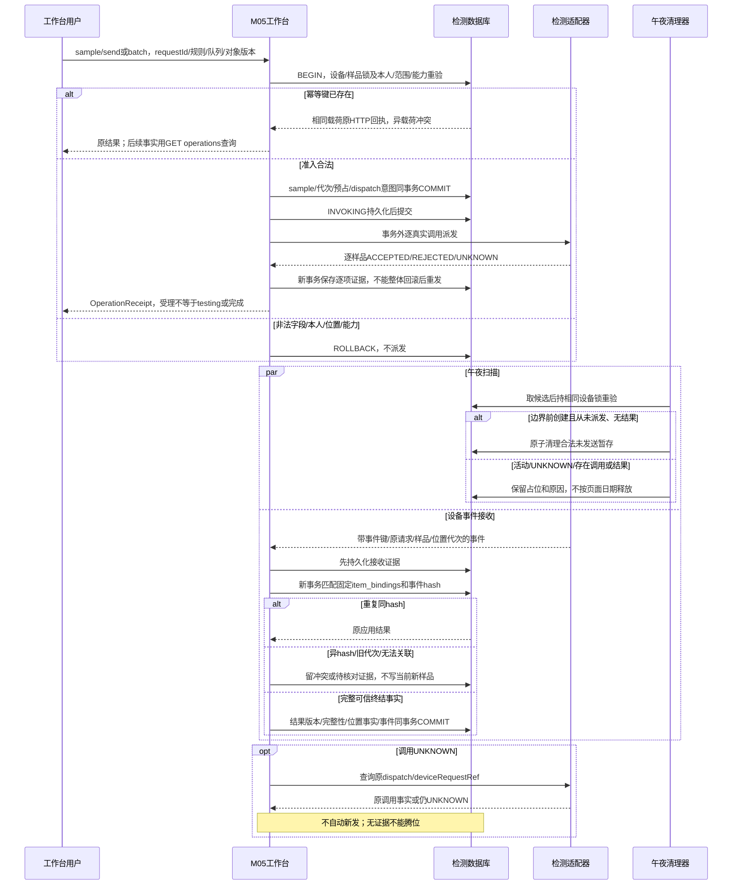

# 发送、午夜清理、接收与恢复

契约版本：DD-20260913-R2。依据[检测工作台接口与位置生命周期](检测工作台接口与位置生命周期.md)及所属模块接口定义。模块标签表示应用职责，不强制拆为独立微服务。本图为设计规格，未执行联调。

完成后左侧腾位保留结果和签批记录；COLUMN锁与物理遮挡分别核验。设备侧取消证据只按核准能力处理，不新增系统设备取消按钮。

## 验收断言

- 正常路径按固定身份只产生一次业务生效。
- 在每个提交前后注入响应丢失／重启，恢复后保留原身份及不可变证据。
- 同键异载荷、旧版本、无权限与依赖未知不得返回虚假成功。
- 图中物理与外部调用在事务提交后；同库业务调用不擅自改为远程RPC。
