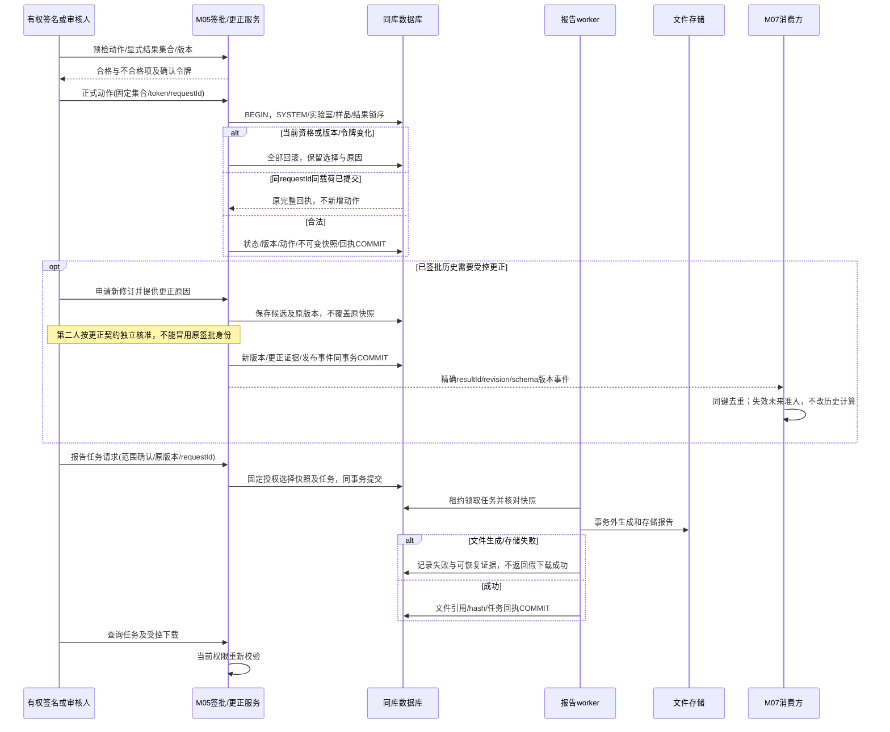

# 签批、更正与报告

契约版本：DD-20260913-R2。依据[受控更正与审计保留设计](受控更正与审计保留设计.md)及所属模块接口定义。模块标签表示应用职责，不强制拆为独立微服务。本图为设计规格，未执行联调。

签名与审核必须不同人；异步文件失败不撤销已提交签批。更正入口受消费者schema兼容门禁约束，模拟事件不证明生产已兼容。

## 验收断言

- 正常路径按固定身份只产生一次业务生效。
- 在每个提交前后注入响应丢失／重启，恢复后保留原身份及不可变证据。
- 同键异载荷、旧版本、无权限与依赖未知不得返回虚假成功。
- 图中物理与外部调用在事务提交后；同库业务调用不擅自改为远程RPC。
