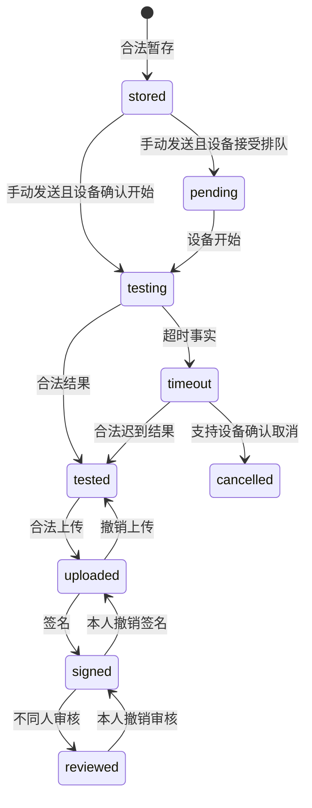

# M05 检测与数据签批详细设计

2026-11-07 S04第4组：样品身份与培养关联按[工作台专题](检测工作台接口与位置生命周期.md)的V5.1增量，混选签批/适用作废审批按本文第11节，分类型签审Excel按[报告专题](签批记录与报告导出设计.md)。新增独立范围见[设备使用记录](设备使用记录查询与导出契约.md)和[Load Sample](LoadSample页面与检测交接契约.md)；[本组报告](history/review/2026-11-07-S04第4组执行报告.md)列明局部待确认与跨组交接。下列早期“设计完成/无剩余”均限其原确认范围，不能覆盖本轮V5.1部分完成及未验证结论。

## 开始培养专项增补（SC-20261017）

M05经M03 CultureStartProfilePort读取已生效类型/前缀，下发ViCell时冻结expectedCellType/sourceRevision，返回按下发快照比对并保留仪器原文；不匹配标红并产生可去重告警事实。不能读取未提交页面草稿或用样品编号前缀冒充类型前缀。前缀格式/大小写等仍需SC-Q07核准；现有显式类型优先级保持。

最新保存规则（2026-10-17）：小试、中试均只在第4步点击“完成”并成功提交后保存业务数据；未完成页面刷新或取消后从第1步重新开始，不恢复表单或中间步骤。操作审计和设备安全收尾保留，必须当天完成的限制不变。

步骤时间记录：四步分别记录服务端开始/结束时间及结束原因；刷新重开新建尝试，旧时间审计保留，未知结束时间不伪造。时间留痕不构成业务表单的中间保存点。

当前专题：[开始培养详细设计](../07-补液运行与任务执行/开始培养工作流详细设计.md)；实施拆分：[开始培养开发计划](../../开发任务/小试中试开始培养开发计划-20261017.md)。本次仅文档补充，业务代码、数据库、设备操作均未执行。

## 三类实验室接入补充（INTEGRATION-20261010）

[检测接入契约](三类实验室检测接入契约.md)补齐三类实验室的派发权归属、旧新结果关联、重复/迟到/部分失败处理、位置释放及M07有效结果交接；总体范围见[共同边界](../00-三类实验室设备接入与执行边界.md)。

检测仍走现有检测派发与观测接收契约，不统一改走补液命令Port。M05接收结果不直接触发泵；一期旧签名不直接等价新系统审核，M09检测告警源须先核对注册。对应INTEG-05/06/07，未核准关联不得用于自动补糖。

> 2026-09-17 M08排除交接：检测工作台、记录、签名台、签批、更正及检测报告PDF/Excel均独立交付，数据管理仅延期在线/离线综合统计入口。业务CRUD、原始接收落库、授权查询及M07/M09结果消费不依赖M08统计表/响应；事件保留后续统计补取能力。见[边界B01—B03/B13及BD01/BD13](../00-M08排除范围与跨模块交付边界.md)。

> 2026-09-11审阅收尾：本模块最新补充见[审阅收尾接口与验收补充.md](审阅收尾接口与验收补充.md)与[审阅收尾完整字段字典](审阅收尾完整字段字典.md)，当前目标15表294列。下文旧表数/包号属于当时基线；以最新增量包及[统一处置表](../00-跨模块审阅收尾/history/review/统一审阅收尾核对.md)为准。仅设计完成，运行验证未执行。

2026-09-10。状态：M05当前确认范围详细设计已完成，可作为开发输入。涵盖七类设备工作台、结果操作与签批、报告导出、跨模块交接、14表267列目标结构及迁移核验回退。业务代码、SQL执行、历史数据核准、接口/浏览器/设备验证未完成。入口：[业务模块目录](../00-业务模块划分与设计目录.md)。

## 1. 范围与依据

本模块沿用现有futurefab-system检测域，不新建独立微服务。依据[数据管理（V4.0 第 7 章）](../../需求说明书V5.1-1030_md/07-数据管理.md)、[检测分析（V4.0 第 8 章）](../../需求说明书V5.1-1030_md/08-检测分析.md)、[数据签名操作台（V4.0 第 9 章）](../../需求说明书V5.1-1030_md/09-数据签名操作台①（5.0调整）.md)、[签批记录（V4.0 第 10 章）](../../需求说明书V5.1-1030_md/10-签批记录①.md)及[最新澄清](../../需求说明书V4.0-0904_md/需求澄清决策记录.md)。在线/离线统计归M08，检测原始结果与签批生命周期归M05。

| 需求标识 | 功能 | 本模块交付 |
| --- | --- | --- |
| M05-REQ01 | 手动取样/手动测样、Load sample、自动取样/手动测样及自动化任务的检测部分 | 样品身份、请求参数、检测关联；与M07已纳入的培养取样测样任务衔接，不能以Q36早期排除覆盖 |
| M05-REQ02 | BGA、Vi-CELL、OSMO-1/2/3、Cedex Bio/HT | 型号能力、队列与批次发送、结果关联、超时及设备取消反馈 |
| M05-REQ03 | 暂存、手动重发、删除与清空 | Q37午夜清理及Q38设备取消，严格区分界面清空、业务删除与物理停止 |
| M05-REQ04 | 检测记录及明细 | 接收、原值、单位、编辑、上传/撤销上传、异常、整结果作废/恢复（不新增单指标入口） |
| M05-REQ05 | 数据签名操作台 | 样品分组/检测类型卡片、批量预检、签名/审核/撤销及结果日志 |
| M05-REQ06 | 签批记录、报告打印与导出 | 精确数据范围、历史签批事实、原模板字段/单位及访问审计 |
| M05-REQ07 | 结果与运行交接 | M07/M08按明确结果版本消费，M04默认温度和60分钟冲突契约接入 |

不恢复09章已删除的“添加审批人”功能；不能因为旧det_approval_assignee表/Controller存在就恢复页面。检测结果审核不接入M06通用业务审批状态机。培养配置及结束培养按最新已授权范围由所属模块落实。单个检测项作废/恢复不在需求范围；整结果作废沿适用审批政策，不新增与补液/校准任务联动。

## 2. 已确认规则与本轮事实

| 规则 | 设计约束 |
| --- | --- |
| Q37暂存恢复 | 用户点击发送手动重发，不因设备恢复在线或有空位自动发送；每天24点清理未发送暂存。按Asia/Shanghai业务日处理，事务竞态和历史保留按工作台与接收契约执行 |
| Q38设备取消 | 系统没有取消按钮/接口；只接受支持取消设备的可信取消反馈，不向不支持设备提供假取消 |
| Q42样品ID长度 | 既有长度已确认完成，不重新定义业务位数；数据库varchar(64)是容量，不等同业务编码规则，复用当前生成/校验实现后核对 |
| Q47非培养类检索 | 查询未关联培养ID的检测，不能当成“非本人培养”；project/culture空值不等于免权限 |
| M04-Q07默认温度 | BGA DEFAULT在任务开始且实际取样前读取目标控制器当前设定温度并固定，不能在保存模板时解析；手工检测页面温度规则另按原文 |
| M04-Q08时间冲突 | 同培养、检测类型集合有交集、等待后的计划时刻差严格小于3600秒冲突；恰好3600秒允许，跨午夜使用完整时间差。常量/核心方法必须记录已确认业务原因 |
| M03历史分享 | 仅历史查看/打印/导出；不能因持有分享记录取得上传、签名、审核、作废或设备派发资格 |
| 签名审核不同人 | 09原文已明确，不再提问；比较稳定用户身份，不能靠显示名、账号改名或超级管理员身份绕过 |
| 撤销本人限制 | 仅本人可撤销自己当前有效签名/审核；审核后先合法撤销审核才能撤销签名，均有必填原因 |

## 3. 型号差异基线

下表按08当前首表与用户最新说明整理。暂存空白明确为不显示按钮；列数与每列填写行数独立，单发每次只提交一条。2026-09-30用户明确本表两列语义：“工作时可发次数”即该设备**可以同时检测的数量**；“排队”写否表示发送到设备后即检测中、无待检测，写时表示同一时刻只有一个检测中、其余待检测，两者并存时排队规则优先。据此Cedex Bio为多样品同时在测、OSMO-1为1个、OSMO-2/3与Vi-CELL均为1个在测其余待检测；七型号模板逐台核对一致，无需改数值。完整配置、暂存/删除及物理轮询见[可配置发送、暂存与删除规则设计](可配置发送暂存与删除规则设计.md)。

| 型号 | 暂存 | 发送模式 | 单次上限 | 每列填写行数 | 排队 | 列数 | 工作时可发次数 |
| --- | --- | --- | --- | --- | --- | --- | --- |
| BGA | 有 | 单发 | 1 | 100 | 否 | 1 | 1 |
| Cedex Bio | 无 | 单发 | 24 | 24 | 否 | 1 | 不限次数 |
| Cedex Bio HT | 无 | 整列发 | 15 | 15 | 否 | 6 | 6 |
| OSMO-1 | 有 | 单发 | 1 | 25 | 否 | 1 | 1 |
| OSMO-2 | 无 | 整列发 | 20 | 20 | 是 | 1 | 不限次数 |
| OSMO-3 | 无 | 整列发 | 24 | 24 | 是 | 1 | 不限次数 |
| Vi-CELL | 无 | 整列发 | 9 | 12 | 是 | 1 | 不限次数 |

M05-Q03旧“column一律等整列完成”解释已被本次详细说明替代：整列发只规定批量提交；HT配置整列锁，Vi-CELL配置位置锁与圆盘遮挡、允许合法空位追加。workSendLimit以显式workCapacity.unit计量，不再按sendMode推导单位。Cedex Bio单发始终每次一个，24保留单次上限原值，不转成24并发限制。运行行为只读核准配置；设备协议路由仍沿既有协议键。

## 4. 状态、身份和领域对象

当前DetConstants统一SampleStatus已有idle/stored/pending/testing/tested/uploaded/signed/reviewed/exception/timeout/cancelled/voided。det_sample.queue_status和det_result.result_status均保存这些编码，注释“统一主状态”不表示数据库只有一列。目标沿用编码，事件原子更新按设备接收契约及结果操作专项执行，不再并行创建一套同义状态表。

需求08的13个中文状态、上述12个落库编码与位置占用态occupancy_state三者**不是一一同义**，对应关系、无对应名的一态（UNKNOWN、RESERVED）以及需求操作矩阵原文允许删除待检测/检测中已被2026-09-30第十三轮问答收窄（仅未发给设备的记录可删）等冲突，统一登记在[检测状态三向映射表](检测状态三向映射表.md)；删除与装新样的判定只取占用态及其证据，不得由中文状态名或queue_status字符串推导可操作性。

| 状态/事件 | 目标口径 |
| --- | --- |
| idle | 左侧可填写空槽；未持久化空白行不强造检测记录 |
| stored | 尚未发送的用户暂存；仍可合法编辑/发送，午夜清理仅覆盖未发送暂存 |
| pending/testing | 依据设备真实接受/排队/开始事实，不能将请求已发出等同实际开始 |
| timeout | 超过有依据的检测等待时间；迟到合法结果仍可进入tested，不等同cancelled或确定未执行 |
| tested→uploaded→signed→reviewed | 分别为收到检测结果、合法上传、签名、审核；结果到达不等于已签名或已审核 |
| uploaded→tested | 只通过符合状态与权限的撤销上传，保留操作历史 |
| signed→uploaded、reviewed→signed | 对应撤销签名/审核，原人和时间进入历史，当前有效状态更新 |
| tested/uploaded→voided | 整检测结果作废保存void_from_status；恢复回原状态，不统一恢复为uploaded |
| 单指标作废/恢复 | 非本期需求；旧字段/实现保留历史追溯，不新增操作或审批入口 |
| cancelled | 可信设备侧取消事实，能力未知或无反馈不伪造 |
| exception | 按设备及页面允许状态标记异常，保存原因；不因人为标记就声称设备停止 |
| clear/delete | 当前有clear_flag/del_flag，属于显示/删除语义；不将删除当作物理取消事件 |

图只表现已明确的主链，整结果作废、直接发送、删除及异常分支见规则表，不能据图反向删掉允许的业务分支。

sample_id是不可复用内部身份，sample_no是可按规则修改/删除后复用的业务编码；send_batch_no是一次页面提交批次，不能替代结果唯一身份。原文唯一范围为同实验室同检测大类的已发送未删除记录，包含原ID和修改后ID。det_sample_id_history需参与核验；旧det_sample的sample_no索引不是唯一约束，不能宣称已防并发占号。

删除后迟到回传不能仅按同名sample_no挂到新发送。后续接收契约必须保留设备请求/检测身份和原始载荷；不足以唯一关联时保留待核验，不静默写入新的同名样品。接收身份、去重和异常投影已在设备接收契约/字段字典展开；真实设备字段能力须按适配核对清单接入验收。

## 5. 页面与交互设计落点

| 页面 | 内容与行为 | 完整设计位置 |
| --- | --- | --- |
| M05-UI01 型号检测工作台 | 设备选择、左侧需求队列、右侧结果；按型号展现合法操作 | [工作台接口](检测工作台接口与位置生命周期.md)、[配置规则](可配置发送暂存与删除规则设计.md)、[接收恢复](设备发送结果接收与位置释放契约.md) |
| M05-UI02 检测记录 | 按08检测记录章节查询，展示结果与明细 | [检测记录与结果操作](检测记录与结果操作设计.md) |
| M05-UI03 数据签名操作台 | 样品分组、每检测类型一张结果卡片，当前页全选；已作废无签批选择框 | 本文11—12节、[签批存储](签批动作与不可变快照数据库设计.md) |
| M05-UI04 签批记录 | 默认当前上传人、上样时间及必须选择授权项目后查询；详情、日志 | [记录查询](检测记录与结果操作设计.md)、[签批记录](签批记录与报告导出设计.md) |
| M05-UI05 报告/导出及操作日志 | 原需求模板与真实字段单位、操作对象快照、原因 | [报告设计](签批记录与报告导出设计.md)、[附件核对](history/review/报告附件核对记录.md) |

UI03沿用内容优先：主筛选与结果同屏，次要筛选可收起，不新增无业务用途的介绍/统计卡片；保留需求规定的筛选字段，布局不能删业务条件。查询前必须选项目的页面显示明确空态，不能先加载全系统数据再前端过滤。全选只作用于当前已加载允许卡片，跨页批量若后续需要必须另定显式选择协议。

批量签名/审核二次确认分别列出可操作与不满足状态/本人条件的卡片，提交明确可操作集合；不能把整页静默当作全库操作。现有executeBatchAction逐项执行并收集RuntimeException，属于当前实现事实；目标预检排除项与正式原子提交、对象版本及回执语义已在第11节明确，不能仅靠预检保证安全。

## 6. 现状复用与差异

详见[现状核对与复用清单](history/review/现状核对与复用清单.md)及[数据库字段基线](数据库字段基线.md)。已提取12张det_表164列，不新建平行样品/结果表。本轮关键源码结论限实际读取的方法，不声称全链路或所有旁路已经审计。

当前签名操作台路径/detect/sign-console，已有projects、batches、query、sign、audit、revoke-sign、revoke-audit、void、revoke-void、print、export入口。sign/audit具有detect:sign:sign及detect:sign:audit功能权限。浏览器通过request.js的VITE_APP_BASE_API拼接，部署核验该配置，不硬编码/system或把服务路径当完整浏览器URL。

DetResultWorkflowServiceImpl签名检查uploaded及无有效签名，写结果并同步样品/签名记录；审核路径另外调用validateApprovalAssignee，它按培养/批次/项目/实验室的旧配置命中，超级管理员直接放行该配置检查。已读路径尚不能满足新需求所有授权要求；尤其被删除的添加审批人入口不能作为新版本授予审核资格的默认来源。

## 7. 跨模块契约索引

| 所有方→使用方 | 目标责任 | 本轮边界 |
| --- | --- | --- |
| M01/M02/M03→M05 | 可信身份+功能权限+实验室/项目有效范围，历史分享单独用途 | 查到对象可见不等于能签名、审核或发送；审核资格按已确认Q01 |
| M02→M05 | 检测设备型号/项目/稀释/发送能力与通讯证据 | 配置正常不代表在线、空闲或真实接受 |
| M04/M07→M05 | 已固定检测参数、明确培养与候选计划时刻、任务关联 | 消费固定版本，不在运行时追模板最新；Q07/Q08按已确认规则 |
| M05→M07 | 明确结果ID/版本、指标ID/值/单位、检测时间、有效性和来源 | 不返回一个没有身份的“最新残糖值”；结果作废/修改不能覆写M07已用历史快照 |
| M05→M08/M09 | 授权结果投影、领域事件、异常/超时/冲突通知事实 | 告警发送失败不回滚真实设备结果；M08不修改结果主状态 |

自动检测参与状态、部分冲突、删除/作废/取消/超时与恢复已在[跨模块契约](自动检测与跨模块结果契约.md)第3节明确；M04已确认3599/3600秒边界保持。设备接受但本地结果未知时保留发送事实，先查询/关联后决定重发；不能简单回滚数据库后重发非幂等设备请求。

## 8. 初始验收矩阵（设计用例，未运行）

| 编号 | 场景 | 预期 |
| --- | --- | --- |
| M05-C01 | 暂存后设备上线/腾出空位 | 不自动发送，用户点击发送后才进行准入 |
| M05-C02 | 午夜清理与手动发送并发 | 已获得发送事实的记录不被当未发送暂存清理 |
| M05-C03 | 同实验室/同检测类复用仍占用的原样品ID | 拒绝并发或修改别名造成的重复 |
| M05-C04 | 删除后复用样品ID，原请求迟到 | 不写入新同名检测，保留可追溯关联或待核验载荷 |
| M05-C05 | 无取消能力/反馈却试图系统取消 | 无业务取消入口，不伪造cancelled |
| M05-C06 | 超时后合法结果到达 | 按原请求身份处理，超时历史保留，不永久丢结果 |
| M05-C07 | 本人签名后本人审核 | 拒绝，即使持有审核功能码 |
| M05-C08 | 已审核时直接撤销签名 | 拒绝；须本人合法撤销审核后再处理签名 |
| M05-C09 | 已检测/已上传分别作废后恢复 | 分别回tested/uploaded，历史不丢失 |
| M05-C10 | 一张Cedex结果卡作废 | 仅按原结果级入口及适用审批，不级联同样品BGA等其他检测类型；不新增单指标作废入口 |
| M05-C11 | 仅历史分享用户调用审核/发送 | 拒绝，不能通过分享用途升级 |
| M05-C12 | 跨午夜3599秒/3600秒同培养同类检测 | 前者冲突，后者不因Q08阻断，仍做资源准入 |
| M05-C13 | 发送被设备接受但本地提交结果不明 | 保留证据并查状态，不盲目再发 |
| M05-C14 | 签批时角色被撤销或记录被别人更新 | 正式提交重新校验，返回明确冲突/拒绝，无伪成功 |

## 9. 已确认业务决策

### M05-Q01 删除添加审批人入口后的审核资格（已确认，2026-09-10）

状态：用户已确认。09原文已删除添加审批人，本期审核资格不再以独立det_approval_assignee名单命中作为必需条件。签名人与审核人不能相同继续执行。

确认规则：审核人需要审核功能权限，并且是该检测所属项目/批次/培养范围的有效负责人或普通成员；沿M03继承关系解析，不要求额外维护独立检测审批人名单。仅历史分享不允许审核，仍遵守当前实验室及对象权限；不能审核本人签名。无培养检测的审核主体按第11.7节已确认Q02，本问题不擅自为其补项目。

例：张三给项目A的结果签名；李四是项目A有效成员且有审核功能权限，可以审核；王五只收到项目A历史分享，即使能查看这条结果也不能审核。该规则已确认为目标设计；接口接入和旧数据处理尚未实施，不自动删除原审批人记录。

## 10. 设计完成判定与开发入口

当前七项需求均已落实到规则、页面/接口、存储、跨模块契约与设计验收场景，见[M05覆盖矩阵与开发验收](M05覆盖矩阵与开发验收.md)。Q01—Q08已确认，不存在本期新增待确认业务问题。按D1—D5推进开发与验收，不把未知外设能力当作已验证可用。

当前图服务不可用，已尝试index/search/coverage后转定向源码。未运行Maven、前端构建、接口、MySQL、浏览器、通讯及设备验证。设计文件完成不代表实施完成；真实设备/历史数据准入按具体证据控制。

## 11. 结果签批状态与批量接口（第一批目标契约，2026-09-10）

本节处理有培养关联及真实无培养关联的检测结果卡片，分别执行Q01/Q02。无培养结果的审核资格按已确认Q02（第11.7节），不能用前端补projectId借用Q01。目标复用DetSignConsoleController/Service及DetResultWorkflowServiceImpl，不创建另一个签批系统；所有入口最终调用同一领域状态操作。

2026-11-07 S04对账：原生重新澄清72、73、74及93统一确认签批混合选择仅办理合格卡片，其他不动并告知；本节的“先预检分组、再确认合格集合”保留。已知不合格项不能导致要求用户重新选择整批；全不合格时只展示原因、不发送写请求。原文未裁决并发失败的部分提交，本节11.5继续用锁内全量重验已确认集合并整体提交，不把业务混选的跳过规则推广到其他业务批量操作。

### 11.1 已读源码差距与改造位置

进一步直接读取结果撤销签名/审核、整结果作废/恢复、单项作废、校验方法，读取DetResultMapper的查询/更新/撤销片段及DetResultSignRecordMapper写入/锁定/撤销片段。图search/coverage仍不可用，未声称所有旁路审计已结束。

| 当前事实 | 目标改造 |
| --- | --- |
| det_result_sign_record已有signer_user_id；当前insertDetResultSignRecord列清单未写该列 | 写入稳定操作者ID；当前有效签名/审核用该ID验证本人，不以create_by或sign_by文本作为身份权威 |
| updateDetResult/revokeSignResult/revokeAuditResult所读SQL仅以result_id定位 | 所有结果写入统一对象版本校验与条件更新；状态/签名/撤销/指标变更不能绕过版本递增 |
| 撤销签名和整作废恢复锁定最近活动动作记录，并记录revoked_by_sign_id | 复用该历史关联，增加结果指针一致性校验；不能从多个冲突活动记录任取最新一条掩盖旧数据问题 |
| 审核和撤销审核依赖旧validateApprovalAssignee | 按Q01改为当前有效负责人/普通成员+功能权限，撤销审核仍限原审核本人；M06审批人不是替代来源 |
| 当前voidWholeResult会调用cancelDeviceOrder；后者对命名管道BGA调用cancelSample，对OSMO/Vi-CELL调用delOrder | Q38禁止系统发起取消；本期结果作废移除此设备取消副作用。结果作废、恢复、签批均只修改合法业务状态与审计，不发设备命令 |
| 当前批量逐项捕获RuntimeException并返回计数 | 目标分离预检可操作集合与正式原子提交；预检排除项不提交，正式已确认集合一旦发生冲突则全体不写，避免确认后静默部分成功 |

本节移除的是应用层“结果作废触发设备取消”调用，不推导删除所有协议适配器或设备取消回调。适配器其他调用者和自动离线重试仍须后续定向核对；不能仅改一个按钮就声称Q37/Q38全入口闭合。

### 11.2 动作矩阵

每个动作先校验真实结果/样品及培养关联、对应功能权限、当前有效领域范围，再校验状态/身份。只有历史分享或角色只读范围不取得修改资格。Q01审核资格不等于允许审核所有实验室对象；原有实验室限制继续合并，不从结果上传人身份推导审核权。

| 动作与服务路径 | 当前功能码复用 | 必需当前状态/身份 | 目标状态/原因 |
| --- | --- | --- | --- |
| SIGN /detect/sign-console/sign | detect:sign:sign | uploaded；无当前有效签名；有效普通业务操作范围，排除仅分享 | signed；不新增强制签名理由，reason=null或选填≤500字 |
| REVIEW /detect/sign-console/audit | detect:sign:audit | signed；按真实关联满足Q01或Q02；审核者ID≠当前签名者ID | reviewed；仅审核通过，不恢复旧DTO的reject动作；reason=null或选填≤500字 |
| REVOKE_SIGN /detect/sign-console/revoke-sign | detect:sign:sign | signed；当前操作者=当前有效签名人；当前仍有该动作权限 | uploaded；原因去首尾空白后1—500字 |
| REVOKE_REVIEW /detect/sign-console/revoke-audit | detect:sign:audit | reviewed；当前操作者=当前有效审核人，当前仍符合对应Q01/Q02 | signed；原因1—500字 |
| VOID /detect/sign-console/void | detect:sign:edit | UI03仅uploaded；检测分析的tested作废走原独立入口，共用领域实现时传可信用途 | 原因1—500字；适用审批则先提交作废候选、原结果不覆盖，通过后才voided；免审直接voided；不改其他检测类型 |
| RESTORE_VOID /detect/sign-console/revoke-void | detect:sign:edit | voided；存在唯一可验证原作废动作，beforeStatus是tested或uploaded | 恢复准确beforeStatus；原因1—500字；不恢复旧签名/审核 |

每个“卡片”操作对象是resultId，不是同sampleNo下所有结果。不得因按钮叫“样品作废”就将BGA、Cedex等全部结果级联作废。单指标作废/恢复不是本期需求，旧resultItemId路径仅为既有实现事实，不作为目标入口。

当前账号改名但userId相同，仍是同一签名/审核人；同名新账号userId不同，不能撤销旧账号动作。超级管理员不能豁免不同人审核和撤销本人限制。旧记录身份无法可靠映射时保留历史查看，返回ACTOR_IDENTITY_UNVERIFIED，不把当前操作者回填成旧签名人。

### 11.3 参数与预检

所有ID为正bigint十进制字符串，版本为非负十进制字符串。Header Authorization始终必需。正式写另外要求X-Request-Id为UUID及X-Management-Revision；沿M01同操作者24小时回执规则。服务路径以上表为准，浏览器沿request.js的VITE_APP_BASE_API拼接，不新增另一条假定网关路由。

新增M05-SIGN-API01 POST /detect/sign-console/preview-action，只读预检，无写回执与管理版本递增。Body固定action、items、reason三键：action取表中六种；items为1—100个去重{resultId,expectedObjectVersion}；reason按动作要求，可用字典填入但最终提交合法文字，禁止仅保存会变的字典显示引用。字段集合外一律400，例如auditAction、printerId、signerUserId、projectId及客户端beforeStatus不得进入此DTO。

API01权限不使用独立“preview”权限码，而是按Body.action映射并校验目标写动作的功能码：SIGN/REVOKE_SIGN→`detect:sign:sign`，REVIEW/REVOKE_REVIEW→`detect:sign:audit`，VOID/RESTORE_VOID→`detect:sign:edit`；同时叠加对象读取范围。预检通过不授予后续写权限，正式接口再次实时校验。

PreviewResult={action,managementRevision,expiresAt,eligible:EligibleItem[],ineligible:IneligibleItem[],confirmationToken:string或null}。EligibleItem仅resultId、sampleNo、detectClass、currentStatus、objectVersion；IneligibleItem仅resultId、code、message，对无权对象不返回样品/设备/培养或操作者细节。全部不可操作时confirmationToken=null且不能提交。响应按请求顺序展示，不静默把不可操作项计为成功。

confirmationToken为服务端签名的短期确认凭据，绑定操作者、action、最终eligible ID与对象版本集合、规范化reason摘要、managementRevision及expiresAt，目标有效5分钟；不将浏览器“已确认=true”当安全证明，也不需要新建确认表。凭据不得携带身份会话密钥或无权对象信息。页面显示可执行项与排除原因并要求二次确认；切换动作、修改理由/选择或重新加载数据须重新预检。预检成功并不冻结角色、成员、实验室或结果状态。

### 11.4 六个写接口与完整响应

M05-SIGN-API02—07依次对应11.2六条路径，均POST。Body仅items、reason、confirmationToken，items必须与令牌中的eligible集合及版本完全一致；action由服务路径确定，不接受浏览器传任意动作名调用动态SQL。读预检可包含不合格选择项，正式写只提交用户确认的合格集合。

WriteResult={requestId,action,managementRevision,completedAt,items:WriteItem[]}，WriteItem={resultId,previousStatus,currentStatus,objectVersion,actionRecordId,approvalId}。approvalId复用M06审批单身份，免审/非审批动作为空；需审批作废时currentStatus仍为原结果状态，返回申请动作记录及审批单，不能以申请提交表示已作废。所有submitted项的本次业务提交一起成功，状态或候选、领域记录、公共审计及回执同事务。正式提交时任何项权限/对象版本/状态变化或历史身份不可核验，整次不写，返回409/403/503与可安全披露的定位信息；不能继续旧实现逐项吞异常后报部分成功。此处为批量技术设计，保留原文“先展示可操作/不可操作再确认”的业务交互。

作废需审批的卡片按既有M06场景产生候选，申请未生效时卡片置灰且不允许其他操作，底层原结果、当前有效版本和指标不提前改写；审批通过后M05重新核验原结果版本/状态及资格，在同一短事务写voided与审计。驳回保留原结果，恢复原可操作投影；不得先作废再补审批，也不新增单指标审批或设备停止副作用。批内免审卡片在本次提交生效，需审卡片仅表示申请提交，页面逐卡显示这两种事实。审批交付及副本通用规则由M06拥有，本节只规定M05生效边界。

技术失败或冲突后保留选择及理由，让用户刷新受影响内容并重新预检，不在客户端自动删掉失败项重试。重复同requestId和相同规范化负载重放原完整成功结果，不再次创建动作记录或递增版本；同requestId异负载拒绝。重放先验证当前身份与读取该原结果的权限；成功回执重放不因确认令牌随后过期而重新执行动作。过期回执不能简单用新requestId重做未知状态动作，先查当前记录。

| 错误码 | 语义 |
| --- | --- |
| INVALID_REQUEST | 字段、数量、重复ID、非法原因/版本/动作；400 |
| FORBIDDEN_OR_NOT_FOUND | 当前无权或目标不存在的统一对外结果；不泄露无权对象 |
| RESULT_VERSION_CONFLICT | 任一结果已变；409，整次不写 |
| MANAGEMENT_REVISION_CONFLICT | M01公共管理版本已变化；409 |
| RESULT_STATE_CONFLICT | 任一状态或当前动作指针不满足；409 |
| SIGNER_CANNOT_REVIEW | 对有权结果，操作者是当前签名人；拒绝审核 |
| ONLY_CURRENT_ACTOR_CAN_REVOKE | 非当前签名/审核人；拒绝撤销 |
| ACTOR_IDENTITY_UNVERIFIED | 旧历史缺稳定用户/动作依据；不猜身份 |
| CONFIRMATION_EXPIRED_OR_CHANGED | 令牌过期、选择/理由/动作不一致；重新预检 |
| DEPENDENCY_UNAVAILABLE | 实验室/成员/关联事实读取不可得；503，不降级放行 |

### 11.5 事务和历史事实

目标锁顺序统一SYSTEM→真实labId升序→sampleId升序→resultId升序→明细/动作记录；先读取定位信息，再在锁内复核关联未变。鉴权使用锁内同一业务日期/管理版本，状态检查针对锁定的当前行。所有结果/明细写入口包括回传修订、编辑、作废、签批及撤销须接入结果对象版本；只改签批入口不足以防止签名后数据被另一入口修改。

正式提交先验证所有项，再写任何一项；出现数据库错误整体回滚。每个结果增量更新使用expectedObjectVersion与预期状态作条件，影响行数必须1。当前样品状态同步须验证该结果与样品的真实有效关联，不将旧结果写回新发送槽位。状态、身份、明细内容、单位及当前有效签名/审核动作必须能形成同一时点证据。

det_result_sign_record复用为领域动作记录：已有sign_id、result_id、sample_id、action_type、action_reason、signer_user_id、before_status/after_status及撤销关联。目标SIGN与REVIEW都写稳定操作者ID和精确结果内容快照；撤销新增对应动作记录，只标原记录is_voided及revoked_by_sign_id/voided_time，不能删除或覆写原动作内容。通用修改/删除签批日志入口须移出正常业务授权，保留领域追加与受控撤销。

最小目标增量责任：det_result新增object_version及当前有效签名/审核动作指针；det_result_sign_record补动作所针对的结果版本和不可变内容快照。具体字段类型、完整DDL/迁移将在数据库目标字典统一交付，本节不把设计增量混入12表164列当前基线。优先复用已有signer_user_id，不再另建“审核人名单”或另一张签名历史表。

历史存在多个活动签名/审核、无原动作或用户身份不可核准时，迁移列异常清单并保留现有显示文本，不从用户名相同就自动关联同名新账号。当前sign_by/review_by可继续作为展示快照，不能再作为权限判定的唯一事实。作废前状态及动作before_status不一致同样阻止自动恢复。

### 11.6 接口验收（设计用例，未运行）

| 编号 | 场景 | 预期 |
| --- | --- | --- |
| M05-SIGN01 | 项目成员有审核功能权限，但未在旧审批名单 | Q01允许继续状态/本人等检查，不因旧名单缺行拒绝 |
| M05-SIGN02 | 旧审批名单有记录但无负责人/普通成员身份 | 不能仅凭旧名单审核 |
| M05-SIGN03 | 同人改账号名后审核本人签名 | 稳定userId相同，拒绝 |
| M05-SIGN04 | 同名新账号撤销旧账号签名 | 稳定userId不同，拒绝 |
| M05-SIGN05 | 当前页选3项，预检2项可操作1项已审核 | 明确展示2可操作/1排除，正式请求仅含2项 |
| M05-SIGN06 | 预检后其中1项被别人修改/签名 | 正式2项全部不写，重新预检 |
| M05-SIGN07 | 预检后被撤销成员或功能权限 | 正式拒绝；token不保留已失效权限 |
| M05-SIGN08 | 重复相同requestId重试成功请求 | 重放相同结果，无重复签批历史/版本递增 |
| M05-SIGN09 | 同requestId换reason或集合 | 拒绝异负载重放 |
| M05-SIGN10 | 令牌跨用户使用或过期 | 拒绝；已成功请求的合规回执查询单独处理 |
| M05-SIGN11 | UI03对tested结果提交VOID | 不允许从此入口作废；不得伪造用途绕过 |
| M05-SIGN12 | 合法作废/恢复调用命名管道设备 | 不发生cancelSample/delOrder或其他设备命令 |
| M05-SIGN13 | 旧记录signer_user_id为空 | 不猜本人，保留查看并提示身份依据待核准 |
| M05-SIGN14 | 原动作缺失/存在多个活动记录 | 拒绝自动恢复，不取“最新一条”掩盖冲突 |
| M05-SIGN15 | 同一次批量写入第2项数据库失败 | 所有项状态、记录、审计及回执整体回滚 |
| M05-SIGN16 | 修改检测值入口与签名同时提交 | 同结果对象版本保护；旧内容不能被当作已签名新内容 |

### 11.7 M05-Q02 无培养检测审核（已确认，2026-09-10）

M05-Q02用户已确认：Q47允许无培养关联检测；此类结果没有项目/批次/培养成员身份，Q01不能直接套用。确定按该结果真实所属实验室授权：审核人具有detect:sign:audit且实验室等级至少可操作1，仍不得审核本人签名；只可查看0不允许审核，不新增独立审批名单。实验室可管理2也满足等级条件，但仍需审核功能权限与不同人约束。

例：一条未关联培养的Cedex检测属于实验室A，李四在A有可操作权限和审核功能权限，且不是签名人，可审核；只有实验室B权限的用户不能审核。该规则已确认为目标接口授权要求，代码尚未接入；有培养结果继续Q01，不能清空cultureId降级到此规则。

## 12. 签名台查询、样品分组与历史展示（2026-09-10）

### 12.1 原文规则与当前差距

09原文规定：默认进入不出数据；必须选择授权项目；日期按上样时间、最多30天、默认当天；查询最小粒度为样品ID，任一检测类型结果命中则展示同一样品全部检测结果；横向按该样品各检测类型最早上样时间从早到晚排列。

本轮完整读取DetSignConsoleMapper.xml及服务的项目/批次选项、querySamples和查询参数校验。当前项目选项仅按未删除与项目创建时间，结果日期按r.create_time，状态条件直接加在结果行，服务按sample_id分组；当前单位优先取dev_detector_item.unit。目标分别改为当前用户授权/参与时间、可信上样时间、先命中样品组再展开授权结果、跨类型同一样品的业务分组、保留结果时单位。只读查询不能修改数据库历史值。

### 12.2 查询类型和输入

保留服务路径与detect:sign:query；增加明确用途用途枚举而不是接受浏览器自报角色。M05-SIGN-API08 GET /detect/sign-console/projects：Query keyword可省略（≤100字符）、pageNum默认1、pageSize默认10/最大100；输出Page<Option>，Option={id,label,associatedAt:ISO或null}，仅当前用户在M03签批查询用途可见的项目。按真实关联/参与时间倒序，未知时间置后，再按稳定项目ID倒序；不使用项目创建时间冒充用户参与时间。

M05-SIGN-API09 GET /detect/sign-console/batches：Query projectId必填、keyword/pageNum/pageSize同API08；校验真实父项目当前可见，仅返回其授权批次。共享历史用户只取得其获准历史范围中的选项，不扩成普通操作范围；候选接口不返回其他实验室隐藏对象数量。

M05-SIGN-API10 POST /detect/sign-console/query：只读，不要求写Header或产生回执。Body固定projectId、batchId、startDate、endDate、sampleKeyword、projectTag、operatorFilter、status、pageNum、pageSize；仅projectId/startDate/endDate必填，batchId可null，文本空白归null且≤100字符。pageNum默认1，pageSize默认10且1—100，分页单位为完整样品组；横向滚动可加载下一页，不能对指标行或单卡片分页导致半个样品组。

operatorFilter固定{mode:SELF_UPLOADER/ANY_PERSON/ALL,keyword:string或null}。默认SELF_UPLOADER、keyword=null，以可信当前用户稳定ID过滤“发送检测需求的人”；ANY_PERSON要求1—100字keyword，在送检人/当前有效签名人/当前有效审核人的账号及显示名中做OR模糊搜索；ALL要求keyword=null，不限制人员。人名搜索是显示检索，不作为身份授权。旧历史人员身份无法核准时仍可在授权历史按保留文本搜索，不能据此获得本人动作资格。不得将浏览器填写当前用户名等同SELF_UPLOADER。

status取ALL/UPLOADED/SIGNED/REVIEWED/VOIDED，默认ALL，明确映射当前小写存储值；拒绝任意SQL值和未知枚举。所有条件之间AND，sampleKeyword内部sample_no或culture_code为OR。LIKE中的百分号/下划线按普通检索文字转义，不开放用户SQL通配表达式。

日期为yyyy-MM-dd，按Asia/Shanghai的[startDate 00:00,endDate次日00:00)查询，含首尾自然日数≤30；必须start≤end，不使用数据库服务器本地时区推测边界。“上样时间”依08定义为需求发送成功时间，不能使用结果建立时间或检测完成时间替代。当前列testing_start_time是否在所有适配器中保持此义需逐路径核对；未知历史上样时间保持null，不编造创建时间填补。该历史记录仍可通过其获准的其他历史查询途径查看，不让未知时间在普通日期范围中伪匹配。

UI03项目必选规则不因Q02取消。无培养结果由检测记录/设备工作台中的真实无培养入口查看并执行同一签批领域动作，不给记录补虚假项目；完整查询及详情/操作入口见[检测记录与结果操作](检测记录与结果操作设计.md)，Q02资格已确定。

### 12.3 先命中组、再展开结果

业务组身份由服务器用真实labId、真实cultureId（无培养显式null）和规范化当前sampleNo确定，不能仅凭显示样品ID跨实验室/培养合并。编码规范化复用已经核准的样品ID规则，不新增长度规则；groupKey为该组合的服务器不透明投影键，仅用于页面分组，不替代sample_id或result_id，不新增样品主表。一个业务组可含不同检测类型对应的多条内部sample_id。

对同一有权组的处理分两步：第一步至少一条结果同时满足日期、状态、人员等结果级筛选；第二步返回该组全部可展示且当前有权的检测结果，不再次套第一步的状态/日期/人员限制。项目/批次/真实培养/实验室范围和删除/历史许可约束两步始终生效。不能因有权BGA命中，就展开另一实验室或无权结果；不能将被删除的历史发送与复用同名新发送混在一起。

“全部检测结果”包括同组当前已有的其他状态结果：例如已上传BGA命中时，同组检测中的Cedex展示状态与暂无结果，而非假造0值或隐去该卡片；其签批allowedActions按实际状态为空。合法作废卡片保留灰显，指标作废不等同整卡片作废。界面可以标记matchedFilter，解释为何有些展开卡片不符合当前筛选条件。

同组同检测类型若实际存在多个有效结果，返回独立resultId卡片并标识本次检测身份/时间，不按类型覆盖成一条或取最后一条。是否存在这种历史情况须数据库核验；不在本节自动删除重复或发明“最新即正确”。复用编码与迟到结果归属仍遵守第4节的不可复用内部身份。

排序取展开后同组全部有权有效上样时间的最小值，升序；无可信时间的组置后，稳定身份打破并列。组内默认按检测大类BGA、VICELL、OSMO、CEDEX，再按上样时间/结果ID排序；未知型号值不冒充其中一类。total按组计数，第一步查询count与分页必须用同一范围条件。第二步批量加载本页组内结果/指标，避免每个指标触发一次数据库查询。

每次查询使用一次一致性数据快照和一次权限判定时间；分页间不承诺结果冻结，数据或权限变化后刷新，不能让旧页面结果直接绕过第11节正式提交校验。当前页全选只选择本页可签批卡片，未加载组不进入选择。

### 12.4 输出与历史单位

Page<Group>={rows:Group[],total:非负整数,pageNum,pageSize,queriedAt:ISO,managementRevision:Version}。Group={groupKey,sampleNo,labId,projectId,batchId,cultureId,cultureCode:string或null,secondId:string或null,dayNumber:非负整数或null,firstLoadedAt:ISO或null,results:ResultCard[]}。全部ID使用字符串，历史未知值为null，不能将培养天数未知补D0。

ResultCard={resultId,sampleId,detectClass,detectType,resultStatus,objectVersion,device:DisplayRef,loadedAt:ISO或null,completedAt:ISO或null,uploader:PersonSnapshot或null,signature:ActionSnapshot或null,review:ActionSnapshot或null,items:ResultItem[],matchedFilter:boolean,allowedActions:string[],issues:Issue[]}。DisplayRef={id:ID,label:string或null}；PersonSnapshot={userId:ID或null,account:string或null,displayName:string或null}；ActionSnapshot={actionRecordId:ID或null,actor:PersonSnapshot,actedAt:ISO或null}。用户身份只能来自当前签批有效动作及已核准历史，不能拿当前登录人代填。

ResultItem={resultItemId,itemId:ID或null,itemCode:string,itemName:string或null,valueText:string或null,numericValue:十进制字符串或null,unit:string或null,isVoided:boolean,voidReason:string或null,isAlarm:boolean或null}；Issue={code,path,message}。无结果用null，异常文本或低于检出限等原始表达保留valueText，不把无法解析的值转0。numericValue仅在有明确解析依据时给出，原始精度保留，前端不回传展示值覆盖检测值。

`ResultItem` 是**页面/HTTP 投影形状**，不是 `det_result_revision.content_snapshot` 的 `items[]` 键名依据（INT-11，2026-10-07）：它把 `itemCnName`/`itemEnName` 合并为单个 `itemName`、把 char(1) 旗标转成 boolean、不携带 `itemOutcome`/`originalValue`/`lowerLimit`/`upperLimit`/`sourceEvidence`/`lastEventId`/`activeVoidActionId`。快照明细元素的权威键名、可空口径与取值域以[自动检测与跨模块结果契约](自动检测与跨模块结果契约.md)4.1 为准；跨模块消费方需要 item 级事实时按该清单或 Port 契约取值，不得凭本投影猜键名，也不得因投影缺键就宣称快照缺键。

历史单位/项目名称优先读取结果接收时保存的事实；当前dev_detector_item调整显示、单位或禁用后不能改写既有结果的含义。如历史unit缺失且未核准，不用当前字典单位无条件填补；列UNIT_UNVERIFIED并允许有权查看，涉及计算/换算的消费则按其准入拒绝。当前配置项与设备回传项的并集可以用于当次采集期配置和显示缺项，但不能用今天的配置删除已签名快照中的旧项目。

“编辑”按08原文是修改样品ID及保存原因/历史，不等同允许手工改检测数值。其他值修订仅在有明确接收/更正业务契约时执行并生成版本，不能以通用编辑DTO开放原始结果、单位或签批字段任意修改。

### 12.5 查询验收（源码与契约测试分开登记）

| 编号 | 场景 | 预期 |
| --- | --- | --- |
| M05-QUERY01 | UI03未选项目进入 | 不加载结果；服务端缺项目也拒绝 |
| M05-QUERY02 | 送检时间与建结果时间跨日不同 | 按真实上样时间筛选，不按r.create_time |
| M05-QUERY03 | 30天/31天含首尾日期 | 前者可查，后者参数拒绝 |
| M05-QUERY04 | BGA已上传命中，同组Cedex已审核 | 两张卡片均展示，Cedex不因状态筛选消失 |
| M05-QUERY05 | 命中组另有检测中结果 | 展示真实状态/暂无值，不生成0结果，不允许签名 |
| M05-QUERY06 | 样品ID相同但实验室/培养不同 | 不混组、不跨权限展开 |
| M05-QUERY07 | 已删除旧发送编码被新发送复用 | 不把旧发送结果合并入新组 |
| M05-QUERY08 | 多种检测类型分别使用不同sample_id | 真实同组身份时汇总，不按单sample_id拆成多个样品列 |
| M05-QUERY09 | 同组同类存在多次有效结果 | 保留独立结果身份，不任取最新覆盖 |
| M05-QUERY10 | 历史单位g/L，当前配置改成另一单位 | 显示历史g/L，不无公式转换数值 |
| M05-QUERY11 | 历史缺单位、当前字典有单位 | 保留未知及issue，不伪造当时量纲 |
| M05-QUERY12 | 默认人员筛选时账号改名 | 按稳定送检人ID仍可命中，不能依赖旧用户名模糊匹配 |
| M05-QUERY13 | 批次属于另一个项目或无权对象 | 拒绝或统一无权响应，不通过客户端父ID组合读出 |
| M05-QUERY14 | 当前页全选后加载下一页 | 不自动将新页卡片纳入上次确认集合 |

2026-10-13：047 后端已接入专用查询服务与 Mapper，在同一只读 REPEATABLE_READ 事务内按可信身份授权，再读取当前有效版本，完整业务组分页。返回公共分页四字段与专用 queriedAt；顶层管理版本由公共 CurrentManagementRevision 提供。结果项按返回页批量读取；分组候选按稳定 resultId 每 500 条续读，没有静默截断。签名/审核按精确有效动作及快照校验；更正版从两份更正签名投影，不伪造旧动作 ID。未核验时间不以旧本地时间补齐，未核验单位不以当前字典补齐。同组辅助字段 secondId/dayNumber 任一未知则组字段为 null，不把未知当身份冲突；两个已知值矛盾仍拒绝。

培养代码/项目标签作为当前主数据查询标签，由新增 M03 DetectionHistoryDisplayPort 读取，只接受已授权结果的稳定培养 ID，加入调用方同库事务；不得写回结果历史快照。送检人按 sent_user_id 稳定 ID 过滤，账号/当前显示名通过 M01 UserRosterFactsPort 的当前人员可见子集读取；不可见人员保留稳定关联并置空名称。签批人员返回当时快照的显示名；当时账号缺失时可取已核验精确动作的 create_by，不通过账号反查用户 ID。动作时间缺少明确时区仍为 null。

当前候选归属核验仍复用已有逐结果 Port 读取，完整组总数也在应用内计算；大项目性能须在真实 MySQL 验证，不把 500 条读取分块视作总量上限。历史行缺少已核准派发绑定或时间证据时仍可能拒绝或无法命中日期，按 BLOCKED_DATA 登记，不放宽权限或制造时间。当前测试证据见 M05 实施台账；真实数据库/部署 HTTP、前端页面、历史数据核准仍后置。七种型号队列和发送/接收详见专项；旧离线恢复路径仍须区分人工暂存与已接受/未知请求。

## 13. 检测结果完整性与配置化位置释放（2026-09-10修订）

### 13.1 原文事实及概念拆分

已直接读取08 BGA暂存/发送/清空、Vi-CELL队列、OSMO-2/3队列、Cedex Bio检测项配置及Bio HT列规则。本节为定向规则基线，完整工作台字段/能力及接收设计已在专项中展开；真实型号协议仍须逐项接入验证。

| 事实 | 原文/已确认依据 | 设计含义 |
| --- | --- | --- |
| 任一指标返回 | 08多型号状态表：拿到任一检测项结果置为已检测 | tested表达已有结果；不能从这个状态单独证明全部指标齐全或物理位置可重用 |
| 自动上传 | 08：所有检测项均获取且关联到历史已创建培养ID时置为已上传 | 完整性和培养关联均须核实；无培养不能擅自套用有培养自动上传分支 |
| HT整列禁用 | 一列发送后，在全部检测完成前该列样品ID置灰；直到全部变为已检测才再次发送 | 最新Q03修订：仅lockScope=COLUMN时要求整列完成；sendMode=column本身不产生列锁 |
| 清空 | 清空填写区；现clearDetSampleBySampleIds只设clear_flag | 界面清空不等于设备结束；运行中请求及实际位置关联保留，不能按clear_flag直接释放设备占用 |
| 删除 | 原08右侧结果删除与本次左侧样品删除须分开；左侧pending/testing不可删除，列批删跳过不可删项 | 保留原发送内部身份/载荷，不用显示编码接迟到结果，不通过删除触发取消；不将左侧规则扩展成删除签批历史 |
| 取消 | Q38只在支持取消的设备上操作 | 系统仅消费可信设备反馈；不为清空、删除、作废隐式发送取消 |

单项数据到达、结果完整、检测实际结束、结果上传、签批状态和可再次使用物理列是不同事实。前端不要把一个resultStatus字符串同时用作这些判断的全部依据。

### 13.2 期望项目与回传证据（目标逻辑契约）

每个发送请求固定expectedItems，即当次合法选择/按型号协议必须返回的检测项目稳定身份集合及单位依据；关联样品、结果和设备请求身份一起保存。Cedex按当次已选项目，不因用户随后修改设备项目配置改变这次“完整”的定义。系统不能把甲样品的项目拼到乙样品，或把额外未知项目当作补齐缺失必需项。

目标完整性投影包含expectedItemIds、receivedExpectedItemIds、missingExpectedItemIds、unexpectedItems、resultCompleteness、deviceCompletion。集合去重，多个回传更新同一指标须按后续接收修订/去重契约记录，不能累加条数就声称齐全。resultCompleteness取NONE/PARTIAL/COMPLETE/UNVERIFIED：NONE尚无期望项目结果；PARTIAL已到部分；COMPLETE期望项目均有可核验返回；UNVERIFIED缺当次期望集合或映射证据。不能让空expectedItems集合自动满足“全部回齐”。

deviceCompletion取NOT_FINISHED/FINISHED/UNKNOWN，必须来自该型号适配契约认可的完成事实；不以数据接收超时、记录删除、clear_flag、一个指标值或本地事务提交推断FINISHED。部分设备可用完整结果包作为完成证据，但必须由型号协议明确，不统一假设另有设备回执。

低于检出限、设备项目失败或无法测量可能是合法回传状态，不能为凑COMPLETE填0；如何区分“项目已返回终态但无数值”和“项目尚未返回”由回传协议展开，计算消费者仍须独立校验是否有可用数值。数据完整不代表每一指标都适合计算，结果签名也不能补造缺失值。

### 13.3 列身份、页面状态与恢复

仅protection.lockScope=COLUMN的配置维护整列锁：列占用关联本轮发送、真实列号及全部已提交sampleId，空位不计入完成集合。POSITION配置维护逐位置占用，同一列可同时存在多次提交；禁止用“存在上一批”直接拒绝合法空位追加。

目标ColumnProgress={detectorId,columnNo,lockScope,activeDispatches,occupiedPositions,completionStatus,canSend,blockingReasons}。activeDispatches各自保留dispatchIdentity/sampleIds/finishedSampleIds/pendingSampleIds，不用单一dispatchIdentity覆盖追加的第二批。请求身份须有设备适配依据，不把页面send_batch_no默认当设备幂等身份。canSend由可信配置、权限、容量、位置、遮挡和版本统一计算。

超时/异常/删除不能代替完成证据；保留相应位置及COLUMN配置的列占用。设备侧确认取消/失败后的释放另走异常恢复，不伪造正常COMPLETE。圆盘位置复用仍保留旧样品和请求关联，迟到回传不得覆盖新占位。

Q37手动暂存仍只在用户点击发送后尝试派发。现retryOfflineDispatches方法存在自动派发路径，后续需核实调用者及来源：人工暂存/离线未发送需求不得进入自动发送候选；已接受或未知设备请求必须先核实结果，不当作新的暂存再发。午夜清理不能消除任何已接受/未知发送的证据或物理占用事实。

### 13.4 M05-Q03修订：发送粒度与锁定范围独立（已确认）

用户随后对HT与Vi-CELL给出更具体说明，替代旧“所有整列发送都必须整列结束”的统一解释。HT某列发送后全部进入检测中，该列不可编辑删除，全部检测完成后可再次使用；其他五列仍可发送。Vi-CELL允许工作中继续向合法空位补样，新1号按物理位置轮询，不能因column模式一律等上一批完成。

因此sendMode与lockScope、queueEnabled、workCapacity.unit、occlusion分开配置。COLUMN锁正常释放仍须本轮全部已发送样品完整结束，首项tested不释放；POSITION锁按各位置事实释放并叠加遮挡，不将其他样品未完成等同整列不可用。

已确认行暂存/列暂存、行删除/列删除、批删跳过及物理轮询，统一记录为[规则设计Q04—Q07](可配置发送暂存与删除规则设计.md)。字段与接口是技术目标设计，尚未落地或设备验证。

### 13.5 完整性与列恢复验收（设计用例，未运行）

| 编号 | 场景 | 预期 |
| --- | --- | --- |
| M05-COMP01 | 一个样品首项回传，其余未回 | 可有tested显示，完整性PARTIAL，不伪装已齐 |
| M05-COMP02 | 发送后设备检测项目配置被删改 | 当次expectedItems不变，不改历史完整性条件 |
| M05-COMP03 | 一个项目重复返回5次 | 不按条数凑齐5个不同期望项目 |
| M05-COMP04 | 设备返回额外项目但缺一个必需项目 | 保留额外事实，不能替代缺失必需项 |
| M05-COMP05 | 期望项目集合未知或为空 | UNVERIFIED，不用空集合推出COMPLETE |
| M05-COMP06 | HT一列只发送3个样品，其余空槽 | 本批固定3个内部样品身份，不等15个槽全满 |
| M05-COMP07 | COLUMN锁三样品各返回1/5项 | 该列不可再次发送，首项tested不释放列；不推广到所有column发送 |
| M05-COMP08 | 清空/删除页面上的未完成样品 | 原批次/请求与物理占用事实保留，不隐式取消 |
| M05-COMP09 | 一个项目返回设备错误无数值 | 保存终态与错误，不填0；可计算性另判 |
| M05-COMP10 | 超时后用户试图重占原位置或COLUMN锁列 | 没有完成/释放证据时拒绝；POSITION的其他空位独立判断 |

本节不发布未经核准的设备字段地址或承诺所有型号具有完成回执；完整接收DTO、关联/去重、适配准入和目标结构已由后续接收及最终数据库包补齐。

### 13.6 能力消费与验收修订

M02提供经过核准的规则快照，M05统一消费sendMode、单次上限、workCapacity.unit/workSendLimit、lockScope、队列与遮挡能力；禁止按名称、sendMode或carrierType推导其他维度。缺必要映射时ready=false。列发请求仅含同列本次候选，未发送候选与当前已运行位置分开，不重复提交待检测/检测中样品。

| 编号 | 场景 | 预期 |
| --- | --- | --- |
| M05-COMP11 | OSMO列发、POSITION锁，原列有待检测样品 | 已发送位置不可重用；其他合法空位按容量及配置判断，不因整列发一律拒绝 |
| M05-COMP12 | 圆盘部分位置空闲、原批次未全完成 | 合法且无遮挡空位允许追加；待检测/检测中不能改删 |
| M05-COMP13 | COLUMN配置A列忙、B列空闲且容量允许 | A列拒绝，B列继续准入 |
| M05-COMP14 | single配置请求两条、单次上限24 | 仍拒绝，两条不能借上限伪装单发 |
| M05-COMP15 | workSendLimit=0 | 总量不限，但仍检查配置的列锁/位置锁与遮挡 |
| M05-COMP16 | 活动/未知请求期间改模式或锁配置 | M02结构使用守卫阻断，旧请求规则和占用保留 |

## 14. 可配置发送、暂存与删除

本轮完整规则子设计见[可配置发送暂存与删除规则设计](可配置发送暂存与删除规则设计.md)：含六组能力配置、七种模板映射、行/列操作、圆盘位置轮询、批量删除逐项跳过、目标接口、并发/回执、M02存储交接和30条设计验收。暂存与发送候选原子校验；批量删除可删项提交、不可删项跳过，不改变签批批量原子语义。数据库字段/迁移及业务代码未实施，不标M05全模块完成。

## 15. 工作台接口与运行字段（第二批目标契约）

[检测工作台接口与位置生命周期](检测工作台接口与位置生命周期.md)展开样品白名单、培养确认、字段能力、八动作接口、读取投影、左侧腾位与午夜边界，新增16条验收。新目标稀释范围按08正文1.0—20.0，不沿旧2.0常量。完成样品左侧移除保留右侧结果及签批历史，当前连带删除方法不能直接复用。

[发送规则与运行字段增量设计](发送规则与运行字段增量设计.md)给出五张既有表20列、索引、不变量、意图派发/恢复及迁移回退要求，新增10条数据验收。对应SQL设计稿已交付；业务代码、SQL执行及设备接入尚未实施。M05-Q08已确认暂存修改/删除仅限本人；本人发送限制和批删跳过已经明确。

## 16. 发送规则数据库设计包

[数据库交付说明](发送规则数据库交付说明.md)汇总本轮20列、M02六列同步/旧库补丁、M05十四列增量及两侧未启用回退；[运行目标字段字典](发送运行目标字段字典.md)覆盖三张运行表67列。新增12条SQL验收场景，仍待实际MySQL执行。结果/签批增量设计已由后续包补齐；代码及设备仍未完成；M05-Q08已明确确认仅暂存本人可修改、删除，批删跳过他人项。

## 17. 设备发送与结果接收契约

[设备发送结果接收与位置释放契约](设备发送结果接收与位置释放契约.md)展开适配能力、逐样品接受/拒绝/未知、六个内部服务方法、事件关联与幂等、乱序/更正、结果完整性、超时补齐及位置释放，新增28条验收。[设备适配与结果采集核对清单](设备适配与结果采集核对清单.md)记录当前HTTP/NamedPipe采集与本地FIFO推进差异；已读路径不是生产协议认证。该清单 **2026-11-04 增补“CDP 同库访问条款”**：现场 `cdp_testing_*` 与主库同实例，正式路径允许使用主库/同实例连接，“必须独立 `sourceInstanceRef`”仅适用于对方库独立部署。

结果tested不再作为终止采集或释放占位的充分条件。圆盘下一检测按可信物理顺序/开始证据，不以create_time最早行自动晋升。接收原文/去重/冲突需要耐久技术收件对象；其物理DDL、实际开始/完成观测时刻和完整性状态已由06—10接收包补齐，不包含在发送20列中。代码和实机未改，M05-Q08已确认仅暂存本人可修改、删除。

## 18. 接收事件与结果数据库包

[接收持久化设计](接收事件持久化与结果字段设计.md)和[字段字典](接收事件与结果字段字典.md)冻结技术收件表30列及既有三表17列，06—10提供迁移前/增量/迁移后/未启用回退/累计目标DDL。结果共同版本固定object_version，未另外新增result_version；有效签批动作指针与快照已由11—15包补齐，最终累计结构见20。新增20条数据验收场景，尚未执行。

本节补齐17节所列收件物理DDL、实际开始/完成观测、完整性与采集状态的设计交接；不代表业务接入或实机验证完成。 **2026-11-04 增补“双通道唯一性与 `testing_end_time` 口径”** 见[接收持久化设计](接收事件持久化与结果字段设计.md)末尾增量条款，**2026-11-04 用户裁决：单设备只允许一种通道**（约束落在 `lab_communication.communication_type`），通道中立唯一键已否决。发送20列包独立保留，累计既有表增量37列，另有新事件表30列。历史值不自动核准，M05-Q08权限已确认仅暂存本人可修改、删除。

## 19. M05-Q08 暂存本人操作边界（2026-09-10已确认）

用户明确确认：仅暂存本人可以修改、删除暂存样品。同实验室其他人员，包括负责人及有管理权限的人员，也不得直接修改、删除他人暂存；批量删除跳过他人项。发送他人暂存继续禁止。身份以稳定用户ID校验，并同时检查功能权限、数据范围和状态；未知历史身份不默认授权。

本问题已关闭，接口及新增M05-WB17—20验收详见[工作台接口第6—7节](检测工作台接口与位置生命周期.md)。本次只同步已确认业务设计，尚未修改业务代码或执行权限测试。

## 20. 签批动作与不可变快照数据库包

[签批存储设计](签批动作与不可变快照数据库设计.md)补齐11节的有效签名/审核/作废指针、动作前后版本、不可变快照和长期请求证据；[字段字典](签批动作与快照字段字典.md)列明两表12列，11—15提供迁移核验及未启用回退，累计两表64列。新增20条验收，未执行数据库。

object_version复用接收包。统一事务锁序补充设备：SYSTEM→真实labId升序→detectorId升序→sampleId升序→resultId升序→明细/动作，与接收入口一致；11.5的原锁序按本节补齐。历史缺身份或当时内容保留UNVERIFIED，不用当前内容补造旧快照；代码、历史接管及并发测试仍未完成。

## 21. 当前确认范围设计完成（2026-09-10）

新增[检测记录与结果操作](检测记录与结果操作设计.md)、[签批记录与报告](签批记录与报告导出设计.md)、[自动检测与跨模块结果](自动检测与跨模块结果契约.md)，补齐本期剩余规则、接口、异常及恢复边界。报告原PDF八页及两工作簿25个sheet结构已核对，具体证据见[附件记录](history/review/报告附件核对记录.md)。

[最终数据库包](结果操作报告与版本发布数据库设计.md)新增既有表16列及14列不可变版本/发件箱表，16—20提供前后核验、增量、未启用回退与全量参考；[完整字段字典](M05完整目标字段字典.md)累计14张det_表267列。M02六列另计。原SQL与需求未改，不执行迁移或补造历史事实。

设计验收和开发顺序统一见[覆盖矩阵](M05覆盖矩阵与开发验收.md)。本文前面分批形成的接口/数据库段落仍保留其阶段范围，当前总状态以本节和文首为准；业务实现、接口并发、浏览器、模板输出及设备验收仍待执行。

## 2026-09-11 用户确认后的补充（当前适用）

用户已接受M05-Q09/Q10/Q11，见[受控更正与审计保留设计](受控更正与审计保留设计.md)及[交付核对](history/review/已确认审阅方案交付核对.md)。新增更正申请/双人审核、完整新版本、批次报告忽略人员/日期筛选及审计暂不自动删除。当前完整目标为15表293列，见[完整字典](受控更正后完整目标字段字典.md)及25目标，01—20和14表267列仍是旧迁移基线。当前新增26条场景，原276条保留。

本节覆盖前文“本期没有更正入口”“历史只能另行设计接管”“没有剩余审阅问题”的范围判断；普通六动作仍限本人，更正不得冒充历史签名。当前已确认推荐方案设计已交付；其他两轮审阅事项仍按交付核对列为待收尾，不能宣称全部复审通过。代码、SQL执行与实机未完成。

### DD-20260913-R2 开发级时序图：发送、午夜清理、接收与恢复

[发送、午夜清理、接收与恢复](检测生命周期开发级时序图.md)覆盖本链事务和恢复分支，接口字段仍以引用的权威契约为准。

### DD-20260913-R2 开发级时序图：签批、更正与报告

[签批、更正与报告](签批更正报告开发级时序图.md)覆盖本链事务和恢复分支，接口字段仍以引用的权威契约为准。

### DD-20260913-R2 错误码统一入口

[错误码全集](错误码全集.md)归集本模块HTTP拒绝与异步原因，局部表为场景说明；命名和技术映射以统一入口为准。

## 十二月范围与澄清同步（2026-11-01）

样品/整条结果作废按入口及适用审批配置；需审批时通过后生效，免审批沿原合法流程。单个检测项作废、恢复及相应审批不是本期需求；旧字段和接口只能解释历史实现，不再列目标入口。第51—55、102—103项额外联动/锁定/导出规则撤下，不增加作废→补液或校准任务暂停恢复。签名/审核本身仍按既有M05链。

签名卡“区间”读反应器当前离线检测项上下限，缺双侧显示未配置，单侧展示该侧，读取失败显示暂无法获取。Cedex提示按itemCode前三位，确认继续、不合并删项。培养取样测样与独立Load Sample/灌注检测的开始培养前置分别处理；Load Sample全所选检测完成并确认孔位可复用才释放。设备统计明细/Excel读取真实派发事实。

本节与[十二月上线范围与澄清规则](../00-十二月上线范围与澄清规则.md)共同落实；仅剩[三类具体开发对接子项](../00-十二月上线开发对接待核事项.md)，不新增业务待决。本次仅文档同步，HTTP/浏览器/设备NOT_VERIFIED。

## 2026-11-07 本轮设计收口补充

整结果VOID逐卡适用审批的最小目标交接、M05/DETECTION_RESULT/schema2、合法候选存储差异及071原请求恢复见[结果操作第6.1/7节](检测记录与结果操作设计.md)。原M05-043/044、其他六动作条件及历史状态不因目录SC052自动扩展；当前需审共享源码/合法存储仍未具备，不以旧DIRECT测试记完成。M03历史取测/指标的只读来源目标见[跨模块结果契约末节](自动检测与跨模块结果契约.md)及PKG，不能以已有统计结果查询代替完整发送历史。上述仅设计，无DDL/源码或运行验收；本轮内部测试与HTTP/浏览器交work1后续统一执行。
