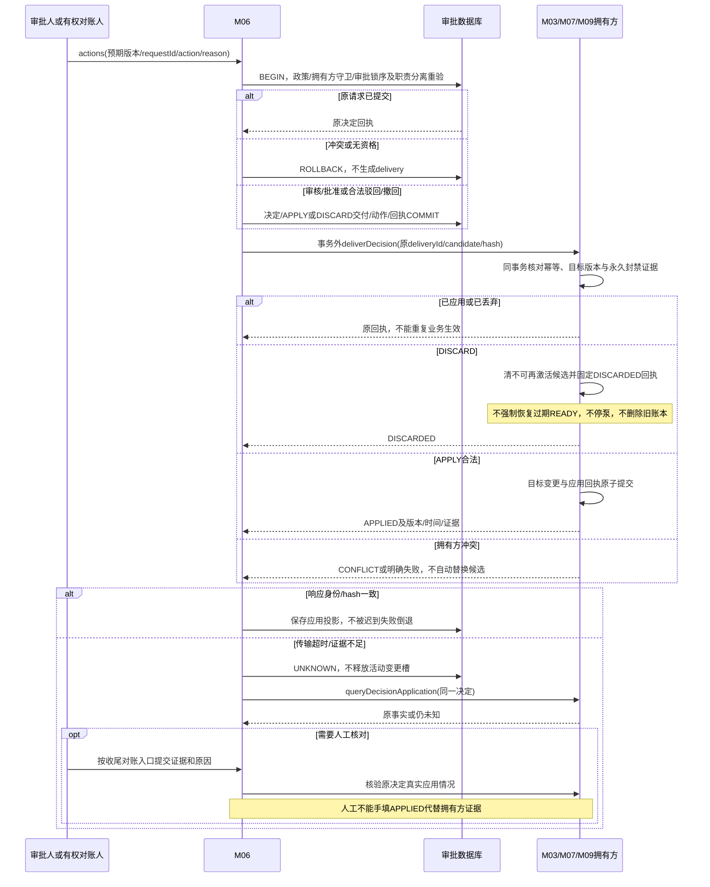

# 决定交付、DISCARD与人工对账

契约版本：DD-20260913-R2。依据[审阅收尾对账与启用契约](审阅收尾对账与启用契约.md)及所属模块接口定义。模块标签表示应用职责，不强制拆为独立微服务。本图为设计规格，未执行联调。

网络至少一次允许原delivery重投，业务应用幂等。永久封禁和归档查询遵循收尾契约，不将查库失败解释为NOT_FOUND。

## 验收断言

- 正常路径按固定身份只产生一次业务生效。
- 在每个提交前后注入响应丢失／重启，恢复后保留原身份及不可变证据。
- 同键异载荷、旧版本、无权限与依赖未知不得返回虚假成功。
- 图中物理与外部调用在事务提交后；同库业务调用不擅自改为远程RPC。
