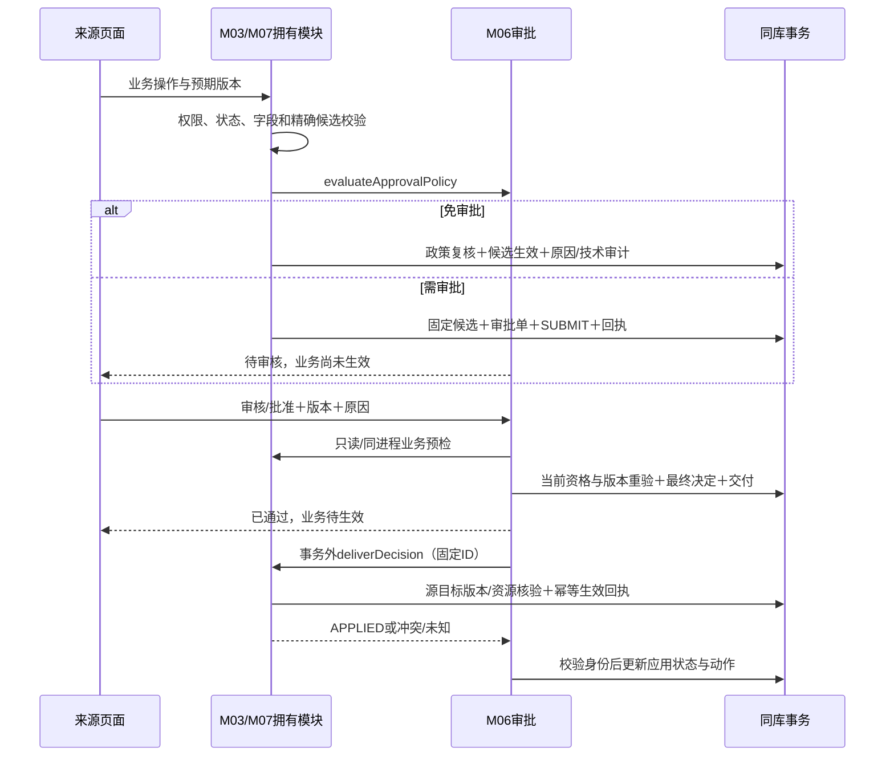

# M06 接口与审批生效契约

## 2026-11-07 现行澄清适用口径

依据正式决策记录末尾S04客户答复及后续补充。本节与下文正文同步；仅为设计，不证明代码或设备已验证。

- **Q-3-02**：保留原D0拦截：当前培养有审核中或执行中的补液任务时不得修改D0。允许修改且方案合法生效后，取消按方案生成的未执行任务，再按新方案生成今天尚未到点及未来日期任务；人工指定日历时间任务保留、不取消、不平移，已执行事实及历史保留，已执行具体计划不补做。取消/新增继续按原实验室适用审批，不采用原任务改时间重排路径。
- **Q-3-06**：原提前取消申请跨计划结束日获批后继续按原取消申请生效，最终为已取消；审计actualEndedAt采用该申请内记录的结束时间，审批时间另记。此为本场景对旧“最终服务器时刻作为实际结束”的明确例外。终态及原占用释放仍在审批通过且原安全/版本条件满足后的实际应用事务中提交，应用/释放时间不回写为申请内业务结束时间；正常结束等其它场景不受此例外扩展。

## SC026 用户会话只读决定原件核验

2026-11-07 固定泵撤回补充：SC026 的 WITHDRAW 在审批守卫事务提交后、响应返回前，按原交付 ID 调用既有交付执行器处理 DISCARD；不新建审批，也不在 GET 中清除候选。清除成功后，默认连接重新读取原生效配置并恢复编辑。处理失败时仍保存已撤回的审批事实，未确认清除的候选继续保留，不伪造回滚或提前解锁。

2026-11-08 本人撤回事务补充：拥有方接到真实 `CANCELLED/WITHDRAWN` 的 SC026 DISCARD 时，在既有 M07 本地可写事务内先锁 SYSTEM，再复用 M03 原清候选和回执逻辑；无需启用设备后台资源事务或定时交付开关。`FixedPumpWorkerDecisionProofPort.readWithdrawalDecision` 在当前事务内读取并核验原撤回决定，非 WITHDRAWN 返回 null；`verifyWithdrawalDecision` 仅在可写事务内核验真实撤回及完整原命令。APPLY 和其他取消决定仍使用原资源事务证明口。撤回结果查询仅查原决定、待审指针和回执，不加锁或写数据；原候选尚在则返回 PENDING，以便既有 UNKNOWN 恢复链路处理同一决定。撤回不更改旧生效配置、补液规则或任务。

交付执行与固定泵原件校验统一使用 `ApprovalDecisionCommandFactory`，从原审批单及交付记录的冻结列装配完整决定。`apr_delivery.payload_json` 是决定及候选身份摘要，保留现有九字段格式，不能按完整 `ApprovalDecisionCommand` 直接反序列化；固定泵核验先逐项比对这份摘要，再使用同一装配函数核对完整决定。决定时间取原交付 `created_at`，影响取原 `change_snapshot`，政策取原 `policy_snapshot`，请求 ID 沿既有交付身份算法生成；不读取当前方案或当前政策来替代原决定。

2026-11-06 后台应用补充（2026-11-08 更新固定泵恢复范围）：`FixedPumpWorkerDecisionProofPort` 在原固定泵资源事务内核验 APPLY/DISCARD 的真实 M06 决定；本人撤回使用上文专用证明口，后台读取原件仍受培养范围约束。SC026 的 UNKNOWN 先查原决定，当原审批为 APPROVED 且决定为 APPLY，或原审批为 CANCELLED/WITHDRAWN 且决定为 DISCARD，并且拥有方核验同一候选仍待处理、返回身份一致的 PENDING 后，沿用同一交付、决定和请求 ID 幂等恢复。驳回及其他取消决定不自动重投。DISCARD 只清候选、保留原生效版本。查询接口自身只读；UNKNOWN、查询异常、身份不符、人工对账或其他场景均不因此自动重投。已应用/已作废原件直接返回原结果，不重复替换方案或创建任务。

M06 内部 `FixedPumpApprovalDecisionProofPort.verifyApply` 只在真实用户会话中核验固定泵 SC026 的审批 APPLY 决定原件；不公开 HTTP、不接收调用者声称的用户身份，也不支持后台 worker、草稿直存或政策免审。M06 以可信会话身份及实验室查看、培养可见范围校验授权，无权与不存在同口径；从 `apr_request` 与 `(approval_id, decision_version)` 唯一交付读取原件，复核 M07/CULTURE/SC026、培养和实验室、候选 ID/版本/摘要、发起人、目标版本、冻结政策及审批决定，并使用 `ApprovalDecisionDigest.v1` 重算原决定摘要。返回的证明只表明审批原件一致；UNKNOWN 等交付状态不证明业务已生效，M03 仍须独立核验自身生效回执与设备、方案事实。缺少会话、原件、访问范围或内容不一致时拒绝，不构造证明。该内口源码接线不代表 HTTP、数据库或浏览器已验证。

2026-11-03实验室配置目录按[最新场景映射](审批场景与初始化映射.md#2026-11-03-最新审批统计配置目录)新增SC049—SC052。Scene目录的sourceKind增加DATA_MANAGEMENT、ownerModule增加M05、operation增加ALARM_BLOCK/CANCEL_COPY/VOID；此处是目录投影值域，不扩下文ChangeSnapshot/API09生产producer值域。政策整份保存继续与POLICY目录取同一集合，旧政策缺项须重新保存，不自动补免审。

**2026-11-07 SC052设计目标补齐（未编码/未部署）**：现行schema1及生产producer仍为M03/M07/M09；仅SC052新增目标使用schema2的M05/DETECTION_RESULT组合，完整原件、真实无培养祖先、逐卡政策与候选/决定/恢复见[M05结果操作第7节](../05-检测与数据签批/检测记录与结果操作设计.md#7-sc052最小目标交接仅设计未编码未安装)。API09/10未来只接受该明确组合和真实检测lab/result版本；旧schema1摘要与在途单不改，其他SC049—051不随之开放。schema2的relatedResult字段、可空relatedCulture、NONE影响及目标/来源键按该节冻结，不借用培养/任务目标。M06原审批状态、级数、职责分离、原决定身份及投递模型保持；M05原件/合法存储及拥有方尚未实现前该目标不具源码准入，不能仅因场景目录存在就放行。

> 2026-10-31 用户最新确认：合法保存的实验室场景政策供新业务直接判策，不再以政策核准、启用或暂停为前提。`readiness`、`activationState` 和旧证据字段仅作历史兼容，不能作为新版本核准事实；原启停写接口停用并明确拒绝，不得假成功。保存仍需 `lab:approval:edit` 与实验室 `MANAGE`、完整场景、对象及管理版本、幂等和审计；缺失或损坏配置不得推断为免审批。已产生的审批单沿用固定快照。本段覆盖下文关于政策 `READY`/`ENABLED`、先 `PAUSE` 和核准导入的旧规则；其他对象的核准或设备就绪不受影响。

> 旧政策的完整性按当前 `SUPPORTED` 和 `OWNER_GATED` 目录检验；目录增减后，如果旧快照与当前目录不一致，新业务判策和建单均阻断，须核对后重新保存完整配置。查询接口为兼容原样返回旧状态及历史来源证据，它们不代表新规则下的核准或生效状态。保存保留根上的旧启用证据作为历史信息，新修订不继承核准人和核准时刻；历史修订不改写。前端对尚无已存档位的场景目前显示 `DIRECT/NONE` 初值，保存前须由有权人员逐项确认，不得把显示初值误认为已核准事实。

2026-09-10，新增目标契约，不表示已有Controller。与[主设计](详细设计.md)共同评审；Q01、Q02已确认，批次无合格审批人时转交项目成员，解析器必须显式记录所用模式。

## 1. 公共约束与数据类型

2026-10-24 参数决定交接：M03读取M06原审批单冻结政策时，使用现有提交生产者的七字段形状`{schemaVersion,policyRevisionId,policyHash,scene,entry,entries,resolutionRules}`。`entries`恰为一个元素且与`entry`完整相等；缺失、空数组、多元素或不一致均在拥有方业务写入前拒绝。原政策修订、场景、候选、actor、决定身份及schema校验继续执行，`policyHash=null`只保留生产者已有的真实空值，不补摘要。审批单单档位与政策版本表多档位不互换；不据此推断签审资格已接通或现场验收通过。

ID为正bigint十进制字符串；Version为非负十进制字符串，新业务对象版本从1开始。所有HTTP需Authorization，写入另需X-Request-Id（UUID36）、X-Management-Revision、Content-Type:application/json。服务端生成actor，不接收浏览器自报审批人、权限码、状态或hash。未知字段拒绝。时间带offset，业务日期YYYY-MM-DD，Asia/Shanghai。成功沿AjaxResult={code:200,msg,requestId,managementRevision,data}，列表沿TableDataInfo={code:200,msg,rows,total,managementRevision}；错误有errorCode及不泄密message，不能全用200成功外壳表示设备未知。

同操作者userId/requestId复用M01 24小时HMAC载荷指纹/回执；同参数返回原结果，异参数409 REQUEST_CONFLICT。过期重传由apr_action长期user/request/action证据返回已处理或重建回执，不能再执行一次审核。内部调用使用可信producer和sourceRequestId以及candidateId/version/hash，不能用公共网络Header伪造服务身份。

| 类型 | 全部字段与约束 |
| --- | --- |
| Person | userId:ID或null，userName/displayName/actorName:string或null，kind:USER/SYSTEM；null不代表管理员 |
| Option | code:string≤32，label:string≤100，parentCode:string或null；实验室选项为id/label |
| PolicyEntry | sceneCode:string≤32，reviewMode:DIRECT/DIRECT_REASON/BATCH/PROJECT，approveMode:NONE/BATCH/PROJECT；每scene唯一 |
| Policy | policyId:ID或null，labId:ID，objectVersion:Version（未建为0），currentRevisionId:ID或null，readiness:UNVERIFIED/READY，activationState:DISABLED/ENABLED/PAUSED或null（仅未建政策根时为null），entries:PolicyEntry[]，resolutionRules:{differentStageActors:true,batchFallback:NO_ELIGIBLE（服务端固定并校验，不接受其他值）}，sourceEvidence:{fileSha256:64hex或null,verifiedBy:ID或null,verifiedAt:ISO或null}，allowedActions:VIEW/SAVE[]；历史状态和证据为兼容字段，不决定能否保存或判策；SAVE仍按当前功能权限和实验室管理范围裁剪，不新增ACTIVATE |
| Scene | sceneCode/sourceKind/moduleLevel1/moduleLevel2/operation/ownerModule/scopeState/sourceReference:string，sortOrder:整数；scopeState为SUPPORTED/OWNER_GATED/EXCLUDED，含明确gateReason |
| ApprovalRow | approvalId:ID，objectVersion:Version，labId/labName/projectId/batchId/cultureId/cultureCode，sceneCode/moduleLevel1/moduleLevel2/operation/sourceKind，state:PENDING_REVIEW/PENDING_APPROVAL/APPROVED/CANCELLED，applyState:NONE/NOT_APPLICABLE/PENDING/APPLIED/CONFLICT/FAILED/UNKNOWN，submittedAt/operationAt:ISO，operator:Person，reviewedAt/approvedAt:ISO或null，reviewer/approver:Person或null，allowedActions:VIEW/LOG/REVIEW/APPROVE/REJECT/WITHDRAW[]，issues:[{code,message}] |
| TypedValue | kind:NULL/TEXT/DECIMAL/DATE/DATETIME/BOOLEAN/ID，value:string/boolean/null；DECIMAL保持精确字符串；NULL只有null；unit:string≤30或null，不执行公式 |
| DiffField | fieldKey:string≤128（拥有模块白名单），label:string≤100，before/after:TypedValue，groupKey:string≤64，sortOrder:整数 |
| Section | sectionKey/title:string，rows:[{rowKey:string,cells:[{fieldKey,label,value:TypedValue}]}]；按拥有模块固定schema展示完整计划行，不接HTML |
| RelatedCulture | cultureId/projectId/batchId/labId:ID，projectCode/batchCode/cultureCode/state:string，reactor:{id:ID或null,name,specification}，airPump/floorScale:{id:ID或null,name}或null，startDate/endDate:Date或null，cultureDays:整数或null，initialWeightG:精确字符串或null，workflow:[{nodeId:ID,nodeName}]，plans:[{planKey,planName,templateId:ID或null,templateName:string或null,templateVersionId:ID或null}]；全部是变更前快照 |
| RelatedTask | taskId:ID，taskType:FEEDING/SUGAR（既有补液schema；新增任务按正式登记扩展），taskVersion:Version，timeRule:string，plannedAt:ISO或null，reactorId:ID，controllerId:ID或null，cultureMediumId:ID或null，pumpId:ID或null，feedingMode:string，quantity:TypedValue，speedStrategy:{kind:string,versionId:ID或null,parameters:Section[]}；字段由M07校验，未知不猜默认 |
| ChangeSnapshot | schemaVersion:1，ownerModule:M03/M07/M09，targetType:CULTURE/TASK/PLAN/ALARM_CONFIG，targetId:ID，expectedTargetVersion:Version，candidateId:ID，candidateVersion:Version，candidateHash:64hex，sourcePlanVersionId:ID或null，diffFields:DiffField[]，beforeSections/afterSections:Section[]，relatedCulture:RelatedCulture，relatedTask:RelatedTask或null，impact:{kind:NONE/REPLACE_PLAN_CANCEL_UNSTARTED/RECALCULATE_UNSTARTED,oldPlanVersionId:ID或null,taskTypes:FEEDING/SUGAR[],description:string}，ownerSchemaRef:string |
| Detail | row:ApprovalRow，policySnapshot:Policy（去掉无关其他场景/内部人员信息），changeSnapshot:ChangeSnapshot，submissionReason:string或null，cancelKind:null/REJECTED/WITHDRAWN/SOURCE_INVALIDATED，supersedesApprovalId:ID或null，deliveryId:ID或null，deliveryState:string或null，activeReconciliationId:ID或null，precheck:{status:PASS/BLOCKED/UNAVAILABLE,issues:[{code,fieldKey或null,message}],checkedAt:ISO} |
| Action | actionId:ID，actionCode:SUBMIT/REVIEW_PASS/APPROVE_PASS/REJECT/WITHDRAW/SOURCE_INVALIDATE/APPLY_RESULT，occurredAt:ISO，actor:Person，beforeState/afterState:string，beforeVersion/afterVersion:Version，reason:string或null，resultCode:string |
| ActionResult | approvalId:ID，objectVersion:Version，state/applyState:string，actionId:ID，requestId:UUID，issues:[{code,message}] |

2026-10-13 读投影补充：API02 的 activationState 取当前政策根，独立于 readiness；未建根返回 null，不虚构 DISABLED。该当前状态不补入或改写历史审批单 policySnapshot。API05 的 deliveryId/deliveryState 仅取本单冻结 decisionVersion 对应的唯一交付；activeReconciliationId 仅取该交付当前 SUBMITTED/RESOLVING 活动对账。无交付时三个字段均为 null，无活动对账时仅 activeReconciliationId 为 null；先通过单据读取范围再查导航，不从最新 ID 猜测、不新增列表接口。列表与详情的 allowedActions 必须按当前操作者、有效版本、操作范围、阶段功能权限和职责分离裁剪；读响应不代替提交时的成员/来源资格重验。

2026-10-13 签审依赖失败关闭的历史保护由下述 2026-10-24 真实依赖接线替代。未装配、缺源或源读取失败仍拒绝，不能仅凭功能权限、实验室范围及阶段通过。未接入的其他拥有方继续返回 `AUTHORIZATION_UNAVAILABLE`，不得通过配置开关放行。申请人本人 WITHDRAW 与原成功动作的原键重放继续保留既有身份、范围、阶段及版本规则。

**2026-10-24 当前签审资格与事务接线**：

- `M03 ApprovalMemberCandidatesPort.load(Query)` 根据审批固定的培养、批次、项目和实验室核对当前真实祖先，只返回未删除、有效期覆盖当前上海业务日的 `grant_type=MEMBER` 批次成员和项目成员；SHARE、LEGACY、负责人/管理员身份不替代成员。读取失败与祖先冲突不是空成员集。
- M06 按原单冻结的 schema1 政策、原 scene/revision、当前阶段和 `differentStageActors=true`、`batchFallback=NO_ELIGIBLE` 筛选。候选人还必须有当前启用账号、当前阶段的 `process:approval:review/approve` 功能码及当前实验室 OPERATE；排除申请人，批准阶段排除审核人。BATCH 合格集合非空只允许该集合；确无合格批次成员才转 PROJECT。无合格人保持待处理，不自动批准。
- M03/M07 的 `ApprovalOwnerPrecheckPort` 只核原候选/版本/摘要、当前来源和指针。读侧 `precheck/allowedActions` 使用同一 M06Readiness，不加锁、不写表、不应用决定。受保护来源不满足时返回实际阻断问题；依赖不可用时 `eligible=false`，不广告对应动作。该接线不代表其他 owner 已开放。
- 写侧在真实管理守卫事务内按 `SYSTEM → lab → policy root → owner culture/runtime/task/candidate → apr_request` 顺序锁定，再重核原身份、冻结政策、当前成员资格与源。原单变化、撤权或源冲突在动作/交付写入前拒绝。签审成功动作记录 `memberResolution.mode/reason`，不固化候选人集合来替代后续实时判定。
- M06 仅写审批状态、动作和不可变投递。最终决定的 `apr_delivery.created_at/updated_at` 同取本次决定时刻；后续投递由原租约、原决定身份和拥有方回执推进，不用审批成功代替业务生效。
- `ApprovalPolicyPort.lockPolicyForCandidate(long labId)` 仅在活动事务且真实 `M03-FEEDING-CANDIDATE`、`M03-FEEDING-PREPARE`或`M03-FEEDING-PREPARATION-DISCARD` 守卫回调中锁现有政策根；缺根或调用来源不合法返回 `POLICY_UNVERIFIED`。它不选择政策、不设默认值、不写入审批。P01 按 M02 lab 后、M03 culture/slot 前调用，保持相同锁序。

所有列名/关联名称来自快照，不能取当前显示名冒充当时姓名；允许额外展示当前名称但必须标识。系统快照Person.kind=SYSTEM且userId=null；任何用户字符串0、空账号不可作为SELF匹配。分页输出labels脱敏，来源权限详细证据只保存服务器审计。

TASK来源relatedTask必填；FEEDING/SUGAR为下述既有schema的补液类型，并非十二月全部任务枚举。新增已确认任务按其所属模块正式登记的字段/审批适用范围版本化扩展，不发明新类型编码，不把补液impact算法套给全部新任务；非任务来源为null。培养/批次/项目/实验室ID必须与RelatedCulture的真实祖先一致；NEW任务的before值可空，但预分配taskId和类型不能空。初始化及方案快照的ownerSchemaRef必须引用已核准的M04固定包/M03候选schema，不能只传一段任意JSON作为完整方案。候选hash由拥有模块按规范化schema内容计算并由M06校验，日程版本与方案内容版本不得混用。

## 2. HTTP接口全表

下表全部是新增目标接口，前缀为system服务内地址。单对象非法ID、不存在、无对象范围统一404；缺功能可403，依赖未知503。

| 编号/方法路径 | 功能/输入（未列字段禁止） | 输出及语义 |
| --- | --- | --- |
| API01 GET /process/approval/scenes | lab:approval:query或process:approval:list按实际入口；Query labId必填、purpose:POLICY/FILTER必填 | Scene[]；POLICY还需实验室管理范围，FILTER只返回可读场景选项。POLICY的可配置集合=目录事实中scopeState为SUPPORTED＋OWNER_GATED的并集（排除EXCLUDED），按读取结果计算不写死条数；OWNER_GATED只表示档位可配置，运行准入仍独立判来源模块ownerReady |
| API02 GET /lab/lab/{labId}/approval-policy | lab:approval:query；Path labId | Policy；兼容字段原样返回，不据此推断政策可用性；缺失或损坏配置不当成DIRECT |
| API03 PUT /lab/lab/{labId}/approval-policy | lab:approval:edit＋实验室MANAGE；Body expectedObjectVersion必填，entries完整集合必填（与API01可配置集合严格全等，空数组/子集/超集都400）；规则分离参数来自确认后的系统契约，不由普通用户改 | data={policyId,currentRevisionId,objectVersion,readiness}；整份原子保存、版本审计；不得由前端自报verifiedBy；新版本不继承历史核准人和时刻。旧ENABLED状态不构成保存前置，版本不匹配返回409 VERSION_CONFLICT |
| API04 GET /process/approval/requests | process:approval:list；Query labId必填，cultureId（正整数ID，精确匹配）可空，cultureKeyword/personKeyword≤100可空，moduleLevel1/moduleLevel2可空，state默认ALL，startDate/endDate同空或成对，pageNum默认1，pageSize默认10且10/20/50/100 | ApprovalRow[]分页；先范围过滤再count/page，三个时间OR置括号 |
| API05 GET /process/approval/requests/{approvalId} | process:approval:query；Path approvalId | Detail；返回不可变旧快照及当前允许动作，不能通过ID穿透 |
| API06 GET /process/approval/requests/{approvalId}/actions | process:approval:query；Path approvalId，无分页参数 | Action[]全部按时间/ID正序；仅业务动作，不刷技术轮询日志 |
| API07 POST /process/approval/requests/{approvalId}/precheck | 具体预检动作的review/approve/withdraw功能；Body action:REVIEW/APPROVE/REJECT/WITHDRAW、expectedObjectVersion | data={eligible,issues,approvalVersion,candidateHash,checkedAt}；只读预检，不需写Header、不锁定未来资格 |
| API08 POST /process/approval/requests/{approvalId}/actions | action REVIEW_PASS→review、APPROVE_PASS→approve、REJECT→当前阶段review或approve、WITHDRAW→withdraw；Body action必填，expectedObjectVersion必填，reason去除首尾空白后≤500，驳回/撤回必填，审核通过和批准通过可选；填写的批注保存在审批动作日志中 | ActionResult；最终锁内重验，成功审批/动作/交付/回执同事务 |

历史审批单的操作人和操作时间按提交事实或 WITHDRAW 动作事实投影，人员及日期筛选使用同一口径；撤回动作证据缺失时留空，不将审核人冒充申请人。

审批列表按当前实验室 VIEW 与 M03 当前可见培养范围交集过滤后计数和分页；详情与动作记录使用相同范围。人员搜索匹配提交及审核、批准、撤回动作的身份快照，并通过 M01 人员候选 Port 匹配当前用户名或显示名；M01 不返回无人员查看权限或已删除的用户，未保存姓名快照的历史记录可能无法通过姓名命中。actorName 是动作时的可信通用名称，可能为账号或显示名，独立返回以供展示回退。

2026-10-31 路由范围调整：审批页面属于实验室模块，地址为 `/labs/:labId/approval-requests`，以路径中的实验室为唯一页面范围，不提供跨实验室选择。工作台顶部入口进入当前实验室，反应器卡片通过 `cultureId` 精确限定培养；培养管理中的审批入口必须匹配培养所属实验室。原系统设置地址不再提供审批页面。接口仍独立校验实验室与培养范围，URL 不构成授权；未确认的原请求只能在所属实验室按原身份恢复。

审批列表实验室选项复用M02带当前用途权限裁剪的候选服务，不用当前无注解options入口当权限事实。预设原因复用M01业务字典读取，审批原因字典目标码process_approval_reason，条目初始化不从样例“手滑”等造生产值；无条目仍可手工输入，禁用条目不抹掉历史文本。

API03只能设置目录已登记场景；Q39导入使用同一保存/校验应用服务，不能给浏览器批量跨实验室写入权。批量配置跨实验室按每实验室独立原子提交、回执明确成功/冲突对象；不承诺整批跨服务原子。审批动作本期不提供批量通过接口，避免把每单来源校验藏在一个总确认后。

## 3. 内部应用接口与可信来源

| 编号/方法 | 完整参数/结果 | 限制 |
| --- | --- | --- |
| API09 evaluateApprovalPolicy | TrustedContext={actor:Person,producer:M03/M07/M09,sourceRequestId:string≤64,labId/projectId/batchId/cultureId:ID,sourceState:string,sceneCode,changeKey:string≤160}，Candidate=ChangeSnapshot→{route:BYPASS_Q31/DIRECT/DIRECT_REASON/APPROVAL,policyRevisionId或null,policyHash或null,reasonRequired:boolean,issues} | 来源模块先判动作权限；场景不匹配/来源故障拒绝，不信浏览器sceneCode |
| API10 submitApproval | 上述Context、Candidate、submissionReason≤500可空、supersedesApprovalId可空→{approvalId,objectVersion,state,candidateId,candidateHash,policyRevisionId} | 仅APPROVAL分支；同producer/sourceRequestId长期去重，相同候选返回原单，不同载荷冲突 |
| API11 deliverDecision | deliveryId:ID，approvalId:ID，decisionVersion:Version，decision:APPLY/DISCARD，candidateId/version/hash，sceneCode、ownerModule、targetType/targetId、expectedTargetVersion、impact、policySnapshot:冻结JSON原文、initiatorUserId:冻结来源发起人ID、decidedAt:ISO、reason或null→DeliveryResult | 可信注册模块，冻结payload；拥有方只核验政策快照与审批身份/场景/修订一致，不按当前政策重算或改写；发起人只能用于本地审计与已登记屏障调用，不得替换为 worker/当前会话；不是面向浏览器的接受任意URL回调 |
| API12 queryDecisionApplication | ownerModule、deliveryId、approvalId、decisionVersion、candidateId/hash→DeliveryResult | 只查原业务提交，不重发物理命令；UNKNOWN先查询 |

DeliveryResult={deliveryId,approvalId,decisionVersion,candidateId,candidateHash,status:APPLIED/DISCARDED/PENDING/CONFLICT/FAILED/UNKNOWN,resultingTargetVersion:Version或null,effectiveAt:ISO或null,evidence:{ownerReceiptId:string或null,cancelledTaskIds:ID[],retainedTaskIds:ID[],resourceEvidenceRefs:string[],errorCode:string或null,message:string或null}}。APPLIED必须有版本、时间及拥有模块回执；DISCARDED只说明候选不再可激活，不要求改运行对象版本；PENDING/UNKNOWN不冒充已生效。核对所有echo身份后M06才更新投影；迟到旧decisionVersion、candidateHash不符均保留冲突证据不更新新单。

new任务没有已存在业务ID时，M07先分配并持久化“不可执行候选taskId”，expectedTargetVersion=0；M06不分配真实任务或自行构造before任务。新的审批单绑定精确candidateId/hash，关联候选由拥有方持久化，M06保存审阅所需完整快照副本。无审批的直接分支不调用API10，拥有方在统一守卫中复核政策版本并执行自身事务；异步设备效果另外以真实回执显示。

### API11原冻结变更快照透传（2026-11-07）

共享ApprovalDecisionCommand增加只读changeSnapshot/sourceRequestId，M06从同一原apr_request.change_snapshot/source_request_id逐字复制；原提交UUID与交付追踪requestId分开，不能互相冒充。SC046拥有方按原快照核原候选及四级祖先，不从当前培养补造原审批归属，不新增窄读Port或读对方内部表；APPLY/DISCARD沿原交付身份重放。物理方法、原幂等身份、政策快照及决定版本语义不变，精确登记见[PKG-00同日增补](../../开发任务/02-PKG-00公共契约与Port物理签名设计.md#2026-11-07-sc046原审批快照透传与事实用途)。

## S04副本及日期影响配套（2026-11-07）

原生110、D0分类及ChangeSnapshot/RuntimeChangeImpact可表达边界的完整本轮配套见[主设计S04副本段](详细设计.md#s04副本及日期影响配套2026-11-07)，与本契约共同使用；既有字段/值域未扩展，不按旧impact反推清方案或取消全部任务。

### 3.1 API10 活动变更槽与终态历史（2026-10-26修正接线）

活动占槽查询必须使用既有生成列与唯一键的同一语义：`owner_module = :ownerModule AND active_change_key = :changeKey`。`active_change_key`继续由现有DDL生成：待审`PENDING_REVIEW/PENDING_APPROVAL`，以及`APPROVED`且`apply_state=PENDING/UNKNOWN`时取原`change_key`，其他状态为NULL；不修改生成表达式、状态枚举或`uk_apr_active_change(owner_module,active_change_key)`。

已取得拥有方生效回执并投影为`APPROVED/APPLIED`的历史单、已经取消的`CANCELLED/NOT_APPLICABLE`历史单不再占用活动槽。新来源请求仍须通过原来源资格、候选身份、政策和版本校验后建单；不能仅按`owner_module + change_key`查任意历史单并永久拒绝后续合法初始化或替换。相同`producer/sourceRequestId`仍先按长期去重返回原单，不因原单已结束而另建一单。

待审、待生效和UNKNOWN继续占槽。交付`CONFLICT`不代表拥有方已证明未生效，原审批的未决`PENDING/UNKNOWN`投影继续占槽，不得以交付冲突、超时或重试为理由伪造终态释放；需要永久封禁时仍遵守[原对账与封禁规则](审阅收尾对账与启用契约.md#unknown-对账)。这里释放的是M06活动变更槽，不代表M07设备资源已释放或允许物理启动。

锁外预查询不替代并发唯一保护。并发新申请仍由既有唯一索引兜底；撞键后按原来源键和同一活动生成键重读归因，活动槽冲突返回`ACTIVE_CHANGE_EXISTS`，不得删除历史行、改来源请求键或放宽写入。

实际接线定位：[AprRequestMapper.selectActiveChangeOwner](../../../futurefab-modules/futurefab-system/src/main/java/com/futurefab/system/mapper/AprRequestMapper.java)及[对应XML](../../../futurefab-modules/futurefab-system/src/main/resources/mapper/system/AprRequestMapper.xml)，由`ApprovalSubmissionPortProvider`提交前检查和并发撞键归因共同调用。隔离SQL定向证据由`M06ActiveChangeSlotPersistenceIT`覆盖终态历史、新申请、未决冲突和并发唯一性；SQL历史夹具不代表完整方案或设备链路已经验收，门户实际链路另记结果。

## 4. 时序与锁顺序

同库协调顺序：SYSTEM→labId升序→政策根→拥有模块业务守卫（培养/任务固定顺序）→审批单→动作/交付。涉及审批的来源写和审核都按此顺序，不出现来源锁后再争SYSTEM或审批锁后反取来源锁。预先只读审批归属可用于规划锁，但在锁内重验身份与版本。跨库不在数据库事务里等待拥有方网络：提交前预检只作提示，最终决定持久化后由拥有方重验生效；只读预检PASS不是资源预约。

同一变更changeKey最多一个待审或已通过待生效/未知的活动审批：任务用TASK:{taskId}；培养独立操作用CULTURE:{cultureId}:{operationUnit}；方案用PLAN:{candidateOwnerId}:{planKey}。数据库条件唯一防并发，调用方不能任意换changeKey规避。CONFLICT/FAILED为不会再自动生效的终结阻断才释放槽，实质变化须新候选/新审批。不同操作单可以同时待审，但最终生效仍受目标版本冲突保护，不未经评审自动合并。提交候选失败、审批创建失败和源回执失败同库全部回滚；若今后拆服务，需要拥有方持久化候选＋幂等交接恢复，不能先修改现行数据再等待审批。

## 5. 错误、恢复与样例

| HTTP/错误码 | 含义与行为 |
| --- | --- |
| 400 INVALID_ARGUMENT/REASON_REQUIRED | 字段、枚举、时间或原因错误；保留输入定位字段 |
| 403 FORBIDDEN/SELF_APPROVAL/STAGE_ACTOR_CONFLICT | 功能/身份/分离不满足，不修改审批 |
| 404 NOT_FOUND | 不存在或无对象范围，不泄露真实项目 |
| 409 VERSION_CONFLICT/REQUEST_CONFLICT/ACTIVE_CHANGE_EXISTS | 刷新核对，不换UUID自动重试相同业务。VERSION_CONFLICT只表示整份/对象版本事实不匹配（含并发首建撞唯一键与根CAS未命中）；M06-009不得用它表达“状态顺序不满足” |
| 409 CULTURE_CODE_CONFLICT/SOURCE_STATE_CONFLICT | 候选不能通过/生效，详情仍允许合法驳回；政策旧ENABLED状态不再是保存拒绝条件 |
| 503 POLICY_UNVERIFIED/AUTHORIZATION_UNAVAILABLE/OWNER_UNAVAILABLE | 缺失或损坏配置及拥有方不可用时失败关闭，不当成DIRECT或无审批人；政策旧readiness值不决定政策可用性 |
| 200审批决定＋applyState=PENDING/UNKNOWN | 决定已提交，业务未确认；继续查询，不宣称物理完成 |

示例：POST /process/approval/requests/830001/actions，Body={"action":"REVIEW_PASS","expectedObjectVersion":"1","reason":""}；可信会话非申请人且无第二级时返回data={"approvalId":"830001","objectVersion":"2","state":"APPROVED","applyState":"PENDING","actionId":"830102","requestId":"该次UUID","issues":[]}。即使HTTP响应丢失，原UUID返回原决定，不能再生成第二个APPLY交付。

投递至少一次，唯一approvalId/decisionVersion；超时设UNKNOWN先queryDecisionApplication，拥有方确认从未生效且允许重交才用原deliveryId重试。重试不变更候选hash，不以新请求ID绕过物理去重。publish worker按状态/nextAttemptAt扫描，不使用最大ID游标遗漏晚提交小ID；ACK只在版本/身份一致时前进，终态不被迟到失败回调倒退。技术投递尝试数与业务动作分开，重复同结果ACK不增加审批版本/业务日志。

2026-10-13 worker租约接入：每次调用拥有方前，在独立本地事务中以交付objectVersion及租约过期条件认领随机UUID，并先持久化UNKNOWN；该认领不产生审批业务动作，也不表示拥有方已经生效。仅未曾被认领的PENDING可作首次投递，过期接管和人工对账先查询原决定；SC026 固定泵的恢复按上文专门规则执行，其他 RETRY 仍须拥有方明确授权后另行接线，不因租约到期自动重投。租约时钟使用数据库会话时间，技术时长由`approval.delivery.worker.lease-seconds`配置，默认120秒且必须为正。

2026-11-08 调度时间统一：审批交付的 JDBC 读写时区与数据库会话时区须一致，当前均为北京时间（UTC+8）。交付认领、到期扫描、活动租约校验及首次未知时间统一使用 `CURRENT_TIMESTAMP(3)`，与 Java Date 写入的 `next_attempt_at`、`updated_at` 使用同一基准，避免把北京时间存值与 UTC 当前时间比较而延迟八小时。保留已冻结的 `created_at`、审批内容及决定摘要算法；不调整原审批数据。变更部署时停止旧版 worker 后再启用新版，避免同库租约由两种时钟解释。

2026-10-13 拥有方交付载荷约束：API11/API12 的 `requestId` 按共享 DTO 契约使用 UUID36。M06 对原交付身份摘要的 UTF-8 字节使用 Java `UUID.nameUUIDFromBytes` 确定性派生，首投、查询和重启恢复保持相同值；内部 64hex `attemptKey` 继续作为交付证据，不直接填入 `requestId`。拥有方物理去重仍依据原审批、决定、候选和交付身份。发给拥有方的 `candidateHash` 使用冻结 `change_snapshot` 中的原始文本，并先按十六进制摘要等价性核对审批单及交付列；避免 BINARY 列经 `hex()` 读回大写后改变拥有方保存的文本。快照摘要缺失或不一致时保持 UNKNOWN，不调用拥有方，也不增加实际调用次数。本批以真实 M03 培养变更 Port/服务和数据库替身验证 DISCARD、重复决定回执及 UNKNOWN 查原回执；不代表真实 SQL、Spring 事务或 APPLY 业务生效联调完成。

认领提交后才可在事务外调用拥有方；结果回写在交付行锁内同时重验租约token、数据库到期时刻及原决定身份，再由同一事务写交付、审批生效投影、动作和对账结果并释放租约。旧worker失去租约后的迟到成功/失败都不写入；进程中断或结果事务回滚保留UNKNOWN及租约，等待过期后查原结果。多实例的租约行为已有测试替身回归，真实MySQL并发、进程重启和拥有方联调仍需独立验收；worker仍默认关闭。

对账worker扫描RESOLVING时，须先关联原交付，按当前可推进的PENDING/UNKNOWN、已到nextAttemptAt、租约为空或已过期过滤，再按对账ID升序限量。退避中、其他worker持有租约或当前不能自动推进的记录不占本批额度，也不因此改状态、释放活动槽或生成新交付。租约认领SQL再次以数据库会话时钟核验nextAttemptAt，防止另一个worker已安排下次查询后，旧扫描结果绕过退避立即查原决定。该过滤不替代RETRY重投资格、永久封禁或终态遗留对账的恢复处理。

## 6. M07任务候选与决定应用交接（2026-09-10）

[M07任务设计](../07-补液运行与任务执行/任务状态调度与异常恢复.md)保存run_task_candidate精确before/after/hash，新增预分配taskId但admitted=false；修改/取消审批期间scheduler_held=true，原参数/状态保留。决定生效与任务版本/事件/回执同事务，旧决定重复查询返回原结果。PAUSED取消获批只关闭剩余计划，保留已认可补量；M06不替代物理停泵。来源方案/计划日失效触发候选INVALIDATED，撤回/驳回不能强制恢复过期READY。

M07-Q04每日每规则一次按任务已创建计数，待审/驳回/取消也占当日额度；审批回滚不删生成身份从而绕过每日限制。这里不改M06审核人与批准人不同、批次无合格人转项目成员的已确认规则。跨模块代码与设备未运行。

2026-11-07 D0专属补充：上段`scheduler_held=true`适用于原普通手工修改/取消，不能覆盖[M03 D0分类](../03-项目与培养管理/培养运行变更页面与接口契约.md#32-d0影响分类仅本次d0修正)要求的旧任务仍有效。原M07受信D0调用创建的`M07:TaskCandidate:UPDATE:D0:v1`及`CANCEL:D0:v1`候选沿原TASK活动槽、冻结五叶来源及完整hash，待审期间不占task.current_candidate_id、不修改旧task_spec/有效日程、不加scheduler_held；有活动候选时原拥有方拒绝竞争修改/取消，合法旧任务调度/执行仍按其真实全部条件判断。稳定sourceRequestId沿原`M03-D0:{父candidateId}:TASK:{taskId}:UPDATE/CANCEL`，不是网络UUID；同来源异内容冲突，超时不得换键。细节唯一引用[M07调度契约](../07-补液运行与任务执行/任务状态调度与异常恢复.md)，不扩M06 producer/target枚举或新审批协议。

D0候选APPLY仍核当前M03日期/祖先、完整源目标/hash、目标版本及未真实执行资格；父培养审批不代替各任务的适用修改/取消审批。DISCARD只关闭本候选，不反写已有效任务，旧任务已经开始或版本前进不允许借撤回恢复旧状态。原WITHDRAW在M06继续按申请人、功能/实验室范围和状态机核验而不调用签审owner预检；REJECT/REVIEW/APPROVE继续按现行来源预检，不为清候选全局放松。决定应用原回执、版本、任务事件及审计在原事务闭合；重复原决定返回原结果，读页展示候选不授予应用资格。

## 2026-09-11审阅收尾衔接

当前技术补充见[审阅收尾对账与启用契约.md](审阅收尾对账与启用契约.md)；完整物理结构以[审阅收尾字典](审阅收尾完整字段字典.md)及该字典链接的最新DDL为准。本文保留此前版本设计，冲突处按该补充执行。实施前必须完成领域实现、隔离迁移和对应CLOSE验收，不代表现已运行。

## T9-R2 决定交付消费冻结

拥有模块须回显核对deliveryId、approvalId、decisionVersion、candidateId/version/hash和目标版本；DeliveryResult、ACK、UNKNOWN查单及REJECTED边界见[T9交接核对](../00-跨模块审阅收尾/history/review/T9-身份状态模板审批交接核对.md#4-m06决定交付--m03m07m09)。

## 2026-10-04 政策有效性与共享登记收口（裁决A/B/C）

三条口径由总控裁决并已落到实现与契约测试，此前文档中“完整档位集合”的含糊表述以本节为准。

**裁决A（整份保存的参照集合）**：API03的entries必须与API01 purpose=POLICY读到的可配置目录严格全等，可配置集合=scopeState为SUPPORTED与OWNER_GATED两类的并集，EXCLUDED不入集合。集合按目录事实计算，实现与断言都不写死条数；“47项”只是[场景与初始化映射](审批场景与初始化映射.md)对来源工作表r3—r49的目录行数清点（其中含EXCLUDED项），不是可配置档位数，也不是开放的47个业务入口。目录为空时按503失败关闭，空数组与任意子集都不是合法的“整份”。不通过修改场景种子来迁就实现。

**历史裁决B（状态顺序与证据不继承）**：原先要求启用中先暂停、重新核准后再启用；该状态顺序已由本文顶部2026-10-31确认覆盖，不再作为保存或判策前置。新版本不继承历史核准人和时刻；旧版本及证据保留，在途审批按各自固定快照完成。真实版本不匹配仍按版本冲突处理。

**审计登记（M06-006/M06-009同一形状）**：审计主体是本次写追加的apr_policy_revision版本行，不是持有指针的政策根，因此canonical对象族为APR_POLICY_REVISION、changeOperation=INSERT、beforeSnapshot为空列表、afterSnapshot按白名单五列投影真实持久化值（policy_id、request_key、request_hash、content_hash、change_reason），OUTCOME_ID绑定本次revisionId，businessType="2"（修改业务的动作），deleteKind=NONE，auditTitle分别“审批政策/保存”“审批政策/启停”。policy_snapshot与source_evidence原文不入行级快照，由content_hash代表；启停侧content_hash由SQL整份复制、服务层未经手，故该列在快照中如实缺键，不回填摘要。本批不为与M09同形而把登记改成UPDATE，也不因INSERT把businessType改成"1"，M09既有审计策略不在本批重判。

**验证层级**：以上只到CONTRACT_TESTED与静态检查——真实ManagementGuardExecutor驱动的写链路消费测试（回执四元组、同键重放零副作用、同键异载荷409、管理版本冲突在任何业务写之前、审计两行按值取证、失败路径零回执零审计零版本递增）与Mapper/XML静态文本门禁均已通过；readiness回落与启停整份复制属SQL语义，只由XML文本层核对，未执行目标库SQL、未启动服务、未做HTTP与浏览器验收。

## 2026-10-24 补液候选明确免审原件

新增内部窄 Port `DirectParameterDecisionPort`：`withDecision(ApprovalPolicyQuery,String packageHash,String reason,Function<Evidence,T>)->T`、`requireCurrent(Evidence)->void`、`requireOriginal(Evidence)->void`。仅对 M03-FEEDING-CANDIDATE 原同步管理事务和 M06_SC019/M06_SC048 的 DIRECT/DIRECT_REASON 适用。由 M06 锁当前政策根、复用 evaluateApprovalPolicy 后产出同原守卫引用绑定的不可变证据；缺政策/需审批/原因缺失/Q31无拥有方依据均拒绝，不制造审批单或 APPROVED。历史完整性核验不等于当前执行授权。精确字段、摘要与 schema2 回执见 M03《培养参数快照与审批生效收尾契约》同日增补。

M07 派生任务的 SYSTEM 判策/提交以及旧未决定审批 SOURCE_INVALIDATED，除原 M03_FEEDING_PLAN_APPLY 资源事务外，仅增加“原 M03-FEEDING-CANDIDATE 守卫 + M03当前回调原件再读取精确一致”的路径。SYSTEM 创建仍逐项校验新任务/候选/原方案代次/请求摘要，不能借任意 HTTP 守卫创建任务，也不解除原审批、成员、政策和资源条件。

## 2026-10-25 补液准备原件与正式提交的M06窄桥接

`ApprovalPolicyPort.lockPolicyForCandidate`实际白名单含`M03-FEEDING-CANDIDATE/M03-FEEDING-PREPARE/M03-FEEDING-PREPARATION-DISCARD`，只说明三条路径可在原活动事务内锁同一政策根，不能推出PREPARE／DISCARD具有生效或SYSTEM派生权限。`M06DirectParameterDecisionProvider.guard()`仍只接受`M03-FEEDING-CANDIDATE`管理守卫、活动事务及无并存资源上下文。M07派生和替换桥接的DIRECT来源同样保持正式CANDIDATE限制。

准备与正式submit使用不同`X-Request-Id` UUID，M01同actor／requestId不能跨operation复用。正式提交的原准备引用由`M03PreparedFeedingCommitScope`提供同步窄能力：先从持久快照核验原输入、requestKey／requestHash、candidateHash及原申请人，再要求当前CANDIDATE守卫和活动事务；scope绑定同一个守卫引用、actor、培养／节点、候选ID／摘要、packageHash和原准备UUID，禁止嵌套，退出finally清除。M03仍在同事务重验当前PREPARED槽位、原版本／包／代次及当前政策，不能凭前次prepare判策直接生效。

`M06DirectParameterDecisionProvider.withDecision`保留原本query.requestId／sourceRequestId／contextRef与当前守卫请求相等的路径；只增加`M03PreparedFeedingCommitScope.permitsDecision(query,packageHash)`精确匹配的准备提交路径。后者要求query.requestId与sourceRequestId为原准备UUID，contextRef=`M03-P01:<原准备UUID>`，changeKey=`PLAN:<cultureId>:<workflowNodeId>:FEEDING`，query actor／culture／candidateId／candidateHash及packageHash均与持久原件一致。producer仍为M03、actor仍为USER、场景仍仅M06_SC019／M06_SC048；M06锁当前政策根并明确判为DIRECT／DIRECT_REASON，后者仍须原理由。

Evidence.requestId及`decisionKey=M06:DIRECT:<candidateId>:<原准备UUID>`保留原准备请求身份，Evidence.managementRevision来自本次正式提交守卫锁定版本；Evidence的其他原候选、包、政策版本及摘要规则不变。当前管理回执记录正式提交的独立头UUID。历史Evidence完整性校验不是当前授权，不能重写旧decisionKey迁就新UUID，也不能让PREPARE产生DirectParameterDecision生效回调。`requireCurrent`继续要求同守卫引用及同一活动Evidence对象；桥接不存在、版本漂移、政策已需审批或原件不匹配均失败关闭，不改走默认免审或制造APPROVED。

此增补登记真实源码边界，不预写SQL、HTTP、并发或浏览器验证通过；具体行为证据以原开发计划最新记录为准。

## 2026-10-26 通用审批操作页与受控菜单登记

通用审批操作页接入门户设置子应用，页面路径为 `approval-requests`，后端菜单组件标识为 `process/approval/index`。菜单采用 `futurefab.menu.m06.root`（审批管理，`process`）与 `futurefab.menu.m06.approval`（审批操作）稳定锚点；数字菜单ID沿用执行时分配，不固定占用未知ID。正式登记来源为 [M01 菜单权限开发包](../../开发基线/开发包/M01-菜单权限初始化-开发包.sql)；来源清单固定该手工包摘要。空库仍先执行01、02、03，再经部署核准串行执行该包及包内核验。该包不进入空库02种子，不改变目标DDL、表数、审批场景或政策。

| 登记位置 | 既有权限码 | 使用边界 |
| --- | --- | --- |
| 审批操作页面 | `process:approval:list` | 读取当前实验室及对象范围内审批列表；页面存在不代表可见所有审批 |
| 详情与记录按钮 | `process:approval:query` | 详情、日志及当前 `managementRevision`；不能生成写授权 |
| 审核按钮 | `process:approval:review` | 审核通过及当前审核阶段驳回；仍须指定人、当前阶段、对象范围及人员分离条件 |
| 批准按钮 | `process:approval:approve` | 批准通过及当前批准阶段驳回；不能绕过审核或替代实际业务生效 |
| 撤回按钮 | `process:approval:withdraw` | 仅申请人满足现行状态、版本等条件时撤回 |

读取范围和动作资格分两层执行：列表/详情继续由M06应用服务与M02按当前身份、实验室及对象范围裁剪；动作须同时满足既有功能权限、当前阶段、指定人和人员分离规则。实验室候选仍按本文API04—API08所约定的用途候选链获取，未标注用途的选项接口不能代替该授权事实。前端只展示具备条件的动作，提交前调用预检，实际写口仍重新核验；预检通过不是预约，也不替代版本与幂等守卫。

不增加专用驳回权限；`REJECT`按当前审核/批准阶段复用对应既有码。详情回传的 `managementRevision`用于写请求的 `X-Management-Revision`，每次新业务动作使用独立 `X-Request-Id`；未知结果查询原回执，不换请求ID重复产生决定。只读动作和具备写码互不推导，超管功能码通配不解除人员分离及对象保护。

页面对未知结果的留存具有连续性：首次尝试得到确定拒绝时可清理本次待发送记录；一旦该原请求出现未知结果，或刷新后恢复出尚未核对的原件，后续重试的权限拒绝、版本冲突等失败不证明此前原请求未成功，继续保留同一用户、UUID、版本、正文及候选摘要并冻结新动作。只有匹配原请求身份的正式结果回执才解除该未知留存。该规则不授予失效权限，不跳过当前鉴权、人员分离或锁内保护。

手工包**不自动授权角色**，不生成用户、角色绑定、审批单、实验室政策或政策版本。普通角色必须依据既有运维授权范围单独绑定目录、页面及所需按钮；本批不设计新授权方式，不设置默认DIRECT，不开放政策编辑、核准导入或Q39启用，也不改变原47场景及已正式登记的SC048语义。审批决定通过、拥有模块已生效、任务已执行、设备已停料和资源已释放分别展示实际事实，不能由审批状态相互代替。

### FEEDING候选内容审阅

M03新提交的FEEDING审批须在提交时固定完整 `afterSections`及字段差异，替换另固定原生效包的 `beforeSections`；初始化无原方案时before为空。具体固定段、字段路径和原件核验以[M03参数快照契约](../03-项目与培养管理/培养参数快照与审批生效收尾契约.md#2026-10-26-feeding审批内容固定投影)为准。M06 API05继续只解析原审批单 `change_snapshot`，不向当前培养或当前模板补取内容，不改原候选摘要、政策或业务版本。

旧单原快照的段为空时，页面应明确显示未提供该部分，不能宣称已核准完整参数；不在读请求中补造历史before/after。需重新审阅完整内容时走合法撤回/作废后新候选流程。完整内容展示与当前签审资格、决定投递、生效、设备执行分别核对，任何一项不能代替其他项。

## 2026-11-07 CONFIG培养预设普通免审来源（待行为RED及实现）

只扩原DirectParameterDecisionPort现有withDecision/requireCurrent/requireOriginal的精确来源，不新增方法、凭证平台或业务状态。CONFIG专用真实保存守卫固定M03-CONFIG-PRESET-SAVE（ManagementOperation.M03_CONFIG_PRESET_SAVE）；M03 producer/候选owner、CULTURE目标与真实cultureId一致，场景仅M06_SC017/036，changeKey为PLAN:<cultureId>:<真实workflowNodeId>:CONFIG。actor与原requestId/sourceRequestId来自当前唯一GuardCallbackContext，contextRef沿M03-P01:<原UUID>；不接受客户端自报来源、FEEDING准备提交scope或任意SYSTEM守卫替代。

M06持原政策根、实际evaluate当前政策，只接受DIRECT/DIRECT_REASON及真实policyRevision，后者必须原理由；APPROVAL、BYPASS_Q31或缺政策不变成免审，不伪造approvalId/APPROVED。证据仅在同一次原同步写事务回调供M03及M04消费，离开回调历史核验不授当前写权。SC026固定泵和原FEEDING分支保持专属来源；不扩其他七个中试流程的执行审批。

该来源供M03培养自身最终CONFIG正文保存闭环，M04先按原正常校验冻结最终正文；不能只将模板复制包装成用户已保存。精确冻结正文、泵冲突确认、未完成节点及读/写双头按M03当前参数契约落实。源码和真实测试状态见本轮B12/02，本节不把来源登记当生效实现。
