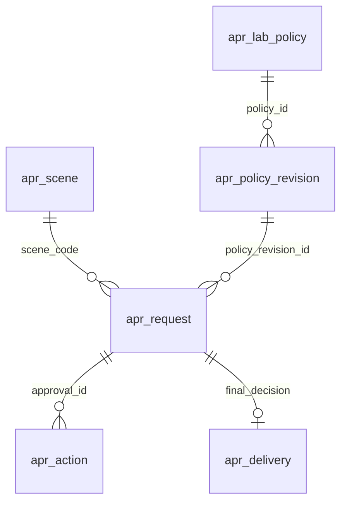

# M06 数据库模型与字段字典

> 本文件为原版本化基线。2026-09-11当前目标见[审阅收尾完整字段字典](审阅收尾完整字段字典.md)及最新完整DDL；旧数量不代表最新目标。

2026-09-10，目标设计，六表95列（含1个生成列）。不新增外键；平台统一分配bigint主键，场景目录采用固定scene_code技术码。所有关联由同事务服务校验。现库未执行、旧库未导入。

| 标识 | 表 | 列数 | 用途 |
| --- | --- | --- | --- |
| DB01 | apr_scene | 12 | 受控场景目录 |
| DB02 | apr_lab_policy | 8 | 每实验室配置根 |
| DB03 | apr_policy_revision | 9 | 不可变政策版本 |
| DB04 | apr_request | 36 | 审批单及当前阶段/生效投影 |
| DB05 | apr_action | 14 | 不可变业务动作 |
| DB06 | apr_delivery | 16 | 耐久决定交付与租约重试 |



配置根current_revision_id必须指向自身版本；政策快照含全部scene条目，审批单只固化本场景规则与目录显示名。培养/批次/项目真实祖先一致且lab_id不可伪造。以上是逻辑关系，无数据库外键。本原版本化基线的新DATETIME(3)按UTC设计，接口带offset，查询上海自然日先转UTC边界；不重新解释M01或旧npp的历史本地时间。2026-11-08审批交付调度的现行时区约束见[apr_delivery字段说明](审阅收尾完整字段字典.md#apr_delivery)：沿用当前JDBC和数据库会话一致的北京时间，不再混用UTC调度比较。

## apr_scene

| 字段 | 完整定义（类型/默认/空值/含义） |
| --- | --- |
| scene_code | VARCHAR(32) CHARACTER SET ascii COLLATE ascii_bin NOT NULL COMMENT '受控场景码主键；不是可编辑业务名称' |
| source_kind | VARCHAR(24) CHARACTER SET ascii COLLATE ascii_bin NOT NULL COMMENT 'TASK/CULTURE_OPERATION/PLAN_INITIALIZATION/DATA_MANAGEMENT' |
| module_level1 | VARCHAR(64) NOT NULL COMMENT '源一级模块名称' |
| module_level2 | VARCHAR(100) NOT NULL COMMENT '源二级模块名称' |
| operation_code | VARCHAR(32) CHARACTER SET ascii COLLATE ascii_bin NOT NULL COMMENT 'MODIFY/MANUAL_CREATE/SYSTEM_CREATE/CREATE/INIT/CANCEL/ALARM_BLOCK/CANCEL_COPY/VOID' |
| owner_module | VARCHAR(8) CHARACTER SET ascii COLLATE ascii_bin NOT NULL COMMENT 'M03/M05/M07/M09；真实变更拥有方' |
| scope_state | VARCHAR(16) CHARACTER SET ascii COLLATE ascii_bin NOT NULL COMMENT 'SUPPORTED/OWNER_GATED/EXCLUDED' |
| source_reference | VARCHAR(255) NOT NULL COMMENT '冻结源文件工作表行号' |
| source_hash | BINARY(32) NOT NULL COMMENT '源附件SHA256' |
| schema_version | SMALLINT UNSIGNED NOT NULL DEFAULT 1 COMMENT '受控目录版本' |
| sort_order | INT UNSIGNED NOT NULL COMMENT '展示顺序' |
| scope_reason | VARCHAR(500) NOT NULL COMMENT '本期范围或排除依据' |

索引及约束：

```sql
PRIMARY KEY (`scene_code`),
CONSTRAINT `ck_apr_scene_source` CHECK (source_kind IN ('TASK','CULTURE_OPERATION','PLAN_INITIALIZATION','DATA_MANAGEMENT')),
CONSTRAINT `ck_apr_scene_scope` CHECK (scope_state IN ('SUPPORTED','OWNER_GATED','EXCLUDED')),
CONSTRAINT `ck_apr_scene_owner` CHECK (owner_module IN ('M03','M05','M07','M09'))
```

## apr_lab_policy

| 字段 | 完整定义（类型/默认/空值/含义） |
| --- | --- |
| policy_id | BIGINT NOT NULL COMMENT '平台分配主键' |
| lab_id | BIGINT NOT NULL COMMENT '真实lab_lab实验室；逻辑唯一' |
| current_revision_id | BIGINT NULL COMMENT '当前不可变配置版本；初始NULL' |
| object_version | BIGINT UNSIGNED NOT NULL DEFAULT 1 COMMENT '整份配置共同版本' |
| readiness | VARCHAR(16) CHARACTER SET ascii COLLATE ascii_bin NOT NULL DEFAULT 'UNVERIFIED' COMMENT 'UNVERIFIED/READY；不默认免审批' |
| created_at | DATETIME(3) NOT NULL COMMENT '创建时刻' |
| updated_at | DATETIME(3) NOT NULL COMMENT '最近更新时刻' |
| updated_by | BIGINT NOT NULL COMMENT '稳定配置操作者' |

索引及约束：

```sql
PRIMARY KEY (`policy_id`),
UNIQUE INDEX `uk_apr_policy_lab` (`lab_id`),
CONSTRAINT `ck_apr_policy_version` CHECK (object_version>=1),
CONSTRAINT `ck_apr_policy_ready` CHECK (readiness IN ('UNVERIFIED','READY') AND (readiness<>'READY' OR current_revision_id IS NOT NULL))
```

## apr_policy_revision

| 字段 | 完整定义（类型/默认/空值/含义） |
| --- | --- |
| revision_id | BIGINT NOT NULL COMMENT '不可变配置版本主键' |
| policy_id | BIGINT NOT NULL COMMENT '配置根逻辑关联' |
| revision_no | BIGINT UNSIGNED NOT NULL COMMENT '同配置从1递增' |
| policy_snapshot | JSON NOT NULL COMMENT 'schema/entries/resolutionRules完整快照' |
| content_hash | BINARY(32) NOT NULL COMMENT '规范化配置SHA256' |
| source_evidence | JSON NOT NULL COMMENT '初始化资料或人工维护事实及核准人时间' |
| created_by | BIGINT NOT NULL COMMENT '真实配置操作者' |
| created_at | DATETIME(3) NOT NULL COMMENT '版本形成时刻' |
| change_reason | VARCHAR(500) NULL COMMENT '管理变更说明，可空；非审批原因' |

索引及约束：

```sql
PRIMARY KEY (`revision_id`),
UNIQUE INDEX `uk_apr_policy_revision` (`policy_id`,`revision_no`),
CONSTRAINT `ck_apr_policy_revision_no` CHECK (revision_no>=1),
CONSTRAINT `ck_apr_policy_json` CHECK (JSON_TYPE(policy_snapshot)='OBJECT' AND JSON_TYPE(source_evidence)='OBJECT')
```

## apr_request

| 字段 | 完整定义（类型/默认/空值/含义） |
| --- | --- |
| approval_id | BIGINT NOT NULL COMMENT '审批单主键' |
| scene_code | VARCHAR(32) CHARACTER SET ascii COLLATE ascii_bin NOT NULL COMMENT 'apr_scene场景逻辑关联' |
| lab_id | BIGINT NOT NULL COMMENT '固定真实实验室' |
| project_id | BIGINT NOT NULL COMMENT '固定真实项目' |
| batch_id | BIGINT NOT NULL COMMENT '固定真实批次' |
| culture_id | BIGINT NOT NULL COMMENT '固定真实培养' |
| owner_module | VARCHAR(8) CHARACTER SET ascii COLLATE ascii_bin NOT NULL COMMENT 'M03/M07/M09' |
| source_request_id | VARCHAR(64) CHARACTER SET ascii COLLATE ascii_bin NOT NULL COMMENT '拥有方持久幂等请求键' |
| change_key | VARCHAR(160) CHARACTER SET ascii COLLATE ascii_bin NOT NULL COMMENT '受控业务操作唯一槽；不由客户端任意选择' |
| target_type | VARCHAR(24) CHARACTER SET ascii COLLATE ascii_bin NOT NULL COMMENT 'CULTURE/TASK/PLAN/ALARM_CONFIG' |
| target_id | BIGINT NOT NULL COMMENT '业务对象或预分配候选任务ID' |
| expected_target_version | BIGINT UNSIGNED NOT NULL COMMENT '审阅所依赖源版本；新增候选0' |
| candidate_id | BIGINT NOT NULL COMMENT '来源不可变候选ID' |
| candidate_version | BIGINT UNSIGNED NOT NULL COMMENT '来源候选版本' |
| candidate_hash | BINARY(32) NOT NULL COMMENT '精确内容SHA256' |
| policy_revision_id | BIGINT NOT NULL COMMENT '申请固定政策版本' |
| policy_snapshot | JSON NOT NULL COMMENT '仅本场景策略与分离/回退规则快照' |
| change_snapshot | JSON NOT NULL COMMENT '全部前后差异与关联对象和影响规则' |
| initiator_kind | VARCHAR(8) CHARACTER SET ascii COLLATE ascii_bin NOT NULL COMMENT 'USER/SYSTEM' |
| initiator_user_id | BIGINT NULL COMMENT '人工申请人；系统NULL' |
| initiator_snapshot | JSON NOT NULL COMMENT '提交身份和合法来源证据' |
| submission_reason | VARCHAR(500) NULL COMMENT '提交补充说明' |
| state | VARCHAR(24) CHARACTER SET ascii COLLATE ascii_bin NOT NULL DEFAULT 'PENDING_REVIEW' COMMENT 'PENDING_REVIEW/PENDING_APPROVAL/APPROVED/CANCELLED' |
| apply_state | VARCHAR(24) CHARACTER SET ascii COLLATE ascii_bin NOT NULL DEFAULT 'NONE' COMMENT 'NONE/NOT_APPLICABLE/PENDING/APPLIED/CONFLICT/FAILED/UNKNOWN' |
| cancel_kind | VARCHAR(24) CHARACTER SET ascii COLLATE ascii_bin NULL COMMENT 'REJECTED/WITHDRAWN/SOURCE_INVALIDATED' |
| decision_version | BIGINT UNSIGNED NULL COMMENT '最终决定版本；后续ack不改变' |
| object_version | BIGINT UNSIGNED NOT NULL DEFAULT 1 COMMENT '审批及生效投影共同版本' |
| reviewer_user_id | BIGINT NULL COMMENT '首级真实审核人' |
| reviewed_at | DATETIME(3) NULL COMMENT '首级通过时刻' |
| approver_user_id | BIGINT NULL COMMENT '第二级真实批准人' |
| approved_at | DATETIME(3) NULL COMMENT '第二级通过时刻；单级NULL' |
| submitted_at | DATETIME(3) NOT NULL COMMENT '首次提交，用于列表排序' |
| operation_at | DATETIME(3) NOT NULL COMMENT '最近提交/撤回时刻，不被审批/投递覆盖' |
| operator_user_id | BIGINT NULL COMMENT '最近提交/撤回用户，系统NULL' |
| supersedes_approval_id | BIGINT NULL COMMENT '重新申请关联旧单，不复活旧单' |
| active_change_key | VARCHAR(160) CHARACTER SET ascii COLLATE ascii_bin GENERATED ALWAYS AS (CASE WHEN state IN ('PENDING_REVIEW','PENDING_APPROVAL') OR (state='APPROVED' AND apply_state IN ('PENDING','UNKNOWN')) THEN change_key ELSE NULL END) STORED COMMENT '待审及通过待生效/未知占用同业务变更槽' |

索引及约束：

```sql
PRIMARY KEY (`approval_id`),
UNIQUE INDEX `uk_apr_request_source` (`owner_module`,`source_request_id`),
UNIQUE INDEX `uk_apr_active_change` (`owner_module`,`active_change_key`),
INDEX `idx_apr_lab_submit` (`lab_id`,`submitted_at`,`approval_id`),
INDEX `idx_apr_lab_state` (`lab_id`,`state`,`submitted_at`,`approval_id`),
INDEX `idx_apr_culture` (`culture_id`,`approval_id`),
CONSTRAINT `ck_apr_request_versions` CHECK (object_version>=1 AND candidate_version>=1 AND (decision_version IS NULL OR decision_version<=object_version)),
CONSTRAINT `ck_apr_request_actor` CHECK ((initiator_kind='USER' AND initiator_user_id IS NOT NULL AND initiator_user_id>0) OR (initiator_kind='SYSTEM' AND initiator_user_id IS NULL)),
CONSTRAINT `ck_apr_request_json` CHECK (JSON_TYPE(policy_snapshot)='OBJECT' AND JSON_TYPE(change_snapshot)='OBJECT' AND JSON_TYPE(initiator_snapshot)='OBJECT'),
CONSTRAINT `ck_apr_request_stage_actors` CHECK ((reviewer_user_id IS NULL OR initiator_user_id IS NULL OR reviewer_user_id<>initiator_user_id) AND (approver_user_id IS NULL OR initiator_user_id IS NULL OR approver_user_id<>initiator_user_id) AND (reviewer_user_id IS NULL OR approver_user_id IS NULL OR reviewer_user_id<>approver_user_id)),
CONSTRAINT `ck_apr_request_actor_time` CHECK ((reviewer_user_id IS NULL AND reviewed_at IS NULL OR reviewer_user_id IS NOT NULL AND reviewed_at IS NOT NULL) AND (approver_user_id IS NULL AND approved_at IS NULL OR approver_user_id IS NOT NULL AND approved_at IS NOT NULL)),
CONSTRAINT `ck_apr_request_state` CHECK ((state IN ('PENDING_REVIEW','PENDING_APPROVAL') AND apply_state='NONE' AND cancel_kind IS NULL AND decision_version IS NULL) OR (state='APPROVED' AND apply_state IN ('PENDING','APPLIED','CONFLICT','FAILED','UNKNOWN') AND cancel_kind IS NULL AND decision_version IS NOT NULL) OR (state='CANCELLED' AND apply_state='NOT_APPLICABLE' AND cancel_kind IS NOT NULL AND cancel_kind IN ('REJECTED','WITHDRAWN','SOURCE_INVALIDATED') AND decision_version IS NOT NULL)),
CONSTRAINT `ck_apr_request_review_stage` CHECK (state NOT IN ('PENDING_APPROVAL','APPROVED') OR reviewer_user_id IS NOT NULL),
CONSTRAINT `ck_apr_request_policy` CHECK (COALESCE(JSON_UNQUOTE(JSON_EXTRACT(policy_snapshot,'$.entry.reviewMode')),'') IN ('BATCH','PROJECT') AND COALESCE(JSON_UNQUOTE(JSON_EXTRACT(policy_snapshot,'$.entry.approveMode')),'') IN ('NONE','BATCH','PROJECT') AND COALESCE(JSON_UNQUOTE(JSON_EXTRACT(policy_snapshot,'$.resolutionRules.differentStageActors')),'')='true'),
CONSTRAINT `ck_apr_request_stage` CHECK ((state='PENDING_REVIEW' AND reviewer_user_id IS NULL AND approver_user_id IS NULL) OR (state='PENDING_APPROVAL' AND reviewer_user_id IS NOT NULL AND approver_user_id IS NULL AND COALESCE(JSON_UNQUOTE(JSON_EXTRACT(policy_snapshot,'$.entry.approveMode')),'') IN ('BATCH','PROJECT')) OR (state='APPROVED' AND reviewer_user_id IS NOT NULL AND ((COALESCE(JSON_UNQUOTE(JSON_EXTRACT(policy_snapshot,'$.entry.approveMode')),'')='NONE' AND approver_user_id IS NULL) OR (COALESCE(JSON_UNQUOTE(JSON_EXTRACT(policy_snapshot,'$.entry.approveMode')),'') IN ('BATCH','PROJECT') AND approver_user_id IS NOT NULL))) OR (state='CANCELLED' AND approver_user_id IS NULL))
```

## apr_action

| 字段 | 完整定义（类型/默认/空值/含义） |
| --- | --- |
| action_id | BIGINT NOT NULL COMMENT '动作主键' |
| approval_id | BIGINT NOT NULL COMMENT '审批单逻辑关联' |
| action_code | VARCHAR(24) CHARACTER SET ascii COLLATE ascii_bin NOT NULL COMMENT 'SUBMIT/REVIEW_PASS/APPROVE_PASS/REJECT/WITHDRAW/SOURCE_INVALIDATE/APPLY_RESULT' |
| actor_kind | VARCHAR(8) CHARACTER SET ascii COLLATE ascii_bin NOT NULL COMMENT 'USER/SYSTEM' |
| actor_user_id | BIGINT NULL COMMENT '系统动作NULL' |
| event_key | BINARY(32) NOT NULL COMMENT '规范化用户请求或来源回执身份摘要' |
| request_id | VARCHAR(36) CHARACTER SET ascii COLLATE ascii_bin NULL COMMENT '人工UUID；系统来源身份在action_snapshot' |
| before_version | BIGINT UNSIGNED NOT NULL COMMENT 'SUBMIT前为0' |
| after_version | BIGINT UNSIGNED NOT NULL COMMENT '成功后=before+1' |
| before_state | VARCHAR(24) NULL COMMENT 'SUBMIT前NULL' |
| after_state | VARCHAR(24) NOT NULL COMMENT '动作后审批状态' |
| reason | VARCHAR(500) NULL COMMENT '拒绝/撤回必填，其他可空' |
| action_snapshot | JSON NOT NULL COMMENT '身份、权限、前后状态/应用态、源证据及请求摘要' |
| occurred_at | DATETIME(3) NOT NULL COMMENT '稳定服务端操作时刻' |

索引及约束：

```sql
PRIMARY KEY (`action_id`),
UNIQUE INDEX `uk_apr_action_event` (`approval_id`,`event_key`),
INDEX `idx_apr_action_order` (`approval_id`,`occurred_at`,`action_id`),
CONSTRAINT `ck_apr_action_version` CHECK (after_version=before_version+1),
CONSTRAINT `ck_apr_action_json` CHECK (JSON_TYPE(action_snapshot)='OBJECT'),
CONSTRAINT `ck_apr_action_actor` CHECK ((actor_kind='USER' AND actor_user_id IS NOT NULL AND actor_user_id>0 AND request_id IS NOT NULL AND CHAR_LENGTH(request_id)=36) OR (actor_kind='SYSTEM' AND actor_user_id IS NULL)),
CONSTRAINT `ck_apr_action_reason` CHECK (action_code NOT IN ('REJECT','WITHDRAW','SOURCE_INVALIDATE') OR (reason IS NOT NULL AND CHAR_LENGTH(TRIM(reason)) BETWEEN 1 AND 500)),
CONSTRAINT `ck_apr_action_code` CHECK (action_code IN ('SUBMIT','REVIEW_PASS','APPROVE_PASS','REJECT','WITHDRAW','SOURCE_INVALIDATE','APPLY_RESULT'))
```

## apr_delivery

| 字段 | 完整定义（类型/默认/空值/含义） |
| --- | --- |
| delivery_id | BIGINT NOT NULL COMMENT '固定决定交付主键' |
| approval_id | BIGINT NOT NULL COMMENT '审批单逻辑关联' |
| decision_version | BIGINT UNSIGNED NOT NULL COMMENT '冻结最终决定版本' |
| decision_kind | VARCHAR(8) CHARACTER SET ascii COLLATE ascii_bin NOT NULL COMMENT 'APPLY/DISCARD' |
| candidate_hash | BINARY(32) NOT NULL COMMENT '冻结候选SHA256' |
| payload_json | JSON NOT NULL COMMENT 'API11完整不可变决定' |
| state | VARCHAR(24) CHARACTER SET ascii COLLATE ascii_bin NOT NULL DEFAULT 'PENDING' COMMENT 'PENDING/RETRY/ACKNOWLEDGED/UNKNOWN/CONFLICT/FAILED' |
| attempts | INT UNSIGNED NOT NULL DEFAULT 0 COMMENT '技术交付次数' |
| next_attempt_at | DATETIME(3) NULL COMMENT '下一次重试或查询时间' |
| lease_token | VARCHAR(36) NULL COMMENT 'worker租约随机UUID' |
| lease_until | DATETIME(3) NULL COMMENT '租约过期时刻' |
| owner_receipt | JSON NULL COMMENT '最后可核验来源回执，完整历史见操作记录' |
| last_error | VARCHAR(1000) NULL COMMENT '无凭据错误摘要' |
| created_at | DATETIME(3) NOT NULL COMMENT '交付形成时刻' |
| updated_at | DATETIME(3) NOT NULL COMMENT '交付状态更新时刻' |
| object_version | BIGINT UNSIGNED NOT NULL DEFAULT 1 COMMENT '投递worker CAS版本' |

索引及约束：

```sql
PRIMARY KEY (`delivery_id`),
UNIQUE INDEX `uk_apr_delivery_decision` (`approval_id`,`decision_version`),
INDEX `idx_apr_delivery_due` (`state`,`next_attempt_at`,`delivery_id`),
CONSTRAINT `ck_apr_delivery_kind` CHECK (decision_kind IN ('APPLY','DISCARD')),
CONSTRAINT `ck_apr_delivery_state` CHECK (state IN ('PENDING','RETRY','ACKNOWLEDGED','UNKNOWN','CONFLICT','FAILED')),
CONSTRAINT `ck_apr_delivery_json` CHECK (JSON_TYPE(payload_json)='OBJECT' AND (owner_receipt IS NULL OR JSON_TYPE(owner_receipt)='OBJECT')),
CONSTRAINT `ck_apr_delivery_ack` CHECK (state<>'ACKNOWLEDGED' OR owner_receipt IS NOT NULL),
CONSTRAINT `ck_apr_delivery_lease` CHECK ((lease_token IS NULL AND lease_until IS NULL) OR (lease_token IS NOT NULL AND lease_until IS NOT NULL)),
CONSTRAINT `ck_apr_delivery_version` CHECK (object_version>=1 AND decision_version>=1)
```

## JSON、不可变性和索引解释

policy_snapshot（版本表）={schemaVersion:1,entries:PolicyEntry[],resolutionRules:{differentStageActors:true,batchFallback:NO_ELIGIBLE}}；source_evidence={kind:VERIFIED_IMPORT/MANUAL_EDIT,fileSha256或null,sourceRows:[{sceneCode,rowRef}],verifiedBy,verifiedAt,previousRevisionId或null}，初始化由已核准导入服务构造，不能以浏览器声明代替。人工修改保留完整新版本和前版本来源；每实验室当前指针单一、版本不可编辑删除。

Q02已确认：batchFallback由服务端固定为NO_ELIGIBLE，保存/初始化政策和提交审批时均校验；成员名单按当前阶段实时筛选，项目候选同样排除申请人和第二级的首级审核人。规则存入不可变版本及单据快照，不增加数据库列。

审批单policy_snapshot={schemaVersion:1,policyRevisionId,policyHash,scene:Scene,entry:PolicyEntry,entries:[PolicyEntry],resolutionRules}，只固化本单策略。现有提交生产者同时保留`entry`和单元素`entries`兼容镜像；两者必须完整相等，不能把版本表的多档位列表代入审批单。M03参数决定交接校验全部七个根字段、schema1、镜像基数与一致性；缺失、多元素或冲突时拒绝交付，不补造字段、不重写原快照。此处补齐既有JSON生产形状登记，不增加表列，不选择全系统移除双键的迁移方案。成员名单不冻结成永久资格。change_snapshot与initiator_snapshot分别为接口ChangeSnapshot和{actor:Person,sourceModule,sourceRequestId,authorizationEvidence,evaluatedAt}，权限证据保持内部使用。active_change_key同时覆盖待审和最终通过待生效/未知，防止旧决定未明又申请同槽；CONFLICT/FAILED为不再自动生效终态才释放槽。业务来源变更必须新候选，不更新原快照。

action_snapshot={schemaVersion:1,actor,authorizationEvidence,requestPayloadHash,before:{state,applyState,version},after:{state,applyState,version},sourceReceipt或null,resultCode,reason}。event_key是规范化{actorKind,userId,requestId,approvalId}或{producer,deliveryId,receiptIdentity,resultKind}的SHA256，重复键须比较完整语义，不以摘要替代内容判断。除技术最小审计外，不保存认证凭据。首级审核/第二级批准时刻取真实动作，不能给单级单补一个批准人。

apr_delivery.payload_json为API11不可变参数；owner_receipt为API12完整核验回执。传输重试只改该表state/attempts/lease/错误及版本，状态进入UNKNOWN先查询原deliveryId。租约CAS不能保证外部恰好一次；拥有方必须提供相同决定身份的事务幂等回执。ACKNOWLEDGED仅表示拥有方已返回可核验APPLIED或DISCARDED，不代表泵已执行；真实物理状态另在M07。TRANSIENT错误保持PENDING/RETRY及审批applyState=PENDING；CONFLICT/FAILED为终结阻断，不后台重试变更内容。

idx_apr_lab_submit支持必选实验室＋提交时间倒序；idx_apr_lab_state支持状态筛选；时间多列OR仍与权限AND，计划用受控谓词，是否需要按操作/审核时刻补索引由目标库执行计划与数据量验证，不凭无数据估算加全套索引。idx_apr_delivery_due按状态和到期扫描，避免最大ID游标漏晚提交。主动申请唯一键由源模块稳定请求键组成；active_change_key处理同业务操作并发。UI日志用审批ID＋时间＋动作ID顺序索引。

## 迁移与回退

[01前核验](history/sql/01-流程审批迁移前核验.sql)→[02建表与47场景](02-流程审批建表与场景初始化.sql)→[03后核验](history/sql/03-流程审批迁移后核验.sql)，[05完整目标](history/sql/05-流程审批目标表结构.sql)只供隔离空库参考，不与02连续重复建表。02不初始化任何实验室的审批档位；Q39真实配置资料在核准后调用同保存服务写policy/revision及审计。缺资料映射只表示该环境未配置，不重新将业务已确认初始值列为未决问题。

原生一致性备份/恢复验证和停写先完成，三个会话开关只证明执行者声明，不由SQL证明外部安全。新表同名或CHECK名称冲突立即停止，禁止IF NOT EXISTS静默跳过、INSERT IGNORE漏场景、--force继续。DDL隐式提交，部分失败逐对象对照；不得直接重复脚本覆盖现场。固定场景生成后码不因源Excel重排而改变，新场景另分新码。

[04回退](history/sql/04-未启用流程审批回退.sql)仅六表完整且从未启用、五业务/配置表空、目录仍为本批47条时执行；已存在政策版本、审批或交付不允许DROP，须保留审计并另定原生恢复/向前修复。脚本不更改或删除旧npp、det_、M01/M02/M03表，不以旧单缺第二级字段补造批准事实。
