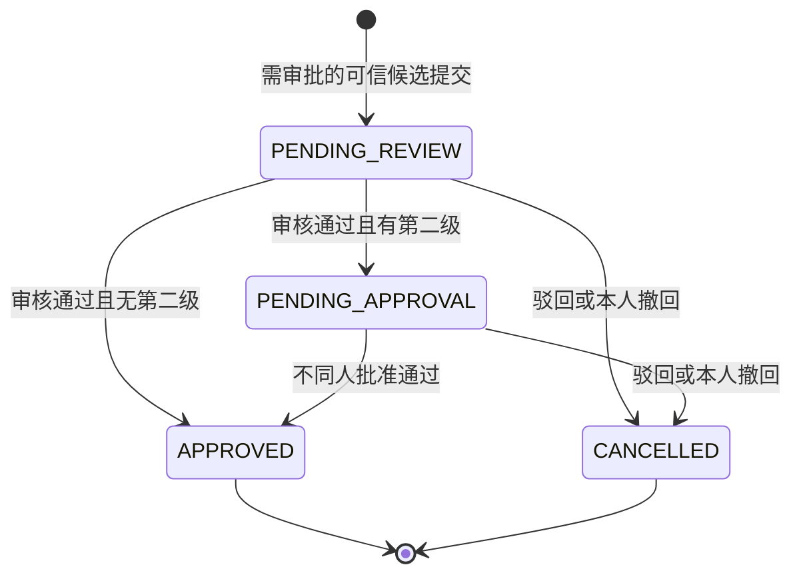

# M06 流程审批管理详细设计

2026-11-03实验室审批流配置按[最新审批统计映射](审批场景与初始化映射.md#2026-11-03-最新审批统计配置目录)增加四个黄色场景，保留原场景身份及补液方案修改。目录、旧政策重新保存要求与未接通业务边界以该节为准；不以配置层改动宣称业务审批已接通。

> 2026-10-31 用户最新确认：实验室审批政策的完整有效配置保存后供新业务直接使用，不再设置政策核准、启用或暂停。旧状态字段仅保留兼容；编辑权限维持 `lab:approval:edit` 与实验室 `MANAGE`。旧审批单继续使用固定政策快照。下文关于政策分批启用、未核准阻断和保存前暂停的旧规则由此覆盖；其他对象的核准及设备就绪要求不变。

## 开始培养专项增补（SC-20261017）

首次完成前，第3步修改已有在线告警在第4步直接保存生效，同时保存为反应器默认（第114—115项），不另走审批；完成后的变更仍按原政策。不新增默认模板待审分支或独立外部监控ACK前置。M06既有交付实现不在本次修改。

最新保存规则（2026-10-17）：小试、中试均只在第4步点击“完成”并成功提交后保存业务数据；未完成页面刷新或取消后从第1步重新开始，不恢复表单或中间步骤。操作审计和设备安全收尾保留，必须当天完成的限制不变。

步骤时间记录：四步分别记录服务端开始/结束时间及结束原因；刷新重开新建尝试，旧时间审计保留，未知结束时间不伪造。时间留痕不构成业务表单的中间保存点。

当前专题：[开始培养详细设计](../07-补液运行与任务执行/开始培养工作流详细设计.md)；实施拆分：[开始培养开发计划](../../开发任务/小试中试开始培养开发计划-20261017.md)。本次仅文档补充，业务代码、数据库、设备操作均未执行。


## 三类实验室接入补充（INTEGRATION-20261010）

按[共同边界](../00-三类实验室设备接入与执行边界.md)逐动作登记一期原审批与新系统审批的唯一生效链。保留旧执行服务不意味着默认免审，也不能将新旧两次批准分别转成两次物理启动；未明确政策的桥接动作保持阻断。

二期/中试目标路径复用现行候选快照/hash、版本、决定幂等交付及UNKNOWN对账，由M03/M07业务拥有方复核再生效。M06不调用设备驱动、不以批准回执代表实际完成；执行恢复或计划变更是否重新审批遵循现行场景政策，不默增新场景或重放旧决定。对应INTEG-02/04、INT-AC06/10/12。

> 2026-09-11审阅收尾：本模块最新补充见[审阅收尾对账与启用契约.md](审阅收尾对账与启用契约.md)与[审阅收尾完整字段字典](审阅收尾完整字段字典.md)，当前目标7表127列。下文旧表数/包号属于当时基线；以最新增量包及[统一处置表](../00-跨模块审阅收尾/history/review/统一审阅收尾核对.md)为准。仅设计完成，运行验证未执行。

2026-09-10。状态：当前确认范围详细设计完成，M06-Q01、Q02均已确认，无本期新增待确认业务问题。仅文档与SQL设计稿，未写业务代码、执行迁移或设备操作。入口：[业务模块目录](../00-业务模块划分与设计目录.md)。

## 1. 范围、依据与复用

依据[18-反应器 → 流程审批（3.1）（V4.0 第 17 章）](../../需求说明书V5.1-1030_md/18-反应器.md)、[02实验室审批设置（V4.0 第 2 章）](../../需求说明书V5.1-1030_md/02-实验室设置.md)、[最新澄清](../../需求说明书V4.0-0904_md/需求澄清决策记录.md)Q31/Q33/Q36/Q39及A5四档统一结论。复用futurefab-system、M01身份/功能权限/管理守卫/回执、M02真实实验室授权、M03培养与成员来源、M04固定模板版本；不新建微服务或另一份项目成员表。

| 标识 | 当前交付 | 设计与验收落点 |
| --- | --- | --- |
| M06-REQ01 | 实验室按场景配置四档审核及三档批准、版本与日志 | UI01、API01—03、DB01—03、CASE01—08 |
| M06-REQ02 | 三类来源、最小业务单元、精确变更快照 | 场景清单、API09—12、DB04、CASE09—16 |
| M06-REQ03 | 一/两级审核、批准、驳回和撤回 | 第3—4节、API07—08、DB05、CASE17—28 |
| M06-REQ04 | 列表、详情、关联培养/任务、完整日志 | UI02—04、API04—06、CASE29—36 |
| M06-REQ05 | 决定交付、来源生效、失败/未知恢复 | 第7节及[接口契约](接口与审批生效契约.md)、DB06、CASE37—46 |
| M06-REQ06 | 权限、并发、初始化、迁移和回退 | 第4/8节、[数据库设计](数据库模型与字段字典.md)、CASE47—54 |

M06拥有审批设置、审批单和决定；M03/M07/M09拥有对应业务变更。检测结果签名/审核仍在M05，不能调用M06审批替代其签名人分离、对象版本等原有签批规则；单检测项作废不列本期功能。工作流节点/模板定义仍在M04，运行编排及物理停止在M07。

已确认的Config/灌注/自动控制培养预设、pH等新增任务和完整工作流已替代早期相关排除；场景目录仅按适用原政策落实，不因历史清单存在开放其他入口。原47场景保留稳定编号，未批准取样/测样/澄清等培养预设编辑不自动恢复。实验室已完成的初始化档位沿现行确认，不重新询问旧0812空白。

当前源码定向证据及旧库复用理由见[现状核对](history/review/现状核对与复用清单.md)。旧npp补料审批记录保留，不自动转成新双阶段记录；M05的det_审批表不是通用业务审批表。完整目标结构和迁移设计由本模块单独提供。

## 2. 审批策略与触发

审核四档固定技术码：DIRECT=不审批不记录；DIRECT_REASON=不审批需记录原因；BATCH=批次成员审批；PROJECT=项目成员审批。批准三档NONE/BATCH/PROJECT。DIRECT或DIRECT_REASON强制批准NONE；BATCH/PROJECT可搭配任意批准档。固定枚举不能通过普通字典改成其他状态；展示文字可翻译，存储码不变。

DIRECT不生成审批单、不要求业务原因；DIRECT_REASON不生成审批单但在来源业务记录保存必填原因。两者仍有公共技术审计和请求幂等，不把“不记录”解释成允许绕过所有系统审计。需要审批时才创建PENDING_REVIEW审批单；提交补充说明可空，驳回/撤回原因必填1—500字；快速原因选项只填写最终文本，不用字典ID代替当时原因。

触发顺序：先由来源模块验证动作是否在本期开放、用户是否有源动作权限、真实培养状态和候选字段→对Q31培养草稿/未开始/已过期的修改/删除走明确免审批分支→再读取该实验室当前已核准场景政策。Q31不是通用任务免审批规则，也不能用培养状态给不在本期开放的初始化/工艺页面放行。政策不存在、未核准或版本未知时阻断需政策的业务入口，不能自动按DIRECT执行。

同实验室每场景一条设置，整份配置保存为不可变版本；新申请固定提交时版本，后续改配置不改旧审批单层数/档位。人员资格不冻结为永久权限，每次动作重新读取当前有效成员、功能和实验室权限。场景下线只阻止新单；历史单查看保留，待办能否生效仍由源动作当前准入判断。业务服务不可用时明确UNAVAILABLE，不降级直通。

任务按每个最终任务独立成单；多泵/多培养由M07拆到最小任务后逐单申请，不用一个批准暗中覆盖整批。培养字段/操作各自成单；培养开始/结束/天数是同一时间操作的关联字段，候选必须包含全部一致值，不拆成会暂时破坏日期约束的三次生效。工艺初始化以培养ID＋单个方案候选为单位，审批的是固定内容而不是模板最新指针；不由M06恢复被排除的编辑入口。

待办内容不可在审批页修改。源页面确需改候选时，先合法撤回未决单，再重新校验、生成新候选和新单；新单关联supersedesApprovalId，原记录完整保留，不把已审核内容原地换掉。已通过/已取消无修改、撤回、撤销通过、重新打开或硬删除入口。

## 3. 审批状态与应用状态

2026-11-07 S04原生110统一补充：需审批的新增/修改/取消在批准前只保存原候选副本，不覆盖生效内容；免审操作不因此新增审批。已有任务修改或取消申请被撤回/驳回，只丢本次副本，原任务/参数继续按原条件处理；新增任务审核被驳回则由M07沿原决定直接将该新任务取消，此次系统取消不再申请取消审核。审批单CANCELLED不能无差别映射业务任务CANCELLED；设备已发生动作和执行历史不逆转。精确交付与D0影响见[接口契约S04补充](接口与审批生效契约.md#s04副本及日期影响配套2026-11-07)。



| 原状态/触发 | 主要守卫 | 同事务变化 | 事务后 |
| --- | --- | --- | --- |
| 待审核/审核通过 | 当前审核资格，非申请人；版本/候选hash一致，源预检通过 | 写REVIEW_PASS；有第二级则待批准，否则已通过＋待生效交付 | 仅最终通过产生一次APPLY交付 |
| 待批准/批准通过 | 当前批准资格，非申请人、非首级审核人 | 写APPROVE_PASS、已通过、交付 | 来源生效服务处理 |
| 两待办/驳回 | 当前阶段审批资格；原因必填 | 已取消、cancelKind=REJECTED、保留首级已通过事实、DISCARD交付 | 来源丢弃候选激活资格，保留历史内容 |
| 两待办/撤回 | 人工申请本人＋withdraw功能＋源对象当前可操作；原因必填 | 已取消、cancelKind=WITHDRAWN、DISCARD交付 | 不取消真实设备或已生效业务 |
| 系统候选被来源合法失效 | 可信拥有模块、精确源版本和证明 | 未决单已取消、cancelKind=SOURCE_INVALIDATED、系统动作、DISCARD交付 | 不伪造某个人撤回 |
| 已通过/已取消任意审批写 | 终态 | 拒绝，不改历史 | 相同幂等请求可返回原成功回执 |

两待办的applyState=NONE；已取消=NOT_APPLICABLE；已通过=PENDING/APPLIED/CONFLICT/FAILED/UNKNOWN之一。审批状态保持四态，页面单独标“业务待生效/已生效/冲突/失败/结果待核实”。APPROVED并不意味着任务已执行或设备已停。DISCARD投递失败不把已取消改回待审核，候选本来也不可在未获通过时生效。

审批单objectVersion覆盖所有审批/生效投影变更；动作保存beforeVersion/afterVersion，成功加1。最后一次修改/新增/撤回人的时间用于列表“操作时间/操作人”；审核/批准分别存独立人和时间，不能用发布器更新时间覆盖。列表按最初submittedAt DESC、approvalId DESC排序，即使operationTime被撤回更新也不改“按提交时间”口径。

## 4. 资格、职责分离与确认决策

审批动作=该阶段功能权限 ∩ 当前所属实验室至少OPERATE ∩ 有效批次/项目成员范围 ∩ 当前状态/对象版本/来源资格。查询用实验室至少VIEW并合并M03可读范围；申请人、过去审批人也不能凭旧身份永久越过当前范围。仅历史SHARE不会自动获得流程审批或修改候选权限；M05历史签批资格不转给M06。

批次/项目成员从M03当前有效MEMBER来源解析，排除过期/禁用用户和仅SHARE。负责人或超级管理员不凭称谓绕过成员、非本人和阶段分离；其有合法成员来源时按同样规则处理。在线状态不参与资格判断，暂时离线不等于无人可审。来源读取故障返回UNAVAILABLE，不当成“无人”转交更宽范围。

**M06-Q01已确认（2026-09-10）：审核人与批准人必须不同。** 同时沿原文，申请人不能审自己的单。比较稳定用户ID，改名、同名或换显示名不构成另一人。人工申请的本人身份固定initiatorUserId；系统生成的单actorKind=SYSTEM、initiatorUserId=null，保留源任务及责任信息，不用虚构用户0；规则编写者不自动等同本次系统提交人，也不自动获得审批资格。

**M06-Q02已确认（2026-09-10）：没有合格批次审批人时，转交项目成员。** 用户确认“按建议转交”。按当前审批阶段先扣除申请人、无当前审批资格的成员及（第二级）首级审核人，若有效批次候选为空，则在所属项目当前有效MEMBER成员中按相同资格及职责分离规则重新筛选；包括批次完全无成员、只有申请人、成员均无当前审批权限、第二级仅剩首级审核人等情况。batchFallback固定为NO_ELIGIBLE，由服务端设置并校验，不作为实验室可选档位；接口输出resolutionMode与原因，政策版本和审批单保存规则快照。成员离线不等于无资格，成员或权限服务故障返回UNAVAILABLE，不得按候选为空转交。项目也无人合格时保持待办，不继续向系统管理员转交或自动通过。

项目也无合格人时允许保存合法申请并明确NO_ELIGIBLE_APPROVER，待办不自动通过；通过M09按有权责任范围提示配置/成员问题，不泄露完整候选名单。权限或成员变化后重新评估，无需改申请内容。人工单撤回仅申请本人；系统单由拥有模块的合法候选失效事件收口，不给任意实验室管理员伪装申请人撤回的通用按钮。

## 5. 页面、字段与交互

### M06-UI01 实验室审批设置

```text
审批设置                          实验室A（只读）
一级模块 | 二级模块 | 操作 | 审核[四档] | 批准[三档]
……该实验室完整受控场景……
未接入/排除场景说明；当前配置版本
                               取消  保存
```

从M02实验室列表“审批流”打开，持labId读取，不新增实验室选择后跨对象保存。场景三级说明只读，按目录sortOrder；审核/批准必填无静默默认，DIRECT档批准锁定NONE，切回审批档保持NONE等待显式选择，不擅自恢复隐藏的旧批准值。保存提交完整配置、expectedObjectVersion和原管理版本；不支持单行漏存或空数组清空。取消/关闭有未保存改动时提示，保存中禁重复提交；版本冲突保留输入供对比，不自动覆盖新配置。无编辑权可看政策及版本但控件禁用；场景未接入不表示默认免审批。

### M06-UI02 流程审批列表

2026-10-31 用户确认：此页迁入实验室模块，实验室由 `/labs/:labId/approval-requests` 的路径确定并只读显示；下方旧图及“实验室单选”说明不再作为跨实验室切换要求。顶部入口使用当前实验室，反应器卡片按 `cultureId` 精确限定培养；其他筛选与权限规则不变。原系统设置页面入口停用。

2026-11-03 用户确认按审批页面设计预览实施：当前实验室与限定培养放在独立上下文栏，培养优先显示业务编号，查询仍使用原精确 cultureId；筛选在宽屏按两行排布，窄屏换行，日期复用现有范围控件。列表将操作、审核、批准三组人员与时间分别上下排列，审批单主键及业务生效状态放在详情，详情/日志使用现有表格操作组件并保留间距；固定列宽、操作列靠右，空间不足时横向滚动。

```text
实验室* [当前] 培养ID [ ] 一级模块[ ] 二级模块[ ] 状态[全部]
操作人/审核人/批准人 [ ] 起止日期 [可选]     检索 清空
序号 | 实验室 | 两级模块 | 操作类型 | 培养ID | 审批状态
操作时间/人 | 审核时间/人 | 批准时间/人 | 详情 日志
                                      分页
```

实验室单选必填，候选限当前可读，默认当前登录实验室；该默认无权则提示选择其他授权实验室，不先查全库。培养ID关键词≤100字，一级/二级非必填且严格联动，换一级清二级；状态ALL或四态；人员词≤100字同时搜索三种人员用户名/显示名，内部OR与权限条件AND。起止日期均空表示不限制，两者有一则必须完整，start≤end；原文未规定默认日期/最大范围，本版不额外设置业务上限。日期命中操作/审核/批准任一时刻，三个条件括号内OR，权限、实验室与其他筛选始终AND。Asia/Shanghai半开区间[start 00:00,end+1 00:00)。

分页pageNum>=1，pageSize=10/20/50/100默认10；按submittedAt DESC、approvalId DESC。加载中保留表头，空结果提示调整条件；故障显示重试，不能伪装空列表。清空恢复默认实验室和其余空/ALL。进入详情返回后保持筛选页码。截图“新增”不意味着可以在M06空白造审批单，申请必须从具体来源业务操作产生。

### M06-UI03 详情与只读关联对象

2026-11-03 用户确认的展示调整：标题仅“审批详情”，不展示“提交时的不可变快照”后缀；移除“原始快照与来源”技术信息页签及场景码、内部目标、候选版本/hash、政策版本/hash的默认展示，不改变后端原件、版本、摘要和审批提交校验。详情保留基本信息、业务生效状态、完整变更前后对比、补充说明、审批意见及日志入口；完整业务明细可展开，方案类或无字段差异表时默认展开，所有业务行、单位、零值和原精度均保留。已知培养字段与分组使用中文名称，不显示内部 rowKey。关联来源页面入口仍沿用原权限和跳转，不以当前来源页代替审批原件。审核意见保留服务端业务原因，不单独展示错误码，相同原因去重；同类影响提示合并。宽屏左右分栏、窄屏上下排列，内容滚动，预检、确认提交、原请求重试和关闭置于底部固定区域，原可执行动作和未知结果恢复规则不变。此次不修改实验室审批流配置弹窗及其共享SDK、语言或全局主题。

上方基本信息：操作时间/人、操作类型、两级模块、审批状态、业务生效状态、相关培养/相关任务。变更表按固定白名单展示全部修改字段、单位、变更前/后；新增before为null、显示“-”，不使用NaN。名称或方案连带信息仍由用户按原入口修改；任务处置须按真实变更类别展示拥有方影响，不能一律提示“全部未执行任务取消”。Q-3-02保留方案参数，取消方案来源未执行任务并新生成，人工日历任务保留不取消不平移、已执行事实保留；规则删除不自动取消已有任务。实际方案替换等其他流程仍按其原明确规则，M06不直接操作运行任务。

相关培养弹窗使用变更前固定快照：项目、批次、状态、培养ID、反应器、规格、空气泵、补料地秤、开始/结束/天数、初始重量g、工作流、方案名及参考模板名；不显示不可核准的现在数据冒充修改前。相关任务仅TASK来源展示，修改时显示旧任务固定详情，字段沿M07任务格式且仅读。工艺初始化按固定泵、补料行、补糖规则等完整展开，不缩成“方案已修改”。D日例子统一0基，不照抄原图1—7天旧示例。

培养ID候选重复时显示“修改后的培养ID不唯一”，审核/批准通过禁用；服务端动作和最终生效均重检唯一约束，仍可按合法阶段驳回。补充说明显示提交时原因，右侧批注输入≤500字；驳回和撤回必填，通过批注可空。按钮根据allowedActions展示：待审核审核通过/驳回，待批准批准通过/驳回；申请人仅查看及未决时独立撤回；终态只有关闭。无权、旧版本或依赖不可用显示原因，不从前端按钮计算最终资格。

### M06-UI04 日志

2026-11-03 按用户确认的页面方案保留操作时间、操作类型、操作人、操作结果、批注五列，移除重复的前后状态辅助列。当前提交及审批动作的 resultCode 保存动作后的审批状态：PENDING_REVIEW/待审核、PENDING_APPROVAL/待批准、APPROVED/已通过、CANCELLED/已取消；页面复用现有状态名称展示，不改变日志原值。这里的“已通过”仅指审批通过，不能据此认定拥有方业务已生效或设备已执行，仍以独立业务生效状态和执行证据为准。展示实施及只读验收见[2026-11-03 页面布局与日志展示验收](history/review/2026-11-03-审批页面布局与日志展示验收.md)。

弹窗按occurredAt ASC、actionId ASC展示操作时间、操作人、操作类型、结果与完整批注，从提交到各阶段/撤回及生效结果。原文要求不分页，本期审批动作有限，直接显示全部；传输可流式加载，但不截成最近N条或让用户手动翻页。技术重复投递次数放生效诊断折叠区，不为每次轮询新增一条业务动作淹没日志。查询失败重试，关闭不改状态。

## 6. 接口和数据库入口

完整白名单、嵌套类型、示例、错误码、事务时序见[接口与审批生效契约](接口与审批生效契约.md)。目标路径为system服务相对路径，浏览器沿VITE_APP_BASE_API拼接，不假定/system。新增功能码process:approval:list/query/review/approve/withdraw，以及lab:approval:query/edit；不自动给普通角色赋权、不借lab:lab:edit替代独立审批设置功能。

数据库为六张目标表：场景目录、实验室配置根、配置版本、审批单、动作、决定交付。逻辑ER、全部字段与索引见[数据库字典](数据库模型与字段字典.md)；无外键。M01回执复用，不再建第二个通用请求回执表；M03项目/批次/培养及成员关系仅读，M06不存另一份可编辑授权表。

## 7. 一致性与生效边界

审批通过只形成精确候选hash与审批版本的决定。M06最终通过事务同时写动作和APPLY交付，事务外调用拥有模块；纯数据库变更由M03/M07在自身事务内再次校验目标版本、唯一性、资源及固定参数，再提交生效。审批时预检通过到生效期间目标可能变化，CONFLICT不会自动套到新对象，也不会把审批历史改成“驳回”。

拥有模块按approvalId＋decisionVersion＋candidateId/hash防重，返回APPLIED（仅业务候选已生效）或CONFLICT/FAILED/UNKNOWN；物理命令ACCEPTED/EXECUTED另由M07维护。超时先按原交付查询，不盲目发新命令。通过无效、超期资源或重新绑定同号对象都不能通过重试“修复”为另一份内容；实质变更需新候选/新审批。

实际替换补液方案时，原已明确适用的旧版本未开始补液任务处置仍由拥有模块在方案/任务共同守卫内核实际集合；M06只展示对应影响，不直接停泵/写任务表。此分支不适用于D0修正或单条自动规则删除：D0以M03当前分类为唯一规则，规则删除依原生137保留原任务由用户自行取消。已执行历史、执行中及物理未确认事实保留，不能借批准或旧REPLACE_PLAN_CANCEL_UNSTARTED字面替代各自准入。

全局锁序沿M01 SYSTEM→真实labId→政策根→拥有模块业务守卫→审批单→动作/交付，与接口契约一致；不持事务锁等网络。跨服务交付持久化后重试，拥有模块不反向持业务行锁同步回调M06；回执走事务后独立ack。通知用交付状态事实和M09去重，不让通知失败回滚审批决定。

## 8. 交付状态与待办

本版含场景映射、六表目标DDL与初始化/核验/未启用回退、页面/接口/状态/生效契约及54条设计验收场景，见[验收与实施顺序](验收与实施顺序.md)。Q01已确认审核人与批准人必须不同；Q02已确认无合格批次审批人时转交项目成员。当前确认范围详细设计完成，无本期新增待确认业务问题；实施及运行验收仍待执行。

旧0812附件仅用于场景名称及源行核对，不替代Q39初始化资料。上线导入须核准真实labId、四档/三档、配置来源hash及功能码分配，缺映射保持未就绪。M03固定方案物理存储、M07业务任务/安全停止、M09通知及告警配置仍由相应模块实施和联调。M06本文没有执行数据库、历史迁移、接口、浏览器或设备测试，不能据文件齐全判定系统已可运行。

## M06-Q03 UNKNOWN自动核对与人工对账（2026-09-11已确认）

- 用户在逐项问答中确认采用“自动核对＋双人核准的人工对账”。本条属于两轮审阅P1-1的新增业务决议，不修改原Q01/Q02审批职责分离规则。
- 审批已通过但业务是否生效未知时，按原deliveryId、决定版本及候选hash间隔查询原交付；持续失败后告警并转人工处理。查询不重发业务或物理命令，达到重试上限本身不能证明失败或释放变更槽。
- 人工对账由一人提交业务所属模块的事实证据，另一名有权限人员复核，两人为不同稳定userId。记录提交人、复核人、原因、原交付身份、证据及前后结果，不允许冒充拥有模块的生效事实。
- 拥有模块证据确认已生效时，补登记该原交付的生效结果，不再次执行。确认从未生效且原交付已被可靠阻止、不能在之后迟到生效时，才结束该交付并允许重新申请；只有“当前未查到记录”或口头判断不足以满足条件。
- 证据不足时继续保留UNKNOWN及变更槽，不提供管理员无证据强制释放按钮；双人确认也不能替代业务事实。该方案不改变M04历史引用限制，不触发设备停止或反向执行。
- 2026-09-11：上述技术设计已落实到[审阅收尾对账与启用契约.md](审阅收尾对账与启用契约.md)；实现、SQL执行和运行验收未执行。

## M06-Q04 审批政策按实验室分批启用（2026-09-11已确认）

- 用户在逐项问答中同意推荐方案：每个实验室完成Q39初始化资料核准、真实labId映射、导入及验证后，即可单独启用，不等待全部实验室同时就绪。Q39资料已确认存在，不重新收集全部业务档位。
- 未就绪实验室只阻断需要读取审批政策的操作，不默认DIRECT或免审批；查询及已明确免审批的操作仍按原规则和当前权限执行，不能借分批启用扩大豁免范围。
- 发现配置有误时暂停该实验室相关新申请/新政策求值入口，其他已就绪实验室不因此停用。已有审批保留提交时政策版本，不静默改档或替换快照；原身份权限、对象状态和生效条件仍须按原契约重验。
- 分批导入需记录实验室、资料摘要、核准人与导入操作者、导入版本、验证结果及批次。具体人员、日期、真实映射属于实施清单，不在设计中编造。失败批次保持未就绪，不把导入成功等同设备可运行。
- 2026-09-11：上述技术设计已落实到[审阅收尾对账与启用契约.md](审阅收尾对账与启用契约.md)；实现、SQL执行和运行验收未执行。

## M06-Q05 审批与对账记录保留（2026-09-11已确认）

- 用户在逐项问答中同意沿用M05的“暂不自动删除、允许受控归档”策略。保留审批单、提交时政策版本、审批动作、生效/丢弃回执、人工对账记录及其证据，不设置未经确认的自动删除期限。
- 历史记录可归档，但仍须可查询、可追溯、按当前权限读取；归档不能丢失原交付与候选身份、版本/hash及原处理结果。查询归档失败不得视为旧请求不存在。
- 长期去重不随HTTP回执到期失效：相同拥有模块/sourceRequestId及原deliveryId/决定版本的请求仍可识别原处理结果，不能因归档或在线清理重新申请、重复审批或重复生效。实际去重索引、归档定位与恢复验证由后续技术契约细化。
- M01 HTTP请求回执仍按原24小时规则清理；该规则不适用于上述审批领域记录。已处理请求应由长期领域证据重建回执或明确返回已处理，不能当新请求执行。
- 自动删除期限以后另行确认。本次归档授权不等于销毁历史或删除唯一原件的授权；归档须校验完整性及可恢复性。
- 本轮问答的三项业务决定已齐备：Q03自动核对与双人人工对账；Q04按实验室分批启用；Q05长期业务记录暂不自动删除。其接口、数据结构、归档与恢复、告警及验收细化仍待完成，其他审阅项也不能据此标为已关闭。本次未执行SQL、代码开发或运行验收。

### DD-20260913-R2 开发级时序图：决定交付、DISCARD与人工对账

[决定交付、DISCARD与人工对账](审批对账开发级时序图.md)覆盖本链事务和恢复分支，接口字段仍以引用的权威契约为准。

### DD-20260913-R2 错误码统一入口

[错误码全集](错误码全集.md)归集本模块HTTP拒绝与异步原因，局部表为场景说明；命名和技术映射以统一入口为准。

## 十二月范围与澄清同步（2026-11-01）

审批政策按实验室保存后生效，不追加启用/核准/暂停前置。新增已确认任务的审批仅按其需求及适用政策；不能把旧补液schema两类枚举解释为目标仅两类，也不能把所有新增任务统一增加审批。首启第4步修改已有在线告警直接保存，不另审批，完成后的修改仍原规则。

样品/整结果作废需审批时通过后生效，免审批按原合法流程；不提供单个检测项作废审批，不增加作废审批引起补液/校准任务暂停、恢复或人工恢复确认流程。

本节与[十二月上线范围与澄清规则](../00-十二月上线范围与澄清规则.md)共同落实；仅剩[三类具体开发对接子项](../00-十二月上线开发对接待核事项.md)，不新增业务待决。本次仅文档同步，HTTP/浏览器/设备NOT_VERIFIED。

## S04副本及日期影响配套（2026-11-07）

此前“仅剩三项”是旧时点清单，本轮局部问题和接线差异另按第6组报告登记。依据原生110及M03[日期变更第3节](../03-项目与培养管理/培养运行变更页面与接口契约.md#3-日期变更与-m07-原子影响)，复用现有ChangeSnapshot、原candidate身份及APPLY/DISCARD，不新增副本表、状态/决定枚举、审批层级或撤回入口。

| 本次申请 | 待审/通过/驳回或撤回的业务含义 |
| --- | --- |
| 修改已有任务/方案/日期 | 待审保留原有效before与调度条件，副本只用于审阅；APPLY由拥有方重验并切换获批内容；DISCARD只使本次候选不能生效，原任务和有效内容保留 |
| 取消已有任务 | 待审不把真实任务提前取消；APPLY经拥有方原取消规则执行；驳回/撤回仅丢取消申请，原任务继续按原条件处理 |
| 新增任务被驳回 | 不可执行新增候选按原驳回决定由M07直接收为已取消，保存原任务/审批/操作历史；不产生第二张“取消该新增”的审批单，不用当前取消审批政策再套一轮 |
| 免审批操作 | 仍由业务拥有方原合法直通链生效，不因统一副本说明新增审批 |

M06只交付原决定，按原来源类型/操作区分DISCARD，不能仅见审批状态CANCELLED就写业务任务已取消。同原决定重复交付只取拥有方原回执，不重复取消/创建；状态/审计随业务拥有方本地事务提交。数据不覆盖不表示可以逆转已发生设备动作。

DATES场景M06_SC028仍一次冻结三项一致日期，只产生一张适用培养审批；是否需审沿实验室原政策。impact继续使用现有字段：D0相关计划调整以既有RECALCULATE_UNSTARTED表达，description写M03当前分类说明；taskTypes只能表达既有FEEDING/SUGAR范围，不能用它假装已列全新控制类型或逐任务审批。M03现有RuntimeChangeImpact.clearPlanKinds=[]、cancelUnstarted布尔也不能被M06翻译成“清空方案/所有未执行任务取消”。

审批详情消费M03的Q-3-02影响：保留方案参数与已执行事实，方案来源未执行任务按原取消规则处理并按新方案生成；人工日历任务保留；仅今天尚未到点及未来日期可新生成，超新周期不生成。任务取消/新增依各自原适用审批，培养审批不替代，未批准不覆盖有效数据。不将原任务改时间路径用于本次变更。

当前ChangeSnapshot.impact与RuntimeChangeImpact不足以承载逐任务清单/非补液新类型审批进度，属于S05共享DTO/映射差异，先用原description及M07任务列表/详情读取真实进度，不塞新字段、扩枚举或让旧布尔充当明细。旧审批快照/候选hash不改写；旧候选若与当前合法D0规则冲突，沿现有SOURCE_STATE_CONFLICT提示回来源核定，不能按旧字面静默清空方案。

M05整结果作废需审的目标沿11-03目录已保留M05来源，但目录扩展不自动扩本契约API09/10的producer/ChangeSnapshot生产者值域；M05候选及精确来源签名须S05跨拥有方登记，本轮不伪造M03来源代送、不宣称M05通用审批链已接。普通M05签名/审核仍独立，不迁为M06审批。

静态场景：原任务修改/取消撤回仍原内容；新增驳回只取消一次且不再审核；D0不清方案、超周期需审不提前取消、任务修改待审原时间仍有效；旧候选不篡改原hash。编译、自动化业务测试、SQL、HTTP、浏览器及设备均未验证。
