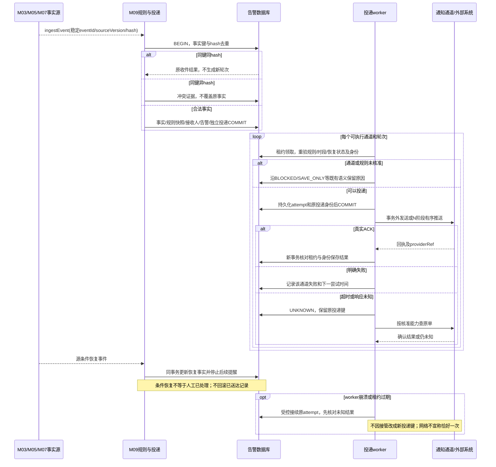

# 事实接收、多通道轮次与恢复

契约版本：DD-20260913-R2。依据[通知投递与恢复契约](通知投递与恢复契约.md)及所属模块接口定义。模块标签表示应用职责，不强制拆为独立微服务。本图为设计规格，未执行联调。

各通道独立成功／失败；通知故障不阻塞设备安全停止，不回滚事实源账本。N推送按同目标顺序和核准查单协议恢复。

## 验收断言

- 正常路径按固定身份只产生一次业务生效。
- 在每个提交前后注入响应丢失／重启，恢复后保留原身份及不可变证据。
- 同键异载荷、旧版本、无权限与依赖未知不得返回虚假成功。
- 图中物理与外部调用在事务提交后；同库业务调用不擅自改为远程RPC。
