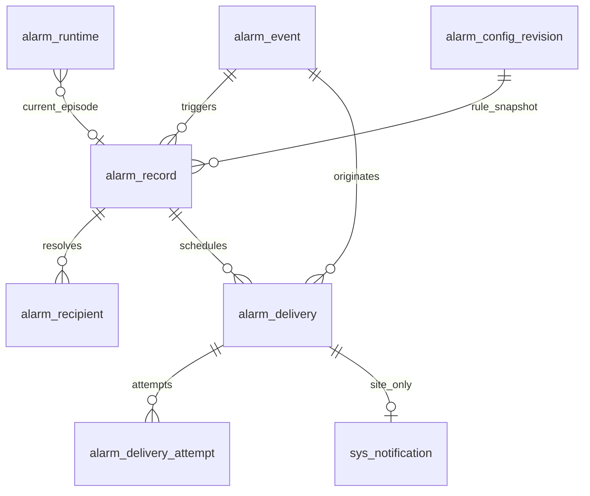

# M09 数据库模型与完整字段字典

> 本文件为原版本化基线。2026-09-11当前目标见[审阅收尾完整字段字典](审阅收尾完整字段字典.md)及最新完整DDL；旧数量不代表最新目标。

2026-09-10。15张目标表、284列；复用7张113列既有表并增加31列，新增8张技术/配置表140列。源为当前`sql/ymsw.sql`，不是运行库。全部既有字段保留，不重建告警记录/站内消息/用户/角色/实验室/培养主表。

新增主键由服务端统一ID生成器生成；既有`lab_status_alarm_config.config_id`保留自增。表均InnoDB/utf8mb4，实际排序规则以05逐列定义为准。所有SHA256键为小写64位十六进制，由服务端规范化后生成；禁止对原用户名做LIKE身份判定。不建物理外键，逻辑关联在写入、批量和后台任务逐行校验。

新增列对历史均NULL；只有显式核准的V2写入才设置版本1。旧配置保留展示但不得默认投递或复用为每个培养有效配置。初次迁移不插入猜测的告警类型、收件人、提供商或秘密，规则初始化见规则清单的稳定键，须通过统一配置接口核准字典映射/时段后开启。

## 逻辑关系

`alarm_record.event_id`→event.event_id；recipient.alarm_id→record.alarm_id；delivery.event_id必填、alarm_id可空；attempt.delivery_id→delivery；notification.delivery_id→delivery；配置各revision_id/active_revision_id→revision。用户ID→M01 sys_user；lab_id→M02实验室；culture/project/batch→M03主键；device_kind+device_id→M02设备身份；item_id→M02检测项目。停用对象保留历史显示快照；当下跳转/发送/处理重新鉴权，软删不级联抹除审计。

列类型、NULL与默认值见下表；新增旧表列一律可空且默认NULL。新表未写DEFAULT的列无隐式业务默认；创建命令显式赋值。中文说明同时给出来源、单位与技术枚举；其余旧列语义保留源注释。业务字典仅`alarm_type`→`smp_alarm_type`，值由M01配置，当前文档分类文字不初始化为固定枚举。`notify_type`保留旧通知分类并由M01核准扩展，不把它当site/email等投递通道。

## alarm_mail_config

复用扩展；24行源DDL。维护主体M09；配置保留修订，事件/尝试按审计保留策略归档且不删除未决记录。

| 字段 | 类型/NULL/默认或源定义 | 中文含义/来源/更新 |
| --- | --- | --- |
| config_id | bigint NOT NULL COMMENT '配置ID' | 既有；详见SQL列注释 |
| config_key | varchar(100) CHARACTER SET utf8mb4 COLLATE utf8mb4_0900_ai_ci NOT NULL DEFAULT 'alarm_mail_default' COMMENT '配置键（系统级单例）' | 既有；详见SQL列注释 |
| sender_email | varchar(100) CHARACTER SET utf8mb4 COLLATE utf8mb4_0900_ai_ci NOT NULL COMMENT '发件人邮箱' | 既有；详见SQL列注释 |
| sender_account | varchar(100) CHARACTER SET utf8mb4 COLLATE utf8mb4_0900_ai_ci NOT NULL COMMENT '发件人账号' | 既有；详见SQL列注释 |
| sender_password | varchar(200) CHARACTER SET utf8mb4 COLLATE utf8mb4_0900_ai_ci NOT NULL COMMENT '发件人密码（加密存储）' | 既有；详见SQL列注释 |
| platform_name | varchar(100) CHARACTER SET utf8mb4 COLLATE utf8mb4_0900_ai_ci NOT NULL COMMENT '发件平台名称' | 既有；详见SQL列注释 |
| server_name | varchar(100) CHARACTER SET utf8mb4 COLLATE utf8mb4_0900_ai_ci NOT NULL COMMENT '发件服务器名称' | 既有；详见SQL列注释 |
| server_port | int NOT NULL COMMENT '发件服务器端口' | 既有；详见SQL列注释 |
| sms_gateway_url | varchar(500) CHARACTER SET utf8mb4 COLLATE utf8mb4_0900_ai_ci NULL DEFAULT NULL COMMENT '短信网关地址' | 既有；详见SQL列注释 |
| sms_secret_key | varchar(200) CHARACTER SET utf8mb4 COLLATE utf8mb4_0900_ai_ci NULL DEFAULT NULL COMMENT '短信密钥' | 既有；详见SQL列注释 |
| version | int NOT NULL DEFAULT 0 COMMENT '乐观锁版本' | 既有；详见SQL列注释 |
| status | char(1) CHARACTER SET utf8mb4 COLLATE utf8mb4_0900_ai_ci NOT NULL DEFAULT '0' COMMENT '启用状态：0启用 1禁用' | 既有；详见SQL列注释 |
| del_flag | char(1) CHARACTER SET utf8mb4 COLLATE utf8mb4_0900_ai_ci NOT NULL DEFAULT '0' COMMENT '删除标志（0未删除 2已删除）' | 既有；详见SQL列注释 |
| create_by | varchar(64) CHARACTER SET utf8mb4 COLLATE utf8mb4_0900_ai_ci NULL DEFAULT NULL COMMENT '创建人' | 既有；详见SQL列注释 |
| create_time | datetime NOT NULL DEFAULT CURRENT_TIMESTAMP COMMENT '创建时间' | 既有；详见SQL列注释 |
| update_by | varchar(64) CHARACTER SET utf8mb4 COLLATE utf8mb4_0900_ai_ci NULL DEFAULT NULL COMMENT '更新人' | 既有；详见SQL列注释 |
| update_time | datetime NULL DEFAULT NULL COMMENT '更新时间' | 既有；详见SQL列注释 |
| remark | varchar(500) CHARACTER SET utf8mb4 COLLATE utf8mb4_0900_ai_ci NULL DEFAULT NULL COMMENT '备注' | 既有；详见SQL列注释 |
| secret_key_version | varchar(64) | 密文密钥版本；未知禁止投递 |
| active_revision_id | bigint | 当前配置修订ID |

## alarm_notify_receiver

复用扩展；55行源DDL。维护主体M09；配置保留修订，事件/尝试按审计保留策略归档且不删除未决记录。

| 字段 | 类型/NULL/默认或源定义 | 中文含义/来源/更新 |
| --- | --- | --- |
| receiver_id | bigint NOT NULL COMMENT '接收人ID' | 既有；详见SQL列注释 |
| rule_id | bigint NOT NULL COMMENT '关联通知规则ID' | 既有；详见SQL列注释 |
| receiver_source | char(1) CHARACTER SET utf8mb4 COLLATE utf8mb4_0900_ai_ci NOT NULL COMMENT '接收人来源：1-培养相关用户, 2-设备负责人, 3-指定角色' | 既有；详见SQL列注释 |
| source_id | bigint NULL DEFAULT NULL COMMENT '来源ID（source=3时为角色ID）' | 既有；详见SQL列注释 |
| del_flag | char(1) CHARACTER SET utf8mb4 COLLATE utf8mb4_0900_ai_ci NOT NULL DEFAULT '0' COMMENT '删除标志（0未删除 2已删除）' | 既有；详见SQL列注释 |
| create_by | varchar(64) CHARACTER SET utf8mb4 COLLATE utf8mb4_0900_ai_ci NULL DEFAULT NULL COMMENT '创建人' | 既有；详见SQL列注释 |
| create_time | datetime NOT NULL DEFAULT CURRENT_TIMESTAMP COMMENT '创建时间' | 既有；详见SQL列注释 |
| stable_source_key | varchar(100) | 来源稳定键；CULTURE_MEMBER或DEVICE_OWNER或ROLE角色ID |

## alarm_notify_rule

复用扩展；90行源DDL。维护主体M09；配置保留修订，事件/尝试按审计保留策略归档且不删除未决记录。

| 字段 | 类型/NULL/默认或源定义 | 中文含义/来源/更新 |
| --- | --- | --- |
| rule_id | bigint NOT NULL COMMENT '规则ID' | 既有；详见SQL列注释 |
| rule_code | varchar(50) CHARACTER SET utf8mb4 COLLATE utf8mb4_0900_ai_ci NOT NULL COMMENT '通知规则编码' | 既有；详见SQL列注释 |
| alarm_type | varchar(20) CHARACTER SET utf8mb4 COLLATE utf8mb4_0900_ai_ci NOT NULL COMMENT '告警类型（smp_alarm_type）' | 既有；详见SQL列注释 |
| alarm_module | varchar(50) CHARACTER SET utf8mb4 COLLATE utf8mb4_0900_ai_ci NOT NULL COMMENT '告警模块' | 既有；详见SQL列注释 |
| notify_mode | char(1) CHARACTER SET utf8mb4 COLLATE utf8mb4_0900_ai_ci NOT NULL COMMENT '通知模式：0-不通知, 1-24h全天候, 2-指定时间段' | 既有；详见SQL列注释 |
| notify_time_start | varchar(10) CHARACTER SET utf8mb4 COLLATE utf8mb4_0900_ai_ci NULL DEFAULT NULL COMMENT '开始时间（HH:mm，仅notify_mode=2时）' | 既有；详见SQL列注释 |
| notify_time_end | varchar(10) CHARACTER SET utf8mb4 COLLATE utf8mb4_0900_ai_ci NULL DEFAULT NULL COMMENT '结束时间（HH:mm，仅notify_mode=2时）' | 既有；详见SQL列注释 |
| notify_methods | varchar(50) CHARACTER SET utf8mb4 COLLATE utf8mb4_0900_ai_ci NULL DEFAULT NULL COMMENT '通知方式，逗号分隔 site/email/sms/sound' | 既有；详见SQL列注释 |
| notify_limit_count | int NULL DEFAULT NULL COMMENT '通知上限次数（1—98）' | 既有；详见SQL列注释 |
| notify_interval_min | int NULL DEFAULT NULL COMMENT '每次间隔分钟数（1—1439）' | 既有；详见SQL列注释 |
| version | int NOT NULL DEFAULT 0 COMMENT '乐观锁版本' | 既有；详见SQL列注释 |
| status | char(1) CHARACTER SET utf8mb4 COLLATE utf8mb4_0900_ai_ci NOT NULL DEFAULT '0' COMMENT '启用状态：0启用 1禁用' | 既有；详见SQL列注释 |
| del_flag | char(1) CHARACTER SET utf8mb4 COLLATE utf8mb4_0900_ai_ci NOT NULL DEFAULT '0' COMMENT '删除标志（0未删除 2已删除）' | 既有；详见SQL列注释 |
| create_by | varchar(64) CHARACTER SET utf8mb4 COLLATE utf8mb4_0900_ai_ci NULL DEFAULT NULL COMMENT '创建人' | 既有；详见SQL列注释 |
| create_time | datetime NOT NULL DEFAULT CURRENT_TIMESTAMP COMMENT '创建时间' | 既有；详见SQL列注释 |
| update_by | varchar(64) CHARACTER SET utf8mb4 COLLATE utf8mb4_0900_ai_ci NULL DEFAULT NULL COMMENT '更新人' | 既有；详见SQL列注释 |
| update_time | datetime NULL DEFAULT NULL COMMENT '更新时间' | 既有；详见SQL列注释 |
| remark | varchar(500) CHARACTER SET utf8mb4 COLLATE utf8mb4_0900_ai_ci NULL DEFAULT NULL COMMENT '备注' | 既有；详见SQL列注释 |
| active_revision_id | bigint | 当前核准规则修订ID |
| rule_key | varchar(64) | 稳定规则键；附件M09-R001至R042及扩展规则 |
| window_policy | varchar(30) | NO_CATCH_UP；Q02已确认：时段外触发仅记录，开窗不补发 |

## alarm_record

复用扩展；158行源DDL。维护主体M09；配置保留修订，事件/尝试按审计保留策略归档且不删除未决记录。

| 字段 | 类型/NULL/默认或源定义 | 中文含义/来源/更新 |
| --- | --- | --- |
| alarm_id | bigint NOT NULL COMMENT '告警ID' | 既有；详见SQL列注释 |
| alarm_type | varchar(20) CHARACTER SET utf8mb4 COLLATE utf8mb4_0900_ai_ci NOT NULL COMMENT '告警类型（smp_alarm_type）' | 既有；详见SQL列注释 |
| alarm_module | varchar(50) CHARACTER SET utf8mb4 COLLATE utf8mb4_0900_ai_ci NOT NULL COMMENT '告警模块（用于通知规则关联）' | 既有；详见SQL列注释 |
| lab_id | bigint NULL DEFAULT NULL COMMENT '实验室ID' | 既有；详见SQL列注释 |
| device_type | varchar(30) CHARACTER SET utf8mb4 COLLATE utf8mb4_0900_ai_ci NULL DEFAULT NULL COMMENT '设备类型' | 既有；详见SQL列注释 |
| device_id | bigint NULL DEFAULT NULL COMMENT '设备实例ID' | 既有；详见SQL列注释 |
| project_id | bigint NULL DEFAULT NULL COMMENT '项目ID' | 既有；详见SQL列注释 |
| batch_id | bigint NULL DEFAULT NULL COMMENT '批次ID' | 既有；详见SQL列注释 |
| culture_id | bigint NULL DEFAULT NULL COMMENT '培养ID' | 既有；详见SQL列注释 |
| sample_id | bigint NULL DEFAULT NULL COMMENT '样品ID' | 既有；详见SQL列注释 |
| biz_key | varchar(100) CHARACTER SET utf8mb4 COLLATE utf8mb4_0900_ai_ci NULL DEFAULT NULL COMMENT '业务幂等键' | 既有；详见SQL列注释 |
| alarm_title | varchar(200) CHARACTER SET utf8mb4 COLLATE utf8mb4_0900_ai_ci NOT NULL COMMENT '告警标题' | 既有；详见SQL列注释 |
| alarm_content | varchar(1000) CHARACTER SET utf8mb4 COLLATE utf8mb4_0900_ai_ci NULL DEFAULT NULL COMMENT '告警详细描述' | 既有；详见SQL列注释 |
| trigger_time | datetime NOT NULL COMMENT '告警触发时间' | 既有；详见SQL列注释 |
| notify_users | varchar(1000) CHARACTER SET utf8mb4 COLLATE utf8mb4_0900_ai_ci NULL DEFAULT NULL COMMENT '通知用户JSON列表' | 既有；详见SQL列注释 |
| related_system | varchar(500) CHARACTER SET utf8mb4 COLLATE utf8mb4_0900_ai_ci NULL DEFAULT NULL COMMENT '关联系统信息' | 既有；详见SQL列注释 |
| jump_link | varchar(500) CHARACTER SET utf8mb4 COLLATE utf8mb4_0900_ai_ci NULL DEFAULT NULL COMMENT '跳转链接' | 既有；详见SQL列注释 |
| handle_status | char(1) CHARACTER SET utf8mb4 COLLATE utf8mb4_0900_ai_ci NOT NULL DEFAULT '0' COMMENT '处理状态：0-未处理, 1-已处理' | 既有；详见SQL列注释 |
| handle_time | datetime NULL DEFAULT NULL COMMENT '处理时间' | 既有；详见SQL列注释 |
| handle_by | varchar(64) CHARACTER SET utf8mb4 COLLATE utf8mb4_0900_ai_ci NULL DEFAULT NULL COMMENT '处理人' | 既有；详见SQL列注释 |
| handle_remark | varchar(500) CHARACTER SET utf8mb4 COLLATE utf8mb4_0900_ai_ci NULL DEFAULT NULL COMMENT '处理备注' | 既有；详见SQL列注释 |
| handle_action | varchar(64) CHARACTER SET utf8mb4 COLLATE utf8mb4_0900_ai_ci NULL DEFAULT NULL COMMENT '处理动作：1-处理, 2-忽略' | 既有；详见SQL列注释 |
| del_flag | char(1) CHARACTER SET utf8mb4 COLLATE utf8mb4_0900_ai_ci NOT NULL DEFAULT '0' COMMENT '删除标志（0未删除 2已删除）' | 既有；详见SQL列注释 |
| create_by | varchar(64) CHARACTER SET utf8mb4 COLLATE utf8mb4_0900_ai_ci NULL DEFAULT NULL COMMENT '创建人' | 既有；详见SQL列注释 |
| create_time | datetime NOT NULL DEFAULT CURRENT_TIMESTAMP COMMENT '创建时间' | 既有；详见SQL列注释 |
| update_by | varchar(64) CHARACTER SET utf8mb4 COLLATE utf8mb4_0900_ai_ci NULL DEFAULT NULL COMMENT '更新人' | 既有；详见SQL列注释 |
| update_time | datetime NULL DEFAULT NULL COMMENT '更新时间' | 既有；详见SQL列注释 |
| remark | varchar(500) CHARACTER SET utf8mb4 COLLATE utf8mb4_0900_ai_ci NULL DEFAULT NULL COMMENT '备注' | 既有；详见SQL列注释 |
| event_id | bigint | 首次触发事件ID |
| condition_key | varchar(64) | 语义条件SHA256；旧数据未知为NULL |
| episode_no | bigint | 同条件告警轮次，从1开始 |
| condition_state | varchar(20) | ACTIVE或RESOLVED；与人工处理独立 |
| resolved_at | datetime(3) | 可信恢复时间 |
| rule_revision_id | bigint | 触发时通知规则修订ID |
| recipient_state | varchar(20) | RESOLVED或KNOWN_EMPTY或UNKNOWN |
| handled_user_id | bigint | 人工处理稳定用户ID |
| row_version | bigint | V2并发版本，从1递增 |
| handle_request_id | varchar(64) | 最终成功处理请求ID |
| handle_request_hash | varchar(64) | 处理请求规范摘要 |
| fact_snapshot | json | 首次事实白名单快照 |

## lab_offline_alarm_config

复用扩展；2123行源DDL。维护主体M09；配置保留修订，事件/尝试按审计保留策略归档且不删除未决记录。

| 字段 | 类型/NULL/默认或源定义 | 中文含义/来源/更新 |
| --- | --- | --- |
| config_id | bigint NOT NULL COMMENT '配置主键' | 既有；详见SQL列注释 |
| lab_id | bigint NOT NULL COMMENT '实验室主键' | 既有；详见SQL列注释 |
| culture_mode | varchar(30) CHARACTER SET utf8mb4 COLLATE utf8mb4_0900_ai_ci NULL DEFAULT '' COMMENT '培养模式（fed_batch/perfusion），字典：SMP培养模式' | 既有；详见SQL列注释 |
| detect_class | varchar(30) CHARACTER SET utf8mb4 COLLATE utf8mb4_0900_ai_ci NOT NULL COMMENT '检测设备分类（BGA/Vicell/OSMO/Cedex），字典：smp_detect_class' | 既有；详见SQL列注释 |
| item_id | bigint NOT NULL COMMENT '检测项主键' | 既有；详见SQL列注释 |
| lower_limit | decimal(18, 4) NULL DEFAULT NULL COMMENT '报警下限' | 既有；详见SQL列注释 |
| upper_limit | decimal(18, 4) NULL DEFAULT NULL COMMENT '报警上限' | 既有；详见SQL列注释 |
| enabled | char(1) CHARACTER SET utf8mb4 COLLATE utf8mb4_0900_ai_ci NULL DEFAULT '0' COMMENT '是否启用（0启用 1停用）' | 既有；详见SQL列注释 |
| create_by | varchar(64) CHARACTER SET utf8mb4 COLLATE utf8mb4_0900_ai_ci NULL DEFAULT '' COMMENT '创建者' | 既有；详见SQL列注释 |
| create_time | datetime NULL DEFAULT NULL COMMENT '创建时间' | 既有；详见SQL列注释 |
| update_by | varchar(64) CHARACTER SET utf8mb4 COLLATE utf8mb4_0900_ai_ci NULL DEFAULT '' COMMENT '更新者' | 既有；详见SQL列注释 |
| update_time | datetime NULL DEFAULT NULL COMMENT '更新时间' | 既有；详见SQL列注释 |
| remark | varchar(500) CHARACTER SET utf8mb4 COLLATE utf8mb4_0900_ai_ci NULL DEFAULT NULL COMMENT '备注' | 既有；详见SQL列注释 |
| culture_id | bigint | 当前培养ID；旧实验室全局配置不自动扩散 |
| active_key | varchar(64) | 培养检测类型指标有效键SHA256 |
| revision_id | bigint | 生效修订ID |
| row_version | bigint | V2版本，从1递增 |

## lab_status_alarm_config

复用扩展；2296行源DDL。维护主体M09；配置保留修订，事件/尝试按审计保留策略归档且不删除未决记录。

| 字段 | 类型/NULL/默认或源定义 | 中文含义/来源/更新 |
| --- | --- | --- |
| config_id | bigint NOT NULL AUTO_INCREMENT COMMENT '配置ID' | 既有；详见SQL列注释 |
| lab_id | bigint NOT NULL COMMENT '实验室ID' | 既有；详见SQL列注释 |
| alarm_type | varchar(20) CHARACTER SET utf8mb4 COLLATE utf8mb4_0900_ai_ci NOT NULL COMMENT '告警类型：consumable-耗材, liquid-液体, sampling_unit-取样单元, feed_unit-补料单元' | 既有；详见SQL列注释 |
| bottle_id | bigint NULL DEFAULT NULL COMMENT '关联液瓶配置ID（取样/补料单元用）' | 既有；详见SQL列注释 |
| item_name | varchar(100) CHARACTER SET utf8mb4 COLLATE utf8mb4_0900_ai_ci NULL DEFAULT NULL COMMENT '项目名称（耗材/液体用）' | 既有；详见SQL列注释 |
| unit | varchar(20) CHARACTER SET utf8mb4 COLLATE utf8mb4_0900_ai_ci NULL DEFAULT NULL COMMENT '单位' | 既有；详见SQL列注释 |
| default_quantity | decimal(12, 3) NULL DEFAULT NULL COMMENT '默认数量' | 既有；详见SQL列注释 |
| default_alarm_quantity | decimal(12, 3) NULL DEFAULT NULL COMMENT '默认报警数量' | 既有；详见SQL列注释 |
| current_quantity | decimal(12, 3) NULL DEFAULT NULL COMMENT '当前数量（耗材/液体存储，取样/补料从bottle_config实时取）' | 既有；详见SQL列注释 |
| alarm_quantity | decimal(12, 3) NULL DEFAULT NULL COMMENT '报警数量（NULL=不报警）' | 既有；详见SQL列注释 |
| alarm_operator | char(1) CHARACTER SET utf8mb4 COLLATE utf8mb4_0900_ai_ci NULL DEFAULT '<' COMMENT '告警操作符：< 当前值<报警值触发, > 当前值>报警值触发' | 既有；详见SQL列注释 |
| liquid_type | varchar(100) CHARACTER SET utf8mb4 COLLATE utf8mb4_0900_ai_ci NULL DEFAULT NULL COMMENT '液体类型（取样/补料单元用）' | 既有；详见SQL列注释 |
| sort_order | int NULL DEFAULT 0 COMMENT '排序' | 既有；详见SQL列注释 |
| create_by | varchar(64) CHARACTER SET utf8mb4 COLLATE utf8mb4_0900_ai_ci NULL DEFAULT '' COMMENT '创建者' | 既有；详见SQL列注释 |
| create_time | datetime NULL DEFAULT CURRENT_TIMESTAMP COMMENT '创建时间' | 既有；详见SQL列注释 |
| update_by | varchar(64) CHARACTER SET utf8mb4 COLLATE utf8mb4_0900_ai_ci NULL DEFAULT '' COMMENT '更新者' | 既有；详见SQL列注释 |
| update_time | datetime NULL DEFAULT NULL COMMENT '更新时间' | 既有；详见SQL列注释 |
| remark | varchar(500) CHARACTER SET utf8mb4 COLLATE utf8mb4_0900_ai_ci NULL DEFAULT NULL COMMENT '备注' | 既有；详见SQL列注释 |
| revision_id | bigint | 当前整组配置修订ID |
| row_version | bigint | V2版本，从1递增 |
| quantity_source_ref | json | 可信当前数量来源；未知不得触发 |
| quantity_observed_at | datetime(3) | 可信当前数量观测时间 |

## sys_notification

复用扩展；4075行源DDL。维护主体M09；配置保留修订，事件/尝试按审计保留策略归档且不删除未决记录。

| 字段 | 类型/NULL/默认或源定义 | 中文含义/来源/更新 |
| --- | --- | --- |
| notify_id | bigint NOT NULL COMMENT '通知主键' | 既有；详见SQL列注释 |
| notify_type | varchar(30) CHARACTER SET utf8mb4 COLLATE utf8mb4_0900_ai_ci NOT NULL COMMENT '通知类型（offline_alarm/unsigned_warn/timeout_warn/detect_overdue/force_logout/other），字典：SMP通知方式' | 既有；详见SQL列注释 |
| target_user_id | bigint NULL DEFAULT NULL COMMENT '目标用户主键' | 既有；详见SQL列注释 |
| title | varchar(200) CHARACTER SET utf8mb4 COLLATE utf8mb4_0900_ai_ci NULL DEFAULT '' COMMENT '通知标题' | 既有；详见SQL列注释 |
| content | text CHARACTER SET utf8mb4 COLLATE utf8mb4_0900_ai_ci NULL COMMENT '通知内容' | 既有；详见SQL列注释 |
| lab_id | bigint NULL DEFAULT NULL COMMENT '关联实验室主键' | 既有；详见SQL列注释 |
| sample_id | bigint NULL DEFAULT NULL COMMENT '关联检测需求主键' | 既有；详见SQL列注释 |
| result_id | bigint NULL DEFAULT NULL COMMENT '关联检测结果主键' | 既有；详见SQL列注释 |
| is_read | char(1) CHARACTER SET utf8mb4 COLLATE utf8mb4_0900_ai_ci NULL DEFAULT '0' COMMENT '是否已读（0未读 1已读）' | 既有；详见SQL列注释 |
| read_time | datetime NULL DEFAULT NULL COMMENT '阅读时间' | 既有；详见SQL列注释 |
| create_time | datetime NULL DEFAULT NULL COMMENT '创建时间' | 既有；详见SQL列注释 |
| delivery_id | bigint | 唯一站内信投递ID |
| event_id | bigint | 来源事件ID |
| alarm_id | bigint | 关联告警ID；普通消息可空 |
| read_actor_id | bigint | 实际标记已读人稳定ID；管理员与目标人区分 |
| row_version | bigint | V2版本，从1递增 |

## alarm_online_config

新增；在线告警现行配置。维护主体M09；配置保留修订，事件/尝试按审计保留策略归档且不删除未决记录。

| 字段 | 类型/NULL/默认或源定义 | 中文含义/来源/更新 |
| --- | --- | --- |
| config_id | bigint NOT NULL | 主键 |
| scope_key | varchar(64) NOT NULL | 设备或培养加设备及指标的SHA256有效键 |
| scope_kind | varchar(20) NOT NULL | DEVICE或CULTURE |
| lab_id | bigint NOT NULL | 所属实验室 |
| device_kind | varchar(40) NOT NULL | M02 DeviceKind |
| device_id | bigint NOT NULL | 设备稳定ID |
| culture_id | bigint NULL | 培养ID；DEVICE时空 |
| item_id | bigint NOT NULL | M02检测项目ID |
| unit | varchar(30) NOT NULL | 项目单位快照 |
| set_value | decimal(20,6) NULL | 设定值 |
| limit_percent | int NULL | 正整数上下限百分比 |
| lower_limit | decimal(20,6) NULL | 最终报警下限 |
| upper_limit | decimal(20,6) NULL | 最终报警上限 |
| stagnant_limit | decimal(20,6) NULL | 呆滞限值，仅保存待外部逻辑核准 |
| stagnant_seconds | decimal(14,3) NULL | 呆滞时长秒，仅保存 |
| upper_delay_seconds | decimal(14,3) NULL | 上限延迟秒，仅保存 |
| lower_delay_seconds | decimal(14,3) NULL | 下限延迟秒，仅保存 |
| cycle_seconds | decimal(14,3) NULL | 循环间隔秒，仅保存 |
| cycle_enabled | char(1) NOT NULL | 0关闭或1开启 |
| methods_json | json NOT NULL | 保存原页面sms、phone、email、sound选项 |
| enabled | char(1) NOT NULL | 0关闭或1开启；与旧离线enabled编码不同 |
| evaluation_state | varchar(20) NOT NULL | SAVE_ONLY或VERIFIED |
| logic_profile_ref | json NULL | 核准外部告警逻辑及版本；无则不得执行高级字段 |
| revision_id | bigint NOT NULL | 生效配置修订 |
| row_version | bigint NOT NULL | 并发版本 |
| updated_by | bigint NOT NULL | 修改人 |
| updated_at | datetime(3) NOT NULL | 修改时间 |

## alarm_monitor_policy

新增；泵速异动和台秤移动监控开关。维护主体M09；配置保留修订，事件/尝试按审计保留策略归档且不删除未决记录。

| 字段 | 类型/NULL/默认或源定义 | 中文含义/来源/更新 |
| --- | --- | --- |
| policy_id | bigint NOT NULL | 主键 |
| scope_key | varchar(64) NOT NULL | 设备和培养稳定键 |
| lab_id | bigint NOT NULL | 实验室 |
| device_kind | varchar(40) NOT NULL | M02设备类型 |
| device_id | bigint NOT NULL | 设备ID |
| culture_id | bigint NULL | 培养ID |
| monitor_mode | varchar(20) NOT NULL | ON或TEMP_OFF或LONG_OFF |
| remark | varchar(500) NULL | 备注 |
| revision_id | bigint NOT NULL | 生效修订ID |
| row_version | bigint NOT NULL | 并发版本 |
| updated_by | bigint NOT NULL | 修改人 |
| updated_at | datetime(3) NOT NULL | 修改时间 |

## alarm_config_revision

新增；不可变配置候选与生效证据。维护主体M09；配置保留修订，事件/尝试按审计保留策略归档且不删除未决记录。

| 字段 | 类型/NULL/默认或源定义 | 中文含义/来源/更新 |
| --- | --- | --- |
| revision_id | bigint NOT NULL | 主键 |
| config_kind | varchar(20) NOT NULL | RULE或MAIL或ONLINE或OFFLINE或STATUS或MONITOR |
| scope_key | varchar(64) NOT NULL | 配置集合语义键 |
| base_revision_id | bigint NULL | 修改前修订；首次为NULL |
| request_key | varchar(64) NOT NULL | 用户、接口、requestId的SHA256 |
| request_hash | varchar(64) NOT NULL | 请求规范摘要 |
| content_json | json NOT NULL | 固定候选内容，不含明文密码 |
| content_hash | varchar(64) NOT NULL | 固定内容SHA256 |
| revision_state | varchar(20) NOT NULL | PENDING或APPLIED或DISCARDED或CONFLICT |
| approval_id | bigint NULL | M06审批单ID |
| created_by | bigint NOT NULL | 申请人 |
| created_at | datetime(3) NOT NULL | 创建时间 |
| applied_at | datetime(3) NULL | 实际生效时间 |
| reason | varchar(500) NULL | 原因 |
| row_version | bigint NOT NULL | 状态转换版本 |

## alarm_event

新增；可靠事件收件与处理证据。维护主体M09；配置保留修订，事件/尝试按审计保留策略归档且不删除未决记录。

| 字段 | 类型/NULL/默认或源定义 | 中文含义/来源/更新 |
| --- | --- | --- |
| event_id | bigint NOT NULL | 主键 |
| source_module | varchar(20) NOT NULL | M01至M09或核准适配器 |
| source_event_key | varchar(64) NOT NULL | 源事件ID规范SHA256 |
| source_event_id | varchar(200) NOT NULL | 源事件原ID |
| source_object_kind | varchar(40) NOT NULL | 来源对象类型 |
| source_object_id | varchar(100) NOT NULL | 来源对象稳定ID |
| source_version | varchar(100) NOT NULL | 来源事实版本 |
| rule_key | varchar(64) NULL | 规则键，外部推送可空 |
| event_kind | varchar(30) NOT NULL | TRIGGER或RECOVER或BUSINESS或EXTERNAL_PUSH |
| condition_key | varchar(64) NULL | 持续条件语义键 |
| source_sequence | bigint NULL | 同条件单调序列；持续条件必填 |
| lab_id | bigint NULL | 实验室 |
| culture_id | bigint NULL | 培养ID |
| occurred_at | datetime(3) NOT NULL | 事实发生时间 |
| received_at | datetime(3) NOT NULL | 收件时间 |
| payload_json | json NOT NULL | 版本1白名单事实 |
| payload_hash | varchar(64) NOT NULL | 相同源ID重复内容校验 |
| process_state | varchar(20) NOT NULL | RECEIVED或APPLIED或IGNORED或BLOCKED |
| result_ref | json NULL | 生成告警和投递ID及原因 |
| lease_token | varchar(64) NULL | 处理租约栅栏token |
| lease_until | datetime(3) NULL | 租约截止 |
| row_version | bigint NOT NULL | 并发版本 |

## alarm_recipient

新增；告警稳定接收人与资格快照。维护主体M09；配置保留修订，事件/尝试按审计保留策略归档且不删除未决记录。

| 字段 | 类型/NULL/默认或源定义 | 中文含义/来源/更新 |
| --- | --- | --- |
| recipient_id | bigint NOT NULL | 主键 |
| alarm_id | bigint NOT NULL | 告警ID |
| user_id | bigint NOT NULL | 用户稳定ID |
| source_json | json NOT NULL | CULTURE_MEMBER、DEVICE_OWNER、ROLE来源并集 |
| display_name | varchar(100) NOT NULL | 触发时姓名快照 |
| authorization_ref | json NOT NULL | 当时资格版本，不替代当前鉴权 |
| created_at | datetime(3) NOT NULL | 解析时间 |

## alarm_delivery

新增；每轮每目标每通道的投递任务。维护主体M09；配置保留修订，事件/尝试按审计保留策略归档且不删除未决记录。

| 字段 | 类型/NULL/默认或源定义 | 中文含义/来源/更新 |
| --- | --- | --- |
| delivery_id | bigint NOT NULL | 主键 |
| delivery_key | varchar(64) NOT NULL | 事件或告警、轮次、目标、通道SHA256 |
| event_id | bigint NOT NULL | 来源事件ID |
| alarm_id | bigint NULL | 告警ID；外部推送和普通消息可空 |
| round_no | int NOT NULL | 告警通知轮次，从1开始 |
| target_kind | varchar(20) NOT NULL | USER或SOUND或EXTERNAL |
| target_key | varchar(100) NOT NULL | 用户ID或设备身份或外部目的端配置ID |
| channel | varchar(20) NOT NULL | site或email或sms或sound或external |
| rule_revision_id | bigint NULL | 规则修订 |
| config_revision_id | bigint NULL | 投递配置修订 |
| template_revision | varchar(64) NOT NULL | 核准模板版本 |
| address_cipher | text NULL | 邮箱手机号等目标密文；站内无需 |
| address_key_version | varchar(64) NULL | 目标加密密钥版本 |
| title | varchar(200) NOT NULL | 脱敏受控标题 |
| content_cipher | mediumtext NULL | 发送内容密文；无秘密时仍按受控内容存储 |
| content_key_version | varchar(64) NULL | 内容密钥版本 |
| content_hash | varchar(64) NOT NULL | 固定发送内容摘要 |
| delivery_state | varchar(20) NOT NULL | PENDING或SENDING或SUCCEEDED或FAILED或UNKNOWN或SKIPPED或CANCELLED |
| reason_code | varchar(64) NULL | 失败、跳过或取消原因 |
| scheduled_at | datetime(3) NOT NULL | 最早发送时间 |
| attempt_count | int NOT NULL | 实际尝试次数，从0开始 |
| provider_ref | varchar(200) NULL | 提供商回执ID；接收不等于送达 |
| lease_token | varchar(64) NULL | 发送租约栅栏token |
| lease_until | datetime(3) NULL | 发送租约截止 |
| created_at | datetime(3) NOT NULL | 建任务时间 |
| updated_at | datetime(3) NOT NULL | 投影更新时间 |
| row_version | bigint NOT NULL | 并发版本 |

## alarm_delivery_attempt

新增；通知尝试及人工重发证据。维护主体M09；配置保留修订，事件/尝试按审计保留策略归档且不删除未决记录。

| 字段 | 类型/NULL/默认或源定义 | 中文含义/来源/更新 |
| --- | --- | --- |
| attempt_id | bigint NOT NULL | 主键 |
| delivery_id | bigint NOT NULL | 投递ID |
| attempt_no | int NOT NULL | 该投递尝试序号 |
| request_key | varchar(64) NOT NULL | 自动租约或人工requestId规范键 |
| request_hash | varchar(64) NOT NULL | 重发请求摘要 |
| actor_user_id | bigint NULL | 人工操作人；自动为空 |
| provider_idempotency_key | varchar(100) NOT NULL | 同一投递固定提供商幂等键 |
| started_at | datetime(3) NOT NULL | 尝试开始 |
| finished_at | datetime(3) NULL | 结果落库时间 |
| attempt_state | varchar(20) NOT NULL | INVOKING或SUCCEEDED或FAILED或UNKNOWN |
| provider_ref | varchar(200) NULL | 外部回执 |
| response_code | varchar(64) NULL | 脱敏错误码 |
| response_summary | varchar(500) NULL | 白名单摘要，禁止回显秘密 |
| evidence_ref | json NULL | 查单或回调证明 |
| lease_token | varchar(64) NOT NULL | 尝试与任务租约一致 |

## alarm_runtime

新增；持续条件与重复通知游标。维护主体M09；配置保留修订，事件/尝试按审计保留策略归档且不删除未决记录。

| 字段 | 类型/NULL/默认或源定义 | 中文含义/来源/更新 |
| --- | --- | --- |
| runtime_id | bigint NOT NULL | 主键 |
| condition_key | varchar(64) NOT NULL | 规则、实体、指标、方向、任务或结果版本语义摘要 |
| latest_source_sequence | bigint NOT NULL | 已应用最大源序列 |
| episode_no | bigint NOT NULL | 累计异常周期数；恢复先到可为0 |
| active_alarm_id | bigint NULL | 本周期告警ID；恢复先到可空 |
| condition_state | varchar(20) NOT NULL | NORMAL或ACTIVE或RESOLVED |
| first_trigger_at | datetime(3) NULL | 本周期开始 |
| last_observed_at | datetime(3) NOT NULL | 最后可信观测时间 |
| resolved_at | datetime(3) NULL | 恢复时间 |
| rounds_created | int NOT NULL | 本周期已生成通知轮次 |
| next_round_at | datetime(3) NULL | 下一轮到期 |
| notify_eligibility | varchar(30) NOT NULL | ELIGIBLE或RECORD_ONLY或STOPPED |
| rule_revision_id | bigint NULL | 本周期固定规则修订 |
| row_version | bigint NOT NULL | 并发版本 |
| updated_at | datetime(3) NOT NULL | 更新时间 |

## 索引与一致性

05中的所有旧索引完整保留；新增唯一键分别约束规则稳定键、配置有效范围、源事件、条件周期、收件人并集、投递和尝试、站内信。NULL历史行允许共存，V2应用必须拒绝缺失唯一键。时间查询索引服务按实验室倒序列表；当前权限OR分支优先分别授权ID子查询后去重分页，禁止扩大为全表公开。

保存配置在同一事务写不可变revision和现行表；培养审批先PENDING，最终APPLY持有scope锁，CAS baseRevision并重验设备关联及培养状态后写APPLIED，失败CONFLICT不改现行值。重复request_key同hash返回原结果，不同hash报冲突。MAIL候选只存加密值引用/密钥版本，绝不存明文。

历史用户名或JSON接收人解析失败标UNKNOWN，不能变KNOWN_EMPTY。未核准历史处理只能走单独人工修复身份清单后启用，迁移不回填虚构ID或批量标已读/已处理。

## SQL执行与回退门禁

先在目标库只读运行01，逐列/索引对照源快照并记录旧行数、备份位置及恢复演练；验证MySQL版本、M01/M02/M03真实关联结构、空闲维护窗口和停写。02列数检查不能发现同数量列替换，故不能代替逐列比对。备份含密文/身份资料，保存在受控位置，不放进文档。

02一次性ALTER/CREATE，无UPDATE历史数据、无DROP旧表、无真实发送；DDL隐式提交，部分失败逐语句核对成功列表后编制剩余清单，不能从头重跑。03核验列数、V2必填、引用和去重，须补目标库实际数据审计及并发用例。04只限全新扩展未使用，门禁失败立即停；不能靠清空新表绕过。05是空库完整结构参考，与02增量分开使用。

代码上线顺序：只读兼容→DDL→关闭发送下核准配置与事件影子对照→单实验室站内信→邮件/短信/声光/外部端分别核准。旧发送入口与V2须同一个启用闸门互斥，避免一事件双发；已有状态同步GET副作用须移到明确初始化/同步命令。
