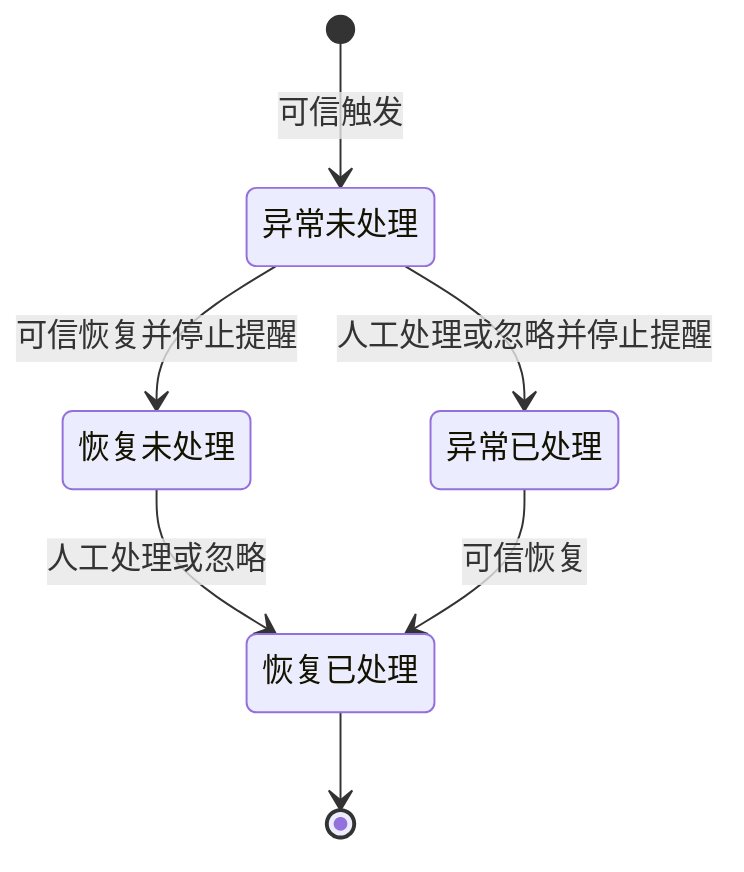

# M09 告警与通知管理详细设计

## 开始培养专项增补（SC-20261017）

M09新增StartCultureAlarmPort负责中试培养→设备→待填草稿的预览、规范校验与最终首次配置生效；页面内存输入和设备默认意图在取消/刷新时丢弃。首次工作流受信来源不放宽普通运行态修改口。首次第4步同时直接生效并保存为反应器默认（第114—115项）；SC-Q05已关闭，不增加独立外部在线监控同步及ACK前置。M09不控制取样泵或重启服务。

最新保存规则（2026-10-17）：小试、中试均只在第4步点击“完成”并成功提交后保存业务数据；未完成页面刷新或取消后从第1步重新开始，不恢复表单或中间步骤。操作审计和设备安全收尾保留，必须当天完成的限制不变。

步骤时间记录：四步分别记录服务端开始/结束时间及结束原因；刷新重开新建尝试，旧时间审计保留，未知结束时间不伪造。时间留痕不构成业务表单的中间保存点。

当前专题：[开始培养详细设计](../07-补液运行与任务执行/开始培养工作流详细设计.md)；实施拆分：[开始培养开发计划](../../开发任务/小试中试开始培养开发计划-20261017.md)。本次仅文档补充，业务代码、数据库、设备操作均未执行。

## 三类实验室接入补充（INTEGRATION-20261010）

按[共同边界](../00-三类实验室设备接入与执行边界.md)承接通信异常、未决执行、停止未核准等已登记来源的告警与恢复；来源身份须能区分原系统实例和新执行器，保留任务/命令/设备关联，去重与恢复沿用现行事件版本、sequence和周期规则。

M02在线观测、M07执行事件遵循既有交接；M05检测失败须核对现有来源注册并补齐缺失契约后接入，不私造可消费schema。M09不直接重下设备命令，通知失败不阻止现场保护、不回滚执行/检测事实。旧告警与新告警不能未经映射重复开周期。对应INTEG-06/07、INT-AC07/11/13。

> 2026-09-17 在线源交接补齐：[M02业务观测](../02-实验室与资源管理/在线业务观测存储与查询契约.md)与[M07运行采样](../07-补液运行与任务执行/业务观测采样与告警交接.md)定义判定状态、持久sequence、源身份和outbox；M09继续INT01/Event v1，不接任意新schema。M08关闭不影响告警源链，真实profile/协议仍须核准。

> 2026-09-17 独立交付补充：业务告警、配置、处理、私信与历史CRUD直接使用本模块契约，在线事实由M02/M07业务接入提供，不等待M08统计/归档。M09-Q03培养级配置在[M07培养运行操作页](../07-补液运行与任务执行/培养运行操作页与独立入口.md)承载，保持当前培养及原审批作用域。消息入口归公共框架；原“因M08暂停在线接入未验证”不再是开发依赖，外部协议核准仍独立保留。见[交付边界与BD06—BD09/BD13](../00-M08排除范围与跨模块交付边界.md)。

> 2026-09-11审阅收尾：本模块最新补充见[审阅收尾准入与恢复契约.md](审阅收尾准入与恢复契约.md)与[审阅收尾完整字段字典](审阅收尾完整字段字典.md)，当前目标15表286列。下文旧表数/包号属于当时基线；以最新增量包及[统一处置表](../00-跨模块审阅收尾/history/review/统一审阅收尾核对.md)为准。仅设计完成，运行验证未执行。

日期：2026-09-10；版本：1.1；当前确认范围详细设计完成。M09-Q02已按用户“按需求处理”确认：时段外触发仅记录，进入通知时段后不补发；在线高级判定与外部通道协议保留原需求的外部依赖。没有编写业务代码、执行SQL、发送真实通知或验证设备。M08按用户要求暂停，待业务表稳定后继续，M09不依赖其统计SQL。

## 1. 范围、依据与交付入口

| 标识 | 本期设计范围 | 主要落点 |
| --- | --- | --- |
| M09-REQ01 | 最新附件42条告警、业务提醒及归属 | [规则映射](告警规则与源事件映射.md)，CASE01—12 |
| M09-REQ02 | 告警查询、详情、人工处理、权限 | [页面与接口](页面与接口契约.md)，CASE13—20 |
| M09-REQ03 | 实验室通知规则、系统共用邮件/短信配置、来源与时段 | [投递契约](通知投递与恢复契约.md)，CASE21—34 |
| M09-REQ04 | 状态、在线/离线阈值与监控开关 | [配置与审批](告警配置与审批生效契约.md)，CASE35—47 |
| M09-REQ05 | 站内消息、未读、管理员发送记录与失败重发 | 页面与接口，CASE48—55 |
| M09-REQ06 | N标记/延期外部推送、声光关闭与恢复 | 投递契约，CASE56—62 |
| M09-DB01 | 复用7表＋新增8表，完整15表284列 | [完整字典](数据库模型与字段字典.md)、[旧表基线](当前七表完整基线.md)、[JSON契约](数据库JSON与事务契约.md) |
| M09-OPS01 | 迁移、恢复和实施顺序 | [01前核验](history/sql/01-告警通知迁移前核验.sql)、[02迁移](history/sql/02-告警通知迁移设计稿.sql)、[03后核验](history/sql/03-告警通知迁移后核验.sql)、[04未启用回退](history/sql/04-未启用告警通知回退.sql)、[05完整目标](history/sql/05-告警通知目标表结构.sql)、[验收](验收与实施顺序.md) |

优先级：本轮用户确认→[澄清决策](../../需求说明书V4.0-0904_md/需求澄清决策记录.md)→正文与原附件→旧实现。需求来源：[基本设置通知（V4.0 第 1 章）](../../需求说明书V5.1-1030_md/01-基本设置.md)、[实验室告警（V4.0 第 2 章）](../../需求说明书V5.1-1030_md/02-实验室设置.md)、[18-反应器 → 反应器详情（3.1）（V4.0 第 14 章）](../../需求说明书V5.1-1030_md/18-反应器.md)、[最新42条Excel](../../需求文档插入的附件/告警事件清单（补液&检测分析）.xlsx)。旧0625附件不覆盖最新版；原文分类仅占位，告警类型通过字典核准。

M01拥有身份、联系方式/偏好及受保护管理员身份；M02拥有实验室与DeviceKind、读数/命令能力及非运行专属在线观测；M03拥有培养、成员、历史培养关联、N标记与延期及其outbox；M05拥有结果事实与签批状态；M06拥有审批决定；M07拥有运行观测、停泵、暂停任务和物理恢复；M08只读消费业务数据进行统计分析，当前暂停；M09拥有告警记录、配置候选、收件及投递。继电器本次仅由M02提供人工开关调用，不接入补料自动控制。设备安全动作不等待M09通知或人工处理，M09不得通过处理按钮修改任务状态。

## 2. 告警状态、通知和处理

**M09-Q01已确认：恢复正常后停止提醒，记录仍待人工标记已处理。** 两个维度独立：handle_status沿用0未处理/1已处理；condition_state新增ACTIVE/RESOLVED。通知达到上限、关闭通知或无人接收不等于已处理。

| 原状态/事件 | 守卫 | 同一事务结果 | 后续 |
| --- | --- | --- | --- |
| NORMAL/RESOLVED收到新TRIGGER | 源身份、schema、事实版本有效，序列大于水位 | runtime周期+1，唯一alarm，固定规则/事实/接收人，计划首轮 | 事务提交后工作器投递 |
| ACTIVE再收到同条件TRIGGER | 新序列、同一语义条件 | 更新观测水位；不增告警，不重置轮数 | 按原计划重复提醒 |
| ACTIVE收到RECOVER | 同条件、更高序列、可信恢复 | condition=RESOLVED，记录恢复时间，取消未开始的自动投递 | handle_status不改；外部已调用结果继续对账 |
| 任一未处理→人工处理/忽略 | 当前可见＋处理权限＋接收人资格＋CAS版本 | 0→1、稳定处理人/时间/动作/备注/request证据，停止未来轮次 | 不停泵、不改审批或签批结果 |
| 已处理重复提交 | 同requestId同hash | 返回原成功结果 | 不覆盖处理人/时间 |
| 已处理另一请求 | 已有最终动作 | ALREADY_HANDLED，返回当前版本 | 不能再次覆盖，也无重开入口 |

一次性BUSINESS提醒以独立源事件生成一个周期，condition_state=RESOLVED、resolved_at=trigger_time、handle_status=0；首次通知仍按时段规则生成一轮，此后不循环。其runtime使用该事件独立conditionKey和本地固定序列1，不与持续条件水位混用。重复通知针对仍ACTIVE且未处理的持续条件。事件处理/忽略后条件仍异常，后续相同条件不生成新周期；只有可信恢复后再次异常才新建。重启/断流不是恢复，恢复先到建立水位，随后迟到TRIGGER忽略；事实顺序无法核实时BLOCKED，不凭服务器接收时间猜。

## 3. 权限边界

告警列表/详情先有查询功能权限，再应用M01/M02/M03当前可见域：有效实验室授权、有效项目/培养可读关系或当前合法告警接收身份，所有分支均受账号有效性和对象范围重检；接收历史快照不能永久授予已撤销项目内容。接口详情、导出、处理、快捷跳转与列表同源鉴权。

人工处理再要求处理功能权限，并且本人稳定ID在该告警接收人集合中；集合确认为KNOWN_EMPTY时允许当前可见且有处理功能的人处理。UNKNOWN、旧JSON解析失败、成员服务异常均不能套用“无人接收”的例外。处理时不因缺少邮箱/关闭短信偏好丢掉本人的接收资格。需要保留历史可见的独立授权变更由M01/M03统一处理，M09不自建旁路。

通知管理页仅M01受保护超级管理员，可查询所有用户站内/邮件/短信记录并代标已读；个人消息页即使管理员也只查本人。实验室通知规则按所属实验室独立保存、查询和投递，沿既有功能权限及实验室授权校验；SMTP/短信连接与凭据继续系统共享，不将规则保持为全局单例。状态/培养阈值修改要求所属实验室OPERATE及来源操作资格；前端allowedActions仅作展示，后端逐次判断。

## 4. 现状核对与实施影响

图工具list_projects/check_index_coverage在本轮均返回Transport closed，无法验证图项目/代次；实际目标D盘仓库以文件源码定向核对。以下为已读范围事实，不是全仓无其他实现的断言。

源码位于`futurefab-modules/futurefab-system/src/main/java/com/futurefab/system/`：AlarmRecordServiceImpl列表/详情已有范围填充，处理方法需补稳定ID、处理动作时重新范围校验及CAS；当前Mapper有notify_users用户名LIKE分支，需改稳定关联。SysNotificationServiceImpl已有个人限制和已读，需分开管理员/个人查询上下文，已读保持首次时间，删除/任意创建接口不得成为通用消息伪造入口；SysNotificationController多处权限字串尾部含多余引号括号，实施须统一核对。

AlarmNotifyRuleServiceImpl聚合保存已有@Transactional与重复编码/通知参数验证，保留并扩展修订/幂等，单表CRUD不能绕过。AlarmMailConfigServiceImpl已有版本控制，密码写入方法本身不能证明全链路加密正确，实施需核查保存/查询/日志/密钥轮换，不把数据库注释“加密存储”当验证完成。LabStatusAlarmConfigServiceImpl列表调用液瓶同步产生写入，应拆为明确同步命令；批量保存需补每个configId与所选实验室一致及原子校验。LabOfflineAlarmConfigServiceImpl现有实验室配置需扩展培养范围，旧enabled=0是启用，不能误复制为默认关闭。LabSoundAlarmServiceImpl已读前170行是设备资产维护，不据此声称报警器控制链路已实现。

复用现有system服务与Vue/Element Plus入口，不建立新微服务骨架。实施影响模块包括上述service/controller、mapper/alarm/AlarmRecordMapper.xml和同域页面；当前未修改其中任何文件。详见配套验收与静态检查结果。

## 5. 已确认结论与外部依赖

M09-Q02已确认（2026-09-10）：用户要求“按需求处理”，沿原正文“时段外仅记录不通知”，固定windowPolicy=NO_CATCH_UP。时段外触发的异常即使进入通知时段仍持续，也不补发；该周期保持RECORD_ONLY。M09-Q01恢复后停止提醒、记录仍待人工处理保持不变。本期无其他需要用户确认的业务问题；下列为原需求保留的技术接入依赖，不混入业务待确认清单。

原文留白的在线呆滞/延迟/循环判定继续SAVE_ONLY，待药明技术给核准profile，不能凭字段名编停泵/去抖。电话已由旧123项明确本期实现，不再以整项SAVE_ONLY排除；原生107/108规定电话按规则、不增个人选项，语音网关账号/主叫/模板等缺实际资料时仅阻该适配并标BLOCKED_EXTERNAL，不自造字段/配置或假成功。SMS网关、声光回执、N外部映射等仍按真实资料接入。在线事实由M02/M07拥有，M08只读，不构成M09业务前置；所有外部运行均须另验。

## 6. 本轮交付检查

[静态核验结果](静态核验结果.md)记录目标表/增量/字段字典、规则行、接口与验收计数、链接和保护文件比对。该检查与业务实现、SQL执行、浏览器和设备验证分开报告。

## M09-Q03 离线告警配置入口与作用域（2026-09-11已确认）

- 用户在逐项问答中同意推荐方案：离线告警只保留在反应器详情中，针对当前培养ID生效；包含该培养所属实验室的BGA、Vi-CELL、OSMO、Cedex检测指标上下限。
- 实验室设置中不再提供另一套离线告警配置入口；原实验室级历史配置保留有权查询，不自动启用、迁移或套用到培养，避免两处配置冲突。该确认不改变独立的在线告警设备模板规则。
- 进行中、已延期培养的修改按当前合法保存的实验室场景审批政策执行，不额外要求核准/ENABLED；缺政策不默认免审批。草稿/未开始/已过期继续沿既有已确认准入，结束/取消不可修改。保存和生效仍遵守原固定候选、版本校验及当前权限约定。
- 本条将澄清记录中“离线告警设置（搁置）处理”的默认待确认口径更新为用户明确确认，不恢复旧全局离线告警入口。M09-Q01恢复后停提醒但待人工处理、Q02时段外不补发不变。
- 2026-09-11：当前审阅技术补充见[审阅收尾准入与恢复契约.md](审阅收尾准入与恢复契约.md)；本次没有执行SQL、业务开发或真实通知发送。

## M09-Q04 告警与通知记录保留（2026-09-11已确认）

- 用户在逐项问答中同意沿用M05/M06的“暂不自动删除、允许受控归档”策略。保留告警事实、接收人快照、通知内容、投递轮次、真实尝试、回执及人工处理记录；不设置未经确认的自动清理期限。
- 未决、UNKNOWN和仍在提醒的记录保持在线；已结束历史可受控归档，但仍须可鉴权查询、追溯并识别原事件和投递，不能因归档丢失去重依据、重开通知轮次或重复发送。恢复正常但尚待人工处理的记录仍属未决，保持在线。
- 归档中的通知正文、联系方式快照继续加密保护，解密仍校验当前用途及权限，普通日志不记录明文；归档不扩大管理员或普通用户查看权限。归档所需密钥版本与恢复能力应保留，不能仅保留密文却丢失合法解密能力。
- 归档须验证完整性和可恢复性。归档故障不伪装成无历史记录，不用新事件替代未知旧投递。具体定位、容量、恢复与幂等设计见跨模块长期保留归档与恢复契约；尚未交付归档程序。
- 自动删除期限以后另行确认；本次归档授权不等于销毁唯一原件。M01 HTTP请求回执原24小时规则不变，不能将其清理规则套到上述领域记录。
- 2026-09-11：上述技术设计已落实到[审阅收尾准入与恢复契约.md](审阅收尾准入与恢复契约.md)；实现、SQL执行、现场资料和运行验收仍待按计划完成。

### DD-20260913-R2 开发级时序图：事实接收、多通道轮次与恢复

[事实接收、多通道轮次与恢复](告警投递开发级时序图.md)覆盖本链事务和恢复分支，接口字段仍以引用的权威契约为准。

### DD-20260913-R2 错误码统一入口

[错误码全集](错误码全集.md)归集本模块HTTP拒绝与异步原因，局部表为场景说明；命名和技术映射以统一入口为准。

## 十二月范围与澄清同步（2026-11-01）

通知规则按实验室分别保存/查询/投递，SMTP和短信连接/凭据仍为系统共用，不将实验室通知规则写成全局单例。实验室告警只读入口复用当前M09记录/详情及原处理，不增加第二套规则。

中试首启第3步修改已有在线告警，在第4步直接生效并保存为该反应器默认，不另审批；完成后修改仍原审批。空闲未配置展示0只是占位并标未配置，保存前不启用配置/监控。批次对比读当前培养在线告警，签名卡读对应反应器当前离线告警；缺配置按已确认文字展示，不补历史/补0。

本节与[十二月上线范围与澄清规则](../00-十二月上线范围与澄清规则.md)共同落实；仅剩[三类具体开发对接子项](../00-十二月上线开发对接待核事项.md)，不新增业务待决。本次仅文档同步，HTTP/浏览器/设备NOT_VERIFIED。

## S04通知与查询配套（2026-11-07）

原生107—109/116/117及140按[投递合同](通知投递与恢复契约.md)和[页面合同](页面与接口契约.md)的S04增量执行。原KNOWN_EMPTY接收人例外、当前身份/功能/范围重验保持；每独立告警的正常提醒每轮只计一次，Q-6-03已确认整轮全失败不计、部分真实送达计一轮，同轮后续成功不重复计，不据旧“计划轮次数”自动扣额度。电话字段只是原渠道phone，不新增个人选项或号码字段。

S02-308实验室告警（V5.1反应器“实验室告警”，B8121—8123）直接复用M09当前实验室列表/详情/处理，M07只导航，不另建告警CRUD。全实验室列表按原授权显示全部相应告警，不因本人未参与某培养过滤；个人“待我处理”另由M09以原生140判断本人负责、明确通知本人且当前有处理资格的设备告警，无cultureId也可纳入，不能扩成全实验室所有设备待办。已有接口/目标批量事实读取可复用，不新造资格缓存或事件。
