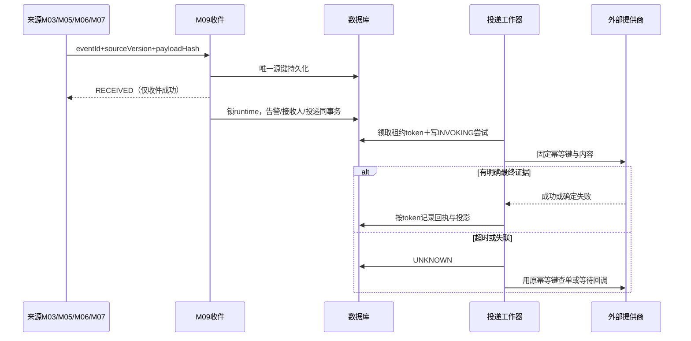

# M09 通知投递、去重与恢复契约

## 2026-11-07 现行澄清适用口径

依据正式决策记录末尾S04客户答复及后续补充。本节与下文正文同步；仅为设计，不证明代码或设备已验证。

- **Q-1-08**：四类检测设备（BGA、Vi-CELL、OSMO、Cedex）除外，设备命令先下发再查询检查结果；下发失败重试下发、查询失败重试查询，不因查询失败就盲目重发已成功下发的命令。失败重试间隔统一10秒；最多重试3次，不包含首次，故下发/查询各阶段最多4次尝试。重试仍失败后提示用户，并提供原手工处理按钮；不在首次失败即直接结束自动尝试，不把受理或查询失败当设备已成功。设备真实方法、回读与原请求身份沿已有契约，未接线不伪装成功。此为本次设备命令调用内重试，不新触发一次工艺规则，不取消原pH每日处理或通气连续调整次数等业务限制，不套用于四类检测设备送检、通知投递或数据库审批交付。
- **Q-6-03**：同一独立告警同轮通知有部分实际送达即计一轮；整轮全失败不计。不按人数或渠道数拆计，同轮其余投递后来成功不重复计轮。受理或UNKNOWN不作送达成功，尚无成功且结果未确定不伪称全失败；本答复不新增无限重试、补发次数或新的投递机制。

2026-09-10。M09-REQ03/05/06。固定事实、通知轮次、通道投递、真实尝试是四层不同记录。

## 1. 规则与接收人

### 2026-11-07 B06受信收件人事实读取
M01新增内部只读`AlarmRecipientFactsPort.readForAlarm(List<Long> userIds,List<Long> roleIds)`，仅供M09已校验来源事件的收件应用Bean调用，不设HTTP入口、不接受浏览器自报来源或伪造后台会话。按真实有效账号与启用角色展开返回稳定userId、displayName、命中的roleIds、notifyInsite/notifySms/notifyEmail布尔事实及hasEmail/hasPhone；不返回密码、联系方式原文/密文。偏好必须来自原0/1字段，缺失/非法不能补默认；已知无有效账号/角色成员可返回空，读取故障抛既有DEPENDENCY_UNAVAILABLE，不能降级为空。
M02新增内部只读`AlarmDeviceRecipientFactsPort.readOwner(long labId,String deviceKind,long deviceId)`，只核其自有设备与真实实验室归属，返回原owner_user_id稳定集合；设备有效且未配负责人为空，设备/归属缺失或事实不可得不能解释为空。设备类型沿既有DeviceKindFacts白名单；M09仍逐用户核当前实验室及培养对象可见域，不因角色配置扩大权限。M03培养MEMBER读取按本节既有最近非空配置层级，正式签名由提供方同批登记。

通知规则及接收配置按所属实验室独立读取/保存/投递，既有alarm_notify_rule/receiver物理映射须在实现时据此核对，不继续以全局单例解释规则；SMTP/短信通道配置仍系统共享。notifyMode=0仅记录，1全天，2指定时段；mode0清空渠道、范围、次数/间隔/时段的有效含义但旧revision留史。mode1/2至少一个site/email/sms/phone/sound；仅sound可无人员来源，否则至少CULTURE_MEMBER/DEVICE_OWNER/ROLE一种。次数1—98，间隔1—1439分钟；轮次从1开始。模式2起止HH:mm，业务时区Asia/Shanghai，半开[start,end)；跨午夜拆两段，start=end非法，全天使用mode1。M09-Q02已按用户要求沿用原需求确认，windowPolicy固定NO_CATCH_UP：时段外触发只记录，开窗不补发。

CULTURE_MEMBER按原要求先当前培养实际成员列表，不存在成员则批次，再项目；采用M03稳定ID、有效MEMBER和真实继承层级，不将SHARE自动当接收成员，不套M06审批的“无合格审批人转交”算法。先选最近非空配置层级，再当前资格过滤；权限服务不可用返回UNKNOWN，不按空列表升级。DEVICE_OWNER取M02设备负责人，ROLE取当前启用角色成员并过滤对象可见域，多来源按userId并集。配置角色不授予跨实验室数据权限。alarm_recipient保存完整来源及当时鉴权版本；当前发送重检账号/授权/偏好。

原生107/108：适用个人通知选项的渠道取规则与本人选项交集；site沿M01固定开启，email/sms允许关闭或无地址，分别SKIPPED_PREFERENCE/MISSING_ADDRESS，其他通道继续，接收人身份不因此消失。phone作为明确例外只按告警规则，不要求个人勾电话，也不因未选短信而禁电话；仍核原接收人及现有合法联系方式，不新增个人电话选项或号码字段。短信/邮箱在最终调用前获取当前经校验联系方式并固定本次密文快照，显示只给脱敏值；手工重发不得由浏览器修改地址。首次调用后地址快照不可改。人工重发时当前经校验地址与快照不一致则ADDRESS_CHANGED阻断，要求从来源创建明确的新通知事件，不提供修改旧投递目标的入口；旧UNKNOWN未核实前不可创建替代投递。

## 2. 时段与重复

一次性通知只一轮；持续条件在ACTIVE＋未处理＋规则有效＋尚未到上限才产生后续轮。原生109/116确认每条独立告警分别累计正常提醒轮次，包含首轮，不共享实验室/规则每日额度；一次技术重试不增加“第x次通知”。本段不以创建计划认定已通知：整轮全失败不计额；同轮部分真实送达也计一轮（Q-6-03已确认），不按创建计划计额。后续轮时序仅说明已明确正常提醒的分支。同轮所有接收人/通道共用轮号，不按邮件成功数计轮。首轮在可信触发提交后最早发送，后续scheduledAt=前一计划轮时间+interval，宕机恢复不把漏掉的多轮集中补发，最多产生一个当前到期轮，下一轮从恢复后的本次计划时点起算；上限仍不能超。

按已确认原需求，时段外触发的周期RECORD_ONLY，开窗不补；窗内触发的持续异常后续到期在窗外则顺延至下一有效窗口，发送前重验仍异常/未处理/原周期可通知。此分支只适用于窗内已取得通知资格的周期，不为窗外触发周期补授通知资格。规则被禁用/改为不通知时取消尚未调用的任务；其他规则修改仅影响新周期，旧周期内容/收件人快照不原地替换，但当前权限/偏好/通道禁用是每次发送硬门禁。已恢复、已处理取消未来自动轮次，已经进入外部调用的尝试无法声称撤回，返回后照实记录。

## 3. 持久化、外部结果与重试

源唯一键(sourceModule,sourceEventKey)；同ID同hash返回既有收件/处理结果，同ID异hash报EVENT_CONFLICT并保留原事实。conditionKey覆盖规则、实体、指标/方向及必要任务/结果版本，不使用显示培养编号；alarm.biz_key='m09:'+SHA256(conditionKey,episodeNo)，适配既有100长唯一键。deliveryKey=告警ID或独立eventId＋轮号＋targetKind/Key＋channel；站内信delivery_id唯一，同事务插入通知和SUCCEEDED，不把重试生成为第二封站内信。

外部任务PENDING→SENDING，领取时原子CAS版本/租约并插入attempt；token限制旧工作器回写，不能阻止已发生的外部副作用，必须依提供商幂等键/查单恢复。明确成功SUCCEEDED；明确可重试失败FAILED；调用超时、进程在调用后落库前崩溃、只返回接收无最终成功证据均UNKNOWN。租约到期的SENDING转UNKNOWN并查单，禁止自动回PENDING盲发。SMTP仅能证明服务器接受时，成功文案显示“邮件服务器已接受”，不宣称用户已阅读/最终送达；SMS依核准网关最终回执定义状态。

旧自动3次及1/5分钟只是未确认技术建议，不作为本轮新增通道或运行默认。确定未受理故障的实际重试预算须沿已核提供方能力确认；配置错误/地址缺失不自动重试，不编电话重试次数。该技术预算与业务轮次独立，投递记录保留每次原因。管理员仅对FAILED可重发，CAS锁防双击；同requestId同内容返回原attempt，不同内容冲突。UNKNOWN按钮为“核实结果”，需查单/受控运维证据，不提供强制当失败按钮。已恢复/已处理记录的旧失败邮件/短信允许管理员明确人工重发，但提示历史内容与当前状态并记操作者，自动重复仍停止；发送前当前权限和通道配置门禁不豁免。

## 4. 模板与通道

附件每条J列原始文案保存在原始单元格JSON，不悄悄纠正后当原文。站内/邮件标题≤200，告警摘要≤1000，详细事实存在受控snapshot，模板HTML转义、链接走白名单路由对象，参数来自可信事件不能执行脚本。

短信有效内容最多40个Unicode码点，每个英文字符、数字、标点也计1；在真实变量替换后计数，中文/英文/长设备号单独验收。不直接截断任意字符使实体不明：核准短模板优先为“{HHmm}告警{shortAlarmCode}，{shortModule}，请登录查看”，shortAlarmCode用告警唯一短展示码映射且不充当鉴权；无法在40内表达则SMS_TEMPLATE_TOO_LONG确定失败，保留原始/渲染摘要和版本，其他通道不受影响。部署前逐42条准备经核准短模板和最坏长度样本；本设计不编造真实短信签名和服务商模板ID。

MAIL配置复用单例alarm_mail_default；发送邮箱/账号/密码/平台/服务器/端口按原必填，端口1—65535。SMS URL及密钥按网关要求校验，禁止把真实密钥放URL/日志；读取仅返回passwordConfigured/secretConfigured，无明文和密文。修改时secretAction=KEEP/REPLACE/CLEAR，REPLACE必填秘密，KEEP不以星号覆盖原值，CLEAR后该通道禁用。密文封装必须适配既有varchar200上限，若认证加密封装超长则阻断上线并评审列扩展，不能截断。SMTP/TLS/SMS协议能力由核准部署配置提供，没有端口猜测自动降级。

声光以设备为目标，每个告警投递键去重，由M02命令保存ON/OFF意图与回读；M09关闭请求只回传真实命令状态。权限、配置关联或命令能力UNKNOWN时跳过实际控制并显示阻断，不虚构蜂鸣器已关闭。

## 5. N阶段/延期外部推送

沿M03outbox唯一(culture,event_type,culture_version)，只消费真实变化，N true→false也为合法变更，保存未变值无事件。M03源业务事务写outbox；M09收件持久化后ACK，使M03 DELIVERED仅表示M09已接收。M09独立生成EXTERNAL目标投递及尝试，接口结果从本模块查，失败不回滚已保存N标记，不改变培养/补液状态。

每个文化对象与目的端按sourceVersion有序交付，存在更早UNKNOWN不得越过；同一版本同事件类型去重，不能仅按cultureId去重丢掉后续变更。payload固定事件发生时old/new最小白名单与源版本，不在重试时查询最新培养信息覆盖旧事件。外部目的端URL/鉴权/字段单位映射/版本排序/幂等及查单能力未提供，保持BLOCKED/未建可执行投递；接入配置由M01受控系统参数管理，只在本模块保存配置修订引用，不存第二套外部主数据。禁止历史全量N补推，迁移阶段只核准之后的新事件。

## 6. 运行与保留

日志只含traceId、eventId、alarmId、deliveryId、attemptId、rule/configRevision、reasonCode，不含电话/邮箱完整值、密码和正文。监测收件积压、最老UNKNOWN、重复冲突、失败率和租约延迟，系统告警独立运维通道防递归自发短信风暴。容量按实际事件速率×接收人数×通道数×轮次评估，批次分页与外部限流可配置，不能为达吞吐跳过授权。按2026-09-11已确认M09-Q04：未决、UNKNOWN和仍在提醒的记录保持在线；已结束历史可受控归档，告警及通知领域记录暂不自动删除，归档保留加密、鉴权、追溯及去重能力。自动删除期限以后另行确认。

### 源延期数据补充

延期推送原始值严格保持M03的{state,startActive,endActive}，N标记保持{marked}；不自行添加无法从outbox取得的计划日期或培养全字段。结束日提醒从独立M03截止事件获取日期版本，不把延期标记变更等同于日期修改。两种延期均统一显示“已延期”，原因按开始/结束阶段分开。M03版本以服务端数值版本顺序比较，不按字符串字典序。先到高版本但前序是否已交付无法证明时，要求M03水位/前驱信息核准后发送，不把到达顺序当业务顺序。

## M09-Q04 告警与通知记录保留（2026-09-11已确认）

- 用户在逐项问答中同意沿用M05/M06的“暂不自动删除、允许受控归档”策略。保留告警事实、接收人快照、通知内容、投递轮次、真实尝试、回执及人工处理记录；不设置未经确认的自动清理期限。
- 未决、UNKNOWN和仍在提醒的记录保持在线；已结束历史可受控归档，但仍须可鉴权查询、追溯并识别原事件和投递，不能因归档丢失去重依据、重开通知轮次或重复发送。恢复正常但尚待人工处理的记录仍属未决，保持在线。
- 归档中的通知正文、联系方式快照继续加密保护，解密仍校验当前用途及权限，普通日志不记录明文；归档不扩大管理员或普通用户查看权限。归档所需密钥版本与恢复能力应保留，不能仅保留密文却丢失合法解密能力。
- 归档须验证完整性和可恢复性。归档故障不伪装成无历史记录，不用新事件替代未知旧投递。具体定位、容量、恢复与幂等实现由技术收尾细化，本条不代表已交付归档程序。
- 自动删除期限以后另行确认；本次归档授权不等于销毁唯一原件。M01 HTTP请求回执原24小时规则不变，不能将其清理规则套到上述领域记录。
- 本条明确覆盖旧“成功历史按既有保留制度实施”中尚未明确的自动清理口径：当前以暂不自动删除为准。本轮Q03离线入口范围与Q04保留策略已确认；其他审阅项及接口、数据库约束、容量/性能与恢复验证仍需技术收尾。未执行SQL、业务开发或真实通知发送。

## FEED-20261020：M07补料原因交接

来源原因定义见[M07错误码全集](../07-补液运行与任务执行/错误码全集.md)，封装见[M07观测交接](../07-补液运行与任务执行/业务观测采样与告警交接.md)。M09仍只接收、去重、配置通知并保存投递结果，不参与正常调度、核准STOP、停料确认或计量认可。

既有Event v1/Fact v1形状不变。ruleKey须按已核准映射及配置使用；原始原因及多原因集合由sourceObject/Fact.source引用M07事实，不从中文摘要猜码，也不把M09处理结果reasonCode当来源故障。不得将Fact.deadline直接复用为补料首启截止时间。映射/规则未落实是接入缺项，不阻断M07已成立的安全停止。

STOP_UNCONFIRMED等等待项不默认触发故障通知；达到核准停止确认期限后再依据STOP_CONFIRMATION_TIMEOUT及相应规则处理。M07 condition恢复方有权报告RECOVER，M09不以邮件送达、人工已读、告警静默或健康恢复代替；condition恢复不清M07停止锁，不抹去超时/违规历史。投递失败按原重试/UNKNOWN处理，设备保护不中断。

## FEED-20261028：补料异常声光投递

M07沿既有安全事实 outbox 交接经核准 ruleKey 映射的补料异常；M09接收原身份和摘要后按有效规则、时段和声光通道决定是否形成设备投递。目标来自可核验的事件时绑定，发送时由M02重验当前绑定和控制资格，不用反应器 ID 代替声光设备 ID；事件时绑定不可核验或与当前不一致时阻断，不以新绑定设备顶替历史目标。映射、绑定、实验室归属、配置或命令能力缺失/不明则保留事实并阻断该通道，不补默认配置；已收件或已形成投递均不等于已下发或物理报警。通知失败不阻断、延误或撤销必要停止，也不影响计量和资源释放资格。
自动开启的设备动作通过 M02 受控端口；人工关闭仍使用 M09-016。客户接口为有副作用的 GET，`open`、`flash`、`close` 的 HTTP 200 与 `ResultCode` 均不能单独证明成功，须按核准协议核对 `IsSuccess`；即使客户服务报告成功，也不自动等同物理声、光已动作。M09保存原投递及尝试身份，记录 BLOCKED、已受理、明确失败或 UNKNOWN 等真实结果；无原命令查单及幂等保障时，结果不明不得换身份盲目重发或伪造成功。实际重试、查单及回读能力须按核准协议和原投递契约验证。

2026-10-28 产品确认仅中试使用声光报警器，小试不配置、不触发；相应代码限制尚待补齐。同一中试报警器有多个活动告警时，来源/活动条件的归属和关闭作用范围不可证明，或聚合策略未核准时，不发送未经验证的开启/关闭序列。正常启动 `flash` 与完成 `close` 为历史参考，是否纳入当前业务待确认；不由本条自动启用。具体规则映射、配置、互斥、设备回读和现场效果分别验证，代码、隔离替身、客户接口及现场验收不得混称。
2026-10-28 声光实施补充：仅 `M07/BUSINESS` 且命令模板为 `SOUND_ON_V1` 的声光投递由补料声光工作器处理；其他来源和模板不抢占。工作器默认关闭，启用时批量、扫描周期及租约时间须显式配置。领取租约先落 `PENDING` 尝试；原事件、时段、已固定规则修订、设备绑定及聚合能力重新核验通过后，再在事务内转 `INVOKING` 并增加实际尝试数，提交后方可在事务外请求M02。前置取消对应投递 `CANCELLED`；前置阻断或资格不明以 `FAILED` 加对应原因保留，不伪装已下发。调用受理但无实际结果证据记 `UNKNOWN`；已调用后的租约过期记 `UNKNOWN`，未调用的租约过期记录前置失败；均不以新身份盲目重发。各阶段故障分别记录，不能因一条重放异常跳过其他投递的过期租约恢复。

声光规划与发送前重验使用同一事务连接查询事件和规则，只有数据库会话 `UTC` 或 `+00:00` 才允许，`SYSTEM`、其他时区或未知均阻断。该检查不能反证历史写入时区；生产数据源及历史写入来源仍须核准。事件发生时未固定且不能证明原生效修订时保持阻断，不以之后的当前修订补造历史事实。真实设备提供方和共享聚合能力尚未装配，默认阻断。
2026-10-28 M02声光发送前来源复核：内部 SoundAlarmDeliveryRequest 在原 delivery/event/alarm/lab/target 上增加原 ruleRevisionId 和本次 leaseToken。M09只读 context 以同一 UTC 事务核对该投递当前 SENDING、同令牌 INVOKING、租约未过期、原事件/告警/目标/规则身份、M07 BUSINESS 来源、事件载荷 v1 规范摘要及 result_ref 对原告警和投递的引用；输出当时 cultureId、occurredAt、M07子事件ID、原事件ID/版本/hash、M09事件摘要、原 attemptId 和本投递所有尝试一致的 providerIdempotencyKey。原事件 hash 是 M09 入站声明，不可单凭 M09 读取冒充 M07 源事实已核实；M02调用能力前须经 M07 权威只读口校验原子事件/子事件和 M09载荷摘要。身份不符、UTC未知、规则失效、租约过期或源事实不可用均阻断，不能发设备。该核验不创建物理证据，也不能撤销已进入设备提供方的在途写；设备提供方仍须承担逐设备能力核准、最终持久仲裁及共享规则。历史尝试同一投递的提供方键不一致时阻断，不按新前缀重造。
声光重发与查单身份：同一 SOUND 投递的自动尝试、人工重发和核对必须使用其已持久保存且一致的原 providerIdempotencyKey；不得按新前缀或新身份重造。人工重发先锁原投递并核验全部尝试，领取时复用该次人工 PENDING attempt 的 ID、token、操作者及原键。原键缺失、历史键冲突或存在未核实 UNKNOWN/INVOKING 时阻断，保留原证据；无效 PENDING 尝试及投递的阻断结果同事务留痕，不能覆盖历史 UNKNOWN。当前缺少将 UNKNOWN 与核准最终失败证明可靠关联的能力时，即使后续可能已有失败结论也不自动重发；须补齐证据并核准恢复协议。INT03 对声光查询使用原键，身份缺失或冲突时不调用外部查单。

### B06正常轮次实施边界（2026-11-07）

每条独立告警分别计正常提醒轮次；同轮多人、多渠道合计1轮。明确SKIPPED_PREFERENCE的渠道已被个人交集排除，不属于适用投递；排除后适用投递中有至少一条真实SUCCEEDED即计一轮，其余部分失败不影响本轮计额；同轮后续成功不重复计额（Q-6-03补充覆盖原全成功要求）。全部仅偏好排除不记成功/不扣轮次，也不连续生成无适用渠道的新轮；旧事件不因随后打开偏好补发。MISSING_ADDRESS、FAILED、UNKNOWN及phone未执行不属于该明确排除，不推定为完整成功；计额与完整送达分开：全失败不计、有部分真实成功计一轮，尚无成功且结果未确定保留真实未决事实。rounds_created只记已生成计划轮次，正常完成轮数从各轮真实投递事实推导，不按人/渠道计额，也不把计划数当送达数。

同一原子receiveEvent事务显式REPEATABLE_READ；内部resolver加入该原事件事务读取规则与本机M01/M02/M03事实，不使用REQUIRES_NEW挂起拥有方，也不把父写事务中的readOnly注解当成真实只读事务。独立resolver无外层时按其RR只读定义执行；T03拥有方同样显式RR。这里只是源码事务定义，目标库隔离与行锁仍需另行验证。
