# 系统设置

## 基本设置

### 场地管理①

通过多层级关联维护场地信息，用于精准标记相关设备的所在位置。用户创建、修改、删除等操作记录日志，记录操作对象。

> **[图 image2.png | 章节：基本设置 / 场地管理① | 上下文：通过多层级关联维护场地信息，用于精准标记相关设备的所在位置。用户创建、修改、删除等操作记录日志，记录操作对象。]**
> **OCR 文本：**
> 基本设置
> 场地管理 | 名称 | 起止时间 | 检索 | 新增
> 部门管理
> 名称 | 编码 | 创建人 | 创建时间 | 修改人 | 修改时间
> 实验组
> 上海率贸厂区 | SHFX | 粥三 | 2026-01-01 12:22 | 张三 | 2026-01-01 12:22 | 修改添加下级删除
> 功能管理
> 角色设置 | 回一号楼 | 李四 | 2026-01-01 12:22 | 李四 | 2026-01-01 12:22 | 修改添加下级删除
> 用户管理 | 201室 | 201 | 张三 | 2026-01-01 12:22 | 张三 | 2026-01-01 12:22 | 修改 | 添加下级删除
> 登录记录 | 202室 | 201 | 张三 | 2026-01-01 12:22 | 张三 | 2026-01-01 12:22 | 修改 | 添加下级删除
> 用户操作记录

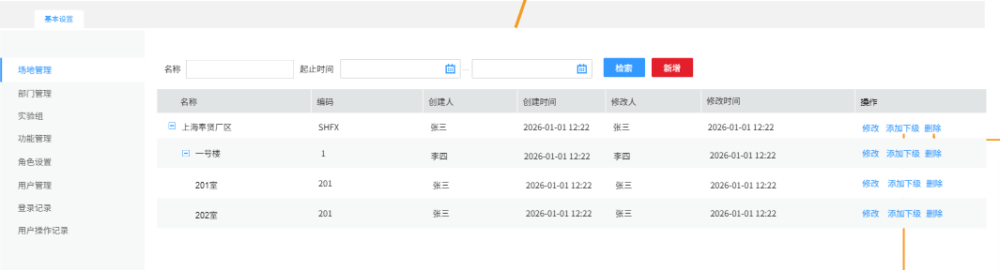

1.  新增

    新增场地信息：

    > **[图 image3.png | 章节：基本设置 / 场地管理① | 上下文：新增场地信息：]**
    > **OCR 文本：**
    > 新增
    > 名称 | Please enter...
    > 编码' | Please enter..
    > 上级 | Please select..
    > 不选择款认为一级场地
    > 上海率资厂区下拉选择
    > 一号楼 | 体现层级效果
    > 101
    > 二号楼
    > 取消

    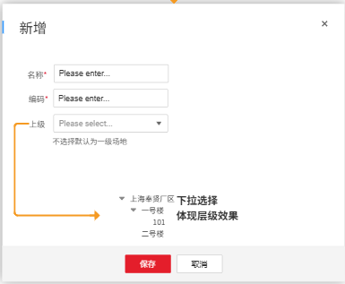

    1.  **名称**：文本框，必填，不超过50个字符，同一层级名称不允许重复（已删除的不包含在内）
    2.  **编码**：文本框，必填，不超过50个字符，编码全局唯一（已删除的不包含在内）
    3.  **上级**：非必填，不填默认层级为1（最高），按照层级展示所有场地，可选择任意作为上级
    4.  保存：
        1.  必填字段的非空校验
        2.  保存时需要校验名称和编码的长度与唯一性，校验通过才能成功保存，否则提示相应失败信息（“名称不允许超过50字符”，“编码不允许超过50字符”，“同级别已有该场地名称”，“同级别已有该场地编码”）
        3.  需记录日志，包括创建人、创建时间
    5.  **取消**：点击取消新增
2.  查询条件

    按照以下条件联合查询：

    1.  **名称**：文本框，按照部门或编码模糊搜索
    2.  **起止时间**：输入开始时间和结束时间，时间条件可针对创建时间和修改时间同时进行匹配检索，起止时间可以只输入一项
3.  结果展示与操作

    查询结果翻页展示，按创建时间倒排，最新的在最上面，包含以下字段：

    1.  **名称**：默认展示顶级场地名称，点击左侧图标，树形结构展示该场地下的所有层级信息
    2.  编码
    3.  创建人
    4.  创建时间
    5.  **修改人**：最近一次进行修改的用户的显示名称
    6.  **修改时间**：最近一次进行修改的时间
    7.  操作
        1.  **修改**：修改后需校验，同新增保存时的校验④1）；需记录修改日志，包括修改人、修改时间

            > **[图 image4.png | 章节：基本设置 / 场地管理① | 上下文：修改：修改后需校验，同新增保存时的校验④1）；需记录修改日志，包括修改人、修改时间]**
            > **OCR 文本：**
            > 修改
            > 名称* | Please enter...
            > 缩码* | Please enter...
            > 上级 | Please select...
            > 不选择默认为一级场地
            > 保存 | 取消

            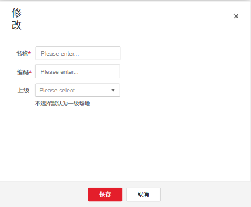

        2.  **添加下级**：自动把当前场地名称带入上级字段，功能与新增一致
        3.  删除：
            1.  删除前需要二次确认，点击确认才可删除

                > **[图 image5.png | 章节：基本设置 / 场地管理① | 上下文：删除前需要二次确认，点击确认才可删除]**
                > **OCR 文本：**
                > 除前语先移除场地关联的设备
                > 此保作将同时除自录下的具他场地
                > 确定要用除吗？
                > 取消 | 确定

                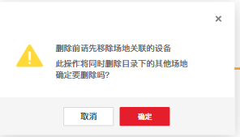

            2.  **关联设备校验**：当前场地存在关联设备时，删除失败并提示

                > **[图 image6.png | 章节：基本设置 / 场地管理① | 上下文：关联设备校验：当前场地存在关联设备时，删除失败并提示]**
                > **OCR 文本：**
                > 删除失败！
                > 当前房间下有设备
                > 请先移除当前房间下的设备
                > 确认

                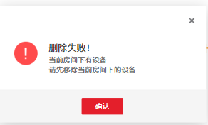

            3.  删除成功提示

### 部门管理①

按照层级关联维护部门信息，用于快速查找用户。用户创建、修改、删除等操作记录日志，记录操作对象。

> **[图 image7.png | 章节：基本设置 / 部门管理① | 上下文：按照层级关联维护部门信息，用于快速查找用户。用户创建、修改、删除等操作记录日志，记录操作对象。]**
> **OCR 文本：**
> 基本设置
> 场地管理 | 名称 | 部门名称或编码 | 起止时间 | 检素 | 新增
> 部门管理
> 部门名称 | 部门编码 | 创建人 | 创建时间 | 修改人 | 修改时间 | 操作
> 实验组
> NPP | NPP | 2026-01-01 12:22 | 张三 | 2026-01-01 12:22 | 修改添加下级查看员工删除一
> 功能管理
> 子部门1 | 001 | 李四 | 2026-01-0112:22 | 李四 | 2026-01-01 12:22 | 修改 | 添加下级查看员工删除
> 角色设置
> 用户管理 | 子部门1.1 | 011 | 张三 | 2026-01-01 12:22 | 张三 | 2026-01-01 12:22 | 修改添加下级查看员工删除
> 登录记录 | 子部门1.2 | 012 | 张三 | 2026-01-01 12:22 | 张三 | 2026-01-01 12:22 | 修改添加下级查看员工删除

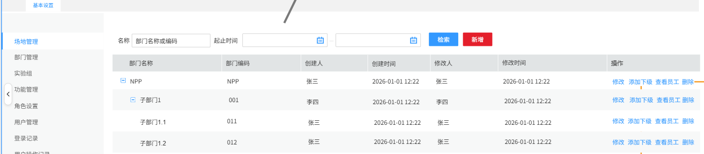

1.  新增

    新增部门信息：

    > **[图 image8.png | 章节：基本设置 / 部门管理① | 上下文：新增部门信息：]**
    > **OCR 文本：**
    > 新增
    > 名称* | Please enter..
    > 编码* | Please enter... | 下拉选择
    > 体现层级效果
    > 上级 | Please select...
    > 不选择默认为一级部门
    > 排序
    > 保存 | 取消

    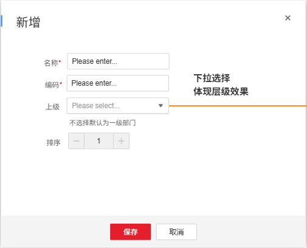

    1.  **场地名称**：文本框，必填，不超过50个字符，同一层级名称不允许重复（删除的不包含在内）
    2.  **场地编码**：文本框，必填，不超过50个字符，同一层级编码不允许重复（删除的不包含在内）
    3.  **上级**：非必填，不填默认层级为1（最高），按照层级展示所有部门，可选择任意作为上级
    4.  **排序**：默认数字1，在前端部门下拉框、树形菜单展示顺序时，同级别下，数字越小越靠前，排序数字一样，按照添加时间，添加得早的排在前面。
    5.  保存：
        1.  必填字段的非空校验
        2.  保存时需要校验名称和编码的长度与唯一性，校验通过才能成功保存，否则提示相应失败信息（“名称不允许超过50字符”，“编码不允许超过50字符”，“同级别已有该部门名称”，“同级别已有该部门编码”）
        3.  需记录日志，包括创建人、创建时间
    6.  **取消**：点击取消新增
2.  查询条件

    按照以下条件联合查询：

    1.  **名称**：文本框，按照部门或编码模糊搜索
    2.  **起止时间**：同(2)②
3.  结果展示与操作

    查询结果翻页展示，按创建时间倒排，最新的在最上面，包含以下字段：

    1.  **部门名称**：默认展示顶级部门名称，点击左侧图标，树形结构展示到该部门下所有层级信息
    2.  部门编码
    3.  创建人
    4.  创建时间
    5.  修改人
    6.  修改时间
    7.  操作
        1.  **修改**：修改后需校验，同新增保存时的校验，需记录修改日志，包括修改人、修改时间

            > **[图 image9.png | 章节：基本设置 / 部门管理① | 上下文：修改：修改后需校验，同新增保存时的校验，需记录修改日志，包括修改人、修改时间]**
            > **OCR 文本：**
            > 修改
            > 名称* | Please enter...
            > 编码* | Please enter...
            > 上级 | Please select...
            > 不选择默认为一级场地
            > 排序
            > 保存 | 取消

            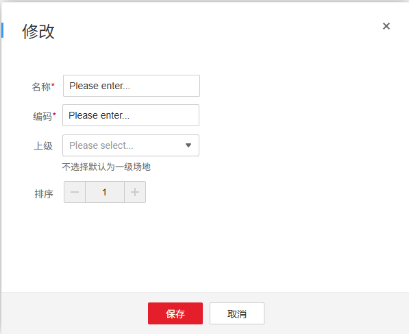

        2.  **添加下级**：自动把当前场地名称带入上级字段，功能与新增一致
        3.  **查看员工**：查看对应部门的详细员工信息
            1.  序号：
            2.  **显示名称**：用户显示名称
            3.  用户名
            4.  邮箱
            5.  角色
            6.  上次登录时间
            7.  **状态**：该用户在线时图标为绿色，否则为灰色

                > **[图 image10.png | 章节：基本设置 / 部门管理① | 上下文：状态：该用户在线时图标为绿色，否则为灰色]**
                > **OCR 文本：**
                > 查看员工
                > 部门名称：NPP
                > 序号 | 显示名称 | 用户名 | 邮箱 | 角色 | 上次登录时间 | 状态
                > 张三 | zhangsan | 2827262@qq.com | 实验员 | 2026-09-21 12:12:34
                > 李四 | lisi | 22262@qq.com | 实习生 | 2026-09-21 12:12:34
                > 王五 | wangwu | 333332@qq.com | 实验员，QA组长 | 2026-09-21 12:12:34
                > 赵六 | zhaoliu | 66662@qq.com | 实习生 | 2026-09-21 12:12:34
                > 赵赵 | zhaozhao | 1018u3@qq.com | 设备管理员 | 2026-09-21 12:12:34
                > 上一页 | 10 | 下一页
                > 关闭

                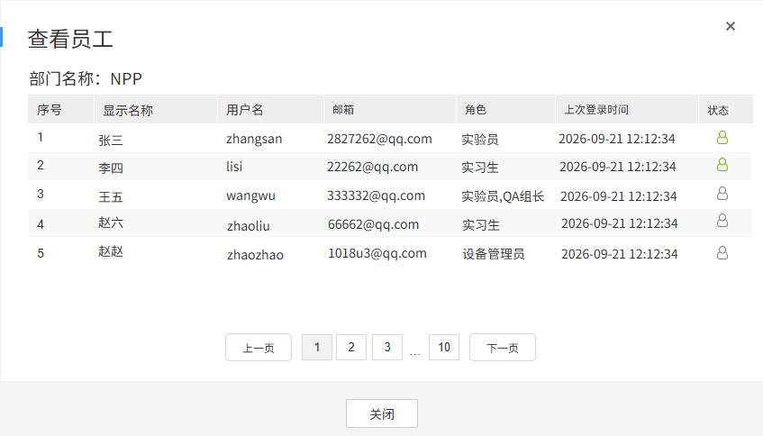

        4.  删除：
            1.  删除前需要二次确认，点击确认才可删除

                > **[图 image11.png | 章节：基本设置 / 部门管理① | 上下文：删除前需要二次确认，点击确认才可删除]**
                > **OCR 文本：**
                > 此操作将会同时删除下级部门
                > 您确定要删除吗?
                > 取消 | 确定

                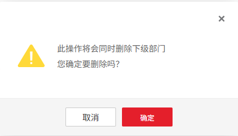

            2.  **关联用户校验**：当前部门存在关联用户时，删除失败并提示

                > **[图 image12.png | 章节：基本设置 / 部门管理① | 上下文：关联用户校验：当前部门存在关联用户时，删除失败并提示]**
                > **OCR 文本：**
                > 删除失败！
                > 当前部门下还有员工哦
                > 请先把员工转移至其他部门
                > 关闭

                

            3.  删除成功提示

                > **[图 image13.png | 章节：基本设置 / 部门管理① | 上下文：删除成功提示]**
                > **OCR 文本：**
                > 操作成功！
                > 数据已经删除
                > 关闭

                

### 实验组①

支持将不同人员共同构建实验组，用于实验时可快速选择人员。用户创建、修改、删除等操作记录日志，记录操作对象。

> **[图 image14.png | 章节：基本设置 / 实验组① | 上下文：支持将不同人员共同构建实验组，用于实验时可快速选择人员。用户创建、修改、删除等操作记录日志，记录操作对象。]**
> **OCR 文本：**
> 基本设置
> 场地管理 | 实验组名称/组编号/负责人 | 起止时间 | 检索 | 新增
> 部门管理
> 序号 | 实验组名称 | 组编号 | 负责人 | 组内成员人数 | 修改人 | 修改时间 | 操作
> 实验组
> 实验组A | 张三 | 2026-06-01 11: 11:11 | 修改
> 功能管理
> 角色设置 | 实验组B | 老王 | 10 | 2026-06-01 11: 11:11 | 修改
> 用户管理 | 实验组C | 张飞 | 2026-06-01 11: 11:11 | 修改
> 登录记录
> 实验组D | 2026-06-01 11: 11:11 | 修改
> 用户操作记录

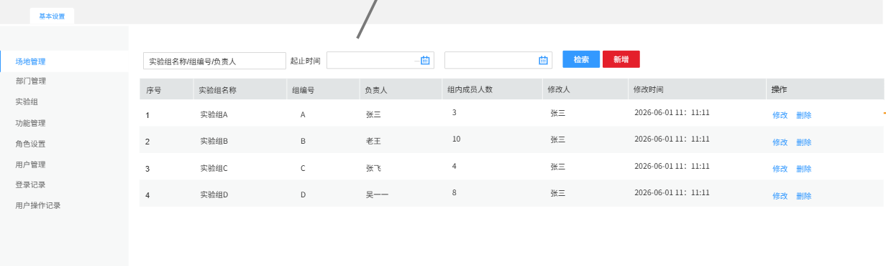

1.  新增

    选择多个用户构建一个新的实验组

    > **[图 image15.png | 章节：基本设置 / 实验组① | 上下文：选择多个用户构建一个新的实验组]**
    > **OCR 文本：**
    > 新增
    > 组内成员
    > 组名称* | Please enter...
    > 全选 | 序号 | 姓名 | 部门名称 | 角色 | 操作
    > 组编码 | Please enter... | Search | 张三 | NPP-DEPT1 | 实验员 | 移除
    > 负责人 | Please select.. | 李四 | NPP-DEPT1 | 主任 | 移除
    > ± Item | 王五 | NPP-DEPT1 | 测试员 | 移除
    > 部门 | Please select... | + Item | 赵六 | OPS | 设备管理 | 移除
    > Item
    > Item
    > Item
    > Item
    > + Item
    > Item
    > 保存 | 取消

    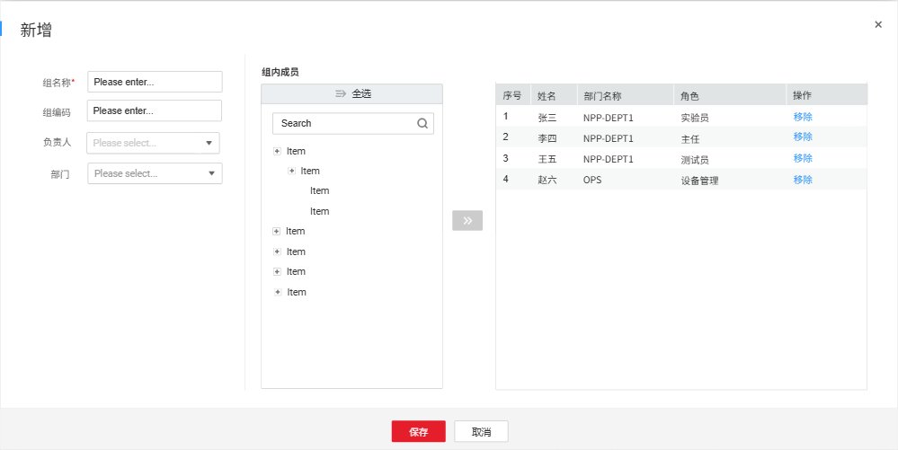

    1.  **组名称**：文本框，必填，20个字符以内，名称不允许重复（删除的不包含在内）
    2.  **组编码**：文本框，选填，当用户输入组名称的时候，默认自动填写组编码=组名称，可修改（删除的不包含在内）
    3.  **负责人**：实验组负责人，下拉选项，非必选，关联用户，支持模糊搜索，支持多选
    4.  **部门**：本组归属的大部门，下拉选项，非必选，单选，关联部门，支持模糊搜索
    5.  组内成员：
        1.  **部门树**：支持按显示名搜索到某一个人并添加；支持选中某个部门，把整个部门的人添加到小组内；支持全选
        2.  成员展示与操作：
            1.  **成员信息**：姓名、所在部门名称、角色名称（用户支持多个角色）
            2.  **移除**：直接移除用户
    6.  **保存**：必填字段的非空校验，通过后成功新增实验组
    7.  **取消**：点击按钮，取消新增
2.  查询条件

    按照以下条件联合查询：

    1.  **实验组名称/组编码/负责人**：文本框，按照实验组名称/组编码/负责人模糊搜索
    2.  **起止时间**：同(2)②
3.  结果展示与操作

    查询结果翻页展示，按创建时间倒排，最新的在最上面，包含以下字段：

    1.  序号
    2.  实验组名称
    3.  组编号
    4.  负责人
    5.  **组内成员人数**：统计展示对应组内的成员数量
    6.  **修改人**：同(3)⑤
    7.  **修改时间**：同(3)⑥
    8.  操作
        1.  **修改**：修改功能同新增保持一致，需记录修改日志；基本信息增加包括修改人、修改时间

            > **[图 image16.png | 章节：基本设置 / 实验组① | 上下文：修改：修改功能同新增保持一致，需记录修改日志；基本信息增加包括修改人、修改时间]**
            > **OCR 文本：**
            > 修改
            > 组内成员
            > 组名称* | 测试小组
            > 全选 | 序号 | 姓名 | 部门名称 | 角色 | 操作
            > 组编码 | TEST | Search | 张三 | NPP-DEPT1 | 实验员 | 移除
            > 负责人 | Please select.... | 李四 | NPP-DEPT1 | 主任 | 移除
            > Item | 王五 | NPP-DEPT1 | 测试员 | 移除
            > 部门 | NPP | ? Item | 赵六 | OPS | 设备管理 | 移除
            > Item
            > Item
            > Item
            > 创建人 | 张三
            > Item
            > 创建时间 | 2026-06-01 00:00:00 | Item
            > Item
            > 修改人 | 张三
            > 修改时间 | 2026-06-01 00:00:00
            > 保存 | 取消

            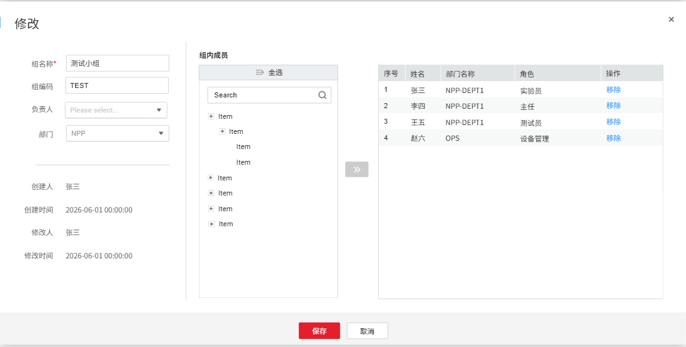

        2.  删除
            1.  删除前需要二次确认才能删除

                > **[图 image17.png | 章节：基本设置 / 实验组① | 上下文：删除前需要二次确认才能删除]**
                > **OCR 文本：**
                > 确定要删除吗
                > 删除后此实验组不可以再使用哦
                > 取消

                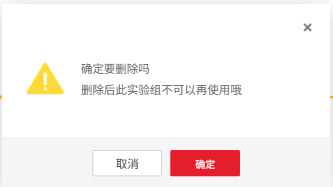

            2.  删除成功，提示信息

                > **[图 image18.png | 章节：基本设置 / 实验组① | 上下文：删除成功，提示信息]**
                > **OCR 文本：**
                > 操作成功！
                > 数据已经删除
                > 关闭

                

### 功能管理①

系统管理员在此模块配置菜单和按钮等，用户创建、修改、删除等操作记录日志，记录操作对象。

> **[图 image19.png | 章节：基本设置 / 功能管理① | 上下文：系统管理员在此模块配置菜单和按钮等，用户创建、修改、删除等操作记录日志，记录操作对象。]**
> **OCR 文本：**
> 名称/编码 | 起止时间 | 检索 | 新增
> 展示名称 | 权限编码 | 节点类型 | 功能状态 | 修改人 | 修改时间 | 操作
> 数据管理 | SJGL | 目录 | 正常 | 张三 | 2026-06-02 00:22:11 | 修改 | 停用 | 添加下级

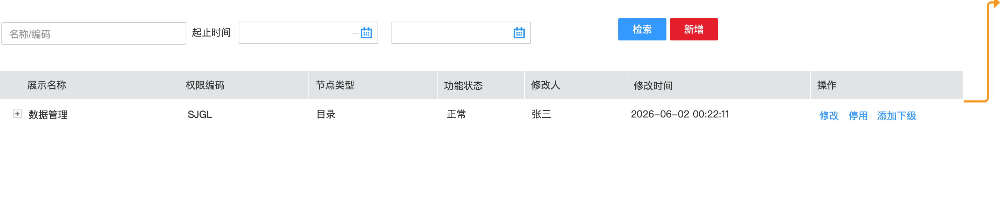

1.  新增

    新增模块/页面/按钮，并维护显示/隐藏等信息，根据功能类型不同需要填写字段也不同。

    > **[图 image20.png | 章节：基本设置 / 功能管理① | 上下文：新增模块/页面/按钮，并维护显示/隐藏等信息，根据功能类型不同需要填写字段也不同。]**
    > **OCR 文本：**
    > 添加菜单
    > 上级荣单 | 主类目
    > 功能类型 | 目录 | 菜单 | 按钮
    > 功能图标 | 请输入 | 显示排序
    > *功能名称 | 请输入 | ?是否外链 | ○是
    > ?路由地址 | 请输入 | 显示状态 | 显示 | 隐藏
    > ?功能状态 | 正常 | 停用
    > 确认 | 取消

    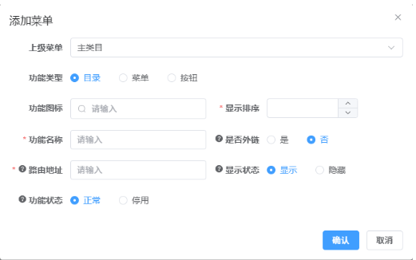

    > **[图 image21.png | 章节：基本设置 / 功能管理① | 上下文：新增模块/页面/按钮，并维护显示/隐藏等信息，根据功能类型不同需要填写字段也不同。]**
    > **OCR 文本：**
    > 上级荣单
    > 功能类型 | 目录 | 荣单 | 按钮
    > 功能图标 | system | 显示排序
    > *功能名称 | 系统管理 | ?路由名称 | 请输入
    > ?是否外链 | 路由地址 | system
    > ?组件路径 | 请输入 | ?权限标识 | 请输入
    > 路由参数 | 请输入 | ?是否缓存 | 缓存 | 不缓存
    > ?显示状态 | 显示 | ?功能状态 | 正常 | 停用
    > 确认 | 取消

    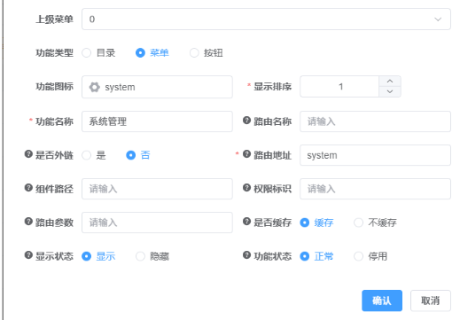

    > **[图 image22.png | 章节：基本设置 / 功能管理① | 上下文：新增模块/页面/按钮，并维护显示/隐藏等信息，根据功能类型不同需要填写字段也不同。]**
    > **OCR 文本：**
    > 上级菜单
    > 功能类型 | 目录 | 菜单 | 按钮
    > 显示排序 | 功能名称 | 系统管理
    > ?权限标识 | 请输入 | ?功能状态 | 停用
    > 确认 | 取消

    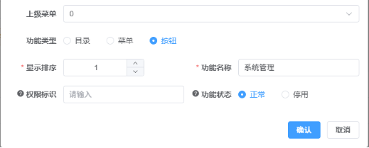

    1.  **上级菜单**：下拉选择，默认为主类目，即一级目录
    2.  **功能类型**：单选，必选，默认为目录，确认当前新增的类型是目录/菜单/按钮，根据不同功能类型，填写不同字段
        1.  目录
            1.  **功能图标**：从系统自带的图标中选择
            2.  **显示排序**：默认数字1，在前端部门下拉框、树形菜单展示顺序时，同级别下，数字越小越靠前，排序数字一样，按照添加时间，添加得早的排在前面。
            3.  **功能名称**：必填，
            4.  **是否外链**：单选，是否允许填写外部链接
            5.  路由地址
            6.  **显示状态**：选择页面是否可见
            7.  **功能状态**：表示该功能是否可用，停用后通过输入地址也无法访问
        2.  菜单
            1.  功能图标
            2.  显示排序
            3.  功能名称
            4.  路由名称
            5.  是否外链
            6.  路由地址
            7.  组建路径
            8.  权限标识
            9.  路由参数
            10. 是否缓存
            11. 显示状态
            12. 功能状态
        3.  按钮
            1.  显示排序
            2.  功能名称
            3.  权限标识
            4.  功能状态
    3.  保存：
    4.  必填字段的非空校验
    5.  需记录日志，包括创建人、创建时间
2.  查询条件

    按照以下条件联合查询：

    1.  **名称**：支持功能名称的模糊检索
    2.  起止时间：
    3.  **功能状态**：单选，筛选正常/停用的
3.  结果展示与操作

    查询结果翻页展示，按创建时间倒排，最新的在最上面，包含以下字段：

    1.  名称
    2.  权限编码
    3.  节点类型
    4.  功能状态
    5.  **修改人**：同(3)⑤
    6.  **修改时间**：同(3)⑥
    7.  操作：
        1.  **修改**：与新增功能保持一致
        2.  **停用**：将权限状态修改为停用，页面或操作不可见，之前已经分配的权限也失效
            1.  需二次确认，点击确认才能成功隐藏

                > **[图 image23.png | 章节：基本设置 / 功能管理① | 上下文：需二次确认，点击确认才能成功隐藏]**
                > **OCR 文本：**
                > 确定要修改状态吗？
                > 状态修改后会影响关联此功能的角色
                > 将会影响角色相关用户使用
                > 取消 | 确定

                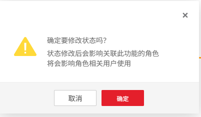

            2.  操作成功提示

                > **[图 image24.png | 章节：基本设置 / 功能管理① | 上下文：操作成功提示]**
                > **OCR 文本：**
                > 操作成功！
                > 状态修改成功
                > 关闭

                

        3.  **添加下级**：自动把当前名称代入上级字段，功能与新增一致

### 角色管理①

用户在此模块创建角色并赋予相应数据权限与功能权限等，用户创建、修改、删除等操作记录日志，记录操作对象。

> **[图 image25.png | 章节：基本设置 / 角色管理① | 上下文：用户在此模块创建角色并赋予相应数据权限与功能权限等，用户创建、修改、删除等操作记录日志，记录操作对象。]**
> **OCR 文本：**
> 基本设置
> 场地管理 | 角色名称/描述 | 起止时间 | 创建/修改人 | 检索 | 新增
> 部门管理
> 序号 | 角色名称 | 数据权限 | 状态 | 修改人 | 修改时间 | 操作
> 实验组
> 实习生 | 启用 | 张三 | 2026-06-01 11: 11:11 | 修改禁用 | 删除查看用户
> 功能管理
> 角色设置 | A实验室主任 | 启用 | 张三 | 2026-06-01 11: 11:11 | 修改 | 禁用 | 删除查看用户
> 用户管理 | B实验室主任 | 禁用 | 张三 | 2026-06-01 11: 11:11 | 修改 | 启用 | 制除 | 查看用户
> 登录记录
> 实验员 | 禁用 | 张三 | 2026-06-01 11: 11:11 | 修改 | 启用 | 除查看用户
> 用户操作记录

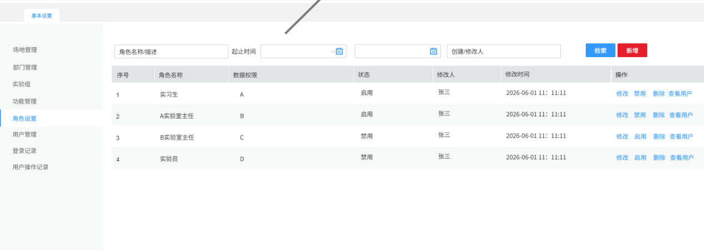

1.  新增

    新增角色信息：

    > **[图 image26.png | 章节：基本设置 / 角色管理① | 上下文：新增角色信息：]**
    > **OCR 文本：**
    > 新增
    > 功能权限
    > 角色名称* | Please enter...
    > 全选 | 展开 | 折叠
    > 状态* | 启用 | 禁用 | Search
    > 数据权限* | 仅自己 | ④模块
    > 所属实验室 | 菜单
    > 所属部门
    > 参与项目 | 操作/按钮
    > 全部数据 | 操作/按钮
    > 描述 | Please enter | ④模块
    > ④模块
    > 0/1000
    > ④模块
    > 模块
    > 保存 | 取消

    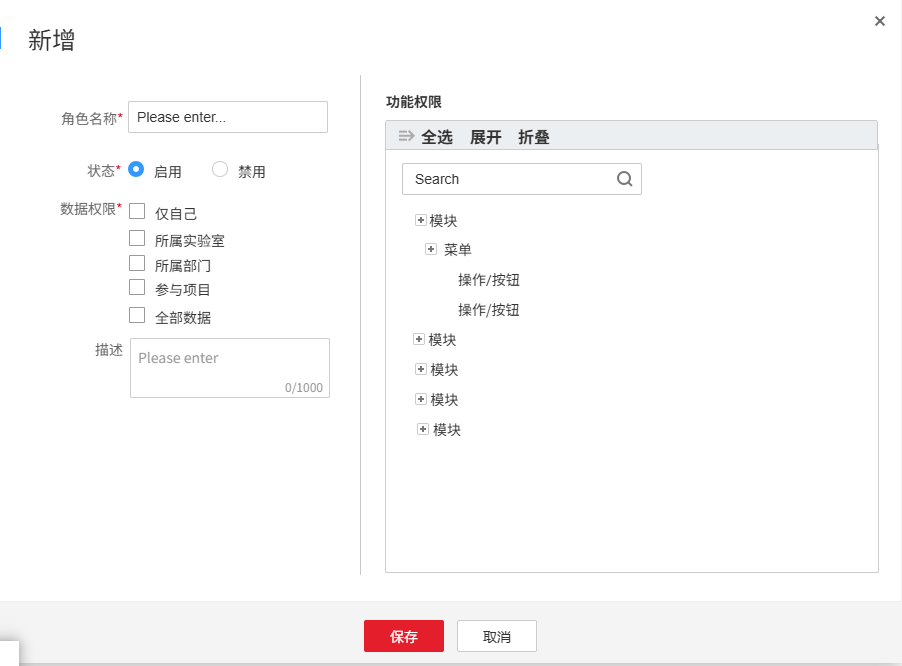

    1.  **角色名称**：文本框，必填，20个汉字字符以内，名称不允许重复
    2.  **状态**：单选，必选，默认启用
    3.  **数据权限**：必选，支持多选，多选时数据权限取并集即最大范围。注意，本人指的是本人创建和本人负责
    4.  **描述**：文本框，选填，1000个字符以内
    5.  **功能权限**：必选，选择授予该角色的模块/页面/按钮
        1.  树形结构展示所有模块/页面/按钮
        2.  支持快速折叠或展开树形结构，默认折叠
        3.  支持任意选择，支持根节点选择节点下所有，支持一键全选所有
        4.  支持模糊搜索
    6.  保存：
        1.  必填字段的非空校验
        2.  角色名称的唯一性与长度校验，校验通过才能成功保存，否则提示相应失败信息
        3.  需记录日志，包括创建人、创建时间
2.  查询条件

    以下筛选条件联合查询

    1.  **角色名称/描述**：支持角色名称和描述共同模糊搜索
    2.  **起止时间**：同(2)②
    3.  **创建/修改人**：支持角色名称和描述共同模糊搜索
3.  结果展示与操作

    查询结果翻页展示，按创建时间倒排，最新的在最上面，包含以下字段：

    1.  序号
    2.  角色名称
    3.  **数据权限**：展示当前角色勾选的数据权限，多个逗号分隔
    4.  **状态**：角色当前的启用/禁用状态
    5.  **修改人**：同(3)⑤
    6.  **修改时间**：(3)⑥
    7.  操作
        1.  修改
            1.  增加创建人、创建时间、修改人、修改时间的信息展示
            2.  与新增功能一致，需完成校验，同(1)⑥
            3.  **禁用状态修改校验**：检查当前角色是否关联了用户，如果关联了用户则不可保存成功，提示“当前角色存在关联用户，无法修改为禁用”

                > **[图 image27.png | 章节：基本设置 / 角色管理① | 上下文：禁用状态修改校验：检查当前角色是否关联了用户，如果关联了用户则不可保存成功，提示“当前角色存在关联用户，无法修改为禁用”]**
                > **OCR 文本：**
                > 修改
                > 功能权限
                > 角色名称* | Please enter...
                > 全选 | 展开折叠
                > 状态 | 启用 | 禁用 | Search
                > 数据权限* | 仅自己 | 模块
                > 所属实验室 | 菜单
                > 所属部门
                > 参与项目 | 操作/按钮
                > 全部数据 | 操作/按钮
                > 描述 | Please enter | ④模块
                > ④模块
                > 0/1000 | 模块
                > ④模块
                > 创建人
                > 创建时间 | 2026-06-01 00:00:00
                > 修改人 | 张三
                > 修改时间 | 2026-06-0100:00:00
                > 保存 | 取消

                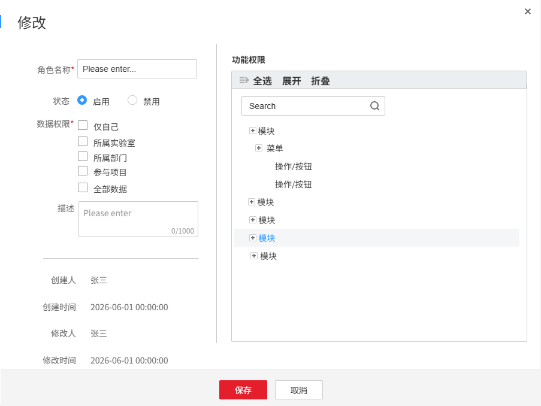

        2.  **启用/禁用**：根据该角色当前状态区分展示（已启用则为禁用操作，已禁用则为启用操作）
            1.  修改为禁用时，需二次确认，点击确认修改为禁用

                > **[图 image28.png | 章节：基本设置 / 角色管理① | 上下文：修改为禁用时，需二次确认，点击确认修改为禁用]**
                > **OCR 文本：**
                > 确定要禁用吗
                > 禁用之前要确认相关用户已移除此角色哦
                > 取消 | 确定

                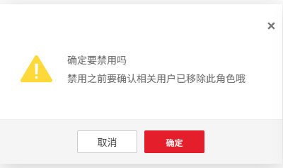

            2.  确认需要修改为禁用时，需检查当前角色是否关联了用户，如果关联了则不可修改，提示

                > **[图 image29.png | 章节：基本设置 / 角色管理① | 上下文：确认需要修改为禁用时，需检查当前角色是否关联了用户，如果关联了则不可修改，提示]**
                > **OCR 文本：**
                > 禁用失败！
                > 当前角色有关联用户，请先给用户移除
                > 角色后再操作
                > 确认

                

            3.  确认需要修改为禁用时，若无关联用户，则禁用成功，提示

                > **[图 image30.png | 章节：基本设置 / 角色管理① | 上下文：确认需要修改为禁用时，若无关联用户，则禁用成功，提示]**
                > **OCR 文本：**
                > 操作成功！
                > 角色已经禁用
                > 关闭

                

            4.  需要修改为启用时，需要二次确认，点击确认修改为启用

                > **[图 image31.png | 章节：基本设置 / 角色管理① | 上下文：需要修改为启用时，需要二次确认，点击确认修改为启用]**
                > **OCR 文本：**
                > 确定要启用吗
                > 启用后可重新为用户分配此角色
                > 取消 | 确定

                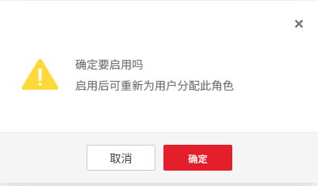

            5.  点击确认修改为启用时，启用成功，提示

                > **[图 image32.png | 章节：基本设置 / 角色管理① | 上下文：点击确认修改为启用时，启用成功，提示]**
                > **OCR 文本：**
                > 操作成功！
                > 角色已经启用
                > 关闭

                

        3.  删除
            1.  点击删除时，需二次点击确认

                > **[图 image33.png | 章节：基本设置 / 角色管理① | 上下文：点击删除时，需二次点击确认]**
                > **OCR 文本：**
                > 确定要删除吗
                > 删除之前要确认相关用户已移除此角色哦
                > 取消 | 确定

                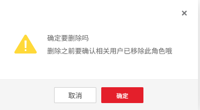

            2.  点击确认删除时，需校验该角色是否有关联用户，若有则提示删除失败并告知原因

                > **[图 image34.png | 章节：基本设置 / 角色管理① | 上下文：点击确认删除时，需校验该角色是否有关联用户，若有则提示删除失败并告知原因]**
                > **OCR 文本：**
                > 删除失败！
                > 当前角色有关联用户，请先给用户移除
                > 角色后再操作
                > 确认

                

            3.  点击确认删除，若无关联用户，则删除成功

                > **[图 image35.png | 章节：基本设置 / 角色管理① | 上下文：点击确认删除，若无关联用户，则删除成功]**
                > **OCR 文本：**
                > 操作成功！
                > 角色已经删除
                > 关闭

                

            4.  **查看用户**：翻页展示当前角色已关联的用户列表，用户默认按照关联时间倒排序，最新关联的在最上面。列表包括：
            5.  **序号**：列表显示排序
            6.  **显示名称**：用户显示名称
            7.  **用户名**：系统登录的username
            8.  **角色**：当前用户的所有角色名称，多个用逗号分隔
            9.  **部门**：当前用户所在部门名称
            10. **上次登录时间**：最近一次登录的时间
            11. **状态**：用户系统离线/在线状态，离线为灰色，在线为绿色

                > **[图 image36.png | 章节：基本设置 / 角色管理① | 上下文：状态：用户系统离线/在线状态，离线为灰色，在线为绿色]**
                > **OCR 文本：**
                > 查看用户
                > 角色名称：实习生
                > 序号 | 显示名 | 用户名 | 角色 | 部门 | 上次登录时间 | 状态
                > 张三 | zhangsan | 实习生，设备管理 | NPP | 2026-09-21 12:12:34
                > 李四 | lisi | 实习生 | NPP | 2026-09-21 12:12:34
                > 王五 | wangwu | 实习生 | NPP | 2026-09-21 12:12:34
                > 赵六 | zhaoliu | 实习生，检测员 | NPP | 2026-09-21 12:12:34
                > 赵赵 | zhaozhao | 实习生，初级QA | NPP | 2026-09-21 12:12:34
                > 上一页 | 10 | 下一页
                > 关闭

                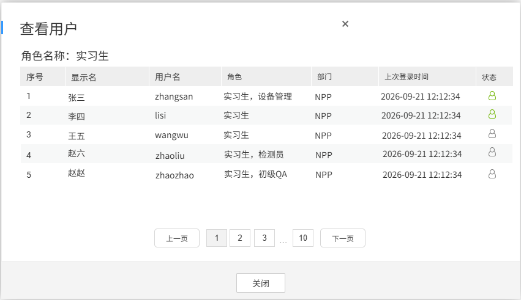

### 用户管理①

在此模块创建用户并设置角色、登录信息等，创建、修改、删除等操作记录日志，记录操作对象。

> **[图 image37.png | 章节：基本设置 / 用户管理① | 上下文：在此模块创建用户并设置角色、登录信息等，创建、修改、删除等操作记录日志，记录操作对象。]**
> **OCR 文本：**
> 的，≥开始时间和≤结束时间，次数条件可以只输一个
> 基本设置
> 场地管理 | 实验组名称/组编号/负责人 | 最近登录 | 登录次数 | 检索 | 新增
> 部门管理
> 序号 | 显示名称 | 用户名 | 角色 | 上次登录时间 | 上次登录IP | 登录次数 | 状态 | 登录状态 | 操作
> 实验组
> 张三 | zhangsan | 设备管理员 | 2026-05-31 12:12:34 | 106.37.114.137 | 启用 | 修改 | 重置密码 | 删除禁用 | 强制下线
> 功能管理
> 角色设置 | 李四 | lisi | 项目组长，试验员 | 2026-05-31 12:12:34 | 106.37.114.137 | 10 | 启用 | 修改 | 重置密码删除禁用
> 用户管理 | 王五 | wangwu | QA组长 | 2026-05-31 12:12:34 | 106.37.114.137 | 启用 | 修改 | 重置密码 | 删除  | 禁用
> 登录记录
> zhaoliu | 试验员 | 2026-01-31 12:12:34 | 106.37.114.137 | 禁用 | 修改 | 重置密码 | 删除  | 启用
> 用户操作记录

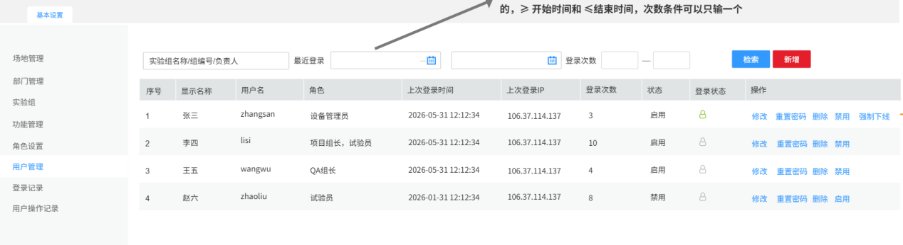

1.  新增

    新增用户：

    > **[图 image38.png | 章节：基本设置 / 用户管理① | 上下文：新增用户：]**
    > **OCR 文本：**
    > 新增
    > 用户名* | Please enter... | 显示姓名* | Please enter...
    > 邮件 | Please enter... | 电话 | Please enter...
    > 部门* | Please select...
    > 角色* | Please select...
    > 实验组 | Please select...
    > 通知方式 | 短信 | 邮件 | 站内
    > 授权实验室 | Please select...
    > 此处授权将影响用户实验室相关功能模块的数据可见范围
    > 状态 | 启用 | 禁用
    > 保存 | 取消

    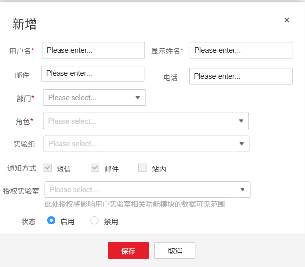

    1.  **用户名**：文本框，长度2-20位，支持数字0-9，英文大小写字母a-z和 A-Z，特殊字符仅支持 . _ （英文格式下的点和下划线，后续和用户邮箱前缀构成保持一致）
    2.  **显示姓名**：文本框，登录后的显示名称，字符串格式，长度不超过50个汉字字符长度
    3.  **邮件**：文本框，非必填，需要邮箱格式校验
    4.  **电话**：文本框，非必填
    5.  **部门**：单选，必选，树形结构展示所有部门层级信息，支持模糊搜索
    6.  **角色**：必选，支持多选，支持模糊搜索
    7.  **实验组**：非必选，支持多选，树形结构展示所有实验组及其所属部门
    8.  **通知方式**：默认选择“站内”且不可取消，支持多选短信或邮件方式
    9.  **授权实验室**：非必选，支持多选，支持模糊搜索，默认值为所选部门自动关联到的实验室。
    10. **状态**：单选，必选，默认为启用
    11. **密码**：新增用户时，统一为初始化密码123456
2.  查询条件

    以下条件联合查询：

    1.  **用户名/显示名**：文本框，支持按用户名或显示名称模糊检索
    2.  **最近登录**：输入开始时间和结束时间，检索的最近一次在指定时间段登录的用户，时间条件可以只输一个条件，表示检索某个时间点之后或某个时间点之前，选择日期表示，开始时间默认00:00分，结束时间默认为指定日期的23:59:59
    3.  **登录次数**：查询满足登录次数要求的用户列表，即≥ 最小次数和 ≤最大次数，次数条件可只输一个
3.  结果展示与操作

    查询结果翻页展示，按创建时间倒排，最新的在最上面，包含以下字段：

    1.  序号
    2.  显示名称
    3.  用户名
    4.  **角色**：多个时，逗号分隔
    5.  上次登录时间
    6.  上次登录IP
    7.  **登录次数**：用户每次重新输入用户名和密码login时，记录时间、ip等信息，同时登录次数+1
    8.  **状态**：禁用启用
    9.  **登录状态**：同⑦4)g
    10. 操作
        1.  **修改**：填写内容与校验功能与新增功能保持一致，如果将状态从启用改为禁用，需要二次确认修改才生效，用户选择取消则整个修改的内容不被保存

            > **[图 image39.png | 章节：基本设置 / 用户管理① | 上下文：修改：填写内容与校验功能与新增功能保持一致，如果将状态从启用改为禁用，需要二次确认修改才生效，用户选择取消则整个修改的内容不被保存]**
            > **OCR 文本：**
            > 修改
            > 用户名* | Please enter... | 显示姓名* | Pleaseenter...
            > 邮件 | Please enter... | 电话 | Please enter...
            > 部门* | Please select...
            > 角色* | Please select...
            > 实验组 | Please select..
            > 通知方式 | 短信 | 邮件 | 站内
            > 授权实验室 | Please select..
            > 此处授权将影响用户实验室相关功能模块的数据可见范围
            > 状态 | 启用 | 禁用
            > 保存 | 取消

            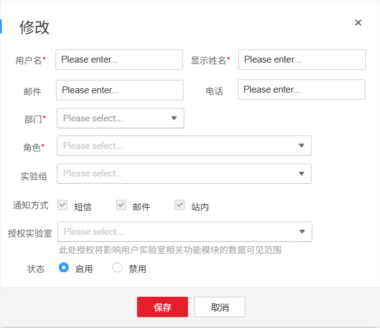

            > **[图 image40.png | 章节：基本设置 / 用户管理① | 上下文：修改：填写内容与校验功能与新增功能保持一致，如果将状态从启用改为禁用，需要二次确认修改才生效，用户选择取消则整个修改的内容不被保存]**
            > **OCR 文本：**
            > 确定要禁用此用户吗
            > 禁用后用户不可在登录系统
            > 取消 | 确定

            

        2.  重置密码：
            1.  需二次确认才能重置密码，提示时显示用户名信息

                > **[图 image41.png | 章节：基本设置 / 用户管理① | 上下文：需二次确认才能重置密码，提示时显示用户名信息]**
                > **OCR 文本：**
                > 确定要重置 | [张三] | 的密码吗
                > 操作后用户的密码变回初始密码
                > 确定

                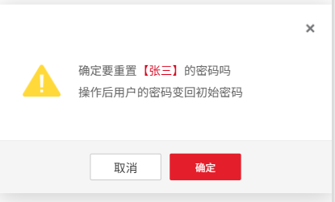

            2.  重置成功时，提示信息

                > **[图 image42.png | 章节：基本设置 / 用户管理① | 上下文：重置成功时，提示信息]**
                > **OCR 文本：**
                > 操作成功！
                > 密码重置成功
                > 关闭

                

        3.  删除
            1.  需二次确认才能删除，提示信息

                > **[图 image43.png | 章节：基本设置 / 用户管理① | 上下文：需二次确认才能删除，提示信息]**
                > **OCR 文本：**
                > 确定要删除吗
                > 删除的用户不可恢复，请在删除之前
                > 确认当前用户相关业务操作已结束
                > 确定

                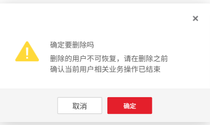

            2.  删除成功时，提示信息，后续校验名称和编码在唯一性时不被考虑在内

                > **[图 image44.png | 章节：基本设置 / 用户管理① | 上下文：删除成功时，提示信息，后续校验名称和编码在唯一性时不被考虑在内]**
                > **OCR 文本：**
                > 操作成功！
                > 数据已经删除
                > 关闭

                

        4.  **启用/禁用**：根据该角色当前状态区分展示（已启用则为禁用操作，已禁用则为启用操作）
            1.  修改为禁用时，需二次确认

                > **[图 image45.png | 章节：基本设置 / 用户管理① | 上下文：修改为禁用时，需二次确认]**
                > **OCR 文本：**
                > 确定要禁用此用户吗
                > 禁用后用户不可在登录系统
                > 取消 | 确定

                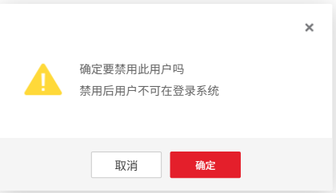

            2.  确认修改为禁用后，该用户不能再登录系统，提示信息

                > **[图 image46.png | 章节：基本设置 / 用户管理① | 上下文：确认修改为禁用后，该用户不能再登录系统，提示信息]**
                > **OCR 文本：**
                > 操作成功！
                > 禁用后可通过启用恢复用户状态
                > 关闭

                

            3.  修改为启用时，需二次确认

                > **[图 image47.png | 章节：基本设置 / 用户管理① | 上下文：修改为启用时，需二次确认]**
                > **OCR 文本：**
                > 确定要重新启用此用户吗
                > 启用后将重新获得原来相应的角色权限
                > 取消 | 确定

                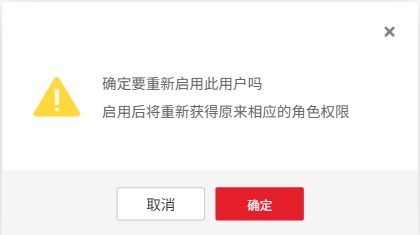

            4.  成功修改为启用时，用户可重新登录系统并获得相应权限，提示信息

                > **[图 image48.png | 章节：基本设置 / 用户管理① | 上下文：成功修改为启用时，用户可重新登录系统并获得相应权限，提示信息]**
                > **OCR 文本：**
                > 操作成功！
                > 启用后用户可正常登录系统
                > 关闭

                

        5.  **强制下线**：用户在线时才显示该操作。
            1.  点击后需二次确认，提示信息

                > **[图 image49.png | 章节：基本设置 / 用户管理① | 上下文：点击后需二次确认，提示信息]**
                > **OCR 文本：**
                > 确定要让用户强制下线吗
                > 操作后用户将退出到登录界面
                > 取消 | 确定

                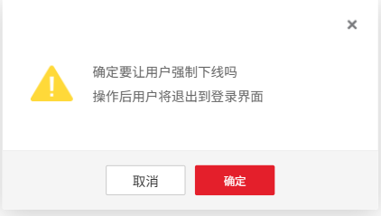

            2.  下线成功后，当前用户退出至登录页提示信息

                > **[图 image50.png | 章节：基本设置 / 用户管理① | 上下文：下线成功后，当前用户退出至登录页提示信息]**
                > **OCR 文本：**
                > 操作成功！
                > 用户已强制下线
                > 关闭

                

4.  有效期设置

    > **[图 image51.png | 章节：基本设置 / 用户管理① | 上下文：有效期设置]**
    > **OCR 文本：**
    > 有效期设置
    > 当前密码有效期设定为90天
    > 系统统一设定密码有效期 | 90 | 天，密码到期前 | 天开始提醒，密码过期用户登录时需强制重置密码。
    > 序号 | 显示名 | 用户名 | 角色 | 密码有效期 | 生效时间 | 失效时间
    > 张三 | zhangsan | 实习生，设备管理 | 2026-09-21 | 2026-09-21
    > 李四 | lisi | 实习生 | 2026-09-21 | 2026-09-21
    > 王五 | wangwu | 实习生 | 10 | 2026-09-21 | 2026-09-21
    > 赵六 | zhaoliu | 实习生，检测员 | 90 | 2026-09-21 | 2026-09-21
    > 赵赵 | zhaozhao | 实习生，初级QA | 2026-09-21 | 2026-09-21
    > 上一页 | 10 | 下一页
    > 保存 | 取消

    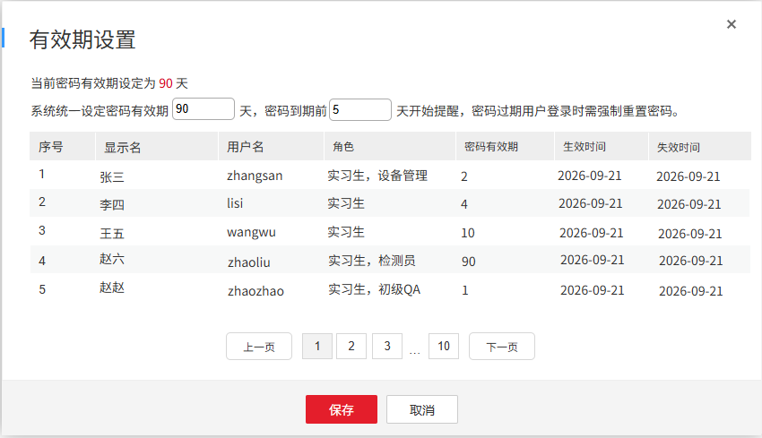

    1.  **密码有效期**：文本框，正整数，大于等于1，小于等于100
    2.  **密码到期提醒时间设置**：文本框，正整数，大于等于1，小于等于15。
    3.  **列表展示**：分页展示所有用户的相关信息
        1.  序号
        2.  显示名
        3.  用户名
        4.  角色
        5.  **密码有效期**：失效时间－当前日期
        6.  **生效时间**：修改密码的当天日期
        7.  **失效时间**：生效时间+当前设定的有效天数

### 系统登录⓪

1.  **登录方式**：支持AAD登入与本地登入。
2.  账户登录说明
    1.  用户登录时需输入用户名和密码，15分钟内错误尝试超过6次锁定账号，30分钟后自动解锁
    2.  同一个用户只能在一个设备终端登录系统，如果同一个用户在登录状态，又登录另一台设备，之前的登录会被退出
    3.  用户名密码的校验通过后，需要检查当前用户的密码有效期，
        1.  **已提醒日期&未失效**：按照失效时间－提醒时间，到达此日期后，用户登录时提醒密码即将到期，
        2.  支持点击取消可正常登录系统，支持填写新密码后可更新密码

            > **[图 image52.png | 章节：基本设置 / 系统登录⓪ | 上下文：支持点击取消可正常登录系统，支持填写新密码后可更新密码]**
            > **OCR 文本：**
            > 重置密码
            > 密码还有5天到期，建议您重置密码
            > 新密码
            > 再次输入
            > 取消 | 确认

            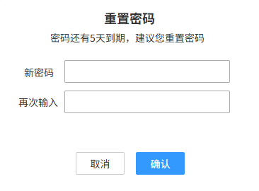

        3.  **已失效**：到达失效时间后，直接提示密码已过期。点击取消无法正常登录系统；必须更新密码后登录。

            > **[图 image53.png | 章节：基本设置 / 系统登录⓪ | 上下文：已失效：到达失效时间后，直接提示密码已过期。点击取消无法正常登录系统；必须更新密码后登录。]**
            > **OCR 文本：**
            > 重置密码
            > 您当前的密码已过期，请立即重置密码
            > 新密码
            > 密码长度10-18位置，必须包含英文字母大小写和
            > 再次输入 | 数字
            > 取消 | 确认

            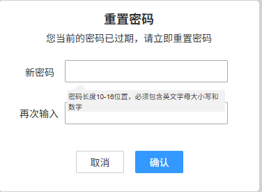

    4.  用户首次登录，以及用户被管理员重置密码后的首次登录必须强制修改密码， 否则不能做任何操作

        > **[图 image54.png | 章节：基本设置 / 系统登录⓪ | 上下文：用户首次登录，以及用户被管理员重置密码后的首次登录必须强制修改密码， 否则不能做任何操作]**
        > **OCR 文本：**
        > 重置密码
        > 当前为初始密码，首次登录需重置
        > 新密码
        > 再次输入
        > 取消 | 确认

        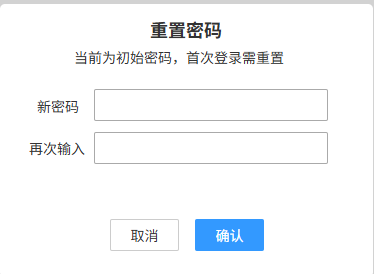

3.  用户重置密码校验要求

    此处限制仅涉及用户自己重置密码场景，不涉及管理员初始化或重置密码场景。需严格满足以下要求才能重置成功：

    1.  密码长度10-16位
    2.  密码必须包含数字，符号，大写，小写四种元素
    3.  **字母‌**：26 个大写（A–Z） + 26 个小写（a–z）
    4.  **‌数字‌**：0–9（共 10 个）
    5.  **‌常见特殊符号‌**：! @ # $ % ^ & * ( ) _ - + = [ ] { } ; : ' " , . / < > ? ~
    6.  密码中不能使用连续数字、连续字母，类似111、123、abc、bbb
    7.  实现一密一盐，例如BCrypt算法
    8.  密码更改时不可与历史最近10次密码重复

### 登录记录（4.0）

此功能开放给超级管理员，不细分数据权限，需记录用户的所有登录信息供统一查询。

> **[图 image55.png | 章节：基本设置 / 登录记录（4.0） | 上下文：此功能开放给超级管理员，不细分数据权限，需记录用户的所有登录信息供统一查询。]**
> **OCR 文本：**
> 基本设置
> 场地管理 | 访问时间 | 2016/09/01-2016/09/20 | 访问IP | IP地址 | 用户名/显示名 | 操作系统/浏览器/PC名称/MC地址 | 检索
> 部门管理
> 序号 | 访问编号 | 访问时间 | 操作系统 | 浏览器 | PC名称 | MAC地址 | 反问用户 | 访问IP | 登录状态 | 描述
> 实验组
> 838737773 | 2026-06-01 11: 11:11 | Window10 | Chrome | Admin (管理员) | 192.168.1.20内网ip | 成功 | 登录成功
> 功能管理
> 838737772 | 2026-06-01 11: 11:11 | Window10 | Chrome | xxxxxX | Admin (管理员) | 192.168.1.20 内网ip | 成功 | 登录成功
> 角色设置
> 用户管理 | 838737771 | 2026-06-01 11: 11:11 | Window10 | Chrome | XXXXXX | XXXXXX | Admin(管理员) | 192.168.1.20 内网ip | 成功 | 登录成功
> 登录记录 | 838737770 | 2026-06-0111:11:11 | Window10 | Chrome | Admin(管理员) | 192.168.1.20内网ip | 成功 | 登录成功
> 用户操作记录
> 通知
> 上一页 | 10 | 下一页

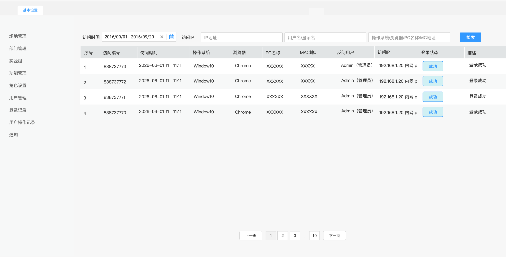

1.  查询条件
    1.  访问时间
    2.  访问IP
    3.  **用户名/显示名**：支持模糊搜索
    4.  **操作系统/浏览器/PC名称**：支持模糊搜索
    5.  **MAC地址**：支持模糊搜索
2.  结果展示

    查询结果翻页展示，按访问时间倒排，最新的在最上面，包含以下字段：

    1.  序号
    2.  访问编号
    3.  访问时间
    4.  操作系统
    5.  浏览器
    6.  PC名称
    7.  MAC地址
    8.  **访问用户**：展示登录用户的用户名及显示名称
    9.  访问IP
    10. 登录状态
    11. 描述

### 操作记录（4.0）

此功能开放给超级管理员，不细分数据权限，需记录所有操作信息供统一查询。

> **[图 image56.png | 章节：基本设置 / 操作记录（4.0） | 上下文：此功能开放给超级管理员，不细分数据权限，需记录所有操作信息供统一查询。]**
> **OCR 文本：**
> 基本设置
> 场地管理 | 操作时间 | 2016/09/01-2016/09/20 | 操作地址 | IP地址 | 用户名/显示名 | 系统模块/操作类型 | 检索
> 部门管理 | 序号 | 日志编号 | 记录时间 | 系统模块 | 操作类型 | 操作用户 | 操作地址 | 操作状态 | 操作
> 实验组
> 838737773 | 20260601 11: 11:11 | 菜单管理 | delete | Admin（管理员） | 192.168.1.20 | 成功 | 详情
> 功能管理
> 838737772 | 20260601 11:11:11 | 菜单管理 | create | Admin（管理员） | 192.168.1.20 | 成功 | 详情
> 角色设置
> 用户管理 | 838737771 | 20260601 11: 11:11 | 菜单管理 | edit | Admin（管理员） | 192.168.1.20 | 成功 | 详情
> 登录记录 | 838737770 | 20260601 11: 11:11 | 菜单管理 | delete | Admin（管理员） | 192.168.1.20 | 成功 | 详情
> 用户操作记录
> 通知
> 上一页 | 10 | 下一页

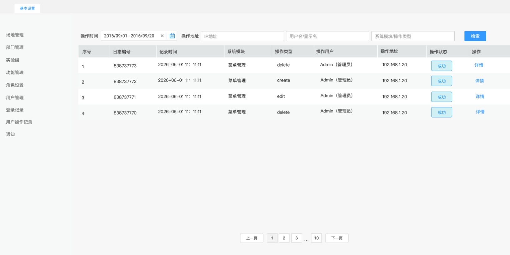

1.  查询条件

    以下条件联合查询：

    1.  操作时间
    2.  访问IP
    3.  **用户名/显示名称**：支持模糊搜索
    4.  **系统模块/操作类型**：支持模糊搜索
2.  结果展示与操作

    查询结果翻页展示，按操作时间倒排，最新的在最上面，包含以下字段：

    1.  序号
    2.  日志编号
    3.  操作时间
    4.  系统模块
    5.  操作类型
    6.  **操作用户**：展示操作用户的用户名及显示名称
    7.  访问IP
    8.  操作状态
    9.  操作
        1.  **查看详情**：点击查看以下详细信息
            1.  操作模块
            2.  操作类型
            3.  执行状态
            4.  操作时间
            5.  操作人员
            6.  所属部门
            7.  访问IP
            8.  请求信息
            9.  请求参数
            10. 返回参数

                > **[图 image57.png | 章节：基本设置 / 操作记录（4.0） | 上下文：返回参数]**
                > **OCR 文本：**
                > 详情
                > |基本信息
                > 操作模块 | 菜单管理 | 业务类型 | 修改
                > 执行状态 | 正常 | 操作时间 | 2026-08-1210:05:02
                > |操作人员
                > 操作人员 | admin | 所属部门 | NPP
                > 操作地址 | 192.168.1.20内网IP
                > |请求信息
                > 请求地址 | PUT /xxx/xXXX
                > 操作方法 | ()Xxx"XXX"XXXx"XXX
                > 消耗时间 | 47毫秒
                > |请求参数
                > "children": , | 复制
                > "component":"detect/sign-workbench/index",
                > "createTime":"2026-06-18 00:01:14",
                > "delFlag":"o",
                > "icon":"edit"
                > "isCache":"o",
                > "isFrame":"1",
                > "menul18nKey":
                > "menuld":507,
                > "menuName""数据签名操作台"
                > "menuType""C",
                > |返回参数
                > 复制
                > “msg"："修改菜单数据签名操作台"失败，菜单名称已存在"
                > "code": 500
                > 关闭

                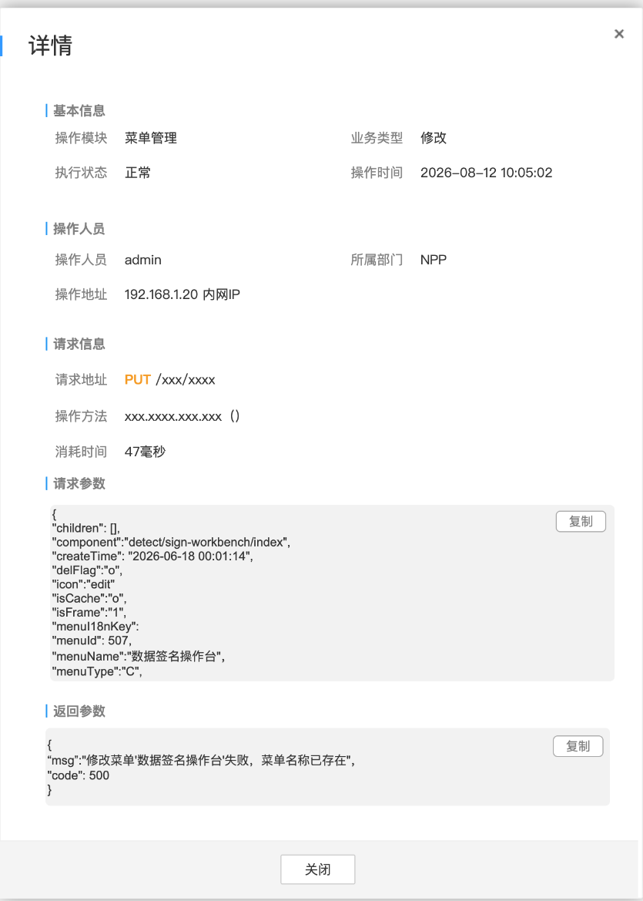

### 通知（4.0）

此功能开放给超级管理员，不细分数据权限，需记录所有通知信息供统一查询并提供相应操作。

#### 站内（4.0）

对所有站内信的统一查询和操作。

> **[图 image58.png | 章节：基本设置 / 站内（4.0） | 上下文：对所有站内信的统一查询和操作。]**
> **OCR 文本：**
> 药明生物SMP系统 | 首页 | A实验室工作台 | B实验室工作台 | 数据管理 | 系统设置-
> 基本设置
> 站内 | 短信
> 场地管理
> 部门管理 | 发送时间 | 2016/09/01 - 2016/09/20 | 通知用户 | 用户名/显示名 | 标题/内容 | 阅读状态 | 已读 | 检索
> 实验组
> 功能管理 | 序号 | 标题 | 内容 | 发送时间 | 通知用户 | 阅读状态 | 操作
> 角色设置 | FX003下罐通知 | FX003今日下罐，请尽快操作 | 20260812 12:23:45 | Admin (管理员） | 未读 | 标记已读
> 用户管理 | FX002下罐通知 | FX002今日下罐，请尽快操作 | 20260812 12:23:45 | Admin (管理员） | 未读 | 标记已读
> 登录记录 | FX013下锂通知 | FX013今日下罐，请尽快操作 | 20260812 12:23:45 | Admin (管理员） | 未读 | 标记已读
> 用户操作记录
> FX998下罐通知 | FX998今日下罐，请尽快操作 | 20260812 12:23:45 | Admin (管理员） | 未读 | 标记已读
> 通知
> 上一页 | 10 | 下一页

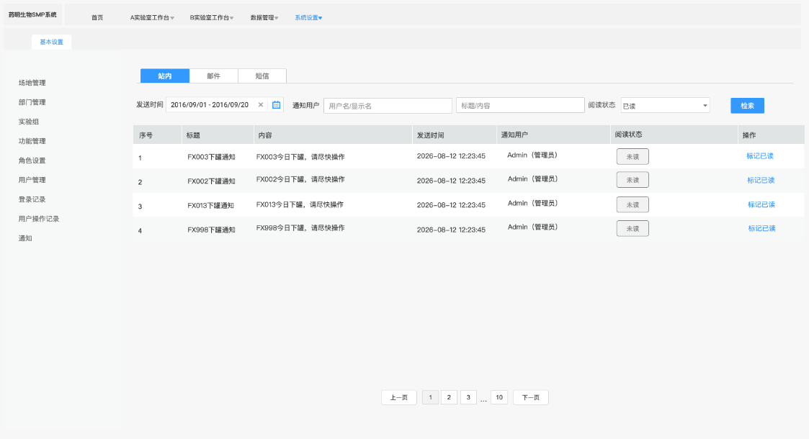

1.  查询条件

    以下条件联合查询：

    1.  发送时间
    2.  **通知用户**：支持用户名和显示名称的模糊搜索
    3.  **标题/内容**：支持模糊搜索
    4.  **阅读状态**：下拉单选，列表内容包括已读、未读
2.  结果展示与操作

    查询结果翻页展示，未读状态的在最上面，同状态下按发送时间倒排，最新的在最上面，包含以下字段：

    1.  序号
    2.  标题
    3.  内容
    4.  发送时间
    5.  通知用户
    6.  阅读状态
    7.  操作
        1.  **标记已读**：未读状态的记录有标记已读按钮，可点击将该条记录变为已读。

#### 邮件（4.0）

对所有邮件的统一查询和操作。

> **[图 image59.png | 章节：基本设置 / 邮件（4.0） | 上下文：对所有邮件的统一查询和操作。]**
> **OCR 文本：**
> 站内 | 邮件 | 短信
> 发送时间 | 2016/09/01-2016/09/20 | 通知用户 | 用户名/显示名/邮箱 | 标题/内容 | 发送状态 | 失败 | 检索
> 序号 | 标题 | 内容 | 发送时间 | 通知用户 | 邮箱 | 发送状态 | 操作
> FX003下罐通知 | FX003今日下罐，请尽快操作 | 20260812 12:23:45 | Admin（管理员） | Admin@qq.com | 成功
> FX002下罐通知 | FX002今日下罐，请尽快操作 | 2026081212:23:45 | Admin（管理员） | Admin@qq.com | 成功
> FX013下罐通知 | FX013今日下罐， | 请尽快操作 | 20260812 12:23:45 | Admin（管理员） | Admin@qq.com | 成功
> FX998下罐通知 | FX998今日下罐，请尽快操作 | 2026081212:23:45 | Admin（管理员） | Adminqq.com | 失败 | 重发
> 上一页 | 10

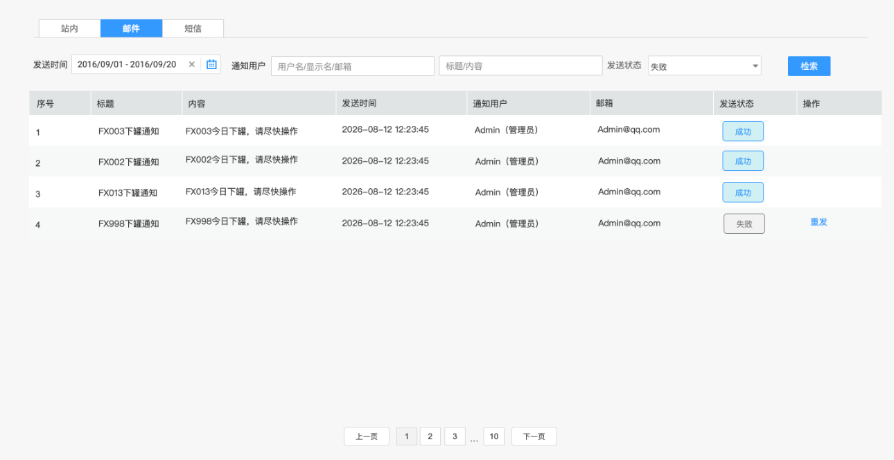

1.  查询条件

    以下条件联合查询：

    1.  发送时间
    2.  **通知用户**：支持用户名、显示名称和邮箱的模糊搜索
    3.  **标题/内容**：支持模糊搜索
    4.  **发送状态**：下拉单选，列表内容包括成功、失败
2.  结果展示与操作

    查询结果翻页展示，按发送时间倒排，最新的在最上面，包含以下字段：

    1.  序号
    2.  标题
    3.  内容
    4.  发送时间
    5.  通知用户
    6.  邮箱
    7.  发送状态
    8.  操作
        1.  **重发**：失败状态的记录有重发按钮，可点击重发对应邮件。

#### 短信（4.0）

对所有短信的统一查询和操作。

> **[图 image60.png | 章节：基本设置 / 短信（4.0） | 上下文：对所有短信的统一查询和操作。]**
> **OCR 文本：**
> 站内 | 邮件 | 短信
> 发送时间 | 2016/09/01-2016/09/20 | 通知用户 | 用户名/显示名/手机号 | 短信内容 | 发送状态 | 失败 | 检索
> 序号 | 短信内容 | 发送时间 | 通知用户 | 手机号 | 发送状态 | 操作
> FX003今日下罐，请尽快操作 | 2026081212:23:45 | Admin (管理员) | 13800138000 | 成功
> FX002今日下罐，请尽快操作 | 20260812 12:23:45 | Admin(管理员) | 13800138000 | 成功
> FX013今日下罐，请尽快操作 | 20260812 12:23:45 | Admin(管理员) | 13800138000 | 成功
> FX998今日下罐，请尽快操作 | 2026081212:23:45 | Admin (管理员) | 13800138000 | 未读 | 重发
> 上一页 | 10 | 下一页

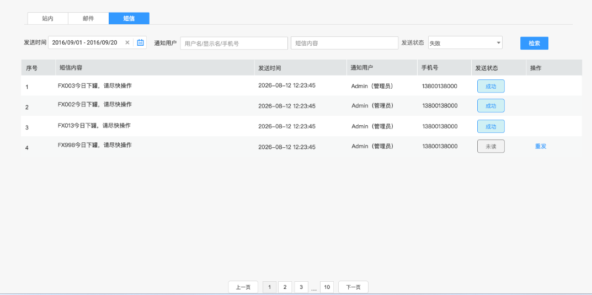

1.  查询条件

    以下条件联合查询：

    1.  发送时间
    2.  **通知用户**：支持用户名、显示名称和手机号的模糊搜索
    3.  **短信内容**：支持模糊搜索
    4.  **发送状态**：下拉单选，列表内容包括成功、失败
2.  结果展示与操作

    查询结果翻页展示，按发送时间倒排，最新的在最上面，包含以下字段：

    1.  序号
    2.  短信内容
    3.  发送时间
    4.  通知用户
    5.  手机号
    6.  发送状态
    7.  操作
        1.  **重发**：失败状态的记录有重发按钮，可点击重发对应短信。
