# 系统设置

## 资源管理

### 设备库①

针对存在多台资产复用的型号，构建标准产品库，实现新增设备选择对应型号可带出标准参数，现场仅在资产表配置IP、负责人等自定义信息即可。

设备库目前包含台式反应器、集成反应器、工艺标准培养容器、地秤和检测设备五类。

#### 台式反应器①

> **[图 image176.png | 章节：资源管理 / 台式反应器① | 上下文：台式反应器①]**
> **OCR 文本：**
> 设备库 | 台式反应器 | 集成反应器 | 培养容器 | 地秤 | 设备检测
> 支持品牌名称利
> 校准对象 | 品牌/描述 | 2016/09/01 - 2016/09/20 | 检索 | 新增 | 的描述来模糊检
> 校准设置 | 建和修改时间的
> 液袋管理 | 序号 | 图标 | 类别 | 容量单位 | 描述 | 修改时间 | 修改人 | 操作
> 耗材 | Broadley James | 3L | 3L Bio-reactor | 2026-06-03 11:11:11 | 张三 | 修改 | 删除
> Broadley James | 7L | 7L Bio-reactor | 2026-06-03 11:11:11 | 张三 | 修改
> Broadley James | 15L | 15L Bio-reactor | 2026-06-03 11:11:11 | 张三 | 修改
> Applikon | 3L | 3L Bio-reactor | 2026-06-03 11:11:11 | 张三 | 修改
> Applikon | 7L | 7L Bio-reactor | 20260603 11:11:11 | 张三 | 修改 | 制除
> Applikon | 15L | 15L Bio-reactor | 2026-0603 11:11:11 | 张三 | 修改 | 删除
> 10 | 下一页

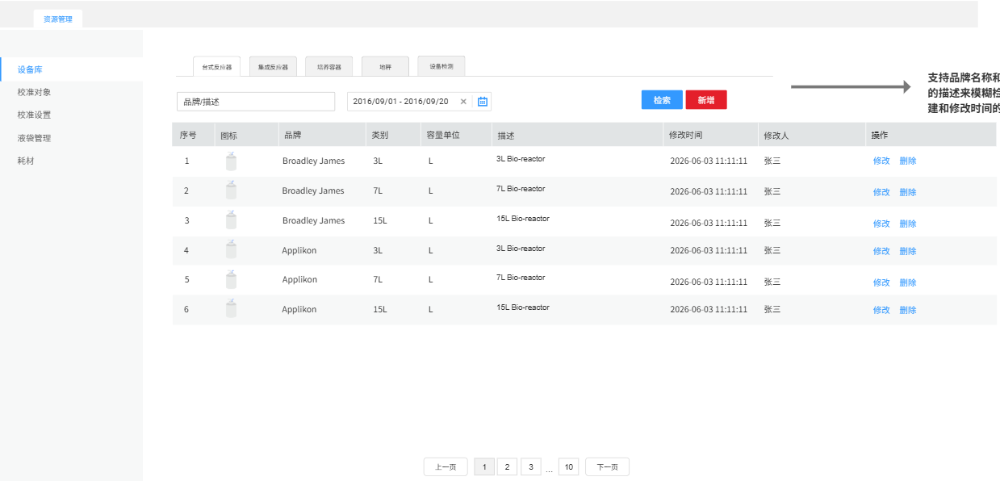

1.  新增

    > **[图 image177.png | 章节：资源管理 / 台式反应器① | 上下文：新增]**
    > **OCR 文本：**
    > 新增
    > 品牌名称* | 请选择品牌
    > 类别* | 请选择品牌
    > 容量单位* | 请选择类型
    > 描述* | Please enter
    > 图标
    > 图标
    > 保存 | 取消

    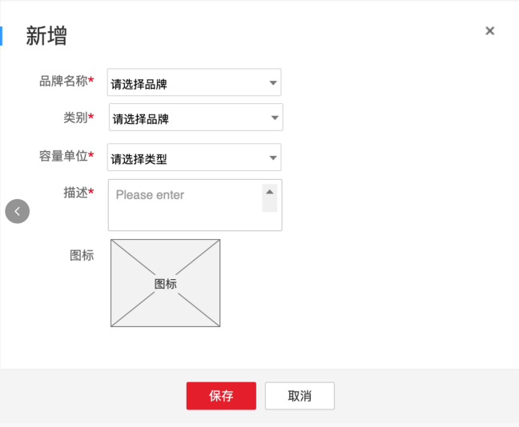

    1.  **品牌名称**：下拉单选，必选，内容来源于维护的数据字典
    2.  **类别**：下拉单选，必选，内容来源于维护的数据字典，品牌+类别为唯一标识，不能重复
    3.  **容量单位**：下拉单选，必选，内容来源于维护的数据字典
    4.  **描述**：文本框，支持最多100个字符的描述
    5.  **图标**：展示当前设备的图标，在配置文件中配置完成，此处仅展示
    6.  **保存**：保存前完成的校验包括必填字段非空、字段长度、品牌+类别的唯一性
2.  查询条件

    以下条件联合查询：

    1.  **品牌/描述**：支持品牌/描述的模糊搜索
    2.  **起止时间**：按照创建/修改时间检索
3.  结果展示与操作

    查询结果翻页展示，按创建时间倒排，最新的在最上面，包含以下字段：

    1.  序号
    2.  **图标**：有多个状态图标时，并列展示即可
    3.  品牌
    4.  类别
    5.  容量单位
    6.  描述
    7.  **修改人**：同(3)⑤
    8.  **修改时间**：(3)⑥
    9.  操作：
        1.  **修改**：保持新增时的完整校验规则。修改后同步到各实验室的具体设备。

            > **[图 image178.png | 章节：资源管理 / 台式反应器① | 上下文：修改：保持新增时的完整校验规则。修改后同步到各实验室的具体设备。]**
            > **OCR 文本：**
            > 修改
            > 品牌名称* | 请选择品牌
            > 类别* | 请选择品牌
            > 容量单位* | 请选择类型
            > 描述* | Please enter
            > 图标
            > 图标
            > 保存 | 取消

            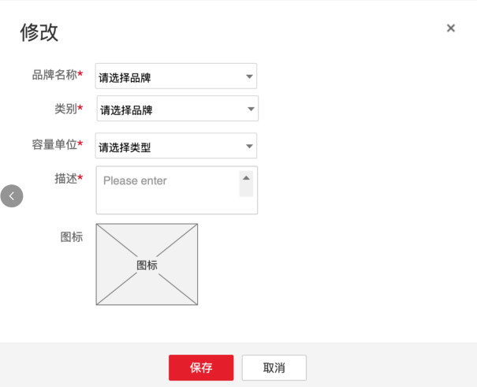

        2.  删除
            1.  需二次确认才可删除，提示信息

                > **[图 image179.png | 章节：资源管理 / 台式反应器① | 上下文：需二次确认才可删除，提示信息]**
                > **OCR 文本：**
                > 确定要删除吗
                > 删除标准产品库之前要确保
                > 所有实验室已移除此型号的设备
                > 取消 | 确定

                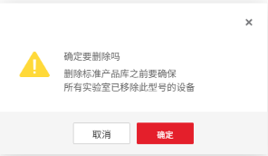

            2.  确认删除后，需校验实验室的设备使用状况，若有设备在使用则无法删除，提示信息

                > **[图 image180.png | 章节：资源管理 / 台式反应器① | 上下文：确认删除后，需校验实验室的设备使用状况，若有设备在使用则无法删除，提示信息]**
                > **OCR 文本：**
                > 删除失败！
                > 有实验室还在使用此设备，无法除
                > 请先在实验室进行删除操作
                > 确认

                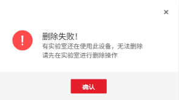

            3.  删除成功，提示信息

                > **[图 image181.png | 章节：资源管理 / 台式反应器① | 上下文：删除成功，提示信息]**
                > **OCR 文本：**
                > 操作成功！
                > 台式反应器已制除
                > 关闭

                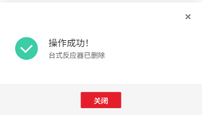

#### 集成反应器①（4.0调整）

> **[图 image182.png | 章节：资源管理 / 集成反应器①（4.0调整） | 上下文：集成反应器①（4.0调整）]**
> **OCR 文本：**
> 设备库 | 台式反应器 | 集成反应器 | 检测设备
> 支持设备号和规格的模糊检
> 校准对象 | 设备型号/规格 | 2016/09/01 - 2016/09/20 | 检索 | 新增 | 索，和创建时间修改时间的
> 校准设置 | 检索
> 液袋管理 | 序号 | 设备型号 | 规格 | 容量 (g) | 描述 | 修改时间 | 修改人 | 操作
> 耗材 | STR 50L | 50L | 50000 | 机械搅拌式不锈钢生物反应器50L | 2026-06-03 11:11:11 | 张三 | 修改 | 删除
> SUB500L | 500L | 500000 | 工业化不锈钢搅拌反应签500L | 2026-06-03 11:11:11 | 张三 | 修改 | 删除
> SUB100L | 100L | 100000 | 工业化不锈钢搅拌反应签 | 2026-06-03 11:11:11 | 张三 | 修改
> SUB50L | 50L | 50000 | 工业化不锈钢搅拌反应签50L | 2026-06-03 11:11:11 | 张三 | 修改 | 删除
> XDR 200L | 200L | 200000 | 一次性生物反应器200L | 2026-06-03 11:11:11 | 张三 | 修改 | 删除
> STR 200L | 200L | 200000 | 机械搅拌式不锈钢生物反应器200L | 2026-06-03 11:11:11 | 张三 | 修改 | 删除
> 10

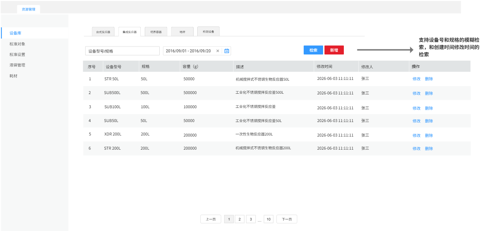

1.  新增

    > **[图 image183.png | 章节：资源管理 / 集成反应器①（4.0调整） | 上下文：新增]**
    > **OCR 文本：**
    > 新增
    > 设备型号* | Please enter...
    > 容量(g)* | Please enter...
    > Please enter...
    > 泵的数量* | Please enter...
    > MFC数量* | Please enter...
    > 压力单位* | 请选择
    > 达阅重量*
    > 描述 | Please enter
    > 0/1000
    > 图标
    > 图标
    > 温度控制*
    > 压力控制*
    > 重量控制*
    > 保存 | 取消

    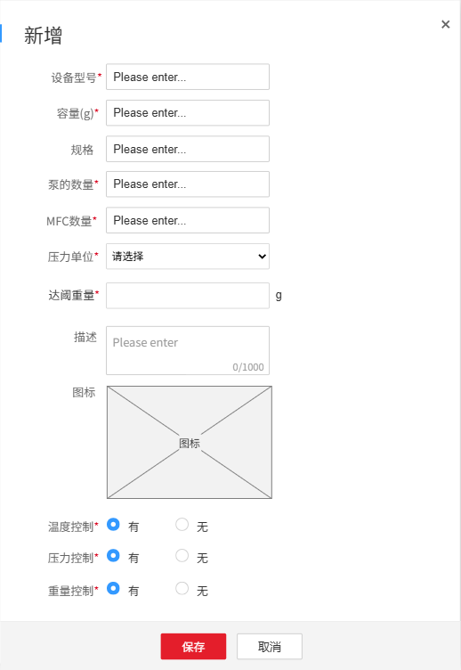

    1.  **设备型号**：文本框，必填，需校验唯一性
    2.  **容量（g）**：输入框，必填，必须为正整数
    3.  **规格**：文本框，非必填
    4.  **泵的数量**：文本框，必填，限制为正整数。保证同一个型号的反应器的泵的数量保持一致，为后续设定补液模板时使用。
    5.  **MFC数量**：文本框，必填，限制为正整数。注意，小试为台式反应器，所以此字段需要在控制器库表中新增。
    6.  **压力单位**：单选必选，内容来源于数据字典
    7.  **达阈重量**：文本框，必填，正整数，单位默认为g。注意，小试为台式反应器，所以此字段需要在控制器库表中新增
    8.  **描述**：文本框，支持最多100个字符的描述
    9.  **图标**：同台式反应器⑤
    10. 温度控制Jacket Temp  ：必选，选择是否有此功能，默认有。注意，小试为台式反应器，所以此字段需要在控制器库表中新增
    11. 重量控制Vessel_Weight ：必选，选择是否有此功能，默认有。注意，小试为台式反应器，所以此字段需要在控制器库表中新增
    12. 压力控制Vessel Pressure ： 必选，选择是否有此功能，默认有。注意，小试为台式反应器，所以此字段需要在控制器库表中新增
    13. **保存**：保存前完成的校验包括必填字段非空、字段长度、唯一性
2.  查询条件

    以下条件联合查询：

    1.  **设备型号/规格**：支持设备型号/规格的模糊搜索
    2.  **起止时间**：按照创建/修改时间检索
3.  结果展示与操作

    查询结果翻页展示，按创建时间倒排，最新的在最上面，包含以下字段：

    1.  序号
    2.  设备型号
    3.  规格
    4.  容量（g）
    5.  描述
    6.  **修改人**：同(3)⑤
    7.  **修改时间**：(3)⑥
    8.  操作：
        1.  **修改**：保持新增时的完整校验规则。修改后同步到各个实验室的具体设备。

            > **[图 image184.png | 章节：资源管理 / 集成反应器①（4.0调整） | 上下文：修改：保持新增时的完整校验规则。修改后同步到各个实验室的具体设备。]**
            > **OCR 文本：**
            > 修改
            > 设备型号* | Please enter...
            > 容量(g)* | Please enter...
            > 规格 | Please enter..
            > 泵的数量* | Please enter...
            > 压力单位* | 请选择
            > 描述 | Please enter
            > 0/1000
            > 图标
            > 图标
            > 保存 | 取消

            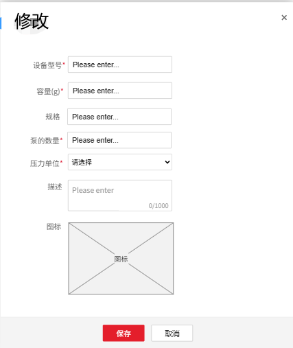

        2.  **删除**：同台式反应器⑨2)

#### 培养容器①

> **[图 image185.png | 章节：资源管理 / 培养容器① | 上下文：培养容器①]**
> **OCR 文本：**
> 资源管理
> 设备库 | 台式反应器 | 集成反应器 | 地秤 | 检测设备
> 支持设备号和规格的模料
> 校准对象 | 索，和创建时间修改时间
> 校准设置 | 设备型号/规格 | 2016/09/01-2016/09/20 | 检索 | 新增 | 检索
> 液袋管理 | 序号 | 容器类型 | 规格 | 描述 | 修改时间 | 修改人 | 操作
> 耗材 | WAVE | 200L | 200L波浪生物反应袋配套摇罐 | 2026-06-03 11:11:11 | 张三 | 修改删除
> WAVE | 500L | 500L波浪生物反应袋配套摇罐 | 2026-06-03 11:11:11 | 张三 | 修改 | 删除
> RM | 200L | 200L不锈钢储液罐/生物配液罐（固定式周转储罐） | 2026-06-03 11:11:11 | 张三 | 修改 | 删除
> Pre-warm Container | 5L | 5L工业化不锈钢搅拌反应釜 | 2026-06-03 11:11:11 | 张三 | 修改
> Mixing Container | 100L | 100L搅拌混合配液罐 | 2026-06-03 11:11:11 | 张三 | 修改 | 删除
> SF | 10L | 10L储料静置罐(SterileFeed无菌储罐） | 2026-06-03 11:11:11 | 张三 | 修改
> 上一页 | 10 | 下一页

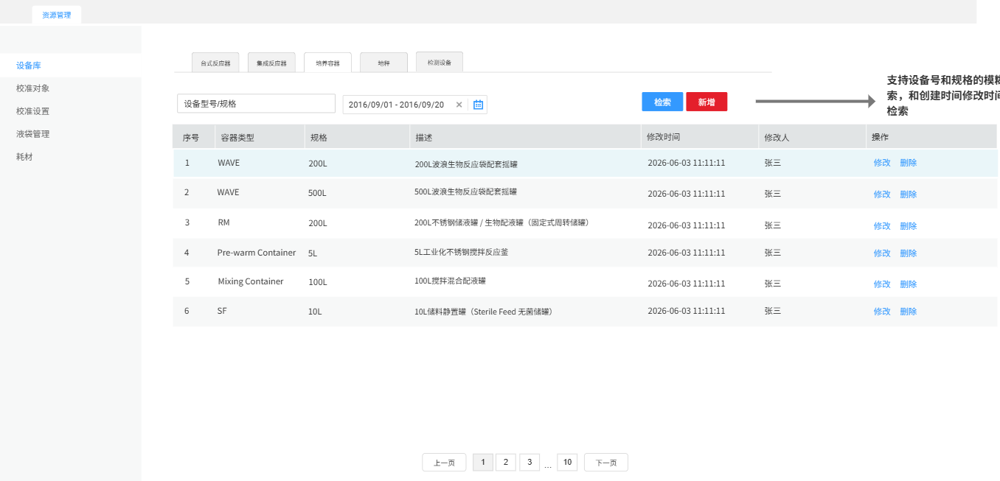

1.  新增

    > **[图 image186.png | 章节：资源管理 / 培养容器① | 上下文：新增]**
    > **OCR 文本：**
    > 新增
    > 容器类型* | 请选择
    > 规格* | Please enter...
    > 描述 | Please enter
    > 0/1000
    > 保存 | 取消

    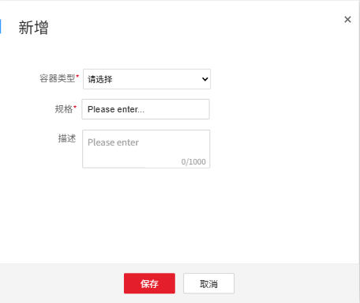

    1.  **容器类型**：下拉单选，包括WAVE、RM、Pre-warm Container、Mixing Container、SF五类，来源于数据字典
    2.  **规格**：文本框，必填，数字+单位填入。容器类型+规格为唯一标识，不能重复
    3.  **描述**：文本框，支持最多100个字符的描述
    4.  **保存**：保存前完成的校验包括必填字段非空、字段长度、容器类型+规格唯一性
2.  查询条件

    以下条件联合查询：

    1.  **设备型号/规格**：支持设备型号/规格的模糊搜索
    2.  **起止时间**：按照创建/修改时间检索
3.  结果展示与操作

    查询结果翻页展示，按创建时间倒排，最新的在最上面，包含以下字段：

    1.  序号
    2.  容器类型
    3.  规格
    4.  描述
    5.  **修改人**：同(3)⑤
    6.  **修改时间**：(3)⑥
    7.  操作：
        1.  **修改**：保持新增时的完整校验规则。修改后同步到各实验室的具体设备。

            > **[图 image187.png | 章节：资源管理 / 培养容器① | 上下文：修改：保持新增时的完整校验规则。修改后同步到各实验室的具体设备。]**
            > **OCR 文本：**
            > 修改
            > 容器类型* | 请选择
            > 规格* | Please enter...
            > 描述 | Please enter
            > 0/1000
            > 保存 | 取消

            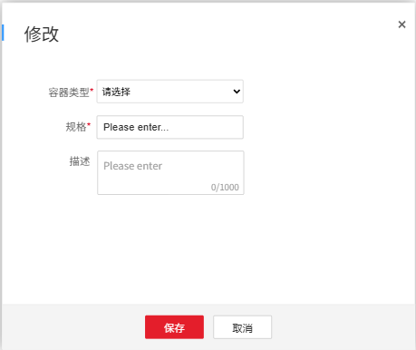

        2.  **删除**：同台式反应器⑨2)

#### 称重设备①

> **[图 image188.png | 章节：资源管理 / 称重设备① | 上下文：称重设备①]**
> **OCR 文本：**
> 资源管理
> 设备库 | 台式反应器 | 集成反应8 | 培养容8 | 称重设备 | 检测设备 | 空气泵 | 分析检测仪器
> 支持设备号、规格和描述的
> 校准对象 | 模糊检索，和创建时间修改
> 校准设置 | 设备型号/规格/描述 | 2016/09/01 - 2016/09/20 | 检索 | 新增 | 时间的检索
> 液袋管理 | 序号 | 图片 | 品牌 | 设备型号 | 量程 | 精度 (g) | 描述 | 修改时间 | 修改人 | 操作
> 耗材 | CHAUS | CHAUS | 35KG | 中试上游使用 | 2026-06-03 11:11:11 | 张三 | 修改 | 删除
> METTLER | METTLER | 60KG | 反应器称重专用 | 2026-06-03 11:11:11 | 张三 | 修改
> METTLER | METTLER | 300KG | 最新采购 | 2026-06-03 11:11:11 | 张三 | 修改 | 删除
> CAIS2-U | CAIS2-U | 1500KG | 补料专用 | 2026-06-03 11:11:11 | 张三 | 修改
> CAIS2-U | CAIS2-U | 1000KG | 中试上游专用 | 2026-06-03 11:11:11 | 张三 | 修改
> CHAUS | CHAUS | 50KG | 中试上游专用 | 2026-06-03 11:11:11 | 张三 | 修改 | 删除
> 上一页 | 10 | 下一页

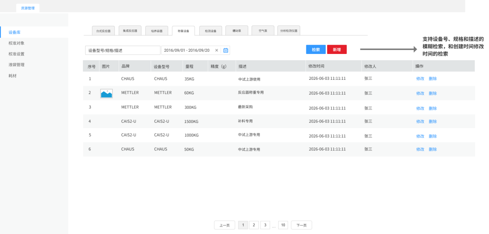

1.  新增

    > **[图 image189.png | 章节：资源管理 / 称重设备① | 上下文：新增]**
    > **OCR 文本：**
    > 新增
    > 品牌* | 请选择
    > 设备型号* | Please enter...
    > 量程* | Please enter...
    > 精度(g) | Please enter...
    > 描述 | Please enter
    > 0/1000
    > 通讯方式* | Please select...
    > 图片
    > +上传图片
    > 保存 | 取消

    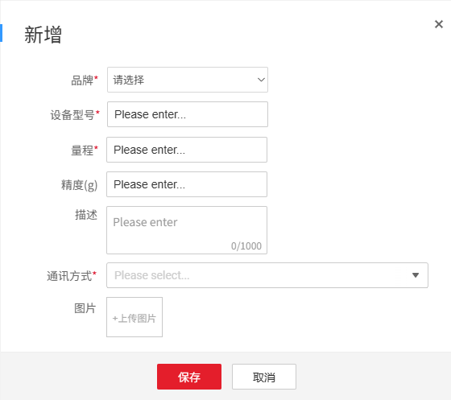

    1.  **品牌**：下拉单选，必选，列表来自数据字典
    2.  **设备型号**：下拉单选，来源于数据字典，品牌+设备型号为唯一标识，不能重复。
    3.  **量程**：量程，文本框，必填。
    4.  **精度（g）**：非必填，浮点型
    5.  **描述**：文本框，支持最多100个字符的描述
    6.  **通讯方式**：下拉选择，必选，支持多选。列表来自数据字典，后续添加具体设备时，只能从此处已选择的方式中选择其中一种。
    7.  **图片**：选传，大小不超过3M
    8.  **保存**：保存前完成的校验包括必填字段非空、字段长度、品牌+设备型号唯一性
2.  查询条件

    以下条件联合查询：

    1.  **设备型号/规格/描述**：支持设备型号/规格的模糊搜索
    2.  **起止时间**：按照创建/修改时间检索
3.  结果展示与操作

    查询结果翻页展示，按创建时间倒排，最新的在最上面，包含以下字段：

    1.  序号
    2.  设备型号
    3.  规格
    4.  精度（g）
    5.  描述
    6.  **修改人**：同(3)⑤
    7.  **修改时间**：(3)⑥
    8.  操作：
        1.  **修改**：保持新增时的完整校验规则。修改后同步到各实验室的具体设备。

            > **[图 image190.png | 章节：资源管理 / 称重设备① | 上下文：修改：保持新增时的完整校验规则。修改后同步到各实验室的具体设备。]**
            > **OCR 文本：**
            > 修改
            > 品牌* | 请选择
            > 设备型号* | Please enter...
            > 量程* | Please enter...
            > 精度(g) | Please enter...
            > 描述 | Please enter
            > 0/1000
            > 通讯方式* | Please select...
            > 图片 | +上传图片
            > 保存 | 取消

            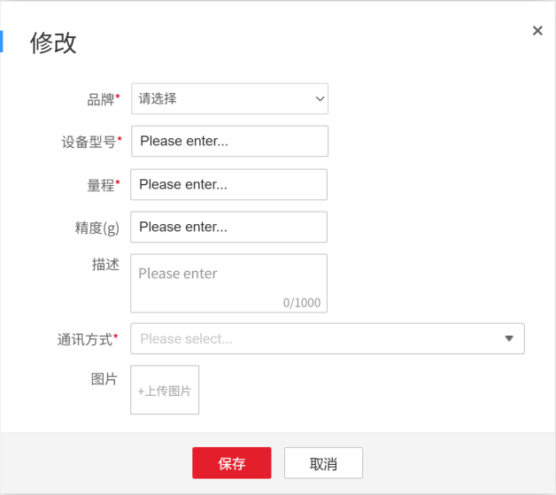

        2.  **删除**：同台式反应器

#### 检测设备①

包含检测设备及其检测项的新增、查询、修改和删除等

##### 检测设备①（3.2）

针对检测设备本身的新增、查询、修改和删除等

> **[图 image191.png | 章节：资源管理 / 检测设备① | 上下文：针对检测设备本身的新增、查询、修改和删除等]**
> **OCR 文本：**
> 支持设备号和规格的模糊检
> 资源管理 | 索，和创建时间修改时间的
> 检索
> 设备库 | 台式反应器 | 集成反应器 | 培养容器 | 地秤 | 检测设备
> 校准对象
> 设备型号/规格 | 2016/09/01-2016/09/20 | 检索 | 新增 | 设备检测项
> 校准设置
> 液袋管理 | 序号 | 设备类型 | 设备型号 | 描述 | 修改时间 | 修改人 | 操作
> 耗材 | BGA | RAPIDLAB 348EX | 血气分析仪 | 2026-06-0311:11:11 | 张三 | 修改
> Vicell | Vi-cell XR | 细胞计数仪 | 2026-06-03 11:11:11 | 张三 | 修改 | 删除
> OSMO | OSMO Pro | 冰点渗透压仪 | 2026-06-03 11:11:11 | 张三 | 修改
> OSMO | 0SMO6060 | 冰点渗透压仪 | 2026-06-0311:11:11 | 张三 | 修改 | 删除
> Cedex | Cedex Bio HT | 生化分析仪 | 2026-06-03 11:11:11 | 张三 | 修改
> Cedex | Cedex Bio | 生化分析仪 | 2026-06-03 11:11:11 | 张三 | 修改 | 删除

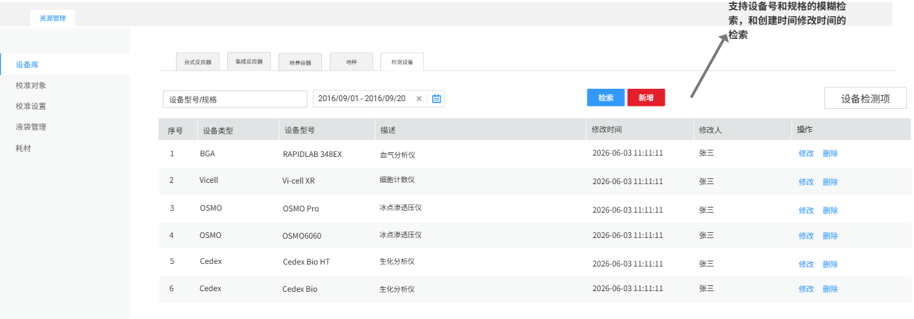

1.  新增

    > **[图 image192.png | 章节：资源管理 / 检测设备① | 上下文：新增]**
    > **OCR 文本：**
    > 新增
    > 设备类型* | 选择类型
    > 设备型号* | Please enter...
    > 单次可发送上限* | Please enter...
    > 通道
    > (左侧填写区）＊ | Please enter...
    > 排数 | Please enter...
    > (左侧填写区）＊
    > 载具形态* | 矩阵/多层
    > 工作状态下发送上限* | Please enter...
    > 超时设置* | Please enter...
    > 是否支持稀释*
    > 描述 | Please enter
    > 保存 | 取消

    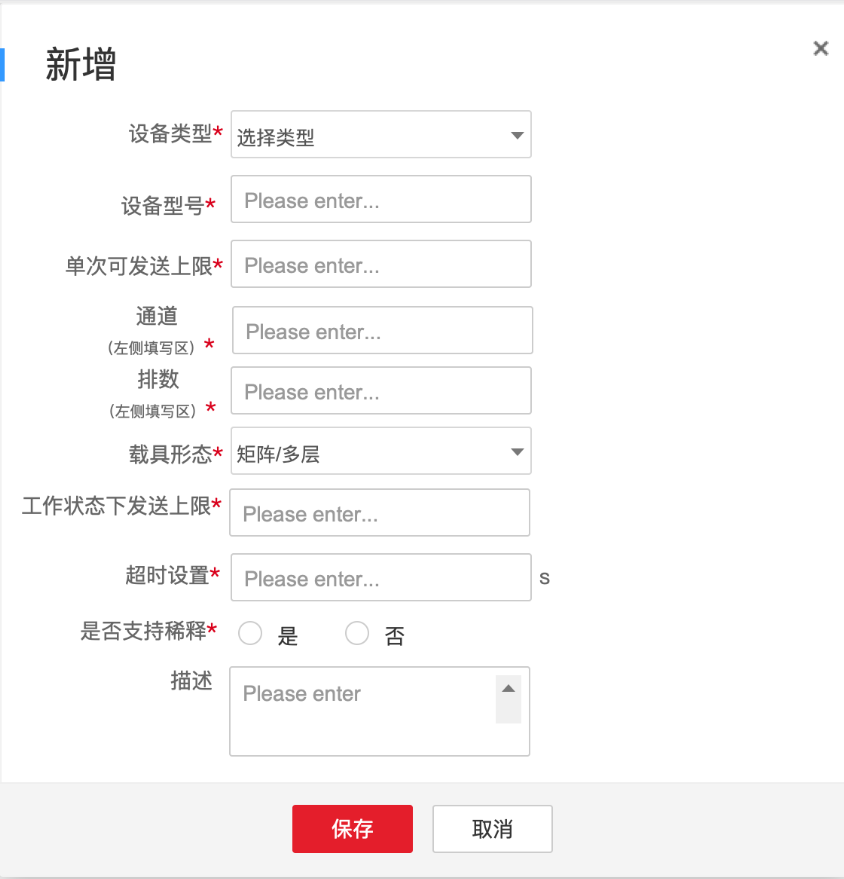

    1.  **检测类型**：下拉单选，必选，内容来源于数据字典
    2.  **设备型号**：文本框，必填。设备类型+设备型号必须唯一
    3.  **单次可发送上限**：文本框，正整数，范围为1~99。单词能够发送的检测需求的数量上限制，比如1则标识一次只能发1条，3则表示一次同时最多可以发送3条
    4.  **通道数**：文本框，正整数，范围为1~99。
    5.  **排数**：文本框，正整数，范围为1~99。
    6.  **载具形态**：下拉单选，内容包含单管、圆盘、矩阵/多层三种
    7.  **工作状态下发送上限**：文本框，必填，0或正整数，如果是0则表示不限制，可以一直发，设备上是可以排队的
    8.  **超时设置**：必填项，单位是s，限制正整数
    9.  **是否支持稀释**：在是或否中二选一。默认为否。选择是后，表示在检测分析页面可以支持修改稀释倍数
    10. **描述**：选填，支持100汉字以内描述
    11. **保存**：保存前完成的校验包括必填字段非空、字段长度、容器类型+规格唯一性
2.  查询条件

    以下条件联合查询：

    1.  **设备型号/规格**：支持设备型号/规格的模糊搜索
    2.  **起止时间**：按照创建/修改时间检索
3.  结果展示与操作

    查询结果翻页展示，按创建时间倒排，最新的在最上面，包含以下字段：

    1.  序号
    2.  设备类型
    3.  设备型号
    4.  描述
    5.  **修改人**：同(3)⑤
    6.  **修改时间**：(3)⑥
    7.  操作：
        1.  **修改**：保持新增时的完整校验规则。修改后同步到各实验室的具体设备。

            > **[图 image193.png | 章节：资源管理 / 检测设备① | 上下文：修改：保持新增时的完整校验规则。修改后同步到各实验室的具体设备。]**
            > **OCR 文本：**
            > 修改
            > 设备类型* | 选择类型
            > 设备型号* | Please enter...
            > 单次可发送上限* | Please enter...
            > 通道
            > (左侧填写区）＊ | Please enter...
            > 排数 | Please enter...
            > (左侧填写区)
            > 载具形态* | 矩阵/多层
            > 工作状态下发送上限* | Please enter...
            > 超时设置* | Please enter...
            > 是否支持稀释*
            > 描述 | Please enter
            > 保存 | 取消

            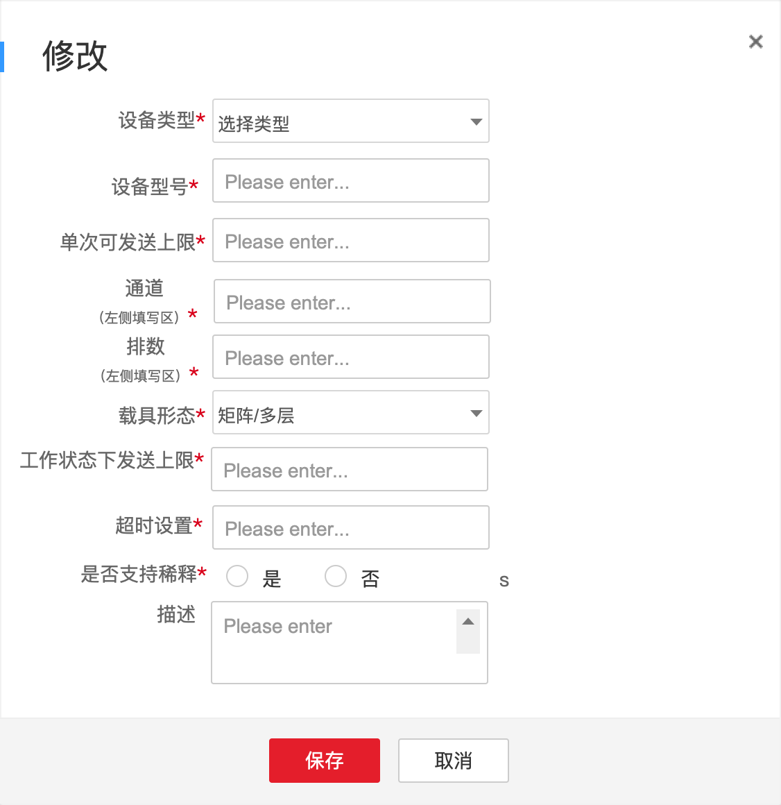

        2.  **删除**：同台式反应器⑨2)

##### 设备检测项①

针对检测设备对应检测项的新增、查询、修改和删除等。

> **[图 image194.png | 章节：资源管理 / 检测设备① | 上下文：针对检测设备对应检测项的新增、查询、修改和删除等。]**
> **OCR 文本：**
> 台式反应器 | 集成反应器 | 培养容器 | 稀重设备 | 检测设备 | 空气泵 | 分析检测收器
> 设备型号/规格 | 2016/09/01 -2016/09/20 | 设备检测项
> 序号 | 设备类型 | 设备型号 | 描述 | 修改时间 | 修改人 | 操作
> BGA | RAPIDLAB 348EX | 血气分析仪 | 2026-06-03 11:11:11 | 张三 | 修改
> Vicell | Vi-cell XR | 细胞计数仪 | 2026-06-03 11:11:11 | 修改 | 删除
> OSMO | OSMO Pro | 冰点涉选压仪 | 2026-06-03 11:11:11 | 张三 | 修改 | 删除
> OSMO | OSM06060 | 冰点涉选压仪 | 2026-06-03 /11:11 | 张三 | 修改
> Cedex | Cedex Bio HT | 生化分析仪 | 202706-03 11:11:11 | 张三 | 修改 | 删除
> Cedex | Cedex Bio | 生化分析仪 | 2026-06-03 11:11:11 | 张三 | 修改 | 删除
> 10 | 下一页
> 我这个实验至需要用到的检测项。
> 支持按照检测类型或检测项
> A实验室工作台 | B实验室工作台 | 系统设置、 | 目名称和描述模糊检索
> 检测设备 | 设备检测项
> 检项名称/描述 | 按检测类型检素 | 检察 | 新增
> 序号 | 检测类型 | 中文名 | 英文名 | 简称 | 描述 | 单位 | 创建时间 | 创建人 | 修改时间 | 修改人 | 操作
> Cedex | GLC3B | GLC3B | Glucose | g/L | 2026-06-03 11:11:11 | 张三 | 2026-06-03 11:11:11 | 张三 | 修改 | 删除
> Cedex | IGGHB | IGGHB | IGGHB | mg/L | 2026-06-03 11:11:11 | 张三 | 2026-06-03 11:11:11 | 张三 | 修改 | 删除
> Cedex | NH3B | NH4+ | mmolL | 2026-06-03 11:11:11 | 张三 | 2026-06-03 11:11:11 | 张三 | 修改 | 删除
> xapap | LAC2B | LAC2B | LAC2B | Lactate | g/L | 2026-06-03 11:11:11 | 张三 | 2026-06-03 11:11:11 | 张三 | 修改 | 删除
> OSMO | OSMO | OSMO | OSMO | Osmolality | 张三 | 2026-06-03 11:11:11 | 张三 | 修改
> ViCell | Viability2B | Viability2B | Viability2B | 2026-06-03 11:11:11 | 张三 | 2026-06-03 11:11:11 | 张三 | 修改 | 删除

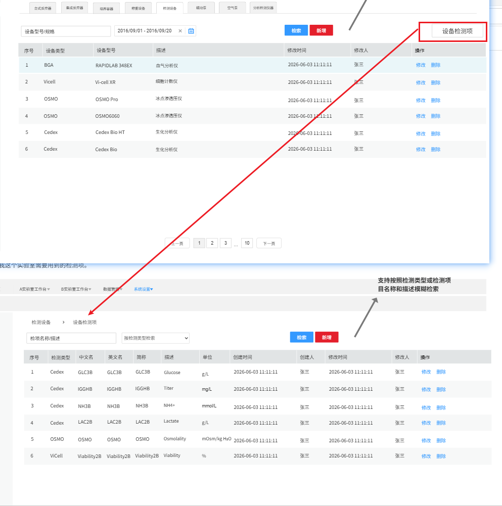

1.  新增

    > **[图 image195.png | 章节：资源管理 / 检测设备① | 上下文：新增]**
    > **OCR 文本：**
    > 新增
    > 检测类型* | 选择类型
    > 中文名称* | Please enter...
    > 英文名称* | Please enter...
    > 简称* | Please enter...
    > 单位 | Please enter...
    > 分组名 | Please enter...
    > 检测项编号* | Please enter...
    > 离线统计名* | Please select...
    > 描述 | Please enter
    > 保存 | 取消

    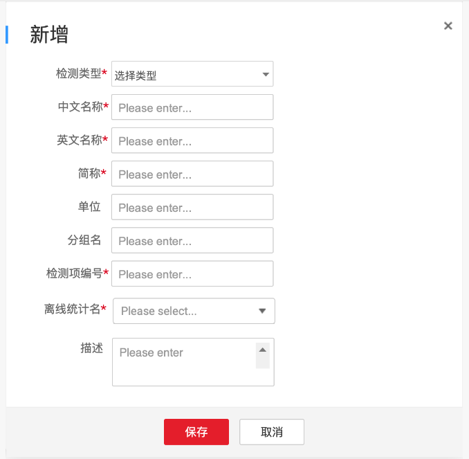

    1.  **检测类型**：下拉单选，必选，内容来源于数据字典
    2.  **检项中文名称**：文本框，必填，可以重复
    3.  **检项英文名称**：文本框，必填，可以重复
    4.  **简称**：文本框，必填，可以重复
    5.  **单位**：字符串，非必填
    6.  **分组名**：文本框，选填，字符串
    7.  **检测项编号**：文本框，必填，同一类型下不能重复
    8.  **离线统计名**：下拉单选，必选，列表内容来自数据字典，用于离线检测绘制图表时的分类，比如GLC2B 和GLC3B属于同一类，会绘制成一条线
    9.  **描述**：非必填，目前看是填写这个项目的英文名
    10. **保存**：保存前完成的校验包括必填字段非空、字段长度、唯一性
2.  查询条件

    以下条件联合查询：

    1.  **检项名称/描述**：支持检项名称/描述共同模糊搜索
    2.  **检测类型**：下拉单选，必选，内容来源于数据字典
3.  结果展示与操作

    查询结果翻页展示，按创建时间倒排，最新的在最上面，包含以下字段：

    1.  序号
    2.  检测类型
    3.  检项简写
    4.  检项中文名称
    5.  检项英文名称
    6.  检项名称
    7.  描述
    8.  单位
    9.  创建人
    10. 创建时间
    11. 修改人
    12. 修改时间
    13. 操作
        1.  **修改**：保持新增时的完整校验规则。修改后同步到各实验室的具体设备。

            > **[图 image196.png | 章节：资源管理 / 检测设备① | 上下文：修改：保持新增时的完整校验规则。修改后同步到各实验室的具体设备。]**
            > **OCR 文本：**
            > 修改
            > 检测类型* | 造择类型
            > 中文名称* | Please enter...
            > 英文名称★ | Please enter...
            > 简称* | Please enter...
            > 单位 | Please enter...
            > 分组名 | Please enter...
            > 通讯编号* | Please enter...
            > 离线统计名* | Please select...
            > 描述 | Please enter
            > 保存 | 取消

            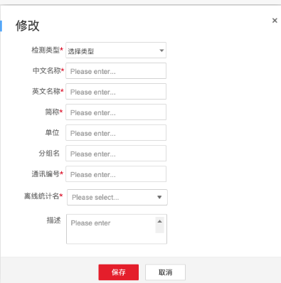

        2.  删除：
            1.  需二次确认才可删除，提示信息

                > **[图 image197.png | 章节：资源管理 / 检测设备① | 上下文：需二次确认才可删除，提示信息]**
                > **OCR 文本：**
                > 确定要删除吗
                > 检测项删除之前请确认实验室已禁用
                > 了此项检测
                > 取消 | 确定

                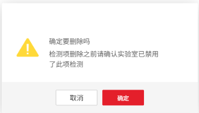

            2.  确认删除后，需校验该检项的启用状况，若有设备的该检项为启用状态，则不能删除

                > **[图 image198.png | 章节：资源管理 / 检测设备① | 上下文：确认删除后，需校验该检项的启用状况，若有设备的该检项为启用状态，则不能删除]**
                > **OCR 文本：**
                > 删除失败！
                > 还有实验室在使用此检测项
                > 确认

                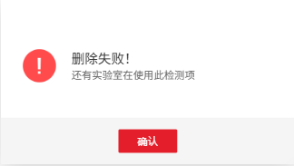

            3.  删除成功，提示信息

                > **[图 image199.png | 章节：资源管理 / 检测设备① | 上下文：删除成功，提示信息]**
                > **OCR 文本：**
                > 操作成功！
                > 检测项已删除
                > 关闭

                

#### 蠕动泵①

> **[图 image200.png | 章节：资源管理 / 蠕动泵① | 上下文：蠕动泵①]**
> **OCR 文本：**
> 台式反应器 | 集成反应器 | 培养容器 | 地秤 | 检测设备 | 空气泵
> 支持设备号、规格和描述的
> 品牌/型号/规格 | 2016/09/01-2016/09/20 | 检索 | 新增 | 时间的检索 | 模糊检索，和创建时间修改
> 序号 | 品牌 | 型号 | 最大流量（L/min) | 描述 | 修改时间 | 修改人 | 操作
> XXX | 中试上游使用 | 2026-06-03 11:11:11 | 张三 | 修改 | 删除
> XXX | 反应器称重专用 | 2026-06-03 11:11:11 | 张三 | 修改 | 删除
> XXX | 最新采购 | 2026-06-03 11:11:11 | 张三 | 修改 | 删除
> XXX | 补料专用 | 2026-06-03 11:11:11 | 张三 | 修改 | 删除
> 中试上游专用 | 2026-06-0311:11:11 | 张三 | 修改 | 删除
> 中试上游专用 | 2026-06-03 11:11:11 | 张三 | 修改 | 删除

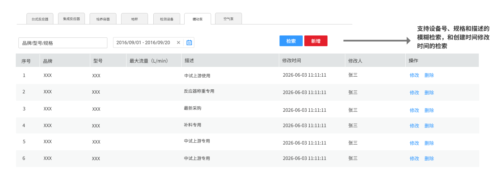

1.  新增

    新增一台蠕动泵：

    > **[图 image201.png | 章节：资源管理 / 蠕动泵① | 上下文：新增一台蠕动泵：]**
    > **OCR 文本：**
    > 新增
    > 品牌* | 请选择
    > 设备型号* | Please enter...
    > 最大流量(L/min) | Please enter...
    > 描述 | Please enter
    > 0/1000
    > 保存 | 取消

    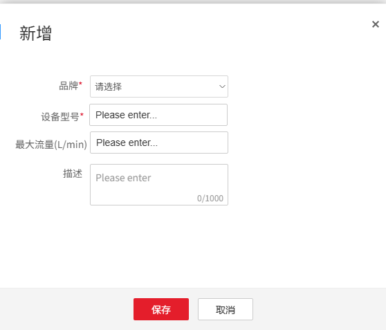

    1.  **品牌**：必填，下拉单选，列表内容来源数据字典
    2.  **设备型号**：文本框，必填，品牌+型号联合做唯一性校验
    3.  **最大流量**：文本框，非必填，浮点型，数据范围参考0.0002 ~ 35，支持小数点后4位即可
    4.  **描述**：文本，选填，支持100个字符
    5.  **保存**：保存前完成的校验包括必填字段非空、字段长度、品牌+设备型号唯一性
2.  查询条件

    以下条件联合查询：

    1.  **品牌/设备型号**：支持品牌/设备型号的模糊搜索
    2.  **起止时间**：按照创建/修改时间检索
3.  结果展示与操作

    查询结果翻页展示，按创建时间倒排，最新的在最上面

    1.  序号
    2.  品牌
    3.  设备型号
    4.  最大流量
    5.  描述
    6.  修改人
    7.  修改时间
    8.  操作：
        1.  **修改**：保持和新增时一样的校验

            > **[图 image202.png | 章节：资源管理 / 蠕动泵① | 上下文：修改：保持和新增时一样的校验]**
            > **OCR 文本：**
            > 修改
            > 品牌* | 请选择
            > 设备型号* | Please enter...
            > 最大流量(L/min) | Please enter...
            > 描述 | Please enter
            > 0/1000
            > 保存 | 取消

            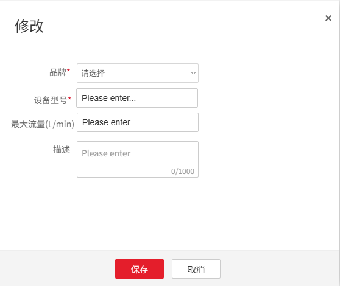

        2.  **删除**：同台式反应器删除操作

#### 空气泵①

> **[图 image203.png | 章节：资源管理 / 空气泵① | 上下文：空气泵①]**
> **OCR 文本：**
> 台式反应器 | 集成反应器 | 培养容器 | 地秤 | 检测设备 | 螺动泵 | 空气泵
> 支持设备号、规格和描述的
> 品牌/型号/规格 | 2016/09/01-2016/09/20 | 检索 | 新增 | 时间的检索 | 模糊检索，和创建时间修改
> 序号 | 型号 | 最大流量（L/min) | 修改时间 | 修改人 | 操作
> xxx | xxx | 中试上游使用 | 2026-06-03 11:11:11 | 张三 | 修改 | 删除
> 反应器称重专用 | 2026-06-03 11:11:11 | 张三 | 修改 | 删除
> XXX | 最新采购 | 2026-06-03 11:11:11 | 张三 | 修改 | 删除
> XXX | xxx | 补料专用 | 2026-06-03 11:11:11 | 张三 | 修改 | 删除
> 中试上游专用 | 2026-06-03 11:11:11 | 张三 | 修改 | 删除
> XXX | 中试上游专用 | 2026-06-03 11:11:11 | 张三 | 修改 | 删除
> 10

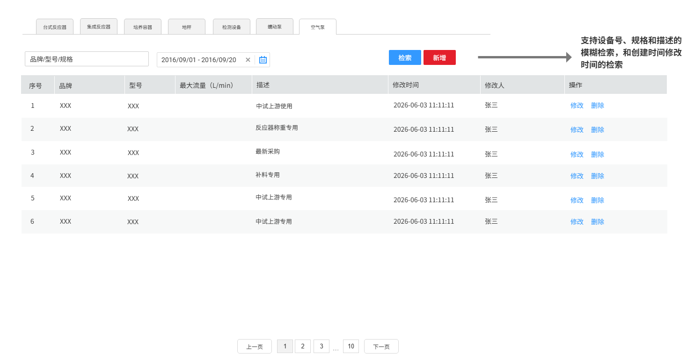

1.  新增

    新增一个空气泵：

    > **[图 image204.png | 章节：资源管理 / 空气泵① | 上下文：新增一个空气泵：]**
    > **OCR 文本：**
    > 新增
    > 品牌* | 请选择
    > 设备型号* | Please enter...
    > 最大流量(L/min) | Please enter..
    > 描述 | Please enter
    > 0/1000
    > 保存 | 取消

    

    1.  **品牌**：下拉单选，列表内容来源数据字典
    2.  **设备型号**：文本框，必填，品牌+型号联合做唯一性校验
    3.  **最大流量**：文本框，非必填，浮点型，数据范围参考0.0002 ~ 35，支持小数点后4位即可
    4.  **描述**：文本，选填，支持100个字符
    5.  **保存**：保存前完成的校验包括必填字段非空、字段长度、品牌+设备型号唯一性
2.  查询条件

    以下条件联合查询：

    1.  **品牌/设备型号**：支持品牌/设备型号的模糊搜索
    2.  **起止时间**：按照创建/修改时间检索
3.  结果展示与操作

    查询结果翻页展示，按创建时间倒排，最新的在最上面

    1.  序号
    2.  品牌
    3.  设备型号
    4.  最大流量
    5.  描述
    6.  修改人
    7.  修改时间
    8.  操作：
        1.  **修改**：保持和新增时一样的校验

            > **[图 image202.png | 章节：资源管理 / 空气泵① | 上下文：修改：保持和新增时一样的校验]**
            > **OCR 文本：**
            > 修改
            > 品牌* | 请选择
            > 设备型号* | Please enter...
            > 最大流量(L/min) | Please enter...
            > 描述 | Please enter
            > 0/1000
            > 保存 | 取消

            

        2.  **删除**：同台式反应器删除操作

#### 分析检测仪②

> **[图 image205.png | 章节：资源管理 / 分析检测仪② | 上下文：分析检测仪②]**
> **OCR 文本：**
> 台式反应器 | 集成反应器 | 培养容器 | 地秤 | 检测设备 | 螺动泵 | 空气泵 | 分析检测仪器
> 支持按设备类型检索
> 设备类型 | 品牌/设备型号 | 2016/09/01-2016/09/20 | 检索 | 新增 | 支持品牌、设备型号的模糊检索 | 支持创建时间/修改时间的检索
> 序号 | 图标 | 设备类型 | 品牌 | 设备型号 | 通讯方式 | 描述 | 修改时间 | 修改人 | 操作
> 密度分析仪 | 中试下游使用 | 2026-06-03 11:11:11 | 张三 | 修改 | 删除
> 密度分析仪 | XXX | 中试下游使用 | 2026-06-03 11:11:11 | 张三 | 修改 | 删除
> 多参数仪 | 最新采购 | 2026-06-03 11:11:11 | 张三 | 修改 | 删除
> ND2000紫外分光光度计 | 中试下游使用 | 2026-06-03 11:11:11 | 张三 | 修改 | 删除
> SoloVPE分光光度计 | 淘汰型号 | 2026-06-03 11:11:11 | 张三 | 修改 | 删除
> 完整性测试仪 | XXX | XXX | 8000 mbar | 测试压力范围100~ | 2026-06-03 11:11:11 | 张三 | 修改
> 上一页 | 10

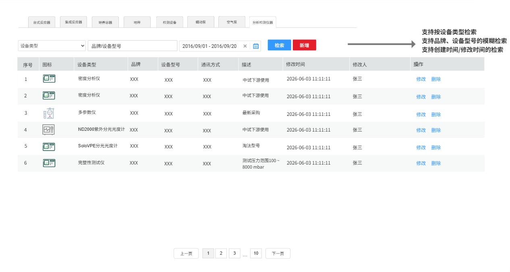

1.  新增

    > **[图 image206.png | 章节：资源管理 / 分析检测仪② | 上下文：新增]**
    > **OCR 文本：**
    > 新增
    > 设备类型* | 密度分析仪
    > 品牌* | 请选择
    > 设备型号* | Please enter..
    > 通讯方式* | Please select...
    > 图标*
    > +上传图片
    > 描述 | Please enter
    > 0/1000
    > 保存 | 取消

    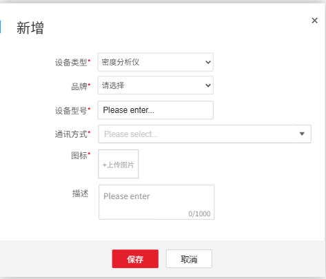

    1.  **设备类型**：下拉单选，必选，列表内容维护在数据字典，目前有5种类型，包括密度分析仪、多参数仪、ND2000紫外分光光度计、SoloVPE分光光度计、完整性测试仪。
    2.  **品牌**：下拉单选，必选，通过数据字典维护
    3.  **设备型号**：必填，品牌+设备型号为唯一标识，不能重复
    4.  **通讯方式**：必选，支持多选，通过数据字典维护，后续设备添加到实验室的时候，只能在这里指定的类型中选择一种方式
    5.  **图标**：必传，支持多传
    6.  **描述**：选填，可输入200个汉字以内
    7.  **保存**：保存前完成的校验包括必填字段非空、字段长度、字段唯一性
2.  查询条件

    以下条件联合查询：

    1.  **设备类型**：支持模糊搜索
    2.  **品牌/设备型号**：支持品牌/设备型号共同模糊搜索
3.  结果展示与操作

    查询结果翻页展示，按创建时间倒排，最新的在最上面，包含以下字段：

    1.  序号
    2.  图标
    3.  设备类型
    4.  品牌
    5.  设备型号
    6.  通讯方式
    7.  描述
    8.  修改人
    9.  修改时间
    10. 操作
        1.  **修改**：保持和新增时一致的校验操作

            > **[图 image207.png | 章节：资源管理 / 分析检测仪② | 上下文：修改：保持和新增时一致的校验操作]**
            > **OCR 文本：**
            > 修改
            > 设备类型* | 密度分析仪
            > 请选择
            > 设备型号* | Please enter...
            > 通讯方式* | Please select..
            > 图标*
            > +上传图片
            > 描述 | Please enter
            > 0/1000
            > 保存 | 取消

            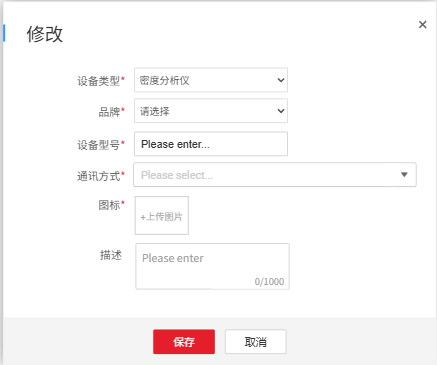

        2.  删除
            1.  删除前需二次确认

                > **[图 image208.png | 章节：资源管理 / 分析检测仪② | 上下文：删除前需二次确认]**
                > **OCR 文本：**
                > 确定要删除吗
                > 删除之前要检查是否与实验室关联
                > 取消 | 确定

                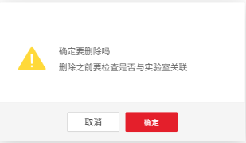

            2.  确认删除时，需确认设备的使用装酷那个，若有实验室一绑定该设备，则删除失败，提示信息

                > **[图 image209.png | 章节：资源管理 / 分析检测仪② | 上下文：确认删除时，需确认设备的使用装酷那个，若有实验室一绑定该设备，则删除失败，提示信息]**
                > **OCR 文本：**
                > 删除失败！
                > 有实验室还在使用此设备，无法删除
                > 请先在实验室进行删除操作
                > 确认

                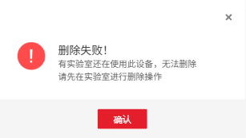

            3.  删除成功，提示信息

                > **[图 image210.png | 章节：资源管理 / 分析检测仪② | 上下文：删除成功，提示信息]**
                > **OCR 文本：**
                > 操作成功！
                > 设备已删除
                > 关闭

                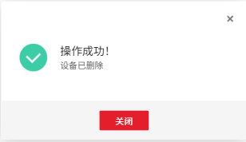

### 校准对象设置②

> **[图 image211.png | 章节：资源管理 / 校准对象设置② | 上下文：校准对象设置②]**
> **OCR 文本：**
> 资源管理
> 设备库
> 校准对象 | 支持按码名称糊检索
> 砖码名称 | 2016/09/01 - 2016/09/20 | 检索 | 新增 | 输入时间段按创建/修改时间检索
> 校准设置 | 开始时间和结束时间支持只输入一项
> 检测规则 | 序号 | 磁码名称 | 创建时间 | 创建人 | 修改时间 | 修改人 | 操作
> 全部记录 | 10KG | 10000 | 2026-06-03 11:11:11 | 张川 | 2026-06-03 11:11:11 | 张三 | 修改 | 删除
> 液袋管理
> 20KG | 20000 | 2026-06-03 11:11:11 | 张三 | 2026-06-03 11:11:11 | 张三 | 修改 | 删除
> 耗材
> 1000g | 1000 | 2026-06-03 11:11:11 | 张三 | 2026-06-03 11:11:11 | 张三 | 修改
> 上一页 | 10 | 下一页

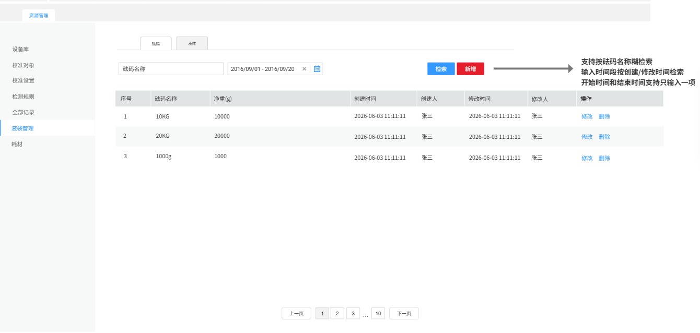

1.  新增

    > **[图 image212.png | 章节：资源管理 / 校准对象设置② | 上下文：新增]**
    > **OCR 文本：**
    > 新增
    > 砖码名称* | Please enter...
    > 净重(g)* | Please enter...
    > 保存 | 取消

    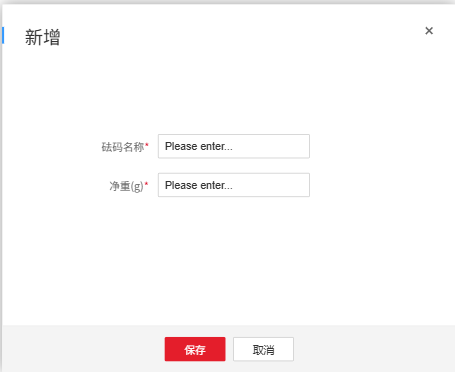

    1.  **砝码名称**：必填，不能重复
    2.  **净重（g）**：必填，纯数字，正整数，默认单位g
2.  查询条件
    1.  **砝码名称**：支持模糊搜索
    2.  起止时间
3.  结果展示与操作

    查询结果翻页展示，按创建时间倒排，最新的在最上面，包含以下字段：

    1.  序号
    2.  砝码名称
    3.  净重（g）
    4.  创建人
    5.  创建时间
    6.  修改人
    7.  修改时间
    8.  操作
        1.  **修改**：保持新增时的校验规则

            > **[图 image213.png | 章节：资源管理 / 校准对象设置② | 上下文：修改：保持新增时的校验规则]**
            > **OCR 文本：**
            > 修改
            > 码名称* | Please enter...
            > 净重(g)* | Please enter...
            > 保存 | 取消

            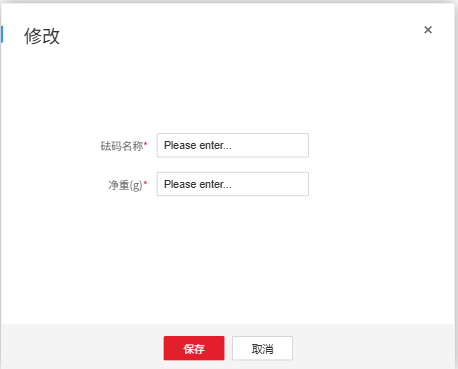

        2.  删除
            1.  删除前需要二次确认

                > **[图 image214.png | 章节：资源管理 / 校准对象设置② | 上下文：删除前需要二次确认]**
                > **OCR 文本：**
                > 确定要删除吗
                > 除后数据不可恢复
                > 取消 | 确定

                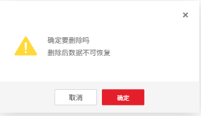

            2.  点击确认，删除成功并提示信息

                > **[图 image215.png | 章节：资源管理 / 校准对象设置② | 上下文：点击确认，删除成功并提示信息]**
                > **OCR 文本：**
                > 操作成功！
                > 数据已利除
                > 关闭

                

### 检测规则②

> **[图 image216.png | 章节：资源管理 / 检测规则② | 上下文：检测规则②]**
> **OCR 文本：**
> 实验室3
> 密度分析仪
> 连续三次测试相同样品密度，任何两个结果之间的差值不得超过：
> 差值 | 保存
> ND2000紫外分光光度计
> 连续三次测试相同样品
> 时间范围：
> 时间 | min | 保存
> 计算RDS:
> RDS | 保存
> 空白样品浓度：
> 空白浓度 (绝对值) | mg/ml | 保存
> SoloVPE分光光度计
> 计算RDS:
> RDS | 保存
> R2 | 保存

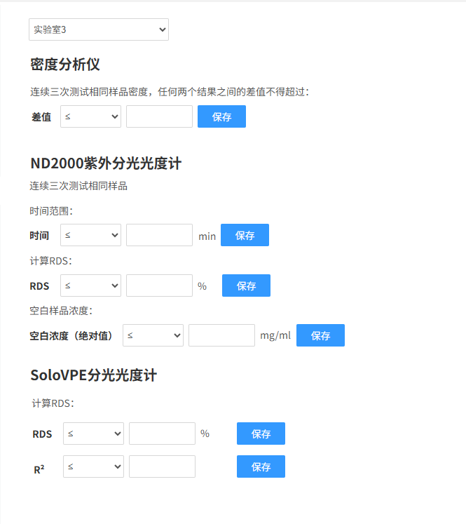

1.  **实验室**：下拉单选，以用户授权实验室为基准，过滤类型为中试下游或小试下游的实验室
2.  **密度分析仪-差值**：下拉单选，可选择≥ 、≤ 、< 、>、 =、 !=，后面支持浮点型数字，支持小数点后两位
3.  **光度计-时间**：下拉单选，可选，≤ 、<，后面填写支持正整数
4.  **光度计-RDS**：下拉单选，可选≥ 、≤ 、< 、>、 =、 !=，后面填写支持正整数
5.  **光度计-空白浓度**：下拉单选，可选≥ 、≤ 、< 、>、 =、 !=，后面支持浮点型，支持小数点后两位
6.  **SoloVP-RDS**：下拉单选，可选≥ 、≤ 、< 、>、 =、 !=，后面填写支持正整数
7.  **SoloVP-R²**：下拉单选，可选≥ 、≤ 、< 、>、 =、 !=，后面支持浮点型，支持小数点后3位

### 液袋管理②

> **[图 image217.png | 章节：资源管理 / 液袋管理② | 上下文：液袋管理②]**
> **OCR 文本：**
> 资源管理
> 按描述模糊检索
> 描述 | 2016/09/01 - 2016/09/20 | 检素 | 新增 | 输入时间段按创建/
> 设备库 | 开始时间和结束时i
> 校准对象 | 序号 | 图标 | 描述 | 型号 | 容量 (g) | 皮重(g) | 残余量(g) | 下限体积(g) | 修改时间 | 修改人 | 操作
> 校准设置 | 1000ML Bag | 1000ML | 1000 | 50 | 100 | 2026-06-03 11:11:11 | 张三 | 修改 | 删除
> 检测规则 | 500ML Bag | 500ML | 00S | 50 | 100 | 2026-06-03 11:11:11 | 张三 | 修改 | 删除
> 全部记录
> 液袋管理 | 20L Bag | 20L | 20000 | 50 | 100 | 2026-06-03 11:11:11 | 张三 | 修改 | 删除
> 耗材 | 10L Bag | 10L | 10000 | 100 | 2026-06-03 11:11:11 | 张三 | 修改 | 删除
> 50L Bag | 50L | 50000 | 0.2 | 50 | 100 | 2026-06-03 11:11:11 | 张三 | 修改 | 删除
> 5L Bag | 5L | 5000 | 50 | 100 | 2026-06-03 11:11:11 | 张三 | 修改 | 删除
> 上一页 | 10

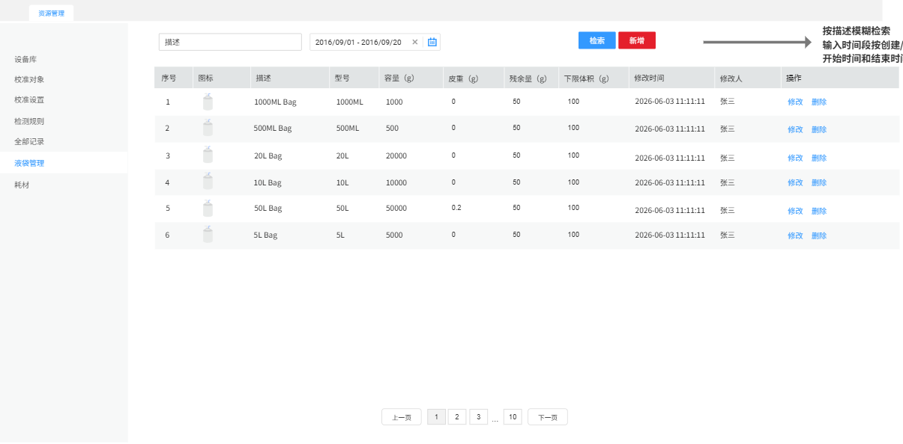

1.  新增

    > **[图 image218.png | 章节：资源管理 / 液袋管理② | 上下文：新增]**
    > **OCR 文本：**
    > 新增
    > 描述* | Please enter... | 型号* | 请选择型号
    > 容量(g)* | Please enter... | 皮重(g)* | Please enter...
    > 残余量(g)* | Please enter... | 下限体积(g)* | Please enter...
    > 图标 | +上传图片
    > 保存 | 取消

    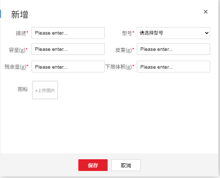

    1.  **描述**：文本框，必填，不能重复
    2.  **型号**：下拉单选，必选，在数据字典里维护
    3.  **容量（g）**：必填，正整数，默认单位是g
    4.  **皮重（g）**：必填，0或正整数，默认单位是g
    5.  **残余量（g）**：必填，0或正整数，默认单位是g
    6.  **下限体积**：必填，0或正整数，默认单位是g
    7.  **图标**：选传， 常见图片格式，小于1M，不传时候显示缺省图
    8.  **保存**：保存前完成的校验包括必填字段非空、指定字段唯一性
2.  查询条件

    以下条件联合查询：

    1.  **描述**：支持按照描述模糊
    2.  **起止时间**：支持按照创建时间和修改时间检索
3.  结果展示与操作

    查询结果翻页展示，按创建时间倒排，最新的在最上面，包含以下字段：

    1.  序号
    2.  **图标**：未上传时，显示缺省图
    3.  描述
    4.  型号
    5.  容量（g）
    6.  皮重（g）
    7.  残余量（g）
    8.  下限体积（g）
    9.  修改人
    10. 修改时间
    11. 操作
        1.  **修改**：保持新增时的完整校验规则。

            > **[图 image219.png | 章节：资源管理 / 液袋管理② | 上下文：修改：保持新增时的完整校验规则。]**
            > **OCR 文本：**
            > 修改
            > 描述* | Please enter.. | 型号* | 请选择型号
            > 容量(g)* | Please enter... | 皮重(g)* | Please enter...
            > 残余量(g)* | Please enter.. | 下限体积(g)* | Please enter...
            > 图标 | +上传图片
            > 保存 | 取消

            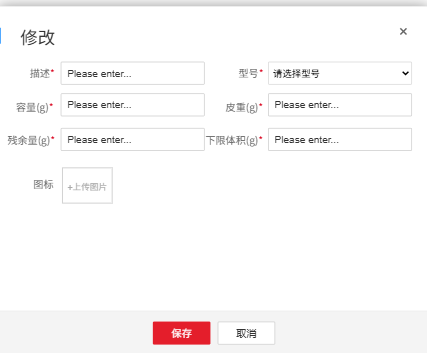

        2.  删除
            1.  删除前需要二次确认

                > **[图 image214.png | 章节：资源管理 / 液袋管理② | 上下文：删除前需要二次确认]**
                > **OCR 文本：**
                > 确定要删除吗
                > 除后数据不可恢复
                > 取消 | 确定

                

            2.  点击确认，删除成功并提示信息

                > **[图 image215.png | 章节：资源管理 / 液袋管理② | 上下文：点击确认，删除成功并提示信息]**
                > **OCR 文本：**
                > 操作成功！
                > 数据已利除
                > 关闭

                

### 补液培养基管理②（3.2）

> **[图 image220.png | 章节：资源管理 / 补液培养基管理②（3.2） | 上下文：补液培养基管理②（3.2）]**
> **OCR 文本：**
> 料液名称 | 检索 | 新增
> 序号 | 料液名称 | 含糖浓度 (g/L) | 糖补料 | 修改时间 | 修改人 | 操作
> 培养基补料00001 | 2026-06-03 11:11:11 | 张三 | 修改 | 删除
> 培养基补料00002 | 2026-06-03 11:11:11 | 张三 | 修改 | 删除
> 培养基补料00003 | 2026-06-03 11:11:11 | 张三 | 修改 | 删除
> 培养基补料00004 | 80 | 2026-06-03 11:11:11 | 张三 | 修改 | 删除
> 培养基补料00005 | 92.6 | 2026-06-03 11:11:11 | 张三 | 修改 | 删除
> 培养基补料00006 | 2026-06-03 11:11:11 | 张三 | 修改 | 删除

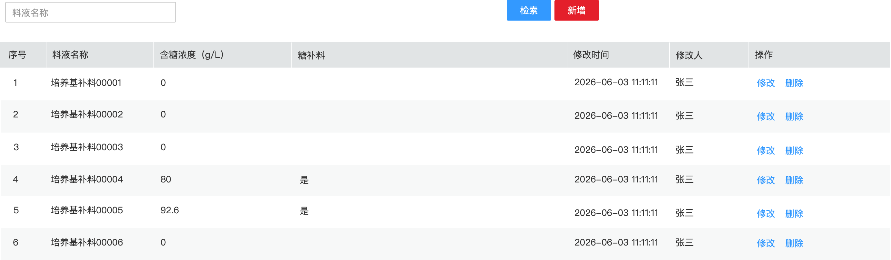

1.  新增

    > **[图 image221.png | 章节：资源管理 / 补液培养基管理②（3.2） | 上下文：新增]**
    > **OCR 文本：**
    > 新增
    > 料液名称* | Please enter...
    > 补液培养基含糖浓度（g/L）＊ | Please enter...
    > ■糖补料
    > 保存 | 取消

    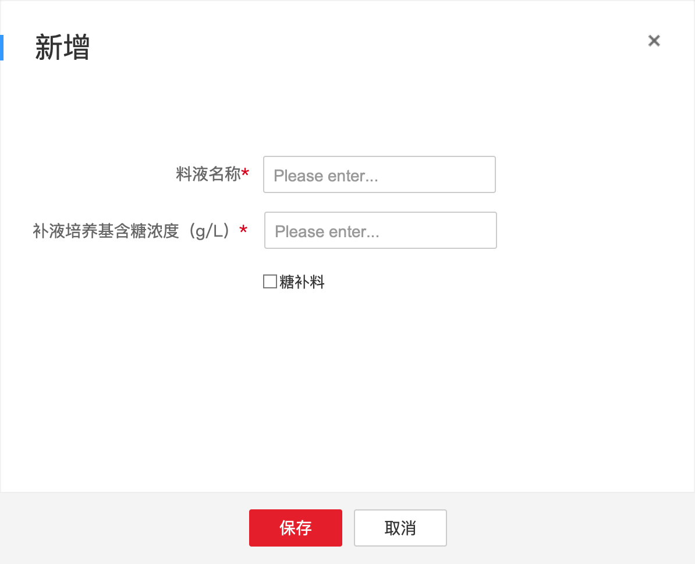

    1.  **料液名称**：文本框，必填，不能重复
    2.  **料液含糖浓度**：必填，浮点型，支持小数点后2位，允许为0
    3.  **是否糖补料**：选填，不勾选，表示不是糖补料，中试和小试都统一使用糖补料勾选框。
2.  查询条件

    以下条件联合查询

    1.  **料液名称**：文本框，支持模糊搜索
3.  结果展示与操作

    查询结果翻页展示，按添加时间倒排，最新的在最上面，包含以下字段：

    1.  序号
    2.  料液名称
    3.  含糖浓度
    4.  糖补料
    5.  修改人
    6.  修改时间
    7.  操作
        1.  **修改**：保持新增时的校验规则

            > **[图 image222.png | 章节：资源管理 / 补液培养基管理②（3.2） | 上下文：修改：保持新增时的校验规则]**
            > **OCR 文本：**
            > 修改
            > 补液培养基名称* | Please enter...
            > 补液培养基含糖浓度(g/L）* | Please enter..
            > 口糖补科
            > 保存 | 取消

            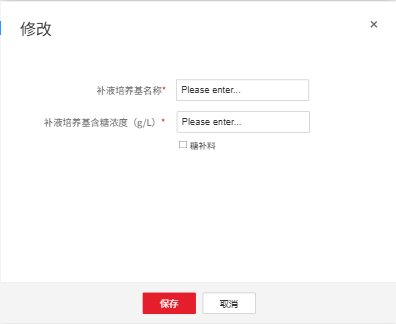

        2.  删除：
            1.  需二次确认删除

                > **[图 image223.png | 章节：资源管理 / 补液培养基管理②（3.2） | 上下文：需二次确认删除]**
                > **OCR 文本：**
                > 确定要删除吗
                > 删除后数据不可恢复
                > 取消 | 确定

                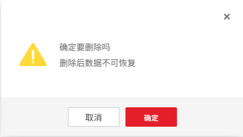

            2.  确认删除后，删除成功并提示信息。注意，删除后，后续在新增数据时，不可见到此数据，但不影响历史数据展示。

                > **[图 image224.png | 章节：资源管理 / 补液培养基管理②（3.2） | 上下文：确认删除后，删除成功并提示信息。注意，删除后，后续在新增数据时，不可见到此数据，但不影响历史数据展示。]**
                > **OCR 文本：**
                > 操作成功！
                > 数据已删除
                > 关闭

                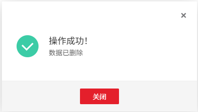

### 耗材管理②

> **[图 image225.png | 章节：资源管理 / 耗材管理② | 上下文：耗材管理②]**
> **OCR 文本：**
> 按耗材编码或描述
> 耗材编码/描述 | 2016/09/01 - 2016/09/20 | 检索 | 新增 | 输入时间段按创建
> 设备库 | 开始时间和结束时
> 校准对象 | 序号 | 图标 | 耗材编码 | 描述 | 类别 | 计量单位 | 容量 | 容量单位 | 品牌 | 修改时间 | 修改人 | 操作
> 校准设置 | 00001 | Vicell tube | CITEM | UNIT | 20000 | INNOVEL | 2026-06-03 11:11:11 | 张三 | 修改 | 删除
> 检测规则 | 00002 | OSMO tube | CITEM | UNIT | 1000 | INNOVEL | 2026-06-03 11:11:11 | 张三 | 修改 | 删除
> 全部记录
> EP tube | CITEM | UNIT | 1500 | INNOVEL | 2026-06-03 11:11:11 | 张三 | 修改 | 删除
> 液袋管理
> 耗材 | 0000 | 96-well | ECITEM | UNIT | 1000 | INNOVEL | 2026-06-03 11:11:11 | 张三 | 修改
> 00005 | 1mI Tip | CITEM | UNIT | 1000 | INNOVEL | 2026-06-03 11:11:11 | 张三 | 修改 | 删除
> 00006 | 2000ml Bucket | CITEM | UNIT | 2000000 | INNOVEL | 2026-06-03 11:11:11 | 张川 | 修改 | 删除
> 上一页

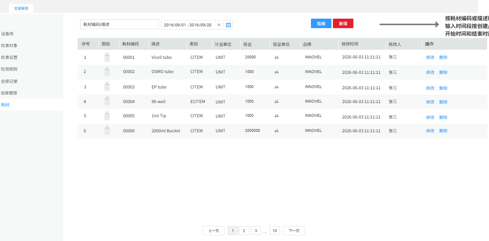

1.  新增

    > **[图 image226.png | 章节：资源管理 / 耗材管理② | 上下文：新增]**
    > **OCR 文本：**
    > 新增
    > 耗材编码* | Please enter... | 描述* | Please enter...
    > 请选择类别 | 计量单位 | Please enter...
    > 容量 | Please enter... | 容量单位 | Please enter..
    > 品牌. | 请选择品牌 | 图标 | +上传图片
    > 保存 | 取消

    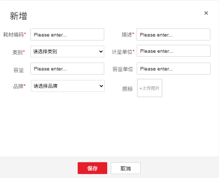

    1.  **耗材编码**：文本框，必填，不能重复
    2.  **描述**：必填，字符串
    3.  **类别**：下拉单选，必选，在数据字典里维护
    4.  **计量单位**：必填，字符串
    5.  **容量**：选填，0或正整数
    6.  **容量单位**：必填写，字符串
    7.  **品牌**：必选，下拉选择，数据来自数据字典
    8.  **图标**：选传（原本系统是必传，但是列表里包含没有图标的数据，这个地方如果使用了配置文件的话，则直接在添加的时候显示图片），无图显示缺省图
    9.  **保存**：保存前完成的校验包括必填字段非空、指定字段唯一性
2.  查询条件

    以下条件联合查询：

    1.  **耗材编码/描述**：支持耗材编码/描述的模糊搜索
    2.  起止时间
3.  结果展示与操作

    查询结果翻页展示，按创建时间倒排，最新的在最上面，包含以下字段：

    1.  序号
    2.  图标
    3.  耗材编码
    4.  描述
    5.  类别
    6.  计量单位
    7.  容量
    8.  容量单位
    9.  品牌
    10. 修改人
    11. 修改时间
    12. 操作
        1.  **修改**：保持新增时的校验操作

            > **[图 image227.png | 章节：资源管理 / 耗材管理② | 上下文：修改：保持新增时的校验操作]**
            > **OCR 文本：**
            > 修改
            > 耗材编码* | Please enter... | 描述* | Please enter...
            > 类别* | 请选择类别 | 计量单位* | Please enter...
            > 容量 | Please enter... | 容量单位 | Please enter..
            > 品牌 | 请选择品牌 | 图标 | +上传图片
            > 保存 | 取消

            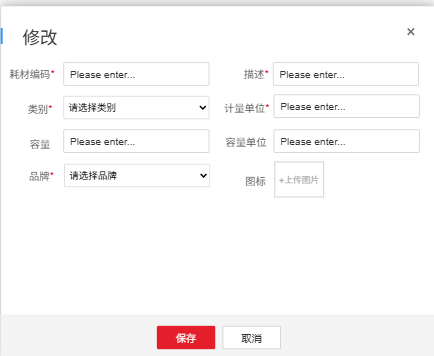

        2.  删除
            1.  删除前需要二次确认

                > **[图 image214.png | 章节：资源管理 / 耗材管理② | 上下文：删除前需要二次确认]**
                > **OCR 文本：**
                > 确定要删除吗
                > 除后数据不可恢复
                > 取消 | 确定

                

            2.  点击确认，删除成功并提示信息

                > **[图 image215.png | 章节：资源管理 / 耗材管理② | 上下文：点击确认，删除成功并提示信息]**
                > **OCR 文本：**
                > 操作成功！
                > 数据已利除
                > 关闭

                

                ---

### ✂️ 已剔除的删除线内容

> 以下内容在源 Word 中带有删除线（`<w:strike>`），根据约定不进入正文，统一汇总在此，避免遗漏核验。

- 段落：通讯方式：必选，支持多选，来自数据字典，后续设备添加到实验室的时候，只能在这里指定的类型中选择一种方式
