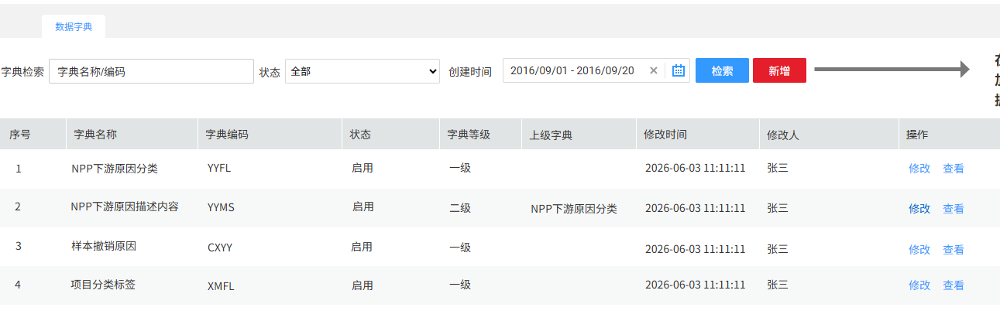
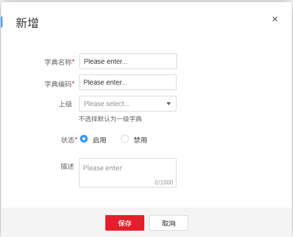
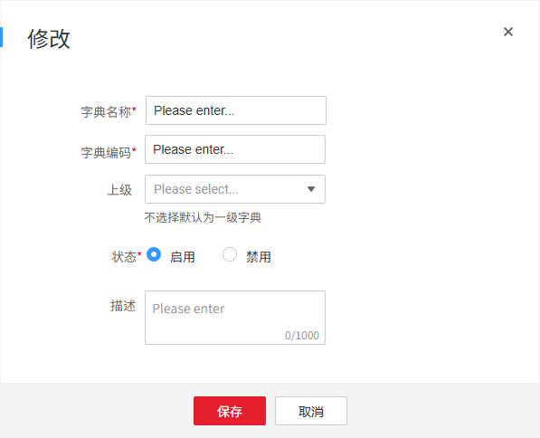
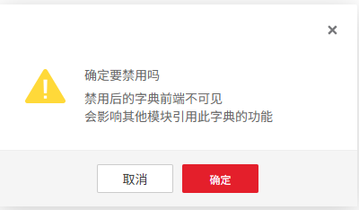
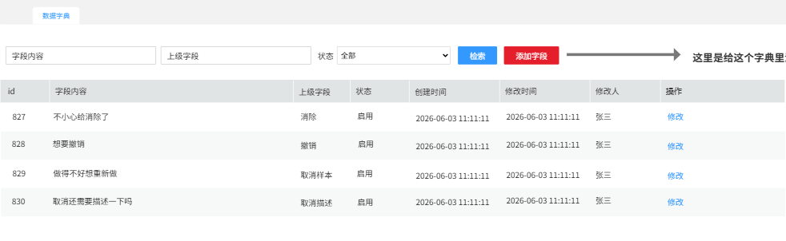
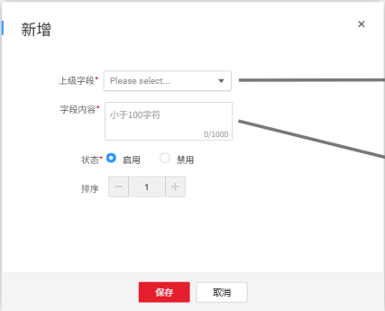
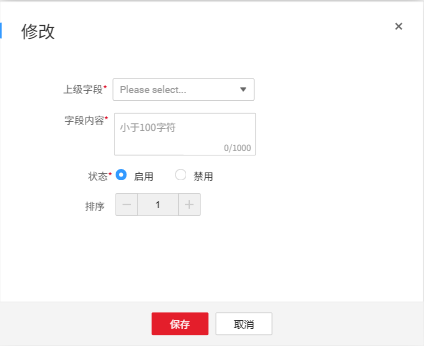
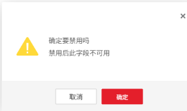

# 系统设置

## 数据字典

数据字典管理整合小试、中试中各种原因、描述、项目标签等字典信息

> **[图 image288.png | 章节：数据字典 | 上下文：数据字典管理整合小试、中试中各种原因、描述、项目标签等字典信息]**
> **OCR 文本：**
> 数据字典
> 字典检索 | 字典名称/编码 | 状态 | 全部 | 创建时间 | 2016/09/01 -2016/09/20 | 检索 | 新增
> 序号 | 字典名称 | 字典编码 | 状态 | 字典等级 | 上级字典 | 修改时间 | 修改人 | 操作
> NPP下游原因分类 | YYFL | 启用 | 一级 | 2026-06-03 11:11:11 | 张三 | 修改 | 查看
> NPP下游原因描述内容 | YYMS | 启用 | 二级 | NPP下游原因分类 | 2026-06-03 11:11:11 | 张三 | 修改 | 查看
> 样本撤销原因 | CXYY | 启用 | 一级 | 2026-06-03 11:11:11 | 张三 | 修改 | 查看
> 项目分类标签 | XMFL | 启用 | 一级 | 2026-06-0311:11:11 | 张三 | 修改 | 查看

### 维护字典信息①

此处仅维护一级/二级字典信息，字典内具体数据项在新增后点击查看按钮进行增删改查。

1.  新增

    新增一个字典信息，字典内具体数据项在新增后点击查看按钮进行增删改查。

    > **[图 image289.png | 章节：数据字典 / 维护字典信息① | 上下文：新增一个字典信息，字典内具体数据项在新增后点击查看按钮进行增删改查。]**
    > **OCR 文本：**
    > 字典名称* | Please enter...
    > 字典编码* | Please enter...
    > 上级 | Please select...
    > 不选择默认为一级字典
    > 状态* | 启用 | 禁用
    > 描述 | Please enter
    > 0/1000
    > 保存 | 取消

    

    1.  **字典名称**：文本框，长度最多20个汉字，不允许重复
    2.  **字典编码**：这个看技术觉得是用系统生成的id方便还是自己编码方便，不允许重复
    3.  **上级**：如果是二级字典关联上级字典id，不选则为一级
    4.  **状态**：启用/禁用，单选，默认启用
    5.  **描述**：非必填，支持100个汉字的描述
    6.  **保存**：保存前完成的校验包括必填字段非空、字段长度、指定字段唯一性
2.  查询条件

    以下条件联合查询：

3.  **字典名称/编码**：支持字典名称/编码共同模糊搜索
4.  **状态**：下拉单选，全部/启用/禁用
5.  **起止时间**：支持按照创建和修改时间检索
6.  结果展示与操作

    查询结果翻页展示，按修改时间倒排，最新的在最上面，包含以下字段：

7.  序号
8.  字典名称
9.  字典编码
10. 状态
11. 字典等级
12. 上级字典
13. 修改人
14. 修改时间
15. 操作
16. 修改：

    > **[图 image290.png | 章节：数据字典 / 维护字典信息① | 上下文：修改：]**
    > **OCR 文本：**
    > 修改
    > 字典名称* | Please enter...
    > 字典编码* | Please enter...
    > 上级 | Please select...
    > 不选择默认为一级字典
    > 状态* | 启用 | 禁用
    > 描述 | Please enter
    > 0/1000
    > 保存 | 取消

    

    1.  将状态从启用修改为禁用时，需二次提示信息

        > **[图 image291.png | 章节：数据字典 / 维护字典信息① | 上下文：将状态从启用修改为禁用时，需二次提示信息]**
        > **OCR 文本：**
        > 确定要禁用吗
        > 禁用后的字典前端不可见
        > 会影响其他模块引用此学典的功能
        > 取消 | 确定

        

    2.  成功将状态修改为禁用

        > **[图 image292.png | 章节：数据字典 / 维护字典信息① | 上下文：成功将状态修改为禁用]**
        > **OCR 文本：**
        > 操作成功！
        > 字典已禁用
        > 关闭

        

17. **查看**：见后一节添加字典数据项

### 添加字典数据项①

维护字典内各数据项的相关信息

> **[图 image293.png | 章节：数据字典 / 添加字典数据项① | 上下文：维护字典内各数据项的相关信息]**
> **OCR 文本：**
> 数据宇典
> 字段内容 | 上级字段 | 状态 | 全部 | 检索 | 添加字段 | 这里是给这个字典里
> id | 字段内容 | 上级字段 | 状态 | 创建时间 | 修改时间 | 修改人 | 操作
> 827 | 不小心给消除了 | 消除 | 启用 | 2026-06-03 11:11:11 | 2026-06-03 11:11:11 | 修改
> 828 | 想要撤销 | 撤销 | 启用 | 2026-06-03 11:11:11 | 2026-06-03 11:11:11 | 修改
> 829 | 做得不好想重新做 | 取消样本 | 启用 | 2026-06-03 11:11:11 | 2026-06-03 11:11:11 | 张三 | 修改
> 830 | 取消还需要描述一下吗 | 取消描述 | 启用 | 2026-06-03 11:11:11 | 2026-06-03 11:11:11 | 修改

1.  添加字段

    给对应字典添加字段

    > **[图 image294.png | 章节：数据字典 / 添加字典数据项① | 上下文：给对应字典添加字段]**
    > **OCR 文本：**
    > 新增
    > 上级字段* | Please select...
    > 字段内容* | 小于100字符
    > 0/1000
    > 状态* | 启用 | 禁用
    > 排序
    > 保存 | 取消

    

2.  **上级字段**：下拉单选，仅当当前为二级字典时，必须下拉选择上级字段，否则不展示该选项框
3.  **字段内容**：必填，前端控制最大100个字符
4.  **状态**：默认为启用
5.  **排序**：默认数字1，在前端展示时，数字越小越靠前，排序数字一样，按照添加时间，最早越靠前。
6.  **保存**：保存前完成的校验包括必填字段非空、字段长度、指定字段唯一性
7.  查询条件

    以下条件联合查询：

8.  **字段内容**：根据字段内容模糊搜索
9.  **上级字段**：根据上级字段模糊搜索
10. **状态**：全部/启用/禁用
11. 结果展示与操作

    查询结果翻页展示，按创建时间倒排，最新的在最上面，包含以下字段：

12. **序号**：行号
13. 字段内容
14. 上级字段
15. 状态
16. 创建时间
17. 修改人
18. 修改时间
19. 操作
20. **修改**：与新增一致

    > **[图 image295.png | 章节：数据字典 / 添加字典数据项① | 上下文：修改：与新增一致]**
    > **OCR 文本：**
    > 修改
    > 上级字段* | Please select...
    > 字段内容* | 小于100字符
    > 0/1000
    > 状态* | 启用 | 禁用
    > 排序
    > 保存 | 取消

    

    1.  将状态从启用修改为禁用时，需二次提示信息

        > **[图 image296.png | 章节：数据字典 / 添加字典数据项① | 上下文：将状态从启用修改为禁用时，需二次提示信息]**
        > **OCR 文本：**
        > 确定要禁用吗
        > 禁用后此字段不可用
        > 取消 | 确定

        

    2.  成功将状态修改为禁用

        > **[图 image297.png | 章节：数据字典 / 添加字典数据项① | 上下文：成功将状态修改为禁用]**
        > **OCR 文本：**
        > 操作成功！
        > 字段已禁用
        > 关闭

        
