# 系统设置

## 工艺设置

### 工作流管理②

列举展示当前系统支持的所有工作流节点（所有节点均为后台写死），不支持新增，仅支持当前流程节点的名称、显示图标，页面提示文字等的修改，或者对现有流程进行禁用，禁用后的流程在实验室配置流程时不可用。

> **[图 image298.png | 章节：工艺设置 / 工作流管理② | 上下文：列举展示当前系统支持的所有工作流节点（所有节点均为后台写死），不支持新增，仅支持当前流程节点的名称、显示图标，页面提示文字等的修改，或者对现有流程进行禁用，禁用…]**
> **OCR 文本：**
> 流程名称 | 检索
> 序号 | 级流程名称 | 图标 | 状态 | 流程说明 | 修改时间 | 修改人 | 操作
> Config关联设置 | 启用 | 支持手动自动 | 2026-06-03 11:11:11 | 张三 | 修改 | 禁用
> 灌注培养基 | 启用 | 支持手动自动 | 2026-06-03 11:11:11 | 张三 | 修改 | 禁用
> 开始培养 | 启用 | 2026-06-03 11:11:11 | 张三 | 修改 | 禁用
> 补液 | 启用 | 2026-06-03 11:11:11 | 张三 | 修改 | 禁用
> 自动控制 | 启用 | 2026-06-03 11:11:11 | 张三 | 修改 | 禁用
> 实验室1 | 启用 | 2026-06-03 11:11:11 | 张三 | 修改 | 禁用

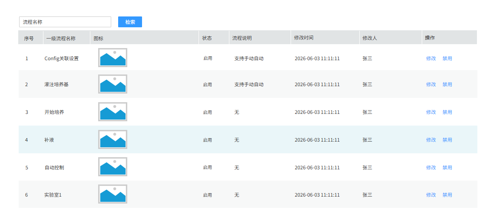

1.  查询条件

    以下条件联合查询

    1.  **流程名称**：文本框，支持模糊搜索
2.  结果展示与操作
    1.  序号
    2.  一级流程名称
    3.  图标
    4.  状态
    5.  流程说明
    6.  修改人
    7.  修改时间
    8.  操作
        1.  **修改**：自动带出对应节点最近一次保存的值。

            > **[图 image299.png | 章节：工艺设置 / 工作流管理② | 上下文：修改：自动带出对应节点最近一次保存的值。]**
            > **OCR 文本：**
            > 修改
            > 流程名称* | 补液
            > 流程说明 | Please enter...
            > 图标*
            > 二级流程
            > 二级名称* | 连接补料单元 | 小试
            > 步骤1 | 开始 | 1.1准备预填充培养基的反应器和全新取样单元1.2选择开 | 示意图
            > 步骤2 | 连接补料单元 | 2.1罐体条码识别，放到台面2.2编辑开始培养信息 | 示意图
            > 步骤3 | 补料管路预填充 | Please enter... | 示意图
            > 步骤4 | 补料管路预填充 | 4.1确认启动启动气体控制器4.2确认启动加热膜4.3确认 | 示意图
            > 二级名称* | 培养中补充补料 (其他) | 小试
            > 步骤1 | 开始 | 1.1准备预填充培养基的反应器和全新取样单元1.2选择开 | 示意图
            > 步骤2 | 连接补料单元 | 2.1罐体条码识别，放到台面2.2编辑开始培养信息 | 示意图
            > 步骤3 | 补料管路预填充 | Please enter... | 示意图
            > 步骤4 | 补料管路预填充 | 4.1确认启动启动气体控制器4.2确认启动加热膜4.3确认 | 示意图
            > 取消 | 确定

            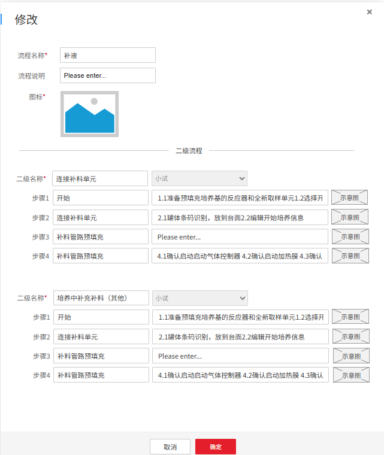

            1.  **流程名称**：文本框，必填
            2.  **流程说明**：文本框，选填
            3.  **图标**：必上传
            4.  二级名称：
                1.  **实验室类型**：展示适用的实验室类型，不支持修改
                2.  **子步骤**：不支持新增，支持修改步骤名称和说明文字
                3.  **示意图**：每个步骤的SOP示意图，支持修改。此处上传的图片会用于工作流中每个步骤的点击弹窗说明。
        2.  **启用/禁用**：修改该节点的状态
            1.  从禁用修改为启用时，直接启用成功，提示启用成功信息即可
            2.  从启用修改为禁用时，需二次确认

                > **[图 image300.png | 章节：工艺设置 / 工作流管理② | 上下文：从启用修改为禁用时，需二次确认]**
                > **OCR 文本：**
                > 确定要禁用吗
                > 禁用之前请确定所有实验室已移除
                > 此流程节点
                > 取消 | 确定

                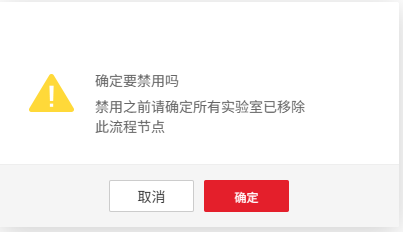

            3.  确认修改为禁用时，存在使用该节点的实验室时，则禁用失败，提示信息

                > **[图 image301.png | 章节：工艺设置 / 工作流管理② | 上下文：确认修改为禁用时，存在使用该节点的实验室时，则禁用失败，提示信息]**
                > **OCR 文本：**
                > 禁用失败！
                > 请先从实验室的流程设置中移除此节点
                > 确认

                

            4.  禁用成功，提示信息

                > **[图 image302.png | 章节：工艺设置 / 工作流管理② | 上下文：禁用成功，提示信息]**
                > **OCR 文本：**
                > 禁用失败！
                > 请先从实验室的流程设置中移除此节点
                > 确认

                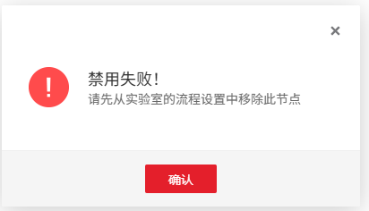

### Config关联设置方案（4.0）

在此模块可新增、维护、查看Config关联设置方案模板。

#### 新增方案模板（4.0）

包含基础信息、MFC、蠕动泵、控制回路、工艺值共计五个tab页，tab页标题使用完成/未填写符号来区分是否已完成填写。

-   所有tab页都必须按要求填写完成才能成功保存方案

##### 基础信息（4.0）

> **[图 image303.png | 章节：工艺设置 / 新增方案模板（4.0） | 上下文：基础信息（4.0）]**
> **OCR 文本：**
> 新增
> 未填写 | 未填可 | 未填写
> 基础信息 | MFC | 糯动泵 | 控制回路 | 工艺值
> 方案名称* | 测试config方案模版
> 控制平台* | DeltaV
> 工艺类型* | 批次培养
> 反应器类型* | 集成反应器
> 反应器型号* | Please select...
> 状态* | 启用 | 禁用
> 保存 | 关闭

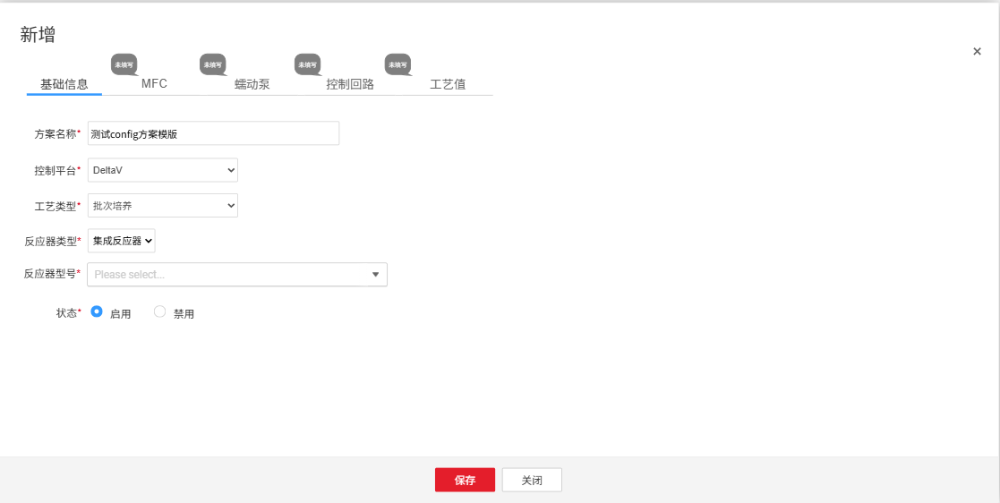

1.  **方案名称**：必填，同类型方案下不能重复，限制在2~50字内
2.  **控制平台**：下拉单选，必选，列表内容目前只有DeltaV，给默认值
3.  **工艺类型**：下拉单选，必选，列表内容目前只有批次培养，给默认值
4.  反应器类型

    下拉单选，必选，列表包含集成反应器和台式反应器

5.  反应器型号：

    下拉，必选，支持多选，根据反应器类型联动获取对应的型号。

    1.  选择台式反应器时在控制器类型里选
    2.  多选的型号必须校验设备的一致性，包含
        1.  泵的数量一致
        2.  MFC的数量一致
        3.  温度控制、重量控制、压力控制可用性一致
6.  **状态**：启用或禁用，二选一，必选，默认启用。

##### MFC设置（4.0）

> **[图 image304.png | 章节：工艺设置 / 新增方案模板（4.0） | 上下文：MFC设置（4.0）]**
> **OCR 文本：**
> 新增
> 完成
> 基础信息 | MFC | 螺动泵 | 控制回路 | 工艺值
> 序号 | MFC编号 | 气体类型 | 量程范围 | 允许通气通路 | 流量设定值 | 初始化OUT | 控制模式
> MFC1 | Air | Please select... | None | MAN
> MFC2 | 02 | Please select... | None | MAN
> MFC3 | Please select.. | None | MAN
> MFC4 | 请选择 | Please select.. | None | MAN
> MFC5 | 请选择 | Please select.. | None | MAN
> MFC6 | 请选择 | Please select.. | None | MAN
> 保存 | 关闭

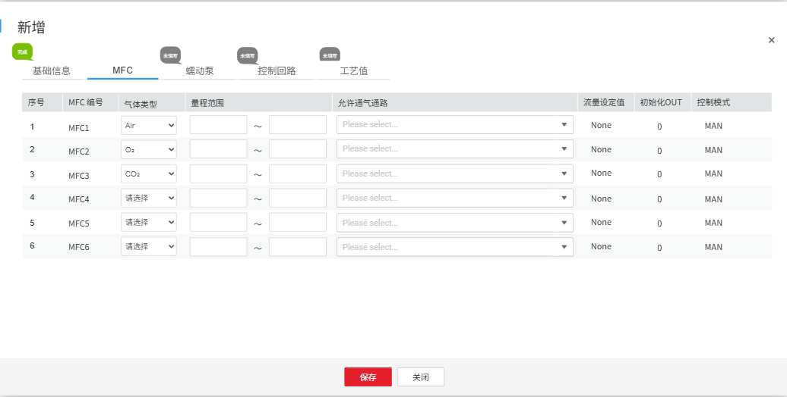

根据当前反应器型号配置的MFC的数量M展示M行，每一行对应一个通道，可以设置以下内容：

1.  **序号**：自增即可
2.  **MFC编号**：MFA通道。编号的方式为MFC+数字自动生成，比如MFC1～MFCM
3.  **气体类型**：下拉单选，列表包含Air、O2、CO2  三种
4.  **量程范围**：两个文本框，填写范围。不同型号的设备MFC量程范围是否都一样？
5.  **通气通路**：下拉单选，列表包含HeadSpace、Spanger1、 Spanger2三种
6.  **流量设定值**：固定值为None，不可修改，需要保存，后续发送指令需要一起。
7.  **初始化OUT**：固定值为0，不可修改，需要保存，后续发送指令需要一起。
8.  **控制模式**：固定值为MAN，不可修改，需要保存，后续发送指令需要一起。
9.  **保存**：点击保存按钮需完成以下校验
    1.  所有的MFC通道可以不用全部填写
    2.  至少需要输入两行，其中气体类型包含一个Air，一个O2

##### 蠕动泵（4.0）

> **[图 image305.png | 章节：工艺设置 / 新增方案模板（4.0） | 上下文：蠕动泵（4.0）]**
> **OCR 文本：**
> 新增
> 完威
> 基础信息 | MFC | 蠕动泵 | 控制回路 | 工艺值
> 序号 | 泵编号 | 功能名称 | 额定转速范围 | 转速/流量 | 转向 | 初始化OUT | 关联控制模式 | 控制模式
> PUMP1 | 转速控制 | 流量控制 | 请选择 | Remote setpoint | MAN
> PUMP2 | 转速控制 | 流量控制 | 请选择 | Remote setpoint | MAN
> PUMP3 | 加碱泵 | 转速控制○ | 流量控制 | 正向(CW) | Remote setpoint | MAN
> PUMP4 | 转速控制O | 流量控制 | 请选择 | Remote setpoint | MAN
> PUMP5 | 转速控制○ | 流量控制 | 请选择 | Remote setpoint | MAN
> PUMP6 | 转速控制O | 流量控制 | 请选择 | Remote setpoint | MAN
> 保存 | 关闭

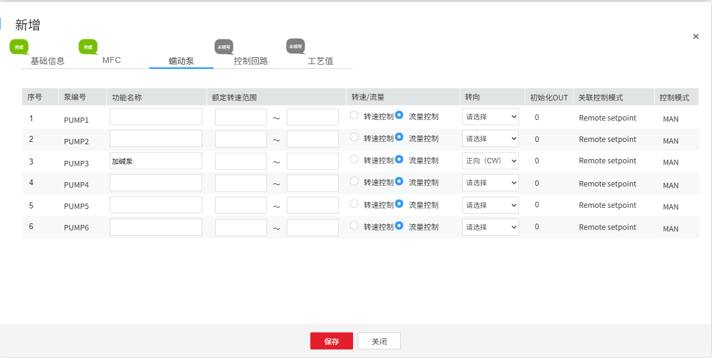

根据当前反应器型号的泵的数量N显示，每一行对应一个泵，可以设置以下内容：

1.  序号
2.  **泵名称**：使用PUMP+数字自动生成，比如PUMP1、PUMP2等等
3.  **功能名称**：文本框，用于标记每个泵的作用，比如说是加碱泵、加酸泵等，
4.  **额定转速范围**：两个文本框，填写范围
5.  **转速/流量**：转速控制或流量控制两种模式，二选一，必选
6.  **转向**：下拉单选，非必选，列表内容包括正向（CW）、反向（CCW）
7.  **初始化OUT**：固定值为0，不可修改，需要保存，后续发送指令需要一起。
8.  **关联控制模式**：固定值为“Remote setpoint”，不可修改，需要保存，后续发送指令需要一起。
9.  **控制模式**：固定值为MAN，不可修改，需要保存，后续发送指令需要一起。
10. **保存**：保存时需要完成以下校验
    1.  可以都不填
    2.  如果某一行有填写，则需要功能名称、额定转速范围和转向都填写完整

##### 控制回路（4.0）

> **[图 image306.png | 章节：工艺设置 / 新增方案模板（4.0） | 上下文：控制回路（4.0）]**
> **OCR 文本：**
> 新增
> 完成
> 基础信息 | MFC | 蠕动泵 | 控制回路 | 工艺值
> 序号 | 回路名称 | 关联 | 控制器输出 | 输出上下限 | 初始化OUT | 控制模式
> MFC1 (Air) | Headspace | Ouput Scale#1 | to | 60 | to | 16
> DO控制回路 | MAN
> MFC2 (O2) | Sparger 1 | Ouput Scale #2 | 60 | to | 100 | to
> MFC3 (CO:) | Headspace | Ouput Scale#1 | to | -100
> pH控制回路 | MAN
> PUMP3 | Ouput Scale #2 | to | 100 | to | 15
> Vessel Temp | MAN
> Jacket Temp | 远程控制 | Vessel Temp Heat Out | MAN
> Agitator | MAN
> Vessel Pressure | MAN
> 关闭

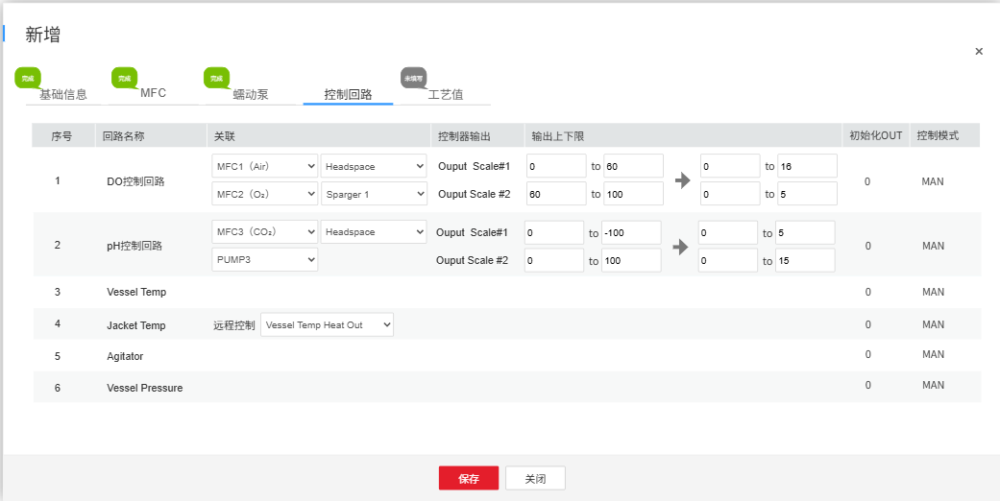

控制回路最全包含DO控制回路、PH控制回路、Vessel Temp、Jacket Temp、Agitator、Vessel Pressure，根据反应器型号不同包含不同回路：

1.  DO控制回路

    所有型号都一定包含。DO控制回路固定仅配置2个输出/2行（output1、output2），每个输出需要配置以下字段

    1.  **关联**：包含两个下拉框
        1.  **气体类型**：下拉单选，列表内容为在MFC页签中气体类型选择为Air和O2的通道。展示时用MFC编号（气体类型）表示，比如MFC1（Air），用于区分选择了同一种气体的不同通道。
        2.  **通气通路**：纯展示，不支持修改。根据选择的气体类型联动带出MFC页签中对应选择的通气通路
            -   **注意**：2个输出不能选择同一种气体类型（即使MFC编号不同也视为同一种气体类型）&同一种通气通路。
    2.  **控制器输出**：Output1 Scale#1或Output1 Scale#2，表示2个输出
    3.  **输出上下限**：左侧为控制回路上下限，右侧为输出上下限制。
        1.  2个输出的左侧范围不能出现交叉区域，允许单点相同，比如0~60，60~100
        2.  右侧范围必须在MFC页签中对应气体的量程范围内/蠕动泵页签中对应泵的额定转速范围
    4.  **初始化OUT**：固定值为0，不可修改，需要保存，后续发送指令需要一起。
    5.  **控制模式**：固定值为MAN，不可修改，需要保存，后续发送指令需要一起。
2.  PH控制回路：

    所有型号都一定包含。PH控制回路固定仅配置2个输出/2行（output1、output2），每个输出需要配置以下字段

    1.  **关联**：包含两个下拉框
        1.  **气体类型**：下拉单选，列表内容为在MFC页签中气体类型选择为CO2和在蠕动泵页签中的功能名称字段有填写的泵。展示时用MFC编号（气体类型）和泵编号（功能名称）表示，比如MFC1（Air）、PUMP1（加碱泵）
        2.  通气通路：
            1.  **气体类型为CO2时**：纯展示，不支持修改。根据选择的气体类型联动，带出MFC页签中对应选择的通气通路。
            2.  气体类型为加碱泵时，不需要此下拉字段。
            -   **注意**：2个输出不能选择同一种气体类型（即使MFC编号不同也视为同一种气体类型）&同一种通气通路。
    2.  **控制器输出**：Output1 Scale#1或Output1 Scale#2，表示2个输出
    3.  **输出上下限**：左侧为控制回路上下限，右侧为输出上下限制。
        1.  2个输出的左侧范围不能出现交叉区域，允许单点相同，比如0~60，60~100
        2.  右侧范围必须在MFC页签中对应气体的量程范围内/蠕动泵页签中对应泵的额定转速范围
    4.  **初始化OUT**：固定值为0，不可修改，需要保存，后续发送指令需要一起。
    5.  **控制模式**：固定值为MAN，不可修改，需要保存，后续发送指令需要一起。
3.  Vessel Temp：所有型号都一定包含。固定1行，包含以下两个固定写死字段：
    1.  **初始化OUT**：固定值为0，不可修改，需要保存，后续发送指令需要一起。
    2.  **控制模式**：固定值为MAN，不可修改，需要保存，后续发送指令需要一起。
4.  Jacket Temp：当前设备型号有温度控制功能时才有此控制回路。固定1行，包含以下字段：
    1.  **远程控制**：下拉单选，必选，目前只有Vessel Temp Heat Out这一个选项，默认选中。
    2.  **初始化OUT**：固定值为0，不可修改，需要保存，后续发送指令需要一起。
    3.  **控制模式**：固定值为MAN，不可修改，需要保存，后续发送指令需要一起。
5.  **Agitator**：所有型号都一定包含。固定1行，包含以下字段：
    1.  **初始化OUT**：固定值为0，不可修改，需要保存，后续发送指令需要一起。
    2.  **控制模式**：固定值为MAN，不可修改，需要保存，后续发送指令需要一起。
6.  Vessel Pressure当前设备型号有压力控制功能时才有此控制回路。固定1行，包含以下字段：
    1.  **初始化OUT**：固定值为0，不可修改，需要保存，后续发送指令需要一起。
    2.  **控制模式**：固定值为MAN，不可修改，需要保存，后续发送指令需要一起。
7.  PID设置

    点击按钮可弹窗进行PID设置

    > **[图 image307.png | 章节：工艺设置 / 新增方案模板（4.0） | 上下文：点击按钮可弹窗进行PID设置]**
    > **OCR 文本：**
    > PID设置
    > DO Control* | Gain | Reset | Rate
    > pH Control* | Gain | Reset | Rate
    > Vessel Temp Control* | Gain | Reset | Rate
    > Jacket Temp Control | Gain | Reset | Rate
    > Vessel Pressure | Gain | Reset | Rate
    > 保存 | 取消

    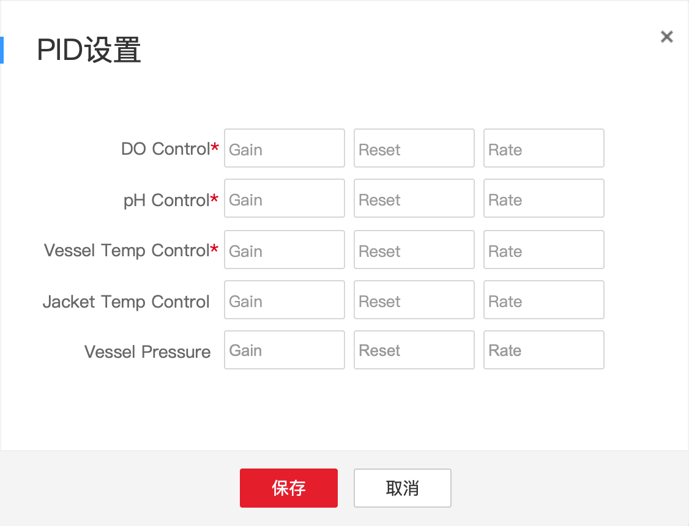

    1.  弹窗中的内容从反应器（中试从实验室设置-设备设置-集成反应器获取；小试为控制器数据库表中维护）设置信息里自动带出
        1.  反应器设置中未配置时，此处必须重新填写
        2.  若选择了多个反应器型号，各反应器的PID设置不一致，此处也需要重新填写
        3.  保存时校验操作与章节实验室设置-设备设置-集成反应器中设置保持一致。
        4.  注意，此处的设置信息仅保存至此方案，内容不回写设备的PID参数
    2.  弹窗包含以下内容：
        1.  DO Control：三个文本框均必填
        2.  pH Control：三个文本框均必填
        3.  Vessel Temp Control：三个文本框均必填
        4.  Jacket Temp Control：此行可以不填，如果填写则一行三个文本框必须都填写
        5.  Vessel Pressure：此行可以不填，如果填写则一行三个文本框必须都填写

##### 工艺值（4.0）

> **[图 image308.png | 章节：工艺设置 / 新增方案模板（4.0） | 上下文：工艺值（4.0）]**
> **OCR 文本：**
> 新增
> 基础信息 | MFC | 动泵 | 控制回路 | 工艺值
> 丨充气工序
> 初始压力设置* | mbar | 充气目标* | 35 | mbar
> 粗充流量* | 精充流量*
> MFC1 Air Headspace | 30 | S增加1至 | 100 | LPM控制模式AUTO | MFC1 Air Headspace | LPM
> MFC1 Air Spargerl | 每  | 30 | S增加1至 | 50 | LPM 控制模式 AUTO | MFC1 Air Spargerl | LPM
> MFC1 Air Sparger2 | S增加1至 | LPM | MFC1 Air Sparger2 | 0.5 | LPM控制模式AUTO
> 保压工序
> 稳定时长* | min | 保压时长* | min | 降压合格阅值*
> 1换气工序 | 口跳过
> 换气倍数*
> 换气流量* | MFC1 Air Headspace | 30 | S增加1至 | 100 | LPM | 控制模式 AUTO
> MFC1 Air Spargerl | 30 | S增加1至 | 50 | LPM | 控制模式 AUTO
> MFC1 Air Sparger2 | S增加1至 | LPM
> 保存 | 关闭

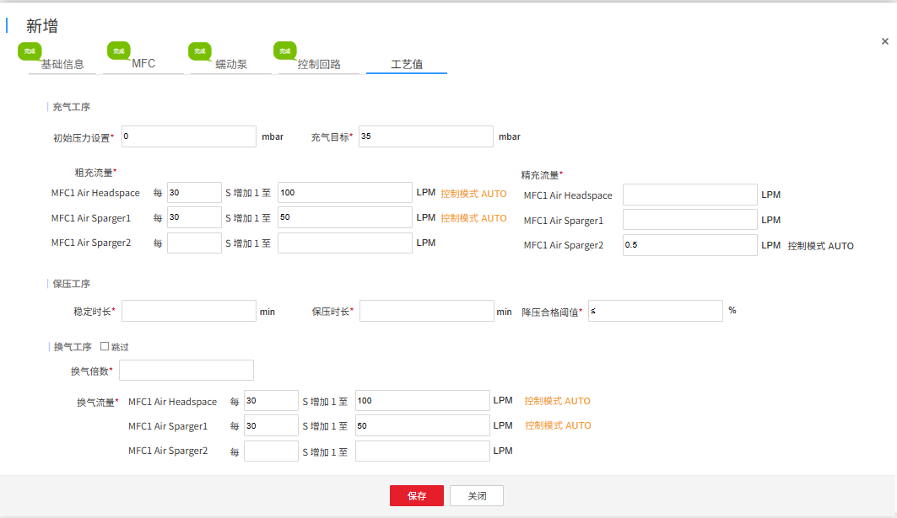

1.  充气工序

    集成反应器且有压力控制功能的反应器型号才有充气工序，需要设置以下内容：

    1.  **初始压力设置**：文本框，必填，默认值0，0 ~ 50 mbar，正整数
    2.  **充气目标**：必填，10 ~ 100 mbar，正整数
    3.  **粗充流量**：对MFC页签中气体类型为Air的所有通道进行设置，每个通道一行，至少填写一行，每行需填写以下内容：
        1.  **时间文本框**：单位S，时间文本框和流量文本框必须都填写或都不填写，正整数，限制大于0且小于60
        2.  **流量文本框**：单位LPM，时间文本框和流量文本框必须都填写或都不填写，范围限制为0.5 ~ 100，支持小点后1位
        3.  **控制模式AUTO**：纯文字提示，当该行填写了时间和流量时会出现此文字提示，后续在工作流中使用此模板实际操作时，需将控制模式自动修改为AUTO；未填写则依然是MAN
    4.  **精充流量**：对MFC页签中气体类型为Air的所有通道进行设置，每个通道一行，至少需要填写一行，一行中需填写以下内容：
        1.  **流量文本框**：文本框，单位LPM，范围限制为0.1 ~ 20，数值必须小于粗充流速
            -   粗充流速=粗充流量/粗充时间
        2.  **控制模式AUTO**：纯文字提示，当该行填写了流量时会出现此文字提示，后续在工作流中使用此模板实际操作时，需将控制模式自动修改为AUTO，未填写则依然是MAN
2.  保压工序：

    集成反应器且有压力控制功能的反应器型号才有保压工序，需要设置以下内容：

    1.  **稳定时长**：单位分钟，必填，填写正整数，范围1 ~ 100
    2.  **保压时长**：单位分钟，必填，填写正整数，范围10~300
    3.  降压合格阈值：
        1.  **判断符号**：默认使用小于等于
        2.  **阈值数值**：文本框，必填，单位%
3.  换气工序

    所有型号都有换气工序，可跳过不设置，需要设置以下内容：

    1.  **跳过勾选框**：可勾选，默认不勾选。勾选表示不进行换气工序，不需要填写相关设置信息
    2.  未勾选跳过时，必须配置以下信息：
        1.  **换气倍数**：必填，支持小数点后1位，范围2.0 ~ 20.0
        2.  **换气流量**：对MFC页签中气体类型为Air的所有通道进行设置，每个通道一行，至少填写一行，每行需填写以下内容：
            1.  **时间文本框**：单位S，时间文本框和流量文本框必须都填写或都不填写，正整数，限制大于0且小于60
            2.  **流量文本框**：单位LPM，时间文本框和流量文本框必须都填写或都不填写，范围限制为0.5 ~ 100，支持小点后1位
            3.  **控制模式AUTO**：纯文字提示，当该行填写了时间和流量时会出现此文字提示，后续在工作流中使用此模板实际操作时，需将控制模式自动修改为AUTO，未填写则依然是MAN

#### 模板查询与展示（4.0）

> **[图 image309.png | 章节：工艺设置 / 模板查询与展示（4.0） | 上下文：模板查询与展示（4.0）]**
> **OCR 文本：**
> 药明生物SMP系统 | 首页 | A实验室工作台 | B实验室工作台 | 数据管理 | 系统设置-
> 工艺设置
> 工作流管理 | 实验室类型 | 中试 | 控制平台 | 请选择 | 方案名称 | 2016/09/01 -2016/09/20 | 新增
> config方案 | 序号 | 方案名称 | 控制平台 | 实验室类型 | 工艺类型 | 状态 | 创建时间 | 创建人 | 修改时间 | 修改人 | 操作
> 培养基方案 | 50L SUB标准Fed-batch模 | DeltaV | 中试 | 批次培养 | 启用 | 2026-06-03 11:11:11 | 张三 | 2026-06-03 11:11:11 | 张三 | 修改 | 禁用
> 取样方案
> 20L反应器通用 | Deltav | 批次培养 | 启用 | 2026-06-03 11:11:11 | 张三 | 2026-06-03 11:11:11 | 张三 | 修改 | 禁用
> 测样方案
> 泵速策略 | 50L罐子适用2.0版本 | DeltaV | 中试 | 批次培养 | 启用 | 2026-06-03 11:11:11 | 张三 | 2026-06-03 11:11:11 | 张三 | 修改 | 禁用 | 删除
> 补液方案 | 15L通用 | DeltaV | 中试 | 批次培养 | 禁用 | 2026-06-03 11:11:11 | 张三 | 2026-06-03 11:11:11 | 张三 | 修改 | 启用
> 自动控制方案 | 测试方案1 | DeltaV | 小试 | 批次培养 | 禁用 | 2026-06-03 11:11:11 | 张三 | 2026-06-03 11:11:11 | 张三 | 修改 | 启用
> 澄清方案
> 测试方案2 | Deltav | 小试 | 批次培养 | 禁用 | 2026-06-03 11:11:11 | 张三 | 2026-06-03 11:11:11 | 张三 | 修改 | 启用 | 删除
> 结束策略
> 下游检测规则
> 上一页 | 10 | 下一页

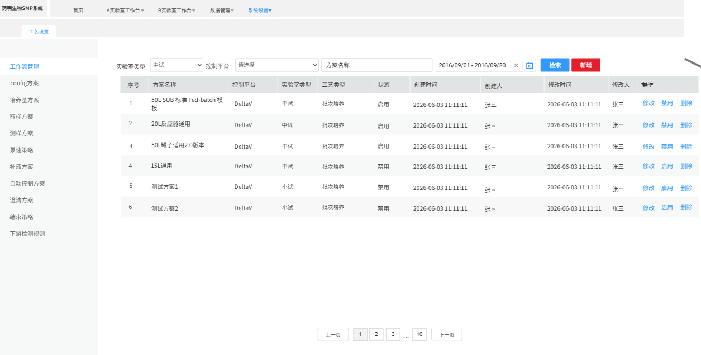

1.  查询条件
    1.  **反应器类型**：下拉单选
    2.  **控制平台**：下拉单选，默认值DeltaV
    3.  **方案名称**：文本框，支持模糊搜索
    4.  **起止时间**：根据创建时间和修改时间均可搜索
2.  结果展示与操作

    查询结果翻页展示，按创建时间倒排，最新的在最上面，包含以下字段：

    1.  序号
    2.  方案名称
    3.  控制平台
    4.  反应器类型
    5.  工艺类型
    6.  状态
    7.  创建时间
    8.  创建人
    9.  修改时间
    10. 修改人
    11. 操作：
        1.  **修改**：与新增时候保持一致的校验
        2.  复制新增

            > **[图 image310.png | 章节：工艺设置 / 模板查询与展示（4.0） | 上下文：复制新增]**
            > **OCR 文本：**
            > 复制新增
            > 未填写 | 未填写
            > 基础信息 | MFC | 蠕动泵 | 控制回路 | 工艺值
            > 方案名称*
            > 控制平台* | DeltaV
            > 工艺类型* | 批次培养
            > 反应器类型* | 集成反应器
            > 反应器型号* | Please select..
            > 状态* | 启用 | 禁用
            > 保存 | 关闭

            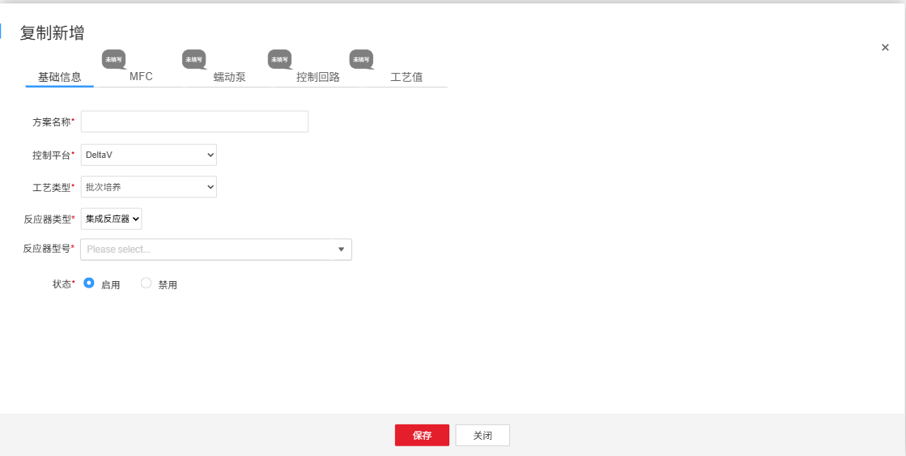

            1.  点击复制新增，弹窗新增一个模板，方案名称为空，必须输入，且不能重复
            2.  弹窗内所有Tab页的内容与原方案完全一致
            3.  所有内容校验与新增保持一致
        3.  禁用/启用：
            1.  从禁用切换为启用时，点击直接切换成功
            2.  从启用切换为禁用时，需点击二次确认，二次确认后切换禁用成功。注意，禁用后只影响后续模板的选择使用即不能选择此模板，不影响历史已使用该模板创建的培养。

                > **[图 image311.png | 章节：工艺设置 / 模板查询与展示（4.0） | 上下文：从启用切换为禁用时，需点击二次确认，二次确认后切换禁用成功。注意，禁用后只影响后续模板的选择使用即不能选择此模板，不影响历史已使用该模板创建的培养。]**
                > **OCR 文本：**
                > 确定要禁用吗
                > 禁用工艺方案中不可在使用，不影响
                > 之前使用此工艺的培养
                > 取消 | 确定
                > 进行一次提示，但不影响禁用操作，禁用
                > 后，不要影响历史数据，历史数据中还可以
                > 展示但是新数据不再可选择此方案
                > 操作成功！
                > 禁用成功
                > 关闭

                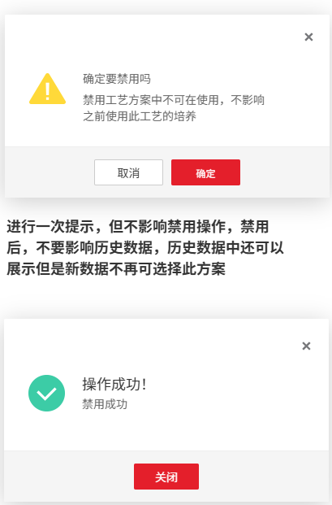

                > **[图 image311.png | 章节：工艺设置 / 模板查询与展示（4.0） | 上下文：从启用切换为禁用时，需点击二次确认，二次确认后切换禁用成功。注意，禁用后只影响后续模板的选择使用即不能选择此模板，不影响历史已使用该模板创建的培养。]**
                > **OCR 文本：**
                > 确定要禁用吗
                > 禁用工艺方案中不可在使用，不影响
                > 之前使用此工艺的培养
                > 取消 | 确定
                > 进行一次提示，但不影响禁用操作，禁用
                > 后，不要影响历史数据，历史数据中还可以
                > 展示但是新数据不再可选择此方案
                > 操作成功！
                > 禁用成功
                > 关闭

                

        4.  删除
            1.  需要二次弹窗确认是否删除，再次点击确认，删除成功

                > **[图 image312.png | 章节：工艺设置 / 模板查询与展示（4.0） | 上下文：需要二次弹窗确认是否删除，再次点击确认，删除成功]**
                > **OCR 文本：**
                > 确定要删除吗
                > 删除工艺方案中不可在使用，不影响
                > 之前使用此工艺的培养
                > 取消 | 确定

                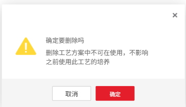

            2.  删除成功后不影响历史已使用该模板创建的培养，但后续培养无法选择此方案
            3.  需提示成功信息

                > **[图 image313.png | 章节：工艺设置 / 模板查询与展示（4.0） | 上下文：需提示成功信息]**
                > **OCR 文本：**
                > 操作成功！
                > 删除成功
                > 关闭

                

### 灌注培养基方案模板（4.0）

#### 新增方案模板（4.0）

灌注培养基方案主要包含基本信息和工艺参数两个部分。

> **[图 image314.png | 章节：工艺设置 / 新增方案模板（4.0） | 上下文：灌注培养基方案主要包含基本信息和工艺参数两个部分。]**
> **OCR 文本：**
> 新增
> 基本信息 | 工艺参数
> 方案名称* | 目标8.5-9.0kg方案模版 | 序号 | MFC编号 | 控制模式 | 序号 | 泵编号 | 控制模式
> 反应器类型* | 集成反应器 | MFC1 | Air | Please select. | CAS | PUMP1 | CAS
> MFC2 | 20 | Please select | MAN | PUMP2 | AUTO
> 反应器型号 | Please select..
> MFC3 | CO2 | Please select. | CAS | PUMP3 | AUTO
> 培养基类型* | 请选择培养基类型
> MFC4 | 请选择 | Please select | MAN | PUMP4 | MAN
> 达阅重量* | 8.0 | kg
> MFC5 | 请选择 | Please select. | MAN | PUMP5 | MAN
> 目标重量* | 8.0 | kg
> MFC6 | 请选择 | Please select. | AUTO | PUMP6 | MAN
> 目标转速* | 120 | rmp
> 序号 | 控制回路 | 控制模式 | 关联 | 输出上下限
> 目标温度* | 37
> MFC1 (Air) | Headspace  Ouput Scale#1 0 | to | 60 | to | 16
> PH目标值* | 死区（Deadhead)+ | DO控制回路 | AUTO
> MFC1 (Air) | Sparger 2 | vOuput Scale #2 | 60 | to | 100 | to
> DO目标值*
> 检测校准 | 已设置 | pH控制回路 | AUTO | MFC3 (CO2  | Headspace  Ouput Scale#1 0 | to | -100 | to
> PUMP3 | Ouput Scale #2 0 | to | 100 | to | 15
> 状态* | 启用 | 禁用
> PID设置
> 保存 | 关闭

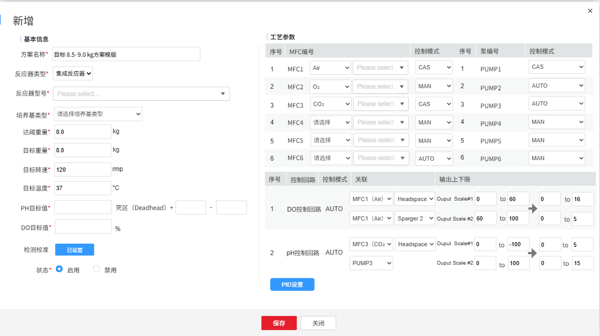

1.  基本信息
    1.  **方案名称**：必填，同类型方案下不能重复，限制在2~50字内
    2.  **反应器类型**：下拉单选，必选，列表包含集成反应器和台式反应器
    3.  **反应器型号**：下拉，必选，支持多选，根据反应器类型联动获取对应的型号。
        1.  选择台式反应器时在控制器类型里选
        2.  多选的型号必须校验设备的一致性，包含
            1.  规格一致
            2.  泵的数量一致
            3.  MFC的数量一致
            4.  温度控制、重量控制、压力控制可用性一致
    4.  **培养基类型**：下拉单选，必选，列表内容来源于数据字典（中试叫初始培养基/小试叫基础培养基，统一下字段名？）
    5.  **达阈重量**：文本框，必填，限制填入数值，限制1位小数，单位根据反应器的规格变化，规格小于15L时单位为g，规格大于等于15L时单位为kg
    6.  **目标重量**：文本框，必填，限制填入数值，限制1位小数，单位根据反应器的规格变化，规格小于15L时单位为g，规格大于等于15L时单位为kg。目标重量必须大于等于达阈重量
    7.  **目标转速**：文本框，必填，限制填入正数，单位rmp
    8.  **目标温度**：文本框，必填，限制填入数值，限制1位小数，单位℃
    9.  **PH目标值**：文本框，必填，限制填入小于20的数值，限制2位小数
    10. **死区（Deadhead）**：支持输入+与-两个数值，限制填入小于10的数值，限制2位小数，无单位
    11. **DO目标值**：文本框，必填，限制填入小于100的数值，限制2位小数，单位%
    12. **检测校准**：点击设置按钮进行检测设置，必须设置；设置后按钮文字变为已设置，设置内容包含以下：

        > **[图 image315.png | 章节：工艺设置 / 新增方案模板（4.0） | 上下文：检测校准：点击设置按钮进行检测设置，必须设置；设置后按钮文字变为已设置，设置内容包含以下：]**
        > **OCR 文本：**
        > 检测校准
        > |标准及要求 | 检测内容
        > 从模版选择 | 中试灌注培养基检测模版
        > 首次检测触发条件* | 温度 | 30
        > 检测内容"
        > 第二次检测，首次在PH校准后等待 | 3.5 | h且温度稳在目标*土 | 0.5 | “C时执行 | 图BGA | 样品量" | 600μL | 检测温度 | DefaultValue | 稳定范国土 | DefaultValue
        > PH校准方式" | ①自动手动
        > 图 ViCell | 样品量* | 800μL | 稀释倍数" | 检测量" | 600μL
        > PH异常通知" | APH | 不校准发送异常通知
        > OSMO | 样品量*
        > DO调整方式" | ①自动○手动
        > 团DO校准要求 | 110 | pO: | 160 | Cedex | 样品量 | 检测项
        > 口DO校准要求 | mmHg | pCO2 | mmHg | 检测方式 | 手动 | 自动
        > 保存 | 关闭

        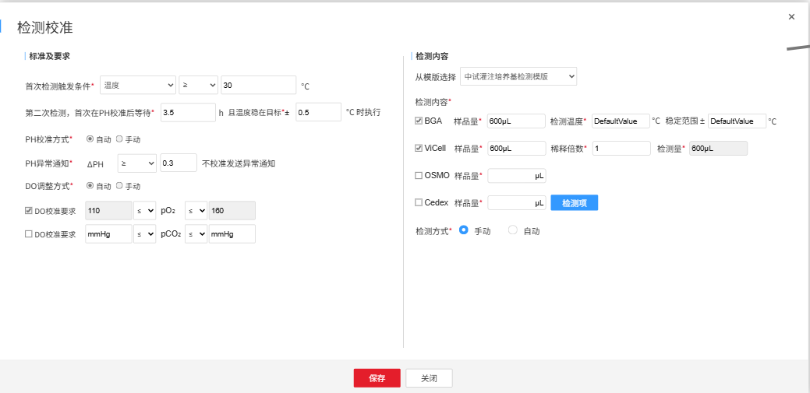

        1.  标准及要求
            1.  首次检测触发条件：
                1.  **触发方式**：下拉单选，必选，列表包含温度、重量
                2.  **触发逻辑**：下拉单选，必选，列表包含≥、＞、≤、＜
                3.  **触发目标温度**：文本框，必填，限制填入大于0且小于100的数值，限制2位小数，单位是℃
            2.  第二次检测触发条件：
                1.  **首次PH校准后等待时间**：文本框，必填，限制填入正数，单位是小时，支持小数点后1位，数值限制范围为大于等于0小于等于24
                2.  **温度**：文本框，必填，限制填入正数，单位是℃
            3.  **PH校准方式**：共有自动和手动两种方式，必须二选一
                1.  **自动**：条件满足后系统自动生成PH校准任务。注意，生成任务的同时是否需要发送通知在告警设置中配置
                2.  **手动**：生成告警，通过站内信、短信能方式通知用户来操作
            4.  **PH异常通知**：PH偏差（计算方式：线上检测和线下检测结果的PH相减再算绝对值）满足此条件时不进行校准操作，需要发送异常通知
                1.  **触发逻辑**：下拉单选，必选，列表包含≥、＞、≤、＜
                2.  **ΔPH触发数值**：文本框，必填，限制填入数值
                3.  **文字提示**：纯文字提示信息“不校准发送异常通知”
            5.  **DO调整方式**：共有自动和手动两种方式，必须二选一
                1.  **自动**：条件满足后系统自动生成DO调整任务。注意，生成任务的同时是否需要发送通知在告警设置中配置
                2.  **手动**：生成告警，通过站内信、短信能方式通知用户来操作
            6.  DO校准要求（pO2）

                必选，不支持取消勾选，相关要求也不支持修改。

                1.  **下限值**：数值固定为110，不支持修改，单位mmHg
                2.  **下限判断逻辑**：固定为≤，不支持修改，
                3.  **上限判断逻辑**：固定为≤，不支持修改，
                4.  **上限值**：数值固定为160，不支持修改，单位mmHg
            7.  DO校准要求（pCO2）

                可选，勾选后，相关要求为必填。

                1.  **下限值**：文本框，当下限判断逻辑选择NA时，置灰不可填写，否则为必填，限制输入正数，支持小数点后1位，下限值必须小于上限值。
                2.  **下限判断逻辑**：下拉单选，列表内容有＜、≤、NA，NA表示不用下限触发规则
                3.  **上限判断逻辑**：下拉单选，列表内容有＜、≤、NA，NA表示不用上限触发规则
                4.  **上限值**：文本框，当下限判断逻辑选择NA时，置灰不可填写，否则为必填，限制输入正数，支持小数点后1位，下限值必须小于上限值。
        2.  检测内容
            1.  **模板选择**：下拉单选，必选。数据来源为已创建的取样测样方案模板，如果当前选择的是集成反应器则筛选出中试实验室的模板；如果当前选择的是台式反应器则筛选出小试实验室的模板。
            2.  检测内容：
                1.  所有字段根据所选模板自动带出
                2.  需手动勾选本次需要检测的类型
                3.  **注意**：使用此模板时，Cedex的检测项-稀释参数需要根据实际设备是否支持稀释对应填写（因为创建模板时，无法确定此模板会被使用在哪种类型的Cedex设备上）
                -   **注意**：检测设置涉及5个不同的通知事件，后续在告警通知单中详细描述
    13. **状态**：启用或禁用，二选一，必选，默认启用。
2.  **工艺参数**：包括MFC参数、泵参数和控制回路参数设置三个部分，所有参数都为非必填。
    1.  **MFC配置**：据设备的型号加载所有MFC，编号从1编号至设备的MFC数量，每个MFC包含以下字段：
        1.  序号
        2.  MFC编号
        3.  **气体类型**：下拉单选，列表包含Air、O2、CO2  三种
        4.  **通气通路**：下拉单选，列表包含HeadSpace、Spanger1、 Spanger2三种
        5.  **MFC控制模式**：下拉单选，列表包含CAS、MAN、AUTO
    2.  **泵配置**：据设备的型号加载所有PUMP，编号从1编号至设备泵的数量，每个泵包含以下字段：
        1.  序号
        2.  泵编号
        3.  **控制模式**：下拉单选，列表包含CAS、MAN、AUTO；默认AUTO
    3.  DO控制回路
        1.  **控制模式**：固定为AUTO
        2.  **关联**：包含两个下拉框
            1.  **气体类型**：下拉单选，列表内容为在MFC配置中气体类型选择为Air和O2的通道。展示时用MFC编号（气体类型）表示，比如MFC1（Air），用于区分选择了同一种气体的不同通道。
            2.  **通气通路**：纯展示，不支持修改。根据选择的气体类型联动带出MFC配置中对应选择的通气通路
                -   **注意**：2个输出不能选择同一种气体类型（即使MFC编号不同也视为同一种气体类型）&同一种通气通路。
        3.  **控制器输出**：Output1 Scale#1或Output1 Scale#2，表示2个输出
        4.  **输出上下限**：左侧为控制回路上下限，右侧为输出上下限制。
            1.  2个输出的左侧范围不能出现交叉区域，允许单点相同，比如0~60，60~100
            2.  右侧范围必须在MFC页签中对应气体的量程范围内/蠕动泵页签中对应泵的额定转速范围
    4.  **PH控制回路**：PH控制回路固定仅配置2个输出/2行（output1、output2），每个输出需要配置以下字段
        1.  **控制模式**：固定为AUTO
        2.  **关联**：包含两个下拉框
            1.  **气体类型**：下拉单选，列表内容为在MFC配置气体类型选择为CO2和在泵配置中出现的所有泵。展示时用MFC编号（气体类型）和泵编号（功能名称）表示，比如MFC1（Air）、PUMP1（加碱泵）
            2.  通气通路：
                1.  **气体类型为CO2时**：纯展示，不支持修改。根据选择的气体类型联动，带出MFC配置中对应选择的通气通路。
                2.  气体类型为加碱泵时，不需要此下拉字段。
                -   **注意**：2个输出不能选择同一种气体类型（即使MFC编号不同也视为同一种气体类型）&同一种通气通路。
        3.  **控制器输出**：Output1 Scale#1或Output1 Scale#2，表示2个输出
        4.  **输出上下限**：左侧为控制回路上下限，右侧为输出上下限制。
            1.  2个输出的左侧范围不能出现交叉区域，允许单点相同，比如0~60，60~100
            2.  右侧范围必须在MFC配置中对应气体的量程范围内/泵配置中对应泵的额定转速范围
    5.  **PID设置**：同Config关联设置方案模板章节的PID设置

        > **[图 image316.png | 章节：工艺设置 / 新增方案模板（4.0） | 上下文：PID设置：同Config关联设置方案模板章节的PID设置]**
        > **OCR 文本：**
        > PID设置
        > DO Control* | Gain | Reset | Rate
        > pH Control* | Gain | Reset | Rate
        > Vessel Temp Control* | Gain | Reset | Rate
        > Jacket Temp Control | Gain | Reset | Rate
        > Vessel Pressure | Gain | Reset | Rate
        > 保存 | 取消

        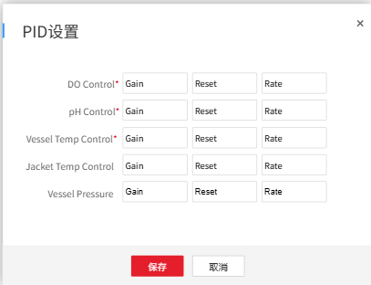

#### 模板查询与展示（4.0）

> **[图 image317.png | 章节：工艺设置 / 模板查询与展示（4.0） | 上下文：模板查询与展示（4.0）]**
> **OCR 文本：**
> 药明生物SMP系统 | 首页 | A实验室工作台 | B实验室工作台 | 数据管理 | 系统设置
> 工艺设置
> 工作流管理 | 反应器类型 | 集成反应器 | 方案名称 | 状态 | 请选择 | 2016/09/01 - 2016/09/20 | 新增
> config方案 | 序号 | 方案名称 | 反应器类型 | 培养基类型 | 反应器型号 | 状态 | 创建时间 | 创建人 | 修改时间 | 修改人 | 操作
> 培养基方案 | X细胞灌注培养基方案 | 集成反应器 | SRT200L, SUB500L | 启用 | 2026-06-03 11:11:11 | 张三 | 2026-06-03 11:11:11 | 张三 | 修改 | 禁用 | 删除
> 取样测样方案
> 小试灌注培养基方案 | 台式反应器 | SRT200L, SUB500L | 启用 | 2026-06-03 11:11:11 | 张三 | 2026-06-03 11:11:11 | 张三 | 修改 | 复制 | 禁用
> 泵速策略
> 补液方案 | 小试X细胞灌注培养基方案 | 台式反应器 | 15L, 20L | 启用 | 2026-06-03 11:11:11 | 张三 | 2026-06-03 11:11:11 | 张三 | 修改 | 复制 | 禁用 | 删除
> 自动控制方案 | 中试灌注培养基方案 | 集成反应器 | 15L, 20L | 禁用 | 2026-06-03 11:11:11 | 张三 | 2026-06-03 11:11:11 | 张三 | 修改 | 复制 | 启用
> 澄清方案 | 中试X细胞灌注培养基方案 | 集成反应器 | SRT200L, SUB500L | 禁用 | 2026-06-03 11:11:11 | 张三 | 2026-06-03 11:11:11 | 张三 | 修改 | 复制 | 启用 | 删除
> 下游检测规则
> 测试灌注培养基方案 | 集成反应器 | SRT200L, SUB500L | 禁用 | 2026-06-03 11:11:11 | 张三 | 2026-06-03 11:11:11 | 张三 | 修改 | 复制 | 启用
> 一页

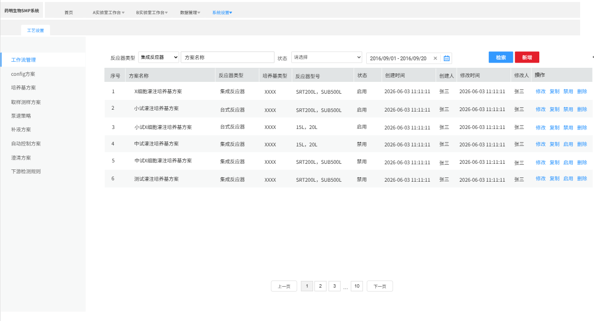

1.  查询条件
    1.  **反应器类型**：下拉单选
    2.  **方案名称**：文本框，支持模糊搜索
    3.  状态
    4.  **起止时间**：根据创建时间和修改时间均可搜索
2.  结果展示与操作

    查询结果翻页展示，按创建时间倒排，最新的在最上面，包含以下字段：

    1.  序号
    2.  方案名称
    3.  反应器类型
    4.  反应器型号
    5.  状态
    6.  创建时间
    7.  创建人
    8.  修改时间
    9.  修改人
    10. 操作
        1.  **修改**：与新增时候保持一致的校验
        2.  复制新增

            > **[图 image318.png | 章节：工艺设置 / 模板查询与展示（4.0） | 上下文：复制新增]**
            > **OCR 文本：**
            > 复制新增
            > 基本信息 | I工艺参数
            > 方案名称* | 日标8.5-9.0kg方案模版 | 序号 | MFC编号 | 控制模式 | 序号 | 泵编号 | 控制模式
            > 反应器类型* | 集成反应器 | MFC1 | Air | Please select | CAS | PUMP1 | CAS
            > MFC2 | Please select | MAN | PUMP2 | AUTO
            > 反应器型号* | Please select..
            > MFC3 | CO2 | Please select | CAS | PUMP3 | AUTO
            > 培养基类型* | 请选择培养基类型
            > MFC4 | 请选择 | Please select | MAN | PUMP4 | MAN
            > 达重量* | 0'8 | kg
            > MFC5 | 请选择 | Please select | MAN | PUMP5 | MAN
            > 目标重量* | 0'8 | kg
            > MFC6 | 请选择 | Please select | AUTO | PUMP6 | MAN
            > 目标转速* | 120 | rmp
            > 序号 | 控制回路 | 控制模式 | 关联 | 输出上下限
            > 目标温度* | 37
            > MFC1 (Air) | Headspace  Ouput Scale#1 0 | to60 | to 16
            > PH目标值* | 死区（Deadhead)+ | DO控制回路AUTO
            > MFC1 (Air) | Sparger 2 | 2Ouput Scale #260 | to100
            > DO目标值*
            > 检测设置 | 已设置 | MFC3(CO2 | Headspace  Ouput Scale#1 0 | to | -100 | to
            > pH控制回路 | AUTO
            > PUMP3 | Ouput Scale #2 0 | to | 100 | to | 15
            > 状态* | 启用 | 禁用
            > PID设置
            > 保存 | 关闭

            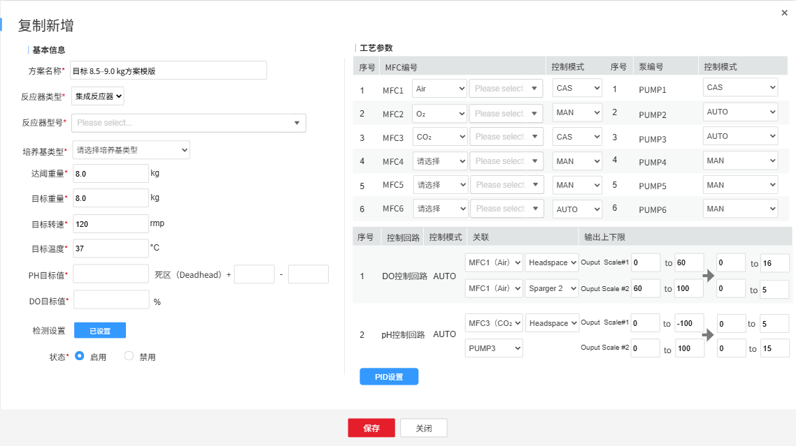

            1.  点击复制新增，弹窗新增一个模板，方案名称为空，必须输入，且不能重复
            2.  弹窗内所有Tab页的内容与原方案完全一致
            3.  所有内容校验与新增保持一致
        3.  禁用/启用：
            1.  从禁用切换为启用时，点击直接切换成功
            2.  从启用切换为禁用时，需点击二次确认，二次确认后切换禁用成功。注意，禁用后只影响后续模板的选择使用即不能选择此模板，不影响历史已使用该模板创建的培养。

                > **[图 image311.png | 章节：工艺设置 / 模板查询与展示（4.0） | 上下文：从启用切换为禁用时，需点击二次确认，二次确认后切换禁用成功。注意，禁用后只影响后续模板的选择使用即不能选择此模板，不影响历史已使用该模板创建的培养。]**
                > **OCR 文本：**
                > 确定要禁用吗
                > 禁用工艺方案中不可在使用，不影响
                > 之前使用此工艺的培养
                > 取消 | 确定
                > 进行一次提示，但不影响禁用操作，禁用
                > 后，不要影响历史数据，历史数据中还可以
                > 展示但是新数据不再可选择此方案
                > 操作成功！
                > 禁用成功
                > 关闭

                

                > **[图 image311.png | 章节：工艺设置 / 模板查询与展示（4.0） | 上下文：从启用切换为禁用时，需点击二次确认，二次确认后切换禁用成功。注意，禁用后只影响后续模板的选择使用即不能选择此模板，不影响历史已使用该模板创建的培养。]**
                > **OCR 文本：**
                > 确定要禁用吗
                > 禁用工艺方案中不可在使用，不影响
                > 之前使用此工艺的培养
                > 取消 | 确定
                > 进行一次提示，但不影响禁用操作，禁用
                > 后，不要影响历史数据，历史数据中还可以
                > 展示但是新数据不再可选择此方案
                > 操作成功！
                > 禁用成功
                > 关闭

                

        4.  删除
            1.  需要二次弹窗确认是否删除，再次点击确认，删除成功

                > **[图 image312.png | 章节：工艺设置 / 模板查询与展示（4.0） | 上下文：需要二次弹窗确认是否删除，再次点击确认，删除成功]**
                > **OCR 文本：**
                > 确定要删除吗
                > 删除工艺方案中不可在使用，不影响
                > 之前使用此工艺的培养
                > 取消 | 确定

                

            2.  删除成功后不影响历史已使用该模板创建的培养，但后续培养无法选择此方案
            3.  需提示成功信息

                > **[图 image313.png | 章节：工艺设置 / 模板查询与展示（4.0） | 上下文：需提示成功信息]**
                > **OCR 文本：**
                > 操作成功！
                > 删除成功
                > 关闭

                

### 取样测样方案模板（4.0）

#### 新增方案模板（4.0）

> **[图 image319.png | 章节：工艺设置 / 新增方案模板（4.0） | 上下文：新增方案模板（4.0）]**
> **OCR 文本：**
> 新增
> 适用实验室* | 实验室A
> 方案名称* | 培养基PH校准后取测
> 检测内容*
> BGA | 样品量* | 120μL | 检测温度* | DefaultValue | 稳定范围土 | DefaultValue
> ViCell | 样品量* | 600μL | 稀释倍数* | 检测量* | 600μL
> oSMO | 样品量* | 200μL
>  Cedex | 样品量* | 350μL | 检测项
> 方式* | 手动 | 自动
> 状态* | 启用 | 禁用
> 保存 | 关闭

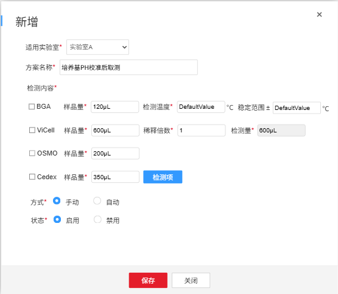

1.  **适用实验室**：下拉单选，必选，列表为所有已创建的实验室
2.  **方案名称**：必填，同类型方案下不能重复，限制在2~50字内
3.  检测内容

    设置当前实验室拥有的检测类型的参数。目前共有以下四种，根据实验室联动展示设置：

    1.  BGA
        1.  **勾选框**：选中则表示需要做此检测类型的检测
        2.  **样品量**：文本框，显示默认值120，单位µL，支持修改，限制范围为小于9999的正整数。
        3.  **检测温度**：文本框，显示默认值DefaultValue（表示反应器控制器的温度允许修改），单位℃，支持修改，限制范围为小于100的正数，支持输入2位小数。
        4.  **稳定范围±**：文本框，显示默认值DefaultValue（表示无稳定要求），单位℃，支持修改，限制范围为小于100的正数，支持输入2位小数。
    2.  Vicell
        1.  **勾选框**：选中则表示需要做此检测类型的检测
        2.  **样品量**：文本框，显示默认值120，单位µL，支持修改，限制范围为小于9999的正整数。
        3.  **稀释倍数**：文本框，显示默认值1，支持修改，限制输入为正整数。
        4.  **检测量**：根据公式自动计算，仅展示，不允许修改
            -   样品量=检测量/稀释倍数
    3.  OSMO
        1.  **勾选框**：选中则表示需要做此检测类型的检测
        2.  **样品量**：文本框，显示默认值120，单位µL，支持修改，限制范围为小于9999的正整数。
    4.  Cedex
        1.  **勾选框**：选中则表示需要做此检测类型的检测
        2.  **样品量**：文本框，显示默认值120，单位µL，支持修改，限制范围为小于9999的正整数。
        3.  **检测项**：点击按钮，弹窗进行检测项设置。

            > **[图 image320.png | 章节：工艺设置 / 新增方案模板（4.0） | 上下文：检测项：点击按钮，弹窗进行检测项设置。]**
            > **OCR 文本：**
            > 检测项设置
            > 组名1：检测项1 | 稀释倍数
            > 检测项2 | 稀释倍数
            > 口检测项3 | 稀释倍数
            > 检测项4 | 稀释倍数
            > 组名2：检测项5 | 稀释倍数
            > 口检测项6 | 稀释倍数
            > 检测项7 | 稀释倍数
            > 口检测项8 | 稀释倍数
            > 组名3：检测项9 | 稀释倍数
            > 检测项10 | 稀释倍数
            > 口检测项11 | 稀释倍数
            > 检测项12 | 稀释倍数
            > 确定 | 取消

            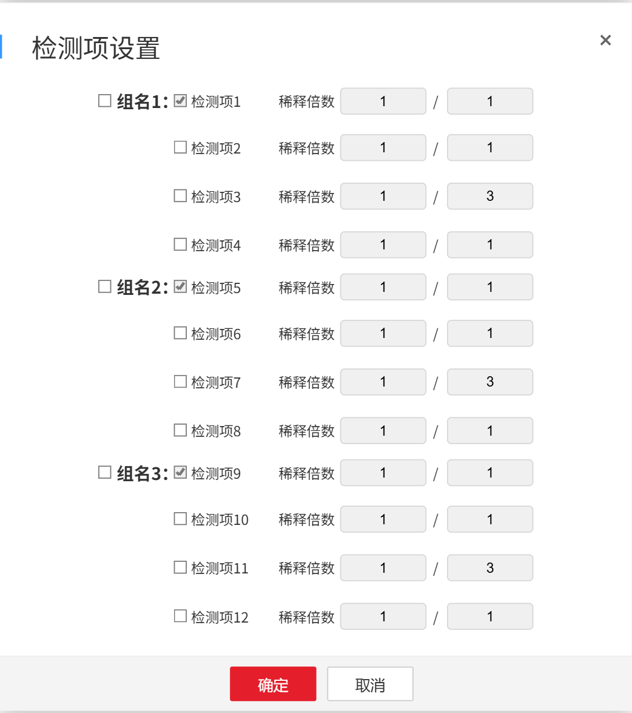

            1.  支持多选，支持按组全选（按照检测项的分组名字段分组，没有填写分组名的全部属于“未分组”这一组），
                1.  **检测项简称**：可选的检测项目在资源管理－设备管理模块配置
                2.  **稀释倍数**：左侧数字默认为1，不可修改；右侧数字默认为1，支持修改。注意，右侧的稀释参数需要根据实际设备是否支持稀释对应填写（因为创建模板时，无法确定此模板会被使用在哪种类型的Cedex设备上）。
4.  **检测方式**：必选，单选，包括以下选择：
    1.  **自动**：自动生成任务。注意，生成任务的同时是否需要发送通知在告警设置中配置
    2.  **手动**：仅发送告警通知
5.  **状态**：必选，禁用或启用二选一，默认启用

#### 模板查询与展示（4.0）

> **[图 image321.jpeg | 章节：工艺设置 / 模板查询与展示（4.0） | 上下文：模板查询与展示（4.0）]**
> **OCR 文本：**
> 药明生物SMP系统 | 首页 | A实验室工作台 | B实验室工作台 | 数据管理 | 系统设置V
> 工艺设置
> 工作流管理 | 实验室 | 请选择 | 方案名称 | 方案名称 | 2016/09/01-2016/09/20 | 检索 | 新增
> config方案 | 序号 | 适用实验室 | 方案名称 | 方式 | 创建时间 | 创建人 | 修改时间 | 修改人 | 操作
> 培养基方案 | 实验室A | PH校准测试方案 | 消息通知 | 启用 | 2026-06-0311:11:11 | 张三 | 2026-06-0311:11:11 | 张三 | 修改复制禁用删除
> 取样测样方案
> 实验室A | 温度校准测试方案 | 消息通知 | 启用 | 2026-06-03 11:11:11 | 张三 | 2026-06-03 11:11:11 | 张三 | 修改复制禁用删除
> 泵速策略
> 补液方案 | 实验室B | 14天培养取样测样方案 | 自动化任务 | 启用 | 2026-06-0311:11:11 | 张三 | 2026-06-0311:11:11 | 张三 | 修改复制禁用 删除
> 自动控制方案 | 实验室B | 残糖确认使用 | 任务+通知 | 禁用 | 2026-06-03 11:11:11 | 张三 | 2026-06-03 11:11:11 | 张三 | 修改复制启用删除
> 澄清方案 | 实验室A | TEST方案 | 消息通知 | 禁用 | 2026-06-03 11:11:11 | 张三 | 2026-06-03 11:11:11 | 张三 | 修改复制启用删除
> 下游检测规则
> 实验室C | TEST取样测样方案 | 消息通知 | 禁用 | 2026-06-0311:11:11 | 张三 | 2026-06-03 11:11:11 | 张三 | 修改复制启用删除
> 上一页 | 10 | 下一页

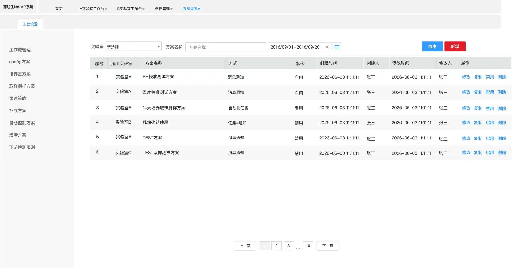

1.  查询条件
    1.  **适用实验室**：下拉单选
    2.  **方案名称**：文本框，支持模糊搜索
    3.  **起止时间**：根据创建时间和修改时间均可搜索
2.  结果展示与操作

    查询结果翻页展示，按创建时间倒排，最新的在最上面，包含以下字段：

    1.  序号
    2.  适用实验室
    3.  方案名称
    4.  方式
    5.  状态
    6.  创建时间
    7.  创建人
    8.  修改时间
    9.  修改人
    10. 操作
        1.  **修改**：与新增时候保持一致的校验
        2.  复制新增

            > **[图 image322.png | 章节：工艺设置 / 模板查询与展示（4.0） | 上下文：复制新增]**
            > **OCR 文本：**
            > 复制新增
            > 适用实验室* | 实验室A
            > 方案名称*
            > 检测内容*
            > 口BGA | 样品量* | 120μL | 检测温度* | DefaultValue | 稳定范围土 | DefaultValue
            > ViCell | 样品量* | 800μL | 稀释倍数* | 检测量* | 600μL
            > OSMO | 样品量* | 200μL
            > Cedex | 样品量* | 350μL | 检测项
            > 方式* | 手动 | 自动
            > 状态* | 启用 | 禁用
            > 保存 | 关闭

            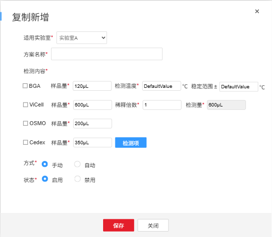

            1.  点击复制新增，弹窗新增一个模板，方案名称为空，必须输入，且不能重复
            2.  弹窗内所有Tab页的内容与原方案完全一致
            3.  所有内容校验与新增保持一致
        3.  禁用/启用：
            1.  从禁用切换为启用时，点击直接切换成功
            2.  从启用切换未禁用时，需点击二次确认，二次确认后切换禁用成功。注意，禁用后只影响后续模板的选择使用即不能选择此模板，不影响历史已使用该模板创建的培养。

                > **[图 image311.png | 章节：工艺设置 / 模板查询与展示（4.0） | 上下文：从启用切换未禁用时，需点击二次确认，二次确认后切换禁用成功。注意，禁用后只影响后续模板的选择使用即不能选择此模板，不影响历史已使用该模板创建的培养。]**
                > **OCR 文本：**
                > 确定要禁用吗
                > 禁用工艺方案中不可在使用，不影响
                > 之前使用此工艺的培养
                > 取消 | 确定
                > 进行一次提示，但不影响禁用操作，禁用
                > 后，不要影响历史数据，历史数据中还可以
                > 展示但是新数据不再可选择此方案
                > 操作成功！
                > 禁用成功
                > 关闭

                

                > **[图 image311.png | 章节：工艺设置 / 模板查询与展示（4.0） | 上下文：从启用切换未禁用时，需点击二次确认，二次确认后切换禁用成功。注意，禁用后只影响后续模板的选择使用即不能选择此模板，不影响历史已使用该模板创建的培养。]**
                > **OCR 文本：**
                > 确定要禁用吗
                > 禁用工艺方案中不可在使用，不影响
                > 之前使用此工艺的培养
                > 取消 | 确定
                > 进行一次提示，但不影响禁用操作，禁用
                > 后，不要影响历史数据，历史数据中还可以
                > 展示但是新数据不再可选择此方案
                > 操作成功！
                > 禁用成功
                > 关闭

                

        4.  删除
            1.  需要二次弹窗确认是否删除，再次点击确认，删除成功

                > **[图 image312.png | 章节：工艺设置 / 模板查询与展示（4.0） | 上下文：需要二次弹窗确认是否删除，再次点击确认，删除成功]**
                > **OCR 文本：**
                > 确定要删除吗
                > 删除工艺方案中不可在使用，不影响
                > 之前使用此工艺的培养
                > 取消 | 确定

                

            2.  删除成功后不影响历史已使用该模板创建的培养，但后续培养无法选择此方案
            3.  需提示成功信息

                > **[图 image313.png | 章节：工艺设置 / 模板查询与展示（4.0） | 上下文：需提示成功信息]**
                > **OCR 文本：**
                > 操作成功！
                > 删除成功
                > 关闭

                

### 自动控制方案模板（4.0）

在此模块可新增、维护、查看自动控制方案模板。

-   使用此模板的自动控制功能模块，会自动生成检测、控制等任务，生成的新任务是否需要审核可通过实验室管理-审批流模块设置；生成任务的同时是否需要发送通知在告警设置中配置
-   自动生成检测任务时，若当前培养在前后各1小时内有同类型的检测任务，则不需要创建此新任务，仅发送告警通知，提示检测任务冲突，等待其它检测任务结果即可。

#### 新增方案模板（4.0）

包含基础信息、取样测样、PH校准、PH调整、通气调整、搅拌调整、微泡开启、温度调整、培养结束共计九个tab页，tab页标题使用完成/未填写符号来区分是否已完成填写。

1.  基础信息tab页必须第一个填写完成，才能填写其余tab页。未填写完成时若切换到其余tab页，则提示信息

    > **[图 image323.png | 章节：工艺设置 / 新增方案模板（4.0） | 上下文：基础信息tab页必须第一个填写完成，才能填写其余tab页。未填写完成时若切换到其余tab页，则提示信息]**
    > **OCR 文本：**
    > 请先完成基本信息

    

2.  除基础信息tab页外，其余tab页至少填写完成一个，否则保存时提示信息

    > **[图 image324.png | 章节：工艺设置 / 新增方案模板（4.0） | 上下文：除基础信息tab页外，其余tab页至少填写完成一个，否则保存时提示信息]**
    > **OCR 文本：**
    > 除基本信息外至少要完成一类控
    > 制方案的填写

    

-   注意，当前章节基本只描述模板所需的填写字段及填写要求，模板在工作流中的应用及相应任务的生成逻辑在后续相应任务队列章节中详细描述。

##### 基础信息（4.0）

包括基本信息和MFC设置两部分。

> **[图 image325.png | 章节：工艺设置 / 新增方案模板（4.0） | 上下文：包括基本信息和MFC设置两部分。]**
> **OCR 文本：**
> 新增
> 基础信息 | 取样测样 | PH校准 | PH调整 | 通气调整 | 搅拌调整 | 微泡开启 | 温度调整 | 培养结束
> MFC设置
> 方案名称*
> 序号 | MFC编号 | 气体类型 | 允许通气通路
> 培养周期* | MFC1 | Air | Please select..
> 反应器类型+ | 集成反应器 | MFC2 | Please select..
> 反应器规格* | Please select.. | MFC3 | CO: | Please select..
> 环控周期* | MFC4 | 请选择 | Please select..
> MFC5 | 请选择 | Please select..
> 状态* | 启用 | 禁用
> MFC6 | 请选择 | Please select..
> 保存 | 关闭

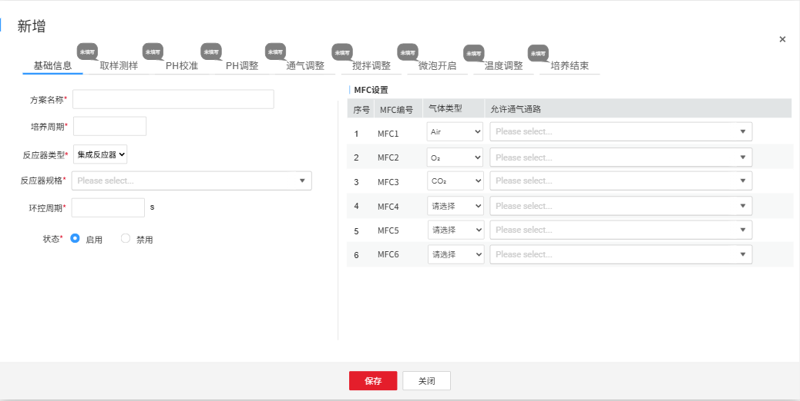

1.  基本信息
    1.  **方案名称**：必填，同类型方案下不能重复，限制在2~50字内
    2.  **培养周期**：必填，限制输入大于1的正整数
    3.  **反应器类型**：下拉单选，必选，列表包含集成反应器和台式反应器
    4.  **反应器规格**：下拉，必选，支持多选，根据反应器类型联动获取对应的型号。选择台式反应器时在对应控制器类型里选
    5.  **环控周期**：自动监控程序的运行周期。限制输入1-3600的正整数，单位s。
    6.  **状态**：启用或禁用，二选一，必选，默认启用。
2.  **MFC设置**：均为非必填
    1.  **序号**：自增即可
    2.  **MFC编号**：MFA通道。编号的方式为MFC+数字自动生成，比如MFC1～MFCM
    3.  **气体类型**：下拉单选，列表包含Air、O2、CO2  三种
    4.  **通气通路**：下拉单选，列表包含HeadSpace、Spanger1、 Spanger2三种

##### 取样测样（4.0）

> **[图 image326.png | 章节：工艺设置 / 新增方案模板（4.0） | 上下文：取样测样（4.0）]**
> **OCR 文本：**
> 新增
> 完成 | 未填写 | 未填写 | 未填写 | 未填写 | 未填写 | 未填写 | 未填写
> 基础信息 | 取样测样 | PH校准 | PH调整 | 通气调整 | 搅拌调整 | 微泡开启 | 温度调整 | 培养结束
> 新增
> 序号 | 培养天数 (开始) | 培养天数 (结束) | 取测时间* | 测试方案* | 操作
> 12 : 00 : 00 | 已设置 | 删除
> 12 : 00 : 00 | 已设置 | 删除
> 12 : 00 : 00 | 已设置 | 删除
> 保存 | 关闭

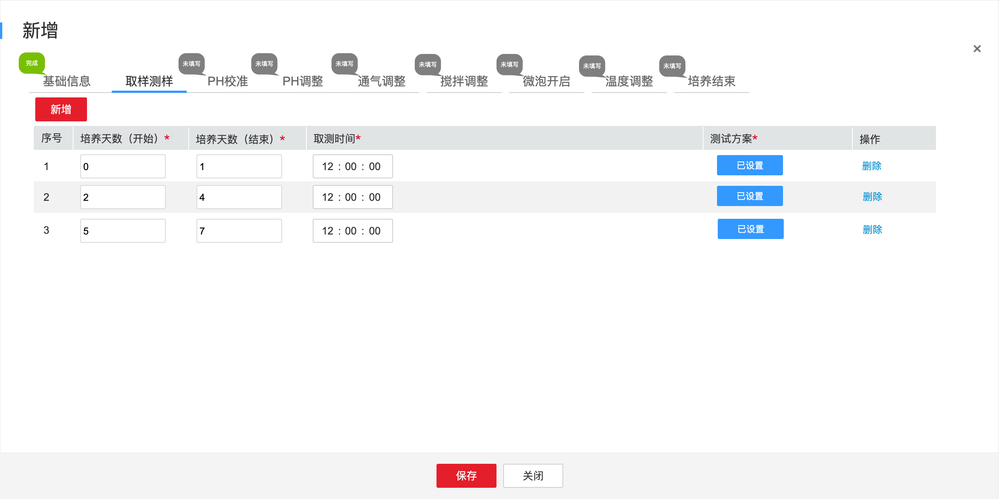

默认不显示，点击新增按钮，可手动添加行设置取样测样规则：

1.  在启动自动控制工作流后根据此规则可自动生成取测任务
2.  每行规则包含以下内容：
    1.  **序号**：行号，自增即可
    2.  **培养天数（开始）**：文本框，必填。从培养开始时间计算，培养开始时间当天为第0天，以此类推。输入限制为大于等于0且小于等于培养周期的整数。
    3.  **培养天数（结束）**：文本框，必填。从培养开始时间计算，培养开始时间为D0，以此类推。输入限制为大于等于0且小于等于培养周期的整数；每一行的培养天数（结束）必须大于等于培养天数（开始）
    4.  **取测时间**：输入时分秒
        -   注意
            -   培养天数（开始）和培养天数（结束）必须大于等于0且小于等于培养周期
            -   每一行的培养天数（结束）必须大于等于培养天数（开始）
            -   不同行的天数允许重叠，但当天数重叠时，若检测类型相同，则取测时间必须间隔相差1小时以上，否则提示信息

                > **[图 image327.png | 章节：工艺设置 / 新增方案模板（4.0） | 上下文：不同行的天数允许重叠，但当天数重叠时，若检测类型相同，则取测时间必须间隔相差1小时以上，否则提示信息]**
                > **OCR 文本：**
                > 测试计划中，同一天1小时内，存在相同
                > 检测内容

                

                举例：

                1.  **第一行**：0-2天 12:00:00 测试 BGA；第二行：1-3天  12:3000 测试 cedex；以上两个安排在第1天和第2天，12点和12点半时间间隔小于1小时，但是测试的检测类型不同，这种场景是允许的
                2.  **第一行**：0-2天 12:00:00 测试 BGA；第二行：1-3天  12:3000 测试 BGA 和 Cedex；以上两个安排在第1天和第2天，12点和12点半时间间隔小于1小时，都出现了BGA测试，这种场景不允许。
    5.  测试方案

        点击按钮弹窗进行测试方案设置，设置完成后按钮文字从“未设置”变为“已设置”。弹窗内容如下：

        > **[图 image328.png | 章节：工艺设置 / 新增方案模板（4.0） | 上下文：点击按钮弹窗进行测试方案设置，设置完成后按钮文字从“未设置”变为“已设置”。弹窗内容如下：]**
        > **OCR 文本：**
        > 新增
        > 等待时长* | min
        > 从模版选择 | 自动控制测试模版
        > 检测内容*
        > BGA | 样品量* | μL | 检测温度* | DefaultValue | '℃稳定范围± | DefaultValue
        > ViCell | 样品量* | 600μL | 稀释倍数* | 检测量* | 600μL
        > oSMO | 样品量*
        > Cedex | 样品量* | 检测项
        > 方式* | 自动 | 手动
        > 保存 | 关闭

        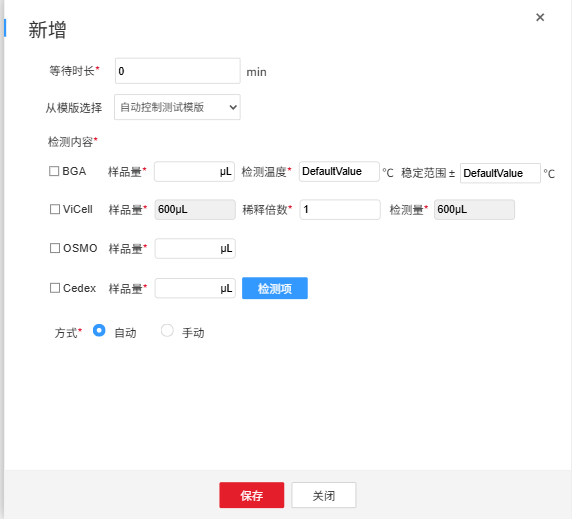

        1.  **等待时长**：必填，输入默认为0，可修改，支持输入正整数，单位是min，表示实际任务执行时间在用户设置的取测时间基础上+xx分钟
        2.  **选择模板**：下拉单选，必选，列表内容为目前已创建的所有取样测样方案模板
        3.  剩余字段：
            1.  剩余所有字段根据选择的模板自动带出
            2.  支持修改，修改及校验规则和新增取样测样方案模板保持一致。
    6.  **删除操作**：点击删除当前行

##### PH校准（4.0）

> **[图 image329.png | 章节：工艺设置 / 新增方案模板（4.0） | 上下文：PH校准（4.0）]**
> **OCR 文本：**
> 新增
> 基础信息 | 取样测样 | PH校准 | PH调整 | 通气调整 | 搅拌调整 | 微泡开启 | 温度调整 | 培养结束
> 新增
> 序号 | 培养天数(开始) | 培养天数(结束）* | 现则* | 调整方式* | 完成后检测 | 操作
> Rule1: PH≤ 0.06 | ①不校准 | O中问值 | O高线值
> Rule2: | 0.06 | APH≤ | 0.15 | O不校准 | O中间值 | ①高线值 | O自动○手动 | 未设置 | 制除
> Rule3: | 0.15 | APH≤ | 0.3 | O中间值 | O高线值
> Rule4: | △PH> | O中间值 | O高线值
> Rule1: | △PH≤ | 0.05 | 不校准 | O中间值 | O高线值
> Rule2: | 900 | APH≤ | 0.17 | O不校准 | O中间值 | ①高线值
> Rule3: | 0.17 | APH≤ | 0.3 | ①④不校准 | O中间值 | O高线值 | O自动○手动 | 未设置 | 制除
> Rule4: | 4PH> | 0.3 | ③不校准 | O中间值 | O高线值
> 保存 | 关闭

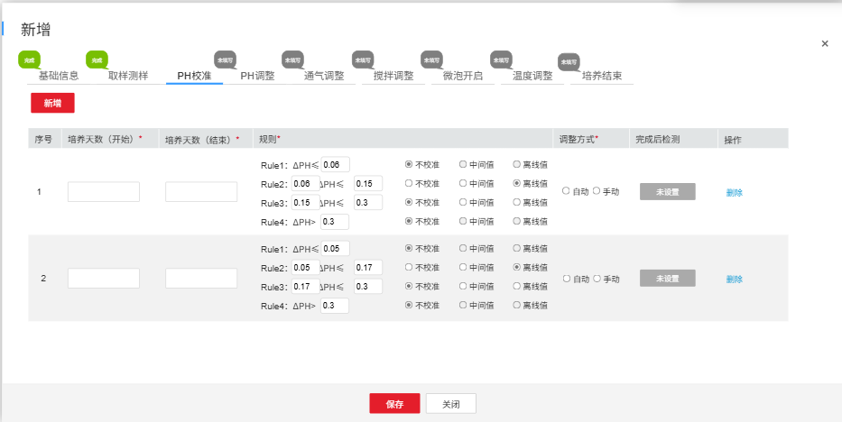

默认不显示，点击新增按钮，可手动添加行设置PH校准规则：

1.  在启动自动控制工作流后根据此规则生成规则监控计划，但不直接生成校准任务
2.  当BGA离线检测的PH指标结果与线上PH传感器读数的差值ΔPH触发相应Rule时，生成自动校准任务
3.  每行规则包含以下内容：
    1.  **序号**：行号，自增即可
    2.  **培养天数（开始）**：文本框，必填。从培养开始时间计算，培养开始时间当天为第0天，以此类推。输入限制为大于等于0且小于等于培养周期的整数。
    3.  **培养天数（结束）**：文本框，必填。从培养开始时间计算，培养开始时间为D0，以此类推。输入限制为大于等于0且小于等于培养周期的整数；每一行的培养天数（结束）必须大于培养天数（开始）
        -   注意
            -   培养天数（开始）和培养天数（结束）必须大于等于0且小于等于培养周期
            -   每一行的培养天数（结束）必须大于等于培养天数（开始）
            -   不同行的天数不允许重叠，否则提示信息。比如第一行0-1 ，第二行1-2，也就是在第1天会出现两种规则，这种情况不允许。

                > **[图 image330.png | 章节：工艺设置 / 新增方案模板（4.0） | 上下文：不同行的天数不允许重叠，否则提示信息。比如第一行0-1 ，第二行1-2，也就是在第1天会出现两种规则，这种情况不允许。]**
                > **OCR 文本：**
                > 不同行的时间设置有重登

                

    4.  **规则**：默认包含4种规则
        1.  **触发条件**：包含以下4种触发条件，所有文本框都支持修改，支持输入小于20的数值，限制1位小数，无单位

            > **[图 image331.png | 章节：工艺设置 / 新增方案模板（4.0） | 上下文：触发条件：包含以下4种触发条件，所有文本框都支持修改，支持输入小于20的数值，限制1位小数，无单位]**
            > **OCR 文本：**
            > Rule1: 4PH≤0.06
            > Rule2: | 0.06 | APH≤ | 0.15
            > Rule3: | 0.15 | APH≤ | 0.3
            > Rule4: △PH> | 0.3

            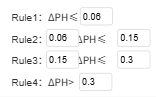

        2.  **校准值**：每个触发条件都可以单独配置一个校准值，校准值包含以下3种，必选其中一种
            1.  **不校准**：触发后不需要进行校准
            2.  **中间值**：以离线检测和线上检测的PH的中间值作为标准，对设备的PH传感器的零点进行校准。如离线检测结果为7，线上监控为6.8，则线上设备应以6.9为标准值进行校准，校准标准=（离线值+线上检测值）/2
            3.  **离线值**：以离线检测的PH为标准，对设备的PH传感器的零点进行校准。如离线检测结果为7，线上监控为6.8，则线上设备应以7为标准值进行校准
    5.  **调整方式**：单选，必选，包含以下调整方式：
        1.  **自动**：自动生成校准任务
        2.  **手动**：只进行告警通知，一般情况是不支持自动校准的设备使用
    6.  完成后检测：
        1.  可选。点击按钮弹窗进行测试方案设置，设置完成后按钮文字从“未设置”变为“已设置”
        2.  如果设置完成，则表示每完成一次此类型任务都需要触发一次取测任务
        3.  弹窗内容如下（与取样测样tab页的测试方案一致）：

            > **[图 image328.png | 章节：工艺设置 / 新增方案模板（4.0） | 上下文：弹窗内容如下（与取样测样tab页的测试方案一致）：]**
            > **OCR 文本：**
            > 新增
            > 等待时长* | min
            > 从模版选择 | 自动控制测试模版
            > 检测内容*
            > BGA | 样品量* | μL | 检测温度* | DefaultValue | '℃稳定范围± | DefaultValue
            > ViCell | 样品量* | 600μL | 稀释倍数* | 检测量* | 600μL
            > oSMO | 样品量*
            > Cedex | 样品量* | 检测项
            > 方式* | 自动 | 手动
            > 保存 | 关闭

            

            1.  **等待时长**：必填，输入默认为0，可修改，支持输入正整数，单位是min，表示在此类型任务完成后等待xx分钟后执行取测任务。
                -   **注意**：取测任务生成时同样需要比较前后1小时内是否有同类型任务，如果有则不生成任务只进行通知
            2.  **选择模板**：下拉单选，必选，列表内容为目前已创建的所有取样测样方案模板
            3.  **剩余字段**：剩余所有字段根据选择的模板自动带出；支持修改，修改及校验规则和新增取样测样方案模板保持一致。
    7.  **删除操作**：点击删除该行

##### PH调整（4.0）

> **[图 image332.png | 章节：工艺设置 / 新增方案模板（4.0） | 上下文：PH调整（4.0）]**
> **OCR 文本：**
> 新增
> 未填可， | 未填可 | 未填可
> 基础信息 | 取样测样 | PH校准 | PH调整 | 通气调整 | 搅拌调整 | 微泡开启 | 温度调整 | 培养结束
> 新增
> 序号 | 触发条件* | 调整至* | 调整方式* | 完成后检测 | 操作
> 到达D | 温度 | "C | 目标值 | Deadband | Deadband | ①自动O手动 | 未设置 | 删除
> 到达D | 温度 | "C | 目标值 | Deadband | Deadband | ①自动O手动 | 未设置 | 删除
> 到达D | 温度 | "C | 目标值 | Deadband | Deadband | ①自动○手动 | 未设置 | 删除
> 保存 | 关闭

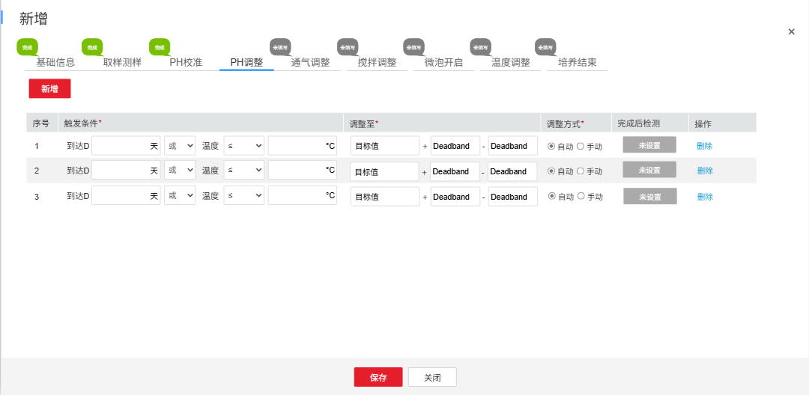

默认不显示，点击新增按钮，可手动添加行设置PH调整规则：

1.  在启动自动控制工作流后根据此规则自动生成PH调整任务，且是立即执行
2.  每行规则包含以下内容：
    1.  **序号**：行号，自增即可
    2.  触发条件
        1.  **到达天**：文本框，必填。从开始培养时间计算，培养开始时间当天为第0天，以此类推。输入限制为大于等于0且小于等于培养周期的整数。
        2.  **满足条件**：且/或，二选一，必选
        3.  **温度逻辑判断**：下拉单选，必选，列表包含≥、＞、≤、＜
        4.  **温度触发数值**：文本框，必填，限制输入数值，单位℃
        -   注意：

            不同行的触发条件不能完全一致，且同一天不能配置两个触发条件，否则提示信息

            > **[图 image333.png | 章节：工艺设置 / 新增方案模板（4.0） | 上下文：不同行的触发条件不能完全一致，且同一天不能配置两个触发条件，否则提示信息]**
            > **OCR 文本：**
            > 相同时间
            > 存在冲突的触发条件

            

    3.  调整至
        1.  **目标值**：文本框，必填，限制输入数值
        2.  **死区+**：文本框，必填，限制输入数值
        3.  **死区-**：文本框，必填，限制输入数值
    4.  **调整方式**：单选，必选，包含以下调整方式：
        1.  **自动**：自动生成任务
        2.  **手动**：只进行告警通知
    5.  **完成后检测**：同PH校准tab页内的完成后检测字段
    6.  **删除操作**：点击删除当前行

##### 通气调整（4.0）

> **[图 image334.png | 章节：工艺设置 / 新增方案模板（4.0） | 上下文：通气调整（4.0）]**
> **OCR 文本：**
> 新增
> 壳成
> 基础信息 | 取样测样 | PH校准 | PH调整 | 通气调整 | 搅拌调整 | 微泡开启 | 温度调整 | 培养结束
> 新增
> 序号 | 培养天数（开始）* | 培养天数 (结束) | 超窗设置* | 调整方式* | 完成后检测 | 调整次数上限* | 操作
> mmHg | pCO: | 10 | Air | Sparger1  | L/min | ①自动○手动 | 已设置 | 删除
> mmHg | NA V | pCO: | 10 | Air | Sparger1  | L/min | ①自动○手动 | 已设置 | 删除
> 保存 | 关闭

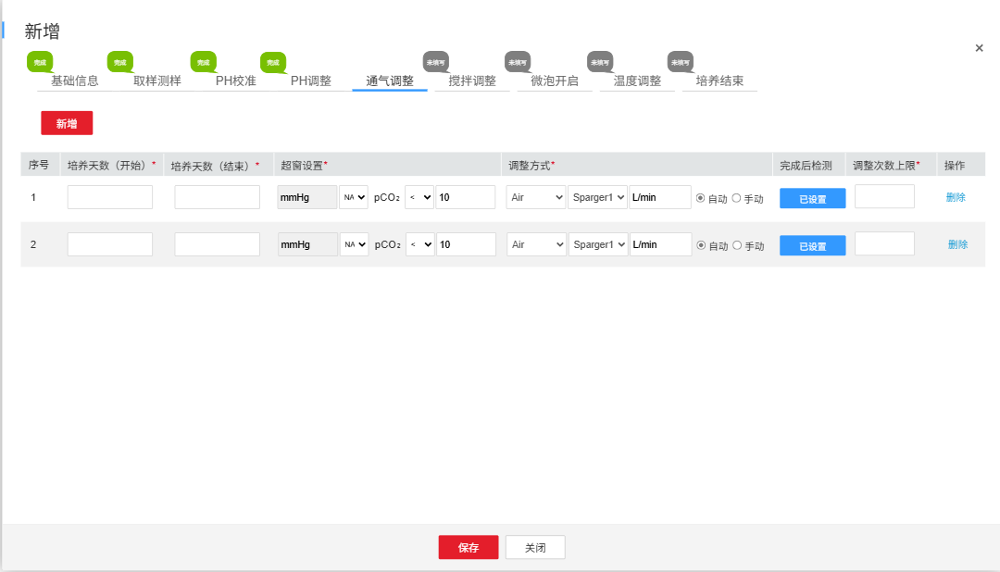

默认不显示，点击新增按钮，可手动添加行设置通气调整规则：

1.  在启动自动控制工作流后，当BGA离线检测的pCO2的指标结果触发规则后，自动生成一个通气调整任务，且是立即执行
2.  每行规则包含以下内容：
    1.  **序号**：行号，自增即可
    2.  **培养天数（开始）**：文本框，必填。从培养开始时间计算，培养开始时间当天为第0天，以此类推。输入限制为大于等于0且小于等于培养周期的整数。
    3.  **培养天数（结束）**：文本框，必填。从培养开始时间计算，培养开始时间为D0，以此类推。输入限制为大于等于0且小于等于培养周期的整数；每一行的培养天数（结束）必须大于等于培养天数（开始）
    4.  超窗设置
        1.  **下限值**：文本框，当下限判断逻辑选择NA时，置灰不可填写，否则为必填，单位mmHg
        2.  **下限判断逻辑**：下拉单选，列表内容有＜、≤、NA，NA表示不用下限触发规则
        3.  **上限判断逻辑**：下拉单选，列表内容有＜、≤、NA，NA表示不用上限触发规则
        4.  **上限值**：文本框，当下限判断逻辑选择NA时，置灰不可填写，否则为必填，单位mmHg
        -   注意
            -   培养天数（开始）和培养天数（结束）必须大于等于0且小于等于培养周期
            -   每一行的培养天数（结束）必须大于等于培养天数（开始）
            -   超窗设置，如果上限值和下限值均填写，则上限值必须大于下限值。
            -   不同行的天数允许重叠，但当天数重叠时，超窗设置里的条件不允许有交集，否则提示信息

                > **[图 image335.png | 章节：工艺设置 / 新增方案模板（4.0） | 上下文：不同行的天数允许重叠，但当天数重叠时，超窗设置里的条件不允许有交集，否则提示信息]**
                > **OCR 文本：**
                > 相同时可
                > 存在冲突的触发条件

                

                举例：

            5.  例1 ：场景合理，时间一样，但是超窗设置条件无交集

                第一行是第0-2天且 pCO₂<5；第二行是第0-2 天且 1000<pCO₂

            6.  例2 ：场景不合理，日期有交集，并且超窗设置条件有包含关系

                第一行是第0-2天且 pCO₂<5，第二行是第1-2天且  pCO₂<6

            7.  例3 ：场景合理，日期无交集，超窗设置条件有交集也无所谓

                第一行是第0-2天且 pCO₂<5，第二行是第3-7天且  pCO₂<10

    5.  调整方式
        1.  **气体选择**：下拉单选，列表O2一个选项，置为默认值
        2.  **通路选择**：下拉单选，必选，列表包括Sparger1和Sparger2，默认值Sparger2。
        3.  **通气量数值**：文本框，必填，单位L/min，限制输入正数，支持1位小数
        4.  **方式**：单选，必选，包含以下调整方式：
            1.  **自动**：自动生成任务
            2.  **手动**：只进行告警通知
    6.  **完成后检测**：同PH校准tab页内的完成后检测字段
    7.  **调整次数上限**：文本框，必填，限制输入正整数。大多数情况下通气调整后都会进行BGA检测，检测结果会产生新的pCO₂数值，为了避免新的数值依然超窗，可能会引发进一步的通气调整，为了避免形成死循环，限制调整次数上限，如，数字为1，如一个培养pCO₂数值超窗产生了一次调整，之后进行了新的测试仍旧超窗，则不会再进行调整，需要产生告警。注意，此处技术需要设计一下数据结构，是否标记测试的产生来源，因为同一个通气调整方案引发的取测次数应等于调整次数上限
    8.  **删除操作**：点击删除该行

##### 搅拌调整（4.0）

> **[图 image336.png | 章节：工艺设置 / 新增方案模板（4.0） | 上下文：搅拌调整（4.0）]**
> **OCR 文本：**
> 新增
> 壳成 | 未填可
> 基础信息 | 取样测样 | PH校准 | PH调整 | 通气调整 | 搅拌调整 | 微泡开启 | 温度调整 | 培养结束
> 新增
> 序号 | 培养天数 (开始) | 培养天数 (结束) | 触发条件* | 转速调整至* | 调整方式* | 完成后检测 | 操作
> L/min | NA V | 02 | Sparger1 | 10 | rpm | ①自动○手动 | 未设置 | 删除
> 10 | Sparger1 | 100 | rpm | ①自动○手动 | 未设置 | 删除
> 100 | 20 | Sparger1 |  VN | L/min | rpm | ①自动O手动 | 未设置 | 删除
> 保存 | 关闭

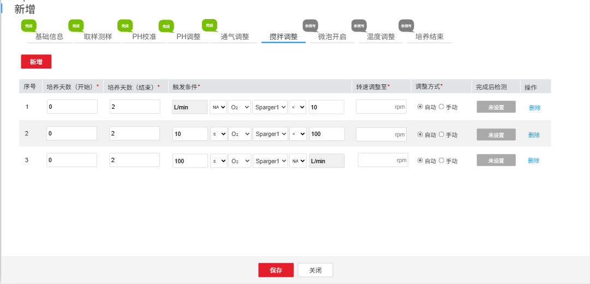

默认不显示，点击新增按钮，可手动添加行设置搅拌调整规则：

1.  在启动自动控制工作流后，反应器监测当前培养所在的反应器的MFC配置的氧气，指定通道的通气量满足了触发条件，则生成转速调整任务，且是立即执行
2.  每行规则包含以下内容：
    1.  **序号**：行号，自增即可
    2.  **培养天数（开始）**：文本框，必填。从培养开始时间计算，培养开始时间当天为第0天，以此类推。输入限制为大于等于0且小于等于培养周期的整数。
    3.  **培养天数（结束）**：文本框，必填。从培养开始时间计算，培养开始时间为D0，以此类推。输入限制为大于等于0且小于等于培养周期的整数；每一行的培养天数（结束）必须大于等于培养天数（开始）
    4.  触发条件
        1.  **下限值**：文本框，当下限判断逻辑选择NA时，置灰不可填写，否则为必填，单位L/min，限制输入小于1000的正整数，支持1位小数
        2.  **下限判断逻辑**：下拉单选，列表内容有＜、≤、NA，NA表示不用下限触发规则
        3.  **气体选择**：下拉单选，目前只有O2一个选项，置为默认值
        4.  **通路选择**：下拉单选，必选，列表包括Sparger1和Sparger2，默认值Sparger1。
        5.  **上限判断逻辑**：下拉单选，列表内容有＜、≤、NA，NA表示不用上限触发规则
        6.  **上限值**：文本框，当下限判断逻辑选择NA时，置灰不可填写，否则为必填，单位L/min，限制输入小于1000的正整数，支持1位小数
        -   注意
            -   培养天数（开始）和培养天数（结束）必须大于等于0且小于等于培养周期
            -   每一行的培养天数（结束）必须大于等于培养天数（开始）
            -   触发条件，如果上限值和下限值均填写，则上限值必须大于下限值。
            -   触发条件-通路选择，所有行必须一样
            -   不同行的天数允许重叠，但当天数重叠时，触发条件不允许有交集，否则提示信息

                > **[图 image335.png | 章节：工艺设置 / 新增方案模板（4.0） | 上下文：不同行的天数允许重叠，但当天数重叠时，触发条件不允许有交集，否则提示信息]**
                > **OCR 文本：**
                > 相同时可
                > 存在冲突的触发条件

                

                举例：

                1.  例1 ，场景合理，时间一样，但是条件无交集

                    第一行是第0-2天 且O2且Sparger1<10；第二行是第0-2天 且 O₂且Sparger1>100

                2.  例2 ，场景不合理，日期有交集，并且条件有交集

                    第一行是第0-2天 且O2且Sparger1<10；第二行是第0-2天 且 O₂且Sparger1<15

    5.  **转速调整至**：文本框，必填，限制输入小于等于9999的正整数，支持1位小数
    6.  **调整方式**：单选，必选，包含以下调整方式：
        1.  **自动**：自动生成任务
        2.  **手动**：只进行告警通知
    7.  **完成后检测**：同PH校准tab页内的完成后检测字段
    8.  **删除操作**：点击删除该行

##### 微泡开启（4.0）

> **[图 image337.png | 章节：工艺设置 / 新增方案模板（4.0） | 上下文：微泡开启（4.0）]**
> **OCR 文本：**
> 新增
> 基础信息 | 取样测样 | PH校准 | PH调整 | 通气调整 | 搅拌调整 | 微泡开启 | 温度调整 | 培养结束
> 新增
> 序号 | 培养天数(开始） | 培养天数 (结束) | 触发条件* | 微泡开启* | 调整方式* | 完成后检测 | 操作
> 02 | Sparger1 | 流量≥ | 100 | L/min
> 02 | Sparger2 v | L/min | ①自动O手动 | 未设置 | 删除
> 且累计通气时长》 | 10 | min
> 02 | Sparger1 v | 流量≥ | 100 | L/min
> 02 | Sparger2 v | L/min | ①自动手动 | 未设置
> 且累计通气时长》 | 10 | min
> Sparger1 v | 流量≥ | 100 | L/min
> Sparger2  | Lmin | ①自动○手动 | 未设置 | 删除
> 且累计通气时长》 | 10 | min
> 保存 | 关闭

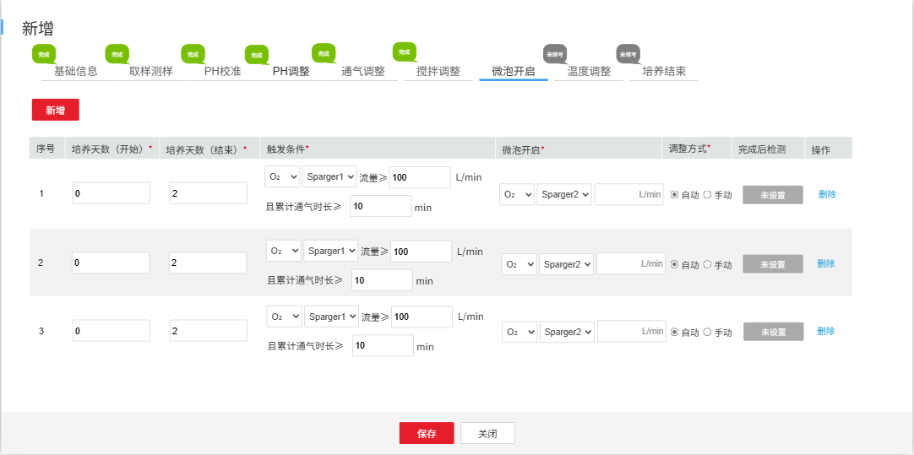

默认不显示，点击新增按钮，可手动添加行设置微泡开启规则：

1.  在启动自动控制工作流后，反应器监测当前培养所在的反应器的MFC配置的氧气，指定通道的流量满足了触发条件，则生成微泡开启任务，且是立即执行
2.  每行规则包含以下内容：
    1.  **序号**：行号，自增即可
    2.  **培养天数（开始）**：文本框，必填。从培养开始时间计算，培养开始时间当天为第0天，以此类推。输入限制为大于等于0且小于等于培养周期的整数。
    3.  **培养天数（结束）**：文本框，必填。从培养开始时间计算，培养开始时间为D0，以此类推。输入限制为大于等于0且小于等于培养周期的整数；每一行的培养天数（结束）必须大于等于培养天数（开始）
    4.  触发条件
        1.  **气体选择**：下拉单选，目前只有O2一个选项，置为默认值
        2.  **通路选择**：下拉单选，必选，列表包括Sparger1和Sparger2，默认值Sparger1。
        3.  **流量值**：文本框，必填，单位L/min，限制输入小于等于999的正数，支持1位小数
        4.  **通气时长**：文本框，必填，单位min，限制输入小于等于1440的正整数，支持小数点后1位。
            -   注意
                -   培养天数（开始）和培养天数（结束）必须大于等于0且小于等于培养周期
                -   每一行的培养天数（结束）必须大于等于培养天数（开始）
                -   触发条件-通路选择，所有行必须一样
                -   大于等于指定气通量后开始计时，持续计通气时间（如果通气速度突然下降低于条件设定数字，则计时结束，下次超过时再重新计时）达到输入的时长后，开启微泡，
                -   不同行的天数不允许重叠，否则提示信息

                    > **[图 image338.png | 章节：工艺设置 / 新增方案模板（4.0） | 上下文：不同行的天数不允许重叠，否则提示信息]**
                    > **OCR 文本：**
                    > 不同行时问设置有重叠

                    

    5.  微泡开启
        1.  **气体选择**：下拉单选，目前只有O2一个选项，置为默认值
        2.  **通路选择**：下拉单选，必选，列表包括Sparger1和Sparger2，默认值Sparger2。
        3.  **流量值**：文本框，必填，单位L/min，限制输入小于等于999的正数，支持1位小数
        4.  **通气时长**：文本框，必填，单位min，限制输入小于等于1440的正数，支持小数点后1位
            -   注意
                -   微泡开启-通路选择，所有行必须一样
    6.  **调整方式**：单选，必选，包含以下调整方式：
        1.  **自动**：自动生成任务
        2.  **手动**：只进行告警通知
    7.  **完成后检测**：同PH校准tab页内的完成后检测字段
    8.  **删除操作**：点击删除该行

##### 温度调整（4.0）

> **[图 image339.png | 章节：工艺设置 / 新增方案模板（4.0） | 上下文：温度调整（4.0）]**
> **OCR 文本：**
> 新增
> 完成 | 未填可
> 基础信息 | 取样测样 | PH校准 | PH调整 | 通气调整 | 搅拌调整 | 微泡开启 | 温度调整 | 培养结束
> 新增
> 序号 | 触发条件* | 温度调整至* | 方式* | 执行规则* | VCD预测到达检测 | 完成后检测 | 操作
> O先补料再降温
> 到达D | VCD≥ | ×10° cells/mL | "C | O自动O手动 | 未设置 | 未设置 | 删除
> O先降温再补料
> O先补料再降温
> 到达D | VCD≥ | 10° cells/mL | "C | O自动O手动 | 未设置 | 未设置
> O先降温再补料
> O先补料再降温
> 到达D | VCD≥ | ×10° cells/mL | "C | O自动○手动 | O先降温再补料 | 未设置 | 未设置
> 保存 | 关闭

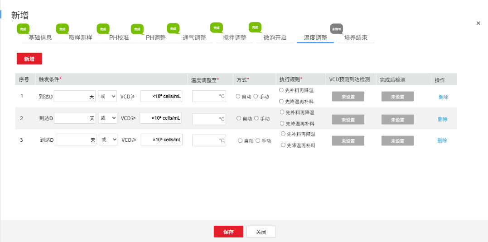

默认不显示，点击新增按钮，可手动添加行设置温度调整规则：

1.  在启动自动控制工作流后根据此规则自动生成温度调整任务
2.  每行规则包含以下内容：
    1.  **序号**：行号，自增即可
    2.  触发条件
        1.  **到达天**：文本框，必填。从开始培养时间计算，培养开始时间当天为第0天，以此类推。输入限制为大于等于0且小于等于培养周期的整数。
        2.  **满足条件**：且/或，二选一，必选
        3.  **VCD触发数值**：文本框，必填，限制输入数值，单位×106cells/ml
            -   注意：
                -   不同行的到达天和VCD触发数值不能完全一致，否则提示信息

                    > **[图 image340.png | 章节：工艺设置 / 新增方案模板（4.0） | 上下文：不同行的到达天和VCD触发数值不能完全一致，否则提示信息]**
                    > **OCR 文本：**
                    > 不同行的条件设置有重叠

                    

    3.  **温度调整至**：文本框，必填，限制输入小于100的数值，支持1位小数，单位℃
    4.  **调整方式**：单选，必选，包含以下调整方式：
        1.  **自动**：自动生成任务
        2.  **手动**：只进行告警通知
    5.  **执行规则**：单选，必选，包含以下规则：
        1.  **先补料再降温**：找到当前培养所有补液任务的计划执行时间，设定当前任务计划执行时间在最后一条补液任务的时间基础上+1分钟
        2.  **先降温再补料**：执行时间为当前时间
    6.  VCD预测到达检测
        1.  可选。点击按钮弹窗进行方案设置，设置完成后按钮文字从“未设置”变为“已设置”
        2.  如果设置完成，则表示VCD数值预测到达后需要触发一次取测任务，取测任务的计划执行时间需根据计算规则计算得到（具体逻辑在任务队列章节详细描述）
        3.  弹窗内容如下（与取样测样tab页的测试方案一致）：

            > **[图 image328.png | 章节：工艺设置 / 新增方案模板（4.0） | 上下文：弹窗内容如下（与取样测样tab页的测试方案一致）：]**
            > **OCR 文本：**
            > 新增
            > 等待时长* | min
            > 从模版选择 | 自动控制测试模版
            > 检测内容*
            > BGA | 样品量* | μL | 检测温度* | DefaultValue | '℃稳定范围± | DefaultValue
            > ViCell | 样品量* | 600μL | 稀释倍数* | 检测量* | 600μL
            > oSMO | 样品量*
            > Cedex | 样品量* | 检测项
            > 方式* | 自动 | 手动
            > 保存 | 关闭

            

            1.  **等待时长**：必填，输入默认为0，可修改，支持输入正整数，单位是min，表示在计算出的任务计划执行时间的基础上再等待xx分钟后执行取测任务。
                -   **注意**：取测任务生成时同样需要比较前后1小时内是否有同类型任务，如果有则不生成任务只进行通知
            2.  **选择模板**：下拉单选，必选，列表内容为目前已创建的所有取样测样方案模板
            3.  **剩余字段**：剩余所有字段根据选择的模板自动带出；支持修改，修改及校验规则和新增取样测样方案模板保持一致。
    7.  **完成后检测**：同PH校准tab页内的完成后检测字段
    8.  **删除操作**：点击删除当前行

##### 培养结束（4.0）

> **[图 image341.png | 章节：工艺设置 / 新增方案模板（4.0） | 上下文：培养结束（4.0）]**
> **OCR 文本：**
> 新增
> 完成
> 基础信息 | 取样测样 | PH校准 | PH调整 | 通气调整 | 搅拌调整 | 微泡开启 | 温度调整 | 培养结束
> 团培养时间到达通知
> 团存活率低于设定值通知
> Viability
> 保存 | 关闭

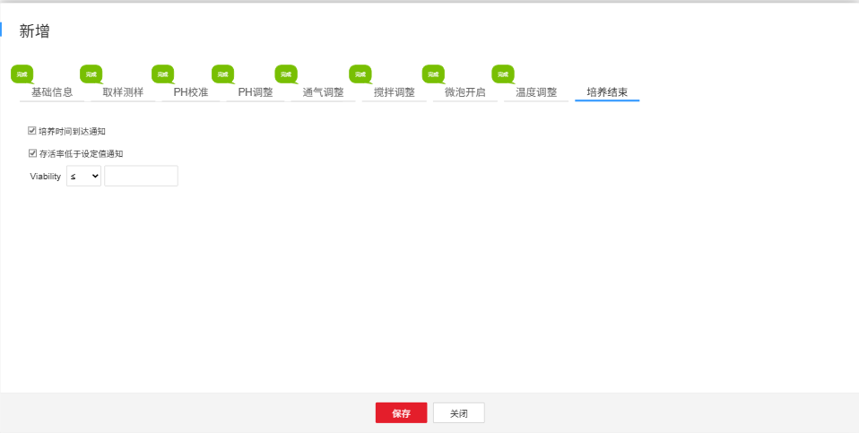

1.  培养时间到达通知
    1.  **勾选框**：可选。勾选则表示到达培养结束时间的当天上午9点发送告警通知，通知规则和范围通过告警设置配置
2.  存活率低于设定值通知：
    1.  **勾选框**：可选。勾选则表示存活率满足判定条件时发送告警通知，通知规则和范围通过告警设置配置。勾选后必选填写存活率判定条件
    2.  存活率判定条件：
        1.  **判读符号**：下拉单选，列表包含＜、≤。
        2.  **存活率设定值**：文本框，限制输入数值。

#### 模板查询与展示（4.0）

> **[图 image342.png | 章节：工艺设置 / 模板查询与展示（4.0） | 上下文：模板查询与展示（4.0）]**
> **OCR 文本：**
> 药明生物SMP系统 | 首页 | A实验室工作台 | B实验室工作台 | 数据管理 | 系统设置
> 工艺设置
> 工作流管理 | 反应器类型 | 集成反应器 | 培养天数 | 方案名称 | 2016/09/01 - 2016/09/20 | 检索 | 新增
> config方案 | 序号 | 反应器类型 | 方案名称 | 培养天数 | 反应器规格 | 环控周期（S）状态 | 创建时间 | 创建人 | 修改时间 | 修改人 | 操作
> 培养基方案 | 集成反应器 | CHO1培养控制方案 | XXXX, xx, X | 启用 | 2026-06-03 11:11:11 | 张三 | 202606-03 11:11:11 | 张三 | 修改复制禁用删除
> 取样测样方案
> 集成反应器 | 测试方案1 | 14 | XXXX, XX, X | 30 | 启用 | 2026-06-03 11:11:11 | 张三 | 2026-06-03 11:11:11 | 张三 | 修改 复制 禁用 删除
> 泵速策路
> 补液方案 | 集成反应器 | 测试方案2 | 14 | XXXX, XX, X | 10 | 启用 | 2026-06-03 11:11:11 | 张三 | 2026-06-03 11:11:11 | 张三 | 修改复制禁用删除
> 自动控制方案 | 台式反应器 | 测试方案3 | XXXX, XX, X | 15 | 禁用 | 2026-06-03 11:11:11 | 张三 | 2026-06-03 11:11:11 | 张三 | 修改 | 复制启用 | 删除
> 澄清方案 | 台式反应器 | 7天测试方案 | XXXX, XX, X | 20 | 禁用 | 2026-06-03 11:11:11 | 张三 | 2026-06-03 11:11:11 | 张三 | 修改 | 复制片 | 启用 | 删除
> 下游检测规则
> 集成反应器 | 14天测试方案 | 14 | XXXX, XX, X | 40 | 禁用 | 2026-06-03 11:11:11 | 张三 | 2026-06-03 11:11:11 | 张三 | 修改 复制启用 删除
> 10 | 下一页

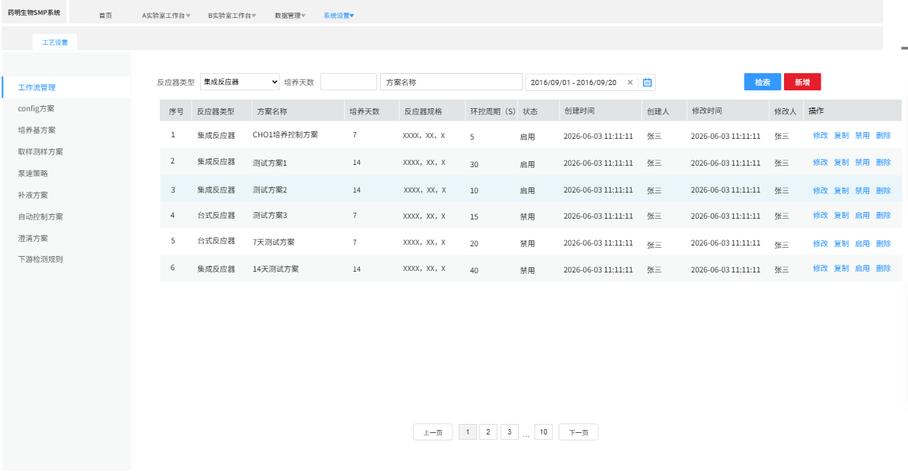

1.  查询条件
    1.  **反应器类型**：下拉单选
    2.  **培养周期**：文本框，支持输入数值
    3.  **方案名称**：文本框，支持模糊搜索
    4.  **起止时间**：根据创建时间和修改时间均可搜索
2.  结果展示与操作

    查询结果翻页展示，按创建时间倒排，最新的在最上面，包含以下字段：

    1.  序号
    2.  反应器类型
    3.  方案名称
    4.  培养周期
    5.  **反应器规格**：多个时，逗号拼接展示
    6.  环控周期（S）
    7.  状态
    8.  创建时间
    9.  创建人
    10. 修改时间
    11. 修改人
    12. 操作
        1.  **修改**：与新增时候保持一致的校验
        2.  复制新增

            > **[图 image343.png | 章节：工艺设置 / 模板查询与展示（4.0） | 上下文：复制新增]**
            > **OCR 文本：**
            > 复制新增
            > 已填可 | 未填弓， | 未镇可 | 未填可 | 未填可 | 未镇可 | 未填可
            > 基础信息 | 取样测样 | PH校准 | PH调整 | 通气调整 | 搅拌调整 | 微泡开启 | 温度调整 | 培养结束
            > 「MFC设置
            > 方案名称*
            > 序号 | MFC编号 | 气体类型 | 允许通气通路
            > 培养周期* | MFC1 | Air | Headspace
            > 反应器类型+ | 集成反应器 | MFC2 | Sparger 1
            > 反应器规格* | Please select.. | MFC3 | CO2 | Sparger 2
            > 环控周期* | 15 | MFC4 | 请选择 | Headspace
            > 状态* | 启用 | 禁用 | MFC5 | 请选择 | Headspace
            > MFC6 | 请选择 | Headspace
            > 保存 | 关闭

            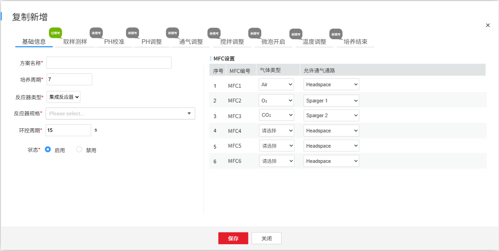

            1.  点击复制新增，弹窗新增一个模板，方案名称为空，必须输入，且不能重复
            2.  弹窗内所有Tab页的内容与原方案完全一致
            3.  所有内容校验与新增保持一致
        3.  禁用/启用：
            1.  从禁用切换为启用时，点击直接切换成功
            2.  从启用切换为禁用时，需点击二次确认，二次确认后切换禁用成功。注意，禁用后只影响后续模板的选择使用即不能选择此模板，不影响历史已使用该模板创建的培养。

                > **[图 image311.png | 章节：工艺设置 / 模板查询与展示（4.0） | 上下文：从启用切换为禁用时，需点击二次确认，二次确认后切换禁用成功。注意，禁用后只影响后续模板的选择使用即不能选择此模板，不影响历史已使用该模板创建的培养。]**
                > **OCR 文本：**
                > 确定要禁用吗
                > 禁用工艺方案中不可在使用，不影响
                > 之前使用此工艺的培养
                > 取消 | 确定
                > 进行一次提示，但不影响禁用操作，禁用
                > 后，不要影响历史数据，历史数据中还可以
                > 展示但是新数据不再可选择此方案
                > 操作成功！
                > 禁用成功
                > 关闭

                

                > **[图 image311.png | 章节：工艺设置 / 模板查询与展示（4.0） | 上下文：从启用切换为禁用时，需点击二次确认，二次确认后切换禁用成功。注意，禁用后只影响后续模板的选择使用即不能选择此模板，不影响历史已使用该模板创建的培养。]**
                > **OCR 文本：**
                > 确定要禁用吗
                > 禁用工艺方案中不可在使用，不影响
                > 之前使用此工艺的培养
                > 取消 | 确定
                > 进行一次提示，但不影响禁用操作，禁用
                > 后，不要影响历史数据，历史数据中还可以
                > 展示但是新数据不再可选择此方案
                > 操作成功！
                > 禁用成功
                > 关闭

                

        4.  删除
            1.  需要二次弹窗确认是否删除，再次点击确认，删除成功

                > **[图 image312.png | 章节：工艺设置 / 模板查询与展示（4.0） | 上下文：需要二次弹窗确认是否删除，再次点击确认，删除成功]**
                > **OCR 文本：**
                > 确定要删除吗
                > 删除工艺方案中不可在使用，不影响
                > 之前使用此工艺的培养
                > 取消 | 确定

                

            2.  删除成功后不影响历史已使用该模板创建的培养，但后续培养无法选择此方案
            3.  需提示成功信息

                > **[图 image313.png | 章节：工艺设置 / 模板查询与展示（4.0） | 上下文：需提示成功信息]**
                > **OCR 文本：**
                > 操作成功！
                > 删除成功
                > 关闭

                

### 补液方案③

在此模块可新增、维护、查看补液方案模板。

#### 新增补液方案模板③（3.2）（3.3）

> **[图 image344.png | 章节：工艺设置 / 新增补液方案模板③（3.2）（3.3） | 上下文：新增补液方案模板③（3.2）（3.3）]**
> **OCR 文本：**
> 新增
> 模版名称* | 支持泵数* | 反应器类型* | 集成反应器 | Item | 规格：50L培养天数*
> 备注
> 固定泵 | 补料任务 | 补糖规则
> 序号 | 泵名称 | 最大量程（g/min) | 补料培养基* | 糖浓度 | 耗材* | 下限体积 | 泵速策略*
> PUMP1 | 88/90 | Nothing | 400 | Nothing | 0.2 | 泵速策略
> PUMP2 | 96/100 | 请选择 | NA | 请选择 | 未知 | 泵速策略
> PUMP3 | 360 | 请选择 | NA | 请选择 | 未知 | 泵速策略
> PUMP4 | 300 | 请选择 | NA | 请选择 | 未知 | 泵速策略
> PUMP5 | 100 | 请选择 | NA | 请选择 | 未知 | 泵速策略
> PUMP6 | 100 | 请选择 | NA | 请选择 | 未知 | 泵速策略
> PUMP7 | 100 | 请选择 | NA | 请选择 | 未知 | 泵速策略
> PUMP8 | 100 | 请选择 | NA | 请选择 | 未知 | 泵速策略
> 保存 | 取消

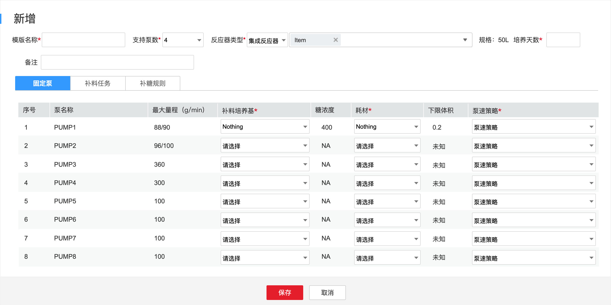

> **[图 image345.png | 章节：工艺设置 / 新增补液方案模板③（3.2）（3.3） | 上下文：新增补液方案模板③（3.2）（3.3）]**
> **OCR 文本：**
> 新增
> 模版名称* | 支持泵数* | 反应器类型* | 集成反应器 | Item | 规格：50L 培养天数*
> 备注
> 固定泵 | 补料任务 | 补糖规则
> PUMP1 | PUMP2 | PUMP3 | PUMP4 | PUMP5 | PUMP6 | PUMP7 | PUMP8
> 新增 | 补料培养基：Glucose
> 序号 | 天* | 补料计划时间* | 补料类型* | 补料体积（%/g）＊ | 操作
> 00 : 00 : 00 | 粘贴 | 数值 | 粘贴 | 粘贴 | 删除
> 00 : 00 : 00 | 粘贴 | 百分比 | 粘贴 | 粘贴 | 删除
> 保存 | 取消

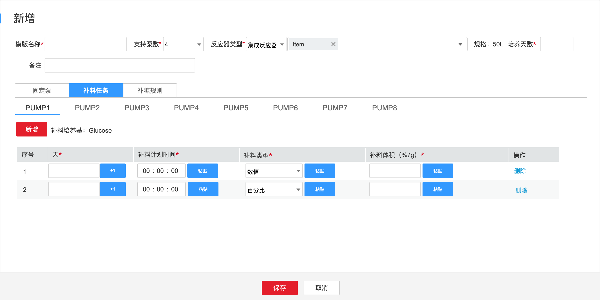

> **[图 image346.png | 章节：工艺设置 / 新增补液方案模板③（3.2）（3.3） | 上下文：新增补液方案模板③（3.2）（3.3）]**
> **OCR 文本：**
> 新增
> 模版名称* | 支持泵数* | 反应器类型* | 集成反应器 | Item | 规格：50L培养天数*
> 备注
> 固定泵 | 补料任务 | 补糖规则
> 新增
> 序号 | 泵名称 | 培养天数 (开始) | 培养天数 (结束) | 计划方式* | 细则* | 操作
> PUMP2 | 按规则 | 下限操作符* | 糖下限（g/L）
> 删除
> 计算模式* | 残糖和乳酸 | 糖补料至 | (g/L)
> PUMP2 | 按数值 | 每日执行时间* | 00 : 00 : 00 | 糖补料体积 (g) | 删除
> 保存 | 取消

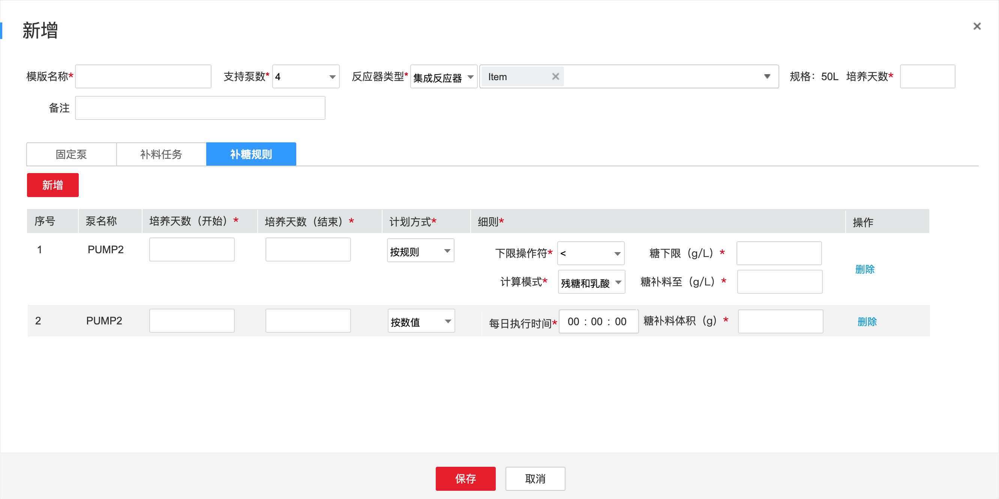

新增一个补液方案模板，包含以下内容：

1.  **模板名称**：文本框，必填，字符串，不能重复
2.  **支持泵数**：下拉选择，根据现有设备的情况整理出枚举类型的数量
3.  **反应器类型**：下拉单选，必选，列表为集成反应器和台式控制器
4.  **型号**：下拉多选。列表内容根据支持泵数+反应器类型联动，集成反应器为设备型号字段（资源管理中已配置），台式控制器为型号字段（小试控制器在数据库中维护，增加型号字段，给控制器型号创建数据字典）。多选型号时，只能选择规格一样的，否则提示不允许操作。
5.  **规格**：根据所选设备型号自动带出展示，不允许修改
6.  **培养周期**：必填，纯数字，大于0的正整数
7.  **备注**：选填，字符串
8.  **固定泵**：一个Tab页，在该Tab页内可维护该反应器下多个泵的相关信息，其中泵的数量根据反应器型号，即集成反应器从实验室设置－集成反应器设置里对应获取，台式控制器从控制器表中获取。每个泵需要维护以下内容：
    1.  **序号**：行号，自增即可。注意，每一行中，补液培养基、耗材、泵速策略三个字段要不都是默认值Nothing，要不都要选择一个其余的具体项。
    2.  **泵名称**：泵的名称使用PUMP+数字自动生成，比如PUMP1、PUMP2等等。
    3.  **最大量程（g/min）**：根据反应器型号，从实验室设置－集成反应器设置或控制表获取对应的量程，若没有则显示NA。若多选的型号中出现了不同的量程，则用/拼接展示
    4.  **补液培养基**：下拉单选，下拉列表为章节1.3.6补液培养基管理中维护的+“Nothing”（Nothing表示不使用当前泵），默认值为Nothing
        1.  所有泵的补液培养基中，只能有一个糖补液培养基（在补液培养基管理中勾选了糖补料）。
            1.  当前已有糖补液培养基时，必须取消选择才能在另一个泵配置糖补液培养基

                > **[图 image347.png | 章节：工艺设置 / 新增补液方案模板③（3.2）（3.3） | 上下文：当前已有糖补液培养基时，必须取消选择才能在另一个泵配置糖补液培养基]**
                > **OCR 文本：**
                > 只能使用 | 日一个糖补料

                

            2.  取消选择已有的糖补液培养基前，如果用户已配置了补糖规则，必须先删除补糖规则，否则提示

                > **[图 image348.png | 章节：工艺设置 / 新增补液方案模板③（3.2）（3.3） | 上下文：取消选择已有的糖补液培养基前，如果用户已配置了补糖规则，必须先删除补糖规则，否则提示]**
                > **OCR 文本：**
                > 悠已经设置了糖补料，如更换补料类型需
                > 要先型除补祛规则

                

        2.  非糖补液培养基支持重复选择，若重复选择了，提示重复选择即可，可继续操作。

            > **[图 image349.png | 章节：工艺设置 / 新增补液方案模板③（3.2）（3.3） | 上下文：非糖补液培养基支持重复选择，若重复选择了，提示重复选择即可，可继续操作。]**
            > **OCR 文本：**
            > 同类已培养基已存在

            

    5.  **糖浓度**：根据选择的补液培养基自动带出糖浓度，仅展示，不可修改，多个则/拼接展示，若未设置值则展示NA
    6.  **耗材**：根据反应器类型联动。默认显示Nothing（表示当前泵不适用），列表其余内容如下：
        1.  如果选择了台式反应器，则从耗材表中筛选出CITEM类型中包含 Bucket的数据
        2.  如果选择了集成反应器，则数据来源为章节液袋管理②
    7.  **下限体积**：根据所选耗材对应展示下限体积字段值，若没有该字段或未配置，则显示“未知”。仅展示，不可修改
    8.  **泵速策略**：根据选择的反应器类型有不同的填写方式：
        1.  **集成反应器**：只有一个“泵速策略”下拉框，单选，必选，默认值为Nothing（表示当前泵不使用）。数据来自章节泵速策略③中创建好的模板，筛选出通用+中试的模板。

            > **[图 image350.png | 章节：工艺设置 / 新增补液方案模板③（3.2）（3.3） | 上下文：集成反应器：只有一个“泵速策略”下拉框，单选，必选，默认值为Nothing（表示当前泵不使用）。数据来自章节泵速策略③中创建好的模板，筛选出通用+中试的模板。]**
            > **OCR 文本：**
            > 泵速策略*
            > 泵速策略
            > 泵速策略
            > 泵速策略
            > 泵速策略
            > 泵速策略
            > 泵速策略
            > 泵速策略
            > 泵速策略

            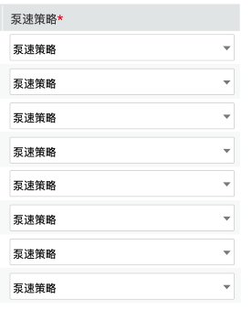

        2.  **台式控制器**：包含两个下拉框，分别为“请选择速度代码”和“泵速策略”，两个下拉框只能二选一，选择其中一个则另一个置灰。

            > **[图 image351.png | 章节：工艺设置 / 新增补液方案模板③（3.2）（3.3） | 上下文：台式控制器：包含两个下拉框，分别为“请选择速度代码”和“泵速策略”，两个下拉框只能二选一，选择其中一个则另一个置灰。]**
            > **OCR 文本：**
            > 请选择速度代码√ | or | 泵速策略
            > 请选择速度代码√ | or | 大罐策略
            > Speed1 | or | 泵速策略

            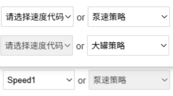

            1.  **请选择速度代码**：选择此方式时，下拉必选，单选，下拉列表为Speed1至Speed10
            2.  **泵速策略**：选择此方式时，下拉必选，单选，数据来自章节泵速策略③中创建好的模板，筛选出通用+小试的模板
9.  **补料任务**：一个Tab页，可对固定泵中非糖补液培养基对应的每个泵增加不同补料任务。
    1.  只能对在【固定泵】tab页中设置了具体培养基且必须为非糖补液培养基的泵才能新增相应的补料任务信息。
    2.  切换不同泵后，若该泵在【固定泵】tab页中设置了具体补液培养基，则展示料液名称。
    3.  切换不同泵后，若该泵在【固定泵】tab页中设置了具体补液培养基，点击【新增】按钮添加多个补料任务。每点击一次【新增】则添加一行
    4.  新增的行必须填写完整才可以保存，每一行包含以下内容
        1.  **序号**：行号，自增即可
        2.  **天**：文本框，必填，整数，范围限制为大于等于0且小于培养周期，不同行允许重复。点击旁边的【+1】按钮，下一行中的天的位置自动填入数值，数值为当前天数+1
        3.  **补料计划时间**：必填，精确到时分秒，
            1.  天+时间做唯一性校验，也就是同一个泵同一天同一个时间点只能执行一个补料任务，如果时间过于接近，同一个小时内，则进行提示，并不强制要求修改，比如设置 9:00:00一个任务 9:30:00一个任务，有可能半个小时前面的任务都没执行完。

                > **[图 image352.png | 章节：工艺设置 / 新增补液方案模板③（3.2）（3.3） | 上下文：天+时间做唯一性校验，也就是同一个泵同一天同一个时间点只能执行一个补料任务，如果时间过于接近，同一个小时内，则进行提示，并不强制要求修改，比如设置 9:00:0…]**
                > **OCR 文本：**
                > 注意任务时间小于1小时

                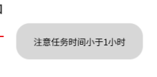

            2.  点击旁边的【粘贴】按钮，将时间统一粘贴至其余空白行
        4.  **补料类型**：补料的计算模式，下拉单选，必选，下拉列表包含数值和百分比。不同模式会影响补料的计算公式，此处选择保存即可，具体计算逻辑会在补液任务生成模块详细描述。点击旁边的【粘贴】按钮，统一粘贴至其余空白行。
        5.  **补料体积（%/g）**：当前面补料类型为百分比的时候，这里的单位是%，输入大于0小于100的数字，支持小数点后3位；当前面的补料类型为数值时，这里的单位是g，可以写数字，支持正整数。点击旁边的【粘贴】按钮，统一粘贴至其余空白行。
        6.  **删除**：点删除后弹出确认，二次确认后删除，直接物理删除即可。注意此处删除只会影响后续的使用，不影响历史使用此模板已创建的培养。

            > **[图 image353.png | 章节：工艺设置 / 新增补液方案模板③（3.2）（3.3） | 上下文：删除：点删除后弹出确认，二次确认后删除，直接物理删除即可。注意此处删除只会影响后续的使用，不影响历史使用此模板已创建的培养。]**
            > **OCR 文本：**
            > 确定要删除吗
            > 数据删除后不可恢复
            > 取消 | 确定

            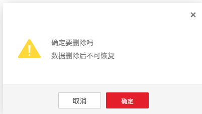

            > **[图 image354.png | 章节：工艺设置 / 新增补液方案模板③（3.2）（3.3） | 上下文：删除：点删除后弹出确认，二次确认后删除，直接物理删除即可。注意此处删除只会影响后续的使用，不影响历史使用此模板已创建的培养。]**
            > **OCR 文本：**
            > 操作成功！
            > 删除成功
            > 关闭

            

10. **补糖规则**：一个Tab页，对配置了糖补液培养基的泵新增补糖规则。
    1.  只有配置了糖补液培养基的泵才能配置补糖规则。因为最多只能设置一个糖补料，所以此处默认展示一个泵或不展示。未配置糖补料时，提示信息

        > **[图 image355.png | 章节：工艺设置 / 新增补液方案模板③（3.2）（3.3） | 上下文：只有配置了糖补液培养基的泵才能配置补糖规则。因为最多只能设置一个糖补料，所以此处默认展示一个泵或不展示。未配置糖补料时，提示信息]**
        > **OCR 文本：**
        > 未设置糖补料

        

    2.  对于配置了糖补料的泵，可以新增多个补糖规则，每点击一次【新增】按钮，下方添加一行，添加的行同样是针对糖补料的泵。
    3.  新增的行必须填写完整才能保存，每行包含以下内容：
        1.  **序号**：行号，自增即可
        2.  **泵名称**：选择了糖补液培养基的泵名称
        3.  **培养周期（开始）**：必填，大于等于0且小于培养周期且小于等于培养周期（结束）
        4.  **培养周期（结束）**：必填，大于等于0且小于培养周期且大于等于培养周期（开始）
        5.  **计划方式**：下拉单选，必选。下拉列表包含按规则和按数值。根据计划方式不同填写不同字段
            1.  按数值：
                1.  **每日执行时间**：支持选择一个时分秒的时间
                2.  **糖补料体积（g）**：文本框，限制为正整数数值。
            2.  按规则
                1.  **下限操作符**：下拉单选，必选，〈或≤，将用于后面生成补糖任务的公式计算。
                2.  **糖下限（g/L）**：必填，单位（g/L），输入大于0的数字，支持小数点后两位
                3.  **糖补料至（g/L）**：必填，单位（g/L），输入大于0的数字，支持小数点后两位
                4.  **计算模式**：下拉单选，必选，列表包含残糖、残糖和乳酸两种，后续影响补糖任务的计算这里仅根据用户选择进行保存
        6.  **删除**：点删除后弹出确认，二次确认后删除，直接物理删除即可。注意此处删除只会影响后续的使用，不影响历史使用此模板已创建的培养。

            > **[图 image353.png | 章节：工艺设置 / 新增补液方案模板③（3.2）（3.3） | 上下文：删除：点删除后弹出确认，二次确认后删除，直接物理删除即可。注意此处删除只会影响后续的使用，不影响历史使用此模板已创建的培养。]**
            > **OCR 文本：**
            > 确定要删除吗
            > 数据删除后不可恢复
            > 取消 | 确定

            

            > **[图 image354.png | 章节：工艺设置 / 新增补液方案模板③（3.2）（3.3） | 上下文：删除：点删除后弹出确认，二次确认后删除，直接物理删除即可。注意此处删除只会影响后续的使用，不影响历史使用此模板已创建的培养。]**
            > **OCR 文本：**
            > 操作成功！
            > 删除成功
            > 关闭

            

    4.  规则可以添加多行，多行数据需要校验日期不能重叠比如：允许第一行输入1-3天由 5补到7，第二行输入4-7天 由6补到8；不允许第一行输入1-3天 由5补到7，第二行输入3-7天 由6补到8，因为第3天出现了规则矛盾
    5.  每天只有在补料完成后进行判断是否触发规则，触发的情况下只会生成一条补糖任务

#### 模板查询与展示③（3.3）

> **[图 image356.png | 章节：工艺设置 / 模板查询与展示③（3.3） | 上下文：模板查询与展示③（3.3）]**
> **OCR 文本：**
> 反应器 | 集成反应器 | STR50L | 天数 | 模版名称 | 2016/09/01 -2016/09/20 | 新增
> 序号 | 模版名称 | 反应器 | 规格 | 天数 | 状态 | 修改时间 | 修改人
> XXXXX | 集成反应器-ST50L | 50L | 14 | 启用 | 2026-06-03 11:11:11 | 张三 | 修改 | 禁用 | 复制
> RRRRRRR | 集成反应器-ST50L | 20L | 14 | 启用 | 2026-06-03 11:11:11 | 张三 | 修改 | 禁用 | 复制
> 29387773 | 集成反应器-ST50L | 10L | 14 | 启用 | 2026-06-03 11:11:11 | 张三 | 修改 | 禁用 | 复制
> HHHHHH | 集成反应器-ST50L | 15L | 禁用 | 2026-06-03 11:11:11 | 张三 | 修改 | 启用 | 复制
> YYYYY | 集成反应器-ST50L | 200L | 禁用 | 2026-06-03 11:11:11 | 张三 | 修改 | 启用 | 复制
> 393873 | 集成反应器-ST50L | 100L | 10 | 禁用 | 2026-06-03 11:11:11 | 张三 | 修改 | 启用 | 复制
> 10 | 下一页

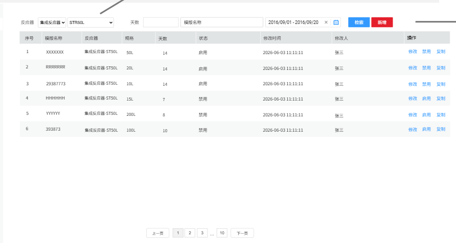

1.  查询条件

    以下条件联合查询：

    1.  **反应器类型**：下拉单选，
    2.  **型号**：下拉单选
    3.  **天数**：文本框，支持模糊搜索
    4.  **模板名称**：文本框，支持模糊搜索
    5.  **起止时间**：支持按照创建和修改时间查询
2.  结果展示与操作

    查询结果翻页展示，按修改时间倒排，最新的在最上面，包含以下字段：

    1.  **序号**：行号
    2.  模板名称
    3.  **反应器**：反应器+型号两个字段拼接展示
    4.  规格：
    5.  **状态**：启用或禁用
    6.  修改人
    7.  修改时间
    8.  操作
        1.  **修改**：与新增时候保持一致的校验
        2.  禁用/启用：
            1.  从禁用切换未启用时，点击直接切换成功
            2.  从启用切换为禁用时，需点击二次确认，二次确认后切换禁用成功。注意，禁用后只影响后续模板的选择使用即不能选择此模板，不影响历史已使用该模板创建的培养。

                > **[图 image311.png | 章节：工艺设置 / 模板查询与展示③（3.3） | 上下文：从启用切换为禁用时，需点击二次确认，二次确认后切换禁用成功。注意，禁用后只影响后续模板的选择使用即不能选择此模板，不影响历史已使用该模板创建的培养。]**
                > **OCR 文本：**
                > 确定要禁用吗
                > 禁用工艺方案中不可在使用，不影响
                > 之前使用此工艺的培养
                > 取消 | 确定
                > 进行一次提示，但不影响禁用操作，禁用
                > 后，不要影响历史数据，历史数据中还可以
                > 展示但是新数据不再可选择此方案
                > 操作成功！
                > 禁用成功
                > 关闭

                

                > **[图 image311.png | 章节：工艺设置 / 模板查询与展示③（3.3） | 上下文：从启用切换为禁用时，需点击二次确认，二次确认后切换禁用成功。注意，禁用后只影响后续模板的选择使用即不能选择此模板，不影响历史已使用该模板创建的培养。]**
                > **OCR 文本：**
                > 确定要禁用吗
                > 禁用工艺方案中不可在使用，不影响
                > 之前使用此工艺的培养
                > 取消 | 确定
                > 进行一次提示，但不影响禁用操作，禁用
                > 后，不要影响历史数据，历史数据中还可以
                > 展示但是新数据不再可选择此方案
                > 操作成功！
                > 禁用成功
                > 关闭

                

        3.  **复制**：点复制后直接打开一个新建的页面，复制当前行的所有内容但“不含模版名称”，最低限度必须输入一个新的名称后，才可以保存复制后的模版
        4.  删除
            1.  需要二次弹窗确认是否删除，再次点击确认，删除成功

                > **[图 image312.png | 章节：工艺设置 / 模板查询与展示③（3.3） | 上下文：需要二次弹窗确认是否删除，再次点击确认，删除成功]**
                > **OCR 文本：**
                > 确定要删除吗
                > 删除工艺方案中不可在使用，不影响
                > 之前使用此工艺的培养
                > 取消 | 确定

                

            2.  删除成功后不影响历史已使用该模板创建的培养，但后续培养无法选择此方案
            3.  需提示成功信息

                > **[图 image313.png | 章节：工艺设置 / 模板查询与展示③（3.3） | 上下文：需提示成功信息]**
                > **OCR 文本：**
                > 操作成功！
                > 删除成功
                > 关闭

                

### 泵速策略③

管理维护泵速策略，用于控制补料过程中的泵速切换、停泵条件和异常监控。目前一共包含二段式、三段式和连续式三种泵速策略。

> **[图 image357.png | 章节：工艺设置 / 泵速策略③ | 上下文：管理维护泵速策略，用于控制补料过程中的泵速切换、停泵条件和异常监控。目前一共包含二段式、三段式和连续式三种泵速策略。]**
> **OCR 文本：**
> 适用实验室类型 | 通用 | 分段类型 | 请选择 | 策略名称/补料时长 | 2016/09/01 - 2016/09/20 | 检索 | 新增
> 序号 | 适用实验室类型 | 策略名称 | 泵速策略 | 理论总时长 | 校准阶段时 | 长 (S) | 补料占比 | 校准阶段 | 高速阶段 | 泵速比例 | 补料占比 | 高速阶段 | 低速阶段 | 泵速比例 | 补料占比 | 低速阶段 | 状态 | 修改时间 | 修改人 | 操作
> 通用 | 二段式卫星 | 罐3分钟 | 二段式 | 3min | 77 | 0.5 | 15 | 启用 | 2026-06-03 11:11:11 | 张三 | 修改 | 禁用 | 盘除
> 小试 | 2999-1h | 二段式 | 60.17min | 77 | 0.2 | 15 | 启用 | 2026-06-03 11:11:11 | 张三 | 修改 | 禁用 | 删除
> 小试 | 50L罐子适用 | 二段式 | 50min | 77 | 0.8 | 15 | 启用 | 2026-06-03 11:11:11 | 张三 | 修改 | 禁用 | 删除
> 中试 | 三段式3分钟 | 三段式 | 3min | 100S | 77 | 15 | 禁用 | 2026-06-03 11:11:11 | 张三 | 修改 | 启用 | 删除
> 中试 | 测试-1h | 三段式 | 60min | 100S | 77 | 0.2 | 15 | 禁用 | 2026-06-03 11:11:11 | 张三 | 修改 | 启用 | 删除
> 通用 | 通用1小时 | 三段式 | 60min | 100S | 77 | 0.7 | 15 | 禁用 | 2026-06-03 11:11:11 | 张三 | 修改 | 启用 | 盘除
> 10

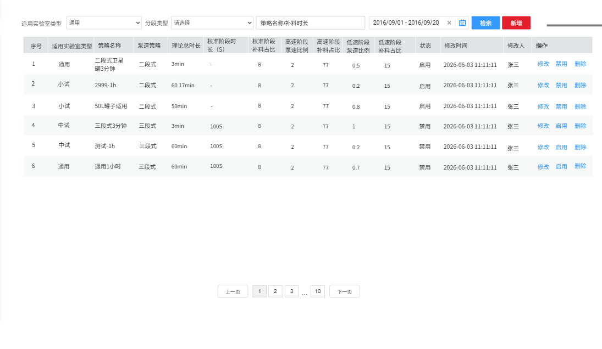

1.  二段式

    二段式包含高速、低速两个阶段，对应高速阶段 → 低速阶段 → 终止三个状态

    | 状态 | 触发条件 | 运行目标 |
    | :---: | :---: | :---: |
    | 高 速 | 补料开始 | 快速补入主要物料量 |
    | 低 速 | 实际补料量达到高速目标量 | 降低泵速，提升停泵精度 |
    | 终 止 | 实际补料量达到终止阈值 | 停泵 |

2.  三段式

    三段式包含校准、高速、低速三个阶段，对应校准阶段 → 高速阶段 → 低速阶段 → 终止三个状态

    | 阶段 | 触发条件 | 运行目标 |
    | :---: | :---: | :---: |
    | 校 准 | 补料开始 | 用固定时间建立初始流量 |
    | 高 速 | 校准完成 | 快速补入主要物料量 |
    | 低 速 | 高速阶段完成 | 精细补料 |
    | 终 止 | 实际补料量达到终止阈值 | 停泵 |

3.  连续式（待后续补充）

#### 新增策略③（3.2）

新增一个泵速策略，并维护相关信息。

> **[图 image358.png | 章节：工艺设置 / 新增策略③（3.2） | 上下文：新增一个泵速策略，并维护相关信息。]**
> **OCR 文本：**
> 新增
> 阶段 | 监控
> 泵素策略* | 二段式 | 环控间隔时间*
> 策略名称* | 补料超量百分比*
> 超时时间*
> 适用实验室类型* | 通用
> 终点百分比* | 99-100
> 抖动
> 高速阶段
> 抖动环控时间系数* | 1-5
> 泵速百分比* | 1-100
> 抖动系数* | 2-10
> 补料占总量百分比* | 50-90
> 抖动观察时间系数*
> 低速阶段
> 抖动地秤系数*
> 泵速百分比* | 1-100 | 返水
> 返水环控时间系数*①
> 返水系数* | >1
> 堵塞环控时间系数*
> 堵塞系数* | 0-1
> 保存 | 取消

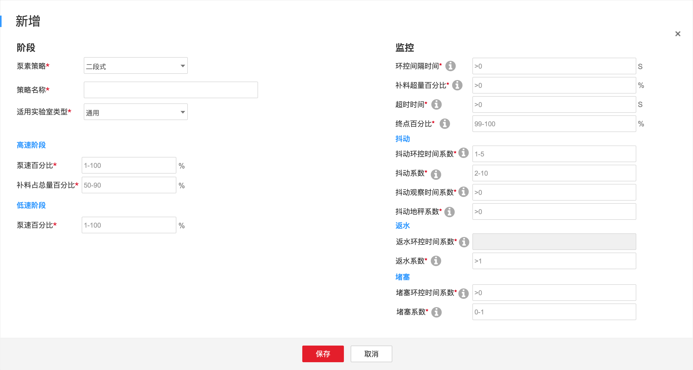

> **[图 image359.png | 章节：工艺设置 / 新增策略③（3.2） | 上下文：新增一个泵速策略，并维护相关信息。]**
> **OCR 文本：**
> 新增
> 阶段 | 监控
> 泵素策略* | 三段试 | 环控间隔时间*
> 策略名称* | 补料超量百分比*
> 适用实验室类型* | 通用 | 超时时间*
> 终点百分比* | 99-100
> 理论总时长* | min
> 抖动
> 校准阶段
> 抖动环控时间系数* | 1-5
> 运行时间* | 120-300
> 抖动系数* | 2-10
> 补料占总量百分比* | 6-20
> 抖动观察时间系数*
> 校准理论速度* | %/min
> 抖动地秤系数*
> 高速阶段
> 返水
> 泵速百分比* | 2-50 | 返水环控时间系数*①
> 补料占总量百分比* | 60-80
> 返水系数* | >1
> 理论时长* | min | 堵塞
> 低速阶段 | 堵塞环控时间系数*
> 泵速百分比* | 0.5-20 | 堵塞系数* | 0-1
> 补料占总量百分比* | 2-15
> 理论时长* | min
> 保存 | 取消

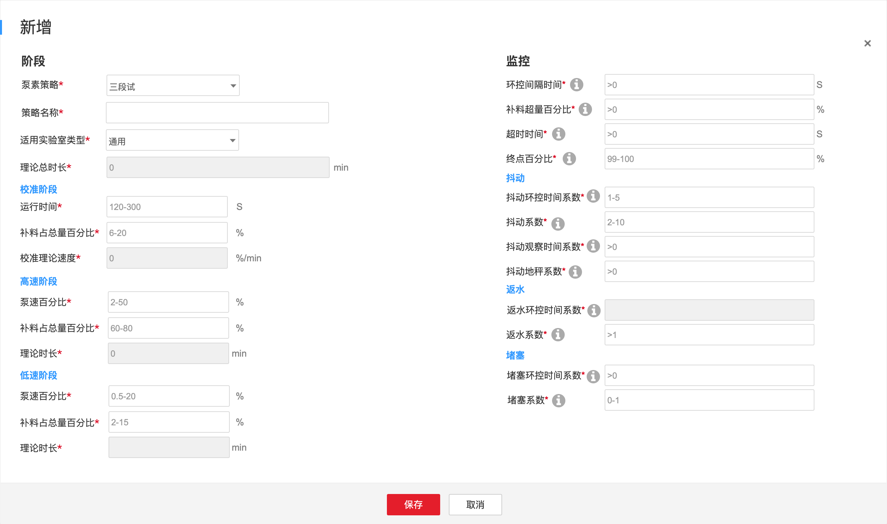

1.  **阶段**：根据泵速策略不同填写不同内容
-   二段式
3.  **泵速策略**：下拉单选，必选，下拉列表包含二段式、三段式和连续式
4.  **策略名称**：必填，字符串，小于20个汉字字符，不允许重复
5.  **适用实验室类型**：下拉单选，包括中试、小试、通用
6.  **高速阶段泵速百分比**：必填，整数，单位%，限制数值范围为1-100。表示高速阶段每分钟补入目标量的百分比。例如目标量为 100 L，若泵速百分比为 50%，则可计算得到理论流量为 50 L/min。
7.  **高速阶段补料占总量百分比**：必填，整数，单位%，限制数值范围为50-90。表示高速阶段补料量占目标量的百分比，可结合目标量计算得到高速阶段能运行到多少升
8.  **低速阶段泵速百分比**：必填，整数，单位%，限制数值范围为1-100。表示低速阶段每分钟补入目标量的百分比。
    -   隐藏字段
        1.  **低速阶段补料占总量百分比**：此字段为隐藏字段。低速阶段补料占总量百分比=终点百分比-高速阶段补料占总量百分比，其中终点百分比为监控部分手动录入数值
        2.  高速阶段理论时长=高速阶段补料占总量百分比/高速阶段泵速百分比
        3.  低速阶段理论时长=低速阶段补料占总量百分比/低速阶段泵速百分比
        4.  理论总时长 = 高速阶段理论时长 + 低速阶段理论时长
    -   约束条件
        1.  低速阶段泵速百分比必须小于高速阶段泵速百分比，不满足则不能保存成功并提示信息
-   三段式
10. **泵速策略**：下拉单选，必选，下拉列表包含二段式、三段式和连续式
11. **策略名称**：必填，字符串，小于20个汉字字符，不允许重复
12. **适用实验室类型**：下拉单选，包括中试、小试、通用
13. **理论总时长**：不可填写，单位min，在填写完后续三个阶段的数值并计算后可显示数值，支持小数点后两位，

    理论总时长=校准阶段运行时间+高速阶段理论时长+低速阶段理论时长。

    注意：公式计算时需要将单位统一为min。

14. **校准阶段运行时间**：必填，单位S（秒），限制数值范围为120-300，填写时建议覆盖泵启动的不稳定时间。
    -   **注意**：统计校准阶段运行时间时，需要减去累积的0泵速下发时间。比如，页面设置校准阶段运行时间为200S，实际运行时，前180S按照校准阶段泵速下发，第180-220S是0泵速下发，那么校准阶段不会在第200S结束，而是应该继续执行直到第240S结束。
15. **校准阶段补料占总量百分比**：必填，整数，单位%，限制数值范围为6-20。表示校准阶段补料量占目标量的百分比
16. **校准理论速度**：不可填写，单位%/min，公式计算后显示数值

    校准理论速度 = （校准阶段补料占总量百分比 / 校准阶段运行时间）* 60

17. **高速阶段泵速百分比**：必填，整数，单位%，限制数值范围为2-50。表示高速阶段每分钟补入目标量的百分比。
18. **高速阶段补料占总量百分比**：必填，整数，单位%，限制数值范围为60-80。表示高速阶段补料量占目标量的百分比，可结合目标量计算得到高速阶段能运行到多少升
19. **高速阶段理论时长**：不可填写，单位min，公式计算后显示数值，四舍五入保留两位小数

    高速阶段理论时长=高速阶段补料占总量百分比/高速阶段泵速百分比

20. **低速阶段泵速百分比**：必填，单位%，限制数值范围为0.5-20，1位小数。表示低速阶段每分钟补入目标量的百分比。
21. **低速阶段补料占总量百分比**：必填，整数，单位%，限制数值范围为2-15。表示低速阶段补料量占目标量的百分比
22. **低速阶段理论时长**：不可填写，单位min，公式计算后显示数值，四舍五入保留两位小数

    低速阶段理论时长=低速阶段补料占总量百分比/低速阶段泵速百分比

    -   约束条件
        1.  校准阶段补料占总量百分比+高速阶段补料占总量百分比+低速阶段补料占总量百分比 必须等于100，否则不能保存成功并提示信息
        2.  低速阶段泵速百分比必须小于高速阶段泵速百分比，否则不能保存成功并提示信息
-   连续式
24. **泵速策略**：下拉单选，必选，下拉列表包含二段式、三段式和连续式
25. **策略名称**：必填，字符串，小于20个汉字字符，不允许重复
26. **适用实验室类型**：下拉单选，包括中试、小试、通用
27. 监控
    1.  环控间隔时间（监控间隔时间）：
        1.  **字段说明（以ⓘ符号添加文字说明）**：监控每次启动间隔时间
        2.  **填写规范**：文本框，必填，单位S，限制数值范围1-60，正整数，填写建议值为1S到5S
        3.  **使用说明**：这个字段是系统读取地秤数值的周期，比如填写5S，那就是每隔5S读取一次地秤数据。
    2.  补料超量百分比（超量报警百分比）：
        1.  **字段说明**：用于计算补料超量告警阈值，与控制正常停泵的终点百分比分开使用（2026-09-06 业务确认）。
        2.  **填写规范**：文本框，必填，单位%，大于0小于100，数字支持小数点后两位，（填写建议：按照工艺容忍度设置）。
        3.  **告警触发计算过程**：当实际补料量>目标量*（1+补料超量百分比/100），触发超量告警；不得使用终点百分比替代补料超量百分比。
    3.  超时时间（超时告警宽限时间）：
        1.  **字段说明**：超过预定补料时间后告警
        2.  **填写规范**：必填，单位S，大于0的正整数，（填写建议：应覆盖泵启动、流量波动和称重延迟）
        3.  告警触发计算过程：
            1.  泵速生效时长 = 实际运行时间-累积的下发0泵速的时间
            2.  泵速生效时长>理论总时长+超时时间 ，触发超时告警
    4.  终点百分比：
        1.  **字段说明**：用于控制正常停泵；补料量达到目标量的终点百分比时下发0泵速，不作为超量告警阈值的计算参数（2026-09-06 业务确认）。
        2.  **填写规范**：必填，单位%填写99-100，支持小数点后1位，（填写建议：用于提前停泵或精确停泵）
        3.  **正常停泵计算过程**：当实际补料量>=目标量*终点百分比/100，系统停泵（下发0泵速）。例如目标量1000g、终点百分比99%、补料超量百分比5%：达到990g时正常停泵；实际补料量超过1050g时触发超量告警，等于1050g时不满足该超量告警条件。
    5.  抖动
        1.  **字段说明**：从校准阶段开始，每一段时间监控实际补料量和当前阶段的理论补料量进行对比，假如实际补料量大于理论补料量配置倍数，下发0泵速并观察一段时间，如果这段时间恢复正常则继续下发泵速补料，否则告警并暂停本次补料任务
        2.  告警触发计算过程：
            1.  当前泵速（一个监控周期的开始时间的理论泵速） = 泵速百分比（一个监控时间段开始的时候，当前所处的阶段（校准、高速、低速）的泵速百分比）*目标量/60。例如目标量为 100 L，泵速为 50%，则泵速为 100*（50%）/60，单位是 L/S
            2.  计划变化量阈值=当前泵速（一个监控周期的开始时间的理论泵速百分比）*监控间隔时间（下文中填写字段）*抖动系数（下文中填写字段）
            3.  地秤精度阈值=当前补料使用称重设备的精度（实验室设置-地秤设置-精度字段）*抖动地秤系数（下文中填写字段）
            4.  抖动阈值 =max(地秤精度阈值，计划变化量阈值），在两个参数中取最大的作为抖动阈值
            5.  抖动环控间隔=环控间隔时间*抖动环控间隔系数（下文中填写字段），表示抖动监控系统启动时间
            6.  抖动观察时间=环控间隔时间*抖动观察时间系数（下文中填写字段），出现抖动状况时，需要进一步观察一段时间，在观察时间内没有恢复才会触发告警。
            7.  实际补料量=监控开始时补料秤读数-监控结束时补料秤读数
            8.  以抖动环控间隔为周期，当实际补料量>抖动阈值 ，则停泵（下发0泵速）并观察一段时间（抖动观察时间）
            9.  若某个抖动环控间隔判断为抖动后，在抖动观察时间内，以环控间隔时间为周期，判断抖动是否恢复（即实际补料量〈=抖动阈值），若一直未恢复则触发告警
    6.  抖动环控时间系数（抖动监控间隔系数）：
        1.  **字段说明**：用于计算抖动监控每次抖动间隔时间（抖动环控时间系数*环控间隔时间）
        2.  **填写规范**：必填，整数，限制数值范围为1-5，建议用于放大或缩小抖动检查窗口
    7.  抖动系数：
        1.  **字段说明**：实际补料量大于（抖动地秤系数*地秤精度）和（抖动系数*计划补料量）两者最大值则告警
        2.  **填写规范**：必填写，整数，限制数值范围为2-10，（填写建议：基于计划变化量判断称重波动）
    8.  抖动观察时间系数：
        1.  **字段说明**：用于计算发生抖动后观察时间，如果这段时间内恢复则不报警（抖动观察时间系数*环控间隔时间）
        2.  **填写规范**：必填，大于0的正整数，（填写建议：控制抖动持续观察时长）
    9.  抖动地秤系数：
        1.  **字段说明**：实际补料量大于（抖动地秤系数*地秤精度）和（抖动系数*计划补料量）两者最大值则告警
        2.  **填写规范**：必填，大于0的正整数，（填写建议：基于地秤精度设置最低抖动阈值）
    10. 返水：
        1.  **字段说明**：从高速阶段开始，每一段时间监控实际补料量，如果为负数且超过地秤精度的配置倍数则报警
        2.  告警触发计算过程：
            1.  返水环控时间=返水环控时间系数*环控间隔时间，表示返水监控的启动间隔时间
            2.  实际补料量=监控开始时补料秤读数-监控结束时补料秤读数
            3.  以返水环控时间为周期，当实际补料量 < 0  且 实际补料量 <= 返水系数 * 当前秤的精度，则触发告警
    11. 返水环控时间系数：
        1.  **字段说明**：用于计算返水监控每次启动间隔时间（返水环控时间系数*环控间隔时间），等于抖动环控间隔系数
        2.  **填写规范**：无法填写，数值等于抖动环控间隔系数
    12. 返水系数：
        1.  **字段说明**：实际补料量大于（抖动地秤系数*地秤精度）和（抖动系数“计划补料量）两者最大值则告警
        2.  **填写规范**：必填，数值是必须小于等于-1的整数，（填写建议：用于判断实际量回退）
    13. 堵塞
        1.  **字段说明**：从高速阶段开始，每一段时间监控实际补料量，小于理论补料量的配置倍数且理论补料量大于2倍地秤精度则告警
        2.  告警触发计算过程：
            1.  堵塞环控时间=堵塞环控时间系数*环控间隔时间，表示返堵塞控的启动间隔时间
            2.  当前泵速（一个监控周期的开始时间的理论泵速） = 泵速百分比（一个监控时间段开始的时候，当前所处的阶段（校准、高速、低速）的泵速百分比）*目标量/60。例如目标量为 100 L，泵速为 50%，则泵速为 100*（50%）/60，单位是 L/S
            3.  计划补料量=当前泵速（一个监控周期的开始时间的理论泵速百分比）*堵塞环控时间
            4.  实际补料量=监控开始时补料秤读数-监控结束时补料秤读数
            5.  以堵塞环控时间为周期，当计划补料量>2*当前补料秤的精度且实际补料量<堵塞系数*计划补料量，触发告警
    14. 堵塞环控时间系数（堵塞监控间隔系数）：
        1.  **字段说明**：用于计算堵塞监控每次启动间隔时间（堵塞环控时间系数*堵塞环控时间系数）
        2.  **填写规范**：必填，大于0的正整数，（填写建议：控制堵塞检查窗口）
    15. 堵塞系数：
        1.  **字段说明**：实际补料量小于堵塞系数*理论补料量同时理论补料量必须大于2倍地秤精度则告警
        2.  **填写规范**：必填，输入0-1之间的浮点型，支持小数点后1位，（填写建议：实际增量低于计划增量的比例时判定堵塞）

#### 查询与展示③

> **[图 image357.png | 章节：工艺设置 / 查询与展示③ | 上下文：查询与展示③]**
> **OCR 文本：**
> 适用实验室类型 | 通用 | 分段类型 | 请选择 | 策略名称/补料时长 | 2016/09/01 - 2016/09/20 | 检索 | 新增
> 序号 | 适用实验室类型 | 策略名称 | 泵速策略 | 理论总时长 | 校准阶段时 | 长 (S) | 补料占比 | 校准阶段 | 高速阶段 | 泵速比例 | 补料占比 | 高速阶段 | 低速阶段 | 泵速比例 | 补料占比 | 低速阶段 | 状态 | 修改时间 | 修改人 | 操作
> 通用 | 二段式卫星 | 罐3分钟 | 二段式 | 3min | 77 | 0.5 | 15 | 启用 | 2026-06-03 11:11:11 | 张三 | 修改 | 禁用 | 盘除
> 小试 | 2999-1h | 二段式 | 60.17min | 77 | 0.2 | 15 | 启用 | 2026-06-03 11:11:11 | 张三 | 修改 | 禁用 | 删除
> 小试 | 50L罐子适用 | 二段式 | 50min | 77 | 0.8 | 15 | 启用 | 2026-06-03 11:11:11 | 张三 | 修改 | 禁用 | 删除
> 中试 | 三段式3分钟 | 三段式 | 3min | 100S | 77 | 15 | 禁用 | 2026-06-03 11:11:11 | 张三 | 修改 | 启用 | 删除
> 中试 | 测试-1h | 三段式 | 60min | 100S | 77 | 0.2 | 15 | 禁用 | 2026-06-03 11:11:11 | 张三 | 修改 | 启用 | 删除
> 通用 | 通用1小时 | 三段式 | 60min | 100S | 77 | 0.7 | 15 | 禁用 | 2026-06-03 11:11:11 | 张三 | 修改 | 启用 | 盘除
> 10

1.  **查询条件**：以下条件联合查询
    1.  **适用实验室类型**：下拉单选，支持搜索
    2.  **泵速策略**：下拉单选，支持搜索
    3.  **策略名称/理论总时长**：文本框，支持策略名称/理论总时长的模糊搜索
    4.  **起止时间**：可同时搜索创建时间和最近一次修改时间，其中一个时间条件符合即可
2.  结果展示与操作

    查询结果翻页展示，按修改时间倒排，最新的在最上面，包含以下字段：

    1.  序号
    2.  适用实验室类型
    3.  策略名称
    4.  泵速策略
    5.  理论总时长（min）
    6.  校准阶段时长（S）
    7.  校准阶段补料占比
    8.  高速阶段泵速百分比
    9.  高速阶段补料占比
    10. 低速阶段泵速百分比
    11. 低速阶段补料占比
    12. 状态
    13. **修改时间**：最近一次修改时间
    14. **修改人**：最近一次修改人的显示名称
    15. 操作
        1.  **修改**：保持新增时一致的校验规则
        2.  启用/禁用：
            1.  状态从启用改为禁用时，需要二次提示：

                > **[图 image360.png | 章节：工艺设置 / 查询与展示③ | 上下文：状态从启用改为禁用时，需要二次提示：]**
                > **OCR 文本：**
                > 确定要禁用吗
                > 禁用工艺方案中不可在使用，不影响
                > 之的使用此工艺的培养
                > 取消 | 确定

                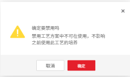

            2.  确认状态从启用改为禁用时，提示禁用成功。此时，历史已选策略继续生效，但后续选择泵速策略时不可选择此策略。

                > **[图 image361.png | 章节：工艺设置 / 查询与展示③ | 上下文：确认状态从启用改为禁用时，提示禁用成功。此时，历史已选策略继续生效，但后续选择泵速策略时不可选择此策略。]**
                > **OCR 文本：**
                > 操作成功！
                > 禁用成功
                > 关闭

                

        3.  删除
            1.  点击删除时，需要二次提示：

                > **[图 image362.png | 章节：工艺设置 / 查询与展示③ | 上下文：点击删除时，需要二次提示：]**
                > **OCR 文本：**
                > 确定要删除吗
                > 删除工艺方案中不可在使用，不影响
                > 之的使用此工艺的培养
                > 取消 | 抛定

                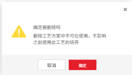

            2.  确认删除时，提示删除成功。此时，历史已选策略继续生效，但后续选择泵速策略时不可选择此策略。

                > **[图 image363.png | 章节：工艺设置 / 查询与展示③ | 上下文：确认删除时，提示删除成功。此时，历史已选策略继续生效，但后续选择泵速策略时不可选择此策略。]**
                > **OCR 文本：**
                > 操作成功！
                > 删除成功
                > 关闭

                

                ---

### ✂️ 已剔除的删除线内容

> 以下内容在源 Word 中带有删除线（`<w:strike>`），根据约定不进入正文，统一汇总在此，避免遗漏核验。

- 段落：实验室类型：文本框，支持模糊搜索
- 段落：实验室类型
